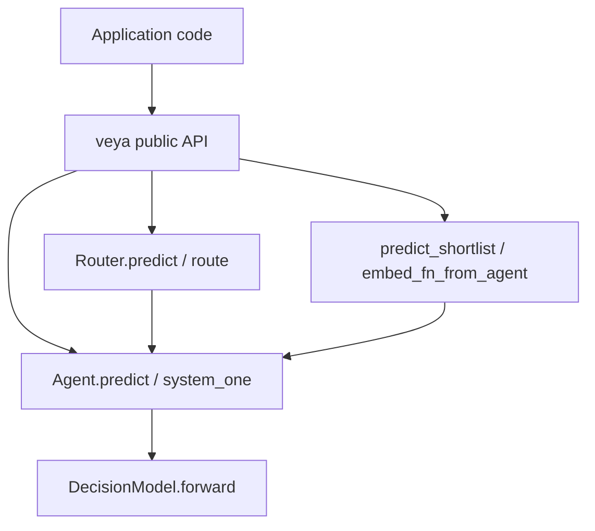
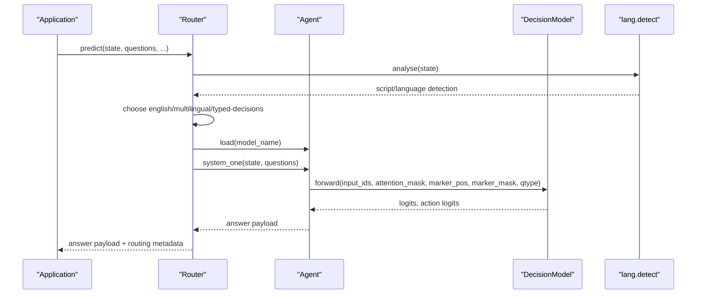
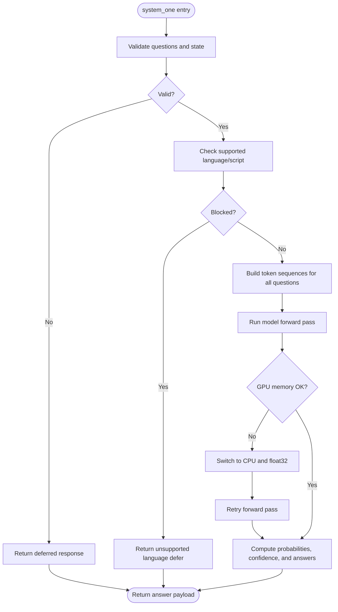
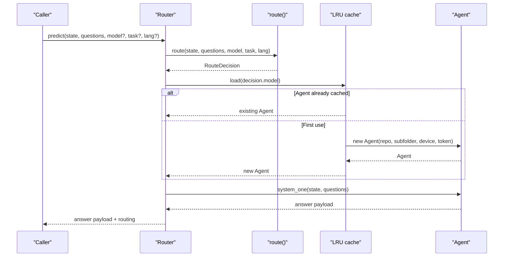
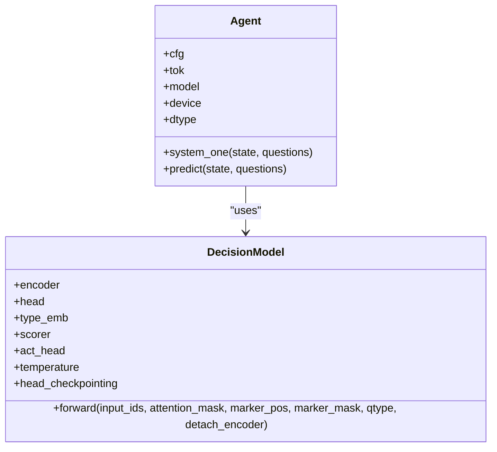
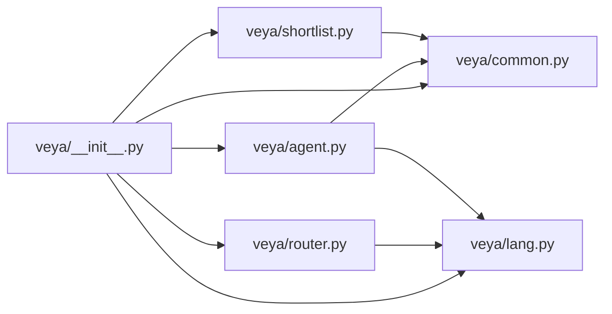

# API Reference

<cite>
**Referenced Files in This Document**
- [veya/__init__.py](file://veya/__init__.py)
- [veya/agent.py](file://veya/agent.py)
- [veya/router.py](file://veya/router.py)
- [veya/common.py](file://veya/common.py)
- [veya/lang.py](file://veya/lang.py)
- [veya/shortlist.py](file://veya/shortlist.py)
</cite>

## Table of Contents
1. [Introduction](#introduction)
2. [Project Structure](#project-structure)
3. [Core Components](#core-components)
4. [Architecture Overview](#architecture-overview)
5. [Detailed Component Analysis](#detailed-component-analysis)
6. [Dependency Analysis](#dependency-analysis)
7. [Performance Considerations](#performance-considerations)
8. [Troubleshooting Guide](#troubleshooting-guide)
9. [Conclusion](#conclusion)

## Introduction
This document describes Veya’s public Python API for fast, non-autoregressive decision inference. It focuses on:

- The `Agent` class and its `predict()` / `system_one()` methods.
- The `Router` class for multi-checkpoint routing, language detection, and automatic task selection.
- The `DecisionModel` base class and extension points.
- Utility functions exposed at the package root, especially `embed_fn_from_agent()` and `predict_shortlist()`.
- Parameter specifications, return schemas, error handling, memory/device behavior, and practical usage patterns.

The public surface is re-exported from the `veya` package root, so most users import directly from `veya` rather than internal modules.

**Section sources**
- [veya/__init__.py:1-56](file://veya/__init__.py#L1-L56)

## Project Structure
At a high level, the public API is organized by responsibility:

| Area | Public entry point | Responsibility |
|---|---|---|
| Inference runtime | `Agent`, `RLAgent`, `load` | Load checkpoints, tokenize state, run one parallel forward pass over typed questions, return calibrated answers. |
| Multi-checkpoint routing | `Router`, `RouteDecision`, `DEFAULT_MODELS` | Detect language/script or honor explicit model/task hints, lazily load agents, enforce an LRU memory cap. |
| Model backbone | `DecisionModel`, `build_model` | Transformer encoder plus typed decision head; used internally by `Agent`. |
| Language detection | `detect_language`, `detect_script`, `is_english` | Lightweight script/language heuristics used by routing and deferral logic. |
| Shortlist utilities | `shortlist_choice`, `predict_shortlist`, `embed_fn_from_agent` | Reduce large choice label sets before calling the decision model. |



**Diagram sources**
- [veya/__init__.py:3-24](file://veya/__init__.py#L3-L24)
- [veya/agent.py:101-416](file://veya/agent.py#L101-L416)
- [veya/router.py:123-336](file://veya/router.py#L123-L336)
- [veya/common.py:114-172](file://veya/common.py#L114-L172)
- [veya/shortlist.py:91-203](file://veya/shortlist.py#L91-L203)

**Section sources**
- [veya/__init__.py:3-24](file://veya/__init__.py#L3-L24)

## Core Components
This section summarizes the main public classes and functions that form the API surface.

| Symbol | Module | Purpose | Key parameters | Return value |
|---|---|---|---|---|
| `Agent` | `veya.agent` | Loads a Veya checkpoint and evaluates typed questions in one forward pass. | `model_id_or_path`, `device`, `token`, `subfolder` | See `system_one()` return schema. |
| `RLAgent` | `veya.agent` | Alias for `Agent`. | Same as `Agent`. | Same as `Agent`. |
| `load` | `veya.agent` | Convenience constructor returning an `Agent`. | Same as `Agent.__init__`. | `Agent` instance. |
| `Router` | `veya.router` | Lazily loads and caches multiple Veya checkpoints and routes requests. | `models`, `device`, `token`, `max_loaded`, `default`, `auto_task_detection`, `standalone_repos`, `preload` | See `predict()` and `route()` return schemas. |
| `RouteDecision` | `veya.router` | Dict-like routing outcome with `model`, `reason`, `detection`, `workflow`. | None (constructed by `Router.route`). | Dict-like object. |
| `DecisionModel` | `veya.common` | Base PyTorch module for the bidirectional encoder + typed decision head. | `encoder`, `head_layers`, `n_act`, `dropout` | `(logits, act_logits)` per forward call. |
| `predict_shortlist` | `veya.shortlist` | Shortlist choice labels, then call `predict` or `system_one` once. | `agent`, `state`, `questions`, `embed_fn`, `k`, extra kwargs forwarded to prediction. | Prediction result plus a `shortlist` metadata dict. |
| `embed_fn_from_agent` | `veya.shortlist` | Build an embedding function from an already loaded `Agent`. | `agent`, `max_length`, `batch_size`. | Callable mapping text list to NumPy embeddings. |
| `detect_language` | `veya.lang` | Analyze script/language for routing decisions. | `state` | Detection dict. |
| `detect_script` | `veya.lang` | Detect dominant Unicode script. | `text` | Script name string. |
| `is_english` | `veya.lang` | Heuristic check whether the English checkpoint can read the input. | `state` | Boolean. |

**Section sources**
- [veya/agent.py:101-431](file://veya/agent.py#L101-L431)
- [veya/router.py:83-336](file://veya/router.py#L83-L336)
- [veya/common.py:114-172](file://veya/common.py#L114-L172)
- [veya/shortlist.py:91-203](file://veya/shortlist.py#L91-L203)
- [veya/lang.py:111-243](file://veya/lang.py#L111-L243)

## Architecture Overview
Veya separates three concerns:

1. **Question formulation**: Typed questions describe what should be decided (`choice`, `score`, or `noul`) and how options are rendered.
2. **Encoding and scoring**: A shared transformer encoder produces hidden states; a typed decision head scores each option marker.
3. **Routing and shortlisting**: `Router` chooses which checkpoint runs the model, and `predict_shortlist` reduces large choice label sets before scoring.



**Diagram sources**
- [veya/router.py:257-331](file://veya/router.py#L257-L331)
- [veya/agent.py:291-414](file://veya/agent.py#L291-L414)
- [veya/common.py:130-161](file://veya/common.py#L130-L161)
- [veya/lang.py:209-238](file://veya/lang.py#L209-L238)

## Detailed Component Analysis

### Agent API

#### Constructor: `Agent(...)`

| Parameter | Type | Default | Description |
|---|---|---|---|
| `model_id_or_path` | `str` | `"veyadynamics/veya"` | Hugging Face repo ID or local directory containing a Veya checkpoint. |
| `device` | `Optional[str]` | `None` | Target device string such as `"cuda"`, `"mps"`, or `"cpu"`. If omitted, CUDA is preferred when available, then MPS, then CPU. |
| `token` | `Optional[str]` | `None` | Hugging Face token; also falls back to the `HF_TOKEN` environment variable. |
| `subfolder` | `Optional[str]` | `None` | Selects a bundled subfolder checkpoint, such as `"multilingual"` or `"typed-decisions"`. |

**Behavior:**

- Resolves a local path or downloads only the required files from Hugging Face using allow-listed patterns.
- Requires `rl_agent_config.json` and `model.safetensors`; missing files raise `FileNotFoundError`.
- Validates architecture compatibility between config, weights, and constructed model.
- Chooses dtype based on device capability: `float16` for older CUDA devices, `float32` for CPU/MPS unless overridden by configuration.
- Falls back from GPU to CPU if placement fails due to memory or runtime errors.
- Applies clamped temperatures from the checkpoint and optional calibration file.

**Errors:**

- `FileNotFoundError`: Local path not found, incompatible checkpoint, missing config/weights, or missing subfolder.
- `ValueError`: Checkpoint architecture or weight shape mismatch during compatibility verification.
- Runtime warnings: Temperatures outside the safe range are clamped.

**Memory and device notes:**

- The model is placed in `.eval()` mode.
- Automatic mixed precision is enabled during inference on CUDA.
- On GPU memory exhaustion, the agent switches to CPU and `float32`.

**Section sources**
- [veya/agent.py:104-262](file://veya/agent.py#L104-L262)
- [veya/agent.py:55-98](file://veya/agent.py#L55-L98)

#### Question definitions

Each question maps a stable question ID to a definition. Supported types:

| Type | Required fields | Criteria semantics |
|---|---|---|
| `choice` | `type`, `instructions`, `criteria` | `criteria` may be a dict of label-to-description or a list of label strings. |
| `score` | `type`, `instructions`, `criteria` | `criteria` must be a list of at least two ordered levels. |
| `noul` | `type`, `instructions` | Optional `criteria` dict with `false`/`true` descriptions. |

Validation rules:

- Every question must be a dict with `type` and `instructions`.
- Unsupported `type` values raise `ValueError`.
- `score` criteria must contain at least two ordered levels.
- `noul` criteria must be a dict when provided.
- Choice criteria are normalized through `_criteria_items`, which rejects duplicates, empty labels, oversized labels/values, and too many candidates.

**Section sources**
- [veya/agent.py:264-289](file://veya/agent.py#L264-L289)
- [veya/shortlist.py:228-253](file://veya/shortlist.py#L228-L253)

#### Method: `system_one(state, questions)`

| Parameter | Type | Description |
|---|---|---|
| `state` | `str`, `dict`, or `list` | Input text, structured JSON-like data, or conversation turns. |
| `questions` | `Dict[str, Dict]` | Mapping from question ID to question definition. |

**Processing flow:**

1. Rejects invalid or empty inputs by returning a deferred response.
2. Checks whether the current checkpoint should defer because the input contains unsupported language/script content.
3. Builds token sequences for all questions in parallel.
4. Runs one forward pass through the model.
5. Converts logits to probabilities, applies temperature scaling, computes confidence, and formats per-question answers.

**Return schema:**

```json
{
  "model": "veya-rl-agent",
  "decision": "answer" | "defer",
  "reason": null | string,
  "answers": {
    "<question_id>": {
      "type": "choice" | "score" | "noul",
      "choice": string,
      "probabilities": {"label": number},
      "score": number,
      "legend": {"index": "level"},
      "noul": number,
      "confidence": number,
      "action": {"act_probability": number}
    }
  },
  "usage": {
    "input_tokens": number,
    "output_tokens": number
  }
}
```

For `choice`, the answer includes the selected label and label probabilities. For `score`, it includes expected score, level legend, and index probabilities. For `noul`, it includes the positive probability and a confidence derived from the binary distribution.

**Deferred responses:**

When the schema is invalid or the checkpoint refuses to answer, the method returns:

```json
{
  "model": "veya-rl-agent",
  "decision": "defer",
  "reason": "invalid_schema" | "unsupported_language",
  "answers": {},
  "usage": {"input_tokens": 0, "output_tokens": 0}
}
```

**Errors:**

- `ValueError`: Unsupported question type, malformed criteria, or option markers exceeding the head length budget.
- GPU fallback: Memory-related CUDA/runtime errors switch execution to CPU and retry.

**Alias:** `predict = system_one`.



**Diagram sources**
- [veya/agent.py:291-414](file://veya/agent.py#L291-L414)

**Section sources**
- [veya/agent.py:291-416](file://veya/agent.py#L291-L416)

#### Configuration options

The `Agent` reads configuration from the checkpoint’s `rl_agent_config.json`. Relevant options include:

| Option | Meaning |
|---|---|
| `encoder` | Encoder model identifier or local encoder directory. |
| `head_layers` | Number of transformer encoder layers in the typed decision head. |
| `max_len` | Maximum sequence length for the full prompt. |
| `head_max_len` | Token budget for rendering choice/score/noul options. |
| `temperature` | Per-question-type temperature array. |
| `temperature_by_options` | Temperature overrides keyed by question type and option-count bucket. |
| `amp_dtype` | Automatic mixed precision dtype string. |
| `act_costs` | Determines the number of action-head output classes. |

Temperatures are clamped to a safe range; values outside the range trigger a warning. Calibration can be applied from a `calibration.json` file when present.

**Section sources**
- [veya/agent.py:206-231](file://veya/agent.py#L206-L231)
- [veya/common.py:270-295](file://veya/common.py#L270-L295)

### Router API

#### Constructor: `Router(...)`

| Parameter | Type | Default | Description |
|---|---|---|---|
| `models` | `Optional[Dict[str, str]]` | Built-in defaults | Override model names to repository specs. |
| `device` | `Optional[str]` | `None` | Device passed to newly created `Agent` instances. |
| `token` | `Optional[str]` | `None` | Hugging Face token; also falls back to `HF_TOKEN`. |
| `max_loaded` | `int` | `1` | Maximum number of agents kept in memory. |
| `default` | `str` | `"english"` | Default model when no signal selects another. |
| `auto_task_detection` | `bool` | `False` | Enable automatic selection of the `typed-decisions` checkpoint when question IDs match a known workflow. |
| `standalone_repos` | `bool` | `False` | Use standalone Hugging Face repos instead of the bundled repo. |
| `preload` | `bool` | `False` | Preload models immediately after construction. |

**Lifecycle methods:**

| Method | Behavior |
|---|---|
| `load(name)` | Lazily build and cache an `Agent`; concurrent callers share one instance. |
| `attach(name, agent)` | Register an externally built `Agent` without loading a duplicate. |
| `preload(names)` | Build specified or all models up front and raise `max_loaded` to fit them. |
| `unload(name=None)` | Free one model or all models. |
| `loaded` | Property listing currently cached model names in LRU order. |

**Concurrency:**

- A reentrant lock protects model lifecycle and LRU bookkeeping.
- Actual inference is intentionally outside the lock so multiple predictions can share a checkpoint without serializing.

**Section sources**
- [veya/router.py:145-254](file://veya/router.py#L145-L254)

#### Routing decision: `route(state, questions, model, task, lang)`

Precedence:

1. Explicit `model`.
2. Explicit `task`.
3. Detected typed-decisions workflow when `auto_task_detection=True`.
4. Explicit `lang`.
5. Detected script/language.
6. Default model.

**Routing rules:**

- Non-Latin scripts are routed to multilingual.
- Latin text identified as non-English is routed to multilingual.
- Unidentified Latin text is routed to multilingual when diacritic evidence suggests non-English.
- English Latin text is routed to the English checkpoint.
- Unknown script uses the default model.

**Return schema:**

`RouteDecision` behaves like a dict with these keys:

| Key | Type | Meaning |
|---|---|---|
| `model` | `str` | Normalized model name: `english`, `multilingual`, or `typed-decisions`. |
| `repo` | `str` | Human-readable repository specification. |
| `reason` | `str` | Explanation of why this model was chosen. |
| `detection` | `dict` | Language detection result from `lang.analyse`. |
| `workflow` | `str` or `None` | Detected typed-decisions workflow when applicable. |

**Section sources**
- [veya/router.py:257-312](file://veya/router.py#L257-L312)
- [veya/lang.py:209-238](file://veya/lang.py#L209-L238)

#### Method: `predict(state, questions, model, task, lang)`

This method combines routing and inference:

1. Call `route()` to decide the checkpoint.
2. Load the corresponding `Agent`.
3. Call `system_one()` on that agent.
4. Attach the routing decision under a `routing` key.

**Return schema:**

Same as `Agent.system_one()`, plus:

```json
{
  "...": "standard Agent response",
  "routing": {
    "model": "english" | "multilingual" | "typed-decisions",
    "repo": "string",
    "reason": "string",
    "detection": {...},
    "workflow": "string or null"
  }
}
```

**Alias:** `system_one = predict`.



**Diagram sources**
- [veya/router.py:315-331](file://veya/router.py#L315-L331)
- [veya/router.py:175-191](file://veya/router.py#L175-L191)
- [veya/agent.py:291-414](file://veya/agent.py#L291-L414)

**Section sources**
- [veya/router.py:315-333](file://veya/router.py#L315-L333)

### DecisionModel Base Class

`DecisionModel` is a PyTorch `nn.Module` representing the shared backbone used by Veya decision checkpoints.

| Attribute | Type | Description |
|---|---|---|
| `encoder` | `nn.Module` | Bidirectional transformer encoder. |
| `head` | Optional `nn.TransformerEncoder` | Typed decision head layers. |
| `type_emb` | `nn.Embedding` | Embedding for question type. |
| `scorer` | `nn.Sequential` | Scores option logits. |
| `act_head` | `nn.Sequential` | Action-head classifier. |
| `temperature` | Buffer | Per-question-type temperature buffer. |
| `head_checkpointing` | `bool` | Flag controlling head checkpointing. |

**Constructor parameters:**

| Parameter | Type | Default | Description |
|---|---|---|---|
| `encoder` | `nn.Module` | Required | Encoder backbone. |
| `head_layers` | `int` | `2` | Number of decision-head transformer layers. |
| `n_act` | `int` | `2` | Number of action-head outputs. |
| `dropout` | `float` | `0.1` | Dropout rate. |

**Forward signature:**

| Argument | Type | Description |
|---|---|---|
| `input_ids` | Tensor | Tokenized input. |
| `attention_mask` | Tensor | Attention mask. |
| `marker_pos` | Tensor | Positions of option markers. |
| `marker_mask` | Tensor | Mask indicating valid markers. |
| `qtype` | Tensor | Question type indices. |
| `detach_encoder` | `bool` | Whether to detach encoder gradients. |

**Return values:**

- `logits`: Option scores per marker.
- `act_logits`: Action-head scores.

**Extension points:**

- Subclassing allows replacing the encoder, decision head, scorer, or action head.
- `build_model(cfg, encoder_dir)` constructs a `DecisionModel` from a checkpoint configuration.



**Diagram sources**
- [veya/common.py:114-172](file://veya/common.py#L114-L172)
- [veya/agent.py:186-196](file://veya/agent.py#L186-L196)

**Section sources**
- [veya/common.py:114-172](file://veya/common.py#L114-L172)

### Shortlist Utilities

#### Function: `predict_shortlist(agent, state, questions, embed_fn, k, ...)`

Purpose:

- Reduce high-cardinality choice questions by embedding the query and candidate labels.
- Keep the top `k` labels per choice question.
- Call the agent’s `predict` or `system_one` once with the reduced label set.
- Attach shortlist metadata without mutating the caller’s `questions`.

| Parameter | Type | Default | Description |
|---|---|---|---|
| `agent` | Any | Required | Object providing `predict` or `system_one`. |
| `state` | Any | Required | Input state forwarded to the agent. |
| `questions` | `Dict[str, Dict]` | Required | Question definitions; only `type == "choice"` is shortlisted. |
| `embed_fn` | `Callable[[Sequence[str]], Any]` | Required | Embedding function returning an array of shape `(len(texts), dim)`. |
| `k` | `int` | `20` | Number of candidate labels to keep. Must be a positive integer. |
| `...` | keyword arguments | — | Forwarded to `predict` or `system_one`. |

**Behavior:**

- Non-choice questions are passed through unchanged.
- Choice questions with label count less than or equal to `k` are passed through unchanged and do not call `embed_fn`.
- The returned result is a copy of the agent’s result with an added `shortlist` key.
- Extra kwargs enable routing features when the agent is a `Router`, for example passing `model=`.

**Shortlist metadata schema:**

```json
{
  "<question_id>": {
    "labels": ["label1", "label2"],
    "scores": [number, number],
    "k": number,
    "n": number,
    "passthrough": boolean
  }
}
```

**Errors:**

- `TypeError`: `questions` is not a dict, `embed_fn` is not callable, or the agent has neither `predict` nor `system_one`.
- `ValueError`: Invalid `k`, missing choice criteria, duplicate labels, oversized labels/values, too many candidates, or wrong embedding array shape.

**Section sources**
- [veya/shortlist.py:91-148](file://veya/shortlist.py#L91-L148)
- [veya/shortlist.py:206-314](file://veya/shortlist.py#L206-L314)

#### Function: `embed_fn_from_agent(agent, max_length=512, batch_size=32)`

Purpose:

- Create an embedding function that uses the tokenizer and encoder already loaded by an `Agent`.
- Mean-pool encoder hidden states while excluding padding positions.
- Avoid running the decision head.
- Batch texts into chunks of `batch_size`.

| Parameter | Type | Default | Description |
|---|---|---|---|
| `agent` | `Agent` | Required | Loaded Veya agent with `tok`, `model.encoder`, and `device`. |
| `max_length` | `int` | `512` | Truncation/padding length for the encoder. |
| `batch_size` | `int` | `32` | Number of texts processed per encoder call. |

**Return value:**

A callable that accepts a sequence of strings and returns a NumPy array of shape `(len(texts), hidden_dim)`.

**Errors:**

- `ValueError`: `max_length` or `batch_size` is not a positive integer.

**Section sources**
- [veya/shortlist.py:151-203](file://veya/shortlist.py#L151-L203)

#### Function: `shortlist_choice(state, criteria, embed_fn, k=20, instructions=None)`

Purpose:

- Rank choice labels by cosine similarity between the query embedding and rendered option embeddings.
- Return the top `k` labels.
- Skip embedding when `k >= number of labels`.

**Return value:**

List of label strings in ranked order.

**Section sources**
- [veya/shortlist.py:67-88](file://veya/shortlist.py#L67-L88)

### Language Detection API

#### Function: `detect_language(state)`

Alias for `lang.analyse`. Returns a detection dictionary including:

| Field | Type | Description |
|---|---|---|
| `script` | `str` | Dominant script: e.g., `"latin"`, `"han"`, `"devanagari"`, or `"unknown"`. |
| `script_profile` | `dict` | Fraction of alphabetic characters per script. |
| `language` | `str` or `None` | Best-effort language guess. |
| `is_english` | `bool` | Whether the English checkpoint can safely read the input. |
| `language_undecided` | `bool` | Whether the heuristic could not identify a specific language. |
| `diacritic_rate` | `float` | Rate of non-English diacritics. |
| `non_latin_fraction` | `float` | Fraction of letters outside Latin script. |

#### Function: `detect_script(text)`

Returns the dominant Unicode script or `"unknown"` when no letters are present.

#### Function: `is_english(state)`

Returns `True` when the heuristic considers the input safe for the English checkpoint.

**Section sources**
- [veya/__init__.py:14-15](file://veya/__init__.py#L14-L15)
- [veya/lang.py:111-243](file://veya/lang.py#L111-L243)

## Dependency Analysis



**Diagram sources**
- [veya/__init__.py:3-24](file://veya/__init__.py#L3-L24)
- [veya/router.py:34](file://veya/router.py#L34)
- [veya/agent.py:10-24](file://veya/agent.py#L10-L24)
- [veya/shortlist.py:23](file://veya/shortlist.py#L23)

**Section sources**
- [veya/__init__.py:3-24](file://veya/__init__.py#L3-L24)
- [veya/agent.py:10-24](file://veya/agent.py#L10-L24)
- [veya/router.py:34](file://veya/router.py#L34)
- [veya/shortlist.py:23](file://veya/shortlist.py#L23)

## Performance Considerations

### Memory management

- `Router.max_loaded` limits resident checkpoints. The default is `1`, meaning only one model stays in memory.
- `Router.preload()` raises `max_loaded` to fit preloaded models, preventing immediate eviction.
- `Router.attach()` lets you reuse an externally built agent to avoid duplicating parameters.
- `Router.unload()` frees one or all models.
- Each Veya checkpoint family totals roughly 1.16 billion parameters across the built-in models.

### Device selection

- `Agent` prefers CUDA, then MPS, then CPU.
- Explicit `device` is validated against availability; unavailable targets fall back to CPU.
- On GPU memory failure during initialization or inference, the agent falls back to CPU and `float32`.
- Older CUDA devices use `float16`; CPU and MPS use `float32`.

### Throughput and batching

- `Agent.system_one()` processes all questions in one forward pass.
- `predict_shortlist()` calls the agent once after reducing choice labels.
- `embed_fn_from_agent()` batches encoder calls by `batch_size`.
- Large choice label sets benefit from shortlisting because the packed option budget is limited.

### Optimization recommendations

- Use `Router(preload=True)` in servers where cold model loads would otherwise add latency.
- Set `Router(max_loaded=...)` according to available GPU/CPU memory.
- Prefer `predict_shortlist()` for high-cardinality choice tasks.
- Tune `embed_fn_from_agent(batch_size=...)` to balance throughput and memory.
- Keep `max_length` reasonable for shortlist queries; the default `512` is conservative.
- Monitor `routing.reason` and `answers[].confidence` to detect misrouted or low-confidence cases.

**Section sources**
- [veya/router.py:123-143](file://veya/router.py#L123-L143)
- [veya/router.py:145-254](file://veya/router.py#L145-L254)
- [veya/agent.py:167-262](file://veya/agent.py#L167-L262)
- [veya/agent.py:338-361](file://veya/agent.py#L338-L361)
- [veya/shortlist.py:151-203](file://veya/shortlist.py#L151-L203)

## Troubleshooting Guide

### Loading failures

| Symptom | Likely cause | Resolution |
|---|---|---|
| `FileNotFoundError` for local path | Path does not exist or is absolute/local but missing. | Verify the directory exists and contains a Veya checkpoint. |
| `FileNotFoundError` for `rl_agent_config.json` | Not a Veya RL agent checkpoint. | Use a compatible checkpoint such as `veyadynamics/veya`. |
| `FileNotFoundError` for `model.safetensors` | Missing weights file. | Ensure the checkpoint includes safetensors weights. |
| `FileNotFoundError` for subfolder | Specified subfolder does not exist. | Check the repo structure and correct the subfolder name. |
| `ValueError` about incompatible model config | Wrong checkpoint format. | Confirm the checkpoint is a Veya RL agent decision model. |
| `ValueError` about missing parameter prefixes | Weights belong to a different architecture. | Use a matching checkpoint. |
| `ValueError` about shape mismatches | Config and weights do not match. | Rebuild or reload a consistent checkpoint. |

**Section sources**
- [veya/agent.py:120-165](file://veya/agent.py#L120-L165)
- [veya/agent.py:55-98](file://veya/agent.py#L55-L98)

### Inference failures

| Symptom | Likely cause | Resolution |
|---|---|---|
| Deferred response with reason `invalid_schema` | Empty or malformed questions/state. | Provide a non-empty state and a dict of typed questions. |
| Deferred response with reason `unsupported_language` | ModernBERT-based English checkpoint received non-Latin or non-English text. | Use `Router` to route to multilingual, or explicitly set `lang="multilingual"`. |
| `ValueError` about unsupported question type | Unknown `type` field. | Use `choice`, `score`, or `noul`. |
| `ValueError` about score criteria | Fewer than two ordered levels. | Add at least two levels. |
| `ValueError` about noul criteria | Criteria is not a dict. | Pass a dict with optional `false`/`true` descriptions. |
| `ValueError` about options exceeding head length | Too many or too long choice options. | Use `predict_shortlist()` or reduce label descriptions. |
| GPU memory error | Insufficient VRAM. | Reduce batch size, sequence length, or let the agent fall back to CPU. |

**Section sources**
- [veya/agent.py:305-361](file://veya/agent.py#L305-L361)
- [veya/agent.py:282-285](file://veya/agent.py#L282-L285)
- [veya/lang.py:252-265](file://veya/lang.py#L252-L265)

### Routing issues

| Symptom | Likely cause | Resolution |
|---|---|---|
| Always routed to English | Input looks like Latin English or is too short for strong language signals. | Pass `lang="multilingual"` or inspect `routing.detection`. |
| Always routed to multilingual | Non-Latin script or strong non-English signals. | Pass `model="english"` if appropriate, or review input. |
| Unexpected `typed-decisions` routing | `auto_task_detection=True` and question IDs exactly match a workflow signature. | Disable auto task detection or change question IDs. |
| High cold-start latency | Models are loaded lazily. | Use `Router(preload=True)` or `Router.preload(...)`. |
| Memory pressure with multiple models | Too many agents resident. | Lower `max_loaded` or unload unused models. |

**Section sources**
- [veya/router.py:257-312](file://veya/router.py#L257-L312)
- [veya/router.py:145-254](file://veya/router.py#L145-L254)

### Shortlist issues

| Symptom | Likely cause | Resolution |
|---|---|---|
| `ValueError` for `k` | `k` is not a positive integer. | Pass a positive integer. |
| `TypeError` for `embed_fn` | Not callable or wrong output shape. | Return a NumPy array of shape `(len(texts), dim)`. |
| Duplicate label error | Labels normalize to the same value. | Make labels distinct after normalization. |
| Too many candidates | More than the allowed candidate limit. | Reduce label count or rely on production routing constants. |
| No shortlist metadata | All choices were passthrough. | Check `shortlist[qid].passthrough`; passthrough means no embedding was needed. |

**Section sources**
- [veya/shortlist.py:222-292](file://veya/shortlist.py#L222-L292)

## Conclusion
Veya’s public API centers on three layers:

- `Agent` provides a fast, single-pass decision interface with typed questions, calibrated confidence, and robust device/memory fallbacks.
- `Router` manages multiple checkpoints, detects language/script, optionally detects typed-decisions workflows, and enforces memory limits through lazy loading and LRU eviction.
- `DecisionModel` exposes the underlying neural architecture, while `predict_shortlist` and `embed_fn_from_agent` provide practical tools for high-cardinality choice tasks.

For production-like usage, prefer `Router` for routing, `predict_shortlist` for large label sets, and monitor both `routing.reason` and answer confidence to ensure the right model handles each request.