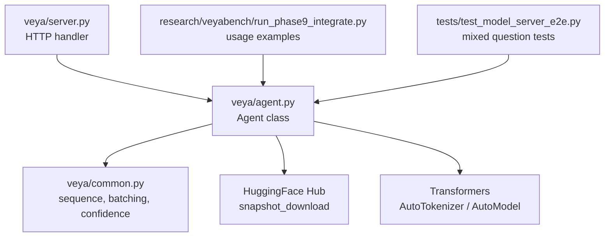
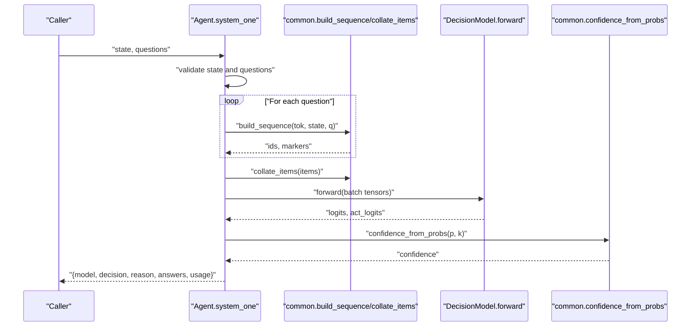
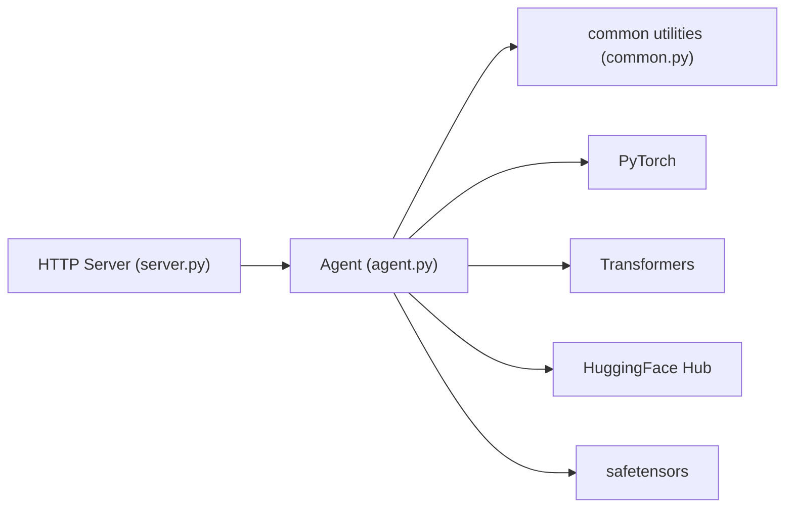

# Agent Class

<cite>
**Referenced Files in This Document**
- [agent.py](file://veya/agent.py)
- [common.py](file://veya/common.py)
- [server.py](file://veya/server.py)
- [run_phase9_integrate.py](file://research/veyabench/run_phase9_integrate.py)
- [test_model_server_e2e.py](file://tests/test_model_server_e2e.py)
</cite>

## Table of Contents
1. [Introduction](#introduction)
2. [Project Structure](#project-structure)
3. [Core Components](#core-components)
4. [Architecture Overview](#architecture-overview)
5. [Detailed Component Analysis](#detailed-component-analysis)
6. [Dependency Analysis](#dependency-analysis)
7. [Performance Considerations](#performance-considerations)
8. [Troubleshooting Guide](#troubleshooting-guide)
9. [Conclusion](#conclusion)

## Introduction
The `Agent` class is the primary runtime interface for Veya’s System 1 decision models. It loads a trained checkpoint, prepares tokenized inputs, runs a single non-autoregressive forward pass over multiple typed questions, and returns calibrated answers with probabilities, confidence scores, and usage metrics. The class also exposes `predict`, an alias for `system_one`, so callers can use either name interchangeably.

Key capabilities:
- Load models from HuggingFace Hub or local directories.
- Select device (`cuda`, `mps`, or `cpu`) with automatic fallbacks.
- Evaluate multiple question types in one batched forward pass.
- Return structured answers for choice, score, and noul question schemas.
- Provide token usage and action probability metadata.

## Project Structure
The `Agent` implementation lives in `veya/agent.py`. Supporting utilities for sequence construction, option rendering, batching, temperature handling, and confidence computation are in `veya/common.py`. Server integration and example usage patterns appear in `veya/server.py` and research/test scripts.

**Diagram sources**
- [agent.py:101-431](file://veya/agent.py#L101-L431)
- [common.py:11-111](file://veya/common.py#L11-L111)
- [server.py:114-194](file://veya/server.py#L114-L194)
- [run_phase9_integrate.py:233-239](file://research/veyabench/run_phase9_integrate.py#L233-L239)
- [test_model_server_e2e.py:112-126](file://tests/test_model_server_e2e.py#L112-L126)

**Section sources**
- [agent.py:101-431](file://veya/agent.py#L101-L431)
- [common.py:11-111](file://veya/common.py#L11-L111)

## Core Components
- `Agent`: Loads a Veya checkpoint, resolves device and precision, validates compatibility, and evaluates typed questions.
- `system_one(state, questions)`: Main inference method; aliased as `predict`.
- `_to_internal(qdef)`: Normalizes user question definitions into internal schema.
- `load(model_id_or_path, device, token, subfolder)`: Convenience loader returning an `Agent`.

Important constructor parameters:
- `model_id_or_path`: HuggingFace Hub model ID or local directory path.
- `device`: Optional explicit device string (for example `"cuda"`, `"mps"`, `"cpu"`). If omitted, auto-detection chooses CUDA if available, then MPS, otherwise CPU.
- `token`: Optional HuggingFace authentication token; falls back to the `HF_TOKEN` environment variable.
- `subfolder`: Optional subfolder selector for repositories bundling multiple checkpoints. Only files under that subfolder are downloaded when using Hub.

Question definition schema:
- Every question must be a dictionary with `type` and `instructions`.
- Supported types:
  - `choice`: Requires `criteria` as a mapping of option keys to descriptions.
  - `score`: Requires `criteria` as an ordered list of at least two levels.
  - `noul`: Optional `criteria` as a dict with optional `false` and `true` descriptions.

Return value format:
- Top-level fields include `model`, `decision`, `reason`, `answers`, and `usage`.
- Each answer includes type-specific fields plus `confidence` and `action.action_probability`.

**Section sources**
- [agent.py:101-231](file://veya/agent.py#L101-L231)
- [agent.py:264-416](file://veya/agent.py#L264-L416)
- [common.py:11-61](file://veya/common.py#L11-L61)

## Architecture Overview
At runtime, `Agent` performs these steps:
1. Resolve model source: local path or Hub snapshot download with optional subfolder filtering.
2. Validate required checkpoint files (`rl_agent_config.json`, `model.safetensors`).
3. Fix tokenizer configuration compatibility where needed.
4. Build the encoder and decision head via `build_model`.
5. Load weights and verify architecture compatibility.
6. Apply calibration and clamp temperatures to safe ranges.
7. Set automatic mixed precision dtype based on device capability.
8. Place model on device with graceful fallback to CPU on memory errors.
9. For each call to `system_one`:
   - Validate state and questions.
   - Build token sequences and markers per question.
   - Collate into a batch.
   - Run a single forward pass with autocast enabled on supported devices.
   - Convert logits to probabilities, compute confidence, and assemble typed answers.
   - Return structured results with token usage.

**Diagram sources**
- [agent.py:291-414](file://veya/agent.py#L291-L414)
- [common.py:64-111](file://veya/common.py#L64-L111)
- [common.py:261-267](file://veya/common.py#L261-L267)

## Detailed Component Analysis

### Constructor and Initialization
Responsibilities:
- Accept Hub IDs or local paths.
- Restrict Hub downloads to relevant files and optionally a subfolder.
- Ensure tokenizer compatibility across transformers versions.
- Load config and weights, validate architecture compatibility.
- Apply calibration and clamp temperatures.
- Determine dtype and device, with fallbacks.

Device selection behavior:
- If `device` is provided:
  - Validate availability for CUDA/MPS; fall back to CPU with a warning if unavailable.
- If `device` is not provided:
  - Prefer CUDA, then MPS, then CPU.

Memory management:
- On placement failure due to memory constraints, automatically switch to CPU and float32.
- During inference, if GPU memory is exceeded, fall back to CPU and retry once.

Precision scaling:
- Default dtype is derived from checkpoint config (`amp_dtype`).
- On older GPUs (capability < 8), force `torch.float16`.
- On CPU/MPS, force `torch.float32`.

Subfolder support:
- When using Hub, only files matching the selected subfolder are downloaded.
- Local paths can still be combined with `subfolder` by joining the directory.

Error handling:
- Missing local path raises `FileNotFoundError`.
- Missing required checkpoint files raise `FileNotFoundError`.
- Incompatible config or weights raise `ValueError`.
- Temperature values outside safe bounds are clamped and warned.

**Section sources**
- [agent.py:101-262](file://veya/agent.py#L101-L262)
- [common.py:275-295](file://veya/common.py#L275-L295)

### Question Definition Schema
Internal normalization (`_to_internal`):
- Validates presence of `type` and `instructions`.
- Supports `choice`, `score`, and `noul`.
- Converts list-style criteria for `choice` into a dict via shortlist utilities.
- Enforces minimum length for `score` criteria.
- Ensures `noul` criteria is a dict when present.
- Serializes non-string instructions to JSON.

Option rendering:
- `render_options` produces textual labels for each option.
- For `choice`, uses criterion keys and optional descriptions.
- For `score`, enumerates levels with descriptions.
- For `noul`, defaults to false/true semantics with optional descriptions.

Complexity considerations:
- Rendering and validation are linear in the number of options.
- Option text is truncated to a small token budget to fit within `head_max_len`.

**Section sources**
- [agent.py:264-289](file://veya/agent.py#L264-L289)
- [common.py:30-61](file://veya/common.py#L30-L61)

### system_one Method (aliased as predict)
Workflow:
- Early return with defer if state is empty or blocked by policy.
- Normalize each question and build token sequences with markers.
- Check that rendered options fit within `head_max_len`; raise if they exceed it.
- Collate all questions into a single batch.
- Run a single forward pass with autocast enabled on CUDA.
- Handle memory errors during inference by falling back to CPU.
- Compute per-question probabilities, confidence, and type-specific answers.
- Return unified result structure.

Return structure:
- Top-level:
  - `model`: Always `"veya-rl-agent"`.
  - `decision`: `"answer"` or `"defer"`.
  - `reason`: Defer reason or `None`.
  - `answers`: Mapping of question IDs to typed answers.
  - `usage`: Token counts including `input_tokens` and `output_tokens`.
- Per-answer fields:
  - `choice`:
    - `type`: `"choice"`.
    - `choice`: Selected option key.
    - `probabilities`: Mapping of option keys to probabilities.
    - `confidence`: Normalized Shannon entropy-based confidence.
    - `action`: Includes `act_probability`.
  - `score`:
    - `type`: `"score"`.
    - `score`: Expected score computed from level indices and probabilities.
    - `legend`: Mapping of integer level indices to criterion descriptions.
    - `probabilities`: Mapping of integer level indices to probabilities.
    - `confidence`: Confidence score.
    - `action`: Includes `act_probability`.
  - `noul`:
    - `type`: `"noul"`.
    - `noul`: Probability of the positive class.
    - `confidence`: Confidence derived from the positive probability.
    - `action`: Includes `act_probability`.

Parallelism:
- All questions are evaluated in one forward pass, minimizing overhead compared to looping calls.

**Section sources**
- [agent.py:291-416](file://veya/agent.py#L291-L416)
- [common.py:261-267](file://veya/common.py#L261-L267)

### Practical Usage Examples

#### Loading Models
- From HuggingFace Hub:
  - Use a Hub model ID such as `"veyadynamics/veya"`.
  - Optionally provide `token` or set `HF_TOKEN`.
  - Optionally select a subfolder like `"multilingual"`.
- From local path:
  - Point `model_id_or_path` to a directory containing `rl_agent_config.json` and `model.safetensors`.
  - Optionally combine with `subfolder` to target a nested checkpoint directory.

Device auto-detection and fallbacks:
- If no device is specified, the agent prefers CUDA, then MPS, then CPU.
- If a requested device is unavailable, it prints a warning and falls back to CPU.
- If placing the model on GPU fails due to memory constraints, it switches to CPU and float32.

Processing different question types:
- `choice`: Provide a mapping of option keys to descriptions.
- `score`: Provide an ordered list of at least two levels.
- `noul`: Provide optional descriptions for false/true cases.

Server integration:
- The HTTP server validates requests and routes them through `Agent.system_one`.
- Example endpoints demonstrate mixed question batches and per-type endpoints.

Research/test usage:
- Benchmarks and integration tests show how to construct mixed question dictionaries and evaluate them via `system_one`.

**Section sources**
- [agent.py:101-231](file://veya/agent.py#L101-L231)
- [server.py:114-194](file://veya/server.py#L114-L194)
- [run_phase9_integrate.py:233-239](file://research/veyabench/run_phase9_integrate.py#L233-L239)
- [test_model_server_e2e.py:112-126](file://tests/test_model_server_e2e.py#L112-L126)

## Dependency Analysis
`Agent` depends on:
- `veya.common` for:
  - Question type constants and mappings.
  - Sequence building and option rendering.
  - Batching utilities.
  - Confidence computation and temperature clamping.
- External libraries:
  - `torch` for model execution and device management.
  - `transformers` for tokenizer and model loading.
  - `huggingface_hub` for downloading snapshots.
  - `safetensors` for loading model weights.

Coupling and cohesion:
- `Agent` encapsulates initialization, validation, and inference logic.
- `common` provides focused utilities for NLP preprocessing and scoring.
- Server code integrates `Agent` without duplicating logic.

Potential circular dependencies:
- None observed between `agent` and `common`.
- Import of `shortlist._criteria_items` occurs inside `_to_internal` to avoid tight coupling.

External integration points:
- HuggingFace Hub for model distribution.
- Transformers ecosystem for tokenization and model architectures.
- HTTP server for exposing inference endpoints.

**Diagram sources**
- [agent.py:101-431](file://veya/agent.py#L101-L431)
- [common.py:11-333](file://veya/common.py#L11-L333)
- [server.py:114-194](file://veya/server.py#L114-L194)

**Section sources**
- [agent.py:101-431](file://veya/agent.py#L101-L431)
- [common.py:11-333](file://veya/common.py#L11-L333)
- [server.py:114-194](file://veya/server.py#L114-L194)

## Performance Considerations
- Single forward pass: `system_one` evaluates all questions in one batch, reducing overhead compared to repeated calls.
- Autocast: Enables automatic mixed precision on CUDA to reduce memory and improve throughput.
- Device-aware dtype: Forces float32 on CPU/MPS and selects appropriate precision on GPUs.
- Memory fallbacks: Automatic fallback to CPU on memory errors prevents crashes and allows inference to continue.
- Token budgets: Options and instruction text are truncated to fit within configured maximum lengths, preventing excessive memory usage.
- Calibration and temperature clamping: Ensures stable confidence estimates and avoids extreme sharpening or softening.

[No sources needed since this section provides general guidance]

## Troubleshooting Guide
Common issues and resolutions:
- Local path not found:
  - Ensure the directory exists and contains required files.
- Incompatible model:
  - Verify the presence of `rl_agent_config.json` and `model.safetensors`.
  - Confirm the checkpoint matches the expected RL Agent decision model architecture.
- Subfolder not found:
  - Check that the specified subfolder exists in the repository or local directory.
- Unsupported question type:
  - Use one of the supported types: `choice`, `score`, `noul`.
- Invalid question schema:
  - Ensure every question has `type` and `instructions`.
  - For `choice`, provide a valid criteria mapping.
  - For `score`, provide at least two ordered levels.
  - For `noul`, provide a dict if criteria are included.
- Options exceeding head length:
  - Reduce the number of options or shorten descriptions to fit within `head_max_len`.
- GPU memory exceeded:
  - The agent will fall back to CPU automatically; consider reducing batch size or option complexity.
- Device unavailability:
  - If CUDA or MPS is requested but unavailable, the agent falls back to CPU with a warning.

**Section sources**
- [agent.py:120-165](file://veya/agent.py#L120-L165)
- [agent.py:264-289](file://veya/agent.py#L264-L289)
- [agent.py:331-361](file://veya/agent.py#L331-L361)

## Conclusion
The `Agent` class provides a robust, efficient interface for evaluating typed decisions with Veya’s System 1 models. It supports flexible model loading, automatic device and precision management, and parallel evaluation of multiple question types in a single forward pass. By returning calibrated probabilities, confidence scores, and usage metrics, it enables reliable downstream decision-making and monitoring. Properly constructed question schemas and awareness of memory and device constraints ensure smooth operation across environments.

[No sources needed since this section summarizes without analyzing specific files]