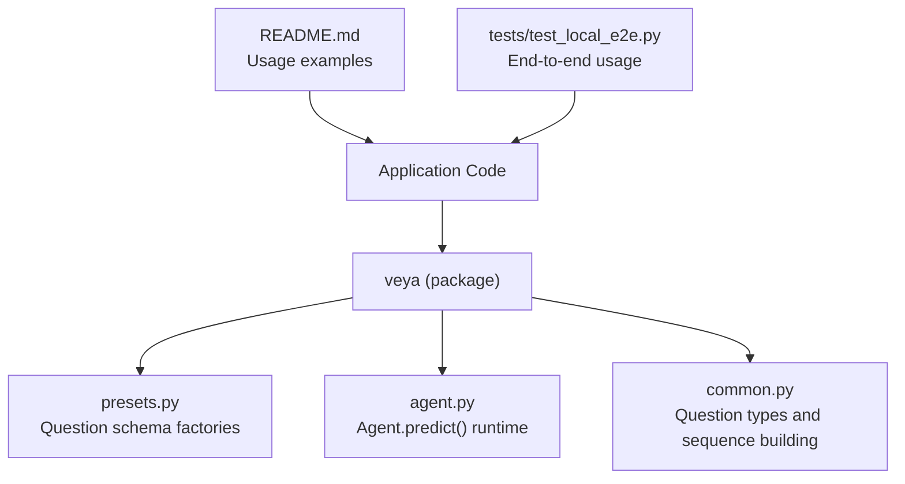
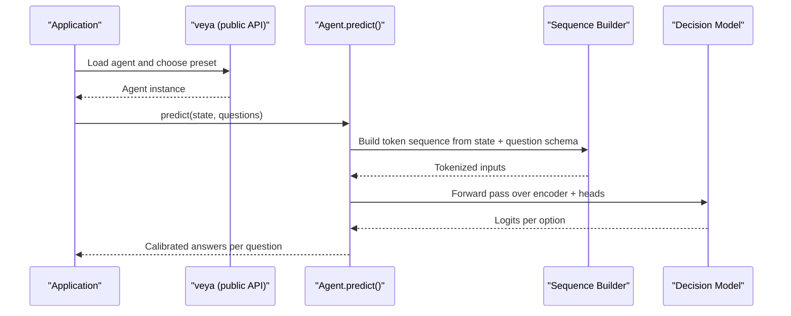
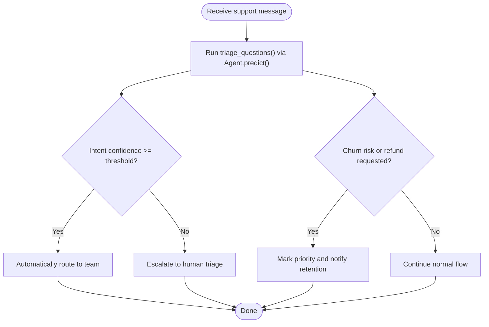
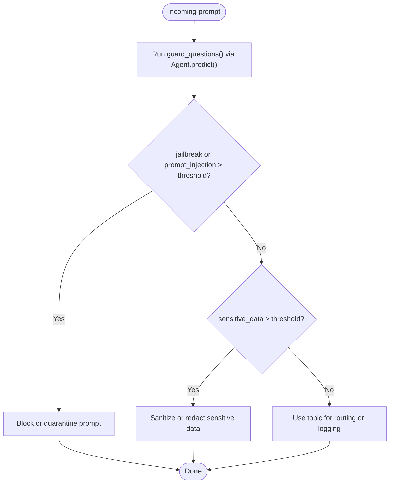
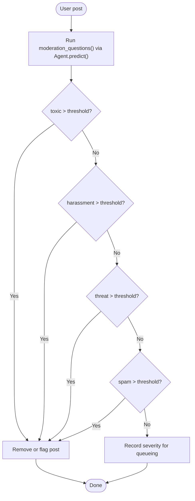
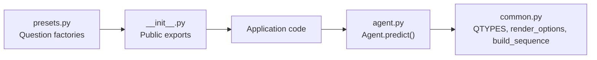

# Presets API

<cite>
**Referenced Files in This Document**   
- [presets.py](file://veya/presets.py)
- [__init__.py](file://veya/__init__.py)
- [agent.py](file://veya/agent.py)
- [common.py](file://veya/common.py)
- [README.md](file://README.md)
- [test_local_e2e.py](file://tests/test_local_e2e.py)
</cite>

## Table of Contents
1. [Introduction](#introduction)
2. [Project Structure](#project-structure)
3. [Core Components](#core-components)
4. [Architecture Overview](#architecture-overview)
5. [Detailed Component Analysis](#detailed-component-analysis)
6. [Dependency Analysis](#dependency-analysis)
7. [Performance Considerations](#performance-considerations)
8. [Troubleshooting Guide](#troubleshooting-guide)
9. [Conclusion](#conclusion)
10. [Appendices](#appendices)

## Introduction
This document explains Veya’s built-in preset question schemas and workflow templates. It focuses on:
- Automated routing and escalation workflows using the triage preset.
- Real-time input guardrails for jailbreaks, prompt injection, sensitive data, harm severity, and topic classification.
- Content safety and moderation for toxicity, harassment, threats, spam, and severity scoring.
- How to extend presets with custom question definitions and integrate them into applications.
- Expected input/output formats, parameter configurations, integration patterns, customization options, performance characteristics, and best practices for combining multiple presets in complex workflows.

The presets are ready-to-use question schemas that you pass to a Veya agent to produce calibrated decisions. They are not functions named `triage_presets()`, `guardrails_presets()`, or `moderation_presets()`; instead, they are exposed as `triage_questions()`, `guard_questions()`, and `moderation_questions()`.

## Project Structure
Veya exposes preset question schemas through its public Python API. The presets module defines the schemas, and the package root re-exports them so you can import them directly from `veya`.

**Diagram sources**
- [presets.py:1-188](file://veya/presets.py#L1-L188)
- [__init__.py:16-22](file://veya/__init__.py#L16-L22)
- [agent.py:101-200](file://veya/agent.py#L101-L200)
- [common.py:11-61](file://veya/common.py#L11-L61)
- [README.md:231-251](file://README.md#L231-L251)
- [test_local_e2e.py:54-203](file://tests/test_local_e2e.py#L54-L203)

**Section sources**
- [presets.py:1-188](file://veya/presets.py#L1-L188)
- [__init__.py:16-22](file://veya/__init__.py#L16-L22)
- [README.md:231-251](file://README.md#L231-L251)

## Core Components
Veya provides five preset question factories:
- `triage_questions()`: Customer support ticket triage.
- `email_questions(categories=None)`: Inbound email triage and threat filtering.
- `guard_questions()`: Real-time LLM input guardrails.
- `moderation_questions()`: Content safety and moderation.
- `router_questions()`: Intelligent model routing.

Each factory returns a dictionary of questions. Every question has:
- `type`: One of `choice`, `score`, or `noul`.
- `instructions`: Natural-language prompt describing what to evaluate.
- `criteria` (optional):
  - For `choice`: a mapping from label to description.
  - For `score`: an ordered list of rubric levels.
  - For `noul`: optional mapping from `"false"` and `"true"` to descriptions.

These schemas are consumed by `Agent.predict(state, questions)` to return calibrated answers.

**Section sources**
- [presets.py:5-42](file://veya/presets.py#L5-L42)
- [presets.py:45-79](file://veya/presets.py#L45-L79)
- [presets.py:82-119](file://veya/presets.py#L82-L119)
- [presets.py:122-151](file://veya/presets.py#L122-L151)
- [presets.py:154-188](file://veya/presets.py#L154-L188)
- [common.py:11-61](file://veya/common.py#L11-L61)

## Architecture Overview
The preset schemas define structured decision tasks. At runtime, Veya converts these schemas into token sequences and runs a fast, non-autoregressive decision model. The result is a set of calibrated answers per question.

**Diagram sources**
- [agent.py:101-200](file://veya/agent.py#L101-L200)
- [common.py:64-111](file://veya/common.py#L64-L111)
- [README.md:231-251](file://README.md#L231-L251)

## Detailed Component Analysis

### Triage Preset: Automated Routing and Escalation Workflows
The triage preset supports customer support workflows by classifying intent, urgency, frustration, refund requests, and churn risk.

- Input fields expected:
  - `message`: The customer message text.
  - Optional additional context fields such as account tier may be included in the state if your application needs them.
- Output fields returned per question:
  - `intent.choice`: Top category among refund, technical_help, billing_question, information, cancellation, other.
  - `intent.confidence`: Confidence for the top choice.
  - `is_urgent.noul`: Probability that the request is urgent.
  - `frustration.score`: Expected level on the frustration rubric.
  - `refund_requested.noul`: Probability that the user asks for money back.
  - `churn_risk.noul`: Probability that the user may churn.

Typical automation pattern:
- Route high-confidence intents automatically.
- Escalate low-confidence or high-risk cases to human agents.

**Diagram sources**
- [presets.py:5-42](file://veya/presets.py#L5-L42)
- [README.md:213-227](file://README.md#L213-L227)
- [test_local_e2e.py:194-203](file://tests/test_local_e2e.py#L194-L203)

**Section sources**
- [presets.py:5-42](file://veya/presets.py#L5-L42)
- [README.md:213-227](file://README.md#L213-L227)
- [test_local_e2e.py:194-203](file://tests/test_local_e2e.py#L194-L203)

### Guardrails Preset: Content Moderation and Safety Filtering
The guard preset protects real-time LLM inputs by detecting jailbreaks, prompt injections, sensitive data leaks, harm severity, and topic classification.

- Input fields expected:
  - `prompt`: The raw user prompt to evaluate before calling downstream models.
- Output fields returned per question:
  - `jailbreak.noul`: Probability that the prompt tries to bypass rules.
  - `prompt_injection.noul`: Probability that the prompt contains instructions aimed at the AI system.
  - `sensitive_data.noul`: Probability that credentials or personal data are present.
  - `harm_severity.score`: Expected level on the harm rubric.
  - `topic.choice`: Topic category such as product_support, coding, general_knowledge, personal_advice, security_testing, other.

Recommended policy:
- Block or quarantine prompts where jailbreak or prompt injection probability exceeds a strict threshold.
- Apply stricter thresholds for sensitive data detection.
- Use harm severity to decide whether to escalate to a safer model or human review.

**Diagram sources**
- [presets.py:82-119](file://veya/presets.py#L82-L119)
- [test_local_e2e.py:150-166](file://tests/test_local_e2e.py#L150-L166)

**Section sources**
- [presets.py:82-119](file://veya/presets.py#L82-L119)
- [test_local_e2e.py:150-166](file://tests/test_local_e2e.py#L150-L166)

### Moderation Preset: Toxicity Detection and Policy Enforcement
The moderation preset evaluates user-generated content for toxicity, harassment, threats, spam, and overall rule-breaking severity.

- Input fields expected:
  - `post`: The user post or comment text.
- Output fields returned per question:
  - `toxic.noul`: Probability that the post is toxic.
  - `harassment.noul`: Probability that the post targets or harasses someone.
  - `threat.noul`: Probability that the post threatens violence or intimidation.
  - `spam.noul`: Probability that the post is spam or advertising.
  - `severity.score`: Expected level on the moderation severity rubric.

Policy guidance:
- Remove or flag posts where toxicity, harassment, or threat probabilities exceed thresholds.
- Use severity to prioritize review queues.
- Combine with guardrails to prevent unsafe prompts from reaching downstream models.

**Diagram sources**
- [presets.py:122-151](file://veya/presets.py#L122-L151)
- [test_local_e2e.py:168-181](file://tests/test_local_e2e.py#L168-L181)

**Section sources**
- [presets.py:122-151](file://veya/presets.py#L122-L151)
- [test_local_e2e.py:168-181](file://tests/test_local_e2e.py#L168-L181)

### Email Triage Preset
The email preset helps classify inbound emails and detect phishing and spam.

- Input fields expected:
  - `body`: The email body text.
  - Optionally, sender and subject can be preprocessed into the state using helper utilities.
- Output fields returned per question:
  - `category.choice`: Team category such as billing, technical, sales, security, hr, other.
  - `is_spam.noul`: Probability that the email is spam.
  - `is_phishing.noul`: Probability that the email is phishing or scam.
  - `urgency.score`: Expected urgency level.
  - `needs_reply.noul`: Probability that the sender expects a reply.

Customization:
- Pass a custom `categories` mapping to align with your organization’s teams.

**Section sources**
- [presets.py:45-79](file://veya/presets.py#L45-L79)
- [test_local_e2e.py:124-148](file://tests/test_local_e2e.py#L124-L148)

### Router Preset
The router preset helps select appropriate models based on difficulty, domain, tool requirements, and sensitivity.

- Input fields expected:
  - `request`: The user request text.
- Output fields returned per question:
  - `difficulty.score`: Expected difficulty level.
  - `domain.choice`: Domain such as code, math_or_logic, writing, factual_lookup, data_analysis, chitchat.
  - `needs_tools.noul`: Probability that external tools or private data are needed.
  - `is_sensitive.noul`: Probability that the request involves money, legal, medical, or safety consequences.

Integration pattern:
- Use router output to select small vs. frontier models, enable tool use, or apply stricter guardrails for sensitive domains.

**Section sources**
- [presets.py:154-188](file://veya/presets.py#L154-L188)
- [test_local_e2e.py:183-192](file://tests/test_local_e2e.py#L183-L192)

## Dependency Analysis
The preset schemas are defined in one module and exported through the package root. Applications import them from `veya` and pass them to `Agent.predict()`.

**Diagram sources**
- [presets.py:1-188](file://veya/presets.py#L1-L188)
- [__init__.py:16-22](file://veya/__init__.py#L16-L22)
- [agent.py:101-200](file://veya/agent.py#L101-L200)
- [common.py:11-61](file://veya/common.py#L11-L61)

**Section sources**
- [presets.py:1-188](file://veya/presets.py#L1-L188)
- [__init__.py:16-22](file://veya/__init__.py#L16-L22)
- [agent.py:101-200](file://veya/agent.py#L101-L200)
- [common.py:11-61](file://veya/common.py#L11-L61)

## Performance Considerations
- Veya uses a fast, non-autoregressive System 1 decision engine with calibrated probabilities.
- Latency benchmarks show sub-100ms typical latencies for single-question inference on local hardware, with mixed multi-question calls taking longer due to batching overhead.
- Using presets does not add significant overhead beyond constructing the question schema and running the model once per call.
- For throughput, batch multiple independent requests when possible and reuse the same agent instance.
- Guardrails and moderation should run early in the pipeline to avoid unnecessary downstream costs.

[No sources needed since this section provides general guidance]

## Troubleshooting Guide
Common issues and resolutions:
- Missing state field: Ensure the state includes the expected keys referenced by the preset instructions, such as `message`, `prompt`, `post`, or `request`.
- Unsupported language: Some checkpoints defer on non-Latin input; use multilingual checkpoints or route appropriately.
- Low confidence: If automated routing confidence is below your threshold, escalate to human review.
- Schema validation errors: Ensure each question has a valid `type`, `instructions`, and correct `criteria` structure.

**Section sources**
- [test_local_e2e.py:108-121](file://tests/test_local_e2e.py#L108-L121)
- [README.md:213-227](file://README.md#L213-L227)

## Conclusion
Veya’s preset question schemas provide production-ready workflows for triage, guardrails, moderation, email handling, and model routing. By combining these presets with confidence gating and policy thresholds, you can build safe, scalable, and domain-specific decision pipelines. Extend presets with custom question definitions to match your application’s taxonomy and maintain consistency across services.

[No sources needed since this section summarizes without analyzing specific files]

## Appendices

### Preset Reference Summary

#### Triage Preset
- Function: `triage_questions()`
- Purpose: Support ticket triage.
- Key outputs: intent, is_urgent, frustration, refund_requested, churn_risk.
- Typical use: Automated routing and escalation.

**Section sources**
- [presets.py:5-42](file://veya/presets.py#L5-L42)
- [test_local_e2e.py:194-203](file://tests/test_local_e2e.py#L194-L203)

#### Guardrails Preset
- Function: `guard_questions()`
- Purpose: Real-time input guardrails.
- Key outputs: jailbreak, prompt_injection, sensitive_data, harm_severity, topic.
- Typical use: Safety filtering and policy enforcement.

**Section sources**
- [presets.py:82-119](file://veya/presets.py#L82-L119)
- [test_local_e2e.py:150-166](file://tests/test_local_e2e.py#L150-L166)

#### Moderation Preset
- Function: `moderation_questions()`
- Purpose: Content safety and moderation.
- Key outputs: toxic, harassment, threat, spam, severity.
- Typical use: Toxicity detection and policy enforcement.

**Section sources**
- [presets.py:122-151](file://veya/presets.py#L122-L151)
- [test_local_e2e.py:168-181](file://tests/test_local_e2e.py#L168-L181)

#### Email Triage Preset
- Function: `email_questions(categories=None)`
- Purpose: Inbound email triage and threat filtering.
- Key outputs: category, is_spam, is_phishing, urgency, needs_reply.
- Customization: Provide a custom categories mapping.

**Section sources**
- [presets.py:45-79](file://veya/presets.py#L45-L79)
- [test_local_e2e.py:124-148](file://tests/test_local_e2e.py#L124-L148)

#### Router Preset
- Function: `router_questions()`
- Purpose: Intelligent model routing.
- Key outputs: difficulty, domain, needs_tools, is_sensitive.
- Typical use: Selecting models and enabling tools based on request characteristics.

**Section sources**
- [presets.py:154-188](file://veya/presets.py#L154-L188)
- [test_local_e2e.py:183-192](file://tests/test_local_e2e.py#L183-L192)

### Extending Presets with Custom Question Definitions
You can combine preset schemas with custom questions:
- Define additional questions following the same structure: `type`, `instructions`, and optional `criteria`.
- Merge them with preset dictionaries before passing to `Agent.predict()`.
- Use consistent naming and clear instructions to keep workflows maintainable.

Example pattern:
- Start with `triage_questions()`.
- Add a custom question such as `requires_legal_review` with type `noul`.
- Route to legal if both `churn_risk` and `requires_legal_review` exceed thresholds.

**Section sources**
- [presets.py:5-42](file://veya/presets.py#L5-L42)
- [common.py:11-61](file://veya/common.py#L11-L61)

### Integration Patterns
- Load an agent and choose a preset.
- Call `agent.predict(state, questions)` with the preset schema.
- Inspect `answers` for each question.
- Apply thresholds and business rules to automate or escalate.

Reference usage examples are provided in the repository documentation and tests.

**Section sources**
- [README.md:231-251](file://README.md#L231-L251)
- [test_local_e2e.py:54-203](file://tests/test_local_e2e.py#L54-L203)