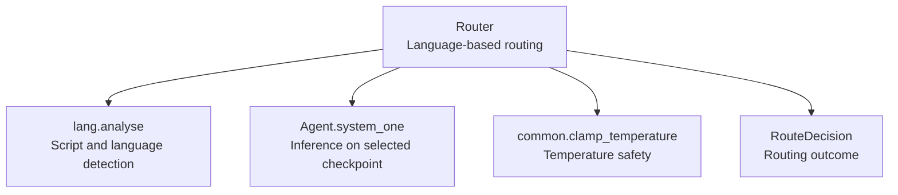
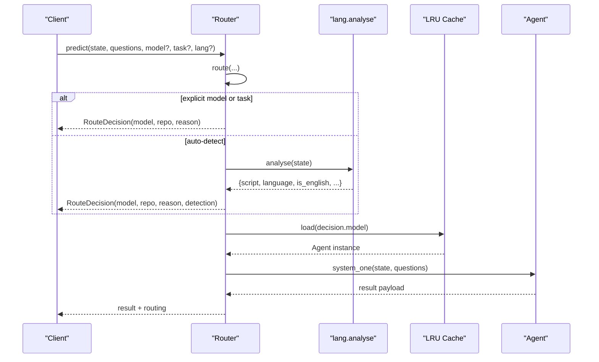
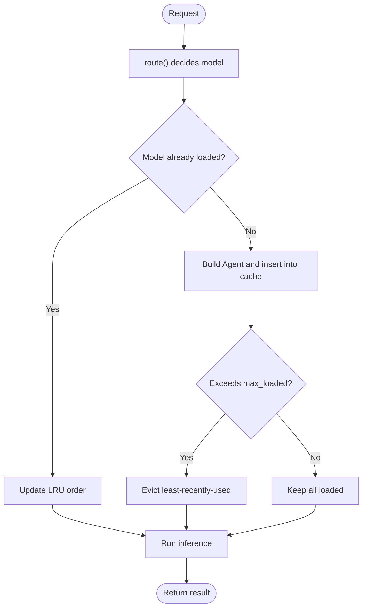
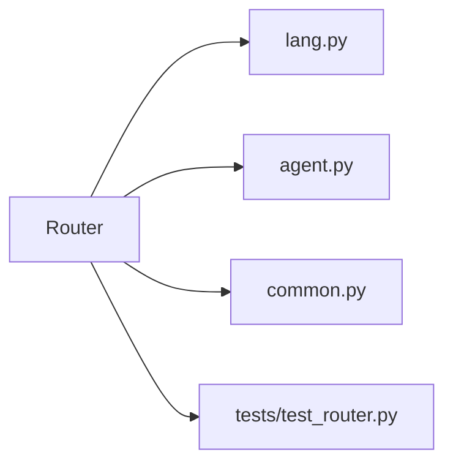

# Router Class

<cite>
**Referenced Files in This Document**   
- [router.py](file://veya/router.py)
- [agent.py](file://veya/agent.py)
- [lang.py](file://veya/lang.py)
- [common.py](file://veya/common.py)
- [test_router.py](file://tests/test_router.py)
</cite>

## Table of Contents
1. [Introduction](#introduction)
2. [Project Structure](#project-structure)
3. [Core Components](#core-components)
4. [Architecture Overview](#architecture-overview)
5. [Detailed Component Analysis](#detailed-component-analysis)
6. [Dependency Analysis](#dependency-analysis)
7. [Performance Considerations](#performance-considerations)
8. [Troubleshooting Guide](#troubleshooting-guide)
9. [Conclusion](#conclusion)
10. [Appendices](#appendices)

## Introduction
The Router class is the entry point for routing requests to the correct Veya checkpoint based on language, script, and optional task signals. It manages multiple Veya agents with lazy loading, memory-efficient LRU eviction, and thread-safe lifecycle control. The router can automatically detect whether input text belongs to English or another language family, select an appropriate model, and return a structured decision that explains why a particular checkpoint was chosen.

Key capabilities:
- Automatic language/script detection using a lightweight, dependency-free detector.
- Memory-efficient checkpoint management through an LRU cache with configurable capacity.
- Thread-safe concurrent access for hot-path inference and cold-path model loading.
- Optional typed-decision workflow detection for specialized synthetic workflows.
- Explicit overrides for model, task, and language when automatic detection is not desired.

## Project Structure
The Router lives in the `veya` package and coordinates three main components:
- Language detection (`veya.lang`).
- Model runtime (`veya.agent.Agent`).
- Shared utilities such as temperature clamping and tokenization helpers (`veya.common`).

**Diagram sources**
- [router.py:123-337](file://veya/router.py#L123-L337)
- [lang.py:209-238](file://veya/lang.py#L209-L238)
- [agent.py:291-416](file://veya/agent.py#L291-L416)
- [common.py:275-291](file://veya/common.py#L275-L291)

**Section sources**
- [router.py:1-337](file://veya/router.py#L1-L337)
- [lang.py:1-266](file://veya/lang.py#L1-L266)
- [agent.py:1-432](file://veya/agent.py#L1-L432)
- [common.py:1-333](file://veya/common.py#L1-L333)

## Core Components
- Router: Orchestrates routing decisions, agent lifecycle, and LRU memory management.
- RouteDecision: A dict-like object representing the routing outcome, including model name, repository string, reason, detection metadata, and optional workflow match.
- Agent: Loads and runs a specific Veya checkpoint; used by Router after selection.
- Language detector: Provides script identification, Latin-script language heuristics, and English-vs-non-English classification.

Important behaviors:
- Models are lazily loaded on first use and cached according to LRU policy.
- Preloading allows all requested checkpoints to be resident so routing is effectively free at request time.
- Concurrency is protected by a reentrant lock around lifecycle operations; inference itself is not serialized.

**Section sources**
- [router.py:83-108](file://veya/router.py#L83-L108)
- [router.py:123-337](file://veya/router.py#L123-L337)
- [agent.py:101-432](file://veya/agent.py#L101-L432)
- [lang.py:209-238](file://veya/lang.py#L209-L238)

## Architecture Overview
The Router composes language detection with model selection and execution:

**Diagram sources**
- [router.py:257-331](file://veya/router.py#L257-L331)
- [lang.py:209-238](file://veya/lang.py#L209-L238)
- [agent.py:291-416](file://veya/agent.py#L291-L416)

## Detailed Component Analysis

### Router API Reference

#### Constructor Parameters
- models: Optional mapping from normalized model names to Hugging Face repo identifiers or local paths. Overrides default mappings.
- device: Optional target device string (e.g., "cuda", "cpu"). Passed to Agent construction.
- token: Optional Hugging Face token; falls back to environment variable if not provided.
- max_loaded: Maximum number of checkpoints kept resident; enforces LRU eviction.
- default: Default model name when no letters are detected or when language cannot be determined safely.
- auto_task_detection: Enables automatic selection of the typed-decisions checkpoint when question IDs exactly match one of the predefined workflow signatures.
- standalone_repos: When true, uses separate repositories per checkpoint instead of subfolders within a single bundle repository.
- preload: If true, preloads all configured models at construction time.

Notes:
- Normalized model names include aliases like "en", "multi", "typed".
- The router maintains an internal LRU list and dictionary for efficient eviction and lookup.
- A reentrant lock protects lifecycle methods; inference is intentionally outside the lock to allow concurrent predictions.

**Section sources**
- [router.py:145-173](file://veya/router.py#L145-L173)
- [router.py:65-71](file://veya/router.py#L65-L71)
- [router.py:164-170](file://veya/router.py#L164-L170)

#### route() Method
Purpose:
- Decide which checkpoint to use without loading or running anything.
- Return a RouteDecision containing model, repository string, reason, detection metadata, and optional workflow match.

Precedence:
1. Explicit model parameter.
2. Explicit task parameter.
3. Auto-detected typed-decisions workflow (only when enabled).
4. Explicit lang parameter.
5. Detected script/language via language detector.
6. Default model.

Behavior highlights:
- For non-Latin scripts, routes to multilingual because the English checkpoint cannot read them.
- For Latin text that is not English, routes to multilingual unless it is clearly English.
- For unknown script or empty state, uses the configured default.
- Returns detailed reasons explaining the decision path.

**Section sources**
- [router.py:257-312](file://veya/router.py#L257-L312)
- [lang.py:209-238](file://veya/lang.py#L209-L238)

#### add_agent() Method
There is no method named add_agent in the current implementation. To register an already-built Agent under a name, use attach():
- attach(name, agent): Registers an existing Agent instance under a normalized name, marks it as recently used, and raises max_loaded if necessary.

Use cases:
- Sharing a checkpoint already loaded elsewhere in the process.
- Avoiding duplicate loads and memory usage.

**Section sources**
- [router.py:209-221](file://veya/router.py#L209-L221)

#### Lifecycle Methods
- load(name): Lazily builds and caches an Agent for the given model name. Concurrent callers share one Agent instance.
- preload(names=None): Preloads specified models (or all configured models), raising max_loaded to keep them resident.
- unload(name=None): Unloads a specific model or all models.
- loaded: Property returning the current LRU order of loaded models.

**Section sources**
- [router.py:175-254](file://veya/router.py#L175-L254)

#### predict() / system_one()
- Executes routing, loads the selected Agent, runs inference once, and attaches the routing decision to the result payload.
- Useful for end-to-end calls where you want both answers and routing metadata.

**Section sources**
- [router.py:315-333](file://veya/router.py#L315-L333)
- [agent.py:291-416](file://veya/agent.py#L291-L416)

### RouteDecision
A dict-like object exposing:
- model: Selected model name.
- reason: Human-readable explanation of the routing decision.
- detection: Language detection metadata when applicable.
- workflow: Typed-decisions workflow name when matched.

It serializes directly into API responses.

**Section sources**
- [router.py:83-99](file://veya/router.py#L83-L99)

### Language Detection
The language detector provides:
- Script identification across many Unicode blocks.
- Latin-script language heuristics based on stopwords and diacritics.
- Safe defaults for unknown or short inputs.

The Router uses this to decide between English and multilingual checkpoints.

**Section sources**
- [lang.py:1-266](file://veya/lang.py#L1-L266)
- [router.py:291-312](file://veya/router.py#L291-L312)

### Typed-Decisions Workflow Detection
When auto_task_detection is enabled, the Router checks whether the question IDs exactly match one of four predefined workflow signatures. If they do, it selects the typed-decisions checkpoint.

This behavior is opt-in to avoid silently routing to a specialized model.

**Section sources**
- [router.py:73-80](file://veya/router.py#L73-L80)
- [router.py:110-120](file://veya/router.py#L110-L120)
- [router.py:275-284](file://veya/router.py#L275-L284)

### Memory-Efficient Checkpoint Management
- LRU eviction ensures only the most recently used checkpoints remain resident.
- max_loaded controls capacity; preload increases capacity to fit preloaded models.
- attach() can register externally built Agents without duplicating memory.
- The LRU order and agent dictionary are kept consistent under a reentrant lock.

**Diagram sources**
- [router.py:175-208](file://veya/router.py#L175-L208)
- [router.py:223-237](file://veya/router.py#L223-L237)

**Section sources**
- [router.py:164-208](file://veya/router.py#L164-L208)
- [router.py:223-254](file://veya/router.py#L223-L254)

### Temperature Scaling and Model Caching Strategies
- Per-language temperature scaling is not exposed directly by Router. Instead, each Agent carries checkpoint-provided temperature values and per-option buckets.
- Temperatures are clamped to safe bounds to prevent over-sharpening probabilities.
- Model caching is handled by Router’s LRU cache; Agent instances are reused across requests.

Configuration options relevant to performance:
- max_loaded: Controls how many checkpoints stay resident.
- preload: Ensures all needed checkpoints are loaded upfront.
- device: Selects GPU/CPU/MPS backend for inference.
- token: Required for private or gated repositories.

**Section sources**
- [agent.py:206-231](file://veya/agent.py#L206-L231)
- [common.py:275-291](file://veya/common.py#L275-L291)
- [router.py:145-173](file://veya/router.py#L145-L173)

### Performance Monitoring
- RouteDecision includes a reason field describing the routing logic.
- Agent returns usage metrics including input token counts.
- You can monitor loaded models via Router.loaded and adjust max_loaded or preload accordingly.

**Section sources**
- [router.py:257-312](file://veya/router.py#L257-L312)
- [agent.py:408-414](file://veya/agent.py#L408-L414)

## Dependency Analysis
The Router depends on:
- Language detection module for script and language analysis.
- Agent runtime for model loading and inference.
- Common utilities for temperature handling and tokenization.

**Diagram sources**
- [router.py:30-34](file://veya/router.py#L30-L34)
- [router.py:185-188](file://veya/router.py#L185-L188)
- [agent.py:10-24](file://veya/agent.py#L10-L24)
- [test_router.py:11-19](file://tests/test_router.py#L11-L19)

**Section sources**
- [router.py:30-34](file://veya/router.py#L30-L34)
- [agent.py:10-24](file://veya/agent.py#L10-L24)
- [test_router.py:1-448](file://tests/test_router.py#L1-L448)

## Performance Considerations
- Prefer preload=True or preload([...]) in server environments to eliminate cold-load latency.
- Tune max_loaded to balance memory usage and routing speed.
- Use attach() to share checkpoints already loaded elsewhere in the process.
- Monitor GPU memory; Agent includes fallback to CPU on out-of-memory conditions.
- Avoid unnecessary model switches at high throughput; batching similar languages reduces evictions.

[No sources needed since this section provides general guidance]

## Troubleshooting Guide
Common issues and resolutions:
- Unknown model name: Ensure you use a supported alias or provide a valid mapping in models.
- Language detection failures: Provide explicit lang= or model= when automatic detection is unreliable.
- Non-Latin script routed unexpectedly: Verify input contains expected characters; consider explicit overrides.
- High memory usage: Reduce max_loaded, avoid preload unless necessary, or detach unused agents.
- Concurrency problems: Router is thread-safe for lifecycle operations; ensure you do not mutate shared state outside the router.

Relevant error handling:
- normalise_name raises ValueError for unknown model names.
- Agent constructor validates configuration and weights compatibility.
- Inference may fall back to CPU on memory errors.

**Section sources**
- [router.py:101-107](file://veya/router.py#L101-L107)
- [agent.py:150-165](file://veya/agent.py#L150-L165)
- [agent.py:238-262](file://veya/agent.py#L238-L262)
- [agent.py:347-361](file://veya/agent.py#L347-L361)

## Conclusion
The Router class provides robust, memory-efficient, and thread-safe routing to Veya checkpoints based on language and optional task signals. It supports automatic detection, explicit overrides, typed-decisions workflow matching, and configurable memory policies. By combining language detection with LRU-managed agent caching, it enables scalable multi-language deployments while keeping routing overhead minimal.

[No sources needed since this section summarizes without analyzing specific files]

## Appendices

### Multi-Language Deployment Examples
- Basic setup: Create a Router with default settings and call predict with mixed-language inputs.
- Preload for servers: Initialize Router(preload=True) or Router().preload(["english", "multilingual"]).
- Custom repositories: Use standalone_repos=True or pass models={"english": "...", "multilingual": "..."}.

**Section sources**
- [router.py:123-143](file://veya/router.py#L123-L143)
- [router.py:156-173](file://veya/router.py#L156-L173)
- [router.py:223-237](file://veya/router.py#L223-L237)

### Handling Language Detection Failures
- Provide explicit lang="en" or lang="de" to force routing.
- Provide explicit model="english" or model="multilingual" to bypass detection.
- Inspect RouteDecision.detection for script_profile and language fields to debug.

**Section sources**
- [router.py:257-312](file://veya/router.py#L257-L312)
- [lang.py:209-238](file://veya/lang.py#L209-L238)

### Optimizing Memory Usage for Production
- Set max_loaded to the minimum number of checkpoints you serve.
- Use preload selectively for frequently accessed languages.
- Detach or unload unused agents with unload(name).
- Monitor Router.loaded to verify residency.

**Section sources**
- [router.py:161-170](file://veya/router.py#L161-L170)
- [router.py:239-254](file://veya/router.py#L239-L254)

### Concurrent Access Patterns
- Multiple threads calling load() for the same model will share one Agent instance.
- Hot-path loads update LRU order safely under a reentrant lock.
- Inference is not serialized; concurrent predictions run concurrently on shared checkpoints.

**Section sources**
- [router.py:166-170](file://veya/router.py#L166-L170)
- [test_router.py:359-432](file://tests/test_router.py#L359-L432)