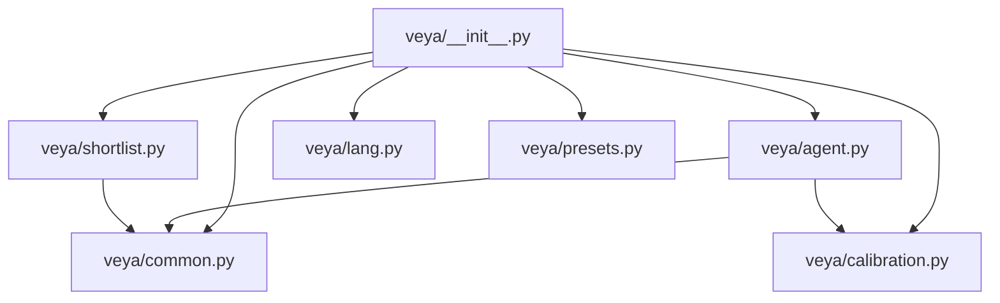
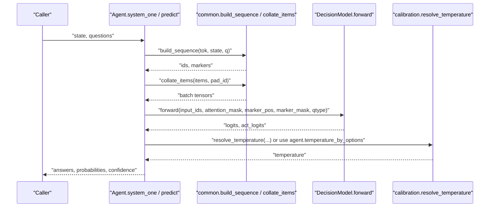
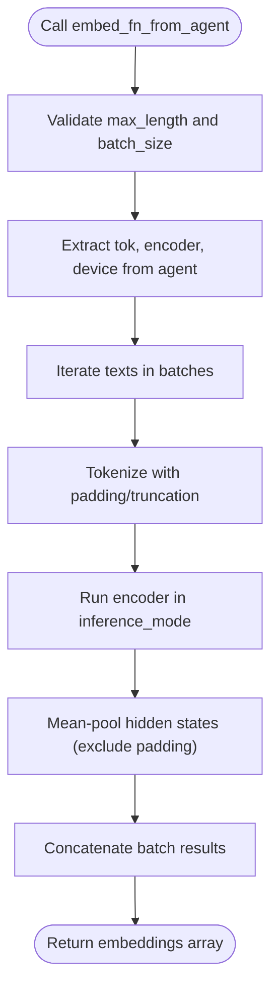
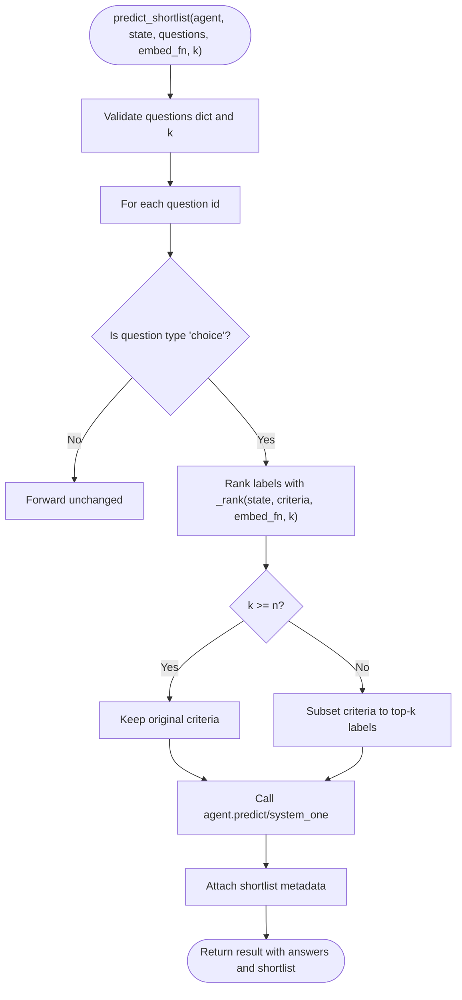
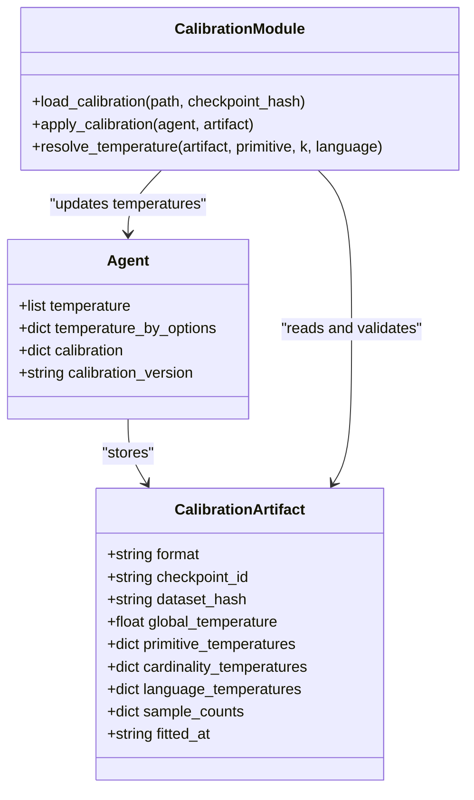
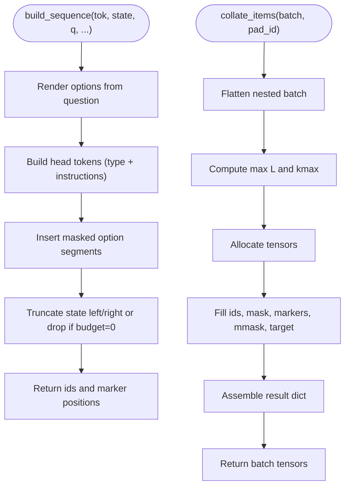
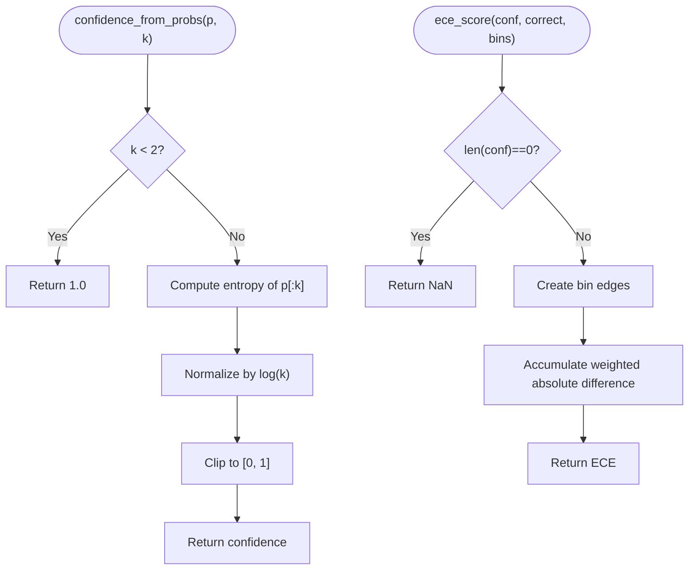
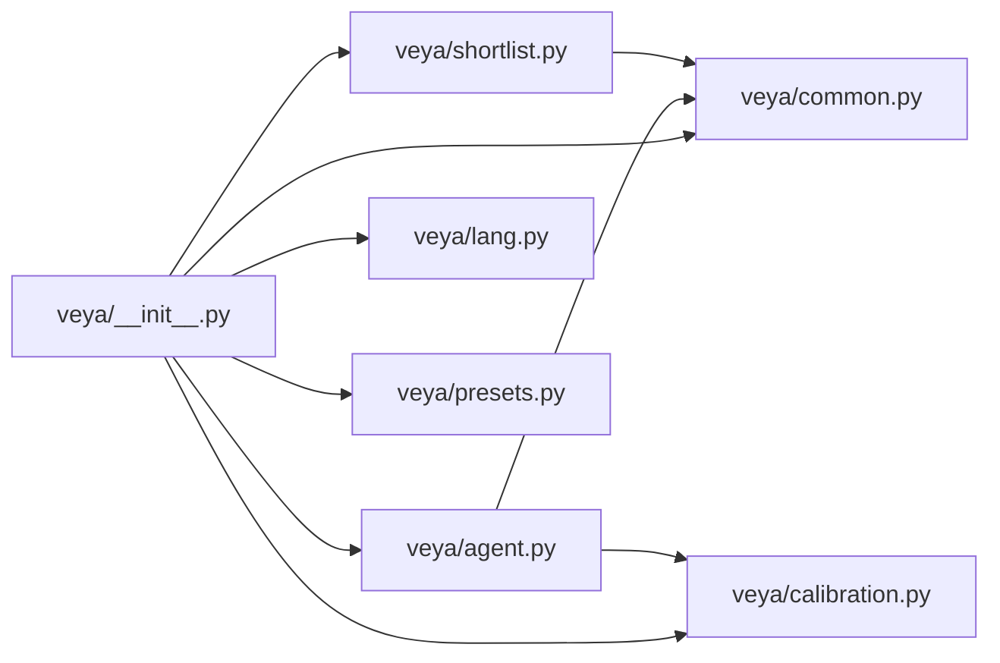

# Utility Functions

<cite>
**Referenced Files in This Document**   
- [veya/__init__.py](file://veya/__init__.py)
- [veya/agent.py](file://veya/agent.py)
- [veya/common.py](file://veya/common.py)
- [veya/calibration.py](file://veya/calibration.py)
- [veya/shortlist.py](file://veya/shortlist.py)
- [veya/lang.py](file://veya/lang.py)
- [veya/presets.py](file://veya/presets.py)
</cite>

## Table of Contents
1. [Introduction](#introduction)
2. [Project Structure](#project-structure)
3. [Core Components](#core-components)
4. [Architecture Overview](#architecture-overview)
5. [Detailed Component Analysis](#detailed-component-analysis)
6. [Dependency Analysis](#dependency-analysis)
7. [Performance Considerations](#performance-considerations)
8. [Troubleshooting Guide](#troubleshooting-guide)
9. [Conclusion](#conclusion)
10. [Appendices](#appendices)

## Introduction
This document explains Veya’s utility functions and helper methods that power high-performance, calibrated decision inference. It focuses on:

- Extracting embedding capabilities from loaded agents with `embed_fn_from_agent()`.
- High-cardinality classification through candidate optimization with `predict_shortlist()`.
- Probability calibration utilities including `apply_calibration()` and `load_calibration()`.
- Sequence building and batching helpers such as `build_sequence()` and `collate_items()`.
- Confidence calculation and temperature scaling utilities.
- Practical usage patterns for custom workflows, extending Veya, and integrating with existing ML pipelines.

The goal is to make these utilities accessible to both new users and experienced practitioners who need to extend or integrate Veya into production systems.

## Project Structure
Veya exposes its public API through the package entry point and organizes core logic across focused modules:

- `veya/__init__.py` exports top-level utilities such as `embed_fn_from_agent`, `predict_shortlist`, confidence metrics, and question presets.
- `veya/agent.py` implements the runtime agent, sequence construction, batching, inference, and calibration application.
- `veya/common.py` provides shared model architecture, sequence formatting, confidence scoring, ECE, reward computation, and collation.
- `veya/calibration.py` implements versioned temperature calibration artifacts and resolution.
- `veya/shortlist.py` implements shortlisting for large label sets using cosine similarity over embeddings.
- `veya/lang.py` provides language/script detection utilities used by routing and guardrails.
- `veya/presets.py` provides ready-to-use question schemas for common workflows.

**Diagram sources**
- [veya/__init__.py:1-56](file://veya/__init__.py#L1-L56)
- [veya/agent.py:1-432](file://veya/agent.py#L1-L432)
- [veya/common.py:1-333](file://veya/common.py#L1-L333)
- [veya/calibration.py:1-193](file://veya/calibration.py#L1-L193)
- [veya/shortlist.py:1-322](file://veya/shortlist.py#L1-L322)
- [veya/lang.py:1-266](file://veya/lang.py#L1-L266)
- [veya/presets.py:1-188](file://veya/presets.py#L1-L188)

**Section sources**
- [veya/__init__.py:1-56](file://veya/__init__.py#L1-L56)

## Core Components
This section summarizes the key utility families exposed by Veya:

- Embedding extraction:
  - `embed_fn_from_agent(agent, max_length=512, batch_size=32)` returns a callable that mean-pools encoder hidden states for batches of text.
- Shortlist prediction:
  - `predict_shortlist(agent, state, questions, embed_fn, k, **kwargs)` reduces choice questions to top-k candidates before calling the agent’s `predict` or `system_one`.
  - `shortlist_choice(state, criteria, embed_fn, k, instructions=None)` ranks labels by cosine similarity without running the decision head.
- Calibration:
  - `load_calibration(path, checkpoint_hash=None)` validates and loads a calibration artifact.
  - `apply_calibration(agent, artifact)` overlays fitted temperatures onto an agent’s temperature maps.
  - `resolve_temperature(artifact, primitive, k, language=None)` resolves a per-bucket temperature.
- Sequence building and batching:
  - `build_sequence(tok, state, q, max_len, head_max_len, option_order, truncate_left, option_token_cap)` formats typed questions into token sequences with marker positions.
  - `collate_items(batch, pad_id)` pads and stacks items into tensors suitable for model forward passes.
- Confidence and calibration utilities:
  - `confidence_from_probs(p, k)` computes normalized Shannon entropy confidence.
  - `ece_score(conf, correct, bins=15)` computes expected calibration error.
  - `clamp_temperature(t, lo=TEMP_MIN, hi=TEMP_MAX)` clamps temperatures to a safe range.
  - `temp_bucket(qtype, k)` groups temperatures by question type and cardinality.

**Section sources**
- [veya/__init__.py:1-56](file://veya/__init__.py#L1-L56)
- [veya/shortlist.py:1-322](file://veya/shortlist.py#L1-L322)
- [veya/calibration.py:1-193](file://veya/calibration.py#L1-L193)
- [veya/common.py:1-333](file://veya/common.py#L1-L333)

## Architecture Overview
At runtime, Veya transforms user-defined questions into structured sequences, runs a single parallel forward pass over a transformer-based decision model, applies temperature scaling, and returns calibrated probabilities and confidence scores. For high-cardinality choice tasks, shortlisting reduces the number of options scored by the decision head.

**Diagram sources**
- [veya/agent.py:291-416](file://veya/agent.py#L291-L416)
- [veya/common.py:64-111](file://veya/common.py#L64-L111)
- [veya/common.py:298-333](file://veya/common.py#L298-L333)
- [veya/common.py:114-161](file://veya/common.py#L114-L161)
- [veya/calibration.py:136-150](file://veya/calibration.py#L136-L150)

## Detailed Component Analysis

### Embedding Extraction: `embed_fn_from_agent()`
`embed_fn_from_agent()` wraps a loaded agent’s tokenizer and encoder to produce fixed-size embeddings for arbitrary text lists. It:

- Validates `max_length` and `batch_size`.
- Uses the agent’s tokenizer to encode texts with padding and truncation.
- Runs the encoder in inference mode.
- Mean-pools hidden states while excluding padding tokens.
- Returns NumPy arrays suitable for cosine ranking.

**Diagram sources**
- [veya/shortlist.py:151-203](file://veya/shortlist.py#L151-L203)

**Section sources**
- [veya/shortlist.py:151-203](file://veya/shortlist.py#L151-L203)

### High-Cardinality Classification: `predict_shortlist()`
`predict_shortlist()` optimizes performance when a choice question has many labels. It:

- Checks input types and question structure.
- For each choice question, ranks labels via cosine similarity against the query.
- Keeps top-k labels; if k >= n, it passes through without embedding.
- Subsets criteria to the selected labels.
- Calls the agent’s `predict` or `system_one` once on the reduced set.
- Adds a `shortlist` metadata field describing labels, scores, k, n, and passthrough behavior.

**Diagram sources**
- [veya/shortlist.py:91-148](file://veya/shortlist.py#L91-L148)
- [veya/shortlist.py:206-219](file://veya/shortlist.py#L206-L219)
- [veya/shortlist.py:308-314](file://veya/shortlist.py#L308-L314)

**Section sources**
- [veya/shortlist.py:91-148](file://veya/shortlist.py#L91-L148)
- [veya/shortlist.py:206-219](file://veya/shortlist.py#L206-L219)
- [veya/shortlist.py:308-314](file://veya/shortlist.py#L308-L314)

### Calibration Utilities: `apply_calibration()` and `load_calibration()`
Calibration improves probability reliability by fitting temperature parameters per group and cardinality bucket. Key behaviors:

- `load_calibration(path, checkpoint_hash=None)` enforces format, split role, scorer identity, and optional checkpoint hash matching.
- `apply_calibration(agent, artifact)` merges fitted temperatures into the agent’s temperature maps and records calibration metadata.
- `resolve_temperature(artifact, primitive, k, language=None)` selects the most specific available temperature: language+bucket, bucket, primitive, then global.

**Diagram sources**
- [veya/calibration.py:159-193](file://veya/calibration.py#L159-L193)
- [veya/calibration.py:136-150](file://veya/calibration.py#L136-L150)

**Section sources**
- [veya/calibration.py:159-193](file://veya/calibration.py#L159-L193)
- [veya/calibration.py:136-150](file://veya/calibration.py#L136-L150)

### Sequence Building: `build_sequence()` and `collate_items()`
`build_sequence()` formats typed questions into token sequences with special markers indicating where options should be scored. It:

- Renders option texts based on question type and criteria.
- Builds a head segment containing question type and instructions.
- Inserts masked option segments within a bounded head length.
- Appends serialized state and separators.
- Handles truncation direction and zero-budget edge cases.
- Returns token IDs and marker positions.

`collate_items()` converts a list of item dicts into padded tensors:

- Computes maximum sequence length and maximum number of markers.
- Allocates tensors for input IDs, attention masks, marker positions, and marker masks.
- Optionally includes targets and labels.
- Preserves metadata fields not consumed by the model.

**Diagram sources**
- [veya/common.py:64-111](file://veya/common.py#L64-L111)
- [veya/common.py:298-333](file://veya/common.py#L298-L333)

**Section sources**
- [veya/common.py:64-111](file://veya/common.py#L64-L111)
- [veya/common.py:298-333](file://veya/common.py#L298-L333)

### Confidence Calculation and Temperature Scaling
Confidence and temperature utilities ensure reliable decision outputs:

- `confidence_from_probs(p, k)` computes normalized Shannon entropy confidence, capping at [0, 1].
- `ece_score(conf, correct, bins=15)` measures calibration quality across confidence bins.
- `clamp_temperature(t, lo=TEMP_MIN, hi=TEMP_MAX)` prevents extreme sharpening or softening.
- `temp_bucket(qtype, k)` groups temperatures by question type and cardinality bucket.
- `safe_automation_coverage(correct, confidence, epsilon)` finds the largest confident subset with bounded error rate.

**Diagram sources**
- [veya/common.py:261-267](file://veya/common.py#L261-L267)
- [veya/common.py:222-234](file://veya/common.py#L222-L234)
- [veya/common.py:283-291](file://veya/common.py#L283-L291)
- [veya/common.py:270-272](file://veya/common.py#L270-L272)
- [veya/common.py:237-258](file://veya/common.py#L237-L258)

**Section sources**
- [veya/common.py:261-267](file://veya/common.py#L261-L267)
- [veya/common.py:222-234](file://veya/common.py#L222-L234)
- [veya/common.py:283-291](file://veya/common.py#L283-L291)
- [veya/common.py:270-272](file://veya/common.py#L270-L272)
- [veya/common.py:237-258](file://veya/common.py#L237-L258)

### Practical Usage Patterns

#### Using `embed_fn_from_agent()` for Custom Retrieval
- Load a Veya agent.
- Create an embedding function from the agent’s encoder.
- Use the embedding function with `shortlist_choice()` to rank labels by cosine similarity.
- Optionally pass the resulting top-k labels into `predict_shortlist()` to reduce decision head load.

Best practices:
- Choose `max_length` consistent with your tokenizer and context window.
- Tune `batch_size` according to memory constraints.
- Prefer a dedicated bi-encoder for retrieval if you have one; this helper is convenient but not optimized for retrieval-only workloads.

#### Extending Veya with Shortlisted Predictions
- Wrap your agent call with `predict_shortlist()`.
- Provide an `embed_fn` that returns shape `(n_texts, dim)` embeddings.
- Set `k` based on trade-offs between accuracy and latency.
- Inspect the returned `shortlist` metadata to understand which questions were shortened and how many candidates were considered.

#### Integrating Calibration into Existing Pipelines
- Fit temperatures on a held-out calibration split using `fit_temperature()` or `fit_groups()`.
- Build a calibration artifact with `build_artifact()`.
- Save it with `dump_calibration()` and load it with `load_calibration()`.
- Apply it to an agent with `apply_calibration()` before inference.
- Use `resolve_temperature()` to select appropriate temperatures during evaluation or custom scoring.

#### Combining Confidence and Automation Coverage
- After inference, collect per-example confidence and correctness.
- Use `safe_automation_coverage()` to determine the highest-confidence subset satisfying an error budget.
- Gate downstream automation on coverage thresholds derived from this metric.

**Section sources**
- [veya/shortlist.py:67-88](file://veya/shortlist.py#L67-L88)
- [veya/shortlist.py:91-148](file://veya/shortlist.py#L91-L148)
- [veya/calibration.py:64-89](file://veya/calibration.py#L64-L89)
- [veya/calibration.py:92-133](file://veya/calibration.py#L92-L133)
- [veya/calibration.py:153-172](file://veya/calibration.py#L153-L172)
- [veya/common.py:237-258](file://veya/common.py#L237-L258)

## Dependency Analysis
The following diagram shows how the main utility modules depend on each other:

**Diagram sources**
- [veya/__init__.py:1-56](file://veya/__init__.py#L1-L56)
- [veya/agent.py:1-432](file://veya/agent.py#L1-L432)
- [veya/common.py:1-333](file://veya/common.py#L1-L333)
- [veya/calibration.py:1-193](file://veya/calibration.py#L1-L193)
- [veya/shortlist.py:1-322](file://veya/shortlist.py#L1-L322)
- [veya/lang.py:1-266](file://veya/lang.py#L1-L266)
- [veya/presets.py:1-188](file://veya/presets.py#L1-L188)

**Section sources**
- [veya/__init__.py:1-56](file://veya/__init__.py#L1-L56)

## Performance Considerations
- Batch processing:
  - `embed_fn_from_agent()` supports configurable `batch_size`; tune it to balance throughput and memory.
  - `collate_items()` efficiently packs variable-length sequences and markers into tensors.
- Shortlisting:
  - Use `predict_shortlist()` for high-cardinality choices to avoid filling the head window with too many options.
  - The production route prefers learned shortlist K=8 beyond a threshold; cosine ranking here is a benchmark helper.
- Device placement and fallbacks:
  - The agent automatically falls back to CPU on GPU memory errors and warns about slower inference.
  - Mixed precision is enabled on CUDA when supported; dtype selection respects device capabilities.
- Temperature clamping:
  - Temperatures are clamped to prevent pathological sharpening or softening.
  - Bucketed temperatures allow fine-grained calibration per question type and cardinality.

[No sources needed since this section provides general guidance]

## Troubleshooting Guide
Common issues and resolutions:

- Invalid question definitions:
  - Ensure every question has `type` and `instructions`.
  - Choice criteria must be non-empty and contain unique labels after normalization.
  - Score criteria must contain at least two ordered levels.
- Excessive label count:
  - If choice criteria exceed the candidate limit, normalize or prune labels.
  - Use shortlisting to reduce the effective label set.
- Calibration artifact mismatch:
  - Verify the artifact format, fitting split, scorer ID, and optional checkpoint hash.
  - Do not mix artifacts trained on different checkpoints or scorers.
- Embedding output shape:
  - `embed_fn` must return a 2D array with shape `(n_texts, dim)`.
  - Handle None inputs gracefully; the helper normalizes them to empty strings.
- Memory pressure:
  - Reduce `max_length`, `batch_size`, or `k`.
  - Allow automatic CPU fallback if GPU memory is insufficient.

**Section sources**
- [veya/agent.py:264-289](file://veya/agent.py#L264-L289)
- [veya/shortlist.py:222-253](file://veya/shortlist.py#L222-L253)
- [veya/shortlist.py:280-292](file://veya/shortlist.py#L280-L292)
- [veya/calibration.py:159-172](file://veya/calibration.py#L159-L172)

## Conclusion
Veya’s utility functions provide a cohesive toolkit for efficient, calibrated decision inference. By combining sequence construction, batching, shortlisting, and temperature calibration, they enable robust workflows for both low- and high-cardinality classification tasks. Practitioners can extend Veya by plugging in custom embedding functions, calibrating probabilities on domain-specific data, and composing confidence-aware automation policies.

[No sources needed since this section summarizes without analyzing specific files]

## Appendices

### Public API Summary
- Embeddings:
  - `embed_fn_from_agent(agent, max_length=512, batch_size=32)`
- Shortlisting:
  - `predict_shortlist(agent, state, questions, embed_fn, k, **kwargs)`
  - `shortlist_choice(state, criteria, embed_fn, k, instructions=None)`
- Calibration:
  - `load_calibration(path, checkpoint_hash=None)`
  - `apply_calibration(agent, artifact)`
  - `resolve_temperature(artifact, primitive, k, language=None)`
- Sequences and batching:
  - `build_sequence(tok, state, q, max_len=512, head_max_len=192, option_order=None, truncate_left=False, option_token_cap=48)`
  - `collate_items(batch, pad_id)`
- Confidence and metrics:
  - `confidence_from_probs(p, k)`
  - `ece_score(conf, correct, bins=15)`
  - `safe_automation_coverage(correct, confidence, epsilon)`
- Temperature utilities:
  - `clamp_temperature(t, lo=TEMP_MIN, hi=TEMP_MAX)`
  - `temp_bucket(qtype, k)`

**Section sources**
- [veya/__init__.py:1-56](file://veya/__init__.py#L1-L56)
- [veya/shortlist.py:67-203](file://veya/shortlist.py#L67-L203)
- [veya/calibration.py:64-193](file://veya/calibration.py#L64-L193)
- [veya/common.py:64-333](file://veya/common.py#L64-L333)