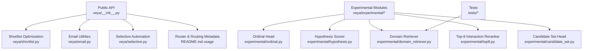
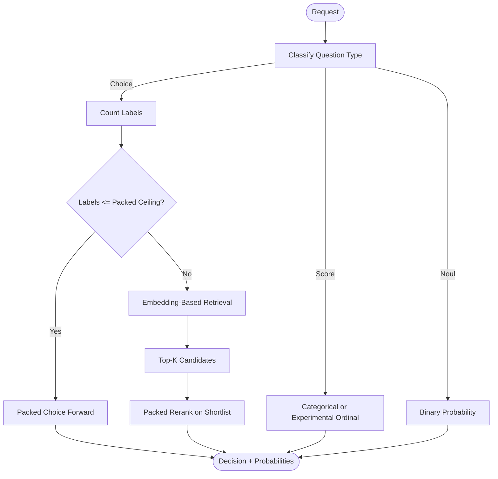
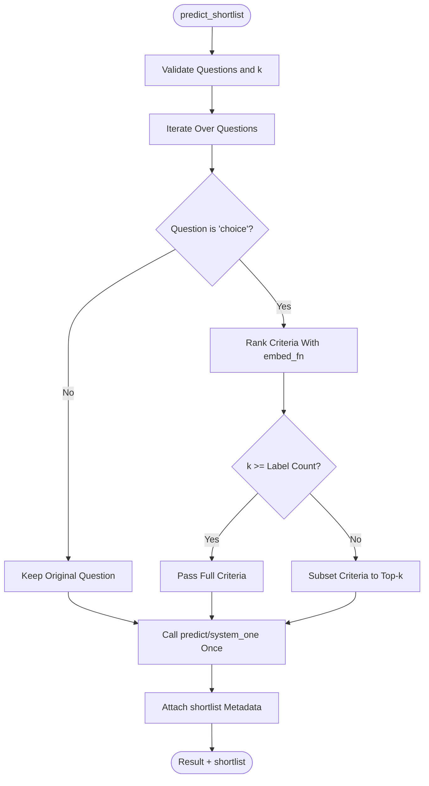
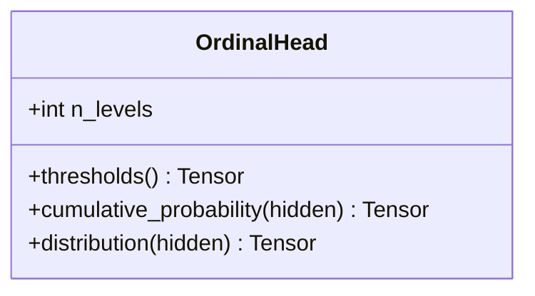
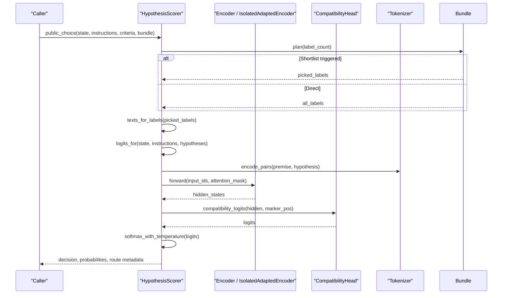
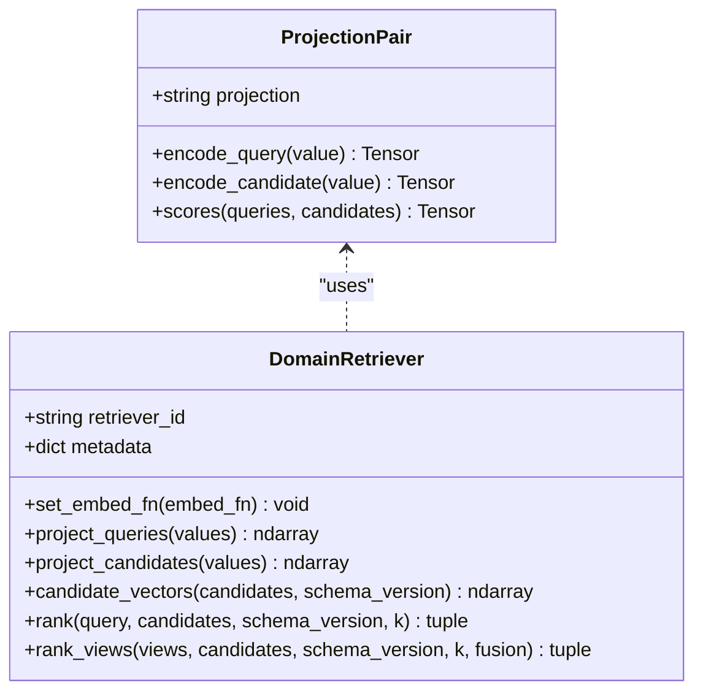
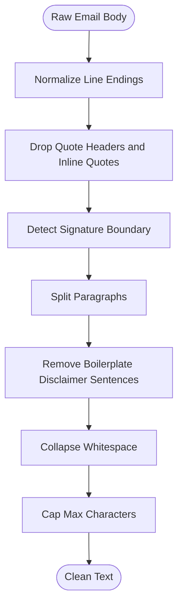
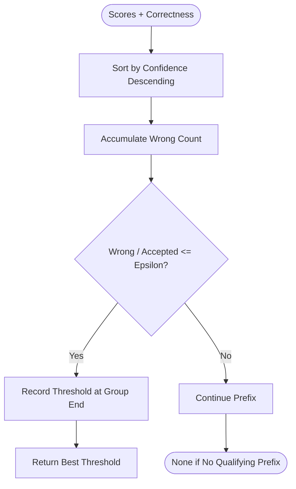
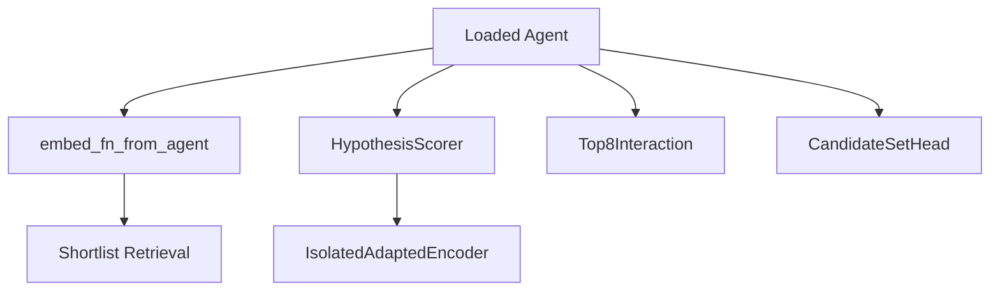
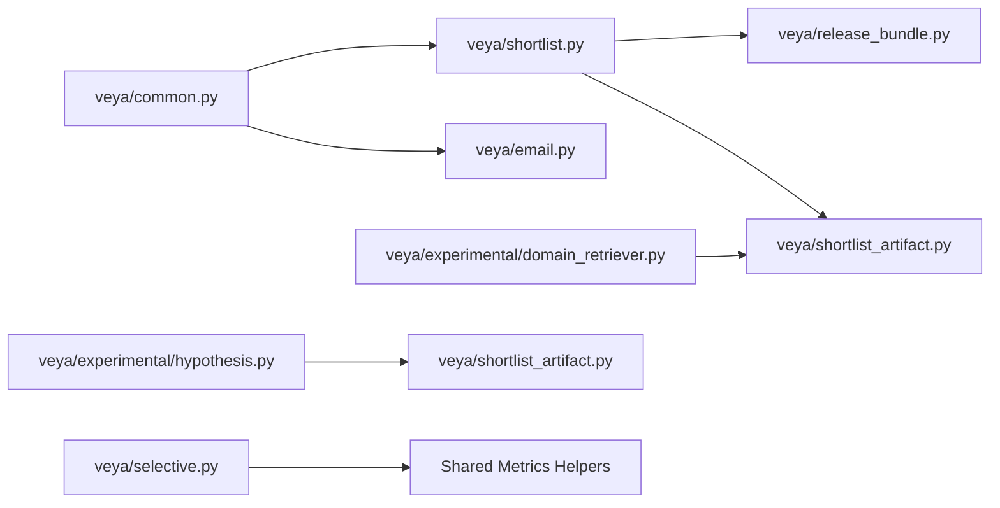

# Advanced Features

<cite>
**Referenced Files in This Document**   
- [README.md](file://README.md)
- [veya/__init__.py](file://veya/__init__.py)
- [veya/shortlist.py](file://veya/shortlist.py)
- [veya/experimental/ordinal.py](file://veya/experimental/ordinal.py)
- [veya/experimental/hypothesis.py](file://veya/experimental/hypothesis.py)
- [veya/experimental/domain_retriever.py](file://veya/experimental/domain_retriever.py)
- [veya/email.py](file://veya/email.py)
- [veya/selective.py](file://veya/selective.py)
- [veya/experimental/top8.py](file://veya/experimental/top8.py)
- [veya/experimental/candidate_set.py](file://veya/experimental/candidate_set.py)
- [tests/test_phase10_retriever.py](file://tests/test_phase10_retriever.py)
</cite>

## Table of Contents
1. [Introduction](#introduction)
2. [Project Structure](#project-structure)
3. [Core Components](#core-components)
4. [Architecture Overview](#architecture-overview)
5. [Detailed Component Analysis](#detailed-component-analysis)
6. [Dependency Analysis](#dependency-analysis)
7. [Performance Considerations](#performance-considerations)
8. [Troubleshooting Guide](#troubleshooting-guide)
9. [Conclusion](#conclusion)

## Introduction
This document explains Veya’s advanced and experimental features with a focus on high-cardinality decision workloads, domain-specific retrieval, ordinal scoring, hypothesis evaluation, email processing utilities, selective automation, and custom model integration patterns. It is intended for engineers deploying or extending Veya beyond the basic single-question API.

The repository provides:
- A production-oriented shortlist system that switches between packed Choice and learned embedding-based candidate retrieval.
- Experimental modules for ordinal scoring, hypothesis compatibility scoring, and domain-general retrievers.
- Email preprocessing utilities and question presets.
- Selective inference tools for confidence-gated automation.
- Small experimental reranking heads and candidate-scoring primitives.

The audited release path uses English Choice as its primary production route; multilingual, ordinal, and Phase 9 hypothesis components are research-only unless explicitly integrated by the caller.

**Section sources**
- [README.md:27-46](file://README.md#L27-L46)
- [veya/__init__.py:1-25](file://veya/__init__.py#L1-L25)

## Project Structure
At a high level, the advanced feature surface is split across:
- `veya/`: core public API, routing, shortlist optimization, email utilities, selective thresholds, and release-time helpers.
- `veya/experimental/`: research-grade heads, hypothesis scorer, domain retriever, top-8 interaction scorer, and candidate-set scorer.
- `research/` and `artifacts/`: training scripts, benchmarks, and experiment artifacts used to select or validate advanced components.
- `tests/`: validation for experimental retrievers, rerankers, shortlists, selective behavior, and end-to-end flows.

**Diagram sources**
- [veya/__init__.py:1-25](file://veya/__init__.py#L1-L25)
- [veya/shortlist.py:1-40](file://veya/shortlist.py#L1-L40)
- [veya/email.py:1-21](file://veya/email.py#L1-L21)
- [veya/selective.py:1-34](file://veya/selective.py#L1-L34)
- [veya/experimental/ordinal.py:1-35](file://veya/experimental/ordinal.py#L1-L35)
- [veya/experimental/hypothesis.py:1-20](file://veya/experimental/hypothesis.py#L1-L20)
- [veya/experimental/domain_retriever.py:1-34](file://veya/experimental/domain_retriever.py#L1-L34)
- [veya/experimental/top8.py:1-25](file://veya/experimental/top8.py#L1-L25)
- [veya/experimental/candidate_set.py:1-26](file://veya/experimental/candidate_set.py#L1-L26)

**Section sources**
- [veya/__init__.py:1-56](file://veya/__init__.py#L1-L56)
- [README.md:58-70](file://README.md#L58-L70)

## Core Components
This section summarizes the advanced capabilities exposed to callers.

| Area | Primary Responsibility | Key Entry Points |
|---|---|---|
| Shortlist optimization | High-cardinality choice handling via packed Choice or learned shortlist retrieval | `production_choice_plan`, `predict_shortlist`, `embed_fn_from_agent` |
| Experimental ordinal scoring | Ordered score distribution modeling | `OrdinalHead` |
| Experimental hypothesis evaluation | State-hypothesis compatibility scoring with calibrated probabilities | `HypothesisScorer`, `load_compatible_scorer` |
| Experimental domain retriever | Frozen-backbone biencoder retrieval with query views and fusion | `DomainRetriever`, `configure_experimental_retriever` |
| Email processing | Cleaning quoted history, signatures, disclaimers, and building structured state | `clean_email_body`, `email_state`, `email_questions` |
| Selective inference | Confidence gating and risk-controlled automation | `score_probabilities`, `select_threshold`, `apply_report` |
| Custom model integration | Embedding wrappers, reranking heads, and isolated encoder adaptation | `embed_fn_from_agent`, `IsolatedAdaptedEncoder`, `Top8Interaction`, `CandidateSetHead` |

**Section sources**
- [veya/shortlist.py:1-40](file://veya/shortlist.py#L1-L40)
- [veya/experimental/ordinal.py:1-35](file://veya/experimental/ordinal.py#L1-L35)
- [veya/experimental/hypothesis.py:1-20](file://veya/experimental/hypothesis.py#L1-L20)
- [veya/experimental/domain_retriever.py:1-34](file://veya/experimental/domain_retriever.py#L1-L34)
- [veya/email.py:1-21](file://veya/email.py#L1-L21)
- [veya/selective.py:1-34](file://veya/selective.py#L1-L34)

## Architecture Overview
Veya’s advanced workflow for high-cardinality tasks follows a staged design:

1. **Question classification**: The caller defines typed questions (`choice`, `score`, `noul`).
2. **Cardinality planning**: For `choice` questions, Veya chooses between packed scoring and shortlist retrieval based on label count.
3. **Embedding-based candidate retrieval**: An optional domain retriever or shared encoder embeddings rank candidates.
4. **Packed reranking**: The final decision head scores the shortlisted candidates in one forward pass.
5. **Optional hypothesis or ordinal extension**: Research-grade scorers can replace or augment the standard path when explicitly loaded.

**Diagram sources**
- [README.md:255-262](file://README.md#L255-L262)
- [veya/shortlist.py:25-55](file://veya/shortlist.py#L25-L55)
- [veya/experimental/hypothesis.py:378-451](file://veya/experimental/hypothesis.py#L378-L451)

## Detailed Component Analysis

### Shortlist Optimization System
The shortlist module implements the production strategy for high-cardinality choice tasks. It avoids token-budget collapse by switching from packed Choice to an embedding-based shortlist once the number of options exceeds a safe ceiling.

Key behaviors:
- Packed Choice is preferred while every option marker fits within the tokenizer window.
- Learned shortlist retrieval is selected for large label sets, typically using K=8.
- Cosine similarity ranking is available as a helper, but the production route uses a saved projection rather than frozen cosine retrieval.
- `predict_shortlist` reduces each choice question to its top-k labels and calls the agent once, returning both the model result and shortlist metadata.

**Diagram sources**
- [veya/shortlist.py:91-148](file://veya/shortlist.py#L91-L148)
- [veya/shortlist.py:206-219](file://veya/shortlist.py#L206-L219)
- [veya/shortlist.py:308-314](file://veya/shortlist.py#L308-L314)

Important implementation details:
- `production_choice_plan` returns either `"packed"` or `"shortlist"` with K=8 for production routes.
- `choose_choice_path` selects packed vs shortlist based on a marker ceiling.
- `embed_fn_from_agent` exposes mean-pooled encoder embeddings without running the decision head.
- Input validation enforces positive integers for `k`, bounded candidate counts, non-empty normalized labels, and maximum character limits.

**Section sources**
- [veya/shortlist.py:1-40](file://veya/shortlist.py#L1-L40)
- [veya/shortlist.py:43-64](file://veya/shortlist.py#L43-L64)
- [veya/shortlist.py:67-88](file://veya/shortlist.py#L67-L88)
- [veya/shortlist.py:91-148](file://veya/shortlist.py#L91-L148)
- [veya/shortlist.py:151-203](file://veya/shortlist.py#L151-L203)
- [veya/shortlist.py:222-321](file://veya/shortlist.py#L222-L321)

### Experimental Ordinal Scoring
The ordinal module provides an ordered score head where cumulative thresholds remain ordered through softplus gaps. Class probabilities are derived from adjacent differences of cumulative probabilities, ensuring a valid distribution over levels.

Design characteristics:
- Requires at least two levels.
- Uses a linear projection plus learnable gaps.
- Produces cumulative probabilities and then class probabilities.
- Not used by `Agent.predict`; it is an experimental head.

**Diagram sources**
- [veya/experimental/ordinal.py:11-35](file://veya/experimental/ordinal.py#L11-L35)

**Section sources**
- [veya/experimental/ordinal.py:1-35](file://veya/experimental/ordinal.py#L1-L35)

### Experimental Hypothesis Evaluation
The hypothesis module implements independent state-hypothesis compatibility scoring. Each candidate becomes a hypothesis pair with the state and question as the premise. Scores are softmax-normalized over the candidate set.

Key responsibilities:
- Build premise/hypothesis segments with strict formatting and leakage checks.
- Encode pairs and extract a compatibility scalar from a designated mask position.
- Support isolated encoder adaptation so the shared production encoder is not mutated.
- Load compatible heads, deltas, and calibration records with strong identity checks.
- Provide a public interface that integrates with shortlist planning and temperature scaling.

**Diagram sources**
- [veya/experimental/hypothesis.py:378-451](file://veya/experimental/hypothesis.py#L378-L451)
- [veya/experimental/hypothesis.py:73-108](file://veya/experimental/hypothesis.py#L73-L108)
- [veya/experimental/hypothesis.py:111-125](file://veya/experimental/hypothesis.py#L111-L125)
- [veya/experimental/hypothesis.py:138-168](file://veya/experimental/hypothesis.py#L138-L168)
- [veya/experimental/hypothesis.py:231-242](file://veya/experimental/hypothesis.py#L231-L242)

Validation and safety:
- Duplicate hypothesis text is rejected.
- H2 requires authoritative definitions and rejects contrastive boundary phrasing.
- Calibration records enforce route, K, method, temperature, checkpoint hash, shortlist hash, head hash, delta hash, template version, and start layer.

**Section sources**
- [veya/experimental/hypothesis.py:1-20](file://veya/experimental/hypothesis.py#L1-L20)
- [veya/experimental/hypothesis.py:22-48](file://veya/experimental/hypothesis.py#L22-L48)
- [veya/experimental/hypothesis.py:51-63](file://veya/experimental/hypothesis.py#L51-L63)
- [veya/experimental/hypothesis.py:73-108](file://veya/experimental/hypothesis.py#L73-L108)
- [veya/experimental/hypothesis.py:111-135](file://veya/experimental/hypothesis.py#L111-L135)
- [veya/experimental/hypothesis.py:138-228](file://veya/experimental/hypothesis.py#L138-L228)
- [veya/experimental/hypothesis.py:287-361](file://veya/experimental/hypothesis.py#L287-L361)
- [veya/experimental/hypothesis.py:378-451](file://veya/experimental/hypothesis.py#L378-L451)

### Experimental Domain-Specific Retrievers
The domain retriever module provides a frozen-backbone biencoder retrieval path with deterministic exact ranking, candidate caching, and multiple query-view strategies.

Core concepts:
- `ProjectionPair` learns separate or shared query/candidate projections into a cosine-compatible space.
- `DomainRetriever` caches projected candidate vectors by retriever ID, schema version, and content hash.
- Query construction supports simple serialized state, bounded semantic views, and Phase-11 adaptive windows.
- Score fusion supports first view, max, mean, and reciprocal rank fusion.
- `configure_experimental_retriever` patches a bundle’s shortlist behavior to use the experimental retriever.

**Diagram sources**
- [veya/experimental/domain_retriever.py:258-284](file://veya/experimental/domain_retriever.py#L258-L284)
- [veya/experimental/domain_retriever.py:287-402](file://veya/experimental/domain_retriever.py#L287-L402)

Query view policies:
- Basic views expose structured fields and full serialized state.
- Phase-11 views support single, first-last, first-middle-last, four-view, and adaptive policies with bounded windows.
- Fusion methods include first, max, mean, and reciprocal rank fusion.

Integration:
- `configure_experimental_retriever` validates mode, artifact path, and checkpoint hash, then wraps the bundle’s shortlist function.
- Tests demonstrate identity projections and metadata expectations.

**Section sources**
- [veya/experimental/domain_retriever.py:1-34](file://veya/experimental/domain_retriever.py#L1-L34)
- [veya/experimental/domain_retriever.py:37-97](file://veya/experimental/domain_retriever.py#L37-L97)
- [veya/experimental/domain_retriever.py:100-130](file://veya/experimental/domain_retriever.py#L100-L130)
- [veya/experimental/domain_retriever.py:133-204](file://veya/experimental/domain_retriever.py#L133-L204)
- [veya/experimental/domain_retriever.py:207-255](file://veya/experimental/domain_retriever.py#L207-L255)
- [veya/experimental/domain_retriever.py:258-402](file://veya/experimental/domain_retriever.py#L258-L402)
- [veya/experimental/domain_retriever.py:405-460](file://veya/experimental/domain_retriever.py#L405-L460)
- [veya/experimental/domain_retriever.py:463-559](file://veya/experimental/domain_retriever.py#L463-L559)
- [tests/test_phase10_retriever.py:1-56](file://tests/test_phase10_retriever.py#L1-L56)

### Email Processing Utilities
Email utilities clean noisy email bodies and provide ready-to-use triage questions.

Capabilities:
- Remove quoted reply headers and inline quotes.
- Detect and truncate signature blocks.
- Strip boilerplate disclaimer paragraphs sentence-by-sentence.
- Normalize whitespace and cap output length.
- Build structured state dictionaries with optional sender and extra fields.
- Provide default categories for department routing, spam/phishing detection, urgency scoring, and reply expectation.

**Diagram sources**
- [veya/email.py:24-55](file://veya/email.py#L24-L55)

**Section sources**
- [veya/email.py:1-21](file://veya/email.py#L1-L21)
- [veya/email.py:24-55](file://veya/email.py#L24-L55)
- [veya/email.py:58-67](file://veya/email.py#L58-L67)
- [veya/email.py:70-104](file://veya/email.py#L70-L104)

### Selective Inference Patterns
Selective inference provides confidence scoring, threshold selection, and risk reporting without training a policy.

Functions:
- `score_probabilities` maps probability vectors to confidence scores such as max probability, negative entropy, or margin.
- `select_threshold` finds the lowest score that keeps the longest high-confidence prefix under a target risk epsilon.
- `apply_threshold` converts scores into a boolean automation mask.
- `risk_coverage_curve` and `apply_report` describe coverage, observed risk, Wilson intervals, and claim support.
- `load_policy` validates selective policy format, route, checkpoint hash, shortlist hash, scorer ID, score type, and thresholds.

**Diagram sources**
- [veya/selective.py:37-56](file://veya/selective.py#L37-L56)

**Section sources**
- [veya/selective.py:1-34](file://veya/selective.py#L1-L34)
- [veya/selective.py:37-64](file://veya/selective.py#L37-L64)
- [veya/selective.py:67-113](file://veya/selective.py#L67-L113)
- [veya/selective.py:116-142](file://veya/selective.py#L116-L142)

### Custom Model Integration Approaches
Veya supports custom integration through embedding functions, reranking heads, and isolated encoder adaptation.

Patterns:
- Use `embed_fn_from_agent` to reuse the loaded encoder for shortlist retrieval without downloading weights again.
- Replace or extend reranking with experimental heads like `Top8Interaction` or `CandidateSetHead`.
- Use `IsolatedAdaptedEncoder` to add private suffix layers without mutating the shared encoder.
- Integrate the hypothesis scorer with a bundle’s shortlist planning and calibration metadata.

**Diagram sources**
- [veya/shortlist.py:151-203](file://veya/shortlist.py#L151-L203)
- [veya/experimental/hypothesis.py:138-197](file://veya/experimental/hypothesis.py#L138-L197)
- [veya/experimental/top8.py:11-24](file://veya/experimental/top8.py#L11-L24)
- [veya/experimental/candidate_set.py:11-25](file://veya/experimental/candidate_set.py#L11-L25)

**Section sources**
- [veya/shortlist.py:151-203](file://veya/shortlist.py#L151-L203)
- [veya/experimental/hypothesis.py:138-197](file://veya/experimental/hypothesis.py#L138-L197)
- [veya/experimental/top8.py:1-25](file://veya/experimental/top8.py#L1-L25)
- [veya/experimental/candidate_set.py:1-26](file://veya/experimental/candidate_set.py#L1-L26)

## Dependency Analysis
Advanced components depend on shared utilities and maintain strict artifact boundaries.

**Diagram sources**
- [veya/shortlist.py:23-23](file://veya/shortlist.py#L23-L23)
- [veya/shortlist.py:280-292](file://veya/shortlist.py#L280-L292)
- [veya/experimental/domain_retriever.py:22-23](file://veya/experimental/domain_retriever.py#L22-L23)
- [veya/experimental/hypothesis.py:14-14](file://veya/experimental/hypothesis.py#L14-L14)
- [veya/experimental/hypothesis.py:321-321](file://veya/experimental/hypothesis.py#L321-L321)

Coupling and cohesion observations:
- Shortlist logic is cohesive around high-cardinality choice handling and remains decoupled from the main decision head.
- Domain retriever depends on artifact hashing and the shared encoder through an embedding function.
- Hypothesis scorer depends on tokenizer behavior, encoder internals, and artifact integrity checks.
- Selective inference is self-contained and metric-focused.

**Section sources**
- [veya/shortlist.py:1-24](file://veya/shortlist.py#L1-L24)
- [veya/experimental/domain_retriever.py:22-23](file://veya/experimental/domain_retriever.py#L22-L23)
- [veya/experimental/hypothesis.py:14-14](file://veya/experimental/hypothesis.py#L14-L14)
- [veya/selective.py:1-34](file://veya/selective.py#L1-L34)

## Performance Considerations
Recommended practices for advanced deployments:

- Prefer packed Choice for small label sets to avoid embedding overhead.
- Route large label sets to the shortlist path; K=8 is the production default for learned retrieval.
- Reuse `embed_fn_from_agent` when you already have a loaded agent to avoid duplicate weight loading.
- Preload checkpoints with `Router(preload=True)` to eliminate per-request model reload latency.
- Tune `head_max_len` and `max_len` for very large label sets so each option retains enough tokens.
- Use selective thresholds only after fitting them on a held-out validation split.
- Cache candidate vectors in the domain retriever by schema version and content hash.
- Limit query views and character bounds to prevent excessive encoding cost.
- Monitor Recall@K, conditional reranking accuracy, and end-to-end accuracy separately because retrieval is often the bottleneck.

[No sources needed since this section provides general guidance]

## Troubleshooting Guide
Common issues and their likely causes:

| Symptom | Likely Cause | Resolution |
|---|---|---|
| `k must be a positive integer` | Invalid shortlist size passed to shortlist functions | Ensure `k` is a positive integer and consistent with your cardinality plan. |
| `choice criteria exceed the 1024-candidate limit` | Too many labels in a single choice question | Split the label set or reduce `k` to a feasible shortlist size. |
| `embed_fn must return an array of shape (n, dim)` | Incorrect embedding function output shape or dtype | Verify batched encoding, device movement, and concatenation. |
| `retriever has no embedding function` | Experimental retriever configured without an embed function | Attach `embed_fn_from_agent` before calling shortlist. |
| `unsupported retriever format` or `belongs to a different base checkpoint` | Mismatched retriever artifact and model checkpoint | Load the retriever artifact produced by the same checkpoint hash. |
| `hypothesis text leaked into the premise` | Hypothesis string appears inside the serialized state/question | Rewrite the hypothesis or sanitize the state. |
| `phase-9 calibration does not match template` | Calibration record mismatched with head/delta/template | Reload the exact calibration, head, and encoder delta files. |
| `selective policy belongs to a different route/checkpoint/shortlist/scorer` | Mixing selective policy artifacts across runs | Use the policy generated for the exact route and scorer identity. |
| Very low end-to-end accuracy despite high conditional reranking accuracy | Retrieval misses dominate the pipeline | Improve candidate representation, query views, or shortlist K. |

**Section sources**
- [veya/shortlist.py:222-292](file://veya/shortlist.py#L222-L292)
- [veya/experimental/domain_retriever.py:304-350](file://veya/experimental/domain_retriever.py#L304-L350)
- [veya/experimental/domain_retriever.py:443-460](file://veya/experimental/domain_retriever.py#L443-L460)
- [veya/experimental/hypothesis.py:42-48](file://veya/experimental/hypothesis.py#L42-L48)
- [veya/experimental/hypothesis.py:287-361](file://veya/experimental/hypothesis.py#L287-L361)
- [veya/selective.py:116-142](file://veya/selective.py#L116-L142)

## Conclusion
Veya’s advanced features center on separating retrieval from reranking, preserving packed-choice efficiency for small label spaces, and providing experimental extensions for ordinal scoring, hypothesis compatibility, and domain-specific retrieval. Email utilities and selective inference make the system practical for real-world workflows, while strict artifact validation and memory-aware integration points help keep complex deployments reliable.

For production:
- Use the audited shortlist path with packed Choice and learned K=8 reranking.
- Treat multilingual, ordinal, and hypothesis components as research extensions unless explicitly validated.
- Measure retrieval quality independently from reranking quality.
- Apply selective automation only after fitting thresholds on a held-out validation split.
- Manage memory by preloading models and reusing encoder embeddings where possible.

[No sources needed since this section summarizes without analyzing specific files]