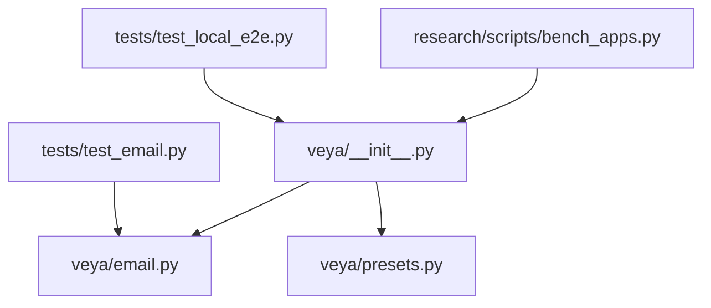
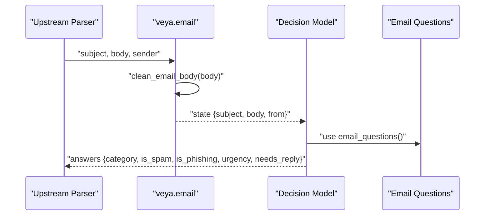
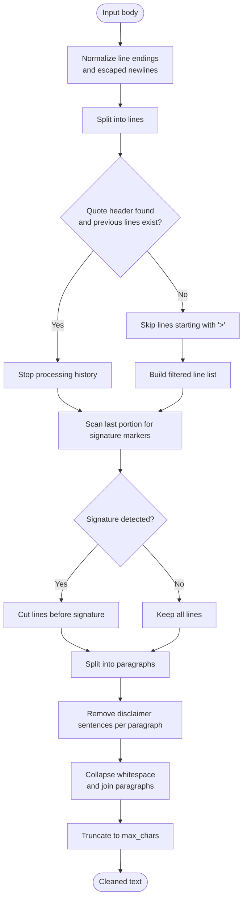
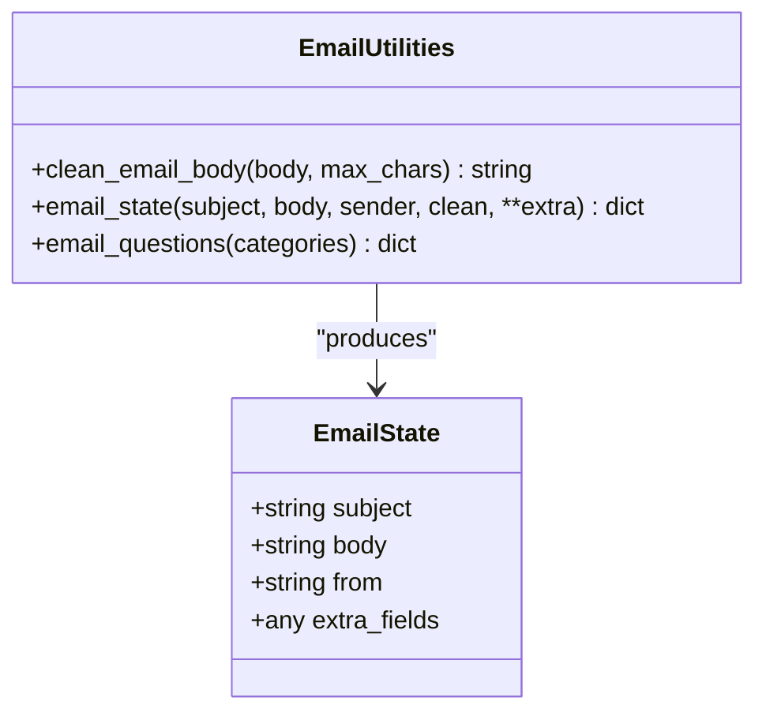
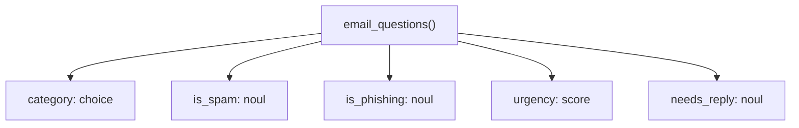
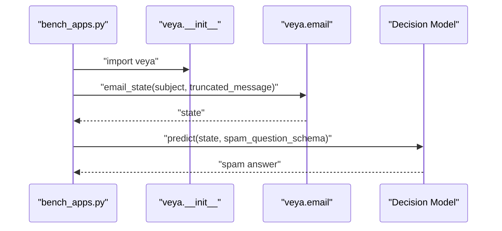
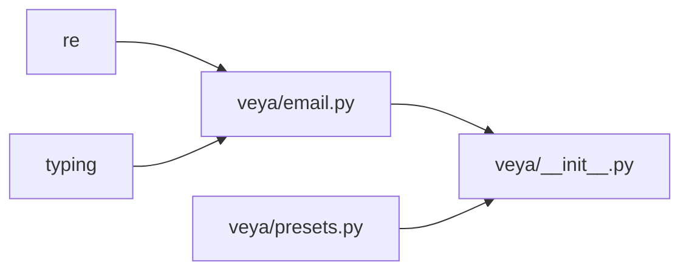

# Email Processing Utilities

<cite>
**Referenced Files in This Document**
- [email.py](file://veya/email.py)
- [__init__.py](file://veya/__init__.py)
- [presets.py](file://veya/presets.py)
- [test_email.py](file://tests/test_email.py)
- [bench_apps.py](file://research/scripts/bench_apps.py)
- [test_local_e2e.py](file://tests/test_local_e2e.py)
</cite>

## Table of Contents
1. [Introduction](#introduction)
2. [Project Structure](#project-structure)
3. [Core Components](#core-components)
4. [Architecture Overview](#architecture-overview)
5. [Detailed Component Analysis](#detailed-component-analysis)
6. [Dependency Analysis](#dependency-analysis)
7. [Performance Considerations](#performance-considerations)
8. [Troubleshooting Guide](#troubleshooting-guide)
9. [Conclusion](#conclusion)

## Introduction
This document explains Veya’s email processing utilities that prepare raw email content for decision models. The utilities focus on cleaning and structuring email inputs rather than full MIME parsing. They remove quoted history, signatures, disclaimers, and normalize whitespace so downstream classifiers can work with concise, focused text.

The main goals are:
- Normalize line endings and escape sequences.
- Remove quoted reply headers and quoted lines.
- Detect and truncate signature blocks near the end of the message.
- Strip boilerplate disclaimer sentences without accidentally deleting the sender’s actual request.
- Produce a clean state dictionary suitable for classification or routing.

## Project Structure
Veya exposes email utilities through its package interface. The implementation lives in `veya/email.py`, while the top-level package re-exports the most useful functions. Preset question schemas for email triage live in `veya/presets.py`. Tests demonstrate expected behavior and integration with decision models.

**Diagram sources**
- [__init__.py:13-42](file://veya/__init__.py#L13-L42)
- [email.py:1-105](file://veya/email.py#L1-L105)
- [presets.py:45-79](file://veya/presets.py#L45-L79)
- [test_email.py:19-113](file://tests/test_email.py#L19-L113)
- [bench_apps.py:153-162](file://research/scripts/bench_apps.py#L153-L162)
- [test_local_e2e.py:137-148](file://tests/test_local_e2e.py#L137-L148)

**Section sources**
- [email.py:1-105](file://veya/email.py#L1-L105)
- [__init__.py:13-42](file://veya/__init__.py#L13-L42)
- [presets.py:45-79](file://veya/presets.py#L45-L79)
- [test_email.py:1-113](file://tests/test_email.py#L1-L113)
- [bench_apps.py:153-162](file://research/scripts/bench_apps.py#L153-L162)
- [test_local_e2e.py:137-148](file://tests/test_local_e2e.py#L137-L148)

## Core Components
The email module provides three primary capabilities:

| Function | Purpose | Key Behavior |
|---|---|---|
| `clean_email_body(body, max_chars=3000)` | Cleans an email body string | Normalizes line endings, removes quoted history and signature blocks, strips disclaimer sentences, collapses whitespace, and truncates to a character limit. |
| `email_state(subject, body, sender=None, clean=True, **extra)` | Builds a structured state object | Produces a dictionary with subject, cleaned body, optional sender, and any extra fields. |
| `email_questions(categories=None)` | Returns preset decision questions | Defines category, spam, phishing, urgency, and reply expectations for email triage. |

These utilities are designed for decision model input. They do not parse MIME structures such as multipart boundaries, attachments, or rich HTML bodies. Instead, they operate on plain text strings after whatever upstream parser has already extracted the body.

**Section sources**
- [email.py:24-67](file://veya/email.py#L24-L67)
- [presets.py:45-79](file://veya/presets.py#L45-L79)

## Architecture Overview
At runtime, email processing is usually part of a pipeline:

1. An upstream component extracts subject, body, and optionally sender from an email source.
2. `email_state` builds a normalized state dictionary.
3. Decision models consume the state and return answers such as category, spam score, phishing risk, urgency, and whether a reply is needed.
4. Preset question schemas guide how the model interprets the input.

**Diagram sources**
- [email.py:37-67](file://veya/email.py#L37-L67)
- [presets.py:45-79](file://veya/presets.py#L45-L79)
- [bench_apps.py:153-162](file://research/scripts/bench_apps.py#L153-L162)
- [test_local_e2e.py:137-148](file://tests/test_local_e2e.py#L137-L148)

## Detailed Component Analysis

### Body Cleaning Pipeline
`clean_email_body` performs several transformations in sequence:

1. Normalize line endings and escaped newline markers.
2. Split into lines and skip quoted reply headers.
3. Drop lines starting with quote markers.
4. Detect signature blocks near the end and truncate them.
5. Split into paragraphs and strip disclaimer sentences per paragraph.
6. Collapse whitespace and truncate to `max_chars`.

**Diagram sources**
- [email.py:37-55](file://veya/email.py#L37-L55)

Key implementation details:
- Quoted history detection uses patterns for common reply headers such as “On ... wrote:”, separator lines, and explicit “From:” markers.
- Signature detection scans the last 40% to 60% of the remaining lines and looks for short lines matching known signature patterns.
- Disclaimer stripping operates at sentence granularity so that a mixed paragraph containing both boilerplate and real content keeps the real content.

**Section sources**
- [email.py:5-21](file://veya/email.py#L5-L21)
- [email.py:24-55](file://veya/email.py#L24-L55)
- [test_email.py:40-99](file://tests/test_email.py#L40-L99)

### State Construction
`email_state` creates a stable input shape for decision models:

- Always includes `subject`.
- Includes `body` either cleaned or raw depending on the `clean` flag.
- Optionally includes `from` when a sender is provided.
- Merges any additional keyword arguments whose values are not `None`.

**Diagram sources**
- [email.py:58-67](file://veya/email.py#L58-L67)

**Section sources**
- [email.py:58-67](file://veya/email.py#L58-L67)

### Email Triage Questions
`email_questions` returns a preset schema used by decision models to classify emails. It defines:

- `category`: choice among billing, technical, sales, security, hr, or other.
- `is_spam`: binary assessment of unsolicited bulk marketing.
- `is_phishing`: binary assessment of phishing or scam attempts.
- `urgency`: scored urgency level.
- `needs_reply`: binary assessment of whether a reply is expected.

**Diagram sources**
- [presets.py:45-79](file://veya/presets.py#L45-L79)

**Section sources**
- [presets.py:45-79](file://veya/presets.py#L45-L79)

### Integration with Decision Models
In benchmarks and tests, email processing is combined with decision models:

- Benchmarks construct email states using `veya.email_state` and then evaluate spam classification tasks.
- End-to-end tests build email states and pass them to a model with `email_questions` to verify phishing direction and other outputs.

**Diagram sources**
- [bench_apps.py:153-162](file://research/scripts/bench_apps.py#L153-L162)
- [__init__.py:13-42](file://veya/__init__.py#L13-L42)

**Section sources**
- [bench_apps.py:153-162](file://research/scripts/bench_apps.py#L153-L162)
- [test_local_e2e.py:137-148](file://tests/test_local_e2e.py#L137-L148)

## Dependency Analysis
The email utilities have minimal external dependencies:

- `re` for regular expressions.
- Standard typing annotations.
- Package-level exports through `veya/__init__.py`.
- Preset question schemas through `veya/presets.py`.

**Diagram sources**
- [email.py:1-3](file://veya/email.py#L1-L3)
- [__init__.py:13-42](file://veya/__init__.py#L13-L42)
- [presets.py:1-2](file://veya/presets.py#L1-L2)

**Section sources**
- [email.py:1-3](file://veya/email.py#L1-L3)
- [__init__.py:13-42](file://veya/__init__.py#L13-L42)
- [presets.py:1-2](file://veya/presets.py#L1-L2)

## Performance Considerations
For bulk email processing, consider these characteristics:

- **Character limit**: `clean_email_body` truncates output to `max_chars`, defaulting to 3000. This helps keep downstream model inputs bounded.
- **Early termination**: Quoted history scanning stops when a recognized reply header appears after some prior lines, avoiding unnecessary processing of long thread histories.
- **Signature scan window**: Signature detection only scans a recent portion of the message instead of the entire body.
- **Whitespace normalization**: Collapsing whitespace reduces tokenization noise but adds linear-time string operations.
- **Regex overhead**: Multiple compiled patterns are reused; however, complex regex matching still scales with input length.

Recommendations:
- Pre-truncate raw bodies before calling `clean_email_body` if your source contains very large messages.
- Avoid passing extremely long quoted threads unless necessary.
- Use `clean=False` only when you need raw text for debugging or specialized pipelines.
- For high-throughput systems, batch preprocessing and reuse compiled patterns if you extend the module.

[No sources needed since this section provides general guidance]

## Troubleshooting Guide

### Common Parsing Failures and Fixes

| Symptom | Likely Cause | Recommended Fix |
|---|---|---|
| Body becomes empty after cleaning | Disclaimer pattern matched too aggressively in older logic | Ensure you are using the current `clean_email_body` behavior, which strips disclaimer sentences per paragraph rather than dropping whole paragraphs that merely mention boilerplate. |
| Request text disappears with footer | Footer ran inline without a blank line and was treated as one paragraph | The current implementation preserves non-boilerplate sentences within mixed paragraphs. Verify that the input is plain text and not heavily mangled. |
| Quoted history remains | Reply headers do not match expected patterns | Add or adjust quoted header patterns if your system uses unusual formats. |
| Signature block remains | Signature does not match known markers or appears too early in the scanned window | Extend `_SIGNATURE_MARKERS` or adjust the scanning window logic. |
| HTML or attachment content is missing | Utilities operate on plain text only | Extract plain-text parts from MIME before calling `clean_email_body`. |
| Encoding errors occur | Input contains non-UTF-8 bytes | Decode the email body to UTF-8 before passing it to the utilities. |
| Very slow processing | Extremely long threads or malformed input | Pre-truncate bodies and validate structure before cleaning. |

### Email Format Support

| Format | Support Level | Notes |
|---|---|---|
| Plain text | Fully supported | Primary target for cleaning and normalization. |
| HTML | Not directly parsed | Convert to plain text before processing. |
| Multipart | Not directly parsed | Extract the preferred plain-text part before processing. |
| Attachments | Not processed | Only metadata can be handled externally; attachments themselves are ignored. |
| Headers | Partially supported | Header-like lines are used to detect quoted history, but full RFC header parsing is not implemented. |

### Character Limits and Encoding

- Default maximum output length is 3000 characters.
- Line ending normalization handles Windows-style `\r\n`, standalone `\r`, and literal `\n` escape sequences.
- No explicit encoding conversion is performed inside the utility; callers should ensure UTF-8 compatible strings.

### Integration Patterns

- Use `email_state` to create a consistent input shape for decision models.
- Combine with `email_questions` for triage, spam filtering, phishing detection, urgency scoring, and reply expectation.
- In benchmark scripts, truncate raw messages before constructing email states to control input size.
- In end-to-end tests, pass sender information through `email_state` and use model predictions to validate phishing direction and other classifications.

**Section sources**
- [test_email.py:1-113](file://tests/test_email.py#L1-L113)
- [email.py:37-55](file://veya/email.py#L37-L55)
- [bench_apps.py:153-162](file://research/scripts/bench_apps.py#L153-L162)
- [test_local_e2e.py:137-148](file://tests/test_local_e2e.py#L137-L148)

## Conclusion
Veya’s email processing utilities provide a focused, deterministic preprocessing layer for email text. They are optimized for decision model input by removing noisy quoted history, signatures, and boilerplate disclaimers while preserving the sender’s core request. They do not replace a full MIME parser; instead, they complement one by normalizing and sanitizing plain-text email bodies.

For production use:
- Extract plain text from emails before calling these utilities.
- Control input size with pre-truncation and the built-in character limit.
- Use `email_state` and `email_questions` to integrate cleanly with Veya’s decision models.
- Monitor edge cases around inline footers, unusual reply headers, and non-UTF-8 encodings.

[No sources needed since this section summarizes without analyzing specific files]