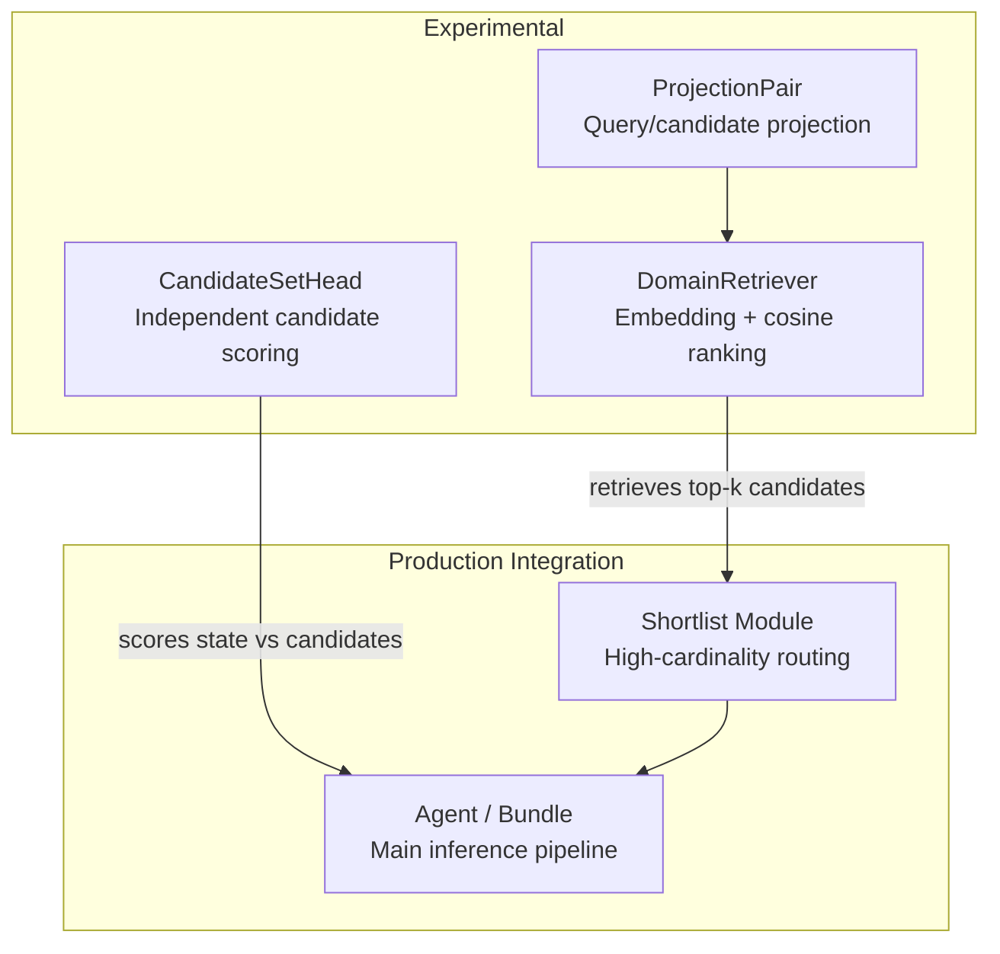
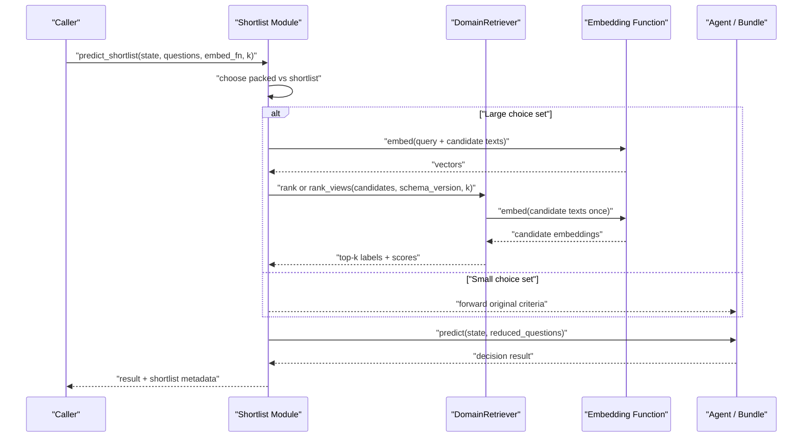
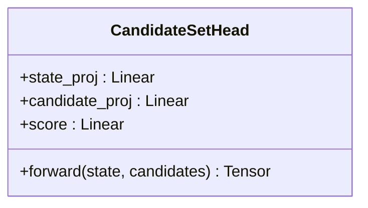
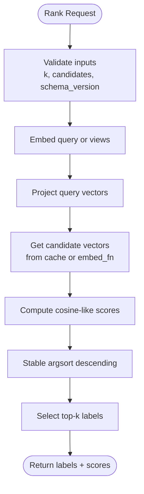
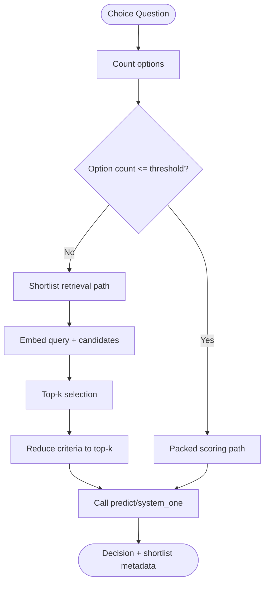
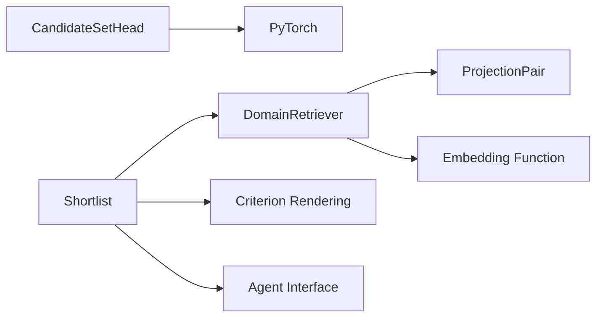

# Candidate Set Management

<cite>
**Referenced Files in This Document**   
- [candidate_set.py](file://veya/experimental/candidate_set.py)
- [domain_retriever.py](file://veya/experimental/domain_retriever.py)
- [shortlist.py](file://veya/shortlist.py)
- [test_phase2.py](file://tests/test_phase2.py)
- [test_phase10_retriever.py](file://tests/test_phase10_retriever.py)
- [run_phase10_validate.py](file://research/veyabench/run_phase10_validate.py)
</cite>

## Table of Contents
1. [Introduction](#introduction)
2. [Project Structure](#project-structure)
3. [Core Components](#core-components)
4. [Architecture Overview](#architecture-overview)
5. [Detailed Component Analysis](#detailed-component-analysis)
6. [Dependency Analysis](#dependency-analysis)
7. [Performance Considerations](#performance-considerations)
8. [Troubleshooting Guide](#troubleshooting-guide)
9. [Conclusion](#conclusion)

## Introduction
This document explains how Veya’s experimental modules organize, filter, and manage collections of decision candidates for high-cardinality tasks. It focuses on:

- The candidate scoring head used to score a state against multiple candidates independently of list order.
- The domain retriever that embeds and ranks candidate sets using frozen projections and deterministic exact ranking.
- The shortlist integration that reduces large choice sets before calling the main inference path.
- Filtering strategies based on metadata, content similarity, query views, and fusion policies.
- Indexing, caching, memory management, and best practices for large-scale candidate collections.

The goal is to help you build efficient candidate pipelines that scale from dozens to thousands of options while keeping latency predictable and results reproducible.

## Project Structure
The relevant code lives under `veya/experimental` and integrates with the production shortlist path:

**Diagram sources**
- [candidate_set.py:11-25](file://veya/experimental/candidate_set.py#L11-L25)
- [domain_retriever.py:258-402](file://veya/experimental/domain_retriever.py#L258-L402)
- [shortlist.py:43-148](file://veya/shortlist.py#L43-L148)

**Section sources**
- [candidate_set.py:1-26](file://veya/experimental/candidate_set.py#L1-L26)
- [domain_retriever.py:1-560](file://veya/experimental/domain_retriever.py#L1-L560)
- [shortlist.py:1-322](file://veya/shortlist.py#L1-L322)

## Core Components
This section summarizes the primary building blocks for managing candidate sets.

### Candidate Scoring Head
`CandidateSetHead` scores each candidate independently from a shared state representation. Its forward pass takes:

- A state tensor of shape `[B, D]`.
- A candidates tensor of shape `[B, N, D]`.
- It returns scores of shape `[B, N]`.

Key properties:

- Order-invariant scoring: permuting candidates permutes scores identically.
- Gradient-friendly: designed for training or experimentation rather than a frozen production head.
- Input validation: enforces batch and dimension consistency.

Use this component when you need a learned, state-aware scorer over a fixed candidate set, especially during research or ablation studies.

**Section sources**
- [candidate_set.py:11-25](file://veya/experimental/candidate_set.py#L11-L25)
- [test_phase2.py:146-156](file://tests/test_phase2.py#L146-L156)

### Domain Retriever
`DomainRetriever` provides deterministic retrieval over candidate sets using:

- An embedding function that maps text to vectors.
- Frozen query and candidate projections.
- Cosine similarity via normalized dot products.
- Exact top-k ranking with stable sorting.
- Versioned candidate embedding cache keyed by retriever ID, schema version, and content hash.

It supports:

- Single-query ranking.
- Multi-view query ranking with deterministic fusion (`first`, `max`, `mean`, `rrf`).
- Naturalized label handling for label-only candidate representations.
- Safe handling of hostile or adversarial candidate text.

**Section sources**
- [domain_retriever.py:258-402](file://veya/experimental/domain_retriever.py#L258-L402)
- [test_phase10_retriever.py:117-177](file://tests/test_phase10_retriever.py#L117-L177)

### Shortlist Integration
The shortlist module routes large choice questions through an embedding-based shortlist before calling the main agent. It:

- Chooses between packed scoring and shortlist retrieval based on option count.
- Supports configurable `k` and production defaults.
- Renders criteria into tokenizable text.
- Returns reduced questions plus metadata about labels, scores, and passthrough behavior.

This is the bridge between candidate collection management and the main Veya inference pipeline.

**Section sources**
- [shortlist.py:1-148](file://veya/shortlist.py#L1-L148)

## Architecture Overview
The candidate management architecture separates three responsibilities:

1. **Candidate Collection**: Represented as pairs of `(label, text)` or structured criteria.
2. **Candidate Indexing and Retrieval**: Embedding, projection, and exact ranking.
3. **Scoring and Routing**: Independent candidate scoring or shortlist-driven reranking.

**Diagram sources**
- [shortlist.py:91-148](file://veya/shortlist.py#L91-L148)
- [domain_retriever.py:353-402](file://veya/experimental/domain_retriever.py#L353-L402)

## Detailed Component Analysis

### CandidateSetHead
`CandidateSetHead` implements a simple but effective independent-scoring pattern:

- State projection: transforms the state vector into a representation compatible with candidate space.
- Candidate projection: transforms each candidate embedding into the same space.
- Mixed representation: combines state and candidate features element-wise after projection.
- Score head: produces one scalar score per candidate.

**Diagram sources**
- [candidate_set.py:11-25](file://veya/experimental/candidate_set.py#L11-L25)

#### Ordering Invariance
The head is order-equivariant: flipping the candidate order flips the output scores in the same way. Tests verify both permutation behavior and gradient flow.

**Section sources**
- [test_phase2.py:146-156](file://tests/test_phase2.py#L146-L156)

#### When to Use
- Experimental scoring where candidate independence matters.
- Ablation studies comparing state-aware candidate scoring versus retrieval-first approaches.
- Training scenarios where gradients must flow through candidate-specific transformations.

#### Limitations
- Not a frozen production head.
- Does not provide indexing, filtering, or persistence.
- Requires precomputed candidate embeddings.

### DomainRetriever
`DomainRetriever` is the core of candidate set indexing and filtering.

#### Data Model
Candidates are represented as sequences of `(label, text)` tuples:

- `label`: unique string identifier used in outputs.
- `text`: untrusted candidate content passed only to the tokenizer/embedder.

#### Indexing Strategy
- Embed candidate texts once via `embed_fn`.
- Apply frozen candidate projection.
- Cache projected vectors keyed by retriever ID, schema version, and content hash.
- Reuse cached projections across queries.

#### Query Processing
- Single query: embed query, project, compute dot product with candidate projections.
- Multi-view query: generate bounded views from serialized state, embed all views, fuse view scores deterministically.

#### Fusion Policies
- `first`: use first view scores.
- `max`: take maximum across views.
- `mean`: average across views.
- `rrf`: reciprocal rank fusion over view rankings.

**Diagram sources**
- [domain_retriever.py:353-402](file://veya/experimental/domain_retriever.py#L353-L402)

#### Metadata-Based Filtering
While `DomainRetriever` does not implement explicit metadata filters, it supports:

- Label naturalization for label-only candidate sets.
- Schema-versioned candidate caches.
- Controlled candidate text normalization and bounds.

For richer metadata filtering, callers should prefilter candidates before passing them to the retriever.

**Section sources**
- [domain_retriever.py:258-402](file://veya/experimental/domain_retriever.py#L258-L402)
- [test_phase10_retriever.py:117-177](file://tests/test_phase10_retriever.py#L117-L177)

### Shortlist Module
The shortlist module decides whether to route a choice question through packed scoring or embedding-based shortlisting.

#### Decision Logic
- Small option counts use packed scoring.
- Large option counts use shortlist retrieval with a configured `k`.
- Production defaults favor K=8 for shortlisted paths.

#### Integration Points
- `shortlist_choice`: returns top-k labels.
- `predict_shortlist`: reduces questions, calls agent, attaches shortlist metadata.
- `embed_fn_from_agent`: builds an embedding function from the loaded agent encoder.

**Diagram sources**
- [shortlist.py:43-148](file://veya/shortlist.py#L43-L148)

**Section sources**
- [shortlist.py:43-148](file://veya/shortlist.py#L43-L148)

## Dependency Analysis
The components have clear separation of concerns:

- `CandidateSetHead` depends only on PyTorch linear layers.
- `DomainRetriever` depends on an external embedding function and frozen projections.
- `Shortlist` depends on rendering utilities, embedding functions, and the agent interface.

**Diagram sources**
- [candidate_set.py:11-25](file://veya/experimental/candidate_set.py#L11-L25)
- [domain_retriever.py:258-402](file://veya/experimental/domain_retriever.py#L258-L402)
- [shortlist.py:1-148](file://veya/shortlist.py#L1-L148)

**Section sources**
- [candidate_set.py:1-26](file://veya/experimental/candidate_set.py#L1-L26)
- [domain_retriever.py:1-560](file://veya/experimental/domain_retriever.py#L1-L560)
- [shortlist.py:1-322](file://veya/shortlist.py#L1-L322)

## Performance Considerations

### Candidate Set Size Limits
- Maximum choice candidates: 1024.
- Maximum candidate label length: 512 characters.
- Maximum candidate value length: 4096 characters.
- Production shortlist threshold: above 19 options triggers shortlist routing.

These limits protect token budgets and prevent excessive embedding costs.

### Caching Behavior
- Candidate projections are cached per retriever ID, schema version, and content hash.
- Cache hits avoid re-embedding and re-projecting identical candidate sets.
- Cache misses increment counters for diagnostics.

### Memory Usage
- Candidate cache stores projected float32 vectors.
- For `N` candidates and projection dimension `D`, approximate cache size is `N × D × 4` bytes.
- Benchmarks measure projected cache bytes alongside latency.

### Ranking Complexity
- Embedding cost: proportional to number of unique candidate texts.
- Projection cost: matrix multiplication over candidate vectors.
- Scoring cost: dot product between query vector and candidate projections.
- Sorting cost: stable argsort over candidate scores.

### Best Practices
- Reuse the same retriever instance across queries when possible to benefit from candidate caching.
- Keep candidate labels unique and stable.
- Normalize or deduplicate candidate text before embedding when appropriate.
- Use multi-view fusion only when query ambiguity benefits from multiple perspectives.
- Monitor cache hits and misses to detect redundant candidate regeneration.

**Section sources**
- [shortlist.py:25-40](file://veya/shortlist.py#L25-L40)
- [domain_retriever.py:330-351](file://veya/experimental/domain_retriever.py#L330-L351)
- [run_phase10_validate.py:269-299](file://research/veyabench/run_phase10_validate.py#L269-L299)

## Troubleshooting Guide

### Common Errors
- **Empty or invalid candidates**: Both retriever and shortlist require non-empty candidate sets.
- **Duplicate labels**: Retriever requires unique candidate labels; shortlist normalizes and rejects duplicates.
- **Mismatched shapes**: `CandidateSetHead` validates batch and dimension alignment.
- **Unknown fusion policy**: Retriever restricts fusion to supported strategies.
- **Missing embedding function**: Retriever raises an error if no embed_fn is provided.

### Debugging Steps
1. Verify candidate labels are unique strings.
2. Check candidate text lengths against documented limits.
3. Confirm schema version stability when relying on cached projections.
4. Inspect cache hit/miss counters on the retriever.
5. Validate that `embed_fn` returns finite arrays with correct shape.
6. Test single-query ranking before enabling multi-view fusion.

**Section sources**
- [domain_retriever.py:330-402](file://veya/experimental/domain_retriever.py#L330-L402)
- [shortlist.py:228-253](file://veya/shortlist.py#L228-L253)
- [test_phase10_retriever.py:117-177](file://tests/test_phase10_retriever.py#L117-L177)

## Conclusion
Veya’s experimental candidate set management system provides three complementary mechanisms:

- `CandidateSetHead` for independent, state-aware candidate scoring.
- `DomainRetriever` for deterministic, cached, cosine-based retrieval over candidate collections.
- `Shortlist` for production-ready routing of high-cardinality choices into a reduced candidate set before main inference.

For large-scale candidate collections, prioritize stable labeling, controlled text sizes, schema-versioned caching, and careful selection of `k` and fusion policies. Use the retriever for semantic filtering and the shortlist module for seamless integration with the main Veya inference pipeline.