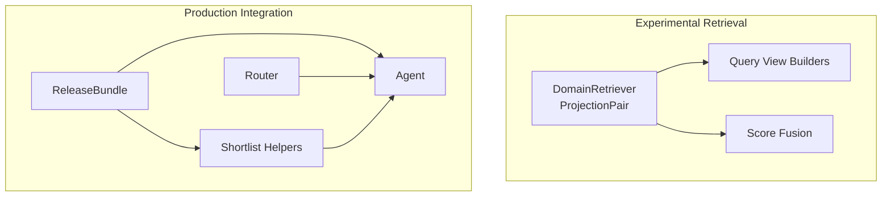
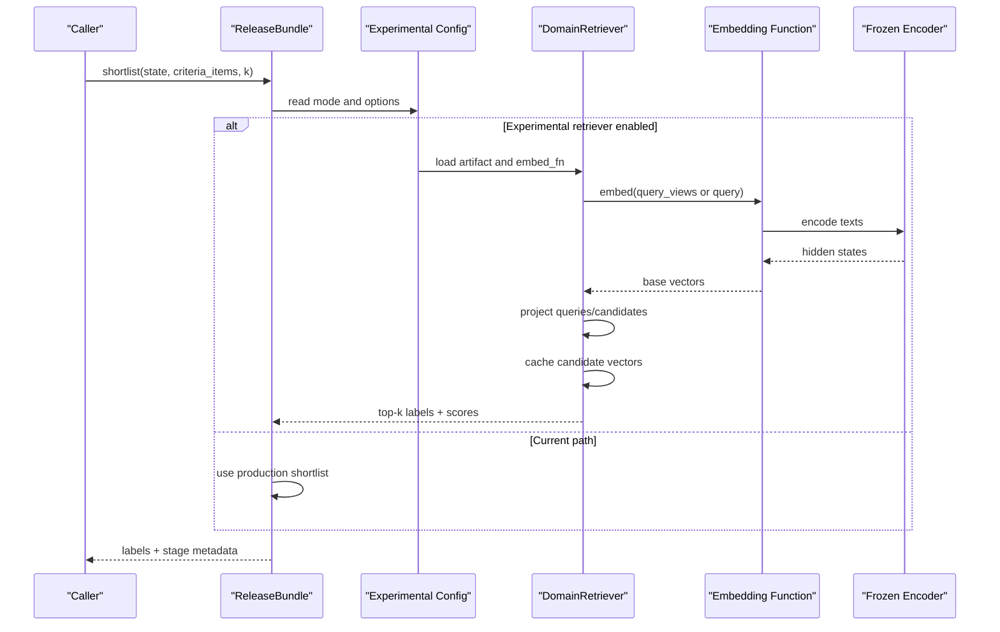
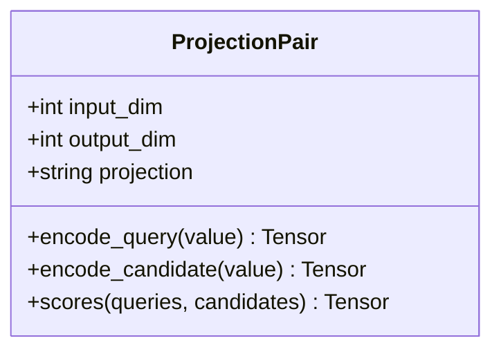
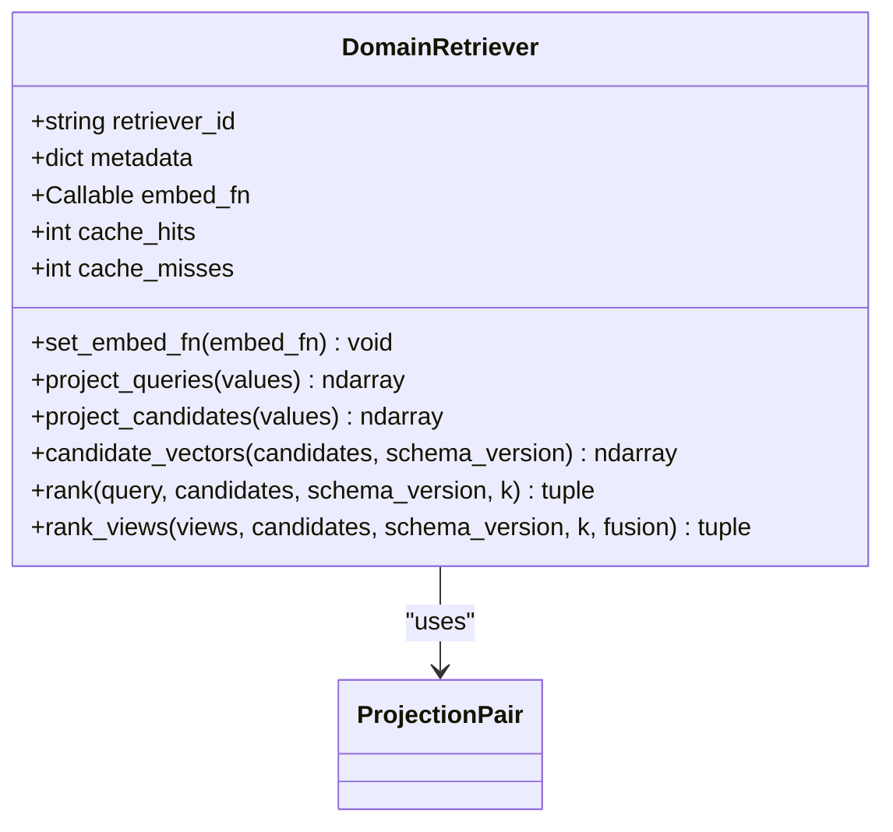
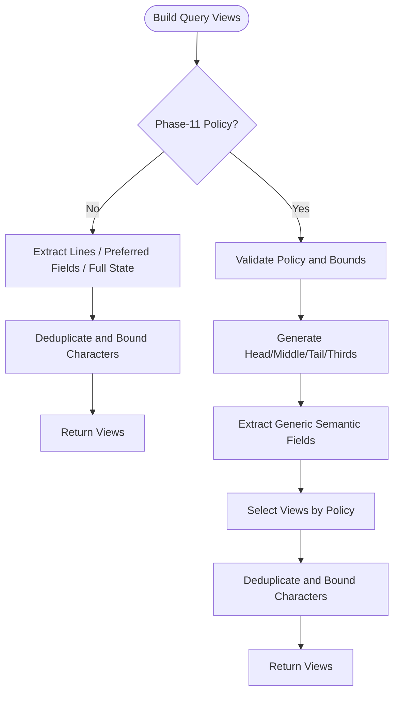
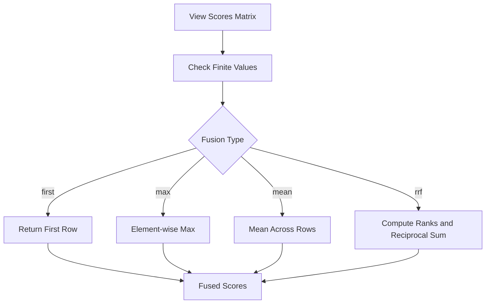
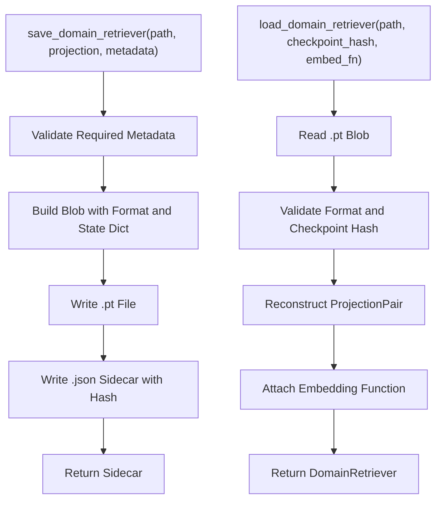
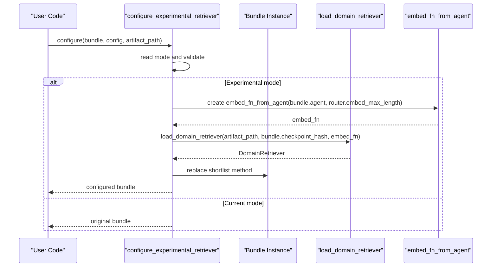
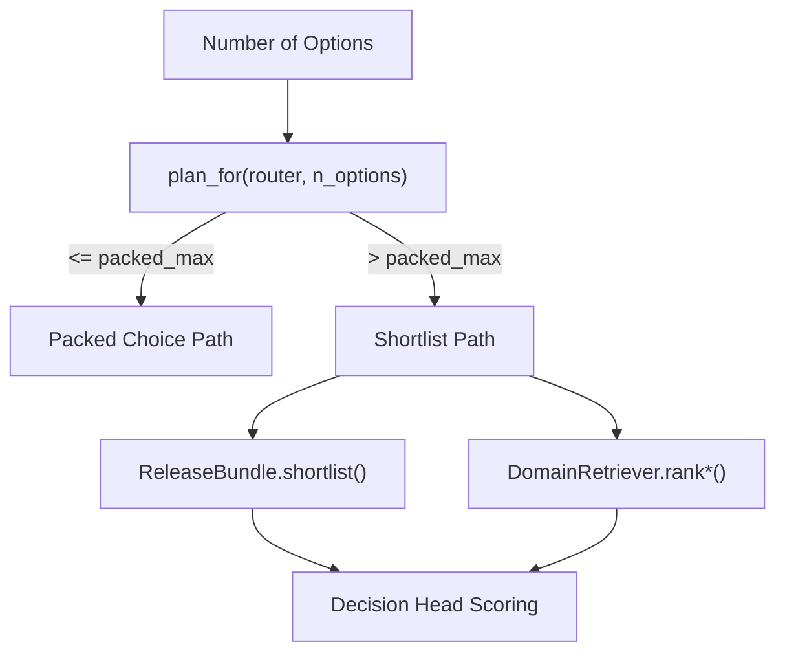
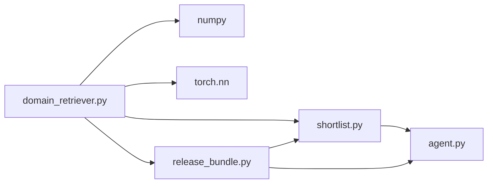

# Domain-Specific Retriever

<cite>
**Referenced Files in This Document**   
- [domain_retriever.py](file://veya/experimental/domain_retriever.py)
- [shortlist.py](file://veya/shortlist.py)
- [release_bundle.py](file://veya/release_bundle.py)
- [router.py](file://veya/router.py)
- [agent.py](file://veya/agent.py)
- [test_phase10_retriever.py](file://tests/test_phase10_retriever.py)
</cite>

## Table of Contents
1. [Introduction](#introduction)
2. [Project Structure](#project-structure)
3. [Core Components](#core-components)
4. [Architecture Overview](#architecture-overview)
5. [Detailed Component Analysis](#detailed-component-analysis)
6. [Dependency Analysis](#dependency-analysis)
7. [Performance Considerations](#performance-considerations)
8. [Troubleshooting Guide](#troubleshooting-guide)
9. [Conclusion](#conclusion)
10. [Appendices](#appendices)

## Introduction
The domain-specific retriever is an experimental retrieval path that enables specialized, schema-aware candidate ranking for high-cardinality choice questions. It reuses a frozen Veya encoder and applies small learned query/candidate projections to compute deterministic cosine scores over candidates. The component is intentionally isolated from the audited release path: it can be opt-in through a feature flag, replaces only the shortlist step on a single bundle instance, and preserves production artifacts and manifests.

Key goals include:
- Causal isolation between retrieval parameters and the main decision model.
- Schema transfer without embedding fixed label identifiers or schema IDs into the model.
- Deterministic exact ranking with versioned caching for reproducibility.
- Multiple query-view strategies for robustness across noisy or structured inputs.
- Safe handling of untrusted candidate text as embedding data rather than instructions.

## Project Structure
The domain-specific retriever lives under the experimental module and integrates with the existing shortlist and release pipeline through explicit configuration.

**Diagram sources**
- [domain_retriever.py:258-402](file://veya/experimental/domain_retriever.py#L258-L402)
- [shortlist.py:151-203](file://veya/shortlist.py#L151-L203)
- [release_bundle.py:127-258](file://veya/release_bundle.py#L127-L258)
- [router.py:123-337](file://veya/router.py#L123-L337)

**Section sources**
- [domain_retriever.py:1-560](file://veya/experimental/domain_retriever.py#L1-L560)
- [shortlist.py:1-322](file://veya/shortlist.py#L1-L322)
- [release_bundle.py:1-503](file://veya/release_bundle.py#L1-L503)
- [router.py:1-337](file://veya/router.py#L1-L337)

## Core Components
- ProjectionPair: A lightweight neural projection layer that transforms encoder outputs into a shared similarity space. It supports shared or dual query/candidate projections and normalizes vectors before dot-product scoring.
- DomainRetriever: The runtime retriever that embeds queries and candidates, projects them, caches candidate vectors by schema version and content hash, and performs deterministic exact ranking.
- Query View Builders: Functions that construct bounded semantic views from raw state, including Phase-10 multi-line/dict/list extraction and Phase-11 adaptive windowing policies.
- Score Fusion: Deterministic fusion of per-view scores using first, max, mean, or reciprocal rank fusion.
- Artifact I/O: Save/load functions for retriever artifacts with format/version checks and sidecar metadata.
- Experimental Configuration: A hook that swaps a bundle’s shortlist method with the domain-specific retriever when opted in via configuration.

**Section sources**
- [domain_retriever.py:258-402](file://veya/experimental/domain_retriever.py#L258-L402)
- [domain_retriever.py:405-560](file://veya/experimental/domain_retriever.py#L405-L560)

## Architecture Overview
The domain-specific retriever integrates at the shortlist stage. When enabled, it replaces the bundle’s shortlist method with one that:
- Builds candidate pairs from criteria items.
- Chooses a query representation strategy based on mode (single view, multi-view, or Phase-11 adaptive).
- Embeds and projects queries and candidates.
- Ranks candidates deterministically and returns labels plus stage metadata.

**Diagram sources**
- [domain_retriever.py:463-560](file://veya/experimental/domain_retriever.py#L463-L560)
- [domain_retriever.py:287-402](file://veya/experimental/domain_retriever.py#L287-L402)
- [shortlist.py:151-203](file://veya/shortlist.py#L151-L203)

## Detailed Component Analysis

### ProjectionPair
ProjectionPair implements a linear projection for query and candidate embeddings. It supports:
- Shared projection: both query and candidate share weights.
- Dual projection: separate query and candidate weights.
- Normalized vector outputs for stable cosine-like dot products.

**Diagram sources**
- [domain_retriever.py:258-285](file://veya/experimental/domain_retriever.py#L258-L285)

**Section sources**
- [domain_retriever.py:258-285](file://veya/experimental/domain_retriever.py#L258-L285)

### DomainRetriever
DomainRetriever encapsulates the full retrieval lifecycle:
- Initialization with projection, metadata, and optional embedding function.
- Candidate vector caching keyed by retriever ID, schema version, and content hash.
- Query projection and candidate projection methods.
- Exact ranking with deterministic sorting and configurable top-k.
- Multi-view ranking with score fusion.

**Diagram sources**
- [domain_retriever.py:287-402](file://veya/experimental/domain_retriever.py#L287-L402)

**Section sources**
- [domain_retriever.py:287-402](file://veya/experimental/domain_retriever.py#L287-L402)

### Query View Builders
Two builders provide bounded, safe representations of user state:
- build_query_views: Extracts lines, preferred fields, and serialized state; deduplicates and bounds character length.
- build_phase11_query_views: Implements policy-driven windows (head, middle, tail, thirds) and structured field extraction while dropping generic metadata keys.

**Diagram sources**
- [domain_retriever.py:37-97](file://veya/experimental/domain_retriever.py#L37-L97)
- [domain_retriever.py:100-204](file://veya/experimental/domain_retriever.py#L100-L204)

**Section sources**
- [domain_retriever.py:37-97](file://veya/experimental/domain_retriever.py#L37-L97)
- [domain_retriever.py:100-204](file://veya/experimental/domain_retriever.py#L100-L204)

### Score Fusion
Fusion combines per-view scores deterministically:
- first: use the first view’s scores.
- max: element-wise maximum across views.
- mean: average across views.
- rrf: reciprocal rank fusion with a constant offset to avoid division by zero.

**Diagram sources**
- [domain_retriever.py:207-226](file://veya/experimental/domain_retriever.py#L207-L226)

**Section sources**
- [domain_retriever.py:207-226](file://veya/experimental/domain_retriever.py#L207-L226)

### Artifact I/O and Loading
Save and load functions ensure format compatibility, checkpoint binding, and metadata integrity:
- save_domain_retriever writes a Torch blob and JSON sidecar with file SHA-256.
- load_domain_retriever validates format, checkpoint hash, and K=8 constraint, then reconstructs ProjectionPair and metadata.

**Diagram sources**
- [domain_retriever.py:405-460](file://veya/experimental/domain_retriever.py#L405-L460)

**Section sources**
- [domain_retriever.py:405-460](file://veya/experimental/domain_retriever.py#L405-L460)

### Experimental Configuration and Integration
configure_experimental_retriever selects the current retriever or opts a bundle into experimental modes:
- Modes: current, phase10_domain_general, phase10_domain_general_multiview, phase11_noise_robust.
- Requires artifact path for experimental modes.
- Wraps bundle.shortlist with a new method that builds candidates, chooses view strategy, ranks, and returns stage metadata.

**Diagram sources**
- [domain_retriever.py:463-560](file://veya/experimental/domain_retriever.py#L463-L560)
- [shortlist.py:151-203](file://veya/shortlist.py#L151-L203)

**Section sources**
- [domain_retriever.py:463-560](file://veya/experimental/domain_retriever.py#L463-L560)

### Production Shortlist vs Experimental Retrieval
Production shortlist uses ReleaseBundle’s projection and cached embeddings to select top-k candidates, then runs the decision head once. Experimental retrieval replaces this shortlist step with DomainRetriever when opted in.

**Diagram sources**
- [release_bundle.py:84-89](file://veya/release_bundle.py#L84-L89)
- [release_bundle.py:172-198](file://veya/release_bundle.py#L172-L198)
- [domain_retriever.py:353-402](file://veya/experimental/domain_retriever.py#L353-L402)

**Section sources**
- [release_bundle.py:84-89](file://veya/release_bundle.py#L84-L89)
- [release_bundle.py:172-198](file://veya/release_bundle.py#L172-L198)
- [domain_retriever.py:353-402](file://veya/experimental/domain_retriever.py#L353-L402)

## Dependency Analysis
The domain-specific retriever depends on:
- torch.nn.Linear for ProjectionPair.
- numpy for deterministic ranking and fusion.
- shortlist helpers for embedding functions and serialization utilities.
- release bundle integration via configure_experimental_retriever.

**Diagram sources**
- [domain_retriever.py:18-23](file://veya/experimental/domain_retriever.py#L18-L23)
- [shortlist.py:151-203](file://veya/shortlist.py#L151-L203)
- [release_bundle.py:127-258](file://veya/release_bundle.py#L127-L258)

**Section sources**
- [domain_retriever.py:18-23](file://veya/experimental/domain_retriever.py#L18-L23)
- [shortlist.py:151-203](file://veya/shortlist.py#L151-L203)
- [release_bundle.py:127-258](file://veya/release_bundle.py#L127-L258)

## Performance Considerations
- Exact ranking: Uses deterministic mergesort-based ordering; suitable for hundreds of candidates.
- Candidate caching: Keys include retriever ID, schema version, and content hash; avoids recomputation across repeated schemas.
- Batched embedding: embed_fn_from_agent batches encoder calls to reduce overhead.
- View limits: Enforces maximum views and character bounds to prevent excessive computation.
- Fusion cost: RRF computes ranks per view; prefer simpler fusions for latency-sensitive paths.
- Memory: Keep embed_fn batch size moderate; avoid loading multiple heavy models concurrently unless preloaded.

[No sources needed since this section provides general guidance]

## Troubleshooting Guide
Common issues and resolutions:
- Unknown retriever mode: Ensure mode is one of current, phase10_domain_general, phase10_domain_general_multiview, or phase11_noise_robust.
- Missing artifact path: Experimental modes require a valid retriever artifact path.
- Checkpoint mismatch: load_domain_retriever rejects artifacts whose checkpoint_hash does not match the bundle’s checkpoint.
- Non-finite embeddings: _base_vectors raises if the embedding function returns NaN/Inf or incorrect shapes.
- Duplicate candidate labels: candidate_vectors enforces unique labels; normalize or deduplicate inputs.
- Invalid query views: view builders enforce positive integer bounds and non-empty state; adjust max_views/max_chars/window_chars accordingly.
- Hostile candidate text: Candidate strings are treated as embedding data only; tests verify they do not alter ranking behavior.

**Section sources**
- [domain_retriever.py:463-476](file://veya/experimental/domain_retriever.py#L463-L476)
- [domain_retriever.py:309-318](file://veya/experimental/domain_retriever.py#L309-L318)
- [domain_retriever.py:330-351](file://veya/experimental/domain_retriever.py#L330-L351)
- [domain_retriever.py:373-402](file://veya/experimental/domain_retriever.py#L373-L402)
- [test_phase10_retriever.py:171-178](file://tests/test_phase10_retriever.py#L171-L178)

## Conclusion
The domain-specific retriever provides a controlled, experimental pathway to improve candidate selection for high-cardinality choices by leveraging learned projections over a frozen encoder. It integrates cleanly with the production pipeline through explicit configuration, preserves artifact integrity, and offers robust query view strategies. For most deployments, keep the current retriever and enable experimental modes only where validated. Tune view policies, fusion strategies, and embedding batch sizes to balance accuracy and latency for your domain.

[No sources needed since this section summarizes without analyzing specific files]

## Appendices

### Configuration Reference
- Mode selection:
  - current: no change.
  - phase10_domain_general: single serialized state view.
  - phase10_domain_general_multiview: multi-line/dict/list views with fusion.
  - phase11_noise_robust: adaptive windowing with policy control.
- Key options:
  - retriever: mode string.
  - candidate_schema_version: version tag for candidate caching.
  - query_fusion: first, max, mean, rrf.
  - query_view_policy: single, first_last, first_middle_last, four_view, adaptive.
  - query_max_views: bounded number of views.
  - query_view_max_chars: per-view character limit.
  - query_window_chars: window size for Phase-11 views.
  - query_max_state_chars: total state character bound for Phase-11.

**Section sources**
- [domain_retriever.py:26-34](file://veya/experimental/domain_retriever.py#L26-L34)
- [domain_retriever.py:463-560](file://veya/experimental/domain_retriever.py#L463-L560)

### Example Setup Patterns
- Opt-in experimental retriever:
  - Provide a retriever artifact path.
  - Set retriever mode and candidate_schema_version.
  - Optionally configure query fusion and view policy.
- Use embed_fn_from_agent:
  - Construct embed_fn from bundle.agent and router.embed_max_length.
  - Pass embed_fn to load_domain_retriever.
- Replace shortlist method:
  - configure_experimental_retriever attaches a new shortlist to the bundle instance.
  - The returned bundle retains other functionality unchanged.

**Section sources**
- [domain_retriever.py:463-560](file://veya/experimental/domain_retriever.py#L463-L560)
- [shortlist.py:151-203](file://veya/shortlist.py#L151-L203)