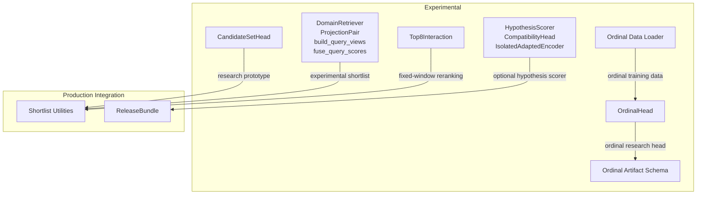
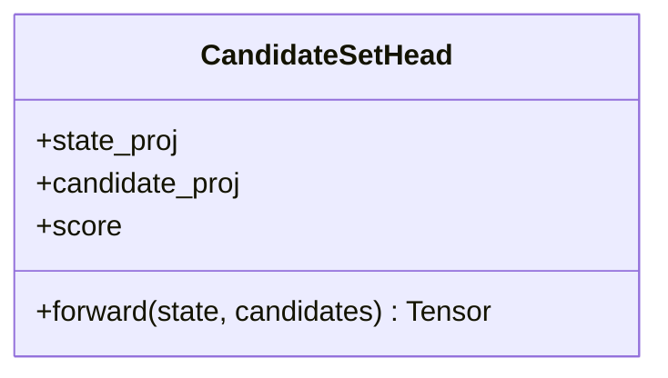
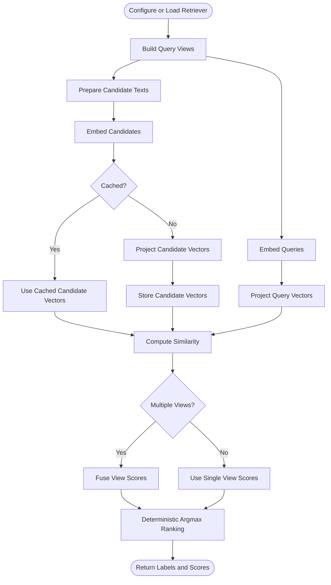
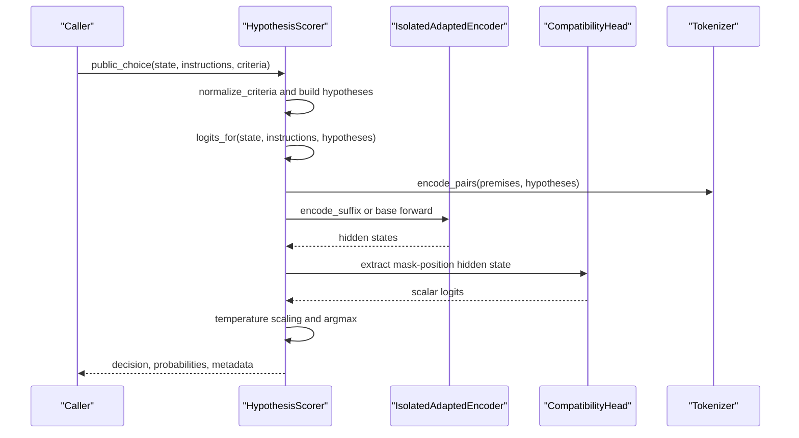
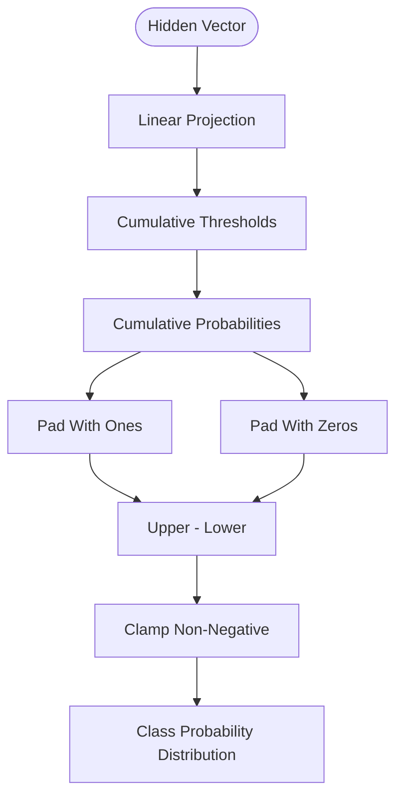
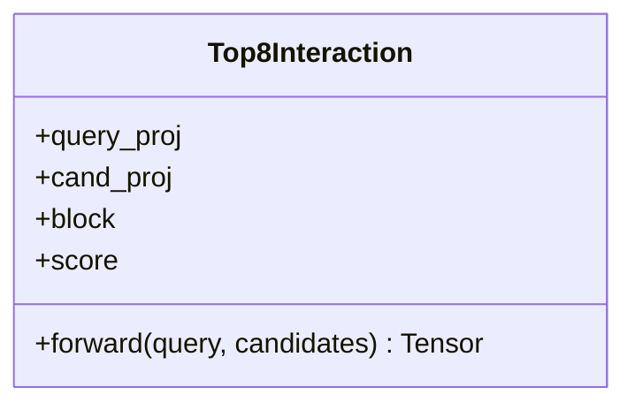
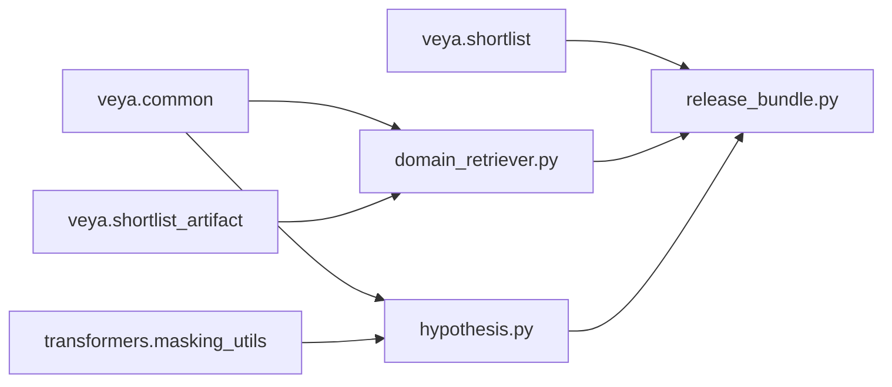

# Experimental Modules

<cite>
**Referenced Files in This Document**
- [__init__.py](file://veya/experimental/__init__.py)
- [candidate_set.py](file://veya/experimental/candidate_set.py)
- [domain_retriever.py](file://veya/experimental/domain_retriever.py)
- [hypothesis.py](file://veya/experimental/hypothesis.py)
- [ordinal.py](file://veya/experimental/ordinal.py)
- [ordinal_artifact.py](file://veya/experimental/ordinal_artifact.py)
- [ordinal_data.py](file://veya/experimental/ordinal_data.py)
- [top8.py](file://veya/experimental/top8.py)
- [shortlist.py](file://veya/shortlist.py)
- [release_bundle.py](file://veya/release_bundle.py)
</cite>

## Table of Contents
1. [Introduction](#introduction)
2. [Project Structure](#project-structure)
3. [Core Components](#core-components)
4. [Architecture Overview](#architecture-overview)
5. [Detailed Component Analysis](#detailed-component-analysis)
6. [Dependency Analysis](#dependency-analysis)
7. [Performance Considerations](#performance-considerations)
8. [Troubleshooting Guide](#troubleshooting-guide)
9. [Conclusion](#conclusion)
10. [Appendices](#appendices)

## Introduction
This document describes Veya’s experimental modules that provide advanced research capabilities for decision modeling, retrieval, and ranking. These components are intentionally separated from the production prediction path: they are present, tested, and useful for experiments, but they are not automatically wired into `Agent.predict`. The experimental surface includes:

- A candidate set scoring head for state-plus-candidate compatibility.
- A domain-specific retriever with deterministic exact ranking, query-view construction, score fusion, and versioned artifact handling.
- A hypothesis evaluation framework that encodes premise-hypothesis pairs and produces per-candidate compatibility logits.
- An ordinal scoring implementation for ranked outputs, including data structures, probability derivation, and artifact schema.
- A top-8 interaction scorer for small fixed-size candidate sets.
- Integration patterns showing how these modules can extend or replace parts of the shortlist and choice pipeline during research.

The documentation emphasizes stability warnings, API evolution considerations, migration guidance, and examples for extending existing modules or building new research prototypes.

## Project Structure
The experimental modules live under `veya/experimental`. Each file focuses on one research capability:

| Module | Purpose |
|---|---|
| `candidate_set.py` | State-plus-candidate compatibility scoring head. |
| `domain_retriever.py` | Domain-general retriever with projection, views, fusion, and artifact I/O. |
| `hypothesis.py` | Premise-hypothesis pair encoding, isolated encoder adaptation, and hypothesis scorer. |
| `ordinal.py` | Ordinal cumulative-threshold probability model. |
| `ordinal_artifact.py` | Research-only ordinal artifact save/load schema. |
| `ordinal_data.py` | CSV-based ordinal dataset loader with strict label ordering. |
| `top8.py` | Transformer-based scorer for a fixed eight-candidate window. |
| `__init__.py` | Package marker indicating experimental status. |



**Diagram sources**
- [candidate_set.py:11-25](file://veya/experimental/candidate_set.py#L11-L25)
- [domain_retriever.py:258-402](file://veya/experimental/domain_retriever.py#L258-L402)
- [hypothesis.py:111-197](file://veya/experimental/hypothesis.py#L111-L197)
- [ordinal.py:11-34](file://veya/experimental/ordinal.py#L11-L34)
- [ordinal_artifact.py:14-47](file://veya/experimental/ordinal_artifact.py#L14-L47)
- [ordinal_data.py:11-42](file://veya/experimental/ordinal_data.py#L11-L42)
- [top8.py:11-24](file://veya/experimental/top8.py#L11-L24)
- [shortlist.py:43-55](file://veya/shortlist.py#L43-L55)
- [release_bundle.py:127-258](file://veya/release_bundle.py#L127-L258)

**Section sources**
- [__init__.py:1-2](file://veya/experimental/__init__.py#L1-L2)

## Core Components
This section summarizes each experimental module’s responsibility, inputs, outputs, and integration points.

### Candidate Set Management System
`CandidateSetHead` scores each candidate independently from a shared state vector. It projects both the state and each candidate, combines them element-wise, applies a nonlinearity, and then scores the mixed representation. Because each candidate is scored separately, its score does not depend on list position, making it suitable for caching and later concatenation.

Key characteristics:
- Input shapes: state `[B, D]`, candidates `[B, N, D]`.
- Output shape: scores `[B, N]`.
- Validation enforces batch and dimension consistency.
- Not a trained production head; intended for research prototypes.

**Section sources**
- [candidate_set.py:1-25](file://veya/experimental/candidate_set.py#L1-L25)

### Domain-Specific Retriever
The domain retriever provides a frozen-backbone biencoder-style retrieval path with deterministic exact ranking. It supports:
- Query and candidate projections.
- Bounded query views for Phase 10 and Phase 11.
- Deterministic score fusion across views.
- Candidate embedding caching keyed by retriever identity, schema version, and content hash.
- Versioned artifact save/load with metadata validation.

Important behaviors:
- `rank` performs cosine-like dot product ranking over projected vectors.
- `rank_views` fuses multiple view scores using first, max, mean, or reciprocal rank fusion.
- `configure_experimental_retriever` can replace a bundle’s shortlist method with an experimental retrieval strategy.

**Section sources**
- [domain_retriever.py:37-97](file://veya/experimental/domain_retriever.py#L37-L97)
- [domain_retriever.py:133-204](file://veya/experimental/domain_retriever.py#L133-L204)
- [domain_retriever.py:207-226](file://veya/experimental/domain_retriever.py#L207-L226)
- [domain_retriever.py:258-284](file://veya/experimental/domain_retriever.py#L258-L284)
- [domain_retriever.py:287-402](file://veya/experimental/domain_retriever.py#L287-L402)
- [domain_retriever.py:405-460](file://veya/experimental/domain_retriever.py#L405-L460)
- [domain_retriever.py:463-559](file://veya/experimental/domain_retriever.py#L463-L559)

### Hypothesis Evaluation Framework
The hypothesis framework evaluates model assumptions by constructing premise-hypothesis pairs and computing compatibility logits. It supports:
- Label-to-hypothesis text templates.
- Pair segment construction with mask-position tracking.
- Batched encoding and grouping.
- Optional isolated upper-layer encoder adaptation that does not mutate the shared encoder.
- Calibration-aware scorer loading with strong artifact identity checks.

Integration highlights:
- `HypothesisScorer.public_choice` can produce a full choice result, optionally triggered after shortlisting.
- `load_compatible_scorer` validates template version, start layer, checkpoint hash, shortlist hash, head hash, and delta hash.

**Section sources**
- [hypothesis.py:22-48](file://veya/experimental/hypothesis.py#L22-L48)
- [hypothesis.py:51-108](file://veya/experimental/hypothesis.py#L51-L108)
- [hypothesis.py:111-135](file://veya/experimental/hypothesis.py#L111-L135)
- [hypothesis.py:138-197](file://veya/experimental/hypothesis.py#L138-L197)
- [hypothesis.py:200-242](file://veya/experimental/hypothesis.py#L200-L242)
- [hypothesis.py:245-279](file://veya/experimental/hypothesis.py#L245-L279)
- [hypothesis.py:287-315](file://veya/experimental/hypothesis.py#L287-L315)
- [hypothesis.py:318-361](file://veya/experimental/hypothesis.py#L318-L361)
- [hypothesis.py:378-450](file://veya/experimental/hypothesis.py#L378-L450)

### Ordinal Scoring Implementation
The ordinal module implements a cumulative-threshold model for ordered classes:
- Thresholds are derived from softplus gaps to maintain order.
- Cumulative probabilities represent `P(Y > k)`.
- Class probabilities are adjacent differences of cumulative probabilities and sum to one.

Artifact and data support:
- Artifacts are explicitly marked research-only and cannot be promoted to production until a held-out comparison exists.
- Dataset loading requires a CSV with explicit low-to-high label ordering and rejects unknown labels.

**Section sources**
- [ordinal.py:1-34](file://veya/experimental/ordinal.py#L1-L34)
- [ordinal_artifact.py:1-47](file://veya/experimental/ordinal_artifact.py#L1-L47)
- [ordinal_data.py:1-42](file://veya/experimental/ordinal_data.py#L1-L42)

### Top-8 Selection Algorithm
`Top8Interaction` is a small transformer-based scorer for exactly eight candidates:
- Projects the query and eight candidates into a shared width.
- Concatenates the query token with candidate tokens.
- Applies a single transformer encoder block.
- Scores all candidate positions except the query token.

It is experimental and not the production reranker unless validated and promoted through a comparison process.

**Section sources**
- [top8.py:1-24](file://veya/experimental/top8.py#L1-L24)

## Architecture Overview
The experimental modules integrate with Veya’s production choice pipeline at different levels:

- Shortlist routing decides between packed choice and learned K=8 shortlist based on candidate count.
- The release bundle loads the router, projection, shortlist artifact, and route calibration.
- Experimental retrievers can replace the bundle’s shortlist behavior.
- Hypothesis scoring can run after shortlisting or directly over criteria.
- Ordinal heads and artifacts remain research-only until formally compared against categorical scoring.

```mermaid
sequenceDiagram
participant Caller as "Caller"
participant Bundle as "ReleaseBundle"
participant Shortlist as "Shortlist Path"
participant Experimental as "Experimental Retriever"
participant Hypothesis as "HypothesisScorer"
participant Model as "Decision Head"
Caller->>Bundle : public_choice(state, instructions, criteria)
Bundle->>Bundle : plan(n_options)
alt Packed Choice
Bundle->>Model : raw_choice_logits
Model-->>Bundle : logits
else Learned Shortlist K=8
Bundle->>Shortlist : shortlist(state, items, k)
Shortlist-->>Bundle : picked_labels
opt Experimental Retriever Active
Bundle->>Experimental : experimental shortlist
Experimental-->>Bundle : selected labels
end
opt Hypothesis Scorer Attached
Bundle->>Hypothesis : logits_for(state, instructions, hypotheses)
Hypothesis-->>Bundle : compatibility logits
else Reranker or Base Head
Bundle->>Model : choice_logits or raw_choice_logits
Model-->>Bundle : logits
end
Bundle->>Bundle : apply temperature and softmax
end
Bundle-->>Caller : decision, probabilities, route metadata
```

**Diagram sources**
- [release_bundle.py:127-258](file://veya/release_bundle.py#L127-L258)
- [shortlist.py:43-55](file://veya/shortlist.py#L43-L55)
- [domain_retriever.py:463-559](file://veya/experimental/domain_retriever.py#L463-L559)
- [hypothesis.py:378-450](file://veya/experimental/hypothesis.py#L378-L450)

## Detailed Component Analysis

### Candidate Set Head
`CandidateSetHead` is a simple compatibility head designed for independent candidate scoring. Its forward pass:
1. Validates input dimensions.
2. Projects state and candidates into a shared space.
3. Adds projected representations element-wise.
4. Applies tanh and a linear score layer.
5. Returns per-candidate scores.



**Diagram sources**
- [candidate_set.py:11-25](file://veya/experimental/candidate_set.py#L11-L25)

**Section sources**
- [candidate_set.py:1-25](file://veya/experimental/candidate_set.py#L1-L25)

### Domain Retriever Pipeline
The domain retriever pipeline builds bounded query views, embeds queries and candidates, projects them, computes similarity, and returns deterministic rankings.



**Diagram sources**
- [domain_retriever.py:37-97](file://veya/experimental/domain_retriever.py#L37-L97)
- [domain_retriever.py:133-204](file://veya/experimental/domain_retriever.py#L133-L204)
- [domain_retriever.py:207-226](file://veya/experimental/domain_retriever.py#L207-L226)
- [domain_retriever.py:330-402](file://veya/experimental/domain_retriever.py#L330-L402)

**Section sources**
- [domain_retriever.py:287-402](file://veya/experimental/domain_retriever.py#L287-L402)
- [domain_retriever.py:405-460](file://veya/experimental/domain_retriever.py#L405-L460)
- [domain_retriever.py:463-559](file://veya/experimental/domain_retriever.py#L463-L559)

### Hypothesis Scorer Flow
The hypothesis scorer constructs premise-hypothesis pairs, encodes them in batches, extracts compatibility logits at a mask position, and converts logits to probabilities using a calibrated temperature.



**Diagram sources**
- [hypothesis.py:245-279](file://veya/experimental/hypothesis.py#L245-L279)
- [hypothesis.py:318-361](file://veya/experimental/hypothesis.py#L318-L361)
- [hypothesis.py:378-450](file://veya/experimental/hypothesis.py#L378-L450)

**Section sources**
- [hypothesis.py:22-48](file://veya/experimental/hypothesis.py#L22-L48)
- [hypothesis.py:51-108](file://veya/experimental/hypothesis.py#L51-L108)
- [hypothesis.py:111-135](file://veya/experimental/hypothesis.py#L111-L135)
- [hypothesis.py:138-197](file://veya/experimental/hypothesis.py#L138-L197)
- [hypothesis.py:200-242](file://veya/experimental/hypothesis.py#L200-L242)
- [hypothesis.py:245-279](file://veya/experimental/hypothesis.py#L245-L279)
- [hypothesis.py:287-315](file://veya/experimental/hypothesis.py#L287-L315)
- [hypothesis.py:318-361](file://veya/experimental/hypothesis.py#L318-L361)
- [hypothesis.py:378-450](file://veya/experimental/hypothesis.py#L378-L450)

### Ordinal Score Model
The ordinal model represents ordered categories through cumulative thresholds:
- Gaps are learned parameters.
- Softplus ensures non-negative gaps.
- Cumulative threshold accumulation maintains ordering.
- Class probabilities are computed as differences between adjacent cumulative probabilities.



**Diagram sources**
- [ordinal.py:11-34](file://veya/experimental/ordinal.py#L11-L34)

**Section sources**
- [ordinal.py:1-34](file://veya/experimental/ordinal.py#L1-L34)
- [ordinal_artifact.py:1-47](file://veya/experimental/ordinal_artifact.py#L1-L47)
- [ordinal_data.py:1-42](file://veya/experimental/ordinal_data.py#L1-L42)

### Top-8 Interaction Scorer
`Top8Interaction` composes a query token with eight candidate tokens and runs a transformer encoder block before scoring each candidate position.



**Diagram sources**
- [top8.py:11-24](file://veya/experimental/top8.py#L11-L24)

**Section sources**
- [top8.py:1-24](file://veya/experimental/top8.py#L1-L24)

## Dependency Analysis
The experimental modules have clear dependency boundaries:

- `domain_retriever.py` depends on `veya.common.serialize_state` and `veya.shortlist_artifact.file_sha256`.
- `hypothesis.py` depends on `veya.common.serialize_state` and uses internal transformer masking utilities.
- `release_bundle.py` integrates optional hypothesis scoring and coordinates shortlist routing.
- `shortlist.py` defines production routing constants and helper embedding utilities used by experimental integrations.



**Diagram sources**
- [domain_retriever.py:22-23](file://veya/experimental/domain_retriever.py#L22-L23)
- [hypothesis.py:14](file://veya/experimental/hypothesis.py#L14)
- [hypothesis.py:140-148](file://veya/experimental/hypothesis.py#L140-L148)
- [release_bundle.py:25-27](file://veya/release_bundle.py#L25-L27)
- [release_bundle.py:223-237](file://veya/release_bundle.py#L223-L237)

**Section sources**
- [domain_retriever.py:22-23](file://veya/experimental/domain_retriever.py#L22-L23)
- [hypothesis.py:14](file://veya/experimental/hypothesis.py#L14)
- [release_bundle.py:25-27](file://veya/release_bundle.py#L25-L27)
- [release_bundle.py:127-258](file://veya/release_bundle.py#L127-L258)

## Performance Considerations
- **Candidate independence**: `CandidateSetHead` scores candidates independently, enabling caching and avoiding permutation-sensitive computation.
- **Deterministic ranking**: The domain retriever uses stable sorting and bounded operations to ensure reproducible results.
- **View budgeting**: Query views are capped by character limits and view counts to prevent excessive token usage.
- **Embedding cache**: Candidate embeddings are cached by retriever ID, schema version, and content hash to reduce repeated computation.
- **Batched encoding**: Hypothesis scoring groups pairs and processes them in batches to improve throughput while preserving group boundaries.
- **Frozen backbone**: Both the domain retriever and hypothesis scorer avoid mutating the shared encoder where possible, reducing risk and memory churn.
- **Fixed-size interaction**: `Top8Interaction` assumes exactly eight candidates, which simplifies attention layout but limits flexibility.

[No sources needed since this section provides general guidance]

## Troubleshooting Guide
Common issues and their likely causes:

| Symptom | Likely Cause | Resolution |
|---|---|---|
| `state must be [B, D] and candidates [B, N, D]` | Incorrect tensor shapes passed to `CandidateSetHead.forward`. | Ensure state is 2D and candidates are 3D with matching batch and dimension sizes. |
| `retriever has no embedding function` | `DomainRetriever` was loaded without `embed_fn`. | Provide an embedding callable via `set_embed_fn` or `load_domain_retriever`. |
| `unknown query fusion` | Invalid fusion string in `rank_views`. | Use one of the supported fusion modes: first, max, mean, or rrf. |
| `candidate labels must be unique` | Duplicate labels in the candidate list. | Deduplicate or rename candidate labels before ranking. |
| `unsupported retriever format` | Artifact was saved with a different format. | Re-save the retriever artifact using `save_domain_retriever`. |
| `phase-9 calibration split is not an allowed fit split` | Calibration record references a disallowed split. | Use an allowed fitting split and retrain or reload compatible calibration. |
| `ordinal artifact must stay status=research` | Attempting to load a production-marked ordinal artifact. | Keep ordinal artifacts marked as research-only until a held-out comparison exists. |
| `ordinal CSV has fewer than 32 rows` | Insufficient ordinal training data. | Expand the ordinal dataset to at least 32 rows. |
| `k must be a positive integer` | Invalid `k` value passed to ranking functions. | Pass a positive integer for `k`. |

**Section sources**
- [candidate_set.py:18-25](file://veya/experimental/candidate_set.py#L18-L25)
- [domain_retriever.py:330-351](file://veya/experimental/domain_retriever.py#L330-L351)
- [domain_retriever.py:373-402](file://veya/experimental/domain_retriever.py#L373-L402)
- [domain_retriever.py:443-460](file://veya/experimental/domain_retriever.py#L443-L460)
- [hypothesis.py:287-315](file://veya/experimental/hypothesis.py#L287-L315)
- [ordinal_artifact.py:39-47](file://veya/experimental/ordinal_artifact.py#L39-L47)
- [ordinal_data.py:15-42](file://veya/experimental/ordinal_data.py#L15-L42)

## Conclusion
Veya’s experimental modules provide a flexible research surface for advanced decision modeling:

- Candidate set scoring enables independent, cache-friendly candidate evaluation.
- The domain retriever offers deterministic, versioned retrieval with bounded query views and robust artifact handling.
- The hypothesis framework supports assumption testing through premise-hypothesis compatibility scoring and isolated encoder adaptation.
- Ordinal scoring introduces ordered-class modeling with strict research-only artifact constraints.
- The top-8 interaction scorer demonstrates fixed-window transformer-based reranking.

These modules are intentionally experimental. They should be extended carefully, validated against held-out comparisons, and migrated to production only when stability, reproducibility, and performance criteria are satisfied.

[No sources needed since this section summarizes without analyzing specific files]

## Appendices

### Stability Warnings and API Evolution Considerations
- Experimental modules are not wired into `Agent.predict` by default.
- Artifact formats include explicit version strings and status markers.
- Some modules enforce strict schema validation (for example, hypothesis calibration records and ordinal artifacts).
- Retrieval modes such as Phase 10 and Phase 11 are configurable but may evolve; configuration keys should be treated as experimental.
- Production routing constants (`PRODUCTION_SHORTLIST_ABOVE`, `PRODUCTION_SHORTLIST_K`) define the current K=8 shortlist policy; experimental overrides should not silently replace them.

**Section sources**
- [__init__.py:1-2](file://veya/experimental/__init__.py#L1-L2)
- [domain_retriever.py:26-34](file://veya/experimental/domain_retriever.py#L26-L34)
- [domain_retriever.py:405-460](file://veya/experimental/domain_retriever.py#L405-L460)
- [ordinal_artifact.py:11-47](file://veya/experimental/ordinal_artifact.py#L11-L47)
- [shortlist.py:43-55](file://veya/shortlist.py#L43-L55)

### Migration Guidance for Experimental Features
- Do not assume experimental modules are backward-compatible with production bundles.
- When replacing shortlist behavior with an experimental retriever, preserve expected return shapes and metadata fields.
- For hypothesis scoring, ensure the attached scorer matches the expected template version, start layer, and calibration identity.
- For ordinal models, keep artifacts marked as research and do not promote them until a held-out comparison justifies the change.
- Validate all configuration keys before enabling experimental modes, especially query view policies and fusion strategies.

**Section sources**
- [domain_retriever.py:463-559](file://veya/experimental/domain_retriever.py#L463-L559)
- [hypothesis.py:318-361](file://veya/experimental/hypothesis.py#L318-L361)
- [ordinal_artifact.py:1-47](file://veya/experimental/ordinal_artifact.py#L1-L47)

### Examples of Extending Existing Experimental Modules
- **Extending candidate set scoring**: Add a separate positional feature if list dependence becomes necessary, but preserve independent scoring semantics unless you redesign the caching contract.
- **Extending domain retrieval**: Add a new query-view policy by updating the policy validation and view-building logic, then expose it through `configure_experimental_retriever`.
- **Extending hypothesis evaluation**: Introduce a new hypothesis variant by adding template logic in the hypothesis text builder and validating it in the scorer interface.
- **Extending ordinal modeling**: Add new loss functions or threshold parameterizations while keeping cumulative probability semantics and research-only artifact constraints.
- **Extending top-8 interaction**: Replace the single transformer block with a deeper stack, but retain the fixed-eight candidate contract or introduce a new module with a different size constraint.

**Section sources**
- [candidate_set.py:11-25](file://veya/experimental/candidate_set.py#L11-L25)
- [domain_retriever.py:37-97](file://veya/experimental/domain_retriever.py#L37-L97)
- [domain_retriever.py:133-204](file://veya/experimental/domain_retriever.py#L133-L204)
- [hypothesis.py:22-39](file://veya/experimental/hypothesis.py#L22-L39)
- [hypothesis.py:378-450](file://veya/experimental/hypothesis.py#L378-L450)
- [ordinal.py:11-34](file://veya/experimental/ordinal.py#L11-L34)
- [top8.py:11-24](file://veya/experimental/top8.py#L11-L24)