# Hypothesis Evaluation Framework

<cite>
**Referenced Files in This Document**
- [hypothesis.py](file://veya/experimental/hypothesis.py)
- [test_phase9_hypothesis.py](file://tests/test_phase9_hypothesis.py)
- [run_phase9_hypothesis.py](file://research/veyabench/run_phase9_hypothesis.py)
- [selective.py](file://veya/selective.py)
- [README.md](file://README.md)
</cite>

## Table of Contents
1. [Introduction](#introduction)
2. [Project Structure](#project-structure)
3. [Core Components](#core-components)
4. [Architecture Overview](#architecture-overview)
5. [Detailed Component Analysis](#detailed-component-analysis)
6. [Dependency Analysis](#dependency-analysis)
7. [Performance Considerations](#performance-considerations)
8. [Troubleshooting Guide](#troubleshooting-guide)
9. [Conclusion](#conclusion)
10. [Appendices](#appendices)

## Introduction
This document explains the hypothesis evaluation framework used to test model assumptions and validate research hypotheses for typed decision tasks. The framework evaluates whether a candidate label is compatible with a given state and question by scoring independent premise-hypothesis pairs, rather than relying on packed multi-label inputs. It provides:

- A structured way to define hypotheses from labels.
- Pair encoding that keeps the hypothesis separate from the premise.
- A compatibility head that produces one scalar per candidate.
- Batched scoring over groups of candidates.
- Optional frozen-prefix encoder adaptation.
- Temperature-based probability calibration.
- Experimental integration with a high-cardinality choice path.
- Security, permutation stability, paraphrase robustness, latency, and cross-task diagnostics.

The framework is research-oriented and complements the broader Veya system described in the repository README.

**Section sources**
- [README.md:27-46](file://README.md#L27-L46)

## Project Structure
The hypothesis evaluation capability lives under the experimental module and is exercised by unit tests and a Phase 9 research script.

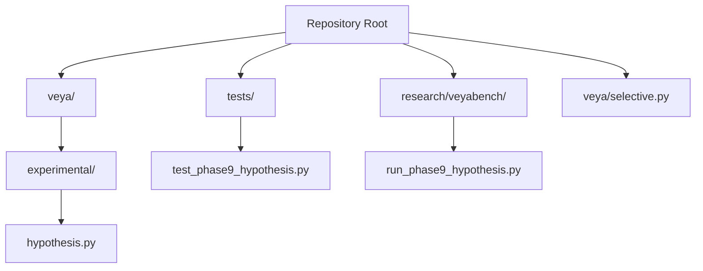

**Diagram sources**
- [hypothesis.py:1-20](file://veya/experimental/hypothesis.py#L1-L20)
- [test_phase9_hypothesis.py:1-31](file://tests/test_phase9_hypothesis.py#L1-L31)
- [run_phase9_hypothesis.py:1-60](file://research/veyabench/run_phase9_hypothesis.py#L1-L60)
- [selective.py:67-113](file://veya/selective.py#L67-L113)

**Section sources**
- [hypothesis.py:1-20](file://veya/experimental/hypothesis.py#L1-L20)
- [test_phase9_hypothesis.py:1-31](file://tests/test_phase9_hypothesis.py#L1-L31)
- [run_phase9_hypothesis.py:1-60](file://research/veyabench/run_phase9_hypothesis.py#L1-L60)

## Core Components
The framework centers around pair-based hypothesis scoring and an optional adapted encoder path.

Key responsibilities:
- Hypothesis text generation and validation.
- Premise-hypothesis pair construction.
- Tokenization and mask-position tracking.
- Compatibility scoring through a linear head.
- Grouped batch processing.
- Optional upper-layer encoder adaptation.
- Probability calibration via temperature scaling.
- Experimental public-choice integration.

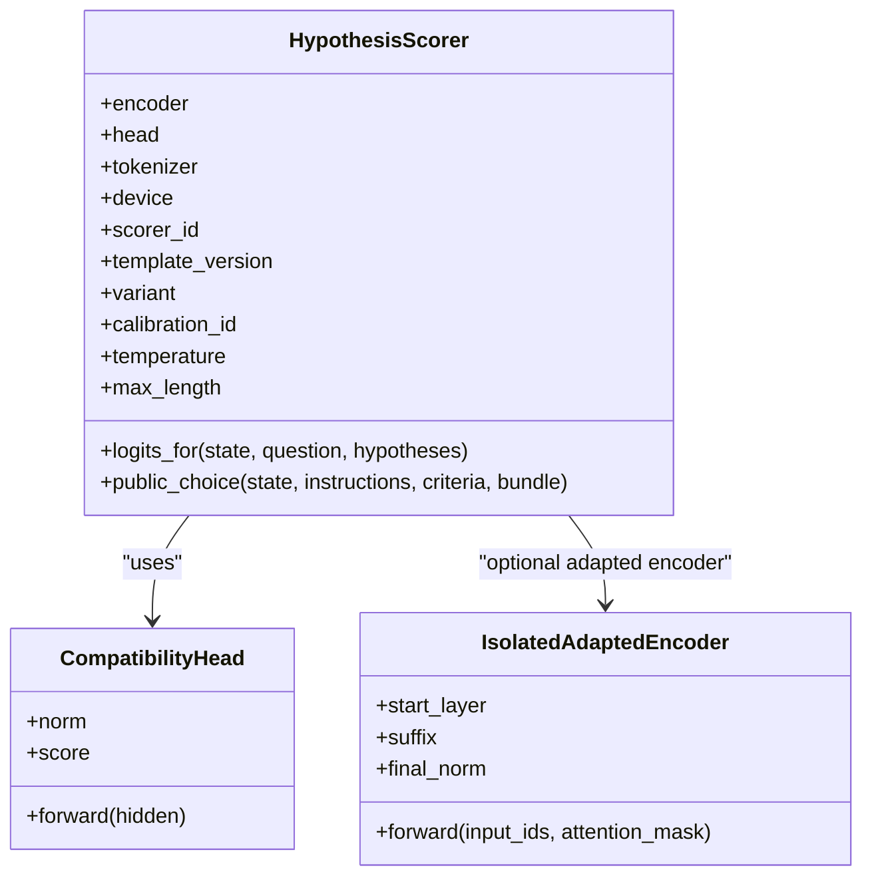

**Diagram sources**
- [hypothesis.py:111-125](file://veya/experimental/hypothesis.py#L111-L125)
- [hypothesis.py:171-197](file://veya/experimental/hypothesis.py#L171-L197)
- [hypothesis.py:378-450](file://veya/experimental/hypothesis.py#L378-L450)

**Section sources**
- [hypothesis.py:22-63](file://veya/experimental/hypothesis.py#L22-L63)
- [hypothesis.py:73-108](file://veya/experimental/hypothesis.py#L73-L108)
- [hypothesis.py:111-135](file://veya/experimental/hypothesis.py#L111-L135)
- [hypothesis.py:138-242](file://veya/experimental/hypothesis.py#L138-L242)
- [hypothesis.py:245-279](file://veya/experimental/hypothesis.py#L245-L279)
- [hypothesis.py:378-450](file://veya/experimental/hypothesis.py#L378-L450)

## Architecture Overview
At runtime, the framework converts each candidate into a hypothesis string, builds a premise containing the serialized state and question, and scores each pair independently. The resulting logits are normalized across the candidate set using temperature-scaled softmax.

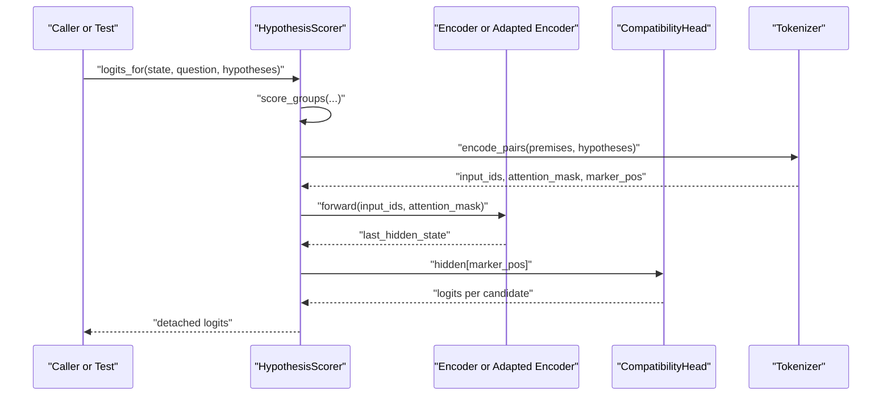

**Diagram sources**
- [hypothesis.py:42-48](file://veya/experimental/hypothesis.py#L42-L48)
- [hypothesis.py:73-108](file://veya/experimental/hypothesis.py#L73-L108)
- [hypothesis.py:231-242](file://veya/experimental/hypothesis.py#L231-L242)
- [hypothesis.py:245-279](file://veya/experimental/hypothesis.py#L245-L279)
- [hypothesis.py:402-409](file://veya/experimental/hypothesis.py#L402-L409)

## Detailed Component Analysis

### Hypothesis Definition and Validation
The framework supports three hypothesis variants:
- H0: Label-id style statement.
- H1: Naturalized label phrasing.
- H2: Authoritative definition-based statement; contrastive boundary text is rejected.

Validation rejects empty or duplicate hypotheses after normalization.

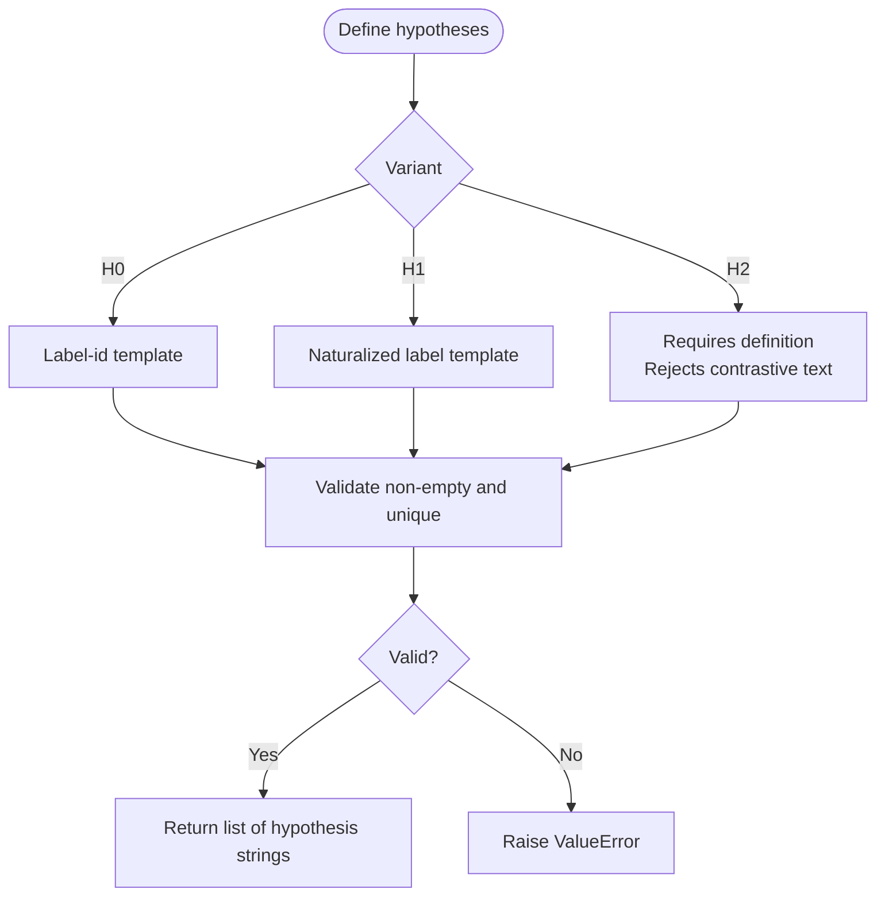

**Diagram sources**
- [hypothesis.py:22-39](file://veya/experimental/hypothesis.py#L22-L39)
- [hypothesis.py:51-63](file://veya/experimental/hypothesis.py#L51-L63)

**Section sources**
- [hypothesis.py:22-63](file://veya/experimental/hypothesis.py#L22-L63)
- [test_phase9_hypothesis.py:72-103](file://tests/test_phase9_hypothesis.py#L72-L103)

### Pair Construction and Encoding
Each candidate becomes a pair:
- Premise: serialized state plus the decision question.
- Hypothesis: the generated hypothesis string.

The tokenizer constructs `[CLS] premise [SEP] [MASK] hypothesis [SEP]`. The mask token position is tracked so the compatibility head reads only that hidden state. Premises may be truncated to keep the hypothesis intact.

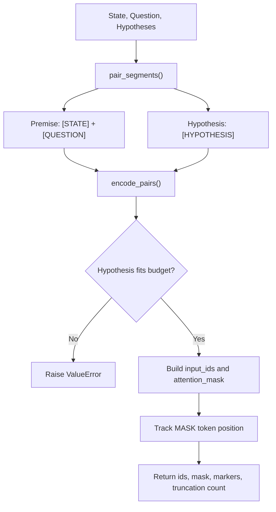

**Diagram sources**
- [hypothesis.py:42-48](file://veya/experimental/hypothesis.py#L42-L48)
- [hypothesis.py:73-108](file://veya/experimental/hypothesis.py#L73-L108)

**Section sources**
- [hypothesis.py:42-48](file://veya/experimental/hypothesis.py#L42-L48)
- [hypothesis.py:73-108](file://veya/experimental/hypothesis.py#L73-L108)
- [test_phase9_hypothesis.py:106-134](file://tests/test_phase9_hypothesis.py#L106-L134)

### Compatibility Scoring
The compatibility head applies LayerNorm followed by a linear layer to produce one scalar per candidate. The forward pass reads the hidden state at the masked token position.

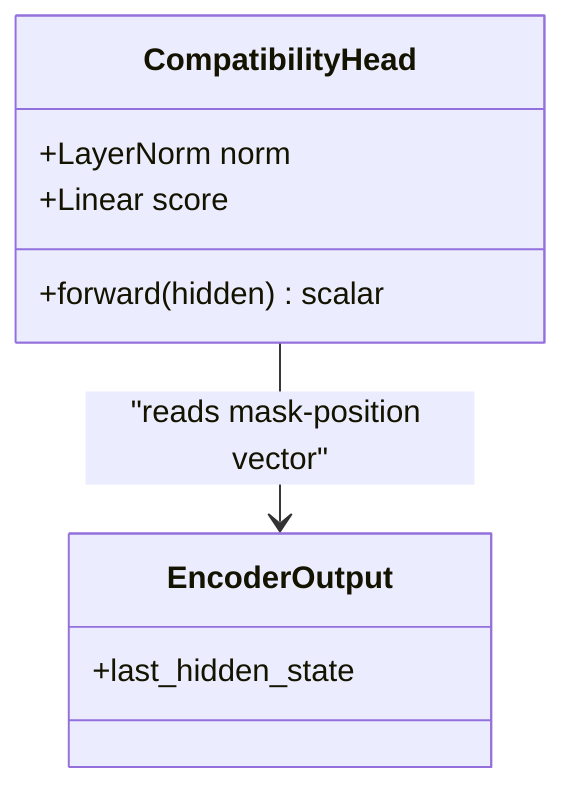

**Diagram sources**
- [hypothesis.py:111-125](file://veya/experimental/hypothesis.py#L111-L125)
- [hypothesis.py:231-242](file://veya/experimental/hypothesis.py#L231-L242)

**Section sources**
- [hypothesis.py:111-125](file://veya/experimental/hypothesis.py#L111-L125)
- [hypothesis.py:231-242](file://veya/experimental/hypothesis.py#L231-L242)

### Grouped Batch Processing
`score_groups` flattens multiple groups of hypotheses, encodes them in batches, and returns one logit tensor per group. This preserves independence between candidates while allowing efficient batching.

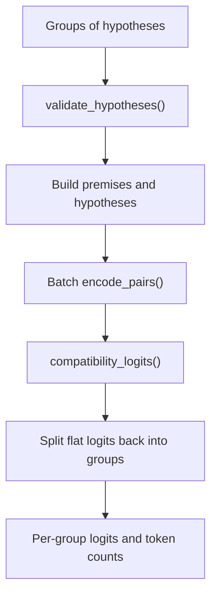

**Diagram sources**
- [hypothesis.py:245-279](file://veya/experimental/hypothesis.py#L245-L279)

**Section sources**
- [hypothesis.py:245-279](file://veya/experimental/hypothesis.py#L245-L279)
- [test_phase9_hypothesis.py:137-161](file://tests/test_phase9_hypothesis.py#L137-L161)

### Encoder Adaptation Options
Two paths exist:
- Frozen prefix with trainable suffix: gradients start at a specified layer.
- Isolated adapted encoder: a private copy of upper layers runs without mutating the shared production encoder.

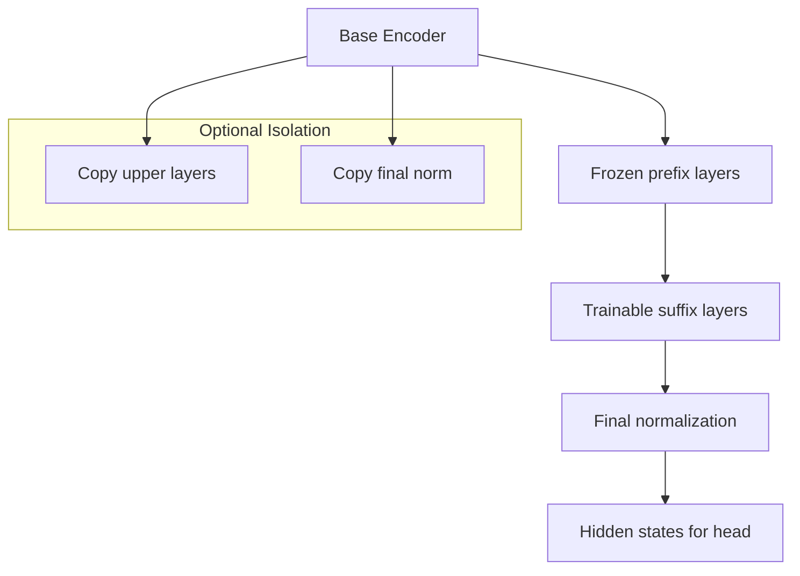

**Diagram sources**
- [hypothesis.py:138-168](file://veya/experimental/hypothesis.py#L138-L168)
- [hypothesis.py:171-197](file://veya/experimental/hypothesis.py#L171-L197)
- [hypothesis.py:200-228](file://veya/experimental/hypothesis.py#L200-L228)

**Section sources**
- [hypothesis.py:138-168](file://veya/experimental/hypothesis.py#L138-L168)
- [hypothesis.py:171-197](file://veya/experimental/hypothesis.py#L171-L197)
- [hypothesis.py:200-228](file://veya/experimental/hypothesis.py#L200-L228)

### Probability Calibration
Probabilities are computed by dividing logits by a positive temperature before softmax. The temperature does not change the argmax but redistributes probability mass.

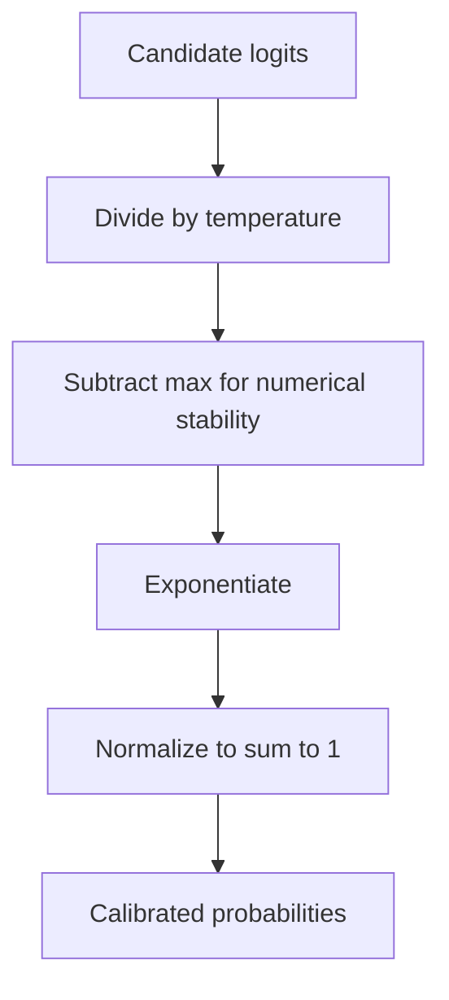

**Diagram sources**
- [hypothesis.py:128-135](file://veya/experimental/hypothesis.py#L128-L135)

**Section sources**
- [hypothesis.py:128-135](file://veya/experimental/hypothesis.py#L128-L135)
- [test_phase9_hypothesis.py:337-347](file://tests/test_phase9_hypothesis.py#L337-L347)

### Experimental Public Choice Integration
`HypothesisScorer.public_choice` integrates with a release bundle plan. For large candidate sets, it can shortlist candidates, generate H0 hypotheses, compute logits, apply temperature, and return a structured result including route metadata and calibration identifiers.

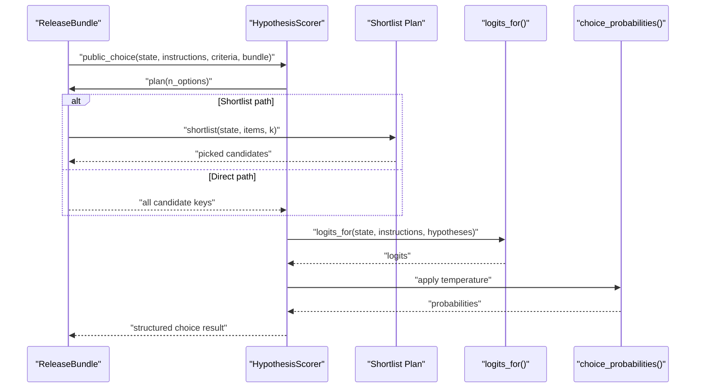

**Diagram sources**
- [hypothesis.py:411-450](file://veya/experimental/hypothesis.py#L411-L450)

**Section sources**
- [hypothesis.py:411-450](file://veya/experimental/hypothesis.py#L411-L450)
- [test_phase9_hypothesis.py:225-283](file://tests/test_phase9_hypothesis.py#L225-L283)

### Statistical Analysis and Metrics
The framework and its research scripts track several statistical measures:

- Accuracy and conditional accuracy when the truth is present.
- Negative log-likelihood and Brier score when applicable.
- Expected Calibration Error (ECE).
- Margin between top and second-best probabilities.
- Permutation stability checks for candidate order invariance.
- Security injection resistance.
- Paraphrase agreement across hypothesis and state variations.
- Latency and token usage comparisons against the packed control.

Additionally, the broader repository includes risk coverage curves and Wilson interval reporting for thresholded acceptance decisions.

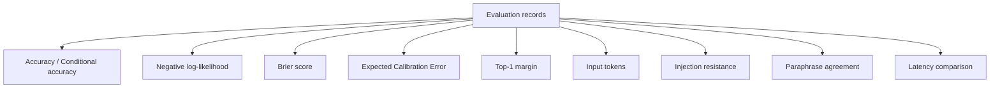

**Diagram sources**
- [run_phase9_hypothesis.py:106-158](file://research/veyabench/run_phase9_hypothesis.py#L106-L158)
- [run_phase9_hypothesis.py:630-695](file://research/veyabench/run_phase9_hypothesis.py#L630-L695)
- [run_phase9_hypothesis.py:702-739](file://research/veyabench/run_phase9_hypothesis.py#L702-L739)
- [selective.py:67-113](file://veya/selective.py#L67-L113)

**Section sources**
- [run_phase9_hypothesis.py:106-158](file://research/veyabench/run_phase9_hypothesis.py#L106-L158)
- [run_phase9_hypothesis.py:340-384](file://research/veyabench/run_phase9_hypothesis.py#L340-L384)
- [run_phase9_hypothesis.py:630-695](file://research/veyabench/run_phase9_hypothesis.py#L630-L695)
- [run_phase9_hypothesis.py:702-739](file://research/veyabench/run_phase9_hypothesis.py#L702-L739)
- [selective.py:67-113](file://veya/selective.py#L67-L113)

## Dependency Analysis
The hypothesis module depends on:
- Tokenizer utilities for pair construction.
- State serialization helpers.
- PyTorch and NumPy for tensor operations and probability computation.
- Optional transformer masking utilities for encoder adaptation.
- Release bundle interfaces for experimental routing.

Tests depend on:
- Unit assertions for templates, duplicates, mask position, permutation invariance, service behavior, and calibration record validation.
- Fake agents, bundles, and scorers to exercise HTTP endpoints and public-choice logic without loading production checkpoints.

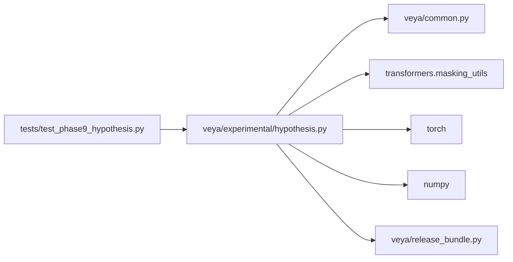

**Diagram sources**
- [hypothesis.py:7-14](file://veya/experimental/hypothesis.py#L7-L14)
- [hypothesis.py:138-149](file://veya/experimental/hypothesis.py#L138-L149)
- [hypothesis.py:411-414](file://veya/experimental/hypothesis.py#L411-L414)
- [test_phase9_hypothesis.py:15-30](file://tests/test_phase9_hypothesis.py#L15-L30)

**Section sources**
- [hypothesis.py:7-14](file://veya/experimental/hypothesis.py#L7-L14)
- [hypothesis.py:138-149](file://veya/experimental/hypothesis.py#L138-L149)
- [hypothesis.py:411-414](file://veya/experimental/hypothesis.py#L411-L414)
- [test_phase9_hypothesis.py:15-30](file://tests/test_phase9_hypothesis.py#L15-L30)

## Performance Considerations
- Pair budget: The maximum length limits premise tokens while preserving the full hypothesis. Excessive premise length triggers truncation.
- Batch size: `pair_batch` controls how many pairs are encoded together.
- Independence: Each candidate is scored independently; there is no positional feature, reducing sensitivity to sibling order.
- Adaptation cost: Upper-layer adaptation avoids rewriting the shared encoder but still requires careful gradient management.
- Latency measurement: The research script compares hypothesis scoring latency against the packed control and reports percentiles.

Recommendations:
- Keep hypotheses concise to avoid unnecessary truncation.
- Use shortlisting for very large candidate sets.
- Monitor token counts and truncation rates.
- Compare hypothesis latency against the packed baseline before promotion.

**Section sources**
- [hypothesis.py:73-108](file://veya/experimental/hypothesis.py#L73-L108)
- [hypothesis.py:245-279](file://veya/experimental/hypothesis.py#L245-L279)
- [run_phase9_hypothesis.py:702-739](file://research/veyabench/run_phase9_hypothesis.py#L702-L739)

## Troubleshooting Guide
Common issues and resolutions:

- Empty or duplicate hypotheses:
  - Cause: Missing or repeated hypothesis text after normalization.
  - Resolution: Ensure each hypothesis is non-empty and unique.

- Hypothesis does not fit the pair budget:
  - Cause: Hypothesis too long relative to `MAX_LENGTH`.
  - Resolution: Shorten hypotheses or increase the effective budget carefully.

- Mask position mismatch:
  - Cause: Unexpected tokenizer behavior or malformed pair construction.
  - Resolution: Verify tokenizer special tokens and pair construction.

- Incompatible calibration record:
  - Cause: Mismatched checkpoint hash, shortlist hash, head hash, delta hash, template version, or allowed fitting split.
  - Resolution: Load matching artifacts and ensure the calibration record matches the loaded files.

- Fitted temperature misuse:
  - Cause: Using a fitted temperature with an uncalibrated scorer identifier.
  - Resolution: Use the correct calibration identifier or an uncalibrated temperature.

- Candidate injection attacks:
  - Cause: Malicious criterion values attempting to override selection.
  - Resolution: For H0, criterion values are ignored; verify security suite results.

**Section sources**
- [hypothesis.py:22-39](file://veya/experimental/hypothesis.py#L22-L39)
- [hypothesis.py:51-63](file://veya/experimental/hypothesis.py#L51-L63)
- [hypothesis.py:73-108](file://veya/experimental/hypothesis.py#L73-L108)
- [hypothesis.py:287-315](file://veya/experimental/hypothesis.py#L287-L315)
- [hypothesis.py:318-361](file://veya/experimental/hypothesis.py#L318-L361)
- [hypothesis.py:378-400](file://veya/experimental/hypothesis.py#L378-L400)
- [test_phase9_hypothesis.py:286-310](file://tests/test_phase9_hypothesis.py#L286-L310)

## Conclusion
The hypothesis evaluation framework provides a rigorous, pair-based approach to testing model assumptions about candidate compatibility. It emphasizes:

- Clear hypothesis definitions with variant-specific templates.
- Independent candidate scoring with strong invariance guarantees.
- Optional encoder adaptation without mutating shared parameters.
- Temperature-based calibration and comprehensive diagnostics.
- Experimental integration with high-cardinality choice routing.

It is designed for research workflows where controlled experimentation, reproducibility, and statistical scrutiny matter more than immediate production deployment.

## Appendices

### How to Define Custom Hypotheses
- Choose a variant:
  - H0 for label-id statements.
  - H1 for naturalized label phrasing.
  - H2 for authoritative definitions, avoiding contrastive boundaries.
- Generate hypotheses from labels using the provided helper.
- Validate the list to reject empty or duplicate entries.

**Section sources**
- [hypothesis.py:22-39](file://veya/experimental/hypothesis.py#L22-L39)
- [hypothesis.py:51-63](file://veya/experimental/hypothesis.py#L51-L63)

### How to Run Evaluations Against Model Outputs
- Prepare state and question text.
- Generate hypothesis strings for each candidate.
- Call `logits_for` to obtain per-candidate logits.
- Apply temperature scaling if calibrated.
- Convert logits to probabilities and select the top candidate.

**Section sources**
- [hypothesis.py:402-409](file://veya/experimental/hypothesis.py#L402-L409)
- [hypothesis.py:128-135](file://veya/experimental/hypothesis.py#L128-L135)

### How to Interpret Results
- Look at predicted label, confidence, margin, and token usage.
- Inspect conditional accuracy when the truth is present.
- Review ECE and Brier/NLL for calibration quality.
- Check permutation stability and security metrics.
- Compare latency against the packed control.

**Section sources**
- [run_phase9_hypothesis.py:106-158](file://research/veyabench/run_phase9_hypothesis.py#L106-L158)
- [run_phase9_hypothesis.py:340-384](file://research/veyabench/run_phase9_hypothesis.py#L340-L384)
- [run_phase9_hypothesis.py:630-695](file://research/veyabench/run_phase9_hypothesis.py#L630-L695)
- [run_phase9_hypothesis.py:702-739](file://research/veyabench/run_phase9_hypothesis.py#L702-L739)

### Comparing Model Variants
- Train or load a compatibility head and optional encoder suffix.
- Evaluate both the packed control and the hypothesis scorer on the same corpus.
- Compare accuracy, conditional accuracy, calibration metrics, token usage, and latency.
- Use permutation and security diagnostics to assess robustness.

**Section sources**
- [run_phase9_hypothesis.py:405-503](file://research/veyabench/run_phase9_hypothesis.py#L405-L503)
- [run_phase9_hypothesis.py:506-522](file://research/veyabench/run_phase9_hypothesis.py#L506-L522)
- [run_phase9_hypothesis.py:630-739](file://research/veyabench/run_phase9_hypothesis.py#L630-L739)

### Generating Evaluation Reports
- Record per-example logits, probabilities, predictions, correctness, confidence, margin, NLL, Brier, and token counts.
- Summarize aggregate metrics including accuracy, ECE, NLL, Brier, and token statistics.
- Include permutation stability, security, paraphrase agreement, and latency comparisons.

**Section sources**
- [run_phase9_hypothesis.py:106-158](file://research/veyabench/run_phase9_hypothesis.py#L106-L158)
- [run_phase9_hypothesis.py:630-739](file://research/veyabench/run_phase9_hypothesis.py#L630-L739)