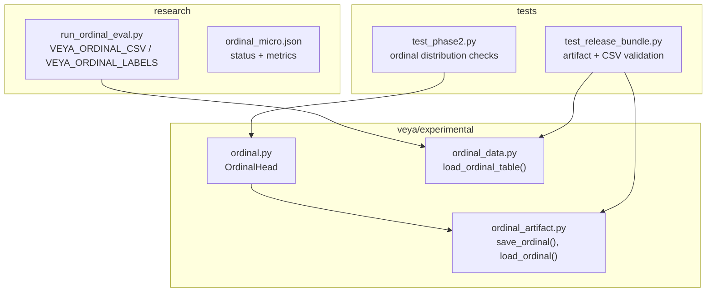
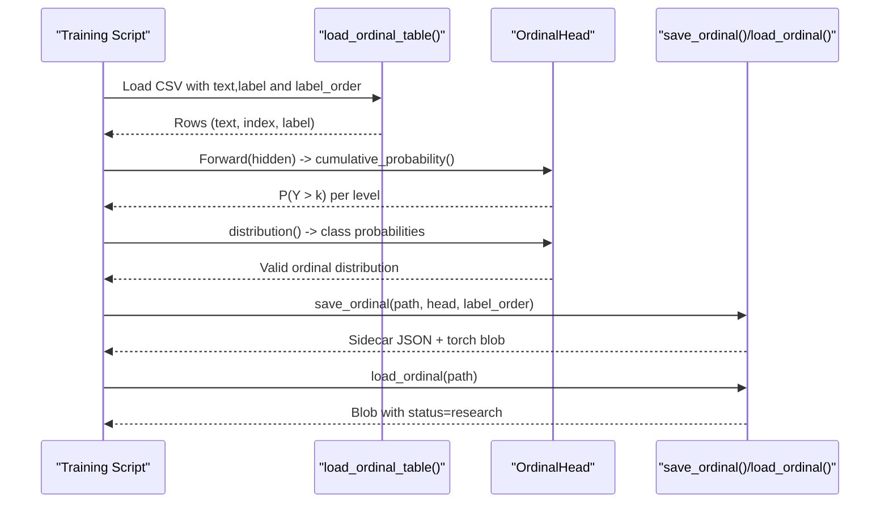
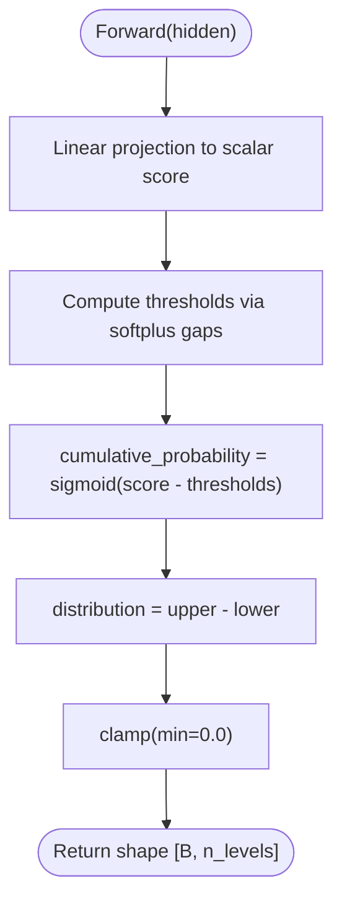
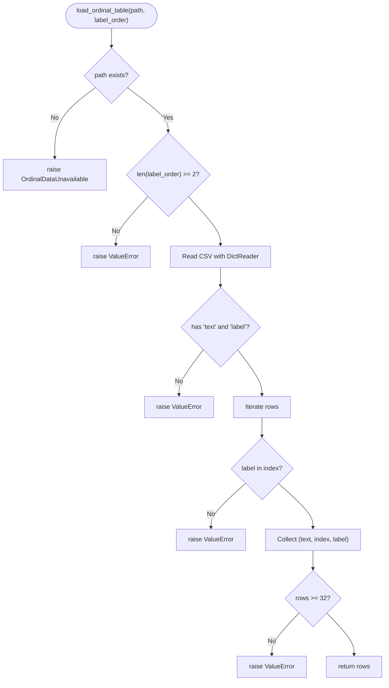
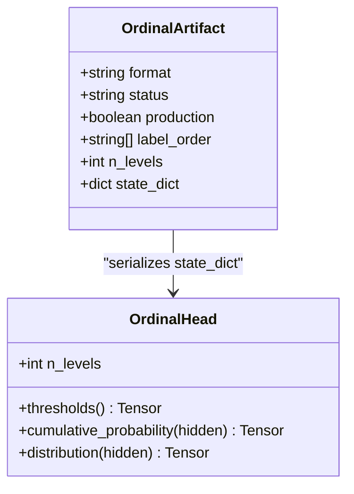
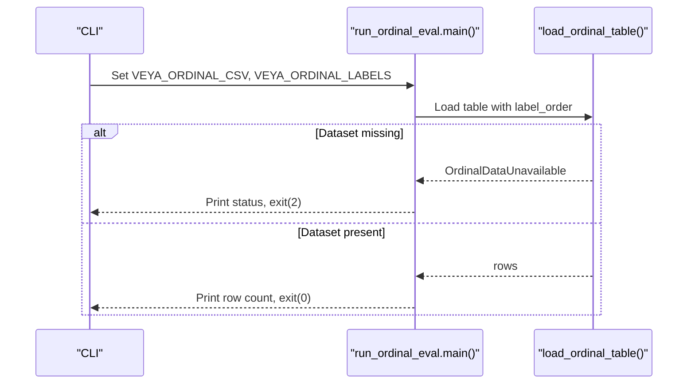
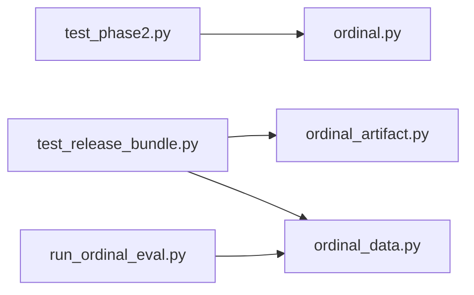

# Ordinal Scoring System

<cite>
**Referenced Files in This Document**
- [README.md](file://README.md)
- [ordinal.py](file://veya/experimental/ordinal.py)
- [ordinal_data.py](file://veya/experimental/ordinal_data.py)
- [ordinal_artifact.py](file://veya/experimental/ordinal_artifact.py)
- [run_ordinal_eval.py](file://research/veyabench/run_ordinal_eval.py)
- [ordinal_micro.json](file://research/configs/ordinal_micro.json)
- [test_phase2.py](file://tests/test_phase2.py)
- [test_release_bundle.py](file://tests/test_release_bundle.py)
</cite>

## Table of Contents
1. [Introduction](#introduction)
2. [Project Structure](#project-structure)
3. [Core Components](#core-components)
4. [Architecture Overview](#architecture-overview)
5. [Detailed Component Analysis](#detailed-component-analysis)
6. [Dependency Analysis](#dependency-analysis)
7. [Performance Considerations](#performance-considerations)
8. [Troubleshooting Guide](#troubleshooting-guide)
9. [Conclusion](#conclusion)
10. [Appendices](#appendices)

## Introduction
This document explains the ordinal scoring system for ranked outputs and ordinal relationships between decisions. It focuses on the experimental ordinal head, ordinal data handling, artifact serialization, evaluation scaffolding, and how these pieces fit into Veya’s broader decision pipeline. The ordinal path is research-only: production Score remains categorical softmax, and ordinal artifacts are explicitly marked as non-production.

Key takeaways:
- Ordinal modeling uses cumulative thresholds to enforce ordered probabilities across levels.
- Ordinal datasets are loaded from CSV with an explicit low-to-high label order.
- Ordinal artifacts can be saved and loaded but cannot be used in production.
- Evaluation scaffolding exists but does not yet compare ordinal vs categorical Score.

**Section sources**
- [README.md:28-37](file://README.md#L28-L37)
- [ordinal_micro.json:1-7](file://research/configs/ordinal_micro.json#L1-L7)

## Project Structure
The ordinal scoring system lives under `veya/experimental` and is supported by research scripts and tests:

**Diagram sources**
- [ordinal.py:11-34](file://veya/experimental/ordinal.py#L11-L34)
- [ordinal_data.py:15-42](file://veya/experimental/ordinal_data.py#L15-L42)
- [ordinal_artifact.py:14-47](file://veya/experimental/ordinal_artifact.py#L14-L47)
- [run_ordinal_eval.py:12-24](file://research/veyabench/run_ordinal_eval.py#L12-L24)
- [ordinal_micro.json:1-7](file://research/configs/ordinal_micro.json#L1-L7)
- [test_phase2.py:159-167](file://tests/test_phase2.py#L159-L167)
- [test_release_bundle.py:95-121](file://tests/test_release_bundle.py#L95-L121)

**Section sources**
- [ordinal.py:1-35](file://veya/experimental/ordinal.py#L1-L35)
- [ordinal_data.py:1-43](file://veya/experimental/ordinal_data.py#L1-L43)
- [ordinal_artifact.py:1-48](file://veya/experimental/ordinal_artifact.py#L1-L48)
- [run_ordinal_eval.py:1-29](file://research/veyabench/run_ordinal_eval.py#L1-L29)
- [ordinal_micro.json:1-7](file://research/configs/ordinal_micro.json#L1-L7)
- [test_phase2.py:159-167](file://tests/test_phase2.py#L159-L167)
- [test_release_bundle.py:95-121](file://tests/test_release_bundle.py#L95-L121)

## Core Components
- OrdinalHead: Implements a cumulative-threshold model that produces ordered cumulative probabilities and a valid class distribution over ordinal levels.
- Ordinal Data Loader: Reads a CSV with columns `text` and `label`, enforces an explicit low-to-high label order, and rejects invalid or undersized datasets.
- Ordinal Artifact Schema: Serializes and deserializes the ordinal head state dict with metadata; refuses production use.
- Evaluation Scaffolding: A command-line entry point that requires environment variables for dataset path and label order, and exits with a specific code when no dataset is configured.

Operational notes:
- Production Score remains categorical; ordinal is research-only.
- Ordinal artifacts carry `status=research` and `production=False`.
- Tests validate ordering, normalization, artifact safety, and CSV constraints.

**Section sources**
- [ordinal.py:11-34](file://veya/experimental/ordinal.py#L11-L34)
- [ordinal_data.py:11-42](file://veya/experimental/ordinal_data.py#L11-L42)
- [ordinal_artifact.py:11-47](file://veya/experimental/ordinal_artifact.py#L11-L47)
- [run_ordinal_eval.py:12-24](file://research/veyabench/run_ordinal_eval.py#L12-L24)
- [README.md:28-37](file://README.md#L28-L37)

## Architecture Overview
The ordinal scoring system composes three layers:

1. Model Layer: OrdinalHead converts encoder hidden states into a probability distribution over ordered levels using cumulative thresholds.
2. Data Layer: OrdinalDataLoader validates and loads training data from CSV with strict schema and size requirements.
3. Artifact Layer: OrdinalArtifact serializes/deserializes the trained head with safety checks preventing production deployment.

**Diagram sources**
- [ordinal_data.py:15-42](file://veya/experimental/ordinal_data.py#L15-L42)
- [ordinal.py:20-34](file://veya/experimental/ordinal.py#L20-L34)
- [ordinal_artifact.py:14-47](file://veya/experimental/ordinal_artifact.py#L14-L47)

## Detailed Component Analysis

### OrdinalHead: Cumulative Thresholds and Distribution
OrdinalHead implements a softplus chain of thresholds to ensure monotonicity of cumulative probabilities. Class probabilities are derived as adjacent differences of cumulative probabilities and clamped to non-negative values.

Key behaviors:
- Requires at least two ordinal levels.
- Produces cumulative probabilities P(Y > k) that are nonincreasing in k.
- Produces a normalized distribution over all levels.

**Diagram sources**
- [ordinal.py:11-34](file://veya/experimental/ordinal.py#L11-L34)

Validation highlights:
- Tests assert cumulative probabilities do not increase across levels.
- Tests assert distributions sum to one and have no negative mass.

**Section sources**
- [ordinal.py:11-34](file://veya/experimental/ordinal.py#L11-L34)
- [test_phase2.py:159-167](file://tests/test_phase2.py#L159-L167)

### Ordinal Data Loader: CSV Schema and Constraints
The ordinal data loader reads a CSV with required columns `text` and `label`, maps labels to indices according to a provided low-to-high order, and rejects rows with unknown labels. It also enforces a minimum dataset size.

Constraints:
- Missing or invalid file path raises a dedicated exception.
- Label order must contain at least two levels.
- CSV must include both `text` and `label` columns.
- Unknown labels raise an error.
- Datasets smaller than 32 rows are rejected.

**Diagram sources**
- [ordinal_data.py:15-42](file://veya/experimental/ordinal_data.py#L15-L42)

**Section sources**
- [ordinal_data.py:11-42](file://veya/experimental/ordinal_data.py#L11-L42)
- [test_release_bundle.py:95-121](file://tests/test_release_bundle.py#L95-L121)

### Ordinal Artifact Schema: Serialization and Safety Checks
The ordinal artifact format stores the head’s state dict alongside metadata such as format version, status, production flag, label order, and number of levels. Loading enforces format compatibility and prevents production use.

Safety rules:
- Only the expected format is accepted.
- Artifacts marked as production are rejected.
- Artifacts must have `status=research`.

**Diagram sources**
- [ordinal_artifact.py:11-47](file://veya/experimental/ordinal_artifact.py#L11-L47)

**Section sources**
- [ordinal_artifact.py:11-47](file://veya/experimental/ordinal_artifact.py#L11-L47)
- [test_release_bundle.py:103-113](file://tests/test_release_bundle.py#L103-L113)

### Evaluation Scaffolding: Command-Line Interface
The ordinal evaluation script requires two environment variables:
- `VEYA_ORDINAL_CSV`: Path to the ordinal dataset CSV.
- `VEYA_ORDINAL_LABELS`: Comma-separated list defining the low-to-high label order.

Behavior:
- If the dataset is unavailable, it prints a status message and exits with code 2.
- Otherwise, it reports the number of rows and indicates that comparison against categorical Score is not implemented until a reviewed training run exists.

**Diagram sources**
- [run_ordinal_eval.py:12-24](file://research/veyabench/run_ordinal_eval.py#L12-L24)
- [ordinal_data.py:15-42](file://veya/experimental/ordinal_data.py#L15-L42)

**Section sources**
- [run_ordinal_eval.py:1-29](file://research/veyabench/run_ordinal_eval.py#L1-L29)
- [ordinal_micro.json:1-7](file://research/configs/ordinal_micro.json#L1-L7)

## Dependency Analysis
The ordinal subsystem has clear boundaries:
- OrdinalHead depends only on PyTorch primitives.
- OrdinalDataLoader depends on Python’s CSV reader and filesystem access.
- OrdinalArtifact depends on Torch’s save/load and JSON for sidecar metadata.
- Evaluation script depends on OrdinalDataLoader.
- Tests depend on all three modules to validate behavior and safety.

**Diagram sources**
- [test_phase2.py:159-167](file://tests/test_phase2.py#L159-L167)
- [test_release_bundle.py:95-121](file://tests/test_release_bundle.py#L95-L121)
- [run_ordinal_eval.py:12-24](file://research/veyabench/run_ordinal_eval.py#L12-L24)

**Section sources**
- [test_phase2.py:159-167](file://tests/test_phase2.py#L159-L167)
- [test_release_bundle.py:95-121](file://tests/test_release_bundle.py#L95-L121)
- [run_ordinal_eval.py:12-24](file://research/veyabench/run_ordinal_eval.py#L12-L24)

## Performance Considerations
- OrdinalHead adds minimal overhead: one linear projection and element-wise operations over thresholds.
- Cumulative threshold computation is O(n_levels); distribution derivation is O(n_levels).
- CSV loading is I/O-bound; ensure datasets meet the minimum size requirement to avoid repeated failures.
- Avoid unnecessary reloads of ordinal artifacts; cache blobs during training or evaluation loops.
- Keep label order consistent across training, evaluation, and artifact usage to prevent mismatches.

[No sources needed since this section provides general guidance]

## Troubleshooting Guide
Common issues and resolutions:
- Missing ordinal dataset: Ensure `VEYA_ORDINAL_CSV` points to a valid CSV and `VEYA_ORDINAL_LABELS` defines at least two levels. The loader will raise a dedicated exception if the file is absent.
- Invalid CSV schema: The CSV must include both `text` and `label` columns. Unknown labels are rejected.
- Small dataset: Datasets below 32 rows are refused; expand your dataset before running evaluations.
- Artifact not allowed in production: Ordinal artifacts are explicitly marked as research; attempting to load a production-flagged artifact raises an error.
- Mismatched label order: When saving or loading artifacts, ensure the label order length matches the head’s number of levels.

Actionable checks:
- Verify environment variables before invoking the ordinal evaluation script.
- Inspect CSV headers and label values.
- Confirm artifact metadata shows `status=research` and `production=False`.

**Section sources**
- [ordinal_data.py:15-42](file://veya/experimental/ordinal_data.py#L15-L42)
- [ordinal_artifact.py:39-47](file://veya/experimental/ordinal_artifact.py#L39-L47)
- [test_release_bundle.py:95-121](file://tests/test_release_bundle.py#L95-L121)

## Conclusion
The ordinal scoring system provides a research-grade mechanism for modeling ordered outcomes through cumulative thresholds. It includes robust data validation, safe artifact serialization, and evaluation scaffolding. While production Score remains categorical, teams can experiment with ordinal heads, validate distributions, and prepare artifacts for future research comparisons. Always respect the research-only constraints and ensure datasets and label orders are correct before training or evaluation.

[No sources needed since this section summarizes without analyzing specific files]

## Appendices

### How to Work with Ordinal Scores
- Training:
  - Prepare a CSV with `text` and `label` columns.
  - Define a low-to-high label order via `VEYA_ORDINAL_LABELS`.
  - Use OrdinalHead to compute cumulative probabilities and derive class distributions.
- Prediction:
  - Obtain hidden representations from your encoder.
  - Call `cumulative_probability()` to get ordered tail probabilities.
  - Call `distribution()` to obtain calibrated class probabilities.
- Ranking uncertainty:
  - Use the full distribution to quantify uncertainty (e.g., entropy, variance).
  - Prefer threshold-based decisions when you need hard ranks; otherwise, work with distributions.

**Section sources**
- [ordinal.py:20-34](file://veya/experimental/ordinal.py#L20-L34)
- [ordinal_data.py:15-42](file://veya/experimental/ordinal_data.py#L15-L42)

### Integration with the Main Decision Pipeline
- Current integration:
  - The main agent’s Score path remains categorical softmax.
  - Ordinal components are isolated under `veya/experimental`.
- Future integration steps:
  - Replace or augment the categorical scorer with OrdinalHead where appropriate.
  - Integrate ordinal distributions into confidence gating and routing logic.
  - Add calibration procedures tailored to ordinal outputs.

**Section sources**
- [README.md:28-37](file://README.md#L28-L37)
- [ordinal_micro.json:1-7](file://research/configs/ordinal_micro.json#L1-L7)

### Visualization of Ordinal Distributions
- Plot cumulative probabilities across levels to verify monotonicity.
- Plot class probabilities to confirm normalization and absence of negative mass.
- Compare distributions across inputs to visualize ranking uncertainty.

[No sources needed since this section provides general guidance]