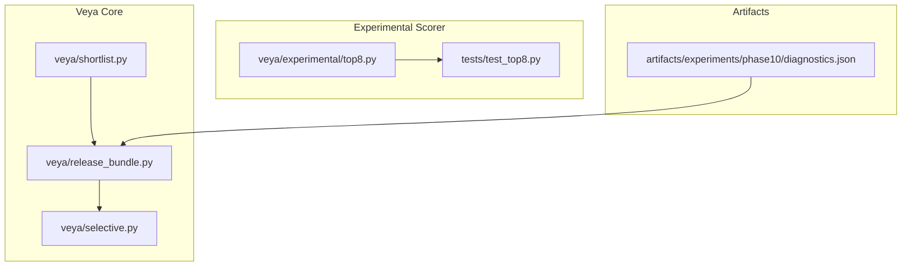
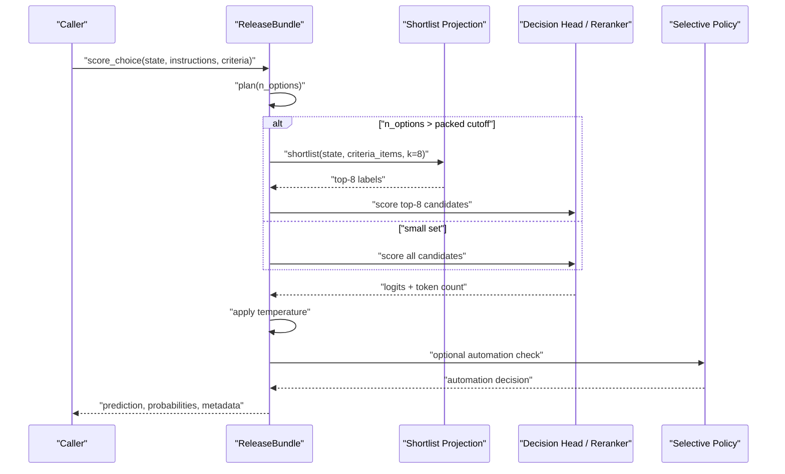
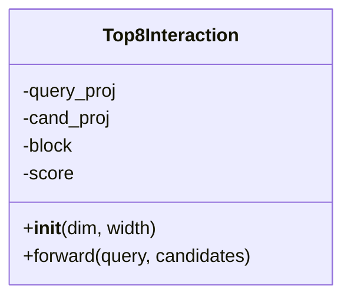
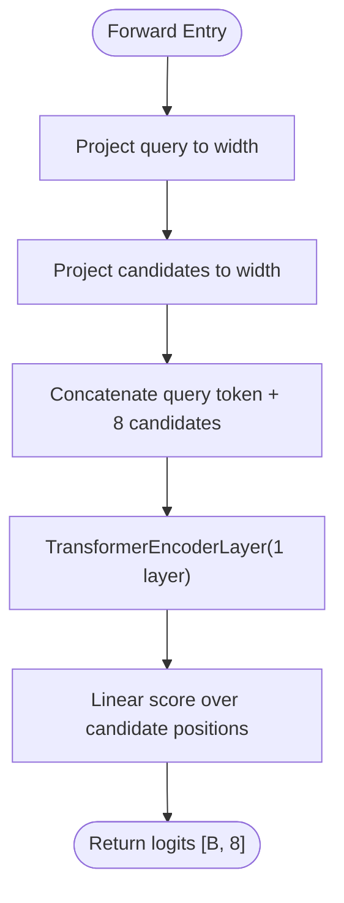
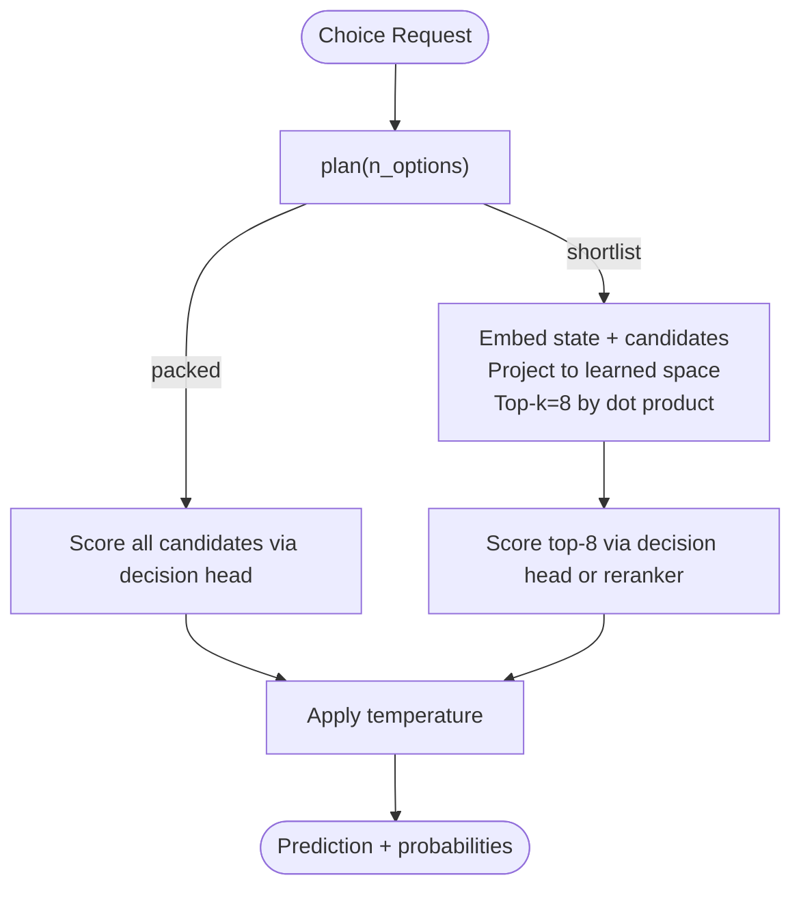
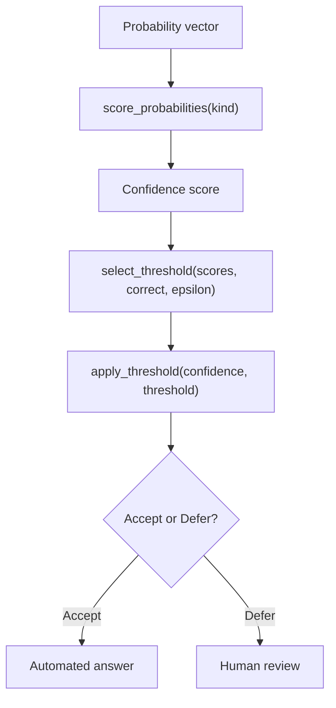
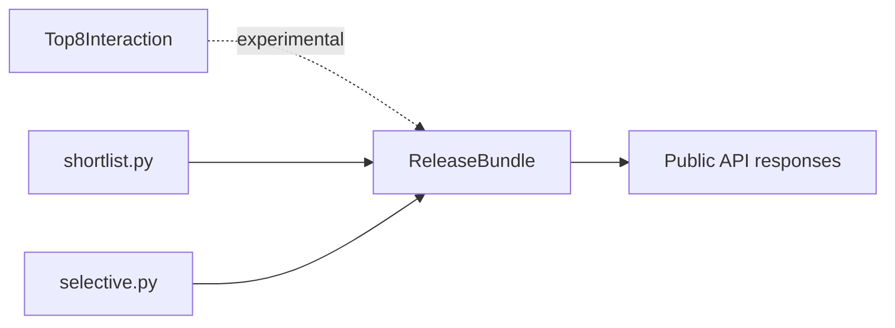

# Top-8 Selection Algorithm

<cite>
**Referenced Files in This Document**
- [veya/experimental/top8.py](file://veya/experimental/top8.py)
- [tests/test_top8.py](file://tests/test_top8.py)
- [veya/shortlist.py](file://veya/shortlist.py)
- [veya/release_bundle.py](file://veya/release_bundle.py)
- [veya/selective.py](file://veya/selective.py)
- [artifacts/experiments/phase10/diagnostics.json](file://artifacts/experiments/phase10/diagnostics.json)
</cite>

## Table of Contents
1. [Introduction](#introduction)
2. [Project Structure](#project-structure)
3. [Core Components](#core-components)
4. [Architecture Overview](#architecture-overview)
5. [Detailed Component Analysis](#detailed-component-analysis)
6. [Dependency Analysis](#dependency-analysis)
7. [Performance Considerations](#performance-considerations)
8. [Troubleshooting Guide](#troubleshooting-guide)
9. [Conclusion](#conclusion)
10. [Appendices](#appendices)

## Introduction
This document explains the top-8 selection approach used by Veya for high-cardinality decision tasks. It focuses on how a small, fixed-size candidate set is selected and scored with an interaction model, how that approach integrates with the shortlist optimization path, and how it fits into the broader Veya decision pipeline.

The repository contains:
- An experimental top-8 interaction scorer that attends over one query vector and eight candidate vectors to produce per-candidate logits.
- A production shortlist routing system that selects up to eight candidates using a learned projection before scoring them through the main decision head or reranker.
- Selective automation policies that gate whether a choice answer can be automated based on confidence metrics.

The term “top-8” here refers to both the fixed candidate window used by the experimental scorer and the production shortlist size K=8 used in the hierarchical route.

## Project Structure
The relevant code lives under `veya` and `tests`, with supporting artifacts under `artifacts`:

**Diagram sources**
- [veya/experimental/top8.py:1-25](file://veya/experimental/top8.py#L1-L25)
- [tests/test_top8.py:1-83](file://tests/test_top8.py#L1-L83)
- [veya/shortlist.py:1-322](file://veya/shortlist.py#L1-L322)
- [veya/release_bundle.py:1-503](file://veya/release_bundle.py#L1-L503)
- [veya/selective.py:1-143](file://veya/selective.py#L1-L143)
- [artifacts/experiments/phase10/diagnostics.json:163-255](file://artifacts/experiments/phase10/diagnostics.json#L163-L255)

**Section sources**
- [veya/experimental/top8.py:1-25](file://veya/experimental/top8.py#L1-L25)
- [veya/shortlist.py:1-322](file://veya/shortlist.py#L1-L322)
- [veya/release_bundle.py:1-503](file://veya/release_bundle.py#L1-L503)
- [veya/selective.py:1-143](file://veya/selective.py#L1-L143)
- [tests/test_top8.py:1-83](file://tests/test_top8.py#L1-L83)
- [artifacts/experiments/phase10/diagnostics.json:163-255](file://artifacts/experiments/phase10/diagnostics.json#L163-L255)

## Core Components
- Experimental top-8 interaction scorer: a PyTorch module that projects a query and eight candidates into a shared space, runs a transformer encoder layer over the combined tokens, and scores each candidate independently.
- Shortlist optimization: a production pathway that reduces large label sets to a fixed shortlist (K=8) using embeddings and a learned projection, then scores only those candidates.
- Selective automation: a policy layer that decides whether to automate a choice answer based on confidence-derived scores such as maximum probability, negative entropy, or margin.

Key responsibilities:
- Candidate reduction: keep computation bounded by selecting at most eight candidates.
- Interaction scoring: optionally score the query against the shortlist with a lightweight interaction model.
- Production routing: choose between packed scoring and shortlist scoring based on cardinality.
- Automation gating: apply thresholds to accept or defer answers.

**Section sources**
- [veya/experimental/top8.py:1-25](file://veya/experimental/top8.py#L1-L25)
- [veya/shortlist.py:25-40](file://veya/shortlist.py#L25-L40)
- [veya/release_bundle.py:127-258](file://veya/release_bundle.py#L127-L258)
- [veya/selective.py:21-34](file://veya/selective.py#L21-L34)

## Architecture Overview
The top-8 selection algorithm is part of a two-stage process:
1. Candidate selection: reduce the full candidate set to a small shortlist.
2. Decision scoring: score the reduced set with either the main decision head or a reranker; optionally use the experimental top-8 interaction scorer during experimentation.

**Diagram sources**
- [veya/release_bundle.py:208-258](file://veya/release_bundle.py#L208-L258)
- [veya/release_bundle.py:172-198](file://veya/release_bundle.py#L172-L198)
- [veya/selective.py:21-34](file://veya/selective.py#L21-L34)

## Detailed Component Analysis

### Experimental Top-8 Interaction Scorer
The experimental scorer implements a compact interaction model designed for exactly eight candidates. It projects the query and candidates into a shared width, concatenates them with the query as the first token, passes them through a single transformer encoder layer, and scores each candidate position.

Behavioral notes:
- Input shapes: query `[B, D]`, candidates `[B, 8, D]`.
- Output shape: logits `[B, 8]`.
- Deterministic evaluation mode is verified by tests.
- State dict serialization round-trips are validated.

**Diagram sources**
- [veya/experimental/top8.py:11-24](file://veya/experimental/top8.py#L11-L24)

**Section sources**
- [veya/experimental/top8.py:1-25](file://veya/experimental/top8.py#L1-L25)
- [tests/test_top8.py:23-67](file://tests/test_top8.py#L23-L67)

### Shortlist Optimization and Production Routing
The shortlist module provides utilities to select a subset of candidates and integrate that subset into prediction. Production constants define:
- A packed ceiling below which all options fit within the tokenizer’s head budget.
- A production shortlist size K=8.
- A threshold above which the shortlist route is preferred.

Key functions:
- `production_choice_plan(n_options)`: returns packed or shortlist routing plan.
- `choose_choice_path(n_options)`: chooses packed vs shortlist based on marker capacity.
- `shortlist_choice(...)`: cosine-based retrieval helper returning top-k labels.
- `predict_shortlist(...)`: wraps agent predict/system_one after reducing criteria.

Production integration:
- `ReleaseBundle.plan(n_options)` uses router configuration to decide packed vs shortlist.
- `ReleaseBundle.shortlist(...)` embeds state and candidates, projects them, computes dot-product scores, and returns top-k labels.
- `ReleaseBundle.score_choice(...)` applies temperature calibration and optional reranker/hypothesis paths.

**Diagram sources**
- [veya/shortlist.py:43-64](file://veya/shortlist.py#L43-L64)
- [veya/release_bundle.py:84-89](file://veya/release_bundle.py#L84-L89)
- [veya/release_bundle.py:172-198](file://veya/release_bundle.py#L172-L198)
- [veya/release_bundle.py:208-258](file://veya/release_bundle.py#L208-L258)

**Section sources**
- [veya/shortlist.py:25-40](file://veya/shortlist.py#L25-L40)
- [veya/shortlist.py:43-64](file://veya/shortlist.py#L43-L64)
- [veya/shortlist.py:67-148](file://veya/shortlist.py#L67-L148)
- [veya/release_bundle.py:84-89](file://veya/release_bundle.py#L84-L89)
- [veya/release_bundle.py:172-198](file://veya/release_bundle.py#L172-L198)
- [veya/release_bundle.py:208-258](file://veya/release_bundle.py#L208-L258)

### Selective Automation and Thresholds
Selective automation gates whether a choice answer should be automated. It maps probability vectors to confidence scores and selects thresholds on validation data.

Supported scores:
- Maximum probability.
- Negative entropy.
- Margin between top two probabilities.

Threshold selection:
- Finds the lowest score that maintains risk no greater than epsilon across the longest high-confidence prefix.

Policy loading:
- Validates format, route, checkpoint hash, shortlist hash, scorer id, and operating epsilon.

**Diagram sources**
- [veya/selective.py:21-34](file://veya/selective.py#L21-L34)
- [veya/selective.py:37-56](file://veya/selective.py#L37-L56)
- [veya/selective.py:59-64](file://veya/selective.py#L59-L64)
- [veya/selective.py:116-142](file://veya/selective.py#L116-L142)

**Section sources**
- [veya/selective.py:21-34](file://veya/selective.py#L21-L34)
- [veya/selective.py:37-56](file://veya/selective.py#L37-L56)
- [veya/selective.py:59-64](file://veya/selective.py#L59-L64)
- [veya/selective.py:116-142](file://veya/selective.py#L116-L142)

## Dependency Analysis
The top-8 selection approach depends on several modules:

- The experimental scorer (`Top8Interaction`) is self-contained but conceptually complements the shortlist path by providing an interaction-based scorer over a fixed candidate window.
- The shortlist module defines constants and helpers for choosing packed vs shortlist routes and for embedding-based retrieval.
- `ReleaseBundle` orchestrates routing, shortlisting, scoring, calibration, and selective automation.
- `selective.py` provides confidence scoring and thresholding logic used by the bundle when a selective policy is attached.

**Diagram sources**
- [veya/experimental/top8.py:1-25](file://veya/experimental/top8.py#L1-L25)
- [veya/shortlist.py:1-322](file://veya/shortlist.py#L1-L322)
- [veya/release_bundle.py:127-258](file://veya/release_bundle.py#L127-L258)
- [veya/selective.py:1-143](file://veya/selective.py#L1-L143)

**Section sources**
- [veya/experimental/top8.py:1-25](file://veya/experimental/top8.py#L1-L25)
- [veya/shortlist.py:1-322](file://veya/shortlist.py#L1-L322)
- [veya/release_bundle.py:127-258](file://veya/release_bundle.py#L127-L258)
- [veya/selective.py:1-143](file://veya/selective.py#L1-L143)

## Performance Considerations
- Fixed candidate window: The experimental scorer assumes exactly eight candidates, keeping attention and scoring cost constant regardless of the original candidate pool size.
- Learned projection: Production shortlist scoring uses a learned projection to compute dot products efficiently over the shortlist.
- Token budget: Packed scoring is used for smaller label sets to avoid dropping option markers; shortlist scoring is preferred once the label set exceeds the packed ceiling.
- Measured diagnostics: The phase10 diagnostics include timing breakdowns for candidate encoding/projection and exact scoring/top-8 operations across different candidate counts.

Practical implications:
- For very large label sets, shortlist K=8 significantly reduces downstream scoring cost while retaining recall through effective retrieval.
- The experimental top-8 scorer can complement the shortlist path if an interaction-based reranking step is desired during experimentation.

**Section sources**
- [veya/experimental/top8.py:1-25](file://veya/experimental/top8.py#L1-L25)
- [veya/shortlist.py:25-40](file://veya/shortlist.py#L25-L40)
- [artifacts/experiments/phase10/diagnostics.json:163-255](file://artifacts/experiments/phase10/diagnostics.json#L163-L255)

## Troubleshooting Guide
Common issues and checks:
- Shape mismatches: The experimental scorer expects queries of shape `[B, D]` and candidates of shape `[B, 8, D]`. Tests validate output shape `[B, 8]`.
- Non-finite outputs: Tests assert that forward outputs are finite; investigate numerical instability if this fails.
- Determinism: In evaluation mode, repeated calls with the same inputs must yield identical outputs.
- Serialization: State dict save/load must preserve outputs exactly.
- Shortlist cardinality: Ensure `k` is a positive integer and that the number of candidates does not exceed configured limits.
- Router configuration: The router file must match production constants for K and packed cutoff; otherwise, bundle loading will raise errors.

Recommended steps:
- Run the provided regression tests for the experimental scorer.
- Validate shortlist constants and router configuration against production values.
- Use the selective policy loader to ensure policy files are compatible with the current checkpoint and shortlist.

**Section sources**
- [tests/test_top8.py:23-67](file://tests/test_top8.py#L23-L67)
- [veya/shortlist.py:222-225](file://veya/shortlist.py#L222-L225)
- [veya/release_bundle.py:43-56](file://veya/release_bundle.py#L43-L56)
- [veya/selective.py:116-142](file://veya/selective.py#L116-L142)

## Conclusion
The top-8 selection approach in Veya combines a fixed candidate window with efficient scoring to handle high-cardinality decision tasks. The experimental top-8 interaction scorer offers a lightweight interaction model over eight candidates, while the production shortlist path uses learned projections to select and score a small subset of candidates. Selective automation adds a safety layer by gating automated answers based on confidence metrics. Together, these components provide scalable, accurate, and controllable decision routing for large label spaces.

[No sources needed since this section summarizes without analyzing specific files]

## Appendices

### When to Use Top-8 Selection Versus Other Strategies
- Use packed scoring when the label set is small enough to fit within the tokenizer’s head budget.
- Use shortlist K=8 when the label set is large and retrieval quality justifies a two-stage approach.
- Use the experimental top-8 interaction scorer during experimentation if you want to evaluate an interaction-based reranker over the shortlist.

### Tuning Selection Thresholds
- Tune the selective policy’s score type (`max_probability`, `neg_entropy`, `margin`) and operating epsilon on a validation split.
- Monitor coverage and risk curves to ensure the chosen threshold meets your automation goals.

### Measuring Performance Improvements
- Compare packed vs shortlist accuracy and latency across cardinalities.
- Inspect diagnostics for candidate encoding/projection time and exact scoring/time for top-8 operations.
- Track automation coverage and error rates under different selective thresholds.

[No sources needed since this section provides general guidance]