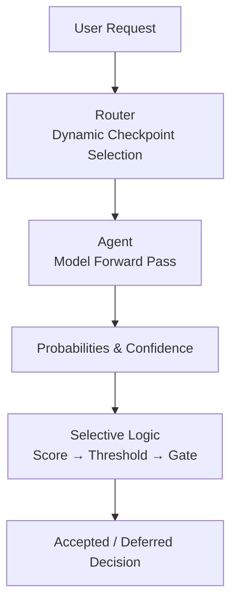
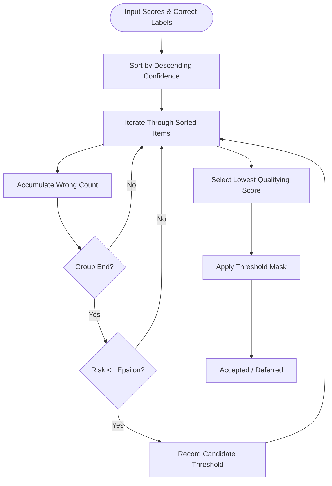
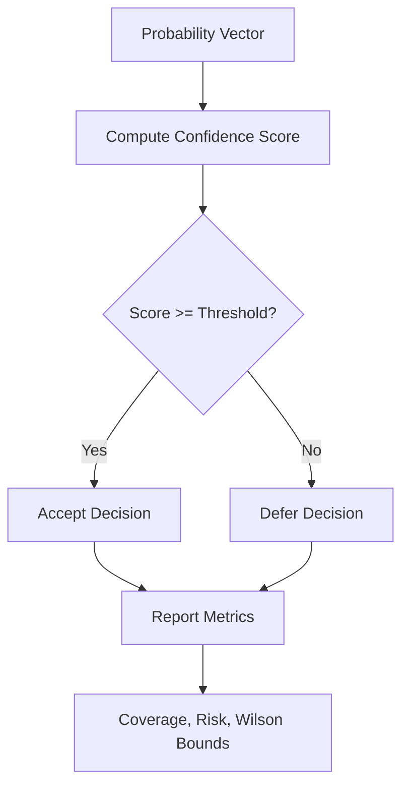
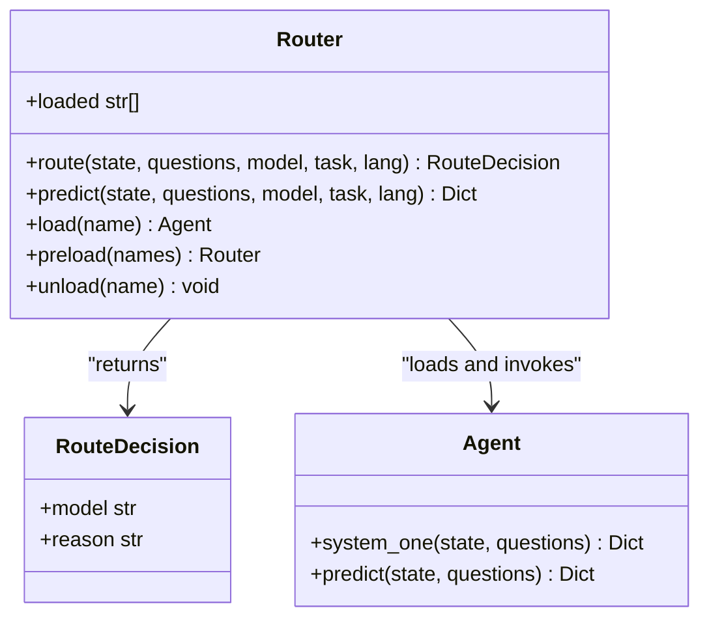
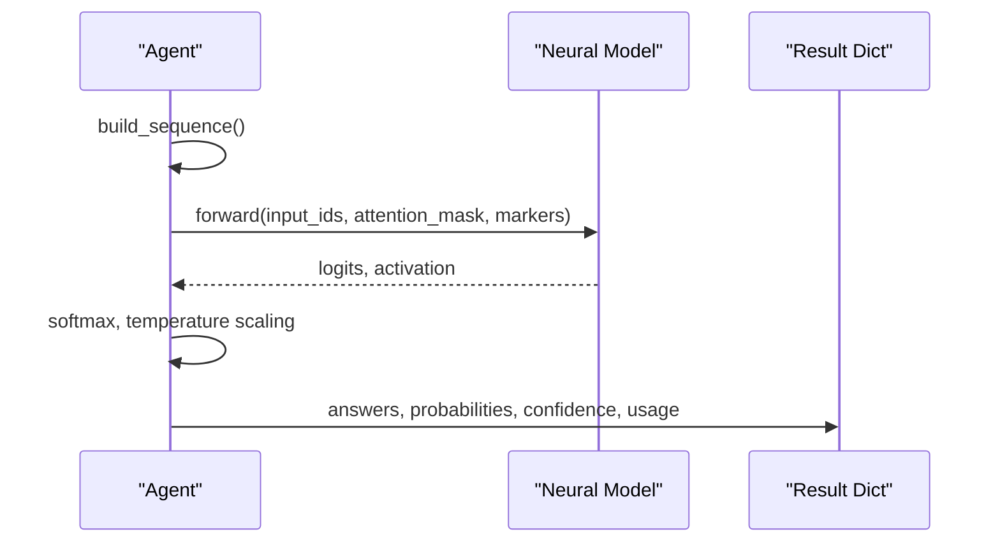
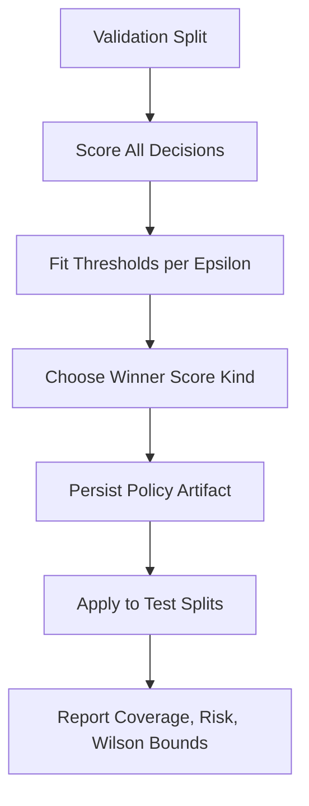
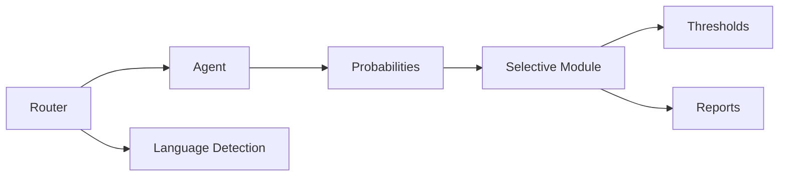

# Selective Inference Patterns

<cite>
**Referenced Files in This Document**
- [selective.py](file://veya/selective.py)
- [router.py](file://veya/router.py)
- [agent.py](file://veya/agent.py)
- [__init__.py](file://veya/__init__.py)
- [automation_policy.json](file://artifacts/decisions/automation_policy.json)
- [run_release_eval.py](file://research/veyabench/run_release_eval.py)
- [test_selective_extra.py](file://tests/test_selective_extra.py)
</cite>

## Table of Contents
1. [Introduction](#introduction)
2. [Project Structure](#project-structure)
3. [Core Components](#core-components)
4. [Architecture Overview](#architecture-overview)
5. [Detailed Component Analysis](#detailed-component-analysis)
6. [Dependency Analysis](#dependency-analysis)
7. [Performance Considerations](#performance-considerations)
8. [Troubleshooting Guide](#troubleshooting-guide)
9. [Conclusion](#conclusion)

## Introduction
This document explains Veya’s selective inference patterns: conditional model execution driven by confidence thresholds and routing logic. It covers how confidence scores are computed, how thresholds are selected on a validation split, how those thresholds gate expensive operations, and how the router selects checkpoints based on language or task signals. It also provides guidance for implementing custom selective rules, configuring confidence thresholds, monitoring inference efficiency, and debugging selective workflows.

Selective inference is not a trained policy in this codebase. Instead, it computes a confidence score per decision, chooses a threshold from a validation split for one or more risk targets, and applies that fixed threshold to later splits. The goal is to accept only high-confidence decisions while deferring uncertain ones, thereby reducing unnecessary computation and controlling observed error rates.

## Project Structure
The selective inference capability spans three main layers:

- Confidence scoring and threshold selection live in `veya/selective.py`.
- Dynamic checkpoint routing lives in `veya/router.py`.
- Model execution and probability generation live in `veya/agent.py`.
- Public exports and versioning live in `veya/__init__.py`.
- Policy artifacts and evaluation scripts demonstrate how thresholds are fitted and reported.



**Diagram sources**
- [router.py:257-331](file://veya/router.py#L257-L331)
- [agent.py:291-414](file://veya/agent.py#L291-L414)
- [selective.py:21-64](file://veya/selective.py#L21-L64)

**Section sources**
- [selective.py:1-143](file://veya/selective.py#L1-L143)
- [router.py:1-337](file://veya/router.py#L1-L337)
- [agent.py:101-432](file://veya/agent.py#L101-L432)
- [__init__.py:1-56](file://veya/__init__.py#L1-L56)

## Core Components
- Confidence scoring functions map raw probability vectors into scalar confidence values. Supported kinds include maximum probability, negative entropy, and margin between top two classes.
- Threshold selection finds the lowest score inside the longest high-confidence prefix whose empirical risk stays under a target epsilon.
- Threshold application converts scores into a boolean mask: accepted decisions proceed; deferred decisions skip expensive downstream work.
- Risk and coverage reporting summarizes accepted volume, incorrect count, coverage fraction, observed risk, Wilson interval bounds, and whether a 1% claim is supported.
- Policy loading validates format, route identity, checkpoint hash, shortlist hash, scorer identity, chosen split, score kind, and finite thresholds.

These components together enable conditional execution: compute probabilities once, score them, compare against a preselected threshold, and either answer or defer.

**Section sources**
- [selective.py:21-113](file://veya/selective.py#L21-L113)
- [selective.py:116-143](file://veya/selective.py#L116-L143)

## Architecture Overview
Veya’s selective inference integrates with routing and agent execution as follows:

1. The router decides which checkpoint to use based on explicit model/task/lang hints, detected workflow, script/language detection, or default.
2. The selected agent runs a single forward pass over all questions and returns probabilities and calibrated confidence.
3. Selective logic transforms those probabilities into a confidence score, compares it to a threshold, and gates further processing.
4. Reporting tools summarize acceptance, deferral, risk, and statistical bounds.

```mermaid
sequenceDiagram
participant Client as "Client"
participant Router as "Router"
participant Agent as "Agent"
participant Selective as "Selective Logic"
Client->>Router : predict(state, questions)
Router->>Router : route()
Router->>Agent : load(model)
Agent->>Agent : system_one()
Agent-->>Router : answers + probabilities + confidence
Router-->>Client : result + routing metadata
Note over Selective : Confidence scores can be derived from probabilities<br/>and compared to a validation-selected threshold.<br/>Accepted items proceed; deferred items skip expensive steps.
```

**Diagram sources**
- [router.py:257-331](file://veya/router.py#L257-L331)
- [agent.py:291-414](file://veya/agent.py#L291-L414)
- [selective.py:21-64](file://veya/selective.py#L21-L64)

## Detailed Component Analysis

### Selective Scoring and Thresholding
Selective scoring maps each decision’s probability distribution into a scalar confidence value. Higher values mean more confident predictions. The supported scoring kinds are:

- Maximum probability: the highest class probability.
- Negative entropy: lower entropy means sharper distributions, so negative entropy increases with confidence.
- Margin: difference between the top two class probabilities; larger margins indicate clearer choices.

Threshold selection sorts decisions by descending confidence, walks through the sorted list, tracks cumulative errors, and picks the lowest score that still keeps the empirical risk at or below the target epsilon within the longest qualifying prefix. If no prefix qualifies, the function returns no threshold.

Threshold application then produces a boolean mask. A missing threshold accepts nothing, ensuring safe defaults when no policy is available.



**Diagram sources**
- [selective.py:37-64](file://veya/selective.py#L37-L64)

**Section sources**
- [selective.py:21-64](file://veya/selective.py#L21-L64)

### Confidence Gating Strategies
Confidence gating determines when to invoke expensive operations. The strategy here is threshold-based:

- Compute a confidence score from probabilities.
- Compare the score to a preselected threshold tied to an operating epsilon.
- Accept if the score meets or exceeds the threshold; otherwise defer.

Reporting includes:

- Accepted count and deferred count.
- Coverage as accepted divided by total.
- Observed risk as incorrect divided by accepted.
- Wilson interval bounds for the observed error rate.
- A flag indicating whether the data supports a 1% error claim under the Wilson upper bound.



**Diagram sources**
- [selective.py:21-64](file://veya/selective.py#L21-L64)
- [selective.py:97-113](file://veya/selective.py#L97-L113)

**Section sources**
- [selective.py:67-113](file://veya/selective.py#L67-L113)

### Integration with the Router System
The router performs dynamic model selection before inference. Its precedence is:

1. Explicit model name.
2. Explicit task name.
3. Detected typed-decisions workflow (opt-in).
4. Explicit language hint.
5. Script and language detection.
6. Default model.

Routing does not itself run the model; it returns a structured decision describing the selected checkpoint and reason. The router then loads the agent and executes a single forward pass.



**Diagram sources**
- [router.py:83-99](file://veya/router.py#L83-L99)
- [router.py:123-337](file://veya/router.py#L123-L337)
- [agent.py:101-432](file://veya/agent.py#L101-L432)

**Section sources**
- [router.py:1-337](file://veya/router.py#L1-L337)

### Agent Execution and Probability Generation
The agent builds a sequence from state and question definitions, runs a single forward pass, and converts logits into probabilities. For each question, it computes calibrated confidence and attaches action metadata. The output includes answers, probabilities, confidence, and token usage.

Selective inference can operate on these probabilities and confidence values after the agent returns results.



**Diagram sources**
- [agent.py:291-414](file://veya/agent.py#L291-L414)

**Section sources**
- [agent.py:291-414](file://veya/agent.py#L291-L414)

### Policy Artifacts and Evaluation Workflow
Evaluation scripts demonstrate how selective policies are fitted and reported:

- Fit a policy on a validation split by comparing multiple scoring kinds.
- Choose a winner using a coverage rule at a target epsilon.
- Persist thresholds and metadata into a selective policy artifact.
- Apply thresholds to test splits and report coverage, risk, and Wilson bounds.
- Include risk-coverage curves and decile summaries.

The automation policy artifact documents a research-only stance for automatic execution on a specific route, preserving validation thresholds for descriptive analysis without asserting production guarantees.



**Diagram sources**
- [run_release_eval.py:218-236](file://research/veyabench/run_release_eval.py#L218-L236)
- [run_release_eval.py:710-784](file://research/veyabench/run_release_eval.py#L710-L784)
- [automation_policy.json:1-27](file://artifacts/decisions/automation_policy.json#L1-L27)

**Section sources**
- [run_release_eval.py:218-236](file://research/veyabench/run_release_eval.py#L218-L236)
- [run_release_eval.py:710-784](file://research/veyabench/run_release_eval.py#L710-L784)
- [automation_policy.json:1-27](file://artifacts/decisions/automation_policy.json#L1-L27)

## Dependency Analysis
Selective inference depends on:

- Probability outputs from the agent.
- Confidence scoring utilities.
- Threshold selection and application functions.
- Reporting utilities for risk and coverage.
- Policy validation for format, route, checkpoint, shortlist, scorer, and finite thresholds.

The router depends on language/script detection and model loading. The agent depends on tokenizer configuration, model building, device placement, and calibration loading.



**Diagram sources**
- [agent.py:291-414](file://veya/agent.py#L291-L414)
- [selective.py:21-113](file://veya/selective.py#L21-L113)
- [router.py:257-331](file://veya/router.py#L257-L331)

**Section sources**
- [selective.py:21-143](file://veya/selective.py#L21-L143)
- [agent.py:291-414](file://veya/agent.py#L291-L414)
- [router.py:257-331](file://veya/router.py#L257-L331)

## Performance Considerations
Selective inference improves efficiency by deferring low-confidence decisions. Key considerations include:

- One forward pass per request: the agent evaluates all questions in a single pass, minimizing repeated model loads.
- Routing overhead is small compared to model loading; preloading checkpoints avoids cold-start latency.
- Threshold application is lightweight and operates on already-computed probabilities.
- Deferral reduces downstream cost when expensive reranking, retrieval, or human review is skipped.
- Calibration quality affects reliability; poor calibration can mislead threshold behavior.

[No sources needed since this section provides general guidance]

## Troubleshooting Guide

### Common Issues and Resolutions
- Unknown selective score kind: ensure the configured score is one of the supported kinds.
- Missing or invalid threshold: a missing threshold accepts nothing; verify the policy contains a finite operating threshold.
- Policy mismatch: validate that the policy belongs to the expected route, checkpoint, shortlist, and scorer.
- Non-finite threshold: thresholds must be finite numbers.
- Unsupported policy format: ensure the policy uses the expected format identifier.
- Empty or length-mismatched inputs: scores and correct labels must be non-empty and equal-length.

**Section sources**
- [selective.py:21-34](file://veya/selective.py#L21-L34)
- [selective.py:37-64](file://veya/selective.py#L37-L64)
- [selective.py:116-143](file://veya/selective.py#L116-L143)

### Debugging Selective Workflows
- Inspect the risk-coverage curve to understand how acceptance and error trade off across confidence levels.
- Compare multiple scoring kinds on validation to choose the most effective confidence signal.
- Use Wilson intervals to assess uncertainty around observed risk.
- Validate policy metadata to confirm alignment with the deployed checkpoint and shortlist.
- Monitor coverage and deferred counts to ensure selective gating behaves as intended.

**Section sources**
- [selective.py:77-113](file://veya/selective.py#L77-L113)
- [test_selective_extra.py:71-99](file://tests/test_selective_extra.py#L71-L99)

## Conclusion
Veya’s selective inference combines confidence scoring, validation-selected thresholds, and routing-aware execution to optimize resource usage while controlling observed error rates. The router dynamically selects checkpoints based on language and task signals, the agent generates calibrated probabilities, and the selective module gates expensive operations behind confidence thresholds. Policies are validated for integrity and compatibility, and reporting tools provide transparency into coverage, risk, and statistical bounds. For production use, carefully select scoring kinds, tune thresholds on representative validation data, monitor performance and accuracy trade-offs, and maintain robust policy governance.

[No sources needed since this section summarizes without analyzing specific files]