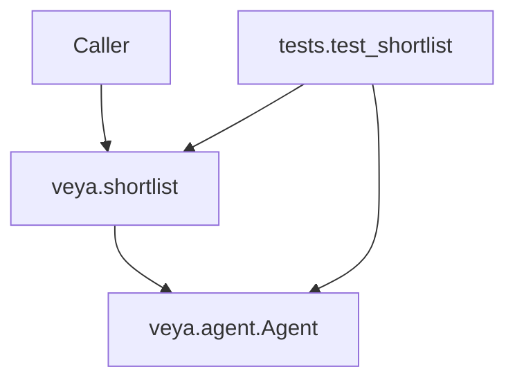
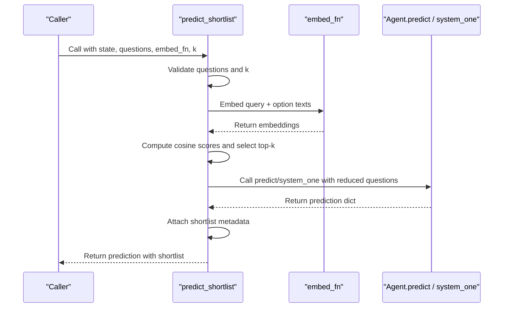
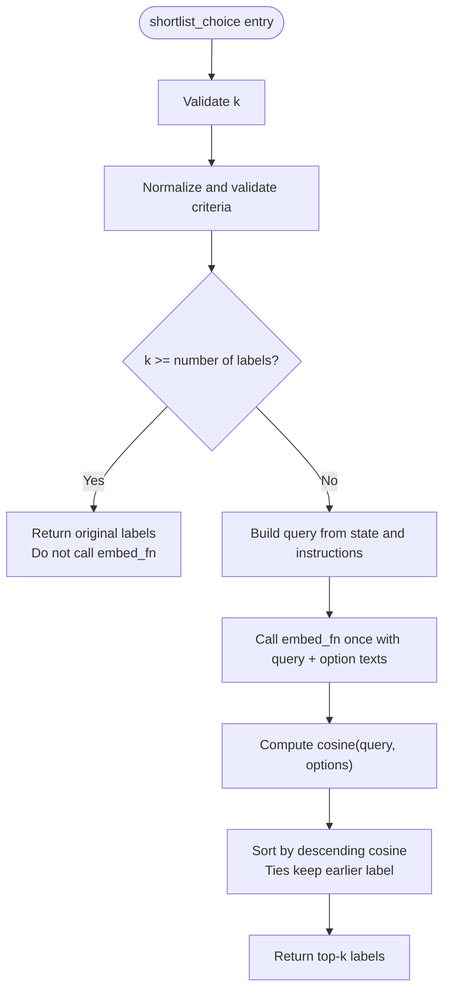
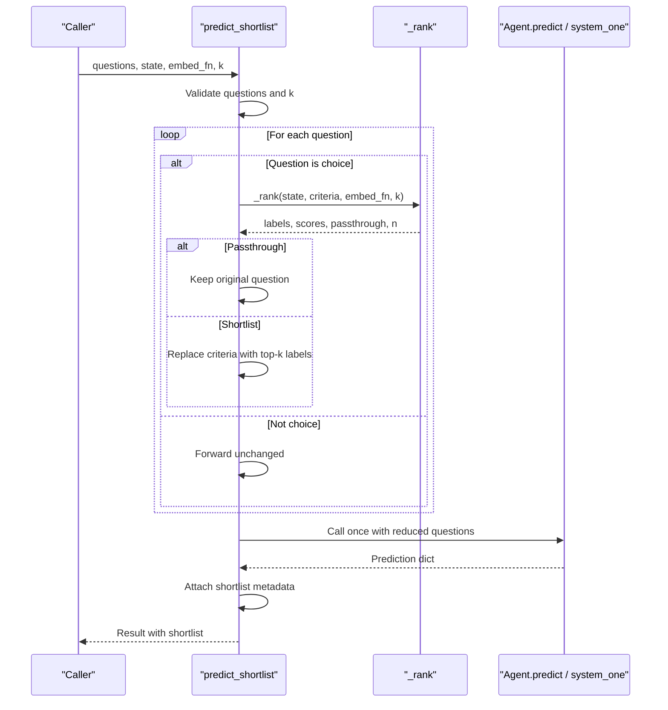
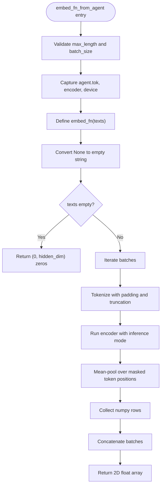
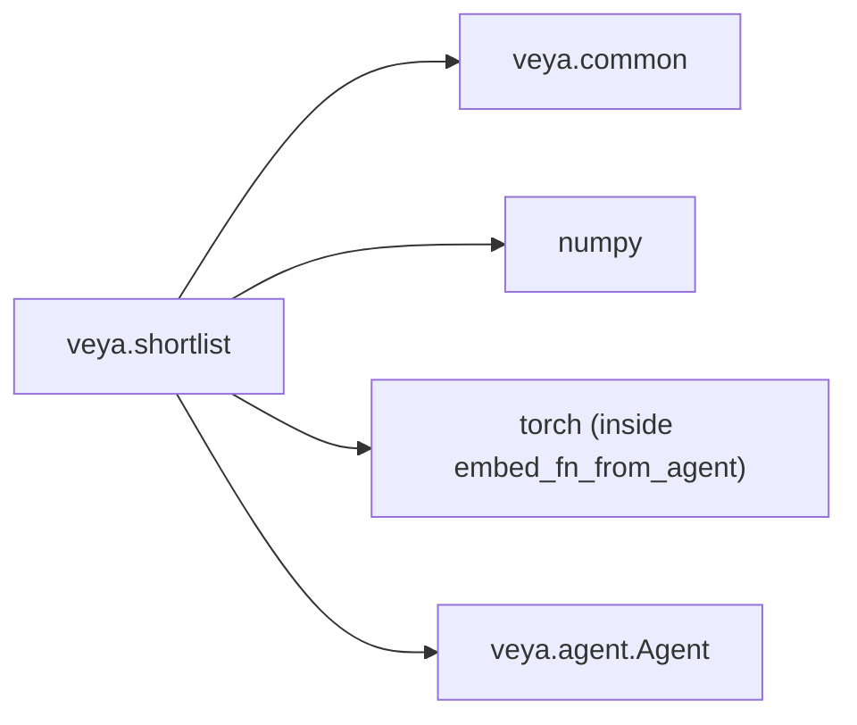

# API Functions & Utilities

<cite>
**Referenced Files in This Document**
- [shortlist.py](file://veya/shortlist.py)
- [agent.py](file://veya/agent.py)
- [__init__.py](file://veya/__init__.py)
- [test_shortlist.py](file://tests/test_shortlist.py)
</cite>

## Table of Contents
1. [Introduction](#introduction)
2. [Project Structure](#project-structure)
3. [Core Components](#core-components)
4. [Architecture Overview](#architecture-overview)
5. [Detailed Component Analysis](#detailed-component-analysis)
6. [Dependency Analysis](#dependency-analysis)
7. [Performance Considerations](#performance-considerations)
8. [Troubleshooting Guide](#troubleshooting-guide)
9. [Conclusion](#conclusion)

## Introduction
This document describes the shortlist optimization module used by Veya for high-cardinality choice questions. It focuses on three public APIs:

- `predict_shortlist`: reduces a large set of choice options to a top-k shortlist, then calls an agent once.
- `embed_fn_from_agent`: builds an embedding function from an already loaded Veya `Agent`.
- `shortlist_choice`: standalone ranking utility that returns the top-k labels using cosine similarity.

The module is designed so that `Agent.predict` and `Agent.system_one` remain unchanged; shortlisting happens before they are called. The returned prediction includes a `shortlist` metadata field describing which labels were kept, how many candidates existed, whether embedding was skipped, and the cosine scores when applicable.

## Project Structure
The shortlist functionality lives in `veya/shortlist.py`. It is re-exported at the package level through `veya/__init__.py`, making it available as `veya.shortlist_choice`, `veya.predict_shortlist`, and `veya.embed_fn_from_agent`. The integration with the decision runtime is exercised against `veya.agent.Agent`, whose `system_one` method is also exposed as `predict`.

**Diagram sources**
- [shortlist.py:1-16](file://veya/shortlist.py#L1-L16)
- [agent.py:291-416](file://veya/agent.py#L291-L416)
- [__init__.py:24-36](file://veya/__init__.py#L24-L36)
- [test_shortlist.py:17-21](file://tests/test_shortlist.py#L17-L21)

**Section sources**
- [shortlist.py:1-16](file://veya/shortlist.py#L1-L16)
- [__init__.py:24-36](file://veya/__init__.py#L24-L36)

## Core Components
The shortlist module provides:

| Function | Purpose | Main Inputs | Main Output |
|---|---|---|---|
| `shortlist_choice` | Rank choice labels by cosine similarity and return the top-k labels. | `state`, `criteria`, `embed_fn`, optional `k`, optional `instructions` | List of label strings |
| `predict_shortlist` | Shortlist each choice question, call the agent once, and attach shortlist metadata. | `agent`, `state`, `questions`, `embed_fn`, optional `k`, extra kwargs forwarded to the agent | Dict containing model result plus `shortlist` |
| `embed_fn_from_agent` | Create an embedding callable from an existing `Agent` encoder. | `agent`, optional `max_length`, optional `batch_size` | Callable returning NumPy arrays |

These functions share internal helpers for parameter validation, criteria normalization, query construction, cosine scoring, and routing to `agent.predict` or `agent.system_one`.

**Section sources**
- [shortlist.py:67-148](file://veya/shortlist.py#L67-L148)
- [shortlist.py:151-203](file://veya/shortlist.py#L151-L203)
- [__init__.py:24-36](file://veya/__init__.py#L24-L36)

## Architecture Overview
The shortlist workflow has two main paths:

1. **Standalone ranking**: `shortlist_choice` embeds the query and option texts once, computes cosine similarities, and returns the top-k labels without calling any agent.
2. **Agent-integrated ranking**: `predict_shortlist` shortlists each choice question, forwards a reduced question set to the agent, copies the agent’s result, and attaches a `shortlist` metadata dict.

**Diagram sources**
- [shortlist.py:91-148](file://veya/shortlist.py#L91-L148)
- [shortlist.py:206-219](file://veya/shortlist.py#L206-L219)
- [shortlist.py:295-314](file://veya/shortlist.py#L295-L314)
- [agent.py:291-416](file://veya/agent.py#L291-L416)

## Detailed Component Analysis

### `shortlist_choice`
`shortlist_choice` is a standalone ranking helper. It does not call an agent. It expects an embedding function that maps a sequence of strings to a numeric array.

**Parameters**

| Parameter | Type | Required | Default | Behavior |
|---|---|---:|---|---|
| `state` | Any | Yes | None | Serialized into text and used as the query. |
| `criteria` | Dict or List | Yes | None | Choice options. Keys become labels; values become rendered option text. |
| `embed_fn` | Callable | Yes | None | Called once with `[query] + option_texts`. Must return a 2D numeric array. |
| `k` | int | No | `DEFAULT_SHORTLIST_K` | Number of labels to return. Must be a positive integer. |
| `instructions` | str or None | No | None | Optional instruction text prepended to the serialized state for the query. |

**Return value**

A list of label strings in descending cosine-similarity order. If `k >= n`, where `n` is the number of labels, the original label order is returned and `embed_fn` is not called.

**Key behaviors**

- Ties preserve earlier input order.
- A zero vector produces cosine score 0 and does not outrank earlier labels.
- Non-finite vector entries are normalized to zero before ranking.
- Criteria validation enforces non-empty string labels, duplicate detection after Unicode normalization, and character limits.

**Diagram sources**
- [shortlist.py:67-88](file://veya/shortlist.py#L67-L88)
- [shortlist.py:206-219](file://veya/shortlist.py#L206-L219)
- [shortlist.py:228-292](file://veya/shortlist.py#L228-L292)

**Section sources**
- [shortlist.py:67-88](file://veya/shortlist.py#L67-L88)
- [shortlist.py:206-219](file://veya/shortlist.py#L206-L219)
- [test_shortlist.py:136-178](file://tests/test_shortlist.py#L136-L178)
- [test_shortlist.py:181-214](file://tests/test_shortlist.py#L181-L214)
- [test_shortlist.py:217-220](file://tests/test_shortlist.py#L217-L220)

### `predict_shortlist`
`predict_shortlist` integrates shortlisting with an agent. It shortlists each choice question independently, calls the agent exactly once, and attaches shortlist metadata.

**Parameters**

| Parameter | Type | Required | Default | Behavior |
|---|---|---:|---|---|
| `agent` | Any | Yes | None | Must provide `predict` or `system_one`. Extra kwargs are forwarded. |
| `state` | Any | Yes | None | Serialized and used as the query for shortlisting. |
| `questions` | Dict[str, Dict] | Yes | None | Maps question id to question definition. Only `"type": "choice"` questions are shortlisted. |
| `embed_fn` | Callable | Yes | None | Embedding function used for shortlisting. |
| `k` | int | No | `DEFAULT_SHORTLIST_K` | Shortlist size per choice question. |
| `**predict_kwargs` | Any | No | None | Forwarded to `agent.predict` or `agent.system_one`. |

**Return value**

A dictionary containing the agent’s result plus a `shortlist` key. For each shortlisted choice question, `shortlist[qid]` contains:

| Field | Type | Meaning |
|---|---|---|
| `labels` | List[str] | Ranked label order selected by cosine similarity. |
| `scores` | List[float] or None | Cosine scores for the selected labels, or `None` if no shortlisting occurred. |
| `k` | int | Requested shortlist size. |
| `n` | int | Total number of candidate labels. |
| `passthrough` | bool | True if the full label set was passed to the agent without shortlisting. |

Important integration rules:

- Non-choice questions are forwarded unchanged.
- A choice with `n <= k` is passed unchanged and marked as passthrough.
- The caller’s `questions` object is not mutated.
- Probabilities returned by the agent are over the shortlisted labels only.
- If the agent returns a non-dict, `predict_shortlist` raises a type error.

**Diagram sources**
- [shortlist.py:91-148](file://veya/shortlist.py#L91-L148)
- [shortlist.py:206-219](file://veya/shortlist.py#L206-L219)
- [shortlist.py:308-314](file://veya/shortlist.py#L308-L314)

**Section sources**
- [shortlist.py:91-148](file://veya/shortlist.py#L91-L148)
- [shortlist.py:308-314](file://veya/shortlist.py#L308-L314)
- [test_shortlist.py:223-328](file://tests/test_shortlist.py#L223-L328)
- [test_shortlist.py:331-344](file://tests/test_shortlist.py#L331-L344)

### `embed_fn_from_agent`
`embed_fn_from_agent` creates an embedding function from an existing `Agent`. It uses the agent’s tokenizer and encoder but does not run the decision head.

**Parameters**

| Parameter | Type | Required | Default | Behavior |
|---|---|---:|---|---|
| `agent` | Any | Yes | None | Must have `tok`, `model.encoder`, and `device`. |
| `max_length` | int | No | 512 | Tokenizer truncation length. Must be a positive integer. |
| `batch_size` | int | No | 32 | Number of texts processed per encoder forward. Must be a positive integer. |

**Return value**

A callable that accepts a sequence of strings and returns a NumPy array of shape `(len(texts), hidden_dim)`.

**Key behaviors**

- `None` inputs are converted to empty strings.
- Batches are chunked according to `batch_size`.
- Padding positions are excluded from mean pooling.
- Torch tensors returned by the encoder are moved to CPU and converted to NumPy.
- Empty input returns an array of shape `(0, hidden_dim)`.
- The decision head is never invoked.

**Diagram sources**
- [shortlist.py:151-203](file://veya/shortlist.py#L151-L203)
- [shortlist.py:317-321](file://veya/shortlist.py#L317-L321)

**Section sources**
- [shortlist.py:151-203](file://veya/shortlist.py#L151-L203)
- [test_shortlist.py:391-468](file://tests/test_shortlist.py#L391-L468)

### Metadata structure in `shortlist`
When `predict_shortlist` shortlists a choice question, the `shortlist[qid]` metadata includes:

- `labels`: ranked label strings.
- `scores`: cosine scores for those labels, or `None` if passthrough occurred.
- `k`: requested shortlist size.
- `n`: total candidate count.
- `passthrough`: boolean indicating whether the full label set was sent to the agent.

For non-choice questions, there is no corresponding entry in `shortlist`.

**Section sources**
- [shortlist.py:105-148](file://veya/shortlist.py#L105-L148)
- [test_shortlist.py:267-277](file://tests/test_shortlist.py#L267-L277)

## Dependency Analysis
The shortlist module depends on:

- `veya.common` for rendering and serialization utilities.
- `numpy` for numeric operations and cosine computation.
- `torch` inside `embed_fn_from_agent` for encoder access.
- `Agent.predict` or `Agent.system_one` for actual decision scoring.

**Diagram sources**
- [shortlist.py:17-23](file://veya/shortlist.py#L17-L23)
- [shortlist.py:171-203](file://veya/shortlist.py#L171-L203)
- [shortlist.py:308-314](file://veya/shortlist.py#L308-L314)
- [agent.py:291-416](file://veya/agent.py#L291-L416)

**Section sources**
- [shortlist.py:17-23](file://veya/shortlist.py#L17-L23)
- [shortlist.py:171-203](file://veya/shortlist.py#L171-L203)
- [shortlist.py:308-314](file://veya/shortlist.py#L308-L314)

## Performance Considerations
- `shortlist_choice` calls `embed_fn` once per ranking operation.
- `predict_shortlist` calls the agent exactly once, regardless of how many choice questions are present.
- When `k >= n`, shortlisting is skipped entirely for that question, avoiding embedding and reducing overhead.
- `embed_fn_from_agent` batches encoder calls according to `batch_size`, which can improve throughput compared to one-by-one encoding.
- The cosine path is described as a benchmark helper; production high-cardinality routing may use a learned projection instead.

[No sources needed since this section provides general guidance]

## Troubleshooting Guide

### Validation and error behavior

| Input | Expected behavior |
|---|---|
| `k` is zero, negative, boolean, float, or string | Raises `ValueError`. |
| `criteria` is empty | Raises `ValueError`. |
| `criteria` is neither dict nor list | Raises `TypeError`. |
| `criteria` contains duplicate labels after Unicode normalization | Raises `ValueError`. |
| A choice question lacks `criteria` | `predict_shortlist` raises `ValueError`. |
| `questions` is not a dict | `predict_shortlist` raises `TypeError`. |
| `embed_fn` returns wrong shape | Raises `ValueError`; the agent is not called. |
| `embed_fn` is not callable | Raises `TypeError`. |
| Agent has neither `predict` nor `system_one` | Raises `TypeError`. |
| Agent returns a non-dict | `predict_shortlist` raises `TypeError`. |

### Common issues

- **Embedding dimension mismatch**: Ensure `embed_fn` returns a 2D array where the first dimension equals the number of input texts.
- **Unexpected passthrough**: If `k >= n`, the full label set is passed to the agent and `scores` will be `None`.
- **Agent not called**: Shape or embedding errors occur before the agent is invoked.
- **Extra kwargs not reaching the agent**: Verify that keyword arguments are passed directly to `predict_shortlist`, not nested inside another object.

**Section sources**
- [shortlist.py:222-292](file://veya/shortlist.py#L222-L292)
- [shortlist.py:308-314](file://veya/shortlist.py#L308-L314)
- [test_shortlist.py:347-373](file://tests/test_shortlist.py#L347-L373)

## Conclusion
The shortlist module provides a controlled way to reduce expensive choice scoring while preserving deterministic ranking semantics. Use `shortlist_choice` for standalone evaluation, `embed_fn_from_agent` when you already have a loaded Veya checkpoint, and `predict_shortlist` to integrate shortlisting into your normal agent workflow. Always inspect the `shortlist` metadata to understand whether shortlisting occurred, how many candidates existed, and what cosine scores were used.

[No sources needed since this section summarizes without analyzing specific files]