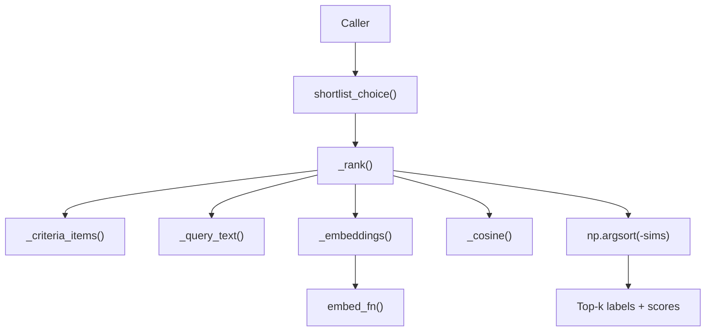
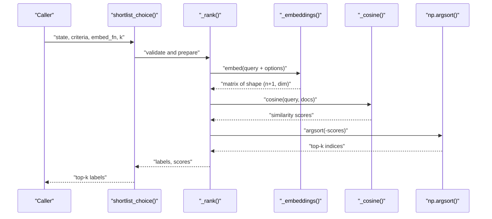
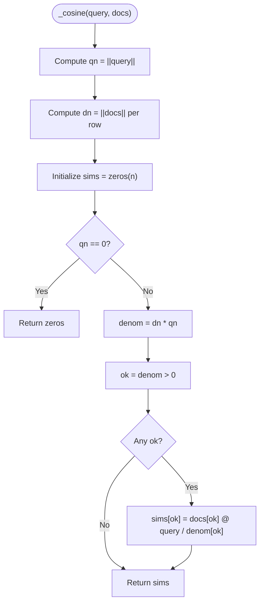
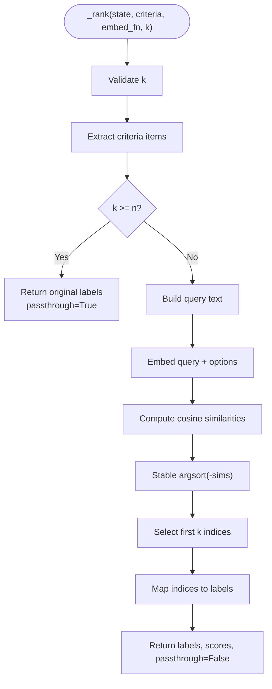
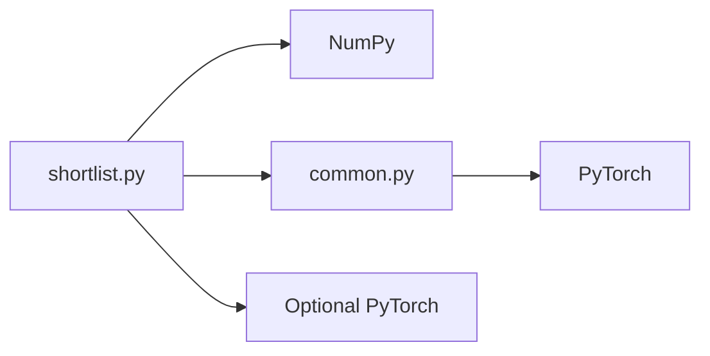

# Candidate Selection & Ranking Algorithms

<cite>
**Referenced Files in This Document**   
- [shortlist.py](file://veya/shortlist.py)
- [common.py](file://veya/common.py)
- [selective.py](file://veya/selective.py)
- [domain_retriever.py](file://veya/experimental/domain_retriever.py)
</cite>

## Table of Contents
1. [Introduction](#introduction)
2. [Project Structure](#project-structure)
3. [Core Components](#core-components)
4. [Architecture Overview](#architecture-overview)
5. [Detailed Component Analysis](#detailed-component-analysis)
6. [Dependency Analysis](#dependency-analysis)
7. [Performance Considerations](#performance-considerations)
8. [Troubleshooting Guide](#troubleshooting-guide)
9. [Conclusion](#conclusion)

## Introduction
This document explains the candidate selection and ranking algorithms used by Veya’s shortlist optimization for high-cardinality choice questions. The system embeds a query and all candidate options, computes cosine similarity between the query embedding and each option embedding, sorts candidates by descending similarity, and returns the top-k labels. It also documents tie-breaking behavior, numerical stability measures, mathematical formulations, complexity, and practical guidance for dataset size and dimension mismatches.

The cosine path is primarily a benchmark helper; production high-cardinality routing uses a learned projection with dot-product scoring rather than frozen cosine retrieval.

## Project Structure
The shortlist logic lives in a focused module that:
- Validates and normalizes candidate criteria.
- Renders option texts from structured criteria.
- Embeds the query and options through a caller-provided embedding function.
- Computes cosine similarities.
- Sorts candidates using a stable sort and selects the top-k.
- Optionally reduces the question to only the selected candidates before calling the model.

**Diagram sources**
- [shortlist.py:67-88](file://veya/shortlist.py#L67-L88)
- [shortlist.py:206-219](file://veya/shortlist.py#L206-L219)
- [shortlist.py:295-305](file://veya/shortlist.py#L295-L305)

**Section sources**
- [shortlist.py:1-16](file://veya/shortlist.py#L1-L16)
- [shortlist.py:67-88](file://veya/shortlist.py#L67-L88)
- [shortlist.py:206-219](file://veya/shortlist.py#L206-L219)

## Core Components
- `shortlist_choice`: Public entry point returning the top-k choice labels for a given state and criteria.
- `_rank`: Orchestrates validation, text rendering, embedding, cosine computation, sorting, and top-k selection.
- `_cosine`: Numerically stable cosine similarity between one query vector and many document vectors.
- `_embeddings`: Normalizes and validates embeddings returned by the caller’s `embed_fn`.
- `predict_shortlist`: Reduces each choice question to its top-k candidates and calls the agent once.
- `embed_fn_from_agent`: Helper that mean-pools an already loaded encoder into an embedding callable.

Key responsibilities:
- Input validation and normalization of candidate labels.
- Rendering structured criteria into consistent text prompts.
- Safe handling of zero or invalid embeddings.
- Stable ordering preservation for ties.
- Efficient top-k retrieval via NumPy.

**Section sources**
- [shortlist.py:67-88](file://veya/shortlist.py#L67-L88)
- [shortlist.py:91-148](file://veya/shortlist.py#L91-L148)
- [shortlist.py:151-203](file://veya/shortlist.py#L151-L203)
- [shortlist.py:206-219](file://veya/shortlist.py#L206-L219)
- [shortlist.py:280-305](file://veya/shortlist.py#L280-L305)

## Architecture Overview
The shortlist pipeline integrates three layers:
1. Text preparation: serialize state, optionally prepend instructions, and render candidate options.
2. Embedding: call `embed_fn` once for the query plus all options.
3. Ranking: compute cosine similarity, sort stably, and select top-k.

**Diagram sources**
- [shortlist.py:67-88](file://veya/shortlist.py#L67-L88)
- [shortlist.py:206-219](file://veya/shortlist.py#L206-L219)
- [shortlist.py:280-305](file://veya/shortlist.py#L280-L305)

## Detailed Component Analysis

### Cosine Similarity: `_cosine`
The `_cosine` function computes cosine similarity between a single query vector and a batch of document vectors.

Mathematical formulation:
- For query q and document d_i:
  - cos(q, d_i) = (q · d_i) / (||q|| ||d_i||)
- If ||q|| = 0, all similarities are defined as 0.
- If ||d_i|| = 0, the i-th similarity is not updated and remains 0.

Numerical stability and edge cases:
- Zero query norm: early return of zeros avoids division by zero.
- Zero document norms: skipped via a boolean mask so no NaN or inf results.
- Denominator check: only entries with positive denominator are computed.
- Output dtype: float64 for stable accumulation and comparison.

Complexity:
- Norm computation: O(n × d)
- Dot products over valid entries: up to O(n × d)
- Overall: O(n × d), where n is number of candidates and d is embedding dimension.

**Diagram sources**
- [shortlist.py:295-305](file://veya/shortlist.py#L295-L305)

**Section sources**
- [shortlist.py:295-305](file://veya/shortlist.py#L295-L305)

### Sorting and Top-k Retrieval: `_rank`
The `_rank` function performs the full ranking workflow:
- Validate k and criteria.
- Render option texts.
- Embed query and options together.
- Compute cosine similarities.
- Sort by descending similarity using a stable merge sort.
- Select the first k indices and map them back to original labels.

Tie-breaking and ordering preservation:
- Uses `kind="mergesort"` for stable sorting.
- Ties preserve earlier label order because the original index order is retained among equal scores.
- Zero vectors score 0 and do not outrank earlier labels with equal or higher similarity.

Complexity:
- Embedding: depends on `embed_fn`, typically O((n+1) × d).
- Cosine: O(n × d).
- Sorting: O(n log n).
- Top-k selection: O(k).
- Overall: O(n log n + n × d).

**Diagram sources**
- [shortlist.py:206-219](file://veya/shortlist.py#L206-L219)

**Section sources**
- [shortlist.py:206-219](file://veya/shortlist.py#L206-L219)

### Embedding Validation and Normalization: `_embeddings`
The `_embeddings` function ensures safe embedding outputs:
- Requires a callable `embed_fn`.
- Accepts PyTorch tensors and converts them to NumPy arrays.
- Enforces 2D shape `(len(texts), dim)` with `dim >= 1`.
- Replaces NaN and infinities with zeros to avoid downstream instability.

Common failure modes addressed:
- Non-callable `embed_fn`.
- Wrong tensor/array rank or shape.
- Missing or inconsistent dimensions across batches.
- Non-finite values introduced by model internals.

**Section sources**
- [shortlist.py:280-292](file://veya/shortlist.py#L280-L292)

### Candidate Label Normalization and Validation: `_criteria_items`
Before embedding, candidate labels are validated and normalized:
- Accepts dict or list criteria.
- Rejects empty or duplicate labels after NFKC normalization and casefolding.
- Enforces maximum lengths for labels and rendered criterion values.
- Ensures at least one candidate exists.

This step prevents ambiguous or malformed choices from entering the ranking pipeline.

**Section sources**
- [shortlist.py:228-253](file://veya/shortlist.py#L228-L253)

### Option Text Rendering: `_option_texts` and `render_options`
Option texts are generated deterministically from structured criteria:
- Dict criteria produce `"label: value"` strings when values are present.
- Structured values are compacted to JSON-like strings.
- The renderer preserves the original label order.

This guarantees consistent input to the embedding function and reproducible rankings.

**Section sources**
- [shortlist.py:256-262](file://veya/shortlist.py#L256-L262)
- [common.py:30-61](file://veya/common.py#L30-L61)

### Query Construction: `_query_text`
The query text combines optional instructions with serialized state:
- If instructions are absent or empty, use serialized state alone.
- If instructions are provided, concatenate instructions and state with a newline separator.
- Instructions can be a string or JSON-serializable structure.

This allows flexible prompting while keeping the core state representation consistent.

**Section sources**
- [shortlist.py:265-271](file://veya/shortlist.py#L265-L271)
- [common.py:15-18](file://veya/common.py#L15-L18)

### Production Routing and K Selection
Production routing chooses between packed labeling and shortlist retrieval based on candidate count:
- Small sets use packed labeling.
- Large sets use shortlist retrieval with a fixed K=8.
- Constants enforce consistency between routing decisions and artifact constraints.

This design balances token budget and model capacity against retrieval quality.

**Section sources**
- [shortlist.py:43-55](file://veya/shortlist.py#L43-L55)
- [shortlist.py:25-40](file://veya/shortlist.py#L25-L40)

### Alternative Ranking Example: Domain Retriever
An experimental domain retriever demonstrates a similar pattern:
- Projects query and candidate vectors.
- Computes dot product scores.
- Uses `np.argsort(-scores, kind="mergesort")[:min(k, len(candidates))]` for stable top-k selection.

This shows consistent usage of stable sorting and bounded k selection across components.

**Section sources**
- [domain_retriever.py:353-371](file://veya/experimental/domain_retriever.py#L353-L371)

## Dependency Analysis
The shortlist ranking depends on:
- NumPy for vector math and stable sorting.
- Optional PyTorch for the built-in embedding helper.
- Common utilities for state serialization and option rendering.

**Diagram sources**
- [shortlist.py:17-23](file://veya/shortlist.py#L17-L23)
- [common.py:1-10](file://veya/common.py#L1-L10)

**Section sources**
- [shortlist.py:17-23](file://veya/shortlist.py#L17-L23)
- [common.py:1-10](file://veya/common.py#L1-L10)

## Performance Considerations
- Embedding cost dominates for large candidate sets. Batch the embedding function if possible; the built-in helper processes in chunks.
- Cosine similarity is O(n × d); keep d reasonable and avoid unnecessary recomputation.
- Stable sorting adds O(n log n); for very large n, consider approximate nearest neighbor methods outside this module.
- Use `predict_shortlist` to reduce the decision head workload by limiting candidates to top-k.
- Tune `k` based on dataset size and reranker capacity; production uses K=8 for high-cardinality cases.

[No sources needed since this section provides general guidance]

## Troubleshooting Guide

### Zero or Invalid Embeddings
Symptoms:
- All similarities are zero.
- Rankings ignore some candidates unexpectedly.

Causes:
- Zero query vector triggers early return of zeros.
- Zero document norms skip similarity updates, leaving zeros.
- NaN or inf values in embeddings are replaced with zeros.

Remediation:
- Ensure `embed_fn` returns non-zero vectors for meaningful inputs.
- Inspect encoder output and attention masks.
- Verify that padding positions are excluded from pooling.

**Section sources**
- [shortlist.py:295-305](file://veya/shortlist.py#L295-L305)
- [shortlist.py:280-292](file://veya/shortlist.py#L280-L292)

### Embedding Dimension Mismatches
Symptoms:
- Shape errors during embedding validation.
- Inconsistent behavior across batches.

Causes:
- `embed_fn` returns arrays with wrong shape or inconsistent dimensions.
- Mixed tensor types without conversion.

Remediation:
- Ensure `embed_fn` returns a 2D array of shape `(len(texts), dim)` with `dim >= 1`.
- Convert tensors to NumPy and ensure consistent dtype.
- Use `embed_fn_from_agent` when working with the loaded Veya encoder.

**Section sources**
- [shortlist.py:280-292](file://veya/shortlist.py#L280-L292)
- [shortlist.py:151-203](file://veya/shortlist.py#L151-L203)

### Duplicate or Malformed Criteria
Symptoms:
- Errors about duplicate labels after normalization.
- Errors about missing or oversized criteria.

Causes:
- Labels differ only by case or Unicode form.
- Labels exceed character limits.
- Empty or malformed criteria structures.

Remediation:
- Normalize labels consistently before passing to the shortlist.
- Keep labels concise and within documented limits.
- Provide either a dict or list of criteria, not mixed types.

**Section sources**
- [shortlist.py:228-253](file://veya/shortlist.py#L228-L253)

### Tie-Breaking and Ordering Issues
Symptoms:
- Unexpected reordering of tied candidates.
- Zero-score candidates appearing before earlier labels.

Behavior:
- Stable sort preserves original order among ties.
- Zero vectors score zero and do not outrank earlier labels.

Remediation:
- Avoid identical embeddings for distinct labels.
- Prefer discriminative encoders or fine-tuned projections.
- Inspect similarity distributions to detect near-duplicates.

**Section sources**
- [shortlist.py:206-219](file://veya/shortlist.py#L206-L219)
- [shortlist.py:295-305](file://veya/shortlist.py#L295-L305)

### Confidence Thresholding and Automation
While unrelated to cosine ranking, confidence-based automation uses similar stable sorting patterns:
- Sort by descending confidence.
- Group ties with a small tolerance.
- Select thresholds that satisfy risk constraints.

This reinforces the importance of stable sorting and consistent tie handling across the system.

**Section sources**
- [selective.py:37-56](file://veya/selective.py#L37-L56)
- [selective.py:77-94](file://veya/selective.py#L77-L94)

## Conclusion
Veya’s shortlist ranking relies on a clear, numerically stable cosine similarity computation and a stable sort for deterministic top-k retrieval. The implementation carefully handles zero vectors, invalid embeddings, and duplicate labels, ensuring robust behavior across diverse datasets. For production, learned projections replace frozen cosine retrieval, but the same principles of validation, stable ordering, and efficient top-k selection remain central. Proper embedding dimensionality, careful prompt construction, and appropriate k selection are key to achieving reliable candidate selection and ranking performance.