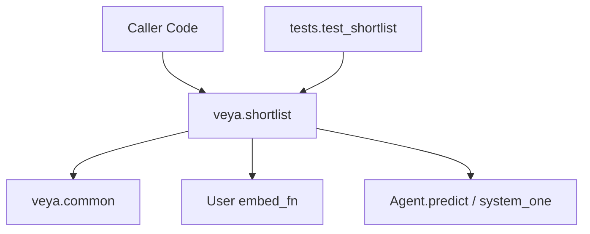
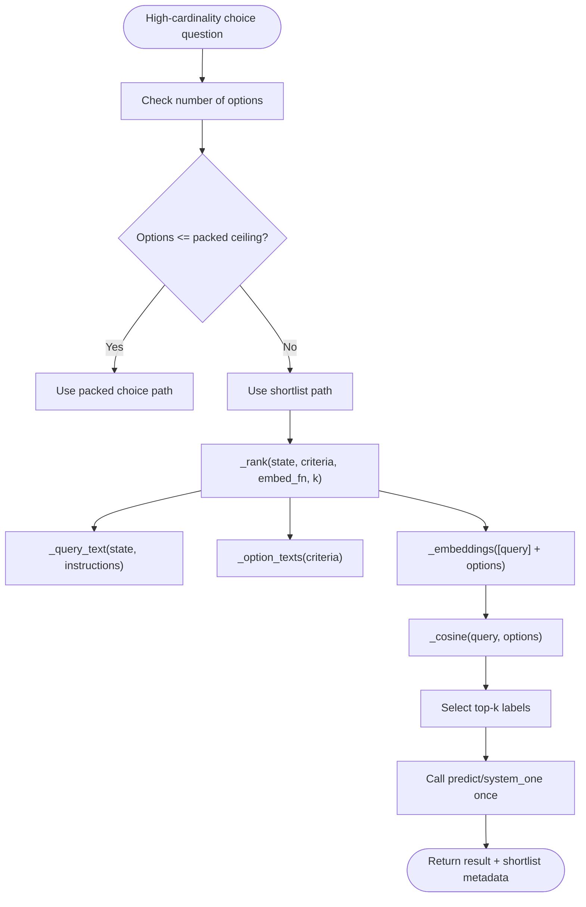
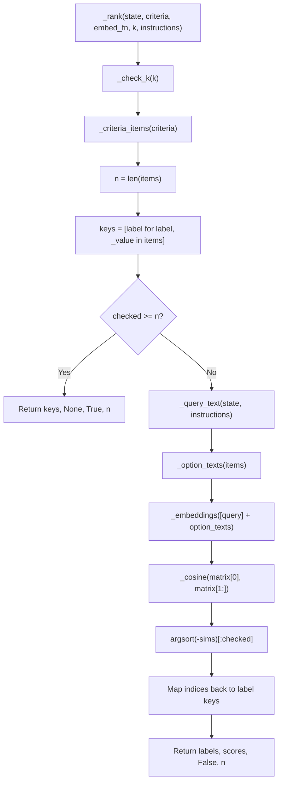
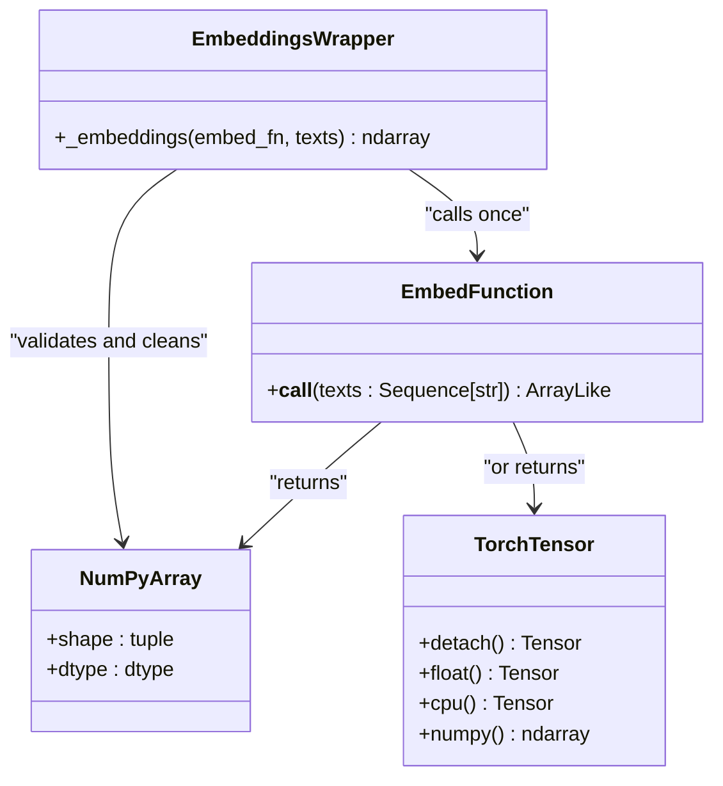
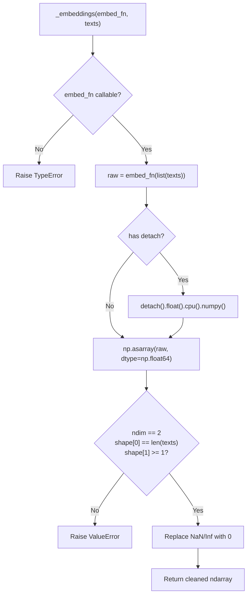
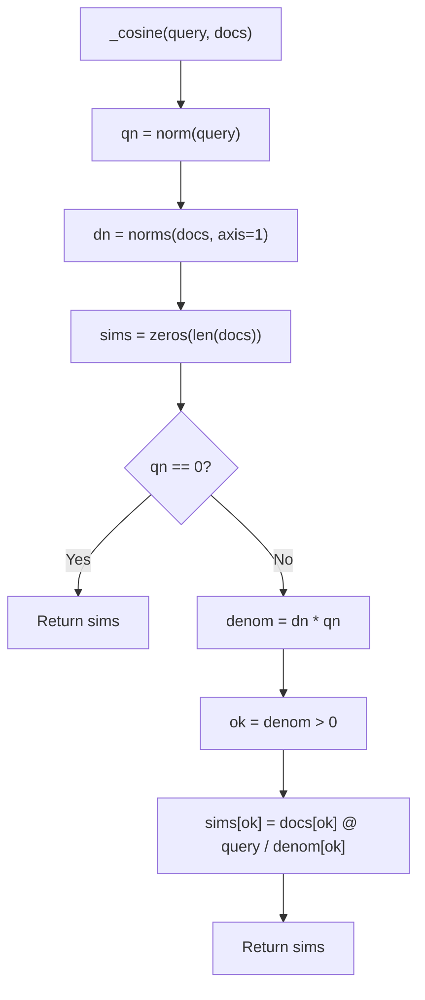
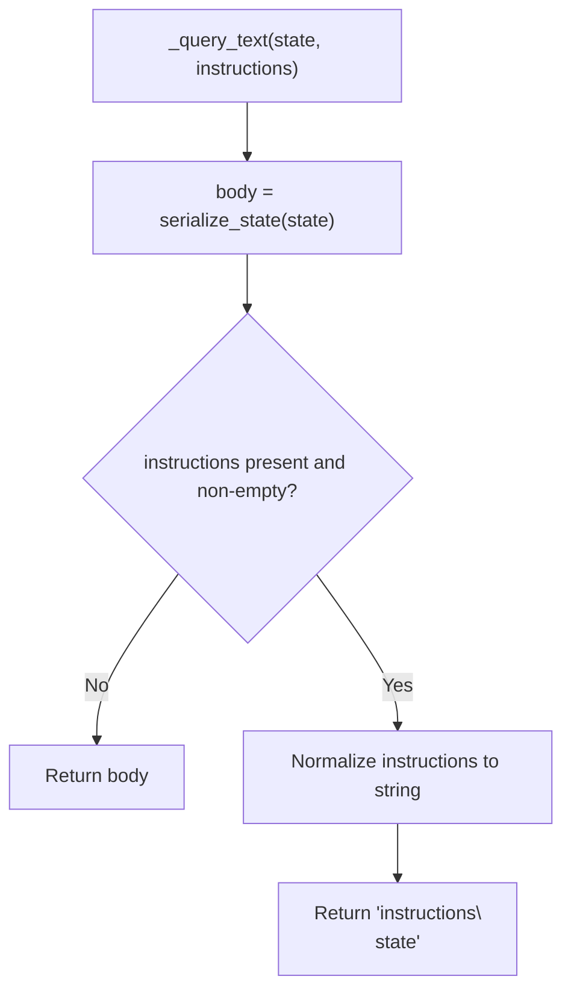
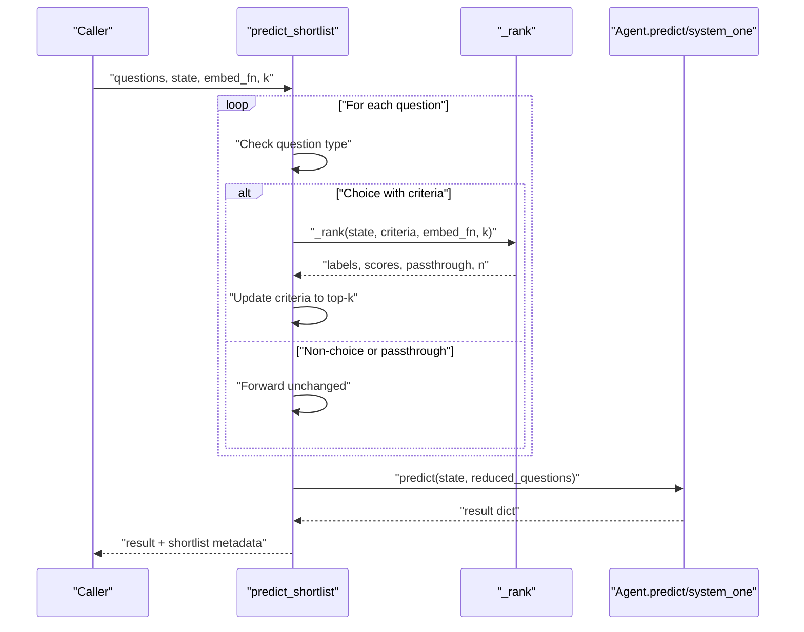
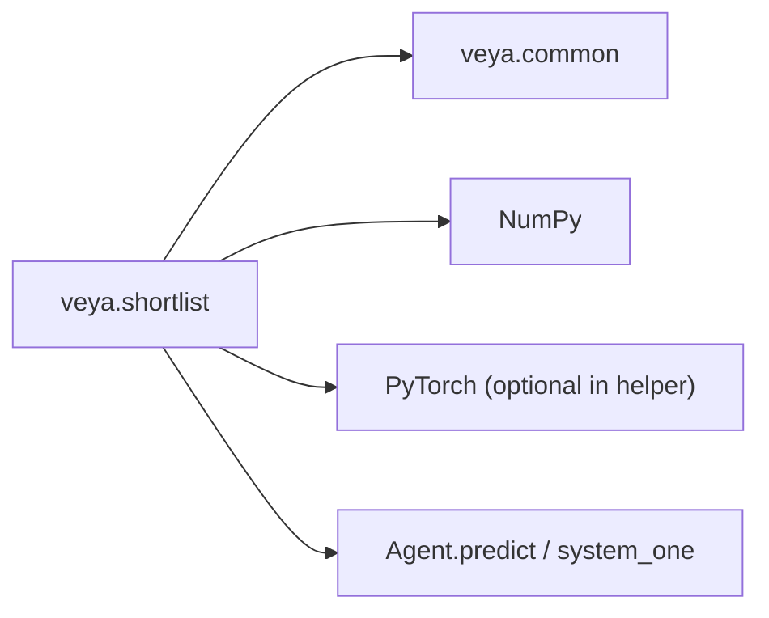

# Embedding-Based Candidate Retrieval

<cite>
**Referenced Files in This Document**
- [shortlist.py](file://veya/shortlist.py)
- [common.py](file://veya/common.py)
- [test_shortlist.py](file://tests/test_shortlist.py)
</cite>

## Table of Contents
1. [Introduction](#introduction)
2. [Project Structure](#project-structure)
3. [Core Components](#core-components)
4. [Architecture Overview](#architecture-overview)
5. [Detailed Component Analysis](#detailed-component-analysis)
6. [Dependency Analysis](#dependency-analysis)
7. [Performance Considerations](#performance-considerations)
8. [Troubleshooting Guide](#troubleshooting-guide)
9. [Conclusion](#conclusion)

## Introduction
This document explains Veya’s embedding-based candidate retrieval used for shortlist optimization on high-cardinality choice questions. The system reduces a large set of choice labels to a small top-k subset using cosine similarity between an embedded query and embedded option texts, then runs the normal decision model once over that reduced set.

The key design goals are:
- Avoid token-budget collapse when many choice options share one head window.
- Keep the production decision path unchanged; only the input question definitions are narrowed before calling the agent.
- Provide a stable, well-defined `embed_fn` interface so callers can plug in their own embedding models or reuse Veya’s encoder.
- Surface enough metadata about which labels were kept, why they were kept, and what scores were observed.

## Project Structure
The embedding-based shortlist logic lives in the Veya package under `veya/shortlist.py`. It depends on shared rendering and serialization helpers from `veya/common.py`, and its behavior is validated by tests in `tests/test_shortlist.py`.

**Diagram sources**
- [shortlist.py:1-16](file://veya/shortlist.py#L1-L16)
- [shortlist.py:67-148](file://veya/shortlist.py#L67-L148)
- [common.py:30-61](file://veya/common.py#L30-L61)
- [test_shortlist.py:196-290](file://tests/test_shortlist.py#L196-L290)

**Section sources**
- [shortlist.py:1-16](file://veya/shortlist.py#L1-L16)
- [common.py:30-61](file://veya/common.py#L30-L61)
- [test_shortlist.py:196-290](file://tests/test_shortlist.py#L196-L290)

## Core Components
The shortlist module exposes two main entry points:
- `shortlist_choice`: returns the top-k choice labels for a state and criteria using cosine similarity.
- `predict_shortlist`: shortlists each choice question, replaces its criteria with the top-k labels, calls the agent once, and attaches retrieval metadata.

Supporting utilities include:
- `_rank`: core ranking pipeline that builds the query, embeds it with candidates, computes cosine similarities, and selects top-k.
- `_embeddings`: batched embedding wrapper that validates shapes, handles tensors, and converts results to NumPy.
- `_cosine`: numerically safe cosine similarity computation.
- `embed_fn_from_agent`: helper that turns a loaded Veya encoder into an `embed_fn`.

Key constants control routing and safety:
- `DEFAULT_SHORTLIST_K = 20`
- `MAX_CHOICE_CANDIDATES = 1024`
- `MAX_CANDIDATE_LABEL_CHARS = 512`
- `MAX_CANDIDATE_VALUE_CHARS = 4096`
- `PACKED_MARKER_CEILING = 100`
- `PRODUCTION_SHORTLIST_ABOVE = 19`
- `PRODUCTION_SHORTLIST_K = 8`

**Section sources**
- [shortlist.py:25-40](file://veya/shortlist.py#L25-L40)
- [shortlist.py:67-148](file://veya/shortlist.py#L67-L148)
- [shortlist.py:206-305](file://veya/shortlist.py#L206-L305)

## Architecture Overview
At runtime, Veya chooses between packed scoring and shortlist retrieval based on label cardinality. For very large label sets, the shortlist path is preferred because packed sequences cannot keep every option marker within the fixed head window.

**Diagram sources**
- [shortlist.py:43-64](file://veya/shortlist.py#L43-L64)
- [shortlist.py:206-219](file://veya/shortlist.py#L206-L219)
- [shortlist.py:256-271](file://veya/shortlist.py#L256-L271)
- [shortlist.py:280-305](file://veya/shortlist.py#L280-L305)

## Detailed Component Analysis

### The `_rank` Function
`_rank` is the central retrieval routine. It:
1. Validates `k`.
2. Normalizes and inspects the criteria.
3. Extracts label keys.
4. Returns all labels unchanged if `k >= n`.
5. Builds the query text from the serialized state and optional instructions.
6. Renders option texts from the criteria.
7. Embeds the query and all options together.
8. Computes cosine similarity between the query vector and each option vector.
9. Sorts by descending similarity and selects the top `k`.
10. Returns the ranked labels, corresponding cosine scores, a passthrough flag, and the original label count.

**Diagram sources**
- [shortlist.py:206-219](file://veya/shortlist.py#L206-L219)
- [shortlist.py:222-253](file://veya/shortlist.py#L222-L253)
- [shortlist.py:256-271](file://veya/shortlist.py#L256-L271)
- [shortlist.py:280-305](file://veya/shortlist.py#L280-L305)

**Section sources**
- [shortlist.py:206-219](file://veya/shortlist.py#L206-L219)

### The `embed_fn` Interface
The embedding function is the integration point between the shortlist retriever and any embedding model. Its contract is:

- **Input**: A sequence of strings. The first string is the query; subsequent strings are rendered option texts.
- **Output**: An array-like object with shape `(len(texts), dim)`.
- **Supported output types**:
  - NumPy arrays.
  - PyTorch tensors (automatically detached, converted to float, moved to CPU, and then converted to NumPy).
- **Shape constraints**:
  - Must be exactly two-dimensional.
  - First dimension must equal the number of input texts.
  - Second dimension must be at least 1.
- **Numerical robustness**:
  - NaN values are replaced with zeros.
  - Positive and negative infinity are replaced with zeros.
- **Batching**:
  - The caller should implement batching internally if needed.
  - `_embeddings` does not split inputs; it passes the full list to `embed_fn`.

Example usage patterns:
- Use `embed_fn_from_agent` to mean-pool the encoder already loaded by a Veya agent.
- Wrap an external embedding model such as SentenceTransformers, OpenAI embeddings, or a custom transformer.
- Cache candidate embeddings when the label set is static across queries.

**Diagram sources**
- [shortlist.py:280-292](file://veya/shortlist.py#L280-L292)

**Section sources**
- [shortlist.py:280-292](file://veya/shortlist.py#L280-L292)

### The `_embeddings` Utility
`_embeddings` is responsible for:
- Ensuring `embed_fn` is callable.
- Calling `embed_fn` with the full list of texts.
- Converting PyTorch tensors to NumPy arrays.
- Casting to `np.float64`.
- Validating the returned shape.
- Replacing NaN and infinite values with zeros.

This utility isolates the rest of the retrieval pipeline from device-specific tensor handling and makes the cosine computation deterministic and NumPy-native.

**Diagram sources**
- [shortlist.py:280-292](file://veya/shortlist.py#L280-L292)

**Section sources**
- [shortlist.py:280-292](file://veya/shortlist.py#L280-L292)

### Cosine Similarity Ranking
The cosine implementation avoids division by zero and treats zero-norm vectors as having no similarity. It:
- Computes the query norm.
- Computes norms for all documents along the feature axis.
- Initializes similarity scores to zero.
- If the query norm is zero, returns all-zero similarities.
- Otherwise, computes dot products only where the denominator is positive.

**Diagram sources**
- [shortlist.py:295-305](file://veya/shortlist.py#L295-L305)

**Section sources**
- [shortlist.py:295-305](file://veya/shortlist.py#L295-L305)

### Query and Option Text Construction
The query text is built from:
- Serialized state via `serialize_state`.
- Optional instructions, which may be a string or JSON-serializable structure.

Option texts are constructed by rendering the criteria through `render_options`. This ensures the same textual representation is used for both embedding and downstream decision modeling.

**Diagram sources**
- [shortlist.py:265-271](file://veya/shortlist.py#L265-L271)
- [common.py:15-18](file://veya/common.py#L15-L18)

**Section sources**
- [shortlist.py:265-271](file://veya/shortlist.py#L265-L271)
- [common.py:15-18](file://veya/common.py#L15-L18)

### Integration with `predict_shortlist`
`predict_shortlist` applies shortlist retrieval per question:
- Non-choice questions pass through unchanged.
- Choice questions without criteria raise an error.
- Choices with fewer than or equal to `k` labels pass through without calling `embed_fn`.
- For other choices, `_rank` produces ranked labels and metadata.
- The question definition is updated with only the top-k criteria.
- The agent is called once with the reduced question set.
- The final result includes a `shortlist` field describing retrieval behavior.

**Diagram sources**
- [shortlist.py:91-148](file://veya/shortlist.py#L91-L148)
- [shortlist.py:206-219](file://veya/shortlist.py#L206-L219)

**Section sources**
- [shortlist.py:91-148](file://veya/shortlist.py#L91-L148)

### Example Implementations and External Integrations

#### Using the Built-in Encoder Helper
If you already have a Veya agent with a loaded encoder, use `embed_fn_from_agent`. It:
- Reads tokenizer, encoder, and device from the agent.
- Batches input texts.
- Tokenizes with padding and truncation.
- Runs inference mode over the encoder.
- Mean-pools hidden states while excluding padding positions.
- Returns NumPy embeddings.

This is convenient but not necessarily optimal for retrieval compared to a dedicated bi-encoder.

**Section sources**
- [shortlist.py:151-203](file://veya/shortlist.py#L151-L203)

#### Custom Embedding Function Pattern
A custom `embed_fn` should:
- Accept a sequence of strings.
- Return an array-like object with shape `(len(texts), dim)`.
- Handle `None` inputs gracefully by converting them to strings.
- Be efficient for batches.
- Optionally cache candidate embeddings when the label set is static.

#### External Embedding Model Pattern
When integrating an external model:
- Convert model outputs to NumPy arrays.
- Ensure the first row corresponds to the query and subsequent rows correspond to options.
- Keep the same order as the criteria passed to `_rank`.
- Validate that the embedding dimension is consistent across calls.

**Section sources**
- [shortlist.py:280-292](file://veya/shortlist.py#L280-L292)
- [test_shortlist.py:196-214](file://tests/test_shortlist.py#L196-L214)

## Dependency Analysis
The shortlist module has clear boundaries:
- It imports rendering and serialization helpers from `common.py`.
- It does not modify the decision model forward pass.
- It delegates actual prediction to the caller-provided agent.
- It relies on NumPy for ranking and cosine similarity.
- It optionally uses PyTorch inside `embed_fn_from_agent`.

**Diagram sources**
- [shortlist.py:17-23](file://veya/shortlist.py#L17-L23)
- [shortlist.py:151-203](file://veya/shortlist.py#L151-L203)
- [shortlist.py:308-314](file://veya/shortlist.py#L308-L314)

**Section sources**
- [shortlist.py:17-23](file://veya/shortlist.py#L17-L23)
- [shortlist.py:151-203](file://veya/shortlist.py#L151-L203)
- [shortlist.py:308-314](file://veya/shortlist.py#L308-L314)

## Performance Considerations

### Large Label Sets
- The maximum number of choice candidates is 1024.
- Labels longer than 512 characters or criterion values longer than 4096 characters are rejected.
- Duplicate labels after normalization are rejected.
- When `k >= n`, the system skips embedding and returns all labels in original order.

These limits prevent unbounded memory growth and ensure deterministic behavior.

**Section sources**
- [shortlist.py:228-253](file://veya/shortlist.py#L228-L253)

### Memory Usage Patterns
- `_embeddings` calls `embed_fn` once with the full list of texts.
- For large label sets, this means the embedding function must handle potentially large batches.
- `embed_fn_from_agent` processes inputs in configurable batches and concatenates results.
- The cosine computation allocates a similarity vector of size `n`.
- Sorting uses mergesort, which is stable and preserves earlier labels on ties.

Recommendations:
- Prefer a dedicated bi-encoder for retrieval when possible.
- Cache candidate embeddings if the label set does not change frequently.
- Tune `batch_size` and `max_length` in `embed_fn_from_agent` according to available memory.

**Section sources**
- [shortlist.py:151-203](file://veya/shortlist.py#L151-L203)
- [shortlist.py:280-305](file://veya/shortlist.py#L280-L305)

### Optimization Strategies for High-Cardinality Choice Questions
- Use `predict_shortlist` instead of scoring all labels directly.
- Choose `k` carefully: too small risks missing the correct label; too large increases reranking cost and may degrade downstream performance.
- Production routing prefers packed scoring for small label sets and learned shortlist projection for larger sets.
- Frozen cosine retrieval is documented as a benchmark helper, not the production ranker.

**Section sources**
- [shortlist.py:1-16](file://veya/shortlist.py#L1-L16)
- [shortlist.py:43-64](file://veya/shortlist.py#L43-L64)

## Troubleshooting Guide

### Common Errors and Causes
- **Invalid `k`**: `k` must be a positive integer. Boolean values are rejected.
- **Invalid criteria**: Criteria must be a dict or list with at least one option.
- **Duplicate labels**: Labels are normalized and deduplicated; duplicates raise an error.
- **Label too long**: Labels exceeding 512 characters are rejected.
- **Criterion value too long**: Rendered criterion values exceeding 4096 characters are rejected.
- **Missing criteria**: A choice question without criteria raises an error.
- **Wrong `embed_fn` return shape**: The returned array must be 2D, have the correct first dimension, and at least one feature dimension.
- **Non-callable `embed_fn`**: Passing a non-callable raises a type error.
- **Agent missing prediction method**: The agent must provide `predict` or `system_one`.

**Section sources**
- [shortlist.py:222-253](file://veya/shortlist.py#L222-L253)
- [shortlist.py:280-292](file://veya/shortlist.py#L280-L292)
- [shortlist.py:308-314](file://veya/shortlist.py#L308-L314)

### Debugging Retrieval Behavior
- Verify that `embed_fn` receives the query as the first element and option texts afterward.
- Confirm that option texts match the rendered form produced by `render_options`.
- Check that the returned embedding dimension is consistent across queries.
- Inspect the `shortlist` metadata attached by `predict_shortlist` to see which labels were kept, whether passthrough occurred, and what cosine scores were observed.

**Section sources**
- [shortlist.py:77-88](file://veya/shortlist.py#L77-L88)
- [shortlist.py:105-148](file://veya/shortlist.py#L105-L148)
- [test_shortlist.py:267-290](file://tests/test_shortlist.py#L267-L290)

## Conclusion
Veya’s embedding-based candidate retrieval provides a controlled way to reduce high-cardinality choice questions to a manageable shortlist before running the decision model. The `_rank` function implements cosine similarity ranking over a query derived from the state and option texts derived from the criteria. The `_embeddings` utility standardizes input/output handling and numerical safety, while `embed_fn_from_agent` offers a convenient bridge to a loaded encoder.

For production workloads, the frozen cosine path is primarily a benchmark helper; the documented production route uses a saved K=8 projection. Regardless of the embedding source, callers should respect the `embed_fn` contract, validate label cardinality, and tune `k` and batch sizes to balance accuracy, latency, and memory usage.