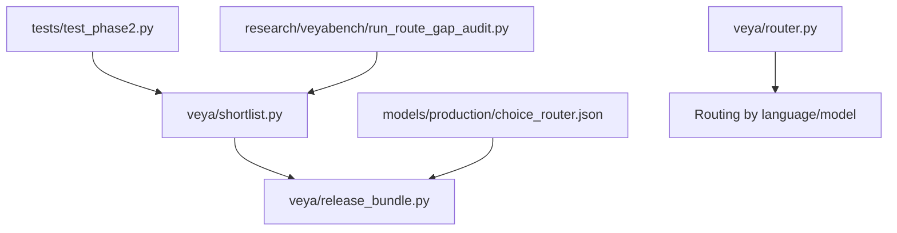
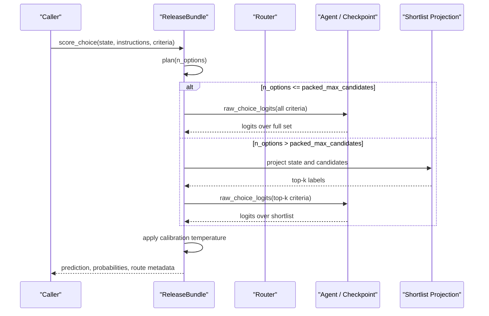
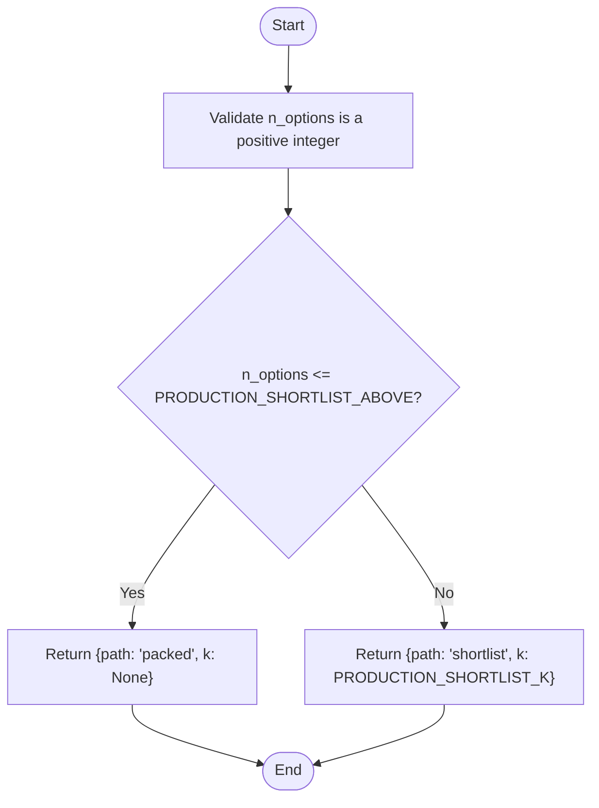
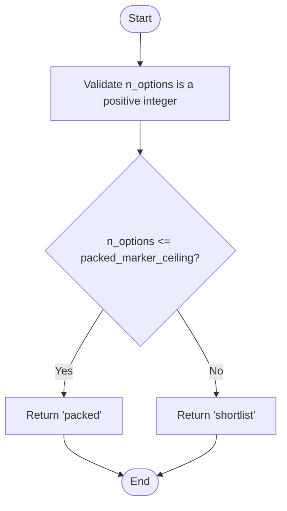
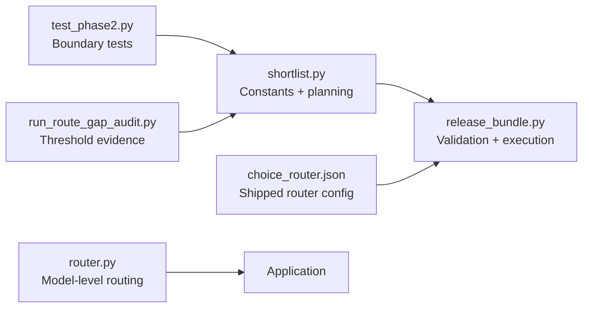

# Production Routing Strategy

<cite>
**Referenced Files in This Document**   
- [shortlist.py](file://veya/shortlist.py)
- [release_bundle.py](file://veya/release_bundle.py)
- [choice_router.json](file://models/production/choice_router.json)
- [router.py](file://veya/router.py)
- [test_phase2.py](file://tests/test_phase2.py)
- [run_route_gap_audit.py](file://research/veyabench/run_route_gap_audit.py)
</cite>

## Table of Contents
1. [Introduction](#introduction)
2. [Project Structure](#project-structure)
3. [Core Components](#core-components)
4. [Architecture Overview](#architecture-overview)
5. [Detailed Component Analysis](#detailed-component-analysis)
6. [Dependency Analysis](#dependency-analysis)
7. [Performance Considerations](#performance-considerations)
8. [Troubleshooting Guide](#troubleshooting-guide)
9. [Conclusion](#conclusion)
10. [Appendices](#appendices)

## Introduction
This document explains Veya’s production routing strategy for high-cardinality choice questions. It focuses on the decision logic that chooses between:
- Packed sequence processing, where all candidate labels are scored together in one model pass.
- Two-stage shortlist retrieval, where a learned projection first selects a small subset of candidates and then scores only those candidates.

The goal is to keep latency low while preserving accuracy as the number of label options grows. The key functions are `production_choice_plan` and `choose_choice_path`, and the key thresholds are `PRODUCTION_SHORTLIST_ABOVE` and `PACKED_MARKER_CEILING`.

## Project Structure
The routing strategy lives primarily in two modules:
- `veya.shortlist`: defines the production constants, the plan function, and the marker-based path selector.
- `veya.release_bundle`: loads the shipped router configuration, validates it against the code constants, and executes the chosen route with calibrated temperatures.

**Diagram sources**
- [shortlist.py:25-55](file://veya/shortlist.py#L25-L55)
- [release_bundle.py:43-89](file://veya/release_bundle.py#L43-L89)
- [choice_router.json:1-12](file://models/production/choice_router.json#L1-L12)
- [router.py:123-312](file://veya/router.py#L123-L312)
- [test_phase2.py:136-143](file://tests/test_phase2.py#L136-L143)
- [run_route_gap_audit.py:99-125](file://research/veyabench/run_route_gap_audit.py#L99-L125)

**Section sources**
- [shortlist.py:1-55](file://veya/shortlist.py#L1-L55)
- [release_bundle.py:1-89](file://veya/release_bundle.py#L1-L89)
- [choice_router.json:1-12](file://models/production/choice_router.json#L1-L12)
- [router.py:123-312](file://veya/router.py#L123-L312)

## Core Components
Veya uses two complementary routing decisions for choice questions:

| Function | Purpose | Decision Rule | Output |
|---|---|---|---|
| `production_choice_plan` | Production plan based on measured accuracy trade-offs | If `n_options <= PRODUCTION_SHORTLIST_ABOVE`, use packed; otherwise use shortlist with fixed `k` | Dictionary with `path` and optional `k` |
| `choose_choice_path` | Safety-oriented path selection based on tokenizer capacity | If `n_options <= PACKED_MARKER_CEILING`, use packed; otherwise use shortlist | String `"packed"` or `"shortlist"` |

Key constants:
- `PRODUCTION_SHORTLIST_ABOVE = 19`: Accuracy-backed cutoff. At 20+ options, the learned shortlist K=8 route wins by a measured margin.
- `PRODUCTION_SHORTLIST_K = 8`: Fixed shortlist size used in production.
- `PACKED_MARKER_CEILING = 100`: Token-window safety ceiling. Above this value, packed sequences would drop option markers.

**Section sources**
- [shortlist.py:25-64](file://veya/shortlist.py#L25-L64)

## Architecture Overview
At runtime, Veya can route at two levels:
1. Model-level routing: choosing English, multilingual, or typed-decisions checkpoints based on language and task signals.
2. Choice-level routing: choosing packed scoring versus two-stage shortlist scoring for each choice question.

**Diagram sources**
- [release_bundle.py:150-258](file://veya/release_bundle.py#L150-L258)
- [choice_router.json:1-12](file://models/production/choice_router.json#L1-L12)

**Section sources**
- [release_bundle.py:127-258](file://veya/release_bundle.py#L127-L258)
- [router.py:123-312](file://veya/router.py#L123-L312)

## Detailed Component Analysis

### Decision Logic in `production_choice_plan`
`production_choice_plan` implements the production accuracy-driven policy:
- Input validation ensures `n_options` is a positive integer.
- If `n_options <= PRODUCTION_SHORTLIST_ABOVE`, it returns the packed path.
- Otherwise, it returns the shortlist path with `k = PRODUCTION_SHORTLIST_K`.

This function does not load embeddings or projections. It is a lightweight planning helper whose behavior is enforced by the shipped router file and release manifest.

**Diagram sources**
- [shortlist.py:43-55](file://veya/shortlist.py#L43-L55)

**Section sources**
- [shortlist.py:43-55](file://veya/shortlist.py#L43-L55)

### Decision Logic in `choose_choice_path`
`choose_choice_path` implements a token-capacity safety policy:
- Input validation ensures `n_options` is a positive integer.
- If `n_options <= packed_marker_ceiling`, it returns `"packed"`.
- Otherwise, it returns `"shortlist"`.

The default `packed_marker_ceiling` is `PACKED_MARKER_CEILING = 100`. This reflects the tokenizer budget: around 100 options already fill the window, and above that the packed sequence would drop markers.

**Diagram sources**
- [shortlist.py:58-64](file://veya/shortlist.py#L58-L64)

**Section sources**
- [shortlist.py:58-64](file://veya/shortlist.py#L58-L64)

### Thresholds and Their Meaning

| Threshold | Value | Meaning | Impact |
|---|---:|---|---|
| `PRODUCTION_SHORTLIST_ABOVE` | 19 | Accuracy-backed cutoff from audit data | Choices with 20+ options use shortlist K=8; choices with 19 or fewer use packed scoring |
| `PACKED_MARKER_CEILING` | 100 | Token-window safety ceiling | Prevents packed sequences from dropping option markers due to context length limits |
| `PRODUCTION_SHORTLIST_K` | 8 | Fixed shortlist size | Reduces scoring cost and improves reranking stability compared to larger K values |

The shipped router file enforces these values:
- `packed_max_candidates` must equal `PRODUCTION_SHORTLIST_ABOVE`.
- `hierarchical_k` must equal `PRODUCTION_SHORTLIST_K`.
- `hierarchical_route` identifies the learned shortlist route.

**Section sources**
- [shortlist.py:25-40](file://veya/shortlist.py#L25-L40)
- [choice_router.json:1-12](file://models/production/choice_router.json#L1-L12)
- [release_bundle.py:43-56](file://veya/release_bundle.py#L43-L56)

### Trade-offs Between Packed Sequence Processing and Two-Stage Shortlist Retrieval

| Aspect | Packed Sequence Processing | Two-Stage Shortlist Retrieval |
|---|---|---|
| Candidate handling | Scores all labels in one forward pass | First projects state and candidates into a learned space, then scores only top-K |
| Latency | Scales with number of labels | Lower scoring cost after retrieval; embedding and projection cost added upfront |
| Accuracy behavior | Stable for small label sets | More accurate for large label sets when retrieval recall is good |
| Token budget risk | Can exceed tokenizer capacity if too many labels | Avoids packing all labels; relies on projection quality |
| Calibration | Uses per-bucket temperature for choice questions | Uses route-specific calibration temperature |

Evidence from the repository comments and audit script shows:
- For Banking77-style workloads, K=8 shortlist reranking outperforms packed scoring at higher cardinalities.
- Larger K values such as 16 or 32 can degrade performance because the reranker collapses rather than the retrieval step alone.
- The production cutoff was selected so that shortlist accuracy leads packed accuracy by at least a measured margin across the evaluated grid.

**Section sources**
- [shortlist.py:29-40](file://veya/shortlist.py#L29-L40)
- [run_route_gap_audit.py:99-125](file://research/veyabench/run_route_gap_audit.py#L99-L125)

### Performance Characteristics by Label Set Size

| Label Set Size | Recommended Route | Reasoning |
|---:|---|---|
| 1–19 | Packed | Small enough to fit in the packed head without marker loss; avoids embedding/projection overhead |
| 20+ | Shortlist K=8 | Learned projection reduces scoring cost and improves accuracy on large label sets |
| Very large (approaching 100+) | Shortlist | Packed sequences risk dropping markers; shortlist avoids this risk |
| Extremely large (above 100) | Shortlist | Exceeds `PACKED_MARKER_CEILING`; packed path is unsafe |

The test suite confirms the expected boundary behavior:
- `choose_choice_path(20)` returns `"packed"` under the default ceiling because 20 ≤ 100.
- `choose_choice_path(150)` returns `"shortlist"` because 150 > 100.
- `production_choice_plan(19)` returns packed.
- `production_choice_plan(20)` returns shortlist with K=8.

**Section sources**
- [shortlist.py:29-64](file://veya/shortlist.py#L29-L64)
- [test_phase2.py:136-143](file://tests/test_phase2.py#L136-L143)

### Configuration Parameters and Their Impact

| Parameter | Location | Default / Shipped Value | Impact |
|---|---|---:|---|
| `PRODUCTION_SHORTLIST_ABOVE` | `veya/shortlist.py` | 19 | Controls accuracy-driven cutoff for packed vs shortlist |
| `PRODUCTION_SHORTLIST_K` | `veya/shortlist.py` | 8 | Controls shortlist size in production |
| `PACKED_MARKER_CEILING` | `veya/shortlist.py` | 100 | Controls token-capacity safety cutoff |
| `packed_max_candidates` | `models/production/choice_router.json` | 19 | Must match `PRODUCTION_SHORTLIST_ABOVE` |
| `hierarchical_k` | `models/production/choice_router.json` | 8 | Must match `PRODUCTION_SHORTLIST_K` |
| `hierarchical_route` | `models/production/choice_router.json` | `"shortlist_k8_packed_rerank"` | Identifies the learned shortlist route |
| `embed_max_length` | `models/production/choice_router.json` | 96 | Limits embedding input length for shortlist retrieval |

The release bundle validates these parameters at startup:
- Router format must be supported.
- `hierarchical_k` must match `PRODUCTION_SHORTLIST_K`.
- `packed_max_candidates` must match `PRODUCTION_SHORTLIST_ABOVE`.
- `embed_max_length` must be present and positive.

**Section sources**
- [shortlist.py:25-40](file://veya/shortlist.py#L25-L40)
- [choice_router.json:1-12](file://models/production/choice_router.json#L1-L12)
- [release_bundle.py:43-56](file://veya/release_bundle.py#L43-L56)

### When to Use Each Strategy

Use **packed sequence processing** when:
- The number of choice options is small.
- You want a single forward pass over all candidates.
- You are below the token-capacity safety ceiling.
- You prefer simplicity and lower upfront embedding cost.

Use **two-stage shortlist retrieval** when:
- The number of choice options is large.
- Accuracy benefits from reducing the candidate set before scoring.
- You have a valid learned projection and route calibration loaded.
- You need to avoid packed marker loss for very large label sets.

### Tuning the Cutoff Thresholds

Tuning should follow this order:
1. Measure accuracy gap between packed and hierarchical routes across a grid of candidate counts.
2. Choose the smallest candidate count where shortlist accuracy leads packed accuracy by at least the desired floor.
3. Set `packed_max_candidates` to the largest count still safe for packed scoring.
4. Keep `hierarchical_k` at the empirically best shortlist size.
5. Keep `PACKED_MARKER_CEILING` at or below the tokenizer capacity where markers are no longer dropped.

The audit script demonstrates this process:
- It computes gaps across candidate counts.
- It requires the gap to stay above a floor for all larger counts.
- It recommends the largest packed cardinality just below the first winning point.

**Section sources**
- [run_route_gap_audit.py:99-125](file://research/veyabench/run_route_gap_audit.py#L99-L125)
- [release_bundle.py:59-81](file://veya/release_bundle.py#L59-L81)

## Dependency Analysis
The production routing system has clear boundaries:
- `shortlist.py` defines constants and planning helpers.
- `release_bundle.py` loads and validates the shipped router configuration and executes the chosen route.
- `router.py` handles model-level routing by language and task, separate from choice-level routing.
- Tests and audit scripts validate behavior and provide evidence for threshold selection.

**Diagram sources**
- [shortlist.py:25-64](file://veya/shortlist.py#L25-L64)
- [release_bundle.py:43-89](file://veya/release_bundle.py#L43-L89)
- [choice_router.json:1-12](file://models/production/choice_router.json#L1-L12)
- [router.py:123-312](file://veya/router.py#L123-L312)
- [test_phase2.py:136-143](file://tests/test_phase2.py#L136-L143)
- [run_route_gap_audit.py:99-125](file://research/veyabench/run_route_gap_audit.py#L99-L125)

**Section sources**
- [shortlist.py:25-64](file://veya/shortlist.py#L25-L64)
- [release_bundle.py:43-89](file://veya/release_bundle.py#L43-L89)
- [router.py:123-312](file://veya/router.py#L123-L312)

## Performance Considerations
- Packed scoring is efficient for small label sets because it avoids embedding and projection overhead.
- Shortlist retrieval adds embedding and projection steps but reduces the number of labels scored by the decision head.
- K=8 is preferred in production because larger K values were observed to degrade reranking performance.
- Embedding length is bounded by `embed_max_length` to control memory and compute usage during shortlist retrieval.
- Release bundles cache embeddings for repeated texts to reduce redundant computation.

[No sources needed since this section provides general guidance]

## Troubleshooting Guide
Common issues and their likely causes:

| Symptom | Likely Cause | Resolution |
|---|---|---|
| Router load fails with mismatched K | `hierarchical_k` does not match `PRODUCTION_SHORTLIST_K` | Align router file with constant K=8 |
| Router load fails with mismatched cutoff | `packed_max_candidates` does not match `PRODUCTION_SHORTLIST_ABOVE` | Align router file with cutoff 19 |
| Router load fails with missing embed length | `embed_max_length` is absent or invalid | Add a positive `embed_max_length` to router config |
| Packed path drops markers | Too many options exceed tokenizer capacity | Switch to shortlist route or reduce label set |
| Shortlist accuracy is poor | Retrieval missed the correct label | Tune K, improve projection, or adjust instructions/state representation |
| Threshold selection seems unstable | Accuracy gap does not stay above floor across larger counts | Increase floor or retrain projection/reranker |

**Section sources**
- [release_bundle.py:43-56](file://veya/release_bundle.py#L43-L56)
- [shortlist.py:29-40](file://veya/shortlist.py#L29-L40)

## Conclusion
Veya’s production routing strategy balances accuracy and efficiency by switching between packed scoring and two-stage shortlist retrieval based on label set size. The accuracy-backed cutoff `PRODUCTION_SHORTLIST_ABOVE = 19` selects shortlist K=8 for 20+ options, while `PACKED_MARKER_CEILING = 100` protects against tokenizer capacity failures. The shipped router configuration enforces these constants, and the release bundle validates them at startup. For new workloads, tune thresholds using measured accuracy gaps across candidate counts, keeping K small and ensuring the shortlist route remains stable at higher cardinalities.

[No sources needed since this section summarizes without analyzing specific files]

## Appendices

### API Behavior Summary

| Function | Input | Output | Notes |
|---|---|---|---|
| `production_choice_plan` | `n_options` | `{"path": "packed"|"shortlist", "k": int or None}` | Accuracy-driven plan |
| `choose_choice_path` | `n_options`, optional `packed_marker_ceiling` | `"packed"` or `"shortlist"` | Token-capacity safety check |
| `ReleaseBundle.plan` | `n_options` | `{"path": "packed"|"shortlist", "k": int or None, "calibration": str}` | Uses shipped router config |
| `ReleaseBundle.score_choice` | `state`, `instructions`, `criteria` | Prediction, probabilities, route metadata | Executes chosen route |

**Section sources**
- [shortlist.py:43-64](file://veya/shortlist.py#L43-L64)
- [release_bundle.py:150-258](file://veya/release_bundle.py#L150-L258)