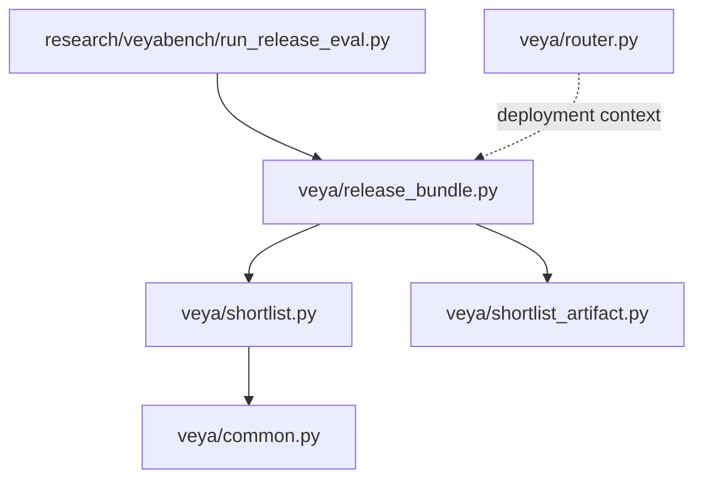
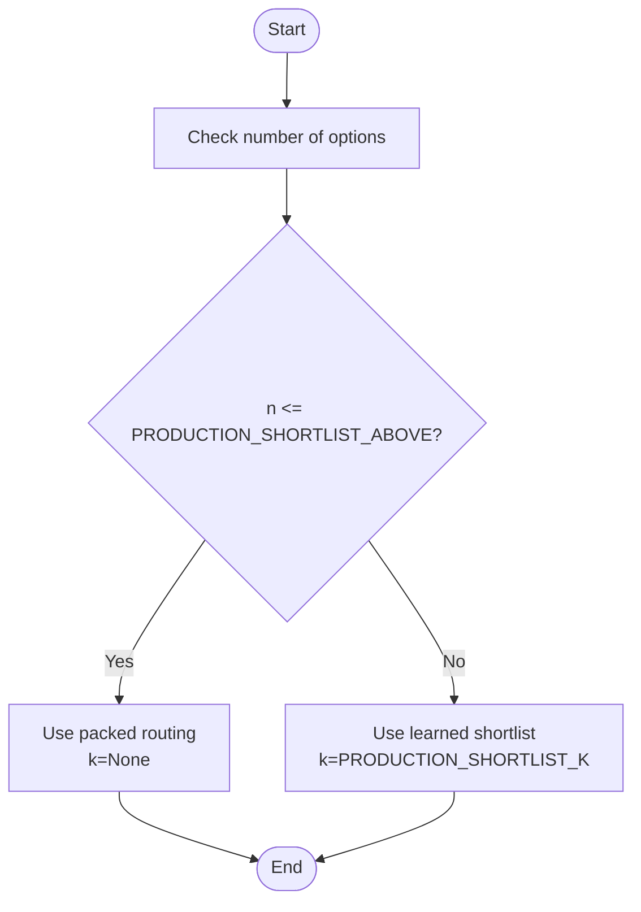
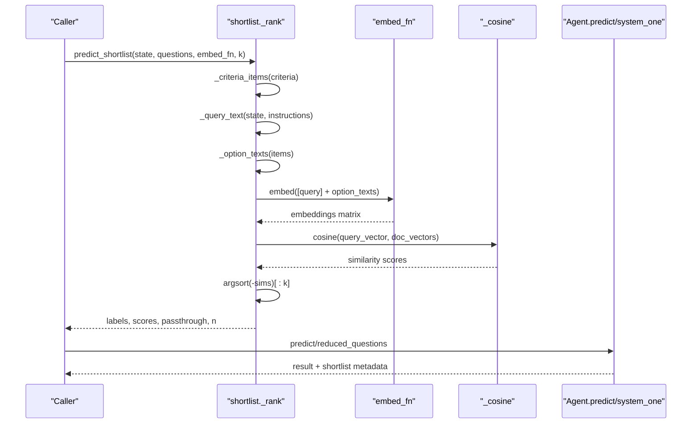
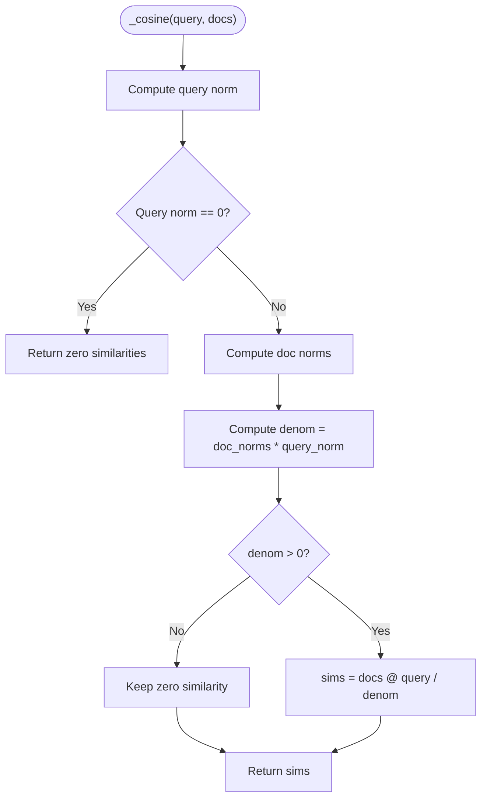
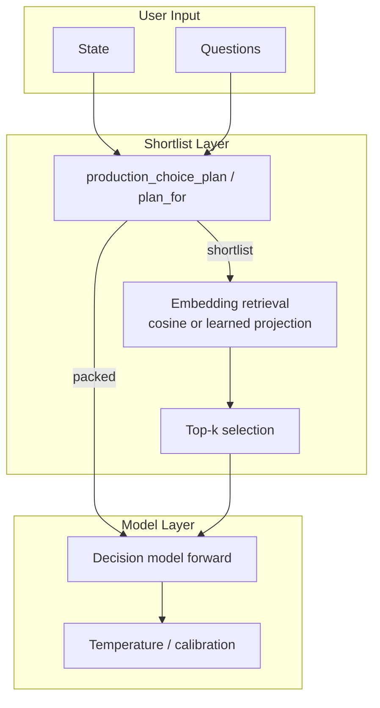
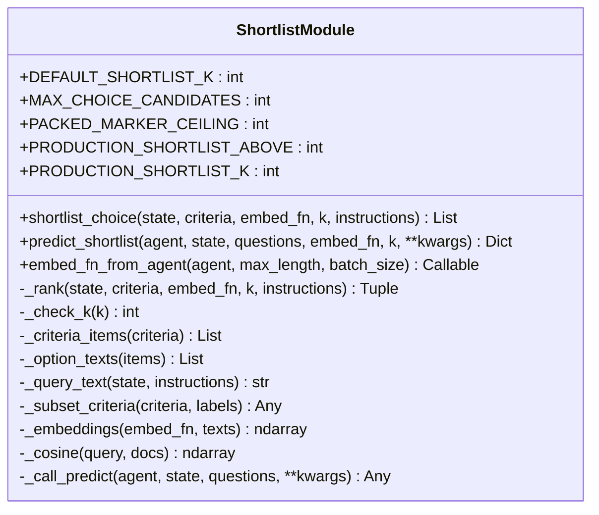
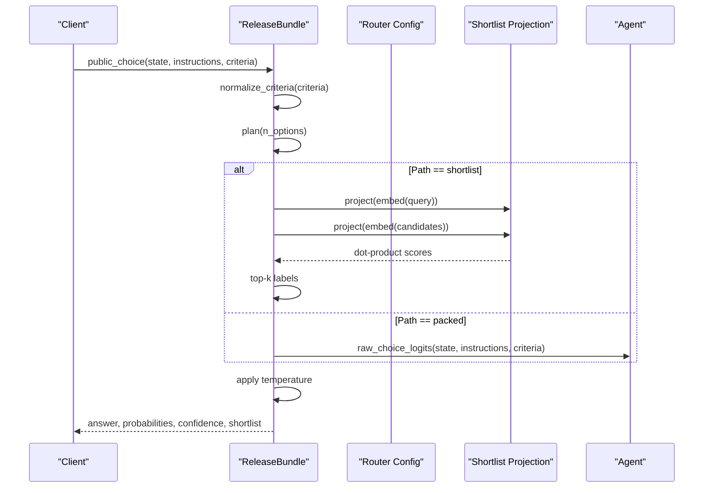
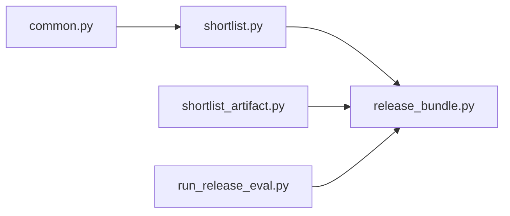

# Shortlist Optimization

<cite>
**Referenced Files in This Document**
- [shortlist.py](file://veya/shortlist.py)
- [shortlist_artifact.py](file://veya/shortlist_artifact.py)
- [release_bundle.py](file://veya/release_bundle.py)
- [common.py](file://veya/common.py)
- [router.py](file://veya/router.py)
- [run_release_eval.py](file://research/veyabench/run_release_eval.py)
</cite>

## Table of Contents
1. [Introduction](#introduction)
2. [Project Structure](#project-structure)
3. [Core Components](#core-components)
4. [Architecture Overview](#architecture-overview)
5. [Detailed Component Analysis](#detailed-component-analysis)
6. [Dependency Analysis](#dependency-analysis)
7. [Performance Considerations](#performance-considerations)
8. [Troubleshooting Guide](#troubleshooting-guide)
9. [Conclusion](#conclusion)

## Introduction
Veya’s shortlist optimization system is designed for high-cardinality choice questions where the number of candidate labels can be large enough to exceed the model’s per-question token budget. Instead of scoring every label with the full decision model, Veya first retrieves a small top-k candidate set using embeddings and cosine similarity, then runs one efficient prediction pass over that reduced set.

The system supports two routing strategies:
- Packed routing: all candidates are embedded into a single sequence and scored together by the decision head. It is fast and accurate for small label sets but loses options when the label list grows too large.
- Learned shortlist routing: a projection-based embedding space selects top-k candidates before the final reranking step. This path is used for larger label sets and is bound to a specific checkpoint and K value.

This document explains how the retrieval mechanism works, how production thresholds decide between packed and shortlist routing, and how to integrate custom embedding functions while avoiding common dimensionality and performance pitfalls.

## Project Structure
The shortlist optimization spans several modules:
- `veya/shortlist.py`: Core shortlist logic, configuration constants, cosine ranking, and helper utilities.
- `veya/shortlist_artifact.py`: Saved projection artifacts, format validation, and route calibration metadata.
- `veya/release_bundle.py`: Production routing plan, learned shortlist integration, temperature selection, and end-to-end choice scoring.
- `veya/common.py`: Shared state serialization, option rendering, and sequence construction helpers.
- `veya/router.py`: Model-level routing across checkpoints; not the same as choice routing, but relevant for understanding deployment context.
- `research/veyabench/run_release_eval.py`: Evaluation harness that exercises shortlist retrieval and reranking.

**Diagram sources**
- [shortlist.py:1-16](file://veya/shortlist.py#L1-L16)
- [release_bundle.py:1-28](file://veya/release_bundle.py#L1-L28)
- [shortlist_artifact.py:1-15](file://veya/shortlist_artifact.py#L1-L15)
- [common.py:15-61](file://veya/common.py#L15-L61)
- [run_release_eval.py:90-127](file://research/veyabench/run_release_eval.py#L90-L127)

**Section sources**
- [shortlist.py:1-41](file://veya/shortlist.py#L1-L41)
- [release_bundle.py:1-56](file://veya/release_bundle.py#L1-L56)
- [shortlist_artifact.py:1-15](file://veya/shortlist_artifact.py#L1-L15)
- [common.py:15-61](file://veya/common.py#L15-L61)

## Core Components
This section documents the main functions and constants that power shortlist optimization.

### Key Configuration Constants
- `DEFAULT_SHORTLIST_K = 20`: Default number of candidates retrieved by `predict_shortlist` and `shortlist_choice`.
- `MAX_CHOICE_CANDIDATES = 1024`: Hard limit on the number of choice criteria accepted by the shortlist pipeline.
- `PACKED_MARKER_CEILING = 100`: Experimental ceiling indicating when packed markers would start being dropped due to tokenizer window limits.
- `PRODUCTION_SHORTLIST_ABOVE = 19`: Threshold above which production routing uses the learned shortlist path instead of packed scoring.
- `PRODUCTION_SHORTLIST_K = 8`: Fixed shortlist size used in production release bundles.

These constants are validated by router loading and release manifest checks so that the packed cutoff, hierarchical K, and route name stay consistent across components.

**Section sources**
- [shortlist.py:25-41](file://veya/shortlist.py#L25-L41)
- [release_bundle.py:43-56](file://veya/release_bundle.py#L43-L56)

### Routing Strategy: Packed vs Shortlist
Production routing chooses between packed and shortlist based on the number of options:
- If the number of options is less than or equal to `PRODUCTION_SHORTLIST_ABOVE`, use packed routing.
- Otherwise, use the learned shortlist path with `PRODUCTION_SHORTLIST_K`.

**Diagram sources**
- [shortlist.py:43-55](file://veya/shortlist.py#L43-L55)
- [release_bundle.py:84-89](file://veya/release_bundle.py#L84-L89)

**Section sources**
- [shortlist.py:43-64](file://veya/shortlist.py#L43-L64)
- [release_bundle.py:84-89](file://veya/release_bundle.py#L84-L89)

### Embedding-Based Candidate Retrieval
The core retrieval flow is:
1. Serialize the user state into text.
2. Optionally prepend instructions to form the query.
3. Render each criterion into an option string.
4. Embed the query and all options through `embed_fn`.
5. Compute cosine similarity between the query vector and option vectors.
6. Select the top-k labels by descending similarity.
7. Return either the full label list (passthrough) or the ranked shortlist.

**Diagram sources**
- [shortlist.py:91-148](file://veya/shortlist.py#L91-L148)
- [shortlist.py:206-219](file://veya/shortlist.py#L206-L219)
- [shortlist.py:256-271](file://veya/shortlist.py#L256-L271)
- [shortlist.py:280-305](file://veya/shortlist.py#L280-L305)

**Section sources**
- [shortlist.py:91-148](file://veya/shortlist.py#L91-L148)
- [shortlist.py:206-219](file://veya/shortlist.py#L206-L219)
- [shortlist.py:256-271](file://veya/shortlist.py#L256-L271)
- [shortlist.py:280-305](file://veya/shortlist.py#L280-L305)

### `predict_shortlist` Function
`predict_shortlist` is the primary integration point for callers who want to reduce computational overhead:
- It iterates over `questions`.
- Non-choice questions are forwarded unchanged.
- Choice questions with label counts less than or equal to `k` are forwarded unchanged without calling `embed_fn`.
- For larger choice questions, it shortlists labels using `_rank`.
- It calls `agent.predict` or `agent.system_one` once over the reduced question set.
- It attaches a `shortlist` metadata entry describing labels, scores, k, n, and passthrough behavior.

Important contract details:
- The caller’s `questions` dict is not mutated.
- Probabilities returned for shortlisted choices are over the kept labels only.
- Extra keyword arguments are forwarded to the underlying predict function.

**Section sources**
- [shortlist.py:91-148](file://veya/shortlist.py#L91-L148)

### `embed_fn_from_agent` Utility
`embed_fn_from_agent` builds an embedding function from an already-loaded Veya agent:
- It uses the agent’s tokenizer and encoder.
- It performs mean pooling over non-padding positions.
- It returns NumPy arrays compatible with the shortlist pipeline.
- It does not run the decision head and does not download weights.
- It batches encoding by `batch_size` and respects `max_length`.

This utility is useful when you only have the Veya checkpoint in memory and do not want to supply a separate bi-encoder.

**Section sources**
- [shortlist.py:151-203](file://veya/shortlist.py#L151-L203)

### Cosine Similarity Ranking Algorithm
The cosine ranking implementation avoids division-by-zero and handles zero vectors safely:
- It computes the norm of the query vector.
- It computes norms for all document vectors.
- If the query norm is zero, it returns zeros rather than NaN.
- It divides the dot product by the product of norms only where the denominator is positive.
- Ties are resolved by stable sorting, preserving earlier labels.

**Diagram sources**
- [shortlist.py:295-305](file://veya/shortlist.py#L295-L305)

**Section sources**
- [shortlist.py:295-305](file://veya/shortlist.py#L295-L305)

## Architecture Overview
At runtime, Veya decides whether to score a choice question directly or to retrieve a shortlist first. In production, this decision is enforced by the release bundle and router configuration.

**Diagram sources**
- [shortlist.py:43-55](file://veya/shortlist.py#L43-L55)
- [release_bundle.py:84-89](file://veya/release_bundle.py#L84-L89)
- [release_bundle.py:208-258](file://veya/release_bundle.py#L208-L258)

## Detailed Component Analysis

### Shortlist Module (`veya/shortlist.py`)
The shortlist module implements:
- Public APIs: `shortlist_choice`, `predict_shortlist`, `embed_fn_from_agent`.
- Internal ranking: `_rank`, `_embeddings`, `_cosine`.
- Input validation: `_check_k`, `_criteria_items`, `_option_texts`, `_query_text`.
- Prediction dispatch: `_call_predict`.

Key behaviors:
- `shortlist_choice` returns only the top-k labels.
- `predict_shortlist` reduces the question set and returns both model output and shortlist metadata.
- `_criteria_items` enforces candidate limits, label constraints, duplicate normalization, and criterion length limits.
- `_embeddings` validates shape and dtype, converts tensors to NumPy, and sanitizes NaN/infinity values.
- `_call_predict` prefers `agent.predict`; if unavailable, it falls back to `agent.system_one`.

**Diagram sources**
- [shortlist.py:25-41](file://veya/shortlist.py#L25-L41)
- [shortlist.py:67-88](file://veya/shortlist.py#L67-L88)
- [shortlist.py:91-148](file://veya/shortlist.py#L91-L148)
- [shortlist.py:151-203](file://veya/shortlist.py#L151-L203)
- [shortlist.py:206-322](file://veya/shortlist.py#L206-L322)

**Section sources**
- [shortlist.py:25-41](file://veya/shortlist.py#L25-L41)
- [shortlist.py:67-88](file://veya/shortlist.py#L67-L88)
- [shortlist.py:91-148](file://veya/shortlist.py#L91-L148)
- [shortlist.py:151-203](file://veya/shortlist.py#L151-L203)
- [shortlist.py:206-322](file://veya/shortlist.py#L206-L322)

### Shortlist Artifact (`veya/shortlist_artifact.py`)
The artifact module manages saved projections and route calibration metadata:
- `save_shortlist` serializes a bias-free linear projection, labels, label texts, checkpoint hash, K, seed, and file SHA-256.
- `load_shortlist` validates format, route, K, checkpoint hash, and loads the projection layer.
- `save_route_calibration` and `load_route_calibration` manage temperature and split metadata tied to a specific shortlist and checkpoint.

Validation rules ensure that a shortlist cannot be reused across incompatible checkpoints, K values, routes, or calibration files.

**Section sources**
- [shortlist_artifact.py:1-65](file://veya/shortlist_artifact.py#L1-L65)
- [shortlist_artifact.py:68-109](file://veya/shortlist_artifact.py#L68-L109)

### Release Bundle Integration (`veya/release_bundle.py`)
The release bundle ties together:
- Router configuration validation.
- Packed vs shortlist planning.
- Learned projection embedding and dot-product scoring.
- Temperature selection for calibrated probabilities.
- End-to-end choice scoring with optional reranker and hypothesis support.

**Diagram sources**
- [release_bundle.py:127-198](file://veya/release_bundle.py#L127-L198)
- [release_bundle.py:200-258](file://veya/release_bundle.py#L200-L258)
- [release_bundle.py:395-425](file://veya/release_bundle.py#L395-L425)

**Section sources**
- [release_bundle.py:43-56](file://veya/release_bundle.py#L43-L56)
- [release_bundle.py:84-94](file://veya/release_bundle.py#L84-L94)
- [release_bundle.py:127-198](file://veya/release_bundle.py#L127-L198)
- [release_bundle.py:200-258](file://veya/release_bundle.py#L200-L258)
- [release_bundle.py:395-425](file://veya/release_bundle.py#L395-L425)

### Common Utilities (`veya/common.py`)
Common utilities provide shared building blocks:
- `serialize_state`: Converts strings, dicts, and lists into a canonical text representation.
- `render_criterion`: Renders structured criterion values as readable text.
- `render_options`: Produces option strings for choice, score, and NUL types.
- `build_sequence`: Builds the packed input sequence with mask tokens and markers.

These helpers are used by both shortlist and packed routing paths.

**Section sources**
- [common.py:15-61](file://veya/common.py#L15-L61)
- [common.py:64-111](file://veya/common.py#L64-L111)

### Model-Level Router Context (`veya/router.py`)
The model router selects among different Veya checkpoints (English, multilingual, typed-decisions). While distinct from choice routing, it provides important deployment context:
- It detects language/script and chooses an appropriate checkpoint.
- It supports preloading models to avoid cold-load latency.
- It exposes `route`, `load`, `preload`, and `predict`.

For shortlist optimization, the model router determines which checkpoint supplies the encoder used by `embed_fn_from_agent` or the release bundle’s projection path.

**Section sources**
- [router.py:1-29](file://veya/router.py#L1-L29)
- [router.py:123-143](file://veya/router.py#L123-L143)
- [router.py:256-333](file://veya/router.py#L256-L333)

## Dependency Analysis
The shortlist system has clear dependency boundaries:
- `shortlist.py` depends on `common.py` for state and option rendering.
- `release_bundle.py` depends on `shortlist.py` for production constants and criteria validation.
- `release_bundle.py` depends on `shortlist_artifact.py` for projection and calibration loading.
- Evaluation code in `research/veyabench/run_release_eval.py` exercises the shortlist path and measures retrieval plus reranking performance.

**Diagram sources**
- [shortlist.py:23-23](file://veya/shortlist.py#L23-L23)
- [release_bundle.py:25-27](file://veya/release_bundle.py#L25-L27)
- [run_release_eval.py:90-127](file://research/veyabench/run_release_eval.py#L90-L127)

**Section sources**
- [shortlist.py:23-23](file://veya/shortlist.py#L23-L23)
- [release_bundle.py:25-27](file://veya/release_bundle.py#L25-L27)
- [run_release_eval.py:90-127](file://research/veyabench/run_release_eval.py#L90-L127)

## Performance Considerations
- Use `predict_shortlist` to avoid scoring every label when the label set is large.
- Choose `k` carefully:
  - Larger `k` improves recall but increases reranking cost.
  - Smaller `k` reduces computation but risks dropping the correct label.
- Prefer the production learned shortlist path for large label sets; it uses a fixed K and a projection trained for that checkpoint.
- Batch embedding calls through `embed_fn_from_agent` to reduce tokenizer and encoder overhead.
- Avoid unnecessary duplication of label descriptions; keep criterion text concise within the character limits.
- Monitor passthrough behavior: if `k >= n`, no embedding call occurs and the original label order is preserved.

[No sources needed since this section provides general guidance]

## Troubleshooting Guide

### Embedding Dimension Mismatches
Symptoms:
- Errors about embedding array shape.
- Incorrect shortlist results due to mismatched encoder dimensions.

Likely causes:
- Custom `embed_fn` returns arrays with wrong shape or dtype.
- Using an encoder whose hidden dimension differs from what the projection expects.
- Passing tensors that are not converted to NumPy correctly.

Resolution steps:
- Ensure `embed_fn` returns a 2D array with shape `(len(texts), dim)`.
- Validate that `dim` matches the encoder’s hidden size.
- Use `embed_fn_from_agent` when working with the bundled Veya checkpoint.
- Inspect intermediate shapes in `_embeddings` and `_cosine`.

**Section sources**
- [shortlist.py:280-292](file://veya/shortlist.py#L280-L292)
- [shortlist.py:317-321](file://veya/shortlist.py#L317-L321)

### Too Many Candidates
Symptoms:
- Validation errors stating that choice criteria exceed the candidate limit.

Likely causes:
- Supplying more than `MAX_CHOICE_CANDIDATES` labels.
- Including duplicate normalized labels.
- Providing excessively long labels or criterion descriptions.

Resolution steps:
- Reduce the number of candidate labels.
- Remove duplicates after normalization.
- Shorten labels and criterion descriptions to fit `MAX_CANDIDATE_LABEL_CHARS` and `MAX_CANDIDATE_VALUE_CHARS`.

**Section sources**
- [shortlist.py:228-253](file://veya/shortlist.py#L228-L253)

### Wrong Routing Path
Symptoms:
- Unexpected packed routing for large label sets.
- Mismatched router K or cutoff during bundle loading.

Likely causes:
- Custom router configuration not aligned with `PRODUCTION_SHORTLIST_ABOVE` and `PRODUCTION_SHORTLIST_K`.
- Loading a shortlist artifact trained for a different checkpoint or K.

Resolution steps:
- Verify router configuration against production constants.
- Ensure the shortlist artifact’s K and checkpoint hash match the loaded model.
- Use `load_release_manifest` to validate hashes and configuration consistency.

**Section sources**
- [shortlist.py:43-55](file://veya/shortlist.py#L43-L55)
- [release_bundle.py:43-56](file://veya/release_bundle.py#L43-L56)
- [release_bundle.py:395-425](file://veya/release_bundle.py#L395-L425)

### Low Recall at Small K
Symptoms:
- Correct label missing from shortlist.
- Reranking accuracy drops sharply when K is too small.

Likely causes:
- Embedding function not well-aligned with the decision task.
- K too small for the label distribution.
- Cosine similarity ranking failing due to zero or invalid vectors.

Resolution steps:
- Increase K gradually and measure recall.
- Use a domain-specific bi-encoder if available.
- Inspect query and option embeddings for zero or degenerate vectors.
- Review evaluation harness metrics for retrieval hit rate and reranking accuracy.

**Section sources**
- [shortlist.py:206-219](file://veya/shortlist.py#L206-L219)
- [run_release_eval.py:90-127](file://research/veyabench/run_release_eval.py#L90-L127)

## Conclusion
Veya’s shortlist optimization system provides a practical balance between accuracy and efficiency for high-cardinality choice questions. By retrieving top-k candidates through embeddings and cosine similarity—or through a learned projection in production—it reduces the number of labels the decision model must score. The packed vs shortlist routing strategy is governed by clear thresholds and validated configuration, ensuring predictable behavior at scale.

For best results:
- Use `predict_shortlist` for flexible integration.
- Use `embed_fn_from_agent` when working with the bundled Veya checkpoint.
- Align production routing constants with your deployment configuration.
- Monitor recall, reranking accuracy, and memory usage when tuning K and embedding functions.

[No sources needed since this section summarizes without analyzing specific files]