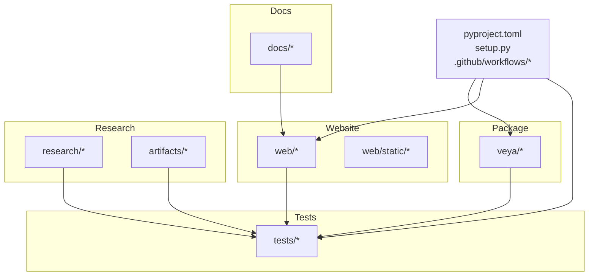
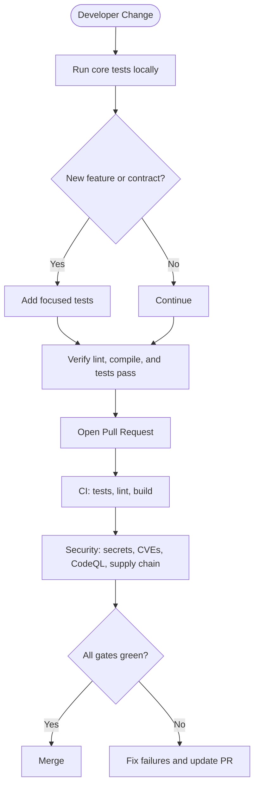
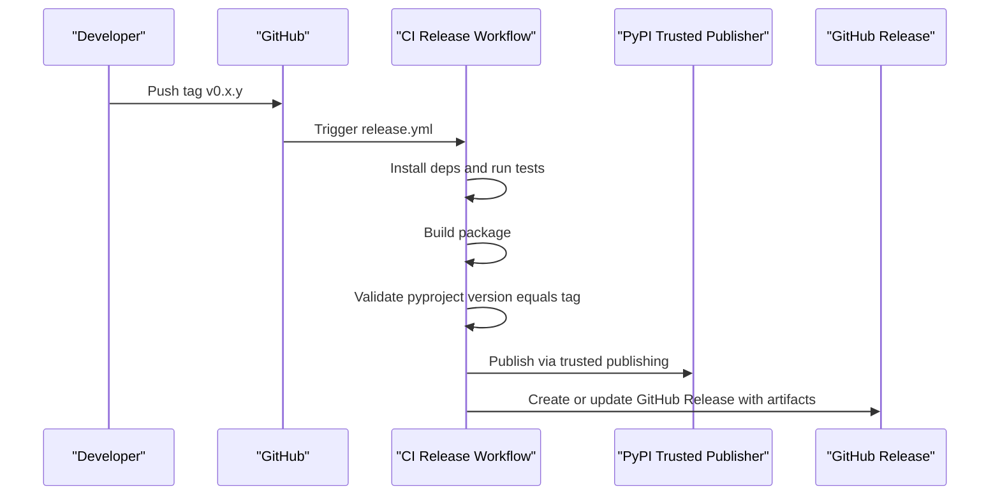
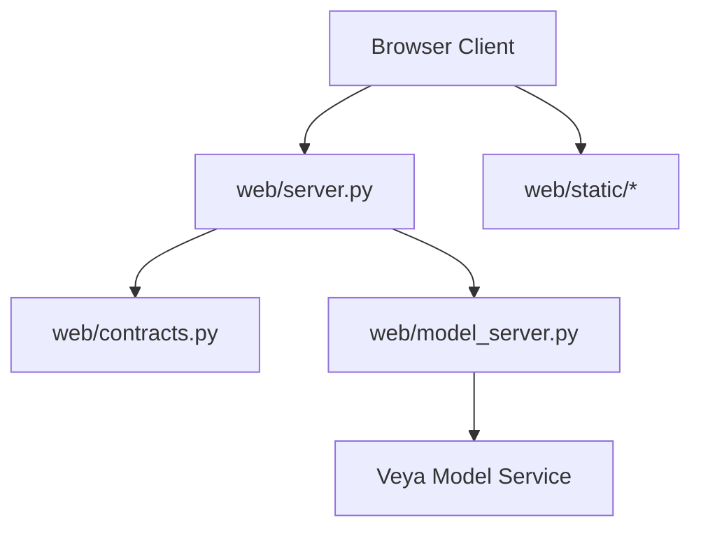
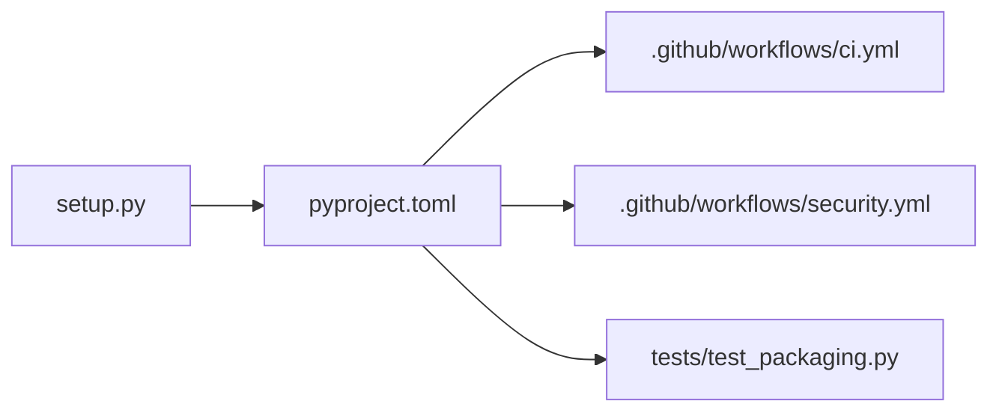

# Contributing & Development

<cite>
**Referenced Files in This Document**
- [README.md](file://README.md)
- [pyproject.toml](file://pyproject.toml)
- [setup.py](file://setup.py)
- [veya/__init__.py](file://veya/__init__.py)
- [docs/CHANGE_PROTOCOL.md](file://docs/CHANGE_PROTOCOL.md)
- [docs/WEBSITE_ARCHITECTURE.md](file://docs/WEBSITE_ARCHITECTURE.md)
- [.github/workflows/ci.yml](file://.github/workflows/ci.yml)
- [.github/workflows/release.yml](file://.github/workflows/release.yml)
- [.github/workflows/security.yml](file://.github/workflows/security.yml)
- [tests/test_packaging.py](file://tests/test_packaging.py)
- [tests/test_reliability.py](file://tests/test_reliability.py)
- [web/server.py](file://web/server.py)
</cite>

## Table of Contents
1. [Introduction](#introduction)
2. [Project Structure](#project-structure)
3. [Development Setup](#development-setup)
4. [Coding Standards](#coding-standards)
5. [Testing Requirements](#testing-requirements)
6. [Pull Request Process](#pull-request-process)
7. [Change Protocol and Review Procedures](#change-protocol-and-review-procedures)
8. [Release Management](#release-management)
9. [Code Organization Principles](#code-organization-principles)
10. [Adding New Features and Extending Functionality](#adding-new-features-and-extending-functionality)
11. [Backward Compatibility Guidelines](#backward-compatibility-guidelines)
12. [Governance, Community Guidelines, and Communication Channels](#governance-community-guidelines-and-communication-channels)
13. [Architecture Overview](#architecture-overview)
14. [Dependency Analysis](#dependency-analysis)
15. [Performance Considerations](#performance-considerations)
16. [Troubleshooting Guide](#troubleshooting-guide)
17. [Conclusion](#conclusion)

## Introduction
This document explains how to contribute to Veya’s development. It covers the development environment, coding standards, testing expectations, pull request workflow, change protocol, review procedures, release management, code organization, compatibility rules, governance, community guidelines, and communication channels.

Veya is a fast, non-autoregressive decision engine with calibrated probabilities. The repository includes Python package code under `veya`, a small website gateway under `web`, tests under `tests`, research artifacts under `research`, and documentation under `docs`.

**Section sources**
- [README.md:1-469](file://README.md#L1-L469)

## Project Structure
The repository is organized by responsibility:
- `veya`: Core Python package for agents, routing, shortlisting, language detection, presets, and utilities.
- `web`: Website gateway, model server interface, contracts, and static browser assets.
- `tests`: Unit, integration, packaging, reliability, and end-to-end checks.
- `research` and `artifacts`: Research scripts, datasets, experiments, and audited results.
- `docs`: Audits, phase reports, website architecture, and change protocol.
- Configuration files at the root define metadata, build settings, and CI workflows.

**Diagram sources**
- [pyproject.toml:1-45](file://pyproject.toml#L1-L45)
- [setup.py:1-5](file://setup.py#L1-L5)
- [veya/__init__.py:1-56](file://veya/__init__.py#L1-L56)
- [docs/WEBSITE_ARCHITECTURE.md:1-62](file://docs/WEBSITE_ARCHITECTURE.md#L1-L62)

**Section sources**
- [pyproject.toml:1-45](file://pyproject.toml#L1-L45)
- [setup.py:1-5](file://setup.py#L1-L5)
- [veya/__init__.py:1-56](file://veya/__init__.py#L1-L56)
- [docs/WEBSITE_ARCHITECTURE.md:1-62](file://docs/WEBSITE_ARCHITECTURE.md#L1-L62)

## Development Setup
- Use Python 3.10 or newer.
- Install the package in editable mode for local development.
- The project pins dependencies such as PyTorch, Transformers, safetensors, huggingface_hub, and NumPy.
- The public SDK exposes agents, routers, shortlisting helpers, language detection, and preset question schemas.

Recommended steps:
1. Create a virtual environment with Python 3.10+.
2. Install the package in editable mode.
3. Run the core test suite to verify your environment.
4. For GPU workloads, install a compatible CUDA-enabled PyTorch wheel; otherwise, CPU-only wheels are used in CI.

**Section sources**
- [README.md:58-65](file://README.md#L58-L65)
- [pyproject.toml:5-33](file://pyproject.toml#L5-L33)
- [veya/__init__.py:1-56](file://veya/__init__.py#L1-L56)

## Coding Standards
- Linting uses Ruff with a focused rule set and a line length of 120.
- Every module must compile successfully.
- Avoid unsafe deserialization and dynamic execution in shipped code.
- Keep configuration and metadata centralized in `pyproject.toml`; `setup.py` is only a shim.
- Prefer small, coherent patches that reuse shared rendering primitives and tokens.

Key rules enforced by CI:
- Ruff checks on `veya/` with selected error categories.
- Byte-compilation of all modules under `veya/` and `tests/`.
- No use of pickle, `torch.load`, joblib load, or YAML load in the shipped package.
- No shell-out or dynamic execution in the shipped package.

**Section sources**
- [.github/workflows/ci.yml:56-68](file://.github/workflows/ci.yml#L56-L68)
- [.github/workflows/security.yml:78-100](file://.github/workflows/security.yml#L78-L100)
- [setup.py:1-5](file://setup.py#L1-L5)
- [docs/CHANGE_PROTOCOL.md:1-18](file://docs/CHANGE_PROTOCOL.md#L1-L18)

## Testing Requirements
CI runs a focused test matrix across Python versions and executes several core test modules:
- Routing, criteria, download, shortlist, decision model, email cleaning, and packaging tests.
- Reliability tests cover truncation behavior, ECE scoring, safe automation coverage, JSON-safe routing decisions, and defer logic without loading weights.
- Packaging tests assert that metadata, dependency floors, classifiers, and CI Python versions stay consistent.

Before submitting changes:
- Run the same tests invoked by CI.
- Add focused tests for new behavior.
- Ensure no regressions in routing, language detection, calibration metrics, and packaging metadata.

**Diagram sources**
- [.github/workflows/ci.yml:1-92](file://.github/workflows/ci.yml#L1-L92)
- [.github/workflows/security.yml:1-101](file://.github/workflows/security.yml#L1-L101)
- [tests/test_packaging.py:1-86](file://tests/test_packaging.py#L1-L86)
- [tests/test_reliability.py:1-136](file://tests/test_reliability.py#L1-L136)

**Section sources**
- [.github/workflows/ci.yml:20-54](file://.github/workflows/ci.yml#L20-L54)
- [tests/test_packaging.py:1-86](file://tests/test_packaging.py#L1-L86)
- [tests/test_reliability.py:1-136](file://tests/test_reliability.py#L1-L136)

## Pull Request Process
- Open a pull request against `main`.
- Ensure CI passes: tests, lint, and build.
- Include focused tests for behavioral changes.
- Keep diffs minimal and scoped to the requested change.
- Inspect the diff for unrelated changes, stale claims, mock output, secrets, and local paths.
- For website changes, verify the affected page at relevant widths and check keyboard behavior.

CI enforces:
- Import checks for the package.
- Routing and language-detection tests.
- Email cleaning tests.
- Lint and byte-compilation.
- Package build and metadata validation.
- Version tag matching when building from tags.

**Section sources**
- [.github/workflows/ci.yml:1-92](file://.github/workflows/ci.yml#L1-L92)
- [docs/CHANGE_PROTOCOL.md:1-18](file://docs/CHANGE_PROTOCOL.md#L1-L18)

## Change Protocol and Review Procedures
For incremental website changes:
1. Parse the delta and explicit exclusions.
2. Map ownership using the website architecture map.
3. Read the primary file and direct dependents.
4. Preserve unrelated routes, models, navigation, and accessibility behavior.
5. Apply the smallest coherent patch and reuse shared primitives.
6. Run focused tests; expand to the gateway suite for contract or shared client changes.
7. View the actual affected page at desktop and mobile widths and check interactive keyboard behavior.
8. Inspect the diff for unrelated changes, stale claims, mock output, secrets, and local paths.
9. Report exactly what changed, what was verified, and any remaining blocker.

Review guidance:
- Treat API contract changes as cross-cutting: browser client, gateway, service, and tests.
- Do not regenerate the website or redesign unaffected pages for small patches.
- Keep audited model claims tied to the current release manifest and benchmark artifact.

**Section sources**
- [docs/CHANGE_PROTOCOL.md:1-18](file://docs/CHANGE_PROTOCOL.md#L1-L18)
- [docs/WEBSITE_ARCHITECTURE.md:1-62](file://docs/WEBSITE_ARCHITECTURE.md#L1-L62)

## Release Management
Releases are triggered by pushing version tags:
- Tag format: `vX.Y.Z`.
- CI builds the package, validates metadata, and publishes to PyPI through trusted publishing.
- A GitHub Release is created or updated with built artifacts.
- The package version in `pyproject.toml` must match the tag.

Local release checklist:
1. Update the version in `pyproject.toml`.
2. Confirm all tests pass.
3. Build the package and validate metadata.
4. Push a tag `vX.Y.Z`.
5. Allow CI to publish to PyPI and create the GitHub Release.

**Diagram sources**
- [.github/workflows/release.yml:1-111](file://.github/workflows/release.yml#L1-L111)
- [pyproject.toml:5-10](file://pyproject.toml#L5-L10)

**Section sources**
- [.github/workflows/release.yml:1-111](file://.github/workflows/release.yml#L1-L111)
- [pyproject.toml:5-10](file://pyproject.toml#L5-L10)

## Code Organization Principles
- Public API surface is defined in `veya/__init__.py`.
- Core responsibilities include:
  - Agent and RL agent abstractions.
  - Router and route decisions.
  - Shortlisting helpers and embedding utilities.
  - Language detection and script analysis.
  - Preset question schemas for common workflows.
  - Utilities for confidence, expected calibration error, proper rewards, and option rendering.
- Website code separates concerns:
  - Static assets and ES modules for the browser.
  - Gateway server handling requests, rate limiting, timeouts, and SEO.
  - Contracts defining request/response shapes.
  - Model server interface for calling the Veya service.

Best practices:
- Keep the public API stable and documented through exports.
- Reuse shared website components and tokens instead of duplicating rendering logic.
- Maintain clear ownership maps for website routes and content.

**Section sources**
- [veya/__init__.py:1-56](file://veya/__init__.py#L1-L56)
- [docs/WEBSITE_ARCHITECTURE.md:1-62](file://docs/WEBSITE_ARCHITECTURE.md#L1-L62)

## Adding New Features and Extending Functionality
Guidelines:
- Identify the owning component using the architecture map.
- Add focused tests before or alongside implementation.
- Extend the public API only through `veya/__init__.py`.
- For website features, add entries to the site registry and structured content rather than hardcoding routes.
- For model-facing changes, ensure language detection, routing, and shortlisting remain correct.

Example patterns:
- Adding a preset question schema: export it from the package and add tests validating its structure and outputs.
- Adding a website page: register the route, add structured content, and verify navigation and accessibility.
- Adding a model capability: ensure the router can select the appropriate checkpoint and that latency and memory implications are understood.

**Section sources**
- [veya/__init__.py:1-56](file://veya/__init__.py#L1-L56)
- [docs/WEBSITE_ARCHITECTURE.md:31-62](file://docs/WEBSITE_ARCHITECTURE.md#L31-L62)

## Backward Compatibility Guidelines
- Do not break existing public exports or function signatures without a coordinated deprecation plan.
- Preserve routing behavior and language detection outcomes unless explicitly changing supported inputs.
- Keep website contracts stable; update them only with cross-cutting changes and tests.
- Avoid introducing unsafe deserialization or dynamic execution into the shipped package.
- Keep audited claims aligned with the current release manifest and benchmark artifacts.

**Section sources**
- [veya/__init__.py:1-56](file://veya/__init__.py#L1-L56)
- [.github/workflows/security.yml:78-100](file://.github/workflows/security.yml#L78-L100)
- [docs/CHANGE_PROTOCOL.md:1-18](file://docs/CHANGE_PROTOCOL.md#L1-L18)

## Governance, Community Guidelines, and Communication Channels
- Licensing: Apache 2.0.
- Project maintainers and contributors should follow the change protocol and CI requirements.
- Community engagement references include Hugging Face model and space links in the README.
- Communication channels referenced by the project include:
  - Hugging Face model hub.
  - Hugging Face Space demo.
  - External engineering writeup link.
- For contributions, use GitHub issues and pull requests following the established workflow.

**Section sources**
- [README.md:1-469](file://README.md#L1-L469)
- [pyproject.toml:5-11](file://pyproject.toml#L5-L11)

## Architecture Overview
The website is a small Python HTTP gateway plus browser-native ES modules. There is no frontend framework or bundler. The gateway serves the HTML shell and static modules; the browser calls only the same-origin gateway. The gateway calls the separate Veya model service. There is no production mock fallback.

**Diagram sources**
- [docs/WEBSITE_ARCHITECTURE.md:1-62](file://docs/WEBSITE_ARCHITECTURE.md#L1-L62)
- [web/server.py:153-206](file://web/server.py#L153-L206)

**Section sources**
- [docs/WEBSITE_ARCHITECTURE.md:1-62](file://docs/WEBSITE_ARCHITECTURE.md#L1-L62)
- [web/server.py:153-206](file://web/server.py#L153-L206)

## Dependency Analysis
The package declares runtime dependencies and Python version requirements. CI installs CPU-only torch for speed and consistency. Packaging tests assert that dependency floors and classifiers are consistent with the declared Python floor and transformers support.

**Diagram sources**
- [pyproject.toml:5-33](file://pyproject.toml#L5-L33)
- [setup.py:1-5](file://setup.py#L1-L5)
- [.github/workflows/ci.yml:34-40](file://.github/workflows/ci.yml#L34-L40)
- [.github/workflows/security.yml:39-61](file://.github/workflows/security.yml#L39-L61)
- [tests/test_packaging.py:37-71](file://tests/test_packaging.py#L37-L71)

**Section sources**
- [pyproject.toml:5-33](file://pyproject.toml#L5-L33)
- [tests/test_packaging.py:37-71](file://tests/test_packaging.py#L37-L71)
- [.github/workflows/ci.yml:34-40](file://.github/workflows/ci.yml#L34-L40)

## Performance Considerations
- Preloading checkpoints reduces per-request latency but increases memory usage.
- Language detection occurs before model inference and avoids unnecessary forward passes.
- High-cardinality choice questions may require shortlisting or increased head token budgets.
- Batched throughput improves significantly over single-question calls.

Contributor guidance:
- Measure latency and memory impact when adding new routing logic or model loaders.
- Preserve efficient language detection and deferral paths.
- Avoid unnecessary model reloads in hot paths.

**Section sources**
- [README.md:161-187](file://README.md#L161-L187)
- [README.md:388-420](file://README.md#L388-L420)

## Troubleshooting Guide
Common issues and resolutions:
- Tests fail due to Python version mismatches: align CI matrix and `requires-python`.
- Lint fails: fix Ruff violations and keep line length within 120.
- Build fails: ensure metadata lives in `pyproject.toml` and matches the tag.
- Security scan fails: remove unsafe deserialization or dynamic execution from shipped code.
- Website changes look broken: verify route registration, content structure, and responsive layouts.

Useful checks:
- Run `python -m compileall` on `veya/` and `tests/`.
- Run the packaging test to validate metadata consistency.
- Run reliability tests to confirm truncation, ECE, routing, and defer behavior.
- Inspect the security workflow findings for secrets, CVEs, CodeQL alerts, and supply-chain risks.

**Section sources**
- [.github/workflows/ci.yml:56-92](file://.github/workflows/ci.yml#L56-L92)
- [tests/test_packaging.py:1-86](file://tests/test_packaging.py#L1-L86)
- [tests/test_reliability.py:1-136](file://tests/test_reliability.py#L1-L136)
- [.github/workflows/security.yml:14-100](file://.github/workflows/security.yml#L14-L100)

## Conclusion
Contributing to Veya means following a disciplined process: small, focused changes; strong tests; strict linting; secure defaults; and careful release hygiene. Use the change protocol for website updates, respect the architecture map, and keep the public API stable. When in doubt, prefer minimal patches, reuse shared components, and validate both automated and manual checks before merging.