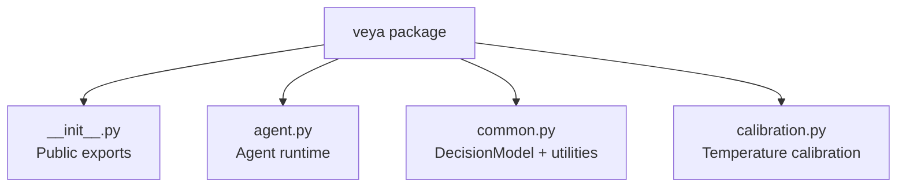
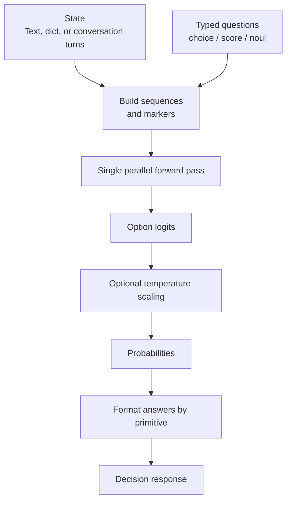
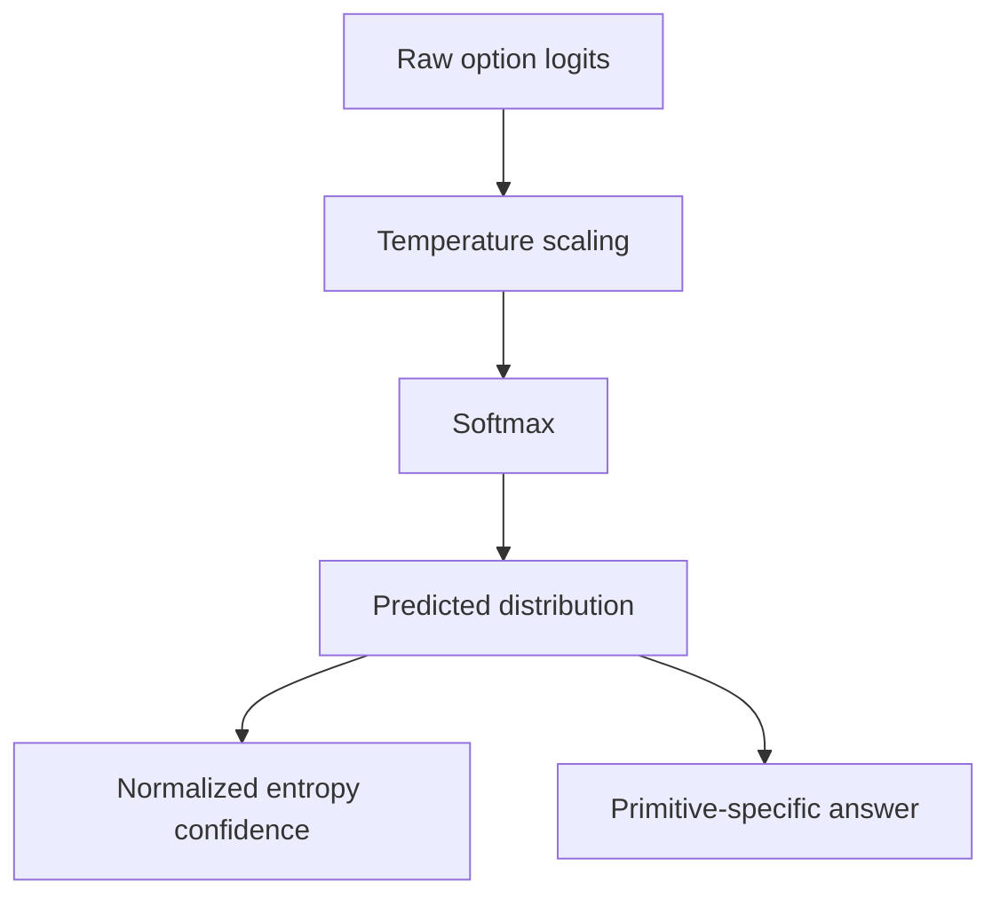
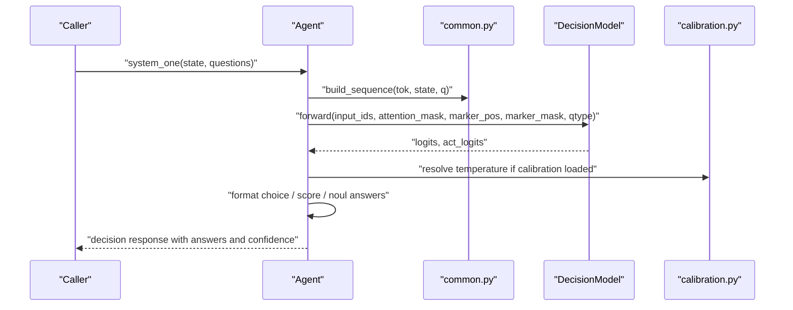
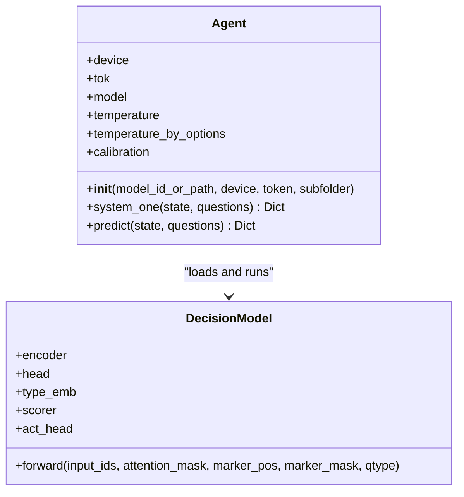
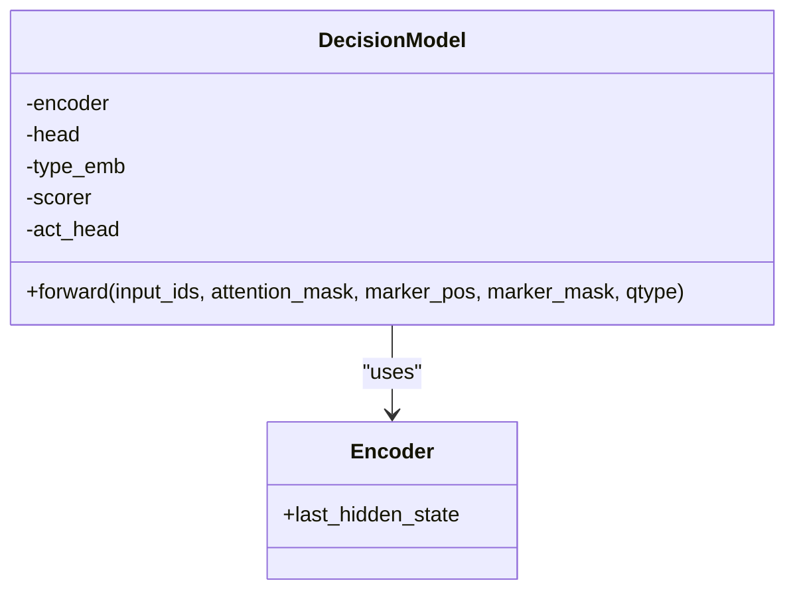
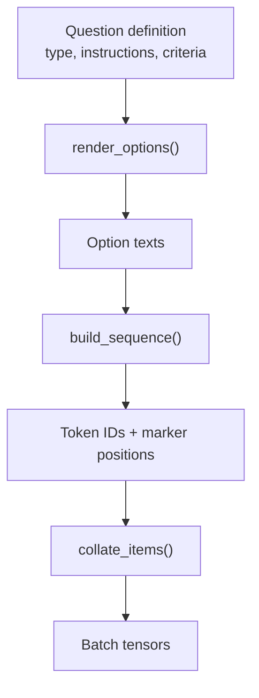
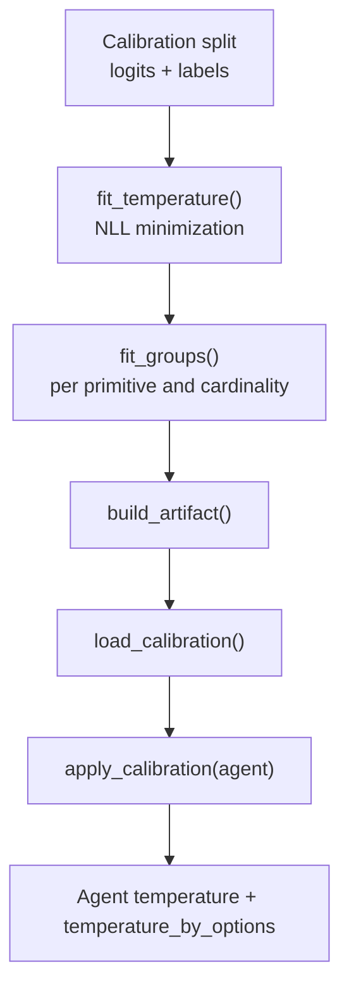
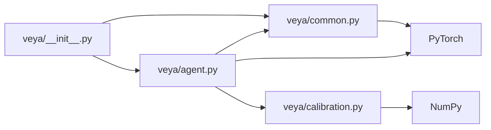

# Core Concepts

<cite>
**Referenced Files in This Document**
- [veya/__init__.py](file://veya/__init__.py)
- [veya/agent.py](file://veya/agent.py)
- [veya/common.py](file://veya/common.py)
- [veya/calibration.py](file://veya/calibration.py)
- [README.md](file://README.md)
</cite>

## Table of Contents
1. [Introduction](#introduction)
2. [Project Structure](#project-structure)
3. [Core Components](#core-components)
4. [Architecture Overview](#architecture-overview)
5. [Detailed Component Analysis](#detailed-component-analysis)
6. [Dependency Analysis](#dependency-analysis)
7. [Performance Considerations](#performance-considerations)
8. [Troubleshooting Guide](#troubleshooting-guide)
9. [Conclusion](#conclusion)

## Introduction
Veya is a fast, non-autoregressive System 1 decision engine that converts natural-language state and typed questions into calibrated probabilities and decisions. Instead of generating tokens one by one, Veya encodes the full input once and scores pre-specified answer options in parallel. The public API centers on the `Agent` class, which loads a trained checkpoint, builds a bidirectional encoder with a typed decision head, and returns answers for three primitive question types:

- **choice**: multi-class classification over named options.
- **score**: ordinal scoring over an ordered list of levels.
- **noul**: binary probability estimation for whether a statement holds.

The package also exposes calibration utilities, confidence estimation, proper scoring-rule rewards used during training, and helper functions for rendering and batching typed questions.

**Section sources**
- [veya/__init__.py:1-26](file://veya/__init__.py#L1-L26)
- [README.md:430-452](file://README.md#L430-L452)

## Project Structure
At the Python package level, the core concepts live under `veya`:

| Area | Responsibility |
|---|---|
| `veya/__init__.py` | Public surface: exports `Agent`, `RLAgent`, `load`, router helpers, language tools, presets, common utilities, and version metadata. |
| `veya/agent.py` | High-level inference runtime: loading checkpoints, device handling, tokenizer setup, sequence construction, batched forward pass, and typed answer formatting. |
| `veya/common.py` | Model architecture (`DecisionModel`), sequence building, option rendering, confidence metrics, temperature clamping, collation, and proper scoring rules. |
| `veya/calibration.py` | Versioned temperature calibration artifacts, NLL-based fitting, cardinality buckets, and application to an agent’s temperatures. |

**Diagram sources**
- [veya/__init__.py:1-26](file://veya/__init__.py#L1-L26)
- [veya/agent.py:1-25](file://veya/agent.py#L1-L25)
- [veya/common.py:1-13](file://veya/common.py#L1-L13)
- [veya/calibration.py:1-18](file://veya/calibration.py#L1-L18)

**Section sources**
- [veya/__init__.py:1-56](file://veya/__init__.py#L1-L56)

## Core Components
This section explains the foundational ideas behind Veya’s design.

### Non-Autoregressive Decision Models vs Autoregressive Approaches
An autoregressive model generates text token by token, conditioning each new token on previously generated tokens. That approach can be flexible but is slower and harder to constrain when the goal is a structured decision rather than free-form generation.

Veya instead uses a **non-autoregressive decision model**:

1. A bidirectional transformer encoder processes the entire input once.
2. Typed question definitions inject a question type embedding and render fixed answer markers.
3. A shared decision head scores all candidate options in parallel.
4. Probabilities are derived from those logits, optionally adjusted by temperature calibration.
5. Answers are formatted per primitive type without further token generation.

This makes Veya well-suited for fast, constrained System 1 decisions where the answer space is known ahead of time.

**Section sources**
- [veya/common.py:114-161](file://veya/common.py#L114-L161)
- [veya/agent.py:291-416](file://veya/agent.py#L291-L416)
- [README.md:438-452](file://README.md#L438-L452)

### State, Questions, and Answers
The runtime separates three concerns:

- **State**: the context being evaluated. It can be a string, JSON-like dictionary, or conversation turn list.
- **Questions**: a mapping from question identifiers to question definitions. Each definition specifies a primitive type, instructions, and criteria describing the answer space.
- **Answers**: per-question results including the primitive-specific prediction, probabilities, confidence, and optional action metadata.

**Diagram sources**
- [veya/agent.py:291-416](file://veya/agent.py#L291-L416)
- [veya/common.py:64-111](file://veya/common.py#L64-L111)

**Section sources**
- [veya/agent.py:291-416](file://veya/agent.py#L291-L416)
- [veya/common.py:15-27](file://veya/common.py#L15-L27)

### Three Typed Decision Primitives
Veya supports three primitives, each with a distinct output semantics.

| Primitive | Purpose | Criteria shape | Output summary |
|---|---|---|---|
| `choice` | Multi-class classification over named options | Dictionary mapping option keys to descriptions | Selected key, per-option probabilities, confidence |
| `score` | Ordinal scoring over ordered levels | Ordered list of at least two levels | Expected score, level legend, per-level probabilities, confidence |
| `noul` | Binary probability estimation | Optional object with `false` and `true` descriptions | Probability that the statement is true, confidence |

#### Choice
Use `choice` when you need to classify input into one of several named categories. The criteria should enumerate stable option keys; descriptions help the model understand what each option means.

#### Score
Use `score` when the answer is ordinal rather than purely categorical. For example, severity, urgency, or quality levels. The model reports a distribution over indices and an expected score computed from that distribution.

#### Noul
Use `noul` when the task is essentially “does this statement hold?” It estimates the probability of the positive class and derives confidence from the binary distribution.

**Section sources**
- [veya/agent.py:264-289](file://veya/agent.py#L264-L289)
- [veya/agent.py:381-406](file://veya/agent.py#L381-L406)
- [veya/common.py:30-61](file://veya/common.py#L30-L61)

### Calibration, Proper Scoring Rules, and Confidence
Calibration ensures that reported probabilities match observed frequencies. Veya’s calibration system fits temperature scalars by minimizing negative log-likelihood on a calibration split and applies them per primitive and per cardinality bucket.

Key ideas:

- **Temperature scaling**: Divides logits before softmax to soften or sharpen distributions. Values are clamped to a safe range.
- **Cardinality buckets**: Group options by count, such as small sets versus large sets, because calibration behavior differs with the number of candidates.
- **Proper scoring rules**: During training, rewards combine log-score, spherical score, and ranked probability score components. This encourages honest probability reporting rather than only hard accuracy.
- **Confidence estimation**: Confidence is derived from normalized Shannon entropy over the predicted distribution. Lower entropy means higher confidence.

**Diagram sources**
- [veya/calibration.py:38-75](file://veya/calibration.py#L38-L75)
- [veya/common.py:261-291](file://veya/common.py#L261-L291)
- [veya/common.py:175-201](file://veya/common.py#L175-L201)

**Section sources**
- [veya/calibration.py:1-193](file://veya/calibration.py#L1-L193)
- [veya/common.py:175-201](file://veya/common.py#L175-L201)
- [veya/common.py:222-291](file://veya/common.py#L222-L291)

## Architecture Overview
The runtime architecture connects user-facing APIs to a shared encoder and typed decision head.

**Diagram sources**
- [veya/agent.py:291-416](file://veya/agent.py#L291-L416)
- [veya/common.py:64-111](file://veya/common.py#L64-L111)
- [veya/common.py:114-161](file://veya/common.py#L114-L161)
- [veya/calibration.py:136-150](file://veya/calibration.py#L136-L150)

## Detailed Component Analysis

### Agent Class
The `Agent` class is the primary interface for running Veya decisions. It handles:

- Loading a Hugging Face Hub snapshot or local directory.
- Fixing tokenizer configuration compatibility.
- Building the model from a checkpoint config.
- Verifying weight compatibility with the configured architecture.
- Selecting device and dtype with graceful fallbacks.
- Applying calibration artifacts when present.
- Running batched inference for multiple typed questions.
- Formatting answers per primitive type.

**Diagram sources**
- [veya/agent.py:101-251](file://veya/agent.py#L101-L251)
- [veya/common.py:114-172](file://veya/common.py#L114-L172)

**Section sources**
- [veya/agent.py:101-251](file://veya/agent.py#L101-L251)
- [veya/agent.py:264-416](file://veya/agent.py#L264-L416)

### DecisionModel Architecture
`DecisionModel` combines a pretrained bidirectional encoder with a small typed decision head:

- **Encoder**: Loads a pretrained transformer encoder and produces hidden states.
- **Type embedding**: Adds a learned embedding per question type so the same backbone can handle `choice`, `score`, and `noul`.
- **Optional head layers**: A small transformer encoder stack can refine representations before scoring.
- **Scorer**: Maps pooled marker representations to option logits.
- **Action head**: Uses top probabilities, entropy, and option count to predict auxiliary actions.

**Diagram sources**
- [veya/common.py:114-161](file://veya/common.py#L114-L161)

**Section sources**
- [veya/common.py:114-172](file://veya/common.py#L114-L172)

### Sequence Construction and Option Rendering
Before the model sees data, Veya constructs a single token sequence containing:

1. Question-type header and instructions.
2. Masked option slots.
3. State content.

Options are rendered according to primitive type:

- `choice`: option key plus optional description.
- `score`: ordered level labels.
- `noul`: fixed false/true structure with optional descriptions.

**Diagram sources**
- [veya/common.py:30-61](file://veya/common.py#L30-L61)
- [veya/common.py:64-111](file://veya/common.py#L64-L111)
- [veya/common.py:298-332](file://veya/common.py#L298-L332)

**Section sources**
- [veya/common.py:30-111](file://veya/common.py#L30-L111)
- [veya/common.py:298-332](file://veya/common.py#L298-L332)

### Calibration Artifact Lifecycle
Calibration is separate from the model weights. A calibration artifact contains:

- Fitting metadata, dataset hash, and method.
- Global temperature.
- Per-primitive temperatures.
- Cardinality-bucket temperatures.
- Sample counts.

When applied, it overlays fitted temperatures onto the agent’s default temperatures without dropping unspecified buckets.

**Diagram sources**
- [veya/calibration.py:44-89](file://veya/calibration.py#L44-L89)
- [veya/calibration.py:92-150](file://veya/calibration.py#L92-L150)
- [veya/calibration.py:175-192](file://veya/calibration.py#L175-L192)

**Section sources**
- [veya/calibration.py:1-193](file://veya/calibration.py#L1-L193)

### Practical Examples and Use Cases

#### Example: Choice
Use `choice` for intent routing, topic classification, or selecting among a fixed set of services.

- Define a question with `type: "choice"`.
- Provide a dictionary of option keys and descriptions.
- Read the returned selected key and its probabilities.

Appropriate use cases:
- Routing customer queries to departments.
- Classifying support tickets.
- Selecting a policy or workflow branch.

#### Example: Score
Use `score` for ordinal judgments such as risk, urgency, sentiment intensity, or compliance severity.

- Define a question with `type: "score"`.
- Provide an ordered list of levels.
- Read the expected score and per-level probabilities.

Appropriate use cases:
- Severity triage.
- Quality grading.
- Risk categorization with meaningful ordering.

#### Example: Noul
Use `noul` for yes/no-style propositions.

- Define a question with `type: "noul"`.
- Optionally provide descriptions for false and true.
- Read the probability that the statement is true.

Appropriate use cases:
- Factuality checks.
- Policy applicability tests.
- Safety gate conditions.

**Section sources**
- [veya/agent.py:264-289](file://veya/agent.py#L264-L289)
- [veya/agent.py:381-406](file://veya/agent.py#L381-L406)
- [veya/common.py:30-61](file://veya/common.py#L30-L61)

## Dependency Analysis
The following diagram shows how the main modules depend on each other.

**Diagram sources**
- [veya/__init__.py:1-26](file://veya/__init__.py#L1-L26)
- [veya/agent.py:1-25](file://veya/agent.py#L1-L25)
- [veya/common.py:1-13](file://veya/common.py#L1-L13)
- [veya/calibration.py:1-18](file://veya/calibration.py#L1-L18)

**Section sources**
- [veya/__init__.py:1-56](file://veya/__init__.py#L1-L56)
- [veya/agent.py:1-25](file://veya/agent.py#L1-L25)
- [veya/common.py:1-13](file://veya/common.py#L1-L13)
- [veya/calibration.py:1-18](file://veya/calibration.py#L1-L18)

## Performance Considerations
Veya is designed for low-latency System 1 decisions:

- **Single-pass encoding**: The encoder runs once over the full input.
- **Parallel option scoring**: All candidate options are scored together.
- **Device-aware initialization**: CUDA or MPS is preferred, with CPU fallback.
- **Automatic memory fallback**: If GPU memory is exceeded during inference, the runtime falls back to CPU.
- **Temperature clamping**: Prevents extreme sharpening that would make uncalibrated probabilities misleading.
- **Mixed precision**: Uses half-precision where supported, falling back to float32 on CPU or older GPUs.

These characteristics make Veya suitable for high-throughput decision pipelines where latency and reliability matter more than open-ended text generation.

**Section sources**
- [veya/agent.py:167-251](file://veya/agent.py#L167-L251)
- [veya/agent.py:336-361](file://veya/agent.py#L336-L361)
- [veya/common.py:275-291](file://veya/common.py#L275-L291)

## Troubleshooting Guide

### Invalid or Empty Input
If the state is empty or the question schema is invalid, the agent returns a deferred decision with no answers. Ensure:

- State is a non-empty string, dictionary, or list.
- Each question has `type` and `instructions`.
- `choice` criteria is a non-empty dictionary.
- `score` criteria is a list with at least two levels.
- `noul` criteria is either absent or a dictionary.

### Unsupported Question Type
Only `choice`, `score`, and `noul` are supported. Passing another type raises a validation error.

### Token Budget Exceeded
If the rendered options exceed the head length, the runtime raises an error. Reduce the number of options, shorten descriptions, or adjust head length settings in the checkpoint configuration.

### Incompatible Checkpoint
Loading requires:

- `rl_agent_config.json`
- `model.safetensors`
- Compatible encoder and tokenizer directories
- Weight prefixes matching the expected architecture

If these are missing or mismatched, loading fails with a clear incompatibility message.

### Calibration Mismatch
A calibration artifact must have the correct format, fitting role, scorer identity, and matching checkpoint hash. Using a calibration file from a different checkpoint or scorer will raise an error.

**Section sources**
- [veya/agent.py:264-289](file://veya/agent.py#L264-L289)
- [veya/agent.py:150-196](file://veya/agent.py#L150-L196)
- [veya/calibration.py:159-172](file://veya/calibration.py#L159-L172)

## Conclusion
Veya’s core idea is simple but powerful: encode once, score options in parallel, and return calibrated probabilities for typed decisions. The `Agent` class provides the main entry point, while `DecisionModel` implements the non-autoregressive architecture. The three primitives—`choice`, `score`, and `noul`—cover classification, ordinal scoring, and binary probability estimation. Calibration and confidence estimation ensure that outputs are not just accurate but also trustworthy. Together, these components form a focused decision engine optimized for speed, clarity, and reliability.