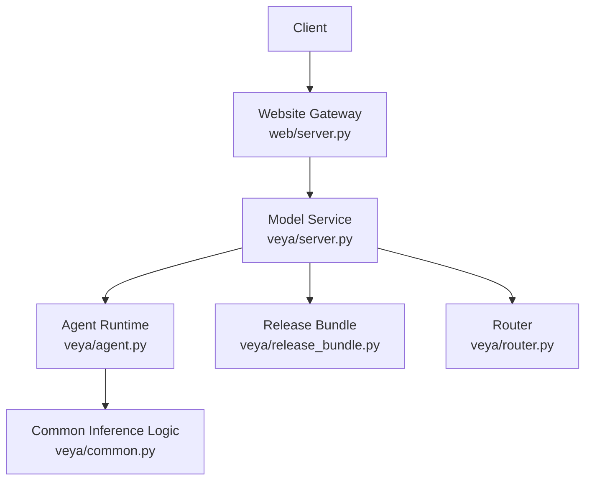
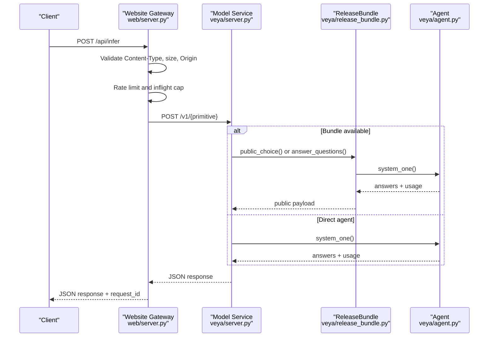
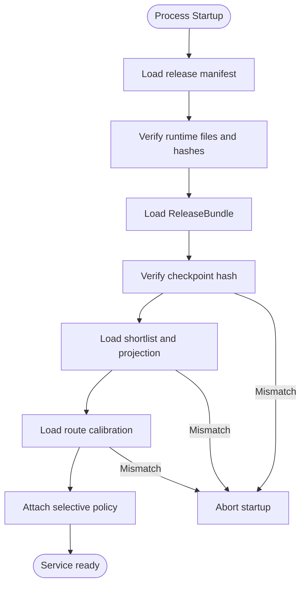
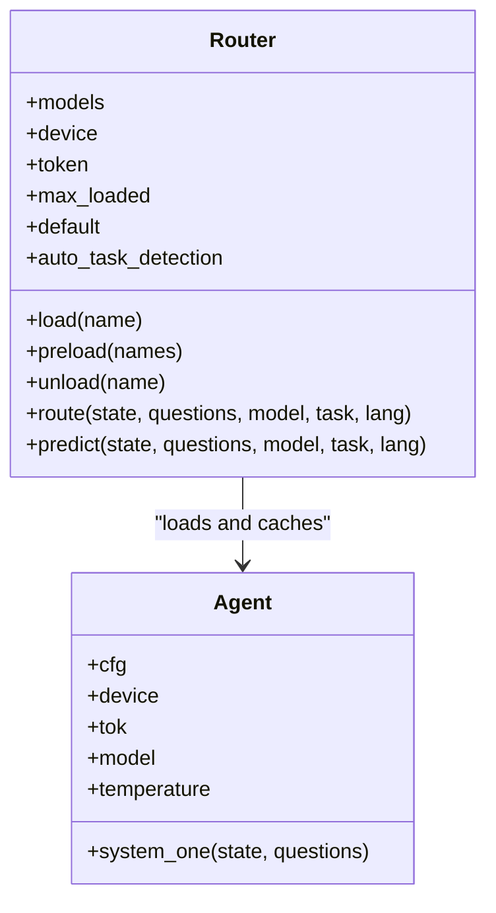
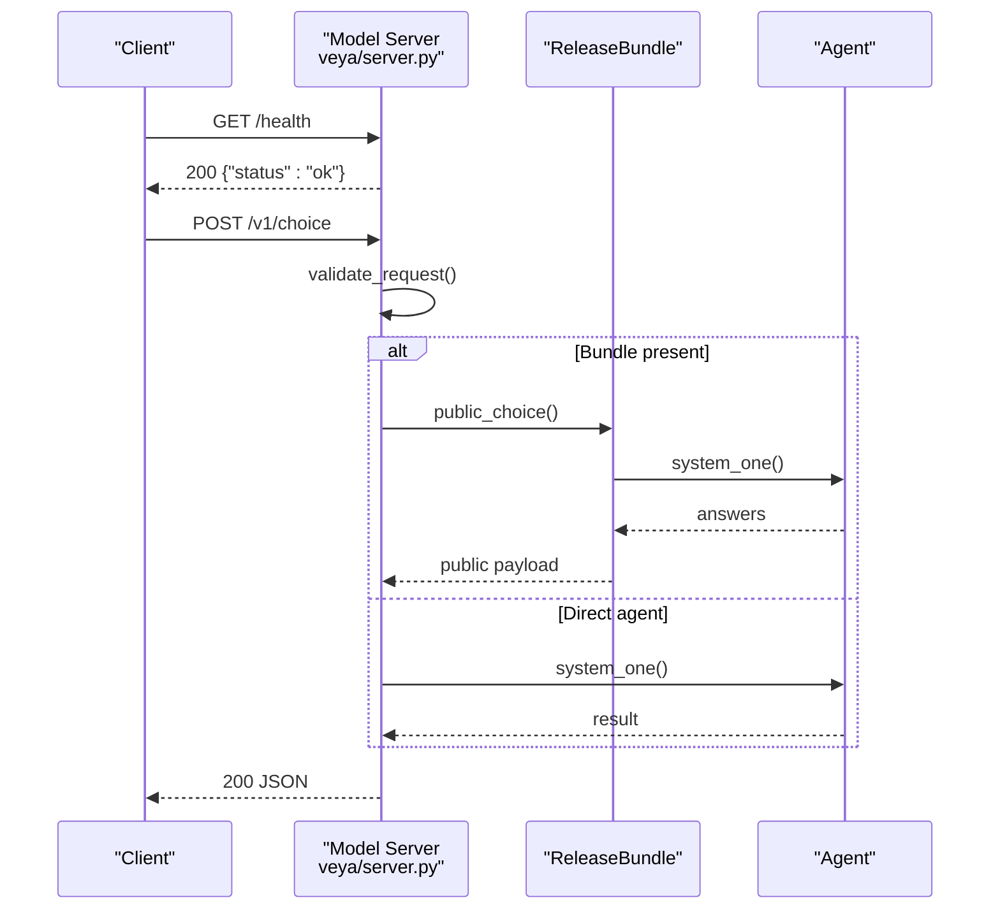
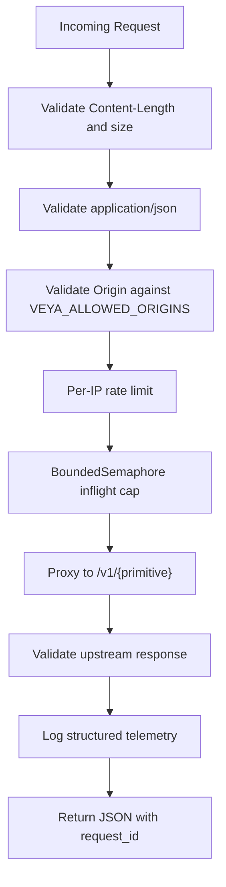
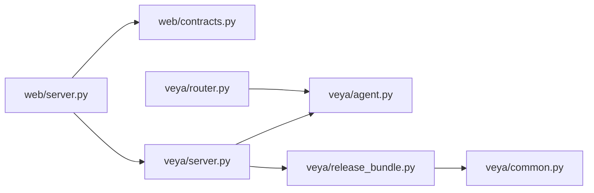

# Deployment & Operations

<cite>
**Referenced Files in This Document**
- [README.md](file://README.md)
- [veya/server.py](file://veya/server.py)
- [web/model_server.py](file://web/model_server.py)
- [web/server.py](file://web/server.py)
- [veya/router.py](file://veya/router.py)
- [veya/agent.py](file://veya/agent.py)
- [veya/release_bundle.py](file://veya/release_bundle.py)
- [veya/common.py](file://veya/common.py)
- [veya/manifest.py](file://veya/manifest.py)
- [docs/commercialization/SCOPING_PLAN.md](file://docs/commercialization/SCOPING_PLAN.md)
</cite>

## Table of Contents
1. [Introduction](#introduction)
2. [Project Structure](#project-structure)
3. [Core Components](#core-components)
4. [Architecture Overview](#architecture-overview)
5. [Detailed Component Analysis](#detailed-component-analysis)
6. [Dependency Analysis](#dependency-analysis)
7. [Performance Considerations](#performance-considerations)
8. [Troubleshooting Guide](#troubleshooting-guide)
9. [Conclusion](#conclusion)
10. [Appendices](#appendices)

## Introduction
This document provides production-focused deployment and operations guidance for Veya. It covers model management, version control, single-model and multi-model routing strategies, monitoring and observability, capacity planning, scaling, security hardening, access control, compliance considerations, and operational troubleshooting.

Veya is a non-autoregressive typed-decision system that evaluates structured questions such as choice, score, and noul without generating text. The repository ships:
- A lightweight HTTP inference server for a loaded agent or release bundle.
- A website gateway that validates requests, rate-limits traffic, proxies to the model service, and exposes health and benchmark endpoints.
- A router that selects between English, multilingual, and typed-decisions checkpoints based on language, script, or explicit configuration.
- A release bundle loader that verifies hashes, calibration artifacts, shortlist projections, and selective policies before serving.

The audited release status indicates that the English Choice path is a research release; several other routes remain research-only. Production deployments should treat confidence scores as calibrated probabilities but not as guarantees, and should gate automated actions with organizational policy.

**Section sources**
- [README.md:27-46](file://README.md#L27-L46)
- [README.md:161-187](file://README.md#L161-L187)

## Project Structure
At a high level, production operation centers around two Python services:
- Model service: loads a checkpoint or release bundle and serves `/v1/*` inference endpoints.
- Website gateway: serves the public site, enforces request contracts, applies rate limits, and forwards validated requests to the model service.

**Diagram sources**
- [web/server.py:32-51](file://web/server.py#L32-L51)
- [veya/server.py:137-242](file://veya/server.py#L137-L242)
- [veya/agent.py:101-416](file://veya/agent.py#L101-L416)
- [veya/release_bundle.py:127-392](file://veya/release_bundle.py#L127-L392)
- [veya/router.py:123-337](file://veya/router.py#L123-L337)
- [veya/common.py:114-172](file://veya/common.py#L114-L172)

**Section sources**
- [web/server.py:32-91](file://web/server.py#L32-L91)
- [veya/server.py:1-17](file://veya/server.py#L1-L17)

## Core Components
- **Agent**: Loads a Veya checkpoint, resolves device and dtype, builds the encoder and decision head, applies calibration, and evaluates typed questions in one forward pass.
- **Router**: Lazily loads and caches multiple checkpoints, detects language/script, and dispatches requests to the appropriate model. Supports preload, LRU eviction, and explicit overrides.
- **ReleaseBundle**: Verifies and loads a frozen release manifest, including checkpoint hash, shortlist artifact, route calibration, and optional reranker/hypothesis components. Provides packed and hierarchical choice paths.
- **Model Server**: Stdlib HTTP server exposing `/health`, `/version`, `/v1/choice`, `/v1/score`, `/v1/noul`, `/v1/systemone`, and experimental hypothesis endpoints. Serializes inference through an internal lock.
- **Website Gateway**: Public-facing HTTP server that validates payloads, enforces origin and content-type rules, rate-limits by IP, caps concurrent inflight requests, proxies to the model service, and logs telemetry.

Key operational responsibilities:
- Preload models in production to avoid cold-start latency.
- Pin and verify release artifacts using manifests.
- Route traffic by language or explicitly select a model.
- Monitor health, latency, deferred decisions, and upstream contract errors.
- Harden inputs, responses, and network exposure.

**Section sources**
- [veya/agent.py:101-263](file://veya/agent.py#L101-L263)
- [veya/router.py:123-337](file://veya/router.py#L123-L337)
- [veya/release_bundle.py:127-392](file://veya/release_bundle.py#L127-L392)
- [veya/server.py:137-242](file://veya/server.py#L137-L242)
- [web/server.py:238-647](file://web/server.py#L238-L647)

## Architecture Overview
The recommended production topology separates the website gateway from the model service. The gateway handles public ingress, validation, rate limiting, and telemetry. The model service runs locally or behind a private load balancer and owns the model runtime.

**Diagram sources**
- [web/server.py:408-647](file://web/server.py#L408-L647)
- [veya/server.py:163-234](file://veya/server.py#L163-L234)
- [veya/release_bundle.py:260-392](file://veya/release_bundle.py#L260-L392)
- [veya/agent.py:291-416](file://veya/agent.py#L291-L416)

## Detailed Component Analysis

### Model Management and Version Control
Veya supports both direct SDK loading and audited release bundles. For production, prefer the release bundle path because it verifies file hashes, calibration artifacts, and router parameters before serving.

- **Direct SDK mode**: `veya.load()` downloads or loads a local checkpoint, fixes tokenizer compatibility, builds the model, verifies weight shapes, applies calibration, and falls back to CPU if GPU memory is insufficient.
- **Release bundle mode**: `load_release_manifest()` validates the manifest format, resolves relative paths safely, verifies every runtime file, loads the checkpoint, router, shortlist, and route calibration, then attaches the selective policy. Mismatched hashes cause startup failure.
- **Manifest builder**: `build_manifest()` computes architecture metadata and weights hash for a model directory.

Operational recommendations:
- Store release manifests alongside frozen artifacts.
- Pin `VEYA_DEVICE` and ensure the process has read-only access to the release root.
- Use `VEYA_MODEL_URL` to point the website gateway at the model service.
- Expose `/health` and `/version` for liveness and readiness probes.

**Diagram sources**
- [veya/release_bundle.py:428-502](file://veya/release_bundle.py#L428-L502)
- [veya/manifest.py:19-39](file://veya/manifest.py#L19-L39)

**Section sources**
- [veya/agent.py:117-263](file://veya/agent.py#L117-L263)
- [veya/release_bundle.py:395-502](file://veya/release_bundle.py#L395-L502)
- [veya/manifest.py:1-39](file://veya/manifest.py#L1-L39)

### Single-Model Deployment
Use single-model mode when your pipeline requires only one checkpoint, such as English Choice or a dedicated fine-tuned variant.

- Load the agent directly via `veya.load()` or instantiate `Agent`.
- Run all typed questions in one forward pass through `system_one`.
- Prefer preloading the agent in long-lived processes to avoid repeated initialization.
- If you need GPU acceleration, set `device="cuda"` and ensure sufficient VRAM.

Single-model characteristics:
- Lower memory footprint than multi-model routing.
- No automatic language detection overhead.
- You must configure question schemas and confidence thresholds yourself.

**Section sources**
- [README.md:190-210](file://README.md#L190-L210)
- [veya/agent.py:101-263](file://veya/agent.py#L101-L263)
- [veya/agent.py:291-416](file://veya/agent.py#L291-L416)

### Multi-Model Routing Deployment
Use the `Router` when you serve mixed-language or mixed-task traffic and want automatic checkpoint selection.

Routing precedence:
1. Explicit `model` override.
2. Explicit `task` override.
3. Optional auto task detection for typed-decisions workflows.
4. Explicit `lang` override.
5. Script and language detection.
6. Default model.

Production guidance:
- Set `preload=True` or call `router.preload()` to keep required checkpoints resident.
- Tune `max_loaded` to balance memory and cold-start risk.
- Attach externally built agents to avoid duplicate parameter copies.
- Inspect `routing.model`, `routing.reason`, and `routing.detection` for auditability.

**Diagram sources**
- [veya/router.py:123-337](file://veya/router.py#L123-L337)
- [veya/agent.py:101-416](file://veya/agent.py#L101-L416)

**Section sources**
- [veya/router.py:1-121](file://veya/router.py#L1-L121)
- [veya/router.py:123-337](file://veya/router.py#L123-L337)

### HTTP API Surface
The model service exposes a minimal, stdlib-based HTTP API.

Endpoints:
- `GET /health`: returns `{"status": "ok"}`.
- `GET /version`: returns model version, checkpoint, calibration metadata, and release information when a bundle is loaded.
- `POST /v1/choice`: evaluates a choice question. With a bundle, uses the packed or hierarchical shortlist path.
- `POST /v1/score`: evaluates an ordinal score question.
- `POST /v1/noul`: evaluates a binary probability question.
- `POST /v1/systemone`: evaluates multiple questions in one call.
- Experimental endpoints: `/v1/choice-hypothesis` and `/v1/choice-compare` when a hypothesis scorer is attached.

Request handling:
- Strict JSON parsing with duplicate-key rejection.
- Request size limit enforced.
- Inference serialized through an internal lock to avoid unsafe concurrent calls.
- Responses include `calibration_version`, `decision`, `answer`, `probabilities`, `confidence`, and `usage`.

**Diagram sources**
- [veya/server.py:137-234](file://veya/server.py#L137-L234)
- [veya/release_bundle.py:260-392](file://veya/release_bundle.py#L260-L392)
- [veya/agent.py:291-416](file://veya/agent.py#L291-L416)

**Section sources**
- [veya/server.py:1-17](file://veya/server.py#L1-L17)
- [veya/server.py:137-242](file://veya/server.py#L137-L242)

### Website Gateway and Observability
The website gateway is intended for public-facing use cases where you need request validation, rate limiting, and telemetry.

Key behaviors:
- Validates `Content-Type`, request size, and allowed origins.
- Applies per-IP sliding-window rate limiting with weighted cost for large candidate sets.
- Caps concurrent upstream calls with a bounded semaphore.
- Proxies to `/v1/{primitive}` on the configured model URL.
- Adds `request_id`, `gateway_latency_ms`, and selected version fields to responses.
- Logs structured telemetry including primitive, candidate count, route, deferred status, latency, model version, and error code.

Environment variables:
- `VEYA_MODEL_URL`: upstream model service URL.
- `VEYA_MODEL_TOKEN`: optional Bearer token forwarded to the model service.
- `VEYA_WEB_PORT`, `VEYA_WEB_HOST`, `VEYA_PUBLIC_ORIGIN`: web server binding and CORS policy.
- `VEYA_ALLOWED_ORIGINS`: additional allowed origins.

**Diagram sources**
- [web/server.py:94-114](file://web/server.py#L94-L114)
- [web/server.py:174-206](file://web/server.py#L174-L206)
- [web/server.py:408-647](file://web/server.py#L408-L647)

**Section sources**
- [web/server.py:32-91](file://web/server.py#L32-L91)
- [web/server.py:94-114](file://web/server.py#L94-L114)
- [web/server.py:174-206](file://web/server.py#L174-L206)
- [web/server.py:408-647](file://web/server.py#L408-L647)

### Security Hardening and Access Control
Built-in security controls:
- Input validation: strict JSON parsing, duplicate key rejection, schema checks, and request size limits.
- Output validation: website gateway validates upstream response structure and probability distributions.
- Origin control: website gateway rejects cross-origin requests unless explicitly allowed.
- Response headers: security-related headers are added by the website gateway.
- Token forwarding: optional `Authorization: Bearer` header forwarded to the model service when `VEYA_MODEL_TOKEN` is set.

Compliance-oriented design notes:
- The commercialization scoping plan proposes API keys, OIDC/SAML SSO, RBAC, immutable audit logs, secrets rotation, data isolation, and compliance targets. These are future-oriented plans rather than current runtime features.
- Current production deployments should place the model service behind a reverse proxy or service mesh that provides TLS termination, authentication, authorization, audit logging, and network isolation.

**Section sources**
- [veya/server.py:114-161](file://veya/server.py#L114-L161)
- [web/server.py:244-268](file://web/server.py#L244-L268)
- [web/server.py:439-452](file://web/server.py#L439-L452)
- [docs/commercialization/SCOPING_PLAN.md:64-83](file://docs/commercialization/SCOPING_PLAN.md#L64-L83)

### Capacity Planning and Scaling
Capacity planning should account for:
- Model size and VRAM requirements.
- Batched throughput versus per-request latency.
- Language switching costs when not preloaded.
- Shortlist projection and reranking overhead in release bundles.
- Website gateway concurrency and rate limits.

Guidelines:
- Preload required checkpoints in long-lived processes.
- Keep `max_loaded` equal to the number of hot models.
- Use GPU instances sized for the largest expected batch and candidate set.
- Scale horizontally by running multiple model service replicas behind a load balancer.
- Use the website gateway’s rate limiter for coarse protection; add external rate limiting at the edge.
- Monitor `/health`, `/version`, latency, deferred decisions, and upstream errors.

**Section sources**
- [README.md:161-187](file://README.md#L161-L187)
- [veya/router.py:133-143](file://veya/router.py#L133-L143)
- [web/server.py:74-83](file://web/server.py#L74-L83)

## Dependency Analysis
The runtime depends on:
- PyTorch and transformers for model loading and inference.
- Hugging Face Hub for remote checkpoint download.
- NumPy for probability and scoring logic.
- Standard library HTTP servers for both model and website services.

Coupling:
- `veya/server.py` depends on `veya/agent.py` and optionally `veya/release_bundle.py`.
- `web/server.py` depends on `web/contracts.py` for request/response validation and proxies to the model service.
- `veya/release_bundle.py` depends on shortlist, calibration, and selective policy modules.
- `veya/router.py` depends on language analysis and `veya/agent.py`.

External integration points:
- Hugging Face Hub for model downloads.
- Optional upstream authentication via `VEYA_MODEL_TOKEN`.
- Reverse proxy or service mesh for TLS, auth, and audit logging.

**Diagram sources**
- [web/server.py:23-30](file://web/server.py#L23-L30)
- [veya/server.py:13-14](file://veya/server.py#L13-L14)
- [veya/release_bundle.py:16-27](file://veya/release_bundle.py#L16-L27)
- [veya/router.py:34](file://veya/router.py#L34)

**Section sources**
- [web/server.py:23-30](file://web/server.py#L23-L30)
- [veya/server.py:13-14](file://veya/server.py#L13-L14)
- [veya/release_bundle.py:16-27](file://veya/release_bundle.py#L16-L27)
- [veya/router.py:34](file://veya/router.py#L34)

## Performance Considerations
- Cold starts dominate when models are not preloaded. Language switches can rebuild checkpoints on every request under lazy loading.
- Preloading eliminates reload latency and makes routing effectively free.
- Batched inference reduces per-question latency; the agent evaluates multiple questions in one forward pass.
- Release bundles may add shortlist embedding and projection steps for high-cardinality choice questions.
- GPU fallback to CPU occurs when memory is insufficient; this significantly increases latency.
- Avoid unnecessary torch compilation flags that can degrade small-batch performance or hang on some platforms.

Operational tuning:
- Set `VEYA_DEVICE=cuda` when GPUs are available.
- Preload all required checkpoints.
- Limit candidate counts per request to reduce token and compute pressure.
- Monitor input tokens and latency from telemetry and response fields.

**Section sources**
- [README.md:161-187](file://README.md#L161-L187)
- [veya/agent.py:198-204](file://veya/agent.py#L198-L204)
- [veya/agent.py:238-263](file://veya/agent.py#L238-L263)
- [veya/release_bundle.py:153-198](file://veya/release_bundle.py#L153-L198)

## Troubleshooting Guide

### Health and Readiness Failures
Symptoms:
- `/health` returns non-ok or times out.
- Website gateway reports `model_unavailable`.

Checks:
- Confirm the model service is running and reachable at `VEYA_MODEL_URL`.
- Verify `/version` returns expected metadata.
- Ensure the release manifest and artifacts exist and have correct hashes.

**Section sources**
- [veya/server.py:163-170](file://veya/server.py#L163-L170)
- [web/server.py:334-346](file://web/server.py#L334-L346)

### Invalid Input or Schema Errors
Symptoms:
- 400 responses with `invalid_input` or `invalid_schema`.
- Upstream returns `defer_reason`.

Checks:
- Validate `Content-Type` is `application/json`.
- Ensure state is non-empty and questions contain required fields.
- For choice questions, ensure criteria are valid and within head length limits.

**Section sources**
- [web/server.py:421-443](file://web/server.py#L421-L443)
- [veya/server.py:114-134](file://veya/server.py#L114-L134)
- [veya/agent.py:264-289](file://veya/agent.py#L264-L289)

### Rate Limiting and Overload
Symptoms:
- 429 responses with `rate_limited` and `retry_after`.
- 503 responses with `model_busy`.

Checks:
- Reduce request rate or increase client-side retry backoff.
- Increase upstream concurrency only if GPU/CPU resources allow.
- Review candidate count weighting; large choice sets cost more capacity.

**Section sources**
- [web/server.py:174-206](file://web/server.py#L174-L206)
- [web/server.py:496-508](file://web/server.py#L496-L508)

### Model Rejection or Deferred Decisions
Symptoms:
- Upstream returns `decision=defer` or `defer_reason`.
- Website gateway maps upstream 4xx to `model_rejected`.

Checks:
- Inspect `defer_reason` for invalid schema or policy blocks.
- Review selective policy and automation thresholds if using release bundles.
- Apply business-level confidence gating for automated actions.

**Section sources**
- [web/server.py:550-572](file://web/server.py#L550-L572)
- [veya/release_bundle.py:260-323](file://veya/release_bundle.py#L260-L323)

### Timeout and Unstable Upstream
Symptoms:
- 504 timeout or 503 model unavailable.
- 502 invalid upstream response.

Checks:
- Increase or tune upstream timeout.
- Validate upstream response shape and probability distributions.
- Add retries with exponential backoff at the client layer.

**Section sources**
- [web/server.py:601-635](file://web/server.py#L601-L635)

### GPU Memory Exhaustion
Symptoms:
- Warning about GPU memory exceeded.
- Automatic fallback to CPU with higher latency.

Checks:
- Reduce batch size or candidate count.
- Ensure sufficient VRAM for the chosen checkpoint and device.
- Avoid mixing multiple large checkpoints unless necessary.

**Section sources**
- [veya/agent.py:338-361](file://veya/agent.py#L338-L361)
- [veya/agent.py:238-263](file://veya/agent.py#L238-L263)

## Conclusion
For production, deploy Veya as a separated model service behind a validated gateway. Use release bundles to pin and verify artifacts, preload required checkpoints, and expose health and version endpoints. Route traffic explicitly or through the router based on language and task. Enforce input/output contracts, rate limits, and origin controls. Monitor latency, deferred decisions, and upstream errors. Treat confidence as calibrated but not absolute, and apply organizational automation policies.

[No sources needed since this section summarizes without analyzing specific files]

## Appendices

### Environment Variables Reference
- `VEYA_DEVICE`: device for model loading in the website model server entrypoint.
- `VEYA_MODEL_PORT`: port for the audited model service.
- `VEYA_MODEL_URL`: upstream model service URL for the website gateway.
- `VEYA_MODEL_TOKEN`: optional Bearer token forwarded to the model service.
- `VEYA_WEB_PORT`, `VEYA_WEB_HOST`, `VEYA_PUBLIC_ORIGIN`: website server binding and CORS policy.
- `VEYA_ALLOWED_ORIGINS`: additional allowed origins for cross-origin requests.

**Section sources**
- [web/model_server.py:9-17](file://web/model_server.py#L9-L17)
- [web/server.py:32-51](file://web/server.py#L32-L51)
- [web/server.py:94-114](file://web/server.py#L94-L114)

### Operational Checklist
- [ ] Pin release manifest and artifacts.
- [ ] Verify `/health` and `/version`.
- [ ] Preload required checkpoints.
- [ ] Configure `VEYA_DEVICE` and GPU sizing.
- [ ] Enable rate limiting and origin validation.
- [ ] Collect telemetry and alert on timeouts, 429s, 502s, and deferred decisions.
- [ ] Apply confidence gating and automation policies.
- [ ] Place model service behind TLS and authentication at the edge.

[No sources needed since this section provides general guidance]