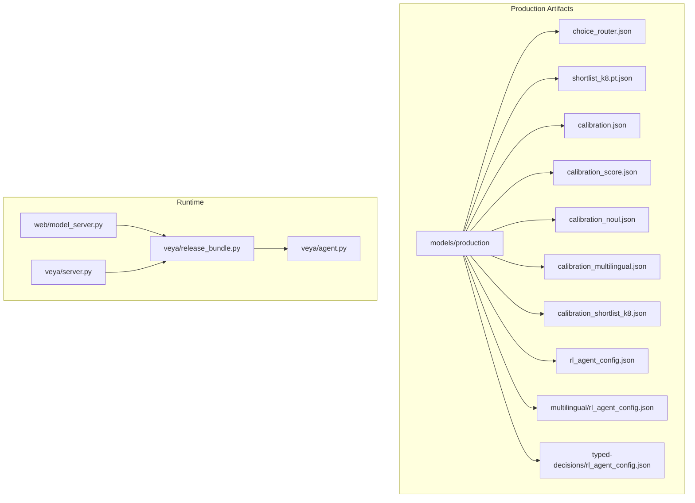
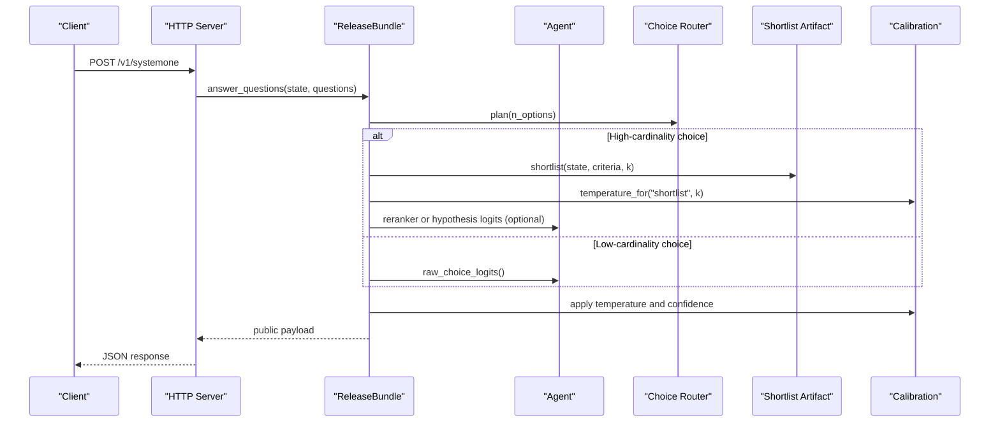
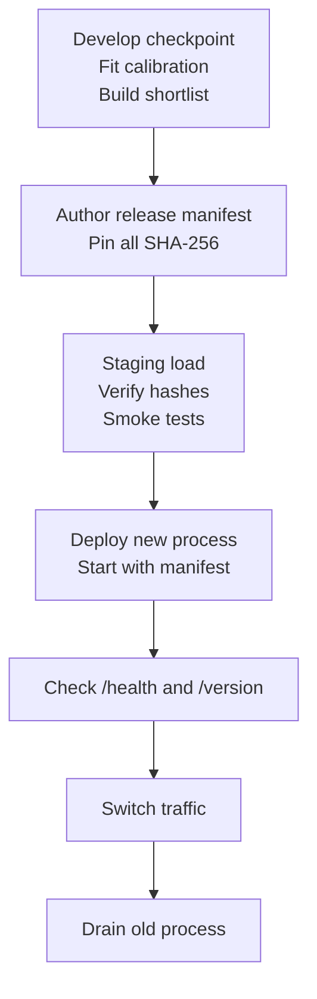
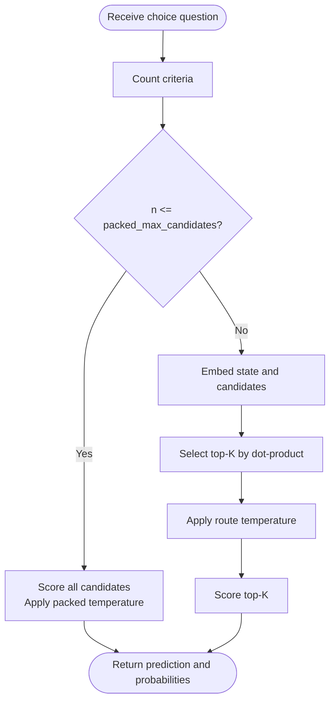
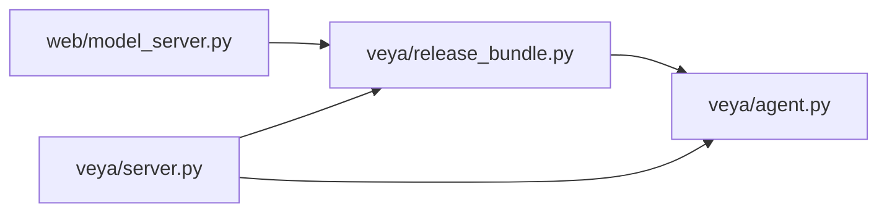

# Model Management

<cite>
**Referenced Files in This Document**
- [README.md](file://README.md)
- [agent.py](file://veya/agent.py)
- [release_bundle.py](file://veya/release_bundle.py)
- [server.py](file://veya/server.py)
- [model_server.py](file://web/model_server.py)
- [calibration.json](file://models/production/calibration.json)
- [rl_agent_config.json](file://models/production/rl_agent_config.json)
- [multilingual_rl_agent_config.json](file://models/production/multilingual/rl_agent_config.json)
- [typed_decisions_rl_agent_config.json](file://models/production/typed-decisions/rl_agent_config.json)
- [choice_router.json](file://models/production/choice_router.json)
- [shortlist_k8.pt.json](file://models/production/shortlist_k8.pt.json)
- [calibration_score.json](file://models/production/calibration_score.json)
- [calibration_multilingual.json](file://models/production/calibration_multilingual.json)
- [calibration_noul.json](file://models/production/calibration_noul.json)
- [calibration_shortlist_k8.json](file://models/production/calibration_shortlist_k8.json)
</cite>

## Table of Contents
1. [Introduction](#introduction)
2. [Project Structure](#project-structure)
3. [Core Components](#core-components)
4. [Architecture Overview](#architecture-overview)
5. [Detailed Component Analysis](#detailed-component-analysis)
6. [Dependency Analysis](#dependency-analysis)
7. [Performance Considerations](#performance-considerations)
8. [Troubleshooting Guide](#troubleshooting-guide)
9. [Conclusion](#conclusion)
10. [Appendices](#appendices)

## Introduction
This document explains how to manage Veya models in production environments. It covers model versioning, registry organization, lifecycle management from development through deployment, configuration formats, calibration parameters, routing behavior, release packaging, dependency handling, zero-downtime updates, storage and backup strategies, and disaster recovery procedures. The guidance is grounded in the repository’s production artifacts and runtime code.

Veya ships audited decision models with typed primitives: choice, score, and noul. Production deployments typically use a release bundle that binds a checkpoint, router, shortlist artifact, route calibration, selective policy, and manifest together. Calibration temperatures are applied per primitive and cardinality bucket, while high-cardinality choice questions can be routed through a learned K=8 shortlist before packed scoring.

## Project Structure
The production model surface consists of:
- Checkpoint directories under `models/production`, including English, multilingual, and typed-decisions variants.
- Routing and calibration manifests under `models/production`.
- A release bundle loader that validates hashes and wires components at startup.
- An HTTP server exposing inference endpoints for single-primitive calls and batched system-one calls.
- A web entry point that loads the audited release manifest and starts the service.

**Diagram sources**
- [release_bundle.py:395-502](file://veya/release_bundle.py#L395-L502)
- [agent.py:101-231](file://veya/agent.py#L101-L231)
- [server.py:137-242](file://veya/server.py#L137-L242)
- [model_server.py:1-18](file://web/model_server.py#L1-L18)
- [choice_router.json:1-13](file://models/production/choice_router.json#L1-L13)
- [shortlist_k8.pt.json:1-174](file://models/production/shortlist_k8.pt.json#L1-L174)
- [calibration.json:1-28](file://models/production/calibration.json#L1-L28)
- [calibration_score.json:1-24](file://models/production/calibration_score.json#L1-L24)
- [calibration_noul.json:1-24](file://models/production/calibration_noul.json#L1-L24)
- [calibration_multilingual.json:1-36](file://models/production/calibration_multilingual.json#L1-L36)
- [calibration_shortlist_k8.json:1-17](file://models/production/calibration_shortlist_k8.json#L1-L17)
- [rl_agent_config.json:1-33](file://models/production/rl_agent_config.json#L1-L33)
- [multilingual_rl_agent_config.json:1-26](file://models/production/multilingual/rl_agent_config.json#L1-L26)
- [typed_decisions_rl_agent_config.json:1-36](file://models/production/typed-decisions/rl_agent_config.json#L1-L36)

**Section sources**
- [README.md:27-55](file://README.md#L27-L55)
- [README.md:161-187](file://README.md#L161-L187)
- [README.md:190-210](file://README.md#L190-L210)
- [README.md:372-394](file://README.md#L372-L394)

## Core Components
- Agent: Loads a Veya checkpoint, applies tokenizer and encoder, verifies weight compatibility, resolves device and dtype, and runs batched inference across typed questions.
- ReleaseBundle: Binds a checkpoint, router, shortlist projection, route calibration, and optional selective policy; selects between packed and shortlist routes for high-cardinality choice questions; exposes public answer payloads.
- Server: Exposes HTTP endpoints for health, version, single-primitive inference, and batched system-one calls; serializes inference with an internal lock.
- Web model server: Loads the audited release manifest and starts the service on a configurable port.

Key responsibilities:
- Versioning: Manifests and artifacts carry hashes, IDs, and timestamps.
- Routing: Router decides whether to pack all candidates or shortlist top-K.
- Calibration: Temperatures are applied per primitive and cardinality bucket; route-specific temperature is used for shortlist path.
- Safety: Request validation, schema checks, and defer reasons protect against invalid inputs.

**Section sources**
- [agent.py:101-231](file://veya/agent.py#L101-L231)
- [agent.py:291-416](file://veya/agent.py#L291-L416)
- [release_bundle.py:127-392](file://veya/release_bundle.py#L127-L392)
- [server.py:137-242](file://veya/server.py#L137-L242)
- [model_server.py:1-18](file://web/model_server.py#L1-L18)

## Architecture Overview
The production runtime composes several verifiable components:
- Base checkpoint weights and config define the encoder and decision heads.
- Choice router defines packing cutoff and hierarchical shortlist strategy.
- Shortlist artifact provides label set, embedding dimensions, and projection weights bound to a specific checkpoint hash.
- Route calibration provides the temperature for the shortlist path.
- Packed calibration overlays cardinality-aware temperatures onto the agent.
- Selective policy gates automation decisions for shortlisted choices.
- Manifest ties everything together with SHA-256 hashes and metadata.

**Diagram sources**
- [release_bundle.py:208-392](file://veya/release_bundle.py#L208-L392)
- [server.py:183-231](file://veya/server.py#L183-L231)
- [choice_router.json:1-13](file://models/production/choice_router.json#L1-L13)
- [shortlist_k8.pt.json:1-174](file://models/production/shortlist_k8.pt.json#L1-L174)
- [calibration_shortlist_k8.json:1-17](file://models/production/calibration_shortlist_k8.json#L1-L17)

## Detailed Component Analysis

### Model Versioning and Registry Organization
- Checkpoints: Each variant has its own directory and `rl_agent_config.json` describing encoder, context length, head length, and temperature settings.
- Routing registry: `choice_router.json` declares format, version, packed cutoff, hierarchical K, route name, embed length, query/candidate text fields, retired strategies, and evidence reference.
- Shortlist registry: `shortlist_k8.pt.json` declares format, route, K, seed, checkpoint binding, embedding dimensions, labels, label texts, creation timestamp, file hash, embed length, training rows, and text mapping fields.
- Calibration registry: Multiple calibration files exist for different primitives and routes, each declaring format, method, sample counts, fitting split, scorer ID, and checksums.

Best practices:
- Keep one canonical release manifest per deployment environment.
- Pin all artifacts by SHA-256 in the manifest.
- Store checkpoints, router, shortlist, and calibrations in immutable storage with signed manifests.

**Section sources**
- [rl_agent_config.json:1-33](file://models/production/rl_agent_config.json#L1-L33)
- [multilingual_rl_agent_config.json:1-26](file://models/production/multilingual/rl_agent_config.json#L1-L26)
- [typed_decisions_rl_agent_config.json:1-36](file://models/production/typed-decisions/rl_agent_config.json#L1-L36)
- [choice_router.json:1-13](file://models/production/choice_router.json#L1-L13)
- [shortlist_k8.pt.json:1-174](file://models/production/shortlist_k8.pt.json#L1-L174)
- [calibration.json:1-28](file://models/production/calibration.json#L1-L28)
- [calibration_score.json:1-24](file://models/production/calibration_score.json#L1-L24)
- [calibration_noul.json:1-24](file://models/production/calibration_noul.json#L1-L24)
- [calibration_multilingual.json:1-36](file://models/production/calibration_multilingual.json#L1-L36)
- [calibration_shortlist_k8.json:1-17](file://models/production/calibration_shortlist_k8.json#L1-L17)

### Lifecycle Management: Development to Deployment
Development:
- Train or fine-tune a checkpoint and produce `rl_agent_config.json`.
- Fit calibration artifacts per primitive and cardinality bucket using held-out data.
- Build shortlist projections bound to the checkpoint hash.
- Author a release manifest enumerating all runtime files and their hashes.

Deployment:
- Start the web model server with the release manifest.
- The server loads the bundle, verifies all hashes, attaches calibrated temperatures, and serves requests.
- Use `/health` and `/version` endpoints for readiness and observability.

Zero-downtime update procedure:
- Deploy a new process with the updated manifest and bundle.
- Switch traffic after `/health` returns ok and `/version` shows the expected release metadata.
- Gracefully terminate the old process once drained.

[No sources needed since this diagram shows conceptual workflow, not actual code structure]

**Section sources**
- [model_server.py:1-18](file://web/model_server.py#L1-L18)
- [release_bundle.py:428-502](file://veya/release_bundle.py#L428-L502)
- [server.py:163-170](file://veya/server.py#L163-L170)

### Model Configuration Format
`rl_agent_config.json` includes:
- Encoder identifier and head depth.
- Context lengths (`max_len`, `head_max_len`).
- Prefix limits and cost settings.
- Mixed precision dtype.
- Temperature arrays and per-option buckets.
- Training metadata such as updates, epochs, hours, world size, and fine-tuning flags.

Variants:
- English production uses ModernBERT-large with 512 context and tuned per-bucket temperatures.
- Multilingual uses mmBERT-base with 1024 context and default unit temperatures.
- Typed-decisions uses ModernBERT-large with 1024 context and additional training flags.

Operational implications:
- Larger context increases memory and latency.
- Per-option temperatures affect calibration quality and should be pinned via calibration artifacts.

**Section sources**
- [rl_agent_config.json:1-33](file://models/production/rl_agent_config.json#L1-L33)
- [multilingual_rl_agent_config.json:1-26](file://models/production/multilingual/rl_agent_config.json#L1-L26)
- [typed_decisions_rl_agent_config.json:1-36](file://models/production/typed-decisions/rl_agent_config.json#L1-L36)

### Calibration Parameters
Calibration artifacts provide:
- Method: temperature-NLL minimization.
- Global temperature and primitive-level temperatures.
- Cardinality buckets such as `choice:3-5`, `choice:11+`, `score:3-5`, `noul:2`.
- Sample counts and fitting splits.
- Scorer identity and checkpoint bindings.

Packed vs route calibration:
- Packed calibration overlays temperatures onto the agent for standard paths.
- Route calibration provides a separate temperature for the shortlist path.

Usage:
- The release loader applies packed calibration to the agent.
- The bundle selects the route temperature when using the shortlist path.

**Section sources**
- [calibration.json:1-28](file://models/production/calibration.json#L1-L28)
- [calibration_score.json:1-24](file://models/production/calibration_score.json#L1-L24)
- [calibration_noul.json:1-24](file://models/production/calibration_noul.json#L1-L24)
- [calibration_multilingual.json:1-36](file://models/production/calibration_multilingual.json#L1-L36)
- [calibration_shortlist_k8.json:1-17](file://models/production/calibration_shortlist_k8.json#L1-L17)
- [release_bundle.py:479-490](file://veya/release_bundle.py#L479-L490)

### Routing Configurations
The choice router controls:
- Packing cutoff: below which all candidates are scored in one pass.
- Hierarchical K: number of candidates selected by the shortlist projection.
- Route name: identifies the shortlist strategy.
- Embedding max length: maximum token length for candidate embeddings.
- Query and candidate text fields: how state and options are represented.
- Retired strategies: deprecated routes kept for audit history.

Routing decision logic:
- If the number of options is less than or equal to the packed cutoff, use the packed path.
- Otherwise, project state and candidates, select top-K, then score those candidates with the route temperature.

**Diagram sources**
- [release_bundle.py:84-89](file://veya/release_bundle.py#L84-L89)
- [release_bundle.py:172-198](file://veya/release_bundle.py#L172-L198)
- [release_bundle.py:208-258](file://veya/release_bundle.py#L208-L258)
- [choice_router.json:1-13](file://models/production/choice_router.json#L1-L13)

**Section sources**
- [choice_router.json:1-13](file://models/production/choice_router.json#L1-L13)
- [release_bundle.py:84-89](file://veya/release_bundle.py#L84-L89)
- [release_bundle.py:172-198](file://veya/release_bundle.py#L172-L198)
- [release_bundle.py:208-258](file://veya/release_bundle.py#L208-L258)

### Packaging Models Using Release Bundles
A release bundle binds:
- Base checkpoint directory and weights.
- Router configuration.
- Shortlist artifact and projection.
- Route calibration.
- Optional selective policy.
- Manifest with SHA-256 hashes for every runtime file.

Startup flow:
- Load manifest and verify all relative paths and hashes.
- Ensure model config belongs to the selected base checkpoint.
- Load router, shortlist, and route calibration.
- Apply packed calibration to the agent.
- Attach selective policy if present.

Security and integrity:
- Path resolution prevents escaping the release root.
- Hash mismatches abort startup.
- Bundle metadata exposes architecture version, reranker identity, and release status.

**Section sources**
- [release_bundle.py:33-56](file://veya/release_bundle.py#L33-L56)
- [release_bundle.py:395-425](file://veya/release_bundle.py#L395-L425)
- [release_bundle.py:428-502](file://veya/release_bundle.py#L428-L502)
- [server.py:57-111](file://veya/server.py#L57-L111)

### Managing Model Dependencies
Dependencies include:
- Tokenizer files under the checkpoint’s tokenizer directory.
- Encoder weights under the checkpoint’s encoder directory.
- Calibration artifacts for packed and route paths.
- Shortlist artifact with matching checkpoint hash.
- Selective policy artifact bound to checkpoint and shortlist hashes.

Recommendations:
- Pin exact versions of Python, PyTorch, transformers, and safetensors.
- Download only required subfolders to reduce bandwidth and attack surface.
- Validate compatibility during Agent initialization and reject incompatible configs or missing prefixes.

**Section sources**
- [agent.py:117-146](file://veya/agent.py#L117-L146)
- [agent.py:148-196](file://veya/agent.py#L148-L196)
- [release_bundle.py:455-478](file://veya/release_bundle.py#L455-L478)

### Handling Model Updates Without Service Interruption
Recommended approach:
- Run multiple processes behind a load balancer.
- Roll out new bundles incrementally by replacing instances.
- Use `/health` to gate traffic and `/version` to confirm rollout.
- Keep the previous bundle active until metrics confirm stability.

Operational notes:
- Inference is serialized internally to avoid concurrent GPU issues.
- Preloading checkpoints reduces cold-start latency but increases memory usage.
- For multi-language workloads, preload only the checkpoints you serve.

**Section sources**
- [README.md:161-187](file://README.md#L161-L187)
- [server.py:1-7](file://veya/server.py#L1-L7)
- [server.py:163-170](file://veya/server.py#L163-L170)

### Best Practices for Model Storage, Backup, and Disaster Recovery
Storage:
- Store checkpoints, tokenizer, encoder, router, shortlist, and calibration artifacts in immutable object storage.
- Sign manifests and store signatures separately.
- Maintain separate registries for dev, staging, and prod with strict access controls.

Backup:
- Back up manifests and all referenced artifacts, not just checkpoints.
- Include calibration artifacts and selective policies in backups.
- Record environment variables and deployment metadata alongside backups.

Disaster recovery:
- Restore from the latest signed manifest and verify all hashes before starting.
- If a manifest is corrupted, fall back to the last known-good manifest.
- Monitor `/health` and `/version` after restore to validate service state.

[No sources needed since this section provides general guidance]

## Dependency Analysis
The runtime depends on:
- Agent for model loading, device/dtype resolution, and batched inference.
- ReleaseBundle for routing, shortlisting, calibration selection, and public payload construction.
- Server for request parsing, validation, and endpoint dispatch.
- Web model server for manifest-driven startup.

**Diagram sources**
- [model_server.py:1-18](file://web/model_server.py#L1-L18)
- [release_bundle.py:395-502](file://veya/release_bundle.py#L395-L502)
- [agent.py:101-231](file://veya/agent.py#L101-L231)
- [server.py:137-242](file://veya/server.py#L137-L242)

**Section sources**
- [model_server.py:1-18](file://web/model_server.py#L1-L18)
- [release_bundle.py:395-502](file://veya/release_bundle.py#L395-L502)
- [agent.py:101-231](file://veya/agent.py#L101-L231)
- [server.py:137-242](file://veya/server.py#L137-L242)

## Performance Considerations
- Cold start: Loading a checkpoint costs seconds; language detection is microseconds.
- Latency: Single-question latency is approximately 32.8 ms on GPU; CPU is significantly slower.
- Memory: Preloading multiple checkpoints increases resident memory; tune `max_loaded` and unload unused models.
- Batch throughput: Throughput scales with batch size; measure on target hardware.
- Context length: Larger `max_len` and `head_max_len` increase memory and latency.
- Shortlist path: Reduces computation for high-cardinality choice questions by scoring only top-K candidates.

**Section sources**
- [README.md:161-187](file://README.md#L161-L187)
- [README.md:277-284](file://README.md#L277-L284)
- [README.md:388-394](file://README.md#L388-L394)

## Troubleshooting Guide
Common issues and resolutions:
- Incompatible model config or weights: Ensure the checkpoint contains required keys and parameter prefixes; shape mismatches indicate wrong architecture.
- Missing tokenizer or encoder files: Verify the checkpoint directory structure matches Veya expectations.
- Calibration mismatch: Calibration artifacts must match the checkpoint hash and scorer identity.
- Router mismatch: Router K and packed cutoff must align with production shortlist and manifest.
- Request too large or invalid JSON: Enforce request size limits and validate schemas before inference.
- Device fallback: If CUDA/MPS is unavailable or OOM occurs, the runtime falls back to CPU with warnings.

Operational checks:
- Use `/health` to verify liveness.
- Use `/version` to inspect model version, encoder, calibration version, architecture version, and release metadata.
- Inspect deferred responses for `defer_reason` when inputs are invalid or blocked.

**Section sources**
- [agent.py:55-99](file://veya/agent.py#L55-L99)
- [agent.py:148-196](file://veya/agent.py#L148-L196)
- [agent.py:238-262](file://veya/agent.py#L238-L262)
- [server.py:114-134](file://veya/server.py#L114-L134)
- [server.py:152-182](file://veya/server.py#L152-L182)
- [server.py:163-170](file://veya/server.py#L163-L170)

## Conclusion
Production model management in Veya centers on verifiable release bundles that bind checkpoints, routers, shortlists, calibrations, and policies under a signed manifest. Versioning is enforced through hashes and IDs; routing adapts to cardinality; calibration ensures reliable probabilities; and the HTTP server provides safe, observable inference endpoints. Following the outlined lifecycle, storage, backup, and disaster recovery practices helps maintain stable, auditable, and resilient model services.

[No sources needed since this section summarizes without analyzing specific files]

## Appendices

### API Endpoints Summary
- GET `/health`: Returns service health.
- GET `/version`: Returns model and release metadata.
- POST `/v1/systemone`: Batched evaluation of typed questions.
- POST `/v1/choice`: Single-choice inference with optional bundle routing.
- POST `/v1/noul`: Binary probability inference.
- POST `/v1/score`: Ordinal categorical inference.

**Section sources**
- [server.py:163-231](file://veya/server.py#L163-L231)

### Configuration Field Reference
- `rl_agent_config.json`: Encoder, head layers, context lengths, prefix limits, costs, dtype, model name, temperatures, temperature-by-options, training metadata.
- `choice_router.json`: Format, version, packed cutoff, hierarchical K, route name, embed length, query/candidate fields, retired strategies, evidence.
- `shortlist_k8.pt.json`: Format, route, K, seed, checkpoint hash, input/output dims, labels, label texts, creation time, file hash, embed length, training rows, text mappings.
- Calibration files: Format, method, global and primitive/cardinality temperatures, sample counts, fitting split, scorer ID, checkpoint/hash bindings.

**Section sources**
- [rl_agent_config.json:1-33](file://models/production/rl_agent_config.json#L1-L33)
- [multilingual_rl_agent_config.json:1-26](file://models/production/multilingual/rl_agent_config.json#L1-L26)
- [typed_decisions_rl_agent_config.json:1-36](file://models/production/typed-decisions/rl_agent_config.json#L1-L36)
- [choice_router.json:1-13](file://models/production/choice_router.json#L1-L13)
- [shortlist_k8.pt.json:1-174](file://models/production/shortlist_k8.pt.json#L1-L174)
- [calibration.json:1-28](file://models/production/calibration.json#L1-L28)
- [calibration_score.json:1-24](file://models/production/calibration_score.json#L1-L24)
- [calibration_noul.json:1-24](file://models/production/calibration_noul.json#L1-L24)
- [calibration_multilingual.json:1-36](file://models/production/calibration_multilingual.json#L1-L36)
- [calibration_shortlist_k8.json:1-17](file://models/production/calibration_shortlist_k8.json#L1-L17)