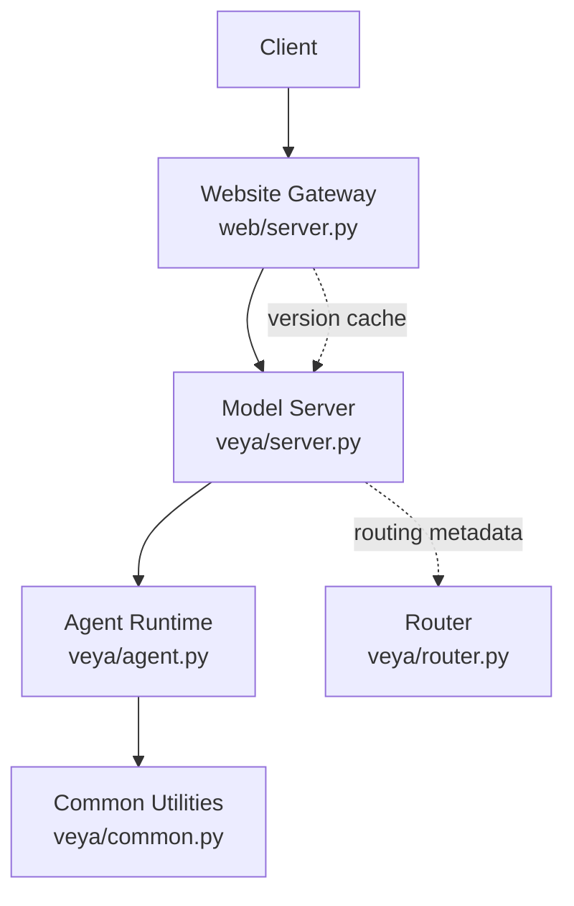
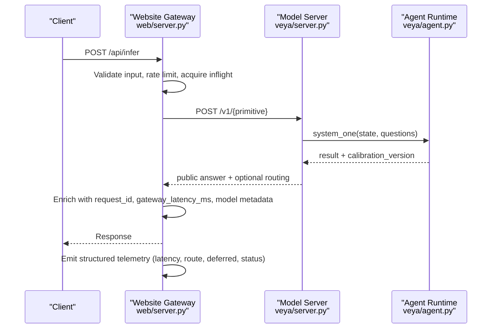
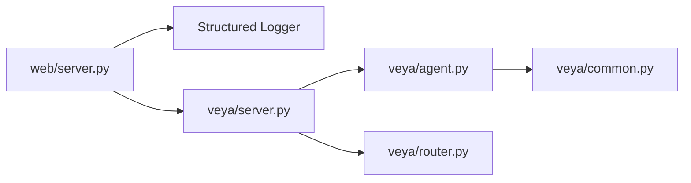

# Monitoring & Observability

<cite>
**Referenced Files in This Document**
- [veya/server.py](file://veya/server.py)
- [web/server.py](file://web/server.py)
- [web/model_server.py](file://web/model_server.py)
- [veya/router.py](file://veya/router.py)
- [veya/agent.py](file://veya/agent.py)
- [veya/common.py](file://veya/common.py)
- [tests/test_model_server_e2e.py](file://tests/test_model_server_e2e.py)
</cite>

## Table of Contents
1. [Introduction](#introduction)
2. [Project Structure](#project-structure)
3. [Core Components](#core-components)
4. [Architecture Overview](#architecture-overview)
5. [Detailed Component Analysis](#detailed-component-analysis)
6. [Dependency Analysis](#dependency-analysis)
7. [Performance Considerations](#performance-considerations)
8. [Troubleshooting Guide](#troubleshooting-guide)
9. [Conclusion](#conclusion)
10. [Appendices](#appendices)

## Introduction
This document explains monitoring and observability for Veya deployments, focusing on:
- Health check endpoints
- Version and capability exposure
- Request telemetry and logging
- Capacity controls and rate limiting
- Performance metrics and latency tracking
- Single-model and multi-model routing visibility
- Alerting guidance, debugging strategies, and dashboard patterns

Veya exposes two primary runtime surfaces:
- A lightweight model server that serves inference endpoints and health/version metadata.
- A website gateway that validates requests, enforces capacity and rate limits, proxies to the model server, and emits structured telemetry.

## Project Structure
The observability surface is implemented across a small set of focused modules:
- Model server: HTTP endpoints for health, version, and inference.
- Website gateway: Public-facing API with validation, rate limiting, timeouts, and telemetry.
- Router: Multi-model routing decisions and per-request routing metadata.
- Agent and common utilities: Inference execution and shared data structures.

**Diagram sources**
- [web/server.py:238-660](file://web/server.py#L238-L660)
- [veya/server.py:137-243](file://veya/server.py#L137-L243)
- [veya/agent.py:101-200](file://veya/agent.py#L101-L200)
- [veya/common.py:1-112](file://veya/common.py#L1-L112)
- [veya/router.py:123-337](file://veya/router.py#L123-L337)

**Section sources**
- [web/server.py:1-90](file://web/server.py#L1-L90)
- [veya/server.py:1-20](file://veya/server.py#L1-L20)

## Core Components
- Health and version endpoints:
  - Model server exposes `/health` and `/version`.
  - Website gateway exposes `/api/health` and `/api/version`, proxying to the model server and adding bounded metadata.
- Telemetry and logging:
  - Website gateway logs structured JSON telemetry per request, including latency, route, deferred status, error codes, and model version.
- Capacity and rate limiting:
  - Per-IP sliding window rate limiter with weighted cost based on primitive type and candidate count.
  - Bounded concurrency via an inflight semaphore.
- Routing visibility:
  - Multi-model routing decisions are recorded in responses when available, enabling dashboards to track model distribution and reasons.

**Section sources**
- [veya/server.py:163-171](file://veya/server.py#L163-L171)
- [web/server.py:334-346](file://web/server.py#L334-L346)
- [web/server.py:209-235](file://web/server.py#L209-L235)
- [web/server.py:174-206](file://web/server.py#L174-L206)
- [web/server.py:496-508](file://web/server.py#L496-L508)
- [veya/router.py:257-331](file://veya/router.py#L257-L331)

## Architecture Overview
The end-to-end request path includes validation, capacity control, upstream proxying, response enrichment, and telemetry emission.

**Diagram sources**
- [web/server.py:408-647](file://web/server.py#L408-L647)
- [veya/server.py:173-234](file://veya/server.py#L173-L234)
- [veya/agent.py:101-200](file://veya/agent.py#L101-L200)

## Detailed Component Analysis

### Health Check Endpoints
- Model server `/health`:
  - Returns a simple status object indicating service readiness.
- Website gateway `/api/health`:
  - Proxies to the model server’s `/health`.
  - Returns 503 with a clear code if the upstream is unhealthy or unreachable.

Operational implications:
- Use `/api/health` for liveness probes at the gateway layer.
- Use `/health` directly for internal checks against the model server.

**Section sources**
- [veya/server.py:163-167](file://veya/server.py#L163-L167)
- [web/server.py:334-346](file://web/server.py#L334-L346)
- [tests/test_model_server_e2e.py:154-166](file://tests/test_model_server_e2e.py#L154-L166)

### Version and Capability Exposure
- Model server `/version`:
  - Exposes model version, checkpoint identifiers, calibration version, supported languages/primitives, and release metadata where available.
- Website gateway `/api/version`:
  - Caches upstream version metadata for up to 60 seconds.
  - Validates field types and sizes before exposing them.
  - Adds release-related fields only after contract validation.

Dashboard usage:
- Track active model versions and architecture versions over time.
- Monitor supported capabilities changes across releases.

**Section sources**
- [veya/server.py:57-111](file://veya/server.py#L57-L111)
- [veya/server.py:168-170](file://veya/server.py#L168-L170)
- [web/server.py:117-171](file://web/server.py#L117-L171)

### Request Telemetry and Logging
- Structured telemetry emitted by the website gateway:
  - Fields include request_id, primitive, candidate_count, route, deferred, status, latency_ms, model_version, and error_code.
  - Emitted once per request in a finally block to ensure coverage even on errors.
- Log format:
  - JSON lines suitable for ingestion into log aggregators.

Alerting suggestions:
- Alert on elevated error_code rates (e.g., `model_error`, `timeout`, `rate_limited`).
- Alert on high p95/p99 latency_ms thresholds.
- Alert on unexpected route distribution shifts.

**Section sources**
- [web/server.py:209-235](file://web/server.py#L209-L235)
- [web/server.py:637-647](file://web/server.py#L637-L647)

### Capacity Monitoring and Rate Limiting
- Weighted rate limiting:
  - Cost increases with number of choice criteria; capped by a global capacity constant.
  - Sliding window tracks per-IP events and returns Retry-After when exceeded.
- Concurrency control:
  - Bounded semaphore limits concurrent upstream calls.
  - When full, returns 503 with `model_busy`.

Capacity signals for dashboards:
- Track per-IP event counts and retry rates.
- Monitor inflight semaphore contention and 503 `model_busy` frequency.

**Section sources**
- [web/server.py:74-84](file://web/server.py#L74-L84)
- [web/server.py:174-206](file://web/server.py#L174-L206)
- [web/server.py:496-508](file://web/server.py#L496-L508)

### Performance Monitoring and Latency Tracking
- Gateway latency:
  - Each successful response includes `gateway_latency_ms`, measuring total time from request receipt to response send.
- Upstream timeout:
  - Configurable timeout for upstream calls; timeouts return 504 with `timeout`.
- Error classification:
  - Clear error codes distinguish invalid input, upstream rejection, rate limiting, timeouts, and unavailable services.

Bottleneck analysis:
- Compare `gateway_latency_ms` with upstream latency to identify gateway overhead vs model processing time.
- Correlate latency spikes with route distribution changes and candidate counts.

**Section sources**
- [web/server.py:513-538](file://web/server.py#L513-L538)
- [web/server.py:601-625](file://web/server.py#L601-L625)

### Single-Model and Multi-Model Routing Visibility
- Single-model scenario:
  - The model server routes all requests through a single agent/bundle; routing metadata may be minimal or absent.
- Multi-model scenario:
  - The router selects among English, multilingual, and typed-decisions checkpoints based on explicit parameters, language detection, or workflow signatures.
  - Responses include a `routing` object with model, reason, detection details, and workflow match when applicable.

Observability tips:
- Track distribution of `routing.model` values to detect misrouted traffic.
- Inspect `routing.reason` to understand why non-Latin script or non-English Latin text was routed to multilingual.
- For typed-decisions workflows, monitor `routing.workflow` matches.

**Section sources**
- [veya/router.py:1-29](file://veya/router.py#L1-L29)
- [veya/router.py:123-170](file://veya/router.py#L123-L170)
- [veya/router.py:257-331](file://veya/router.py#L257-L331)

### Resource Utilization Tracking
- Process memory:
  - Bench scripts can report RSS memory usage; this is useful for capacity planning but not exposed by the servers themselves.
- Model loading and device selection:
  - Agent resolves device preferences and falls back gracefully when requested accelerators are unavailable.
- Concurrency and throughput:
  - Throughput is constrained by inflight semaphore and upstream timeouts; tune these based on observed latency distributions.

Recommendations:
- Integrate OS-level process metrics (CPU, memory, GPU utilization) with application telemetry.
- Use benchmark artifacts to establish baseline latency and memory profiles under load.

**Section sources**
- [veya/agent.py:167-184](file://veya/agent.py#L167-L184)
- [web/server.py:74-84](file://web/server.py#L74-L84)

## Dependency Analysis
The observability stack depends on:
- HTTP handlers for request/response lifecycle.
- Logging infrastructure for structured telemetry.
- Router for routing metadata.
- Agent for inference execution and calibration metadata.

**Diagram sources**
- [web/server.py:238-660](file://web/server.py#L238-L660)
- [veya/server.py:137-243](file://veya/server.py#L137-L243)
- [veya/agent.py:101-200](file://veya/agent.py#L101-L200)
- [veya/router.py:123-337](file://veya/router.py#L123-L337)
- [veya/common.py:1-112](file://veya/common.py#L1-L112)

**Section sources**
- [web/server.py:1-90](file://web/server.py#L1-L90)
- [veya/server.py:1-20](file://veya/server.py#L1-L20)

## Performance Considerations
- Latency SLOs:
  - Define SLOs around p50, p95, and p99 of `gateway_latency_ms`.
  - Alert on sustained violations above thresholds.
- Capacity tuning:
  - Adjust CAPACITY and MAX_INFLIGHT based on observed throughput and latency trade-offs.
  - Monitor per-IP rate limiting to prevent abuse while preserving fairness.
- Routing efficiency:
  - Preload models in the router to avoid cold starts during peak traffic.
  - Track routing reasons to optimize language detection and reduce misroutes.
- Resource planning:
  - Use RSS and CPU/GPU metrics alongside application telemetry to size instances.
  - Benchmark different batch sizes and question counts to find optimal operating points.

[No sources needed since this section provides general guidance]

## Troubleshooting Guide
Common issues and diagnostics:
- Health failures:
  - If `/api/health` returns 503, inspect upstream connectivity and model server `/health`.
- Version mismatches:
  - If `/api/version` shows unexpected fields or missing metadata, validate upstream `/version` and manifest alignment.
- High error rates:
  - Investigate `error_code` in telemetry; focus on `model_rejected`, `timeout`, `rate_limited`, `model_unavailable`.
- Latency spikes:
  - Correlate with route distribution changes and candidate counts; check for non-Latin script misroutes.
- Capacity saturation:
  - Monitor 503 `model_busy` and per-IP retry rates; adjust CAPACITY and MAX_INFLIGHT accordingly.

Debugging steps:
- Extract request_id from responses and correlate with telemetry logs.
- Inspect `route` and `deferred` fields to understand decision flow.
- Review upstream error responses for schema rejections or timeouts.

**Section sources**
- [web/server.py:334-346](file://web/server.py#L334-L346)
- [web/server.py:544-647](file://web/server.py#L544-L647)
- [veya/server.py:173-234](file://veya/server.py#L173-L234)

## Conclusion
Veya’s observability combines concise health/version endpoints, structured request telemetry, robust capacity controls, and rich routing metadata. By integrating these signals into centralized logging and metrics systems, operators can build effective dashboards and alerting rules to maintain reliability, performance, and correctness across single-model and multi-model deployments.

[No sources needed since this section summarizes without analyzing specific files]

## Appendices

### API Endpoints Summary
- Model server:
  - GET `/health`: Service readiness.
  - GET `/version`: Model and release metadata.
  - POST `/v1/{primitive}`: Inference endpoint.
- Website gateway:
  - GET `/api/health`: Proxy to model health.
  - GET `/api/version`: Cached and validated version metadata.
  - POST `/api/infer`: Validated, rate-limited inference proxy.

**Section sources**
- [veya/server.py:163-171](file://veya/server.py#L163-L171)
- [web/server.py:334-346](file://web/server.py#L334-L346)
- [web/server.py:408-538](file://web/server.py#L408-L538)

### Example Dashboard Panels
- Latency percentiles:
  - Panel: p50/p95/p99 of `gateway_latency_ms`.
  - Filters: primitive, route, error_code.
- Error rate:
  - Panel: Count of `error_code` categories over time.
  - Alerts: Thresholds for `model_error`, `timeout`, `rate_limited`.
- Route distribution:
  - Panel: Distribution of `routing.model` and `routing.reason`.
  - Alerts: Unexpected shifts in multilingual or typed-decisions routing.
- Capacity utilization:
  - Panel: Per-IP event counts and retry rates.
  - Alerts: Frequent 503 `model_busy`.

[No sources needed since this section provides conceptual guidance]