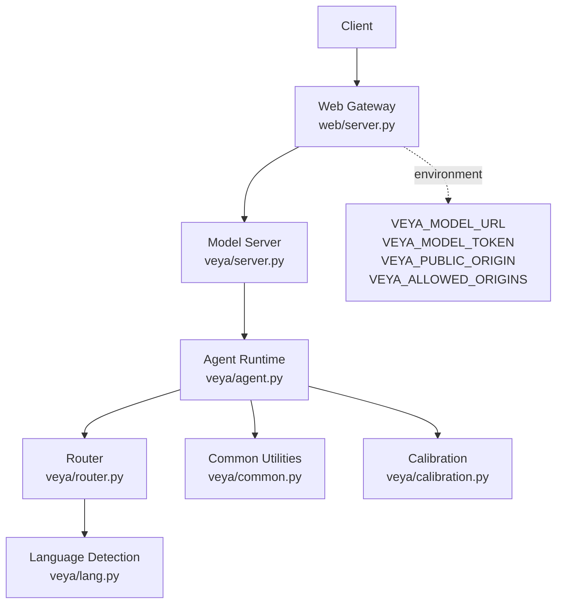
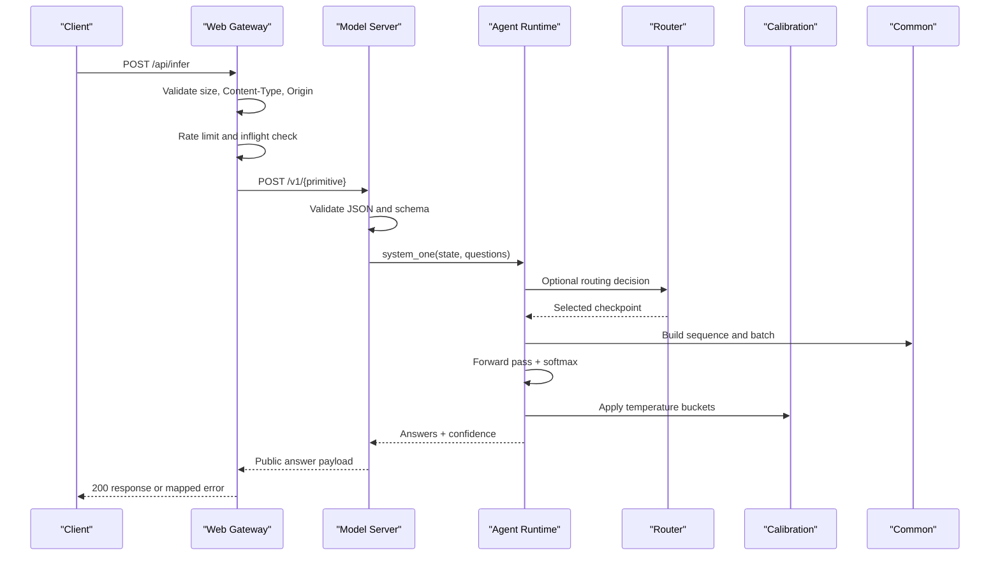
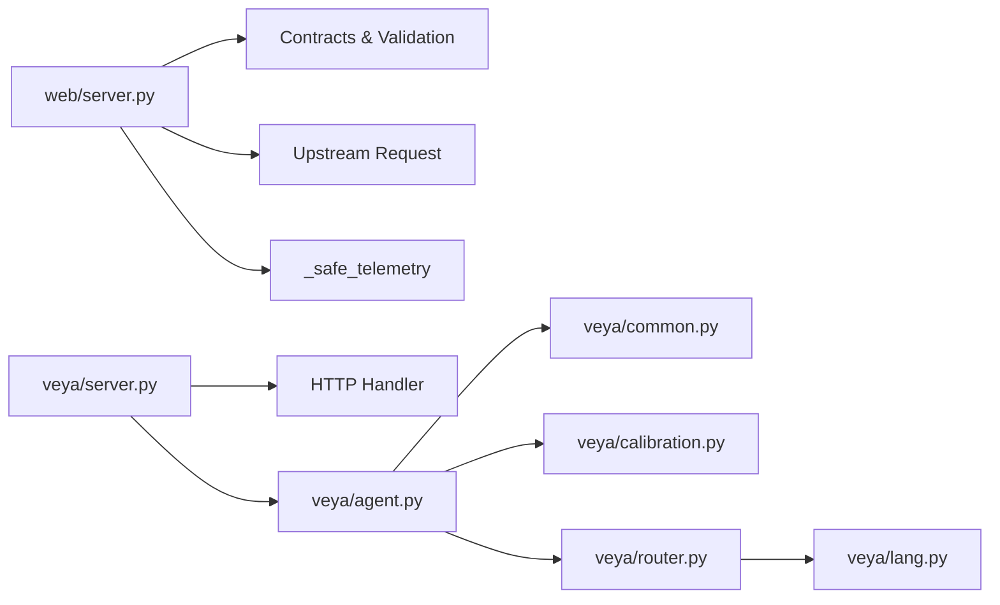

# Troubleshooting Guide

<cite>
**Referenced Files in This Document**   
- [README.md](file://README.md)
- [veya/server.py](file://veya/server.py)
- [web/server.py](file://web/server.py)
- [web/model_server.py](file://web/model_server.py)
- [veya/router.py](file://veya/router.py)
- [veya/agent.py](file://veya/agent.py)
- [veya/common.py](file://veya/common.py)
- [veya/calibration.py](file://veya/calibration.py)
- [veya/lang.py](file://veya/lang.py)
</cite>

## Table of Contents
1. [Introduction](#introduction)
2. [Project Structure](#project-structure)
3. [Core Components](#core-components)
4. [Architecture Overview](#architecture-overview)
5. [Detailed Component Analysis](#detailed-component-analysis)
6. [Dependency Analysis](#dependency-analysis)
7. [Performance Considerations](#performance-considerations)
8. [Troubleshooting Guide](#troubleshooting-guide)
9. [Conclusion](#conclusion)

## Introduction
This guide documents operational troubleshooting for Veya deployments, focusing on model loading failures, routing problems, performance degradation, memory issues, network connectivity problems, API endpoint failures, calibration and confidence scoring diagnostics, multi-model routing conflicts, security-related issues, access control problems, and compliance violations. It is organized so that operators can quickly identify the failure layer — web gateway, model server, agent runtime, routing, or calibration — and follow step-by-step resolution procedures.

## Project Structure
Veya exposes two primary HTTP services:
- A lightweight local model server that serves a loaded `Agent` or release bundle over `/v1/*`.
- A website/gateway service that validates requests, enforces rate limits and CORS, proxies inference to the model server, and returns standardized responses with telemetry.

**Diagram sources**
- [web/server.py:32-50](file://web/server.py#L32-L50)
- [web/server.py:94-114](file://web/server.py#L94-L114)
- [veya/server.py:137-235](file://veya/server.py#L137-L235)
- [veya/agent.py:101-231](file://veya/agent.py#L101-L231)
- [veya/router.py:123-172](file://veya/router.py#L123-L172)
- [veya/common.py:114-172](file://veya/common.py#L114-L172)
- [veya/calibration.py:175-192](file://veya/calibration.py#L175-L192)
- [veya/lang.py:209-238](file://veya/lang.py#L209-L238)

**Section sources**
- [web/server.py:1-90](file://web/server.py#L1-L90)
- [veya/server.py:1-17](file://veya/server.py#L1-L17)
- [web/model_server.py:1-17](file://web/model_server.py#L1-L17)

## Core Components
- **Web Gateway (`web/server.py`)**: Validates request size, content type, origin, and payload; applies per-IP rate limiting; enforces an inflight concurrency limit; proxies to the model server; normalizes upstream errors into stable error codes; emits structured telemetry.
- **Model Server (`veya/server.py`)**: Serves `/health`, `/version`, `/v1/choice`, `/v1/score`, `/v1/noul`, and optional hypothesis endpoints; serializes inference through a single lock; validates JSON bodies and question schemas; returns public answer payloads.
- **Agent Runtime (`veya/agent.py`)**: Loads checkpoints from Hugging Face or local paths; verifies architecture compatibility; manages device placement with GPU-to-CPU fallback; tokenizes state and questions; runs one forward pass across typed questions; computes calibrated probabilities and confidence.
- **Router (`veya/router.py`)**: Selects between English, multilingual, and typed-decisions checkpoints based on explicit overrides, task detection, language hints, script detection, and defaults; supports preloading and LRU eviction.
- **Common Utilities (`veya/common.py`)**: Builds sequences, renders options, defines the decision model, implements proper scoring utilities, ECE, confidence computation, temperature clamping, and batching helpers.
- **Calibration (`veya/calibration.py`)**: Fits and applies versioned temperature artifacts by primitive and cardinality bucket; validates artifact format and provenance.
- **Language Detection (`veya/lang.py`)**: Detects dominant script, estimates Latin-script language heuristics, and determines whether text is safe for the English checkpoint.

**Section sources**
- [web/server.py:94-114](file://web/server.py#L94-L114)
- [web/server.py:174-207](file://web/server.py#L174-L207)
- [web/server.py:408-647](file://web/server.py#L408-L647)
- [veya/server.py:137-235](file://veya/server.py#L137-L235)
- [veya/agent.py:101-231](file://veya/agent.py#L101-L231)
- [veya/agent.py:291-416](file://veya/agent.py#L291-L416)
- [veya/router.py:123-337](file://veya/router.py#L123-L337)
- [veya/common.py:64-111](file://veya/common.py#L64-L111)
- [veya/common.py:261-291](file://veya/common.py#L261-L291)
- [veya/calibration.py:175-192](file://veya/calibration.py#L175-L192)
- [veya/lang.py:209-238](file://veya/lang.py#L209-L238)

## Architecture Overview
The production flow routes client traffic through the web gateway, which performs input validation, CORS checks, rate limiting, and concurrency control before forwarding to the model server. The model server validates the request schema, optionally uses a release bundle, and executes inference under an inference lock. The agent builds tokens, runs the model, applies calibration temperatures, and returns answers with confidence. Routing metadata may be added when using the router.

**Diagram sources**
- [web/server.py:408-647](file://web/server.py#L408-L647)
- [veya/server.py:137-235](file://veya/server.py#L137-L235)
- [veya/agent.py:291-416](file://veya/agent.py#L291-L416)
- [veya/router.py:314-331](file://veya/router.py#L314-L331)
- [veya/common.py:64-111](file://veya/common.py#L64-L111)
- [veya/calibration.py:175-192](file://veya/calibration.py#L175-L192)

## Detailed Component Analysis

### Model Loading Failures
Symptoms include missing files, incompatible checkpoints, tokenizer configuration errors, weight shape mismatches, and device placement failures.

Diagnostic steps:
1. Verify the model identifier or path exists and contains required artifacts:
   - For remote models, ensure Hugging Face access and allow patterns download only needed files.
   - For local paths, confirm the directory exists and includes `rl_agent_config.json` and `model.safetensors`.
2. Check subfolder selection when bundling multiple checkpoints.
3. Inspect tokenizer compatibility fixes applied automatically; if they fail silently, inspect the tokenizer config manually.
4. Confirm architecture compatibility: required config keys and parameter prefixes must match expected RL agent structure.
5. Validate weight shapes and completeness; missing tensors or mismatched dimensions raise clear errors.
6. Observe device fallback behavior: CUDA/MPS unavailability or out-of-memory triggers CPU fallback with warnings.

Resolution actions:
- Use a valid Veya checkpoint ID or a training output directory containing the required files.
- Set `subfolder` explicitly when loading bundled checkpoints.
- Ensure environment variables such as `HF_TOKEN` are configured for private repositories.
- If GPU memory is insufficient, reduce batch size, context length, or option count; accept CPU fallback and monitor latency.
- Rebuild or re-export the checkpoint if weights are incomplete or architecture has changed.

**Section sources**
- [veya/agent.py:117-165](file://veya/agent.py#L117-L165)
- [veya/agent.py:167-184](file://veya/agent.py#L167-L184)
- [veya/agent.py:186-231](file://veya/agent.py#L186-L231)
- [veya/agent.py:238-262](file://veya/agent.py#L238-L262)
- [veya/agent.py:55-99](file://veya/agent.py#L55-L99)

### Routing Problems
Symptoms include incorrect checkpoint selection, unexpected multilingual routing, or typed-decisions not being selected.

Diagnostic steps:
1. Inspect the routing decision returned by `Router.route()` or `Router.predict()`.
2. Check explicit overrides: `model`, `task`, and `lang` take precedence.
3. Review automatic task detection: it requires exact question-id matches and opt-in via `auto_task_detection=True`.
4. Review language detection results: script detection is primary; Latin-script non-English text routes to multilingual.
5. Confirm default model and aliases used by the router.

Resolution actions:
- Pass `model="english"` or `model="multilingual"` to force a checkpoint.
- Enable `auto_task_detection=True` only when you intentionally want typed-decisions workflow matching.
- Provide `lang="en"` or another supported hint when language is known.
- Avoid relying solely on confidence for routing; use script/language detection before inference.

**Section sources**
- [veya/router.py:30-49](file://veya/router.py#L30-L49)
- [veya/router.py:73-80](file://veya/router.py#L73-L80)
- [veya/router.py:101-107](file://veya/router.py#L101-L107)
- [veya/router.py:110-120](file://veya/router.py#L110-L120)
- [veya/router.py:257-312](file://veya/router.py#L257-L312)
- [veya/lang.py:209-238](file://veya/lang.py#L209-L238)

### Performance Degradation
Symptoms include high latency, frequent model reloads, slow cold starts, or throughput collapse.

Diagnostic steps:
1. Determine whether the router is lazy-loading with `max_loaded=1`; language switches then rebuild models per request.
2. Check whether checkpoints are preloaded or attached to avoid duplicate VRAM usage.
3. Monitor device placement: GPU fallback to CPU increases latency significantly.
4. Evaluate batch sizes and question counts; large choice sets consume head tokens aggressively.
5. Inspect telemetry fields: `gateway_latency_ms`, `latency_ms`, `route`, `deferred`, and `error_code`.

Resolution actions:
- Preload checkpoints with `Router(preload=True)` or `router.preload(["english", "multilingual"])`.
- Attach existing agents to the router to prevent duplicate loads.
- Increase `max_loaded` carefully to balance memory and hot-path performance.
- Reduce context length or shortlist high-cardinality choices using `predict_shortlist`.
- Keep inference on GPU where possible; verify PyTorch CUDA support for newer GPUs.

**Section sources**
- [README.md:161-187](file://README.md#L161-L187)
- [veya/router.py:123-172](file://veya/router.py#L123-L172)
- [veya/router.py:223-237](file://veya/router.py#L223-L237)
- [veya/agent.py:238-262](file://veya/agent.py#L238-L262)
- [web/server.py:209-235](file://web/server.py#L209-L235)

### Memory Issues
Symptoms include out-of-memory errors during model load or inference, unexpected CPU fallback, or degraded throughput.

Diagnostic steps:
1. Check warnings about GPU memory exceeded during inference; the agent falls back to CPU and float32.
2. Inspect device placement at initialization; OOM or unsupported devices trigger CPU fallback.
3. Measure memory pressure from multiple preloaded checkpoints; three checkpoints total ~1.16B parameters.
4. Evaluate sequence construction: large option lists and long state text increase token budgets.

Resolution actions:
- Reduce `head_max_len` and `max_len` for high-cardinality choice questions.
- Shortlist candidates before scoring to fit within token budgets.
- Limit `max_loaded` or unload unused checkpoints.
- Prefer GPU with sufficient VRAM; otherwise accept CPU fallback and adjust expectations.
- Avoid unnecessary concurrent batches; the model server serializes inference.

**Section sources**
- [veya/agent.py:238-262](file://veya/agent.py#L238-L262)
- [veya/agent.py:338-361](file://veya/agent.py#L338-L361)
- [veya/router.py:123-143](file://veya/router.py#L123-L143)
- [veya/common.py:64-111](file://veya/common.py#L64-L111)

### Network Connectivity Problems
Symptoms include timeouts, unavailable model service, invalid upstream responses, or rate-limited requests.

Diagnostic steps:
1. Check `VEYA_MODEL_URL`; the web gateway proxies to this URL by default.
2. Inspect timeout handling: socket timeouts map to 504; URLError maps to 504 or 503 depending on reason.
3. Validate upstream contract: response must be a bounded JSON object; oversized responses are rejected.
4. Check rate limiting: per-IP sliding window charges requests by candidate count; heavy workloads get 429.
5. Inspect inflight concurrency: exceeding the limit returns 503 with `model_busy`.

Resolution actions:
- Ensure the model server is reachable on the configured host and port.
- Configure `VEYA_MODEL_TOKEN` if the upstream requires authorization.
- Tune request sizes and candidate counts to stay within rate limits.
- Add retry logic respecting `Retry-After` headers.
- Monitor health endpoints `/api/health` and `/health`.

**Section sources**
- [web/server.py:32-50](file://web/server.py#L32-L50)
- [web/server.py:94-114](file://web/server.py#L94-L114)
- [web/server.py:174-207](file://web/server.py#L174-L207)
- [web/server.py:496-508](file://web/server.py#L496-L508)
- [web/server.py:550-635](file://web/server.py#L550-L635)

### API Endpoint Failures
Symptoms include 400 invalid schema, 404 not found, 413 request too large, 429 rate limited, 502 invalid upstream response, 503 unavailable, 504 timeout.

Diagnostic steps:
1. For 400 errors, inspect `defer_reason` and `detail`; these indicate invalid JSON, missing instructions, or unsupported question types.
2. For 404 errors, verify the requested path exists: `/health`, `/version`, `/v1/choice`, `/v1/score`, `/v1/noul`, `/v1/systemone`, or website pages.
3. For 413 errors, reduce request body size below the gateway’s 32 KB limit.
4. For 429 errors, implement exponential backoff using `retry_after`.
5. For 502 errors, inspect upstream response validity and model errors.
6. For 503 errors, check model health and availability.
7. For 504 errors, investigate slow upstream processing or network delays.

Resolution actions:
- Validate payloads against the expected primitives: `choice`, `score`, `noul`, or `systemone`.
- Ensure `instructions` is present for single-question endpoints.
- Use `/v1/systemone` for batched typed questions.
- Monitor `/api/version` and `/version` for capability metadata and release status.
- Log and correlate requests using `request_id`.

**Section sources**
- [veya/server.py:163-235](file://veya/server.py#L163-L235)
- [web/server.py:408-647](file://web/server.py#L408-L647)

### Calibration and Confidence Scoring Diagnostics
Symptoms include overconfident predictions, poor Expected Calibration Error (ECE), inconsistent confidence across cardinalities, or calibration artifacts not applied.

Diagnostic steps:
1. Check whether a calibration artifact is loaded; the agent applies it if `calibration.json` exists.
2. Inspect temperature values: global, primitive, and cardinality-specific temperatures are clamped to usable ranges.
3. Verify artifact provenance: format, fitting split, scorer identity, and checkpoint hash must match.
4. Evaluate ECE and Brier scores on held-out data; the code provides utilities for ECE calculation.
5. Confirm confidence computation uses normalized Shannon entropy over the top-k options.

Resolution actions:
- Fit calibration temperatures on a dedicated calibration split and apply the artifact.
- Use cardinality-aware temperatures for choice questions with many options.
- Avoid trusting raw probabilities without temperature fitting, especially for multilingual checkpoints.
- Monitor `calibration_version` in responses to track which artifact is active.

**Section sources**
- [veya/agent.py:206-231](file://veya/agent.py#L206-L231)
- [veya/calibration.py:175-192](file://veya/calibration.py#L175-L192)
- [veya/calibration.py:159-172](file://veya/calibration.py#L159-L172)
- [veya/common.py:222-234](file://veya/common.py#L222-L234)
- [veya/common.py:261-291](file://veya/common.py#L261-L291)

### Multi-Model Routing Conflicts
Symptoms include unexpected typed-decisions selection, ambiguous language detection, or conflicting explicit overrides.

Diagnostic steps:
1. Review precedence: explicit `model` > explicit `task` > detected workflow > explicit `lang` > detected script/language > default.
2. Confirm `auto_task_detection` is enabled only when intended.
3. Inspect question-id signatures for typed-decisions workflows; exact set matching is required.
4. Check alias normalization: aliases like `en`, `multi`, `typed` resolve to canonical names.

Resolution actions:
- Disable auto task detection unless you rely on exact workflow signatures.
- Use explicit `model` overrides for deterministic routing in production.
- Validate language hints when inputs contain mixed scripts or short texts.

**Section sources**
- [veya/router.py:257-312](file://veya/router.py#L257-L312)
- [veya/router.py:66-71](file://veya/router.py#L66-L71)
- [veya/router.py:110-120](file://veya/router.py#L110-L120)

### Security-Related Issues, Access Control, and Compliance Violations
Symptoms include cross-origin rejection, missing security headers, unauthorized upstream access, or unsafe public binding.

Diagnostic steps:
1. Verify `VEYA_PUBLIC_ORIGIN` is HTTPS-only and contains no path/query/fragment; public binding requires it.
2. Check allowed origins: only the current host scheme plus configured origins are accepted.
3. Inspect security headers: `X-Content-Type-Options`, `Referrer-Policy`, `X-Frame-Options`, `Permissions-Policy`, `Content-Security-Policy`.
4. Validate upstream authentication via `VEYA_MODEL_TOKEN`.
5. Review release manifest capabilities and compliance metadata exposed by `/version`.

Resolution actions:
- Set `VEYA_PUBLIC_ORIGIN` to a strict HTTPS origin when exposing the site publicly.
- Restrict `VEYA_ALLOWED_ORIGINS` to trusted domains.
- Configure `VEYA_MODEL_TOKEN` for upstream authorization.
- Audit `/version` outputs for supported languages, primitives, and release status.
- Treat research-only routes and non-audited checkpoints as non-production.

**Section sources**
- [web/server.py:32-50](file://web/server.py#L32-L50)
- [web/server.py:244-255](file://web/server.py#L244-L255)
- [web/server.py:439-452](file://web/server.py#L439-L452)
- [web/server.py:94-114](file://web/server.py#L94-L114)
- [veya/server.py:57-111](file://veya/server.py#L57-L111)

## Dependency Analysis
The following diagram shows how components depend on each other during a typical request.

**Diagram sources**
- [web/server.py:23-30](file://web/server.py#L23-L30)
- [web/server.py:94-114](file://web/server.py#L94-L114)
- [web/server.py:209-235](file://web/server.py#L209-L235)
- [veya/server.py:137-235](file://veya/server.py#L137-L235)
- [veya/agent.py:101-231](file://veya/agent.py#L101-L231)
- [veya/router.py:123-337](file://veya/router.py#L123-L337)
- [veya/lang.py:209-238](file://veya/lang.py#L209-L238)

**Section sources**
- [web/server.py:1-90](file://web/server.py#L1-L90)
- [veya/server.py:1-17](file://veya/server.py#L1-L17)
- [veya/agent.py:1-25](file://veya/agent.py#L1-L25)

## Performance Considerations
- Prefer preloaded checkpoints in server deployments to eliminate cold-start latency.
- Use GPU acceleration where available; CPU fallback is significantly slower.
- Limit high-cardinality choice questions by shortlisting candidates.
- Monitor telemetry for latency spikes, deferred decisions, and error codes.
- Tune rate limits and inflight concurrency according to workload characteristics.

[No sources needed since this section provides general guidance]

## Troubleshooting Guide

### Diagnostic Procedures

#### Model Loading Failures
- Confirm checkpoint ID or local path exists and contains required files.
- Validate tokenizer configuration compatibility.
- Check architecture compatibility and weight completeness.
- Observe device fallback warnings and adjust hardware or batch size.

#### Routing Problems
- Inspect routing decision and detection evidence.
- Use explicit `model`, `task`, or `lang` overrides.
- Enable auto task detection only when necessary.
- Validate language detection for mixed or short inputs.

#### Performance Degradation
- Preload checkpoints and attach existing agents.
- Adjust `max_loaded` and context lengths.
- Shortlist high-cardinality choices.
- Monitor telemetry and device placement.

#### Memory Issues
- Reduce sequence length and option budgets.
- Unload unused checkpoints.
- Accept CPU fallback and adjust expectations.
- Avoid excessive concurrent batches.

#### Network Connectivity Problems
- Verify `VEYA_MODEL_URL` and reachability.
- Handle timeouts and upstream unavailability.
- Respect rate limits and retry-after headers.
- Monitor health and version endpoints.

#### API Endpoint Failures
- Validate request schema and content type.
- Use appropriate endpoints for single or batched questions.
- Correlate errors with `request_id`.
- Inspect upstream response validity.

#### Calibration and Confidence Scoring
- Load and validate calibration artifacts.
- Fit temperatures on held-out calibration splits.
- Monitor ECE and confidence distributions.
- Track `calibration_version` in responses.

#### Multi-Model Routing Conflicts
- Review precedence rules and explicit overrides.
- Validate typed-decisions workflow signatures.
- Normalize aliases and defaults.

#### Security, Access Control, and Compliance
- Enforce HTTPS-only public origin.
- Restrict allowed origins.
- Configure upstream token.
- Audit version metadata and release status.
- Treat research-only routes as non-production.

**Section sources**
- [veya/agent.py:117-262](file://veya/agent.py#L117-L262)
- [veya/router.py:123-337](file://veya/router.py#L123-L337)
- [veya/common.py:64-111](file://veya/common.py#L64-L111)
- [veya/calibration.py:159-192](file://veya/calibration.py#L159-L192)
- [web/server.py:32-50](file://web/server.py#L32-L50)
- [web/server.py:408-647](file://web/server.py#L408-L647)

## Conclusion
Operational reliability depends on correct model loading, deterministic routing, calibrated confidence, and robust networking. Use preloaded checkpoints, explicit routing controls, validated calibration artifacts, and strict security settings. When issues arise, follow the layered diagnostic approach: validate the request at the web gateway, inspect upstream connectivity, examine model server responses, review agent runtime behavior, and analyze routing and calibration metadata. This ensures actionable resolution for deployment and operational problems while maintaining safety and compliance.