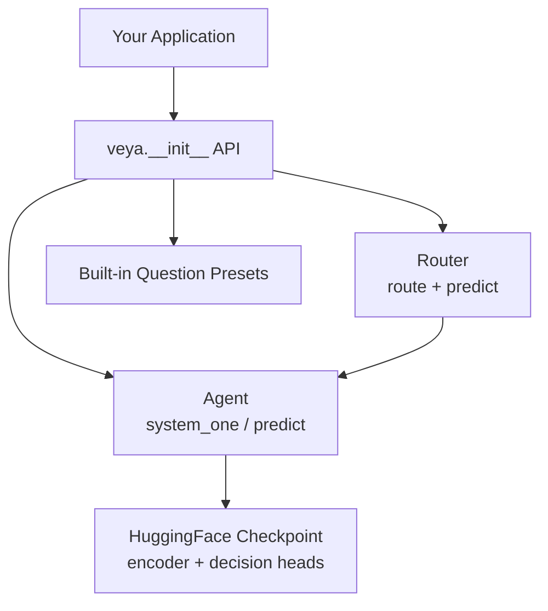
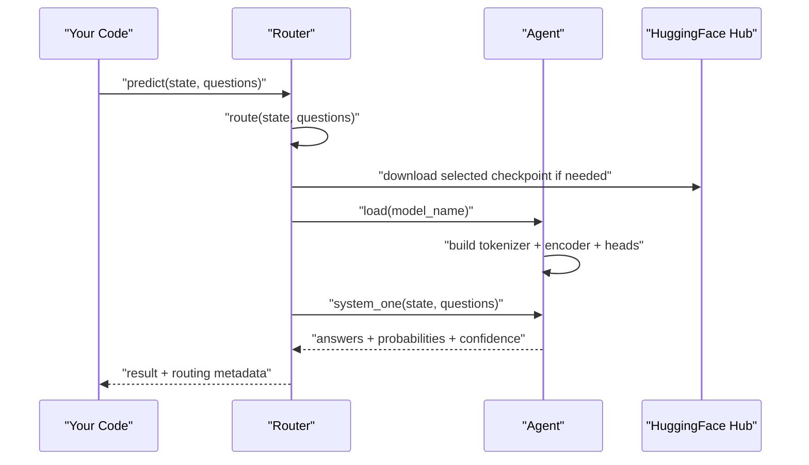
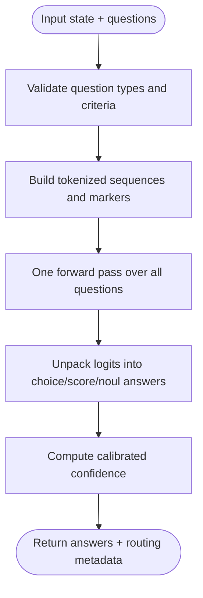
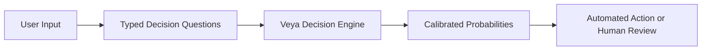
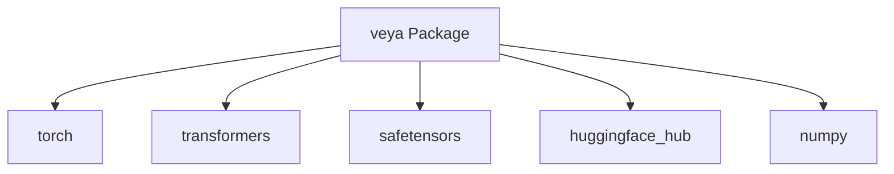

# Getting Started

<cite>
**Referenced Files in This Document**
- [README.md](file://README.md)
- [pyproject.toml](file://pyproject.toml)
- [veya/__init__.py](file://veya/__init__.py)
- [veya/agent.py](file://veya/agent.py)
- [veya/router.py](file://veya/router.py)
- [veya/presets.py](file://veya/presets.py)
</cite>

## Table of Contents
1. [Introduction](#introduction)
2. [Project Structure](#project-structure)
3. [Core Components](#core-components)
4. [Architecture Overview](#architecture-overview)
5. [Detailed Component Analysis](#detailed-component-analysis)
6. [Dependency Analysis](#dependency-analysis)
7. [Performance Considerations](#performance-considerations)
8. [Troubleshooting Guide](#troubleshooting-guide)
9. [Conclusion](#conclusion)

## Introduction
Veya is a non-autoregressive, System 1 decision engine that evaluates typed questions without generating text. Instead of producing tokens, it returns calibrated probabilities for structured decisions such as routing, scoring, or binary risk signals. Its core value proposition is speed and interpretability: you get fast answers with confidence scores that are trained to be statistically meaningful, rather than raw logits from a generative model.

At a high level:
- You provide state (text, JSON, or conversation turns).
- You define typed questions using primitives like `choice`, `score`, and `noul`.
- Veya runs one forward pass over all questions and returns answers, probabilities, and confidence.
- Optionally, a router selects the best checkpoint per request based on language, script, or task.

This guide starts with installation and quickstart examples, then explains the basic concepts so you can move from first run to production-style usage.

**Section sources**
- [README.md:8-48](file://README.md#L8-L48)

## Project Structure
The public Python package lives under `veya`. The most important entry points for getting started are:
- Top-level API: `veya.load` and `veya.Router`.
- Inference runtime: `Agent.system_one` (aliased as `predict`).
- Router: automatic checkpoint selection across English, multilingual, and fine-typed-decisions checkpoints.
- Presets: ready-to-use question schemas for common workflows.

**Diagram sources**
- [veya/__init__.py:1-24](file://veya/__init__.py#L1-L24)
- [veya/agent.py:101-116](file://veya/agent.py#L101-L116)
- [veya/router.py:123-143](file://veya/router.py#L123-L143)
- [veya/presets.py:1-6](file://veya/presets.py#L1-L6)

**Section sources**
- [veya/__init__.py:1-24](file://veya/__init__.py#L1-L24)
- [veya/agent.py:101-116](file://veya/agent.py#L101-L116)
- [veya/router.py:123-143](file://veya/router.py#L123-L143)
- [veya/presets.py:1-6](file://veya/presets.py#L1-L6)

## Core Components
This section introduces the building blocks you will use in every example.

### Typed Decision Primitives
Veya’s questions are typed. Each type has a different output shape and typical use case:

| Primitive | Output Meaning | Typical Use |
|---|---|---|
| `choice` | Selected label plus probabilities over options | Intent routing, department triage, topic classification |
| `score` | Expected ordinal level plus distribution over ordered levels | Urgency, frustration, harm severity |
| `noul` | Calibrated probability P(true) between 0.0 and 1.0 | Phishing detection, churn risk, jailbreak detection |

These types are validated when you build questions, and they determine how probabilities and confidence are computed during inference.

**Section sources**
- [veya/agent.py:264-289](file://veya/agent.py#L264-L289)
- [veya/agent.py:381-406](file://veya/agent.py#L381-L406)

### Confidence Gating
Every answer includes a confidence score. Because Veya uses proper-scoring-rule training, these probabilities are intended to be statistically meaningful. A common pattern is to automate actions above a threshold and escalate low-confidence cases to human review.

Important note: confidence gating should not be treated as a production safety guarantee. The repository documents calibration behavior and explicitly warns against treating probabilities as a risk guarantee without fitting domain-specific thresholds and temperatures.

**Section sources**
- [README.md:213-228](file://README.md#L213-L228)
- [README.md:372-377](file://README.md#L372-L377)
- [README.md:379-387](file://README.md#L379-L387)

### Built-in Workflow Presets
Veya ships preset question schemas for common tasks:
- `router_questions()`: assess difficulty, domain, tooling needs, and sensitivity.
- `guard_questions()`: detect jailbreaks, prompt injections, sensitive data, and harm severity.
- `moderation_questions()`: detect toxicity, harassment, threats, spam, and rule-breaking severity.
- `triage_questions()`: classify support intent, urgency, frustration, refund requests, and churn risk.
- `email_questions()`: categorize inbound email, detect spam/phishing, estimate urgency, and decide whether a reply is expected.

Presets let you start quickly; you can also replace them with your own question definitions.

**Section sources**
- [veya/presets.py:5-42](file://veya/presets.py#L5-L42)
- [veya/presets.py:45-79](file://veya/presets.py#L45-L79)
- [veya/presets.py:82-119](file://veya/presets.py#L82-L119)
- [veya/presets.py:122-151](file://veya/presets.py#L122-L151)
- [veya/presets.py:154-187](file://veya/presets.py#L154-L187)

## Architecture Overview
There are two main ways to use Veya:

1. **Single-model mode**: Load one checkpoint directly and call `agent.predict(state, questions)`.
2. **Router mode**: Use `Router` to automatically select among English, multilingual, and typed-decisions checkpoints.

**Diagram sources**
- [veya/router.py:257-331](file://veya/router.py#L257-L331)
- [veya/agent.py:117-196](file://veya/agent.py#L117-L196)
- [veya/agent.py:291-414](file://veya/agent.py#L291-L414)

## Detailed Component Analysis

### Installation Requirements
Install Veya with pip. The package requires Python 3.10 or newer. The declared dependencies include PyTorch, Transformers, HuggingFace Hub, safetensors, and NumPy.

Key requirements:
- Python 3.10+
- PyTorch
- Transformers
- HuggingFace Hub
- safetensors
- NumPy

The README also notes that the dependency floor aligns with versions requiring Python 3.10.

**Section sources**
- [README.md:58-64](file://README.md#L58-L64)
- [pyproject.toml:5-10](file://pyproject.toml#L5-L10)
- [pyproject.toml:27-33](file://pyproject.toml#L27-L33)

### Quickstart: Single-Model Mode
Use single-model mode when you only need one checkpoint for a dedicated pipeline.

Steps:
1. Import `veya`.
2. Load a specific checkpoint using `veya.load`.
3. Define your state and typed questions.
4. Call `agent.predict(state, questions)`.
5. Read answers, probabilities, and confidence from the result.

Typical outputs:
- `choice`: top label, option probabilities, confidence.
- `score`: expected ordinal level, legend, distribution, confidence.
- `noul`: calibrated probability of truth, confidence.

This mode is useful for research, evaluation, or applications where you deliberately choose one model family.

**Section sources**
- [README.md:190-209](file://README.md#L190-L209)
- [veya/agent.py:422-431](file://veya/agent.py#L422-L431)

### Quickstart: Router Mode
Router mode is convenient when you want automatic checkpoint selection across languages and tasks.

Steps:
1. Import `veya` and `Router`.
2. Create a `Router`. For production-like latency, preload checkpoints.
3. Prepare state and typed questions.
4. Call `router.predict(state, questions)`.
5. Inspect both answers and routing metadata.

Routing behavior:
- Explicit `model` overrides everything.
- Optional explicit `task` can select the typed-decisions checkpoint.
- Optional explicit `lang` maps English to the English checkpoint and other languages to multilingual.
- Automatic detection uses script and language analysis.
- The default is the English checkpoint unless detection indicates otherwise.

Routing metadata tells you which model was chosen and why, including script and language information.

**Section sources**
- [README.md:68-187](file://README.md#L68-L187)
- [veya/router.py:123-143](file://veya/router.py#L123-L143)
- [veya/router.py:257-331](file://veya/router.py#L257-L331)

### Basic Concepts: State, Questions, and Answers
State can be a string, a dictionary, or a list of conversation turns. Questions map an identifier to a definition containing:
- `type`: one of `choice`, `score`, `noul`.
- `instructions`: natural-language guidance for the model.
- `criteria`: options for `choice`, ordered levels for `score`, or optional labels for `noul`.

The agent validates question definitions and builds a single batched input for all questions. It then performs one forward pass and unpacks results per question.

**Diagram sources**
- [veya/agent.py:264-289](file://veya/agent.py#L264-L289)
- [veya/agent.py:291-335](file://veya/agent.py#L291-L335)
- [veya/agent.py:363-414](file://veya/agent.py#L363-L414)

**Section sources**
- [veya/agent.py:264-289](file://veya/agent.py#L264-L289)
- [veya/agent.py:291-414](file://veya/agent.py#L291-L414)

### Conceptual Overview
Conceptually, Veya separates decision modeling from text generation. Instead of asking a large language model to write an explanation, you ask it to evaluate structured hypotheses about your input. This makes responses faster, more predictable, and easier to integrate into automated pipelines.

[No sources needed since this diagram shows conceptual workflow, not actual code structure]

## Dependency Analysis
Veya depends on a modern PyTorch-based transformer stack. The package metadata declares minimum versions for key libraries.

**Diagram sources**
- [pyproject.toml:27-33](file://pyproject.toml#L27-L33)

**Section sources**
- [pyproject.toml:5-10](file://pyproject.toml#L5-L10)
- [pyproject.toml:27-33](file://pyproject.toml#L27-L33)

## Performance Considerations
Veya is designed for fast System 1 decisions. The README reports historical latency measurements on a T4 GPU, including single-question and batched throughput numbers. It also compares routed performance against another decision model.

Practical guidance:
- Prefer preloading models in server or demo environments to avoid cold-load latency.
- Use GPU when available; CPU fallback is supported but significantly slower.
- Be aware that confidence scores are not a production safety guarantee without domain-specific calibration and thresholds.
- For very large label sets, consider shortlisting strategies or splitting label spaces.

**Section sources**
- [README.md:161-187](file://README.md#L161-L187)
- [README.md:277-309](file://README.md#L277-L309)
- [README.md:388-420](file://README.md#L388-L420)

## Troubleshooting Guide
Common issues and their likely causes:

- **CUDA or MPS unavailable**: If you request a device that is not available, Veya may fall back to CPU. The agent prints warnings and continues on CPU, though performance drops.
- **GPU memory errors during inference**: If a forward pass exceeds GPU memory, the agent attempts to fall back to CPU.
- **Incompatible checkpoint**: Loading fails if required files like `rl_agent_config.json` or `model.safetensors` are missing, or if weight shapes do not match the configured architecture.
- **Invalid question schema**: Missing `type` or `instructions`, unsupported question types, invalid criteria shapes, or too many options exceeding the head token budget can raise validation errors.
- **Routing confusion**: If routing seems unexpected, inspect the `routing` field in the result. It records the selected model, repository, and reason.

Recommended checks:
- Verify Python version and installed dependencies.
- Confirm network access to HuggingFace Hub if downloading checkpoints.
- Inspect routing metadata when using `Router`.
- Reduce label count or use shortlisting for high-cardinality `choice` questions.
- Fit calibration temperatures for your domain if you rely heavily on confidence thresholds.

**Section sources**
- [veya/agent.py:167-184](file://veya/agent.py#L167-L184)
- [veya/agent.py:238-262](file://veya/agent.py#L238-L262)
- [veya/agent.py:338-361](file://veya/agent.py#L338-L361)
- [veya/agent.py:264-289](file://veya/agent.py#L264-L289)
- [veya/router.py:257-331](file://veya/router.py#L257-L331)
- [README.md:372-387](file://README.md#L372-L387)

## Conclusion
You can start using Veya by installing the package, loading a checkpoint, defining typed questions, and calling `predict`. For multi-language or multi-task scenarios, use `Router` to select the appropriate checkpoint automatically. The three core primitives—`choice`, `score`, and `noul`—cover most structured decision needs, while built-in presets help you prototype quickly.

Remember that Veya is a fast decision engine, not a text generator. Its strength is returning calibrated probabilities for typed decisions, enabling automation with confidence-aware routing. Treat confidence as a statistical signal, validate thresholds for your domain, and prefer preloading and GPU acceleration for production workloads.

[No sources needed since this section summarizes without analyzing specific files]