# Calibration System

<cite>
**Referenced Files in This Document**
- [calibration.py](file://veya/calibration.py)
- [common.py](file://veya/common.py)
- [router.py](file://veya/router.py)
- [selective.py](file://veya/selective.py)
- [calibration.json](file://artifacts/decisions/calibration.json)
- [calibration.json](file://models/production/calibration.json)
</cite>

## Table of Contents
1. [Introduction](#introduction)
2. [Project Structure](#project-structure)
3. [Core Components](#core-components)
4. [Architecture Overview](#architecture-overview)
5. [Detailed Component Analysis](#detailed-component-analysis)
6. [Dependency Analysis](#dependency-analysis)
7. [Performance Considerations](#performance-considerations)
8. [Troubleshooting Guide](#troubleshooting-guide)
9. [Conclusion](#conclusion)
10. [Appendices](#appendices)

## Introduction
This document explains Veya’s calibration system: how temperature scaling is fitted and applied, how confidence is estimated, how Expected Calibration Error (ECE) and safe automation coverage are computed, and how the temperature bucketing system adapts to question type and label count. It also documents the proper scoring rule used for training decision heads, shows how calibration artifacts relate to routing and selective automation, and provides practical guidance for tuning temperatures and confidence thresholds.

The goal is to make calibration transparent: every temperature is derived from a held-out calibration split, evaluated with ECE and related metrics, and constrained so that published confidence remains reliable across task types.

## Project Structure
Calibration touches several modules:

- `veya/calibration.py` fits per-group temperatures, builds versioned calibration artifacts, resolves temperatures at inference time, and overlays them onto an agent.
- `veya/common.py` defines the typed decision model, confidence estimation, ECE, safe automation coverage, temperature clamping, and the runtime temperature bucket key.
- `veya/selective.py` selects and applies confidence thresholds for automation.
- `veya/router.py` chooses which checkpoint runs a request; calibration quality matters because different checkpoints can have very different calibration behavior.
- `artifacts/decisions/calibration.json` records a research decision about which cardinality buckets to keep or override.
- `models/production/calibration.json` is a production calibration artifact containing fitted cardinality temperatures and metadata.

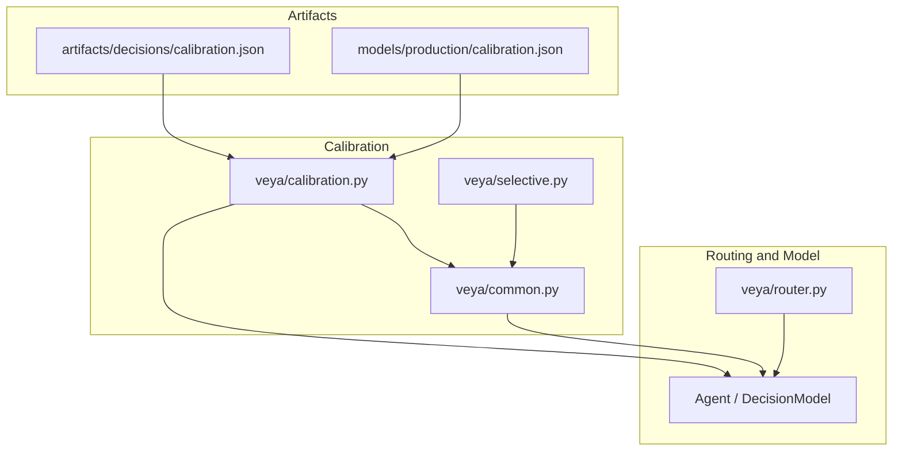

**Diagram sources**
- [calibration.py:1-193](file://veya/calibration.py#L1-L193)
- [common.py:114-291](file://veya/common.py#L114-L291)
- [selective.py:1-143](file://veya/selective.py#L1-L143)
- [router.py:123-337](file://veya/router.py#L123-L337)
- [calibration.json:1-32](file://artifacts/decisions/calibration.json#L1-L32)
- [calibration.json:1-28](file://models/production/calibration.json#L1-L28)

**Section sources**
- [calibration.py:1-193](file://veya/calibration.py#L1-L193)
- [common.py:1-333](file://veya/common.py#L1-L333)
- [selective.py:1-143](file://veya/selective.py#L1-L143)
- [router.py:1-337](file://veya/router.py#L1-L337)
- [calibration.json:1-32](file://artifacts/decisions/calibration.json#L1-L32)
- [calibration.json:1-28](file://models/production/calibration.json#L1-L28)

## Core Components
- Temperature fitting uses negative log-likelihood over a grid of temperatures.
- Grouping supports primitive question-type temperatures and cardinality-based buckets.
- Confidence comes from normalized Shannon entropy over the top-k option probabilities.
- ECE measures the gap between average confidence and accuracy across bins.
- Safe automation coverage finds the largest high-confidence prefix whose empirical error rate stays under a risk budget.
- Production artifacts record fitted temperatures, sample counts, dataset hashes, and validation constraints.

**Section sources**
- [calibration.py:20-193](file://veya/calibration.py#L20-L193)
- [common.py:175-291](file://veya/common.py#L175-L291)
- [selective.py:21-56](file://veya/selective.py#L21-L56)
- [calibration.json:1-28](file://models/production/calibration.json#L1-L28)

## Architecture Overview
At inference time, Veya computes raw logits for each candidate option, converts them into probabilities using a temperature, derives confidence, and optionally routes or automates based on calibrated signals.

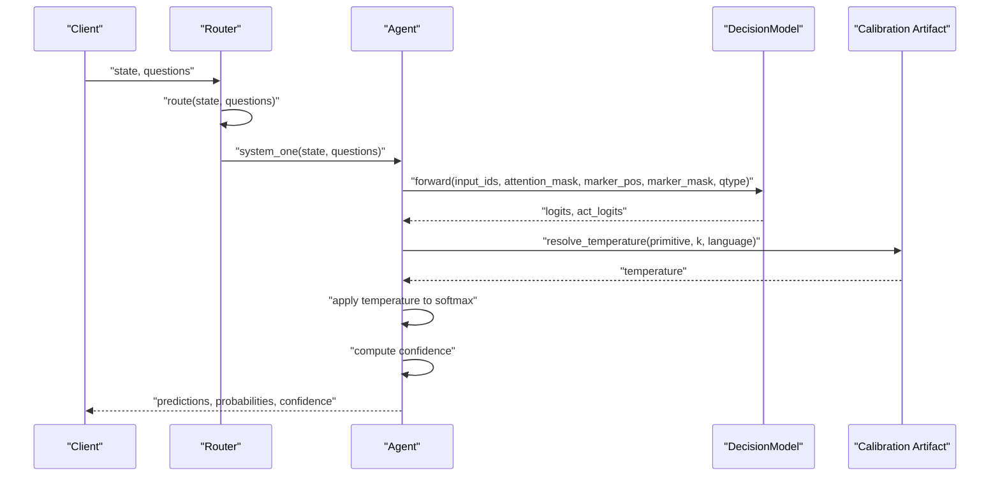

**Diagram sources**
- [router.py:257-331](file://veya/router.py#L257-L331)
- [common.py:130-161](file://veya/common.py#L130-L161)
- [calibration.py:136-150](file://veya/calibration.py#L136-L150)

## Detailed Component Analysis

### Temperature Scaling Mechanism
Temperature scaling adjusts the sharpness of the output distribution without changing the ranking of options. A higher temperature softens probabilities; a lower temperature sharpens them. In Veya:

- The temperature grid is logarithmically spaced between a minimum and maximum value.
- For each group of logits and labels, the temperature minimizing negative log-likelihood is selected.
- Fitted temperatures are clamped to a safe range to prevent extreme sharpening or over-smoothing.
- Global and per-bucket temperatures are stored in calibration artifacts.

Key behaviors:
- Zero-row inputs raise an error during fitting.
- Grid search returns the best temperature found on the provided rows.
- Clamping prevents unsafe values such as extremely low temperatures that would publish misleadingly high confidence.

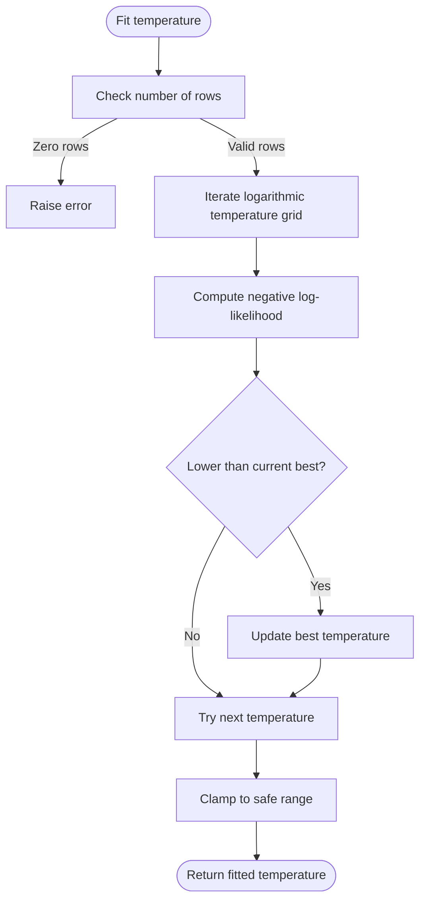

**Diagram sources**
- [calibration.py:34-75](file://veya/calibration.py#L34-L75)
- [common.py:275-291](file://veya/common.py#L275-L291)

**Section sources**
- [calibration.py:34-75](file://veya/calibration.py#L34-L75)
- [common.py:275-291](file://veya/common.py#L275-L291)

### Proper Scoring Rule Used for Training
Veya trains decision heads with a strictly proper scoring rule reward composed of:

- Log score: encourages correct probability mass.
- Spherical score: normalizes reported distributions.
- Ranked Probability Score (RPS): added only for ordinal-style score tasks, penalizing cumulative distribution differences.

This combination rewards honest probabilistic predictions rather than merely picking the top class.

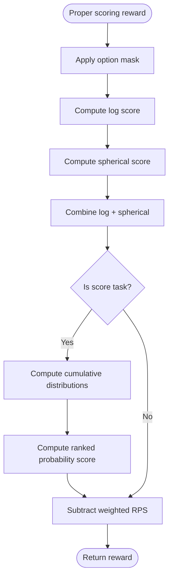

**Diagram sources**
- [common.py:175-201](file://veya/common.py#L175-L201)

**Section sources**
- [common.py:175-201](file://veya/common.py#L175-L201)

### Confidence Estimation
Confidence is derived from the probability distribution over options:

- Normalized Shannon entropy confidence equals one minus normalized entropy.
- For fewer than two options, confidence defaults to one.
- The model also computes internal features including top-1 vs top-2 gaps and entropy, which feed action-head logic.

This makes confidence interpretable: it is high when the distribution is concentrated and low when it is spread across multiple options.

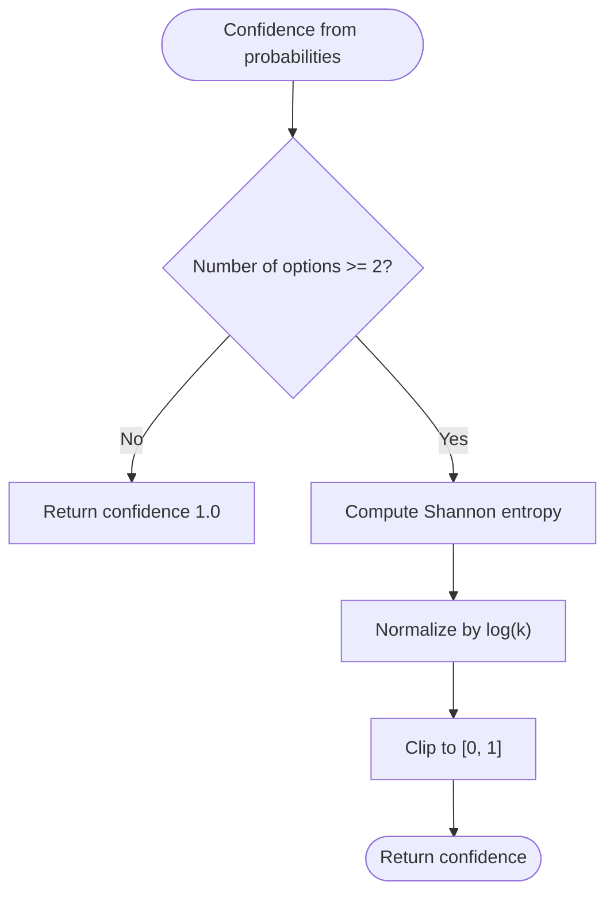

**Diagram sources**
- [common.py:261-267](file://veya/common.py#L261-L267)
- [common.py:144-161](file://veya/common.py#L144-L161)

**Section sources**
- [common.py:144-161](file://veya/common.py#L144-L161)
- [common.py:261-267](file://veya/common.py#L261-L267)

### Temperature Bucketing System
Temperatures are resolved through a hierarchy:

1. Language-specific bucket: `language:primitive:cardinality`.
2. Cardinality bucket: `primitive:cardinality`.
3. Primitive temperature: per question type.
4. Global fallback temperature.

Cardinality buckets are based on the number of candidate options:

- Two or fewer options: small bucket.
- Three to five options: medium-small bucket.
- Six to ten options: medium bucket.
- Eleven to twenty options: large bucket.
- Twenty-one to fifty options: very large bucket.
- More than fifty options: extra-large bucket.

At runtime, the bucket key combines the question type and label count.

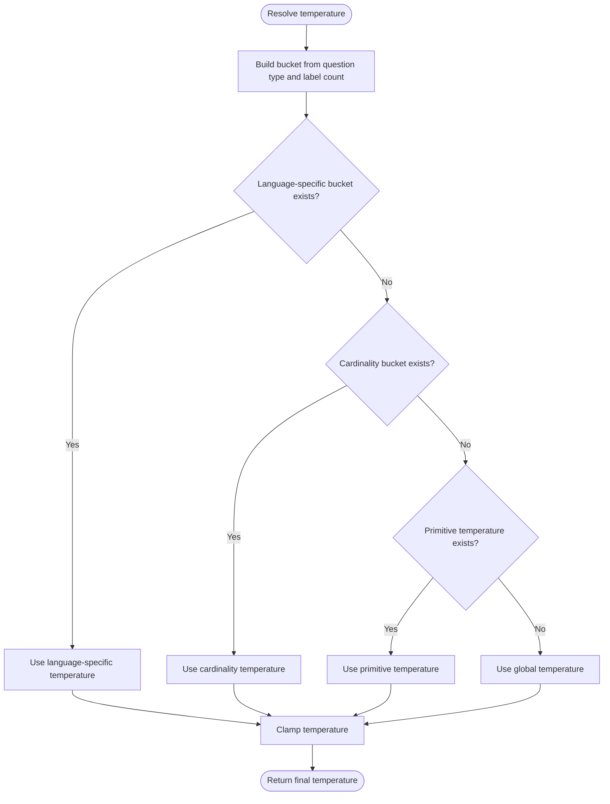

**Diagram sources**
- [calibration.py:20-31](file://veya/calibration.py#L20-L31)
- [calibration.py:136-150](file://veya/calibration.py#L136-L150)
- [common.py:270-272](file://veya/common.py#L270-L272)

**Section sources**
- [calibration.py:20-31](file://veya/calibration.py#L20-L31)
- [calibration.py:136-150](file://veya/calibration.py#L136-L150)
- [common.py:270-272](file://veya/common.py#L270-L272)

### ECE Calculation
Expected Calibration Error partitions confidence into bins and averages the absolute difference between average confidence and average correctness within each bin. Important details:

- The first bin includes the lower bound to avoid dropping zero-confidence rows.
- Empty datasets return NaN.
- Bins are uniformly spaced from zero to one.

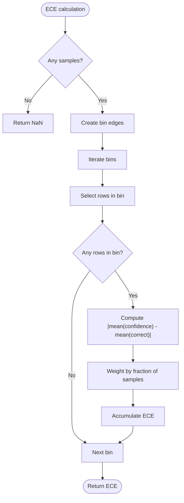

**Diagram sources**
- [common.py:222-234](file://veya/common.py#L222-L234)

**Section sources**
- [common.py:222-234](file://veya/common.py#L222-L234)

### Safe Automation Coverage
Safe automation coverage answers: what fraction of decisions can be automated while keeping the observed error rate below a risk threshold?

Algorithm:
- Sort decisions by descending confidence.
- Accumulate wrong decisions.
- At each grouped confidence boundary, check whether the cumulative error rate is within the allowed epsilon.
- Track the largest accepted prefix relative to the full dataset size.

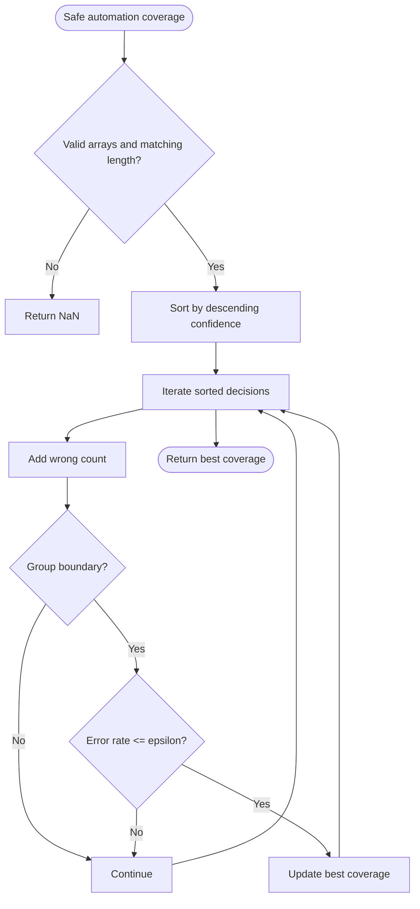

**Diagram sources**
- [common.py:237-258](file://veya/common.py#L237-L258)

**Section sources**
- [common.py:237-258](file://veya/common.py#L237-L258)

### Calibration Artifacts and Application
A calibration artifact contains:

- Format version.
- Checkpoint identity and hash.
- Dataset hash and fitting split metadata.
- Method description.
- Minimum observations threshold.
- Global temperature.
- Primitive temperatures.
- Cardinality temperatures.
- Sample counts per group.
- Timestamps and scorer identity.

Application steps:
- Load and validate the artifact format, fitting role, scorer identity, and checkpoint hash.
- Overlay primitive temperatures onto the agent’s per-question-type temperatures.
- Merge cardinality temperatures into the agent’s option-level temperature map.
- Record the calibration version and artifact reference.

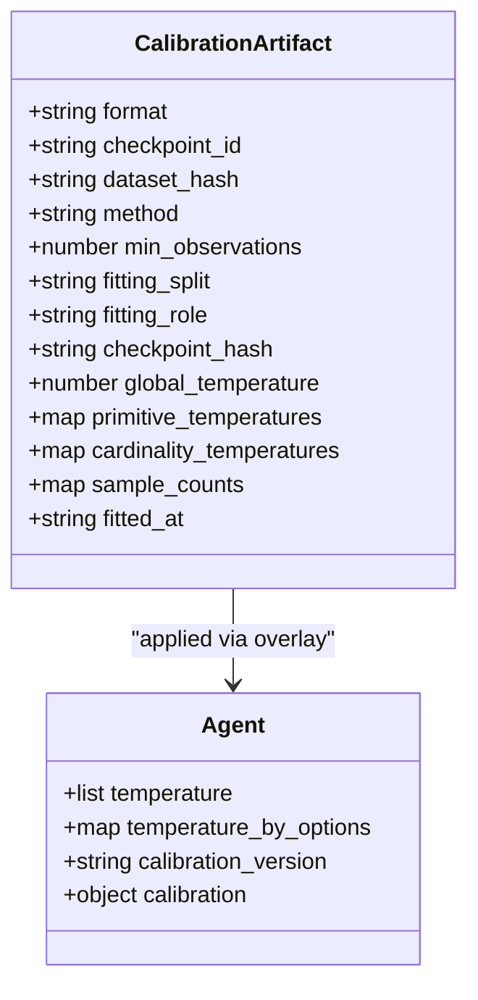

**Diagram sources**
- [calibration.py:92-133](file://veya/calibration.py#L92-L133)
- [calibration.py:175-193](file://veya/calibration.py#L175-L193)

**Section sources**
- [calibration.py:92-133](file://veya/calibration.py#L92-L133)
- [calibration.py:159-193](file://veya/calibration.py#L159-L193)

### Relationship Between Routing and Calibration Quality
Routing selects among English, multilingual, and typed-decisions checkpoints. Calibration quality varies strongly by checkpoint and language family. For example, the English checkpoint can report high confidence while performing poorly on non-English text, making script detection essential before relying on confidence.

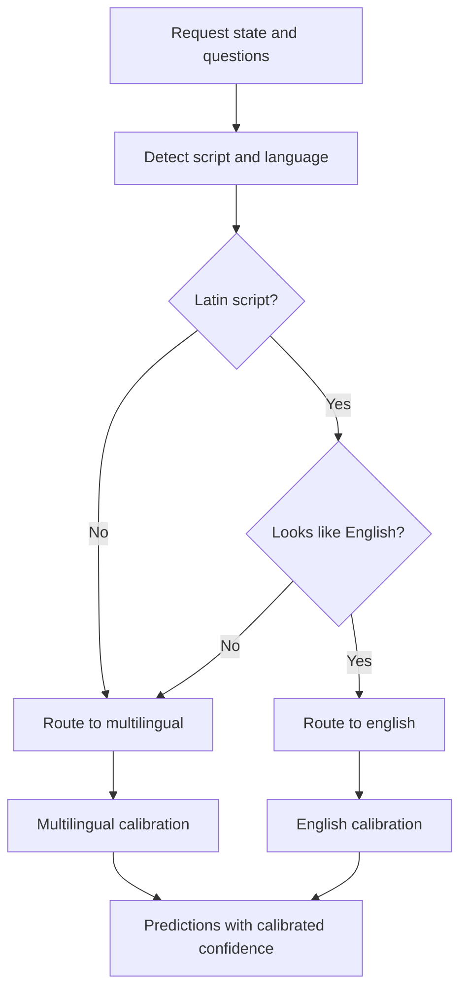

**Diagram sources**
- [router.py:257-312](file://veya/router.py#L257-L312)

**Section sources**
- [router.py:1-337](file://veya/router.py#L1-L337)

## Dependency Analysis
The calibration system depends on shared utilities for confidence, ECE, safe automation coverage, and temperature clamping. Calibration artifacts are consumed by agents and influence both confidence and automation decisions.

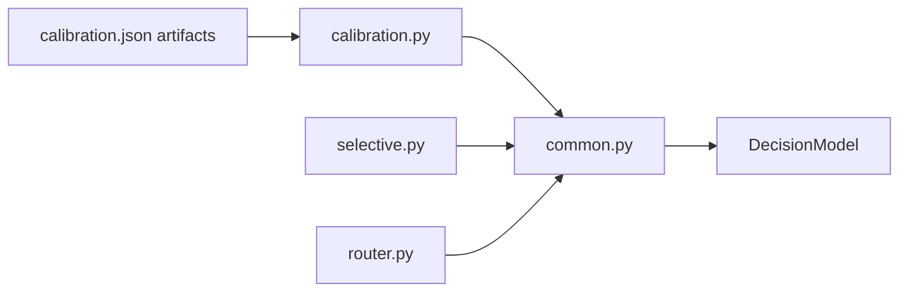

**Diagram sources**
- [calibration.py:1-193](file://veya/calibration.py#L1-L193)
- [common.py:1-333](file://veya/common.py#L1-L333)
- [selective.py:1-143](file://veya/selective.py#L1-L143)
- [router.py:1-337](file://veya/router.py#L1-L337)
- [calibration.json:1-28](file://models/production/calibration.json#L1-L28)

**Section sources**
- [calibration.py:1-193](file://veya/calibration.py#L1-L193)
- [common.py:1-333](file://veya/common.py#L1-L333)
- [selective.py:1-143](file://veya/selective.py#L1-L143)
- [router.py:1-337](file://veya/router.py#L1-L337)
- [calibration.json:1-28](file://models/production/calibration.json#L1-L28)

## Performance Considerations
- Temperature fitting is a grid search over a fixed logarithmic grid; it is inexpensive but should be run on a representative calibration split.
- Grouping by cardinality reduces overfitting for rare label-count regimes by sharing parameters where data is sparse.
- Clamping temperatures avoids pathological sharpening that would inflate confidence without improving calibration.
- ECE computation is linear in the number of samples and bins.
- Safe automation coverage sorts once and scans once, making it efficient for evaluation pipelines.

[No sources needed since this section provides general guidance]

## Troubleshooting Guide

### Calibration Artifact Validation Errors
Common validation failures include:

- Unsupported format version.
- Fitting split named test or empty.
- Fitting role not set to calibration.
- Checkpoint hash mismatch.
- Scorer identity mismatch.

These checks prevent mixing calibration artifacts across models, scorers, or splits.

**Section sources**
- [calibration.py:159-172](file://veya/calibration.py#L159-L172)

### Unsafe Temperatures
If a fitted temperature is too low, it can sharply amplify confidence without genuine calibration improvement. The system clamps temperatures to a safe interval and refuses to apply values outside that range.

**Section sources**
- [common.py:275-291](file://veya/common.py#L275-L291)
- [calibration.py:64-75](file://veya/calibration.py#L64-L75)

### Low or Missing Confidence
Confidence may be low when:

- Multiple options have similar probabilities.
- The question has many candidates.
- The model is uncertain due to ambiguous input.
- The chosen checkpoint is poorly matched to the language or task.

In these cases, consider routing to a more appropriate checkpoint and reviewing calibration artifacts for the relevant bucket.

**Section sources**
- [common.py:261-267](file://veya/common.py#L261-L267)
- [router.py:257-312](file://veya/router.py#L257-L312)

### High ECE After Refit
A refit may reduce NLL or Brier score while increasing ECE if it sharpens confidence too aggressively. The documented decision artifact explicitly warns about historical ECE values being development-exposed and not sufficient for release certification.

**Section sources**
- [calibration.json:17-30](file://artifacts/decisions/calibration.json#L17-L30)

## Conclusion
Veya’s calibration system ties together temperature scaling, proper scoring, confidence estimation, ECE, and safe automation coverage. It uses cardinality-aware bucketing to adapt to different question types and label counts, validates calibration artifacts rigorously, and constrains temperatures to maintain reliable confidence. Calibration quality directly affects decision reliability, especially across languages and task types, so routing, bucket selection, and confidence thresholds should be tuned together.

[No sources needed since this section summarizes without analyzing specific files]

## Appendices

### Examples of Calibration Application

#### Example 1: Applying a Production Calibration Artifact
- Load the production calibration artifact.
- Validate its format, fitting role, scorer identity, and checkpoint hash.
- Apply it to the agent so that primitive and cardinality temperatures replace the default values.
- Inspect `agent.temperature`, `agent.temperature_by_options`, and `agent.calibration_version`.

**Section sources**
- [calibration.py:159-193](file://veya/calibration.py#L159-L193)
- [calibration.json:1-28](file://models/production/calibration.json#L1-L28)

#### Example 2: Computing ECE and Safe Automation Coverage
- Collect per-sample confidence and correctness.
- Compute ECE using uniform bins.
- Choose a risk budget, sort by confidence, and compute the largest accepted prefix.
- Report coverage against the full dataset.

**Section sources**
- [common.py:222-258](file://veya/common.py#L222-L258)

#### Example 3: Setting a Confidence Threshold for Automation
- Choose a confidence score: max probability, negative entropy, or margin.
- Select a threshold on a validation split so that the longest high-confidence prefix satisfies the risk budget.
- Apply the threshold to accept or defer decisions.

**Section sources**
- [selective.py:21-56](file://veya/selective.py#L21-L56)

### Temperature Parameter Tuning Guidance
- Fit temperatures on a dedicated calibration split, not on training or test data.
- Prefer cardinality buckets when some label counts have few samples.
- Monitor ECE, not just accuracy or NLL.
- Respect the clamped temperature range to avoid publishing misleading confidence.
- Revisit calibration only if a later held-out set shows worse honest ECE or changes top-1 decisions.

**Section sources**
- [calibration.py:64-133](file://veya/calibration.py#L64-L133)
- [calibration.json:1-32](file://artifacts/decisions/calibration.json#L1-L32)

### Confidence Threshold Setting Guidance
- Use a validation split to choose the threshold.
- Keep the threshold unchanged when evaluating a later split.
- Report Wilson intervals for observed risk when accepted decisions are limited.
- Treat missing thresholds as rejecting all decisions.

**Section sources**
- [selective.py:37-113](file://veya/selective.py#L37-L113)