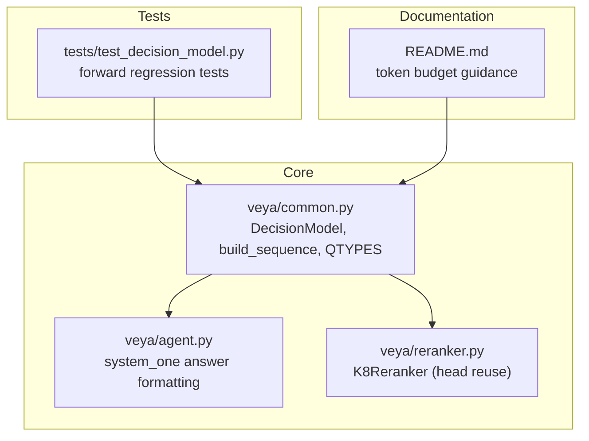
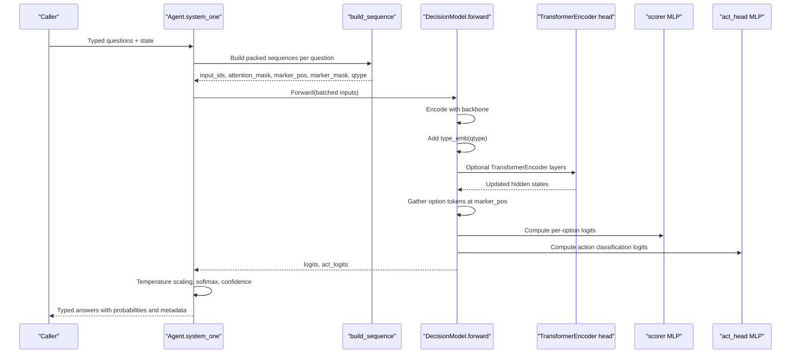
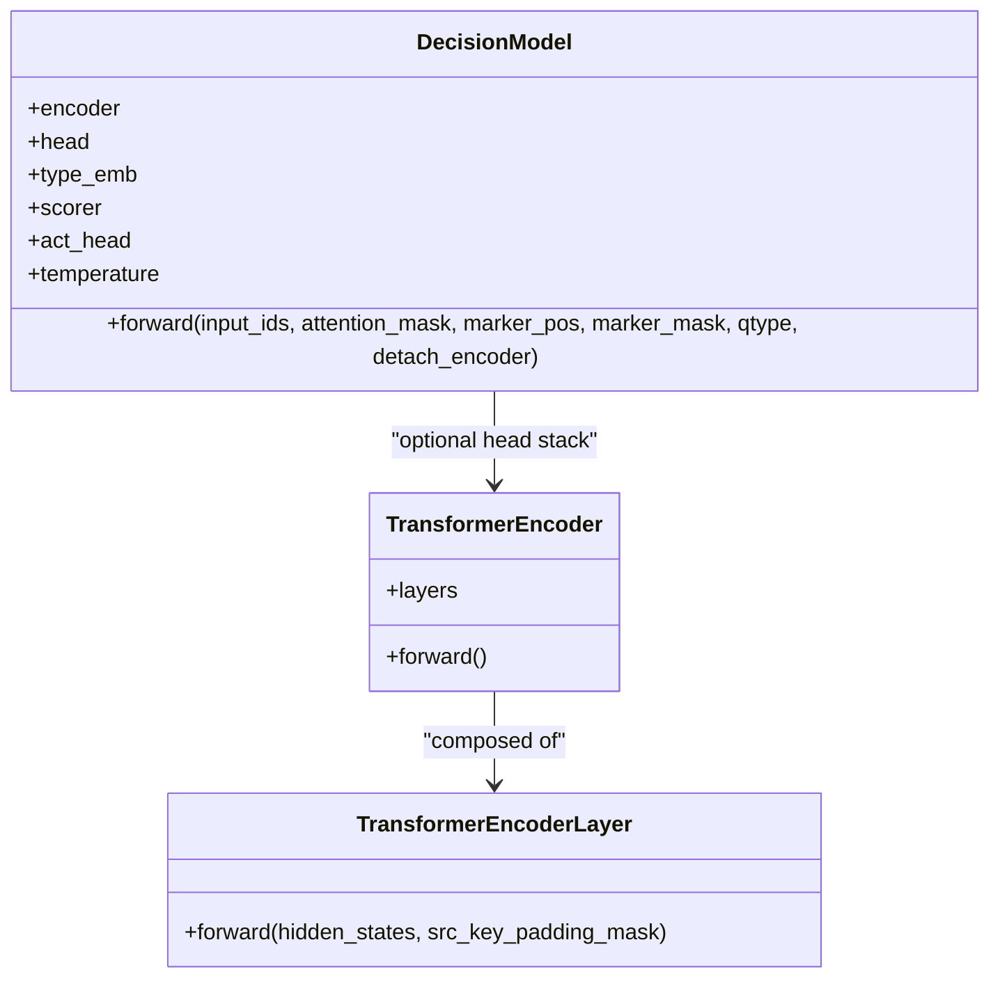
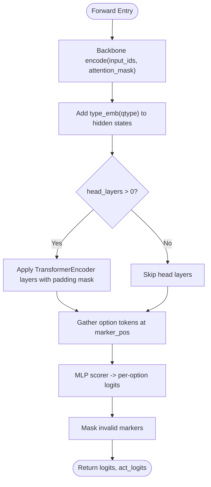
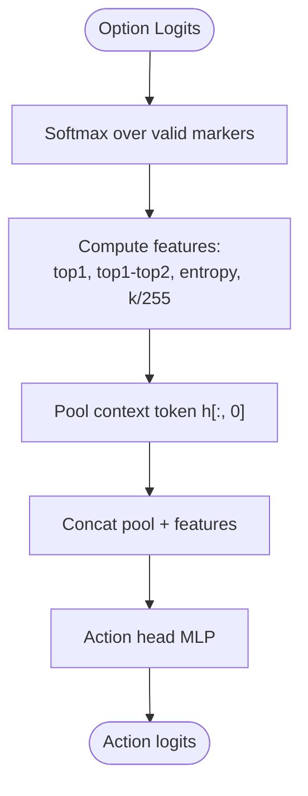
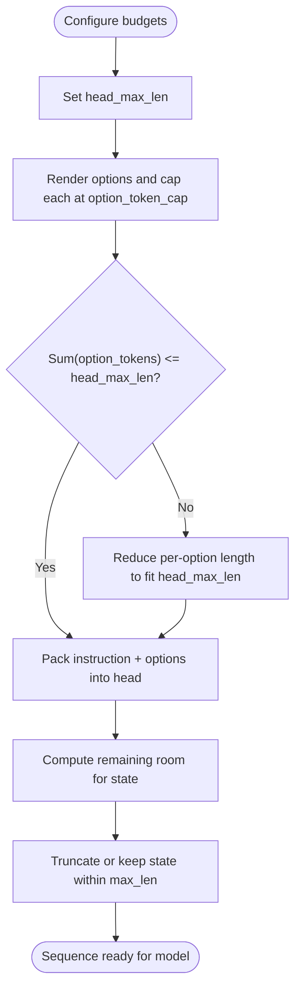
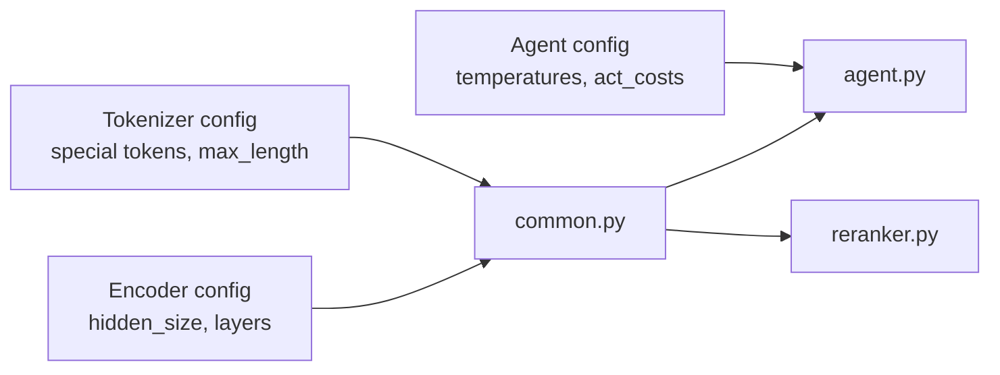

# Decision Heads

<cite>
**Referenced Files in This Document**
- [common.py](file://veya/common.py)
- [agent.py](file://veya/agent.py)
- [reranker.py](file://veya/reranker.py)
- [test_decision_model.py](file://tests/test_decision_model.py)
- [README.md](file://README.md)
</cite>

## Table of Contents
1. [Introduction](#introduction)
2. [Project Structure](#project-structure)
3. [Core Components](#core-components)
4. [Architecture Overview](#architecture-overview)
5. [Detailed Component Analysis](#detailed-component-analysis)
6. [Dependency Analysis](#dependency-analysis)
7. [Performance Considerations](#performance-considerations)
8. [Troubleshooting Guide](#troubleshooting-guide)
9. [Conclusion](#conclusion)

## Introduction
This document explains Veya’s typed decision heads architecture. It focuses on the `DecisionModel` class, its TransformerEncoder-based head layers, type embeddings, and scoring mechanisms. It also documents the three decision primitives supported by the model: choice, score, and noul, including how each is processed through the shared forward pass. Finally, it clarifies the relationship between sequence length controls (`head_max_len`, `option_token_cap`) and label-space constraints that affect accuracy and token budgeting.

## Project Structure
The typed decision logic lives primarily in the core module alongside utilities for sequence construction and evaluation. The agent layer consumes model outputs to produce user-facing answers per question type. A reranker variant reuses the same head components for a high-cardinality shortlist route.

**Diagram sources**
- [common.py:11-172](file://veya/common.py#L11-L172)
- [agent.py:350-414](file://veya/agent.py#L350-L414)
- [reranker.py:17-77](file://veya/reranker.py#L17-L77)
- [test_decision_model.py:17-99](file://tests/test_decision_model.py#L17-L99)
- [README.md:379-394](file://README.md#L379-L394)

**Section sources**
- [common.py:11-172](file://veya/common.py#L11-L172)
- [agent.py:350-414](file://veya/agent.py#L350-L414)
- [reranker.py:17-77](file://veya/reranker.py#L17-L77)
- [test_decision_model.py:17-99](file://tests/test_decision_model.py#L17-L99)
- [README.md:379-394](file://README.md#L379-L394)

## Core Components
- DecisionModel: A bidirectional transformer encoder backbone with an optional TransformerEncoder head stack, type embeddings, a scorer for option logits, and an action classification head.
- Sequence builder: Formats inputs into a packed prompt containing instruction text, masked option slots, and state tokens.
- Question types: choice, score, and noul are encoded as integer types and routed through the same forward path.
- Agent integration: Converts raw logits and action probabilities into typed answers with confidence and metadata.

Key responsibilities:
- Tokenization and packing: `build_sequence` constructs the input sequence and marker positions for options.
- Encoding and type injection: `DecisionModel.forward` encodes the full sequence, adds type embeddings, optionally applies head layers, and extracts option representations at marker positions.
- Scoring and action prediction: Computes per-option logits and an action classification signal from pooled context and distribution features.

**Section sources**
- [common.py:11-172](file://veya/common.py#L11-L172)
- [agent.py:350-414](file://veya/agent.py#L350-L414)

## Architecture Overview
The typed decision pipeline processes all three primitives through a unified representation and scoring mechanism.

**Diagram sources**
- [agent.py:350-414](file://veya/agent.py#L350-L414)
- [common.py:64-111](file://veya/common.py#L64-L111)
- [common.py:130-161](file://veya/common.py#L130-L161)

## Detailed Component Analysis

### DecisionModel Class Structure
`DecisionModel` composes:
- Backbone encoder: Any compatible transformer encoder loaded via configuration.
- Optional head stack: A configurable number of TransformerEncoder layers operating over the full sequence.
- Type embedding: An embedding table mapping the three decision types to vectors added to token representations.
- Scorer: A small MLP that maps option-position representations to scalar logits.
- Action head: A small MLP that predicts automation-related actions using pooled context and distribution-derived features.

**Diagram sources**
- [common.py:114-172](file://veya/common.py#L114-L172)

**Section sources**
- [common.py:114-172](file://veya/common.py#L114-L172)

### TransformerEncoder Head Layers
- Construction: The head uses `nn.TransformerEncoderLayer` with dimension derived from the backbone’s hidden size, multi-head attention configured as `max(1, d // 64)`, feed-forward width `4 * d`, dropout, batch-first ordering, and pre-normalization.
- Stacking: The number of head layers is configurable; if zero, the head is omitted.
- Masking: Padding masks are applied based on the attention mask so that padding tokens do not attend to content.

**Diagram sources**
- [common.py:117-138](file://veya/common.py#L117-L138)
- [common.py:139-142](file://veya/common.py#L139-L142)

**Section sources**
- [common.py:117-138](file://veya/common.py#L117-L138)
- [common.py:139-142](file://veya/common.py#L139-L142)

### Type Embeddings
- Purpose: Inject task-specific information into the shared representation by adding a learned vector per decision type to every token position.
- Implementation: An embedding table of size 3 maps the integer types to vectors matching the encoder’s hidden dimension.

Behavioral implications:
- Choice, score, and noul share the same encoder and head but are disambiguated by their type embeddings.
- Calibration temperatures are maintained per type to adjust softmax sharpness during inference.

**Section sources**
- [common.py:124-127](file://veya/common.py#L124-L127)
- [agent.py:373-376](file://veya/agent.py#L373-L376)

### Scoring Mechanisms
- Option extraction: After encoding and optional head processing, the model gathers hidden states at marker positions corresponding to each option.
- Scorer MLP: Maps each option’s representation to a scalar logit. Invalid markers are masked out before softmax.
- Distribution features: From the softmax distribution over options, the model computes entropy, top-1 probability, top-1 minus top-2 gap, and normalized option count. These features plus the pooled context token are fed to the action head.

Edge case handling:
- Single-option questions: When only one valid marker exists, the code pads the second top-k entry to ensure the action head receives a consistent “fully decided” signal.

**Diagram sources**
- [common.py:144-161](file://veya/common.py#L144-L161)

**Section sources**
- [common.py:144-161](file://veya/common.py#L144-L161)
- [test_decision_model.py:41-79](file://tests/test_decision_model.py#L41-L79)

### Three Decision Types and Their Processing

#### Choice
- Label space: A non-empty dictionary of candidate labels to descriptions.
- Sequence format: Options are rendered as label texts and placed into masked slots.
- Output interpretation: Argmax over option probabilities yields the selected choice; probabilities are returned per label.

Processing highlights:
- Marker positions correspond to each criterion key.
- Confidence is derived from the option distribution.
- Action probability indicates automation readiness.

**Section sources**
- [common.py:42-53](file://veya/common.py#L42-L53)
- [agent.py:381-389](file://veya/agent.py#L381-L389)

#### Score
- Label space: An ordered list of at least two levels.
- Sequence format: Levels are rendered as “level i: description”.
- Output interpretation: Expected score is computed as the weighted sum of level indices under the predicted distribution.

Processing highlights:
- Probabilities map to ordered categories.
- Legend provides human-readable level names.

**Section sources**
- [common.py:50-53](file://veya/common.py#L50-L53)
- [agent.py:390-399](file://veya/agent.py#L390-L399)

#### Noul
- Label space: Binary proposition evaluation with fixed order [false, true].
- Sequence format: Two fixed options representing false and true propositions.
- Output interpretation: Probability of the true class is reported as the noul value; confidence is the maximum of p(true) and 1 - p(true).

Processing highlights:
- No external criteria are required; defaults apply when none are provided.

**Section sources**
- [common.py:54-61](file://veya/common.py#L54-L61)
- [agent.py:400-406](file://veya/agent.py#L400-L406)

### Forward Pass Mechanics

#### Marker Position Handling
- Markers are inserted before each option’s tokenized text within the packed sequence.
- During forward, marker positions are clamped to non-negative values and used to gather option representations from the hidden states.

Robustness:
- If fewer markers fit within the sequence due to truncation, the marker mask excludes them from scoring.

**Section sources**
- [common.py:94-111](file://veya/common.py#L94-L111)
- [common.py:139-142](file://veya/common.py#L139-L142)

#### Logit Computation
- Per-option logits are produced by the scorer MLP after gathering option tokens.
- Invalid markers are masked with a large negative value before softmax to exclude them from the distribution.

**Section sources**
- [common.py:139-142](file://veya/common.py#L139-L142)

#### Action Classification
- The action head consumes:
  - Pooled context token representation.
  - Four distribution-derived features: top-1 probability, top-1 minus top-2 gap, normalized entropy, and normalized option count.
- Outputs binary action logits indicating automation eligibility.

**Section sources**
- [common.py:144-161](file://veya/common.py#L144-L161)

### Code Examples: Processing Different Question Types

While this document avoids embedding code snippets, the following paths illustrate how different question types flow through the system:

- Building sequences and marking options:
  - [common.py:64-111](file://veya/common.py#L64-L111)
- Running the model and interpreting outputs:
  - [agent.py:350-414](file://veya/agent.py#L350-L414)
- Regression tests for single-option edge cases:
  - [test_decision_model.py:41-79](file://tests/test_decision_model.py#L41-L79)

Example scenarios:
- Choice with multiple criteria:
  - Construct a question with a dict of criteria; the builder renders each criterion as an option slot; the agent returns the chosen key and per-label probabilities.
- Score with ordered levels:
  - Provide a list of levels; the agent computes expected score from the predicted distribution over levels.
- Noul proposition evaluation:
  - Use default binary options; the agent reports the probability of the true proposition and confidence.

**Section sources**
- [common.py:64-111](file://veya/common.py#L64-L111)
- [agent.py:350-414](file://veya/agent.py#L350-L414)
- [test_decision_model.py:41-79](file://tests/test_decision_model.py#L41-L79)

### Relationship Between head_max_len, option_token_cap, and Label Space Constraints

Token budgeting is split into two parts:
- Head budget (`head_max_len`): Allocates tokens for the typed instruction and all option slots.
- State budget (`max_len - head_max_len`): Allocates tokens for the surrounding state or document context.

Constraints and behaviors:
- Each option is capped at `option_token_cap` tokens to prevent any single label from dominating the head budget.
- If the total option tokens exceed `head_max_len`, the builder reduces per-option lengths proportionally to fit within the budget.
- For very large label sets (e.g., 50+ options), the per-option token allocation can become too small, harming discriminability and accuracy.

Guidance:
- Increase `head_max_len` and `max_len` to give more room for both options and state.
- Alternatively, use shortlisting to evaluate only the top candidates in a packed forward pass.
- Splitting label sets into coarse and fine-grained questions can improve performance when many options must be scored simultaneously.

**Diagram sources**
- [common.py:64-111](file://veya/common.py#L64-L111)
- [README.md:379-394](file://README.md#L379-L394)

**Section sources**
- [common.py:64-111](file://veya/common.py#L64-L111)
- [README.md:379-394](file://README.md#L379-L394)

## Dependency Analysis
The decision heads depend on:
- Tokenizer configuration for special tokens and maximum sequence length.
- Encoder configuration for hidden dimensions and attention parameters.
- Agent configuration for temperature calibration and action costs.

External relationships:
- The K8 reranker reuses the same head modules (TransformerEncoder, type embeddings, scorer) for a specialized high-cardinality route without modifying the base checkpoint.

**Diagram sources**
- [common.py:164-172](file://veya/common.py#L164-L172)
- [reranker.py:17-39](file://veya/reranker.py#L17-L39)
- [models/production/tokenizer/tokenizer_config.json:1-14](file://models/production/tokenizer/tokenizer_config.json#L1-L14)
- [models/production/typed-decisions/tokenizer/tokenizer_config.json:1-15](file://models/production/typed-decisions/tokenizer/tokenizer_config.json#L1-L15)

**Section sources**
- [common.py:164-172](file://veya/common.py#L164-L172)
- [reranker.py:17-39](file://veya/reranker.py#L17-L39)

## Performance Considerations
- Batched evaluation: The agent batches multiple typed questions over a shared state to amortize encoder cost.
- Token budget tuning: Properly sizing `head_max_len` and `option_token_cap` is critical for high-cardinality tasks to avoid losing discriminative information in option slots.
- Action head features: Entropy and top-k gaps provide strong signals for automation decisions; ensuring these features are well-calibrated improves reliability.

[No sources needed since this section provides general guidance]

## Troubleshooting Guide
Common issues and resolutions:
- Single-option crash:
  - Symptom: Forward pass raises when there is exactly one valid marker.
  - Cause: Attempting to select top-2 probabilities from a single-option distribution.
  - Resolution: The implementation pads the missing second entry to maintain consistent feature shapes; tests verify this behavior.
- Excessive truncation of options:
  - Symptom: Accuracy drops sharply with many options.
  - Cause: Insufficient `head_max_len` leading to aggressive per-option truncation.
  - Resolution: Increase `head_max_len` and/or reduce the number of options via shortlisting.
- State truncation:
  - Symptom: Important context is dropped.
  - Cause: Not enough remaining room after packing options.
  - Resolution: Increase `max_len` or reduce option token usage.

**Section sources**
- [test_decision_model.py:41-79](file://tests/test_decision_model.py#L41-L79)
- [README.md:379-394](file://README.md#L379-L394)

## Conclusion
Veya’s typed decision heads unify choice, score, and noul primitives through a shared encoder, type embeddings, and a compact scoring head. The forward pass robustly handles marker positions, computes per-option logits, and derives action classification signals from distribution features. Careful configuration of `head_max_len`, `option_token_cap`, and `max_len` is essential to balance label discrimination and context retention, especially for high-cardinality tasks. The design enables efficient batched inference and clear interpretability across all decision types.