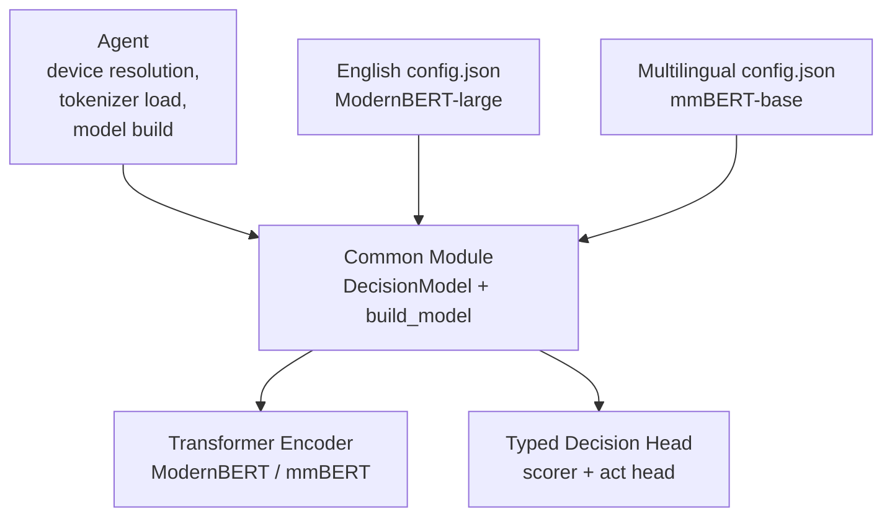
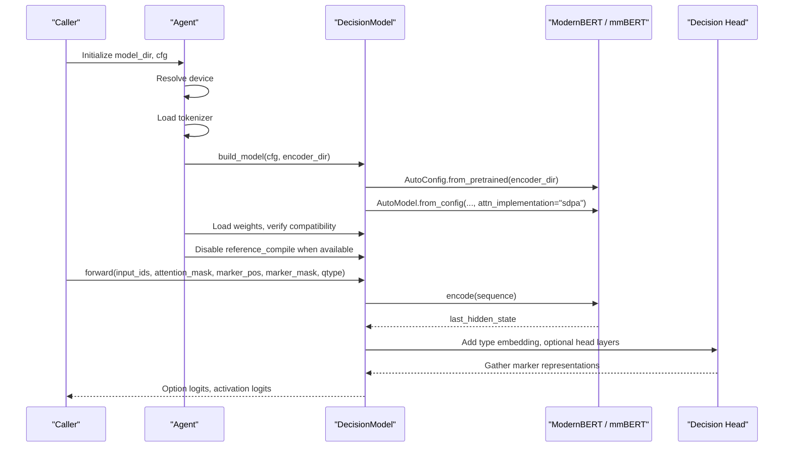
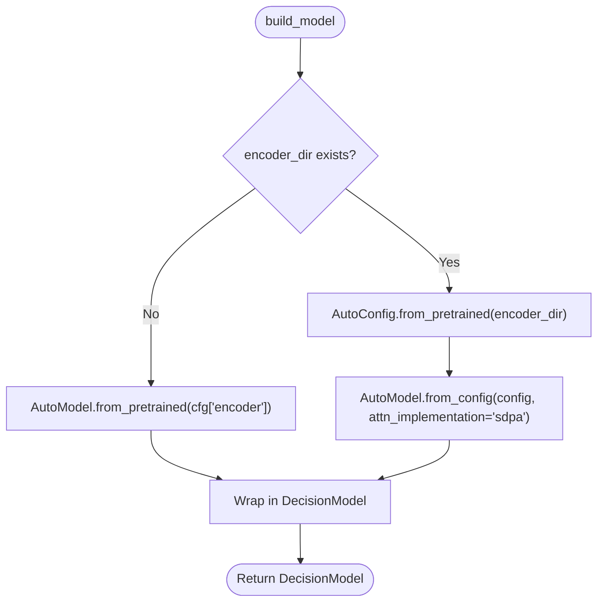
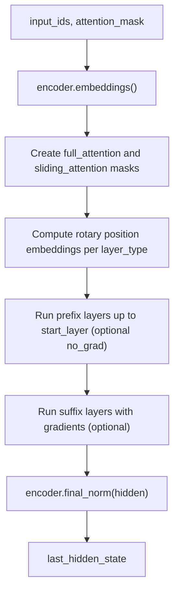
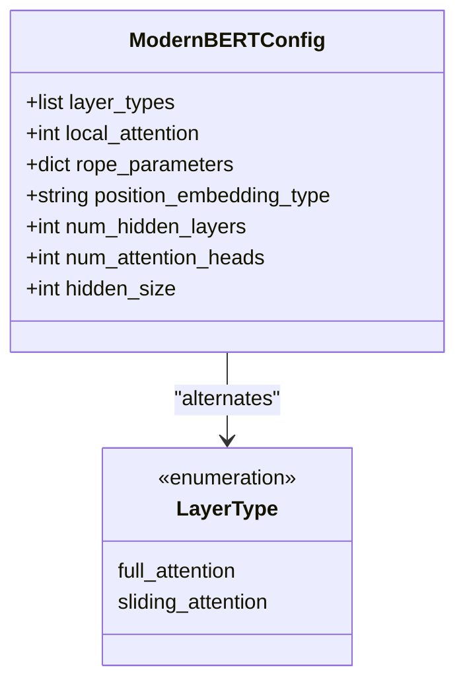
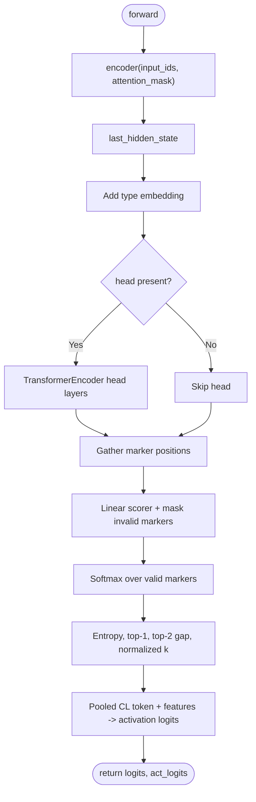
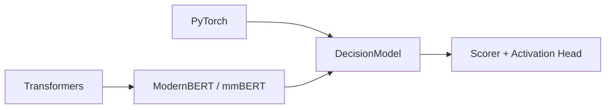

# Encoder Backbone

<cite>
**Referenced Files in This Document**
- [common.py](file://veya/common.py)
- [agent.py](file://veya/agent.py)
- [hypothesis.py](file://veya/experimental/hypothesis.py)
- [config.json (English ModernBERT-large)](file://models/production/encoder/config.json)
- [config.json (Multilingual mmBERT-base)](file://models/production/multilingual/encoder/config.json)
- [BENCHMARKS.md](file://BENCHMARKS.md)
</cite>

## Table of Contents
1. [Introduction](#introduction)
2. [Project Structure](#project-structure)
3. [Core Components](#core-components)
4. [Architecture Overview](#architecture-overview)
5. [Detailed Component Analysis](#detailed-component-analysis)
6. [Dependency Analysis](#dependency-analysis)
7. [Performance Considerations](#performance-considerations)
8. [Troubleshooting Guide](#troubleshooting-guide)
9. [Conclusion](#conclusion)

## Introduction
This document explains Veya’s encoder backbone implementation and how it integrates transformer encoders behind typed decision inference. The production backbones are ModernBERT-based:

- English choice model uses a frozen ModernBERT-large encoder.
- Multilingual model uses a frozen mmBERT-base encoder.

The encoder is loaded from `config.json` files under the model package, wrapped by Veya’s `DecisionModel`, and used to extract sequence representations that feed small typed decision heads. The documentation covers configuration loading, sequence encoding, attention behavior, hidden state extraction, initialization patterns, memory and performance characteristics, and optimization strategies for different encoder backbones.

## Project Structure
Veya’s encoder integration lives primarily in the core model module, with runtime device and weight loading handled by the agent layer. Encoder-specific configuration is stored as JSON artifacts alongside the model packages.

**Diagram sources**
- [agent.py:167-204](file://veya/agent.py#L167-L204)
- [common.py:114-172](file://veya/common.py#L114-L172)
- [config.json (English ModernBERT-large):1-84](file://models/production/encoder/config.json#L1-L84)
- [config.json (Multilingual mmBERT-base):1-79](file://models/production/multilingual/encoder/config.json#L1-L79)

**Section sources**
- [agent.py:167-204](file://veya/agent.py#L167-L204)
- [common.py:114-172](file://veya/common.py#L114-L172)
- [config.json (English ModernBERT-large):1-84](file://models/production/encoder/config.json#L1-L84)
- [config.json (Multilingual mmBERT-base):1-79](file://models/production/multilingual/encoder/config.json#L1-L79)

## Core Components
- `DecisionModel`: A bidirectional transformer encoder backbone plus a typed decision head. It reads the encoder’s last hidden state, injects a type embedding, optionally runs a small TransformerEncoder head, extracts marker token representations, produces logits for options, and computes activation signals.
- `build_model`: Loads an encoder via Hugging Face Transformers using either a local encoder directory or a pretrained model identifier. It forces scaled dot-product attention (`sdpa`) and wraps the encoder in `DecisionModel`.
- Agent integration: Resolves device, loads tokenizer, builds the model, loads weights, and disables ModernBERT’s automatic compilation path because Veya’s batch sizes are small and eager execution is more reliable.

Key responsibilities:
- Configuration-driven encoder construction.
- Sequence encoding through the underlying ModernBERT/mmBERT encoder.
- Hidden state extraction at the final layer.
- Typed option scoring and activation estimation.

**Section sources**
- [common.py:114-172](file://veya/common.py#L114-L172)
- [agent.py:167-204](file://veya/agent.py#L167-L204)

## Architecture Overview
At inference time, Veya constructs a token sequence containing question instructions, masked option tokens, and the user state. The encoder processes this sequence and returns the last hidden state. The decision head then:

1. Adds a type embedding based on the primitive type.
2. Optionally passes the sequence through a small TransformerEncoder head.
3. Gathers representations at marker positions corresponding to candidate options.
4. Scores each marker with a linear scorer.
5. Computes softmax probabilities, entropy, and top-1/top-2 gaps.
6. Produces activation logits from pooled CL-token representation and option features.

**Diagram sources**
- [agent.py:167-204](file://veya/agent.py#L167-L204)
- [common.py:130-161](file://veya/common.py#L130-L161)
- [common.py:164-172](file://veya/common.py#L164-L172)

## Detailed Component Analysis

### Encoder Initialization and Configuration Loading
`build_model` supports two initialization paths:

- Local encoder directory: Reads `AutoConfig` from the provided encoder directory and constructs the model from that config with SDPA attention.
- Pretrained model identifier: Loads the encoder directly from the configured model name.

The English and multilingual production configurations define ModernBERT-style architectures. Differences include hidden dimensionality, number of layers, attention heads, vocabulary size, position embedding strategy, and rope parameters.

Important configuration fields:
- `hidden_size`: 1024 for English ModernBERT-large; 768 for multilingual mmBERT-base.
- `num_hidden_layers`: 28 for English; 22 for multilingual.
- `num_attention_heads`: 16 for English; 12 for multilingual.
- `layer_types`: Alternating full and sliding attention blocks.
- `max_position_embeddings`: 8192 for both backbones.
- `position_embedding_type`: Absolute for English; sans position for multilingual.
- `rope_parameters`: Per-layer-type RoPE theta values.

**Diagram sources**
- [common.py:164-172](file://veya/common.py#L164-L172)

**Section sources**
- [common.py:164-172](file://veya/common.py#L164-L172)
- [config.json (English ModernBERT-large):1-84](file://models/production/encoder/config.json#L1-L84)
- [config.json (Multilingual mmBERT-base):1-79](file://models/production/multilingual/encoder/config.json#L1-L79)

### Sequence Encoding Process
The encoder receives tokenized input IDs and an attention mask. It returns the last hidden state, which represents contextualized token embeddings after all transformer layers.

For ModernBERT-style encoders, attention masks are constructed per layer type:
- Full attention masks allow global bidirectional context.
- Sliding attention masks restrict attention to a local window.

Position embeddings are computed using rotary embeddings per layer type, matching ModernBERT’s internal structure.

**Diagram sources**
- [hypothesis.py:200-228](file://veya/experimental/hypothesis.py#L200-L228)

**Section sources**
- [hypothesis.py:200-228](file://veya/experimental/hypothesis.py#L200-L228)

### Attention Mechanisms
ModernBERT mixes two attention styles across its layers:

- Full attention: Global bidirectional attention over the entire sequence.
- Sliding attention: Local bidirectional attention within a fixed window.

The configuration specifies alternating layer types and a local attention window size. Rope parameters differ between full and sliding attention, allowing distinct positional scaling behaviors.

**Diagram sources**
- [config.json (English ModernBERT-large):26-76](file://models/production/encoder/config.json#L26-L76)
- [config.json (Multilingual mmBERT-base):26-71](file://models/production/multilingual/encoder/config.json#L26-L71)

**Section sources**
- [config.json (English ModernBERT-large):26-76](file://models/production/encoder/config.json#L26-L76)
- [config.json (Multilingual mmBERT-base):26-71](file://models/production/multilingual/encoder/config.json#L26-L71)

### Hidden State Extraction and Decision Head
`DecisionModel.forward` performs the following steps:

1. Calls the encoder and retrieves `last_hidden_state`.
2. Optionally detaches the encoder output to freeze gradients during fine-tuning experiments.
3. Adds a type embedding corresponding to the primitive type.
4. Optionally applies a small TransformerEncoder head.
5. Gathers token representations at marker positions for each candidate option.
6. Scores markers with a linear scorer and fills invalid markers with a large negative value before softmax.
7. Computes normalized entropy and top-1/top-2 probability gaps.
8. Pools the first token representation and concatenates option features to produce activation logits.

**Diagram sources**
- [common.py:130-161](file://veya/common.py#L130-L161)

**Section sources**
- [common.py:130-161](file://veya/common.py#L130-L161)

### Relationship Between Encoder Configuration and Model Capabilities
Configuration fields directly determine encoder capacity and behavior:

- `hidden_size` controls representation dimensionality and downstream head dimensions.
- `num_hidden_layers` determines depth and representational capacity.
- `num_attention_heads` affects parallel attention computation and context mixing.
- `layer_types` controls the mix of global and local attention, influencing long-range dependency modeling versus efficiency.
- `max_position_embeddings` sets maximum supported sequence length.
- `position_embedding_type` changes how positions are encoded; absolute vs sans position impacts multilingual tokenization behavior.
- `rope_parameters` defines rotational positional encoding behavior per attention type.

These fields explain why the English ModernBERT-large encoder has higher capacity than the multilingual mmBERT-base encoder and why they behave differently across languages and tasks.

**Section sources**
- [config.json (English ModernBERT-large):21-76](file://models/production/encoder/config.json#L21-L76)
- [config.json (Multilingual mmBERT-base):21-71](file://models/production/multilingual/encoder/config.json#L21-L71)

### Encoder Initialization Examples and Parameters
Initialization examples are expressed through the public API rather than raw code:

- Initialize the agent with a model directory containing tokenizer and encoder subdirectories.
- The agent resolves device automatically, preferring CUDA, then MPS, then CPU.
- Tokenizer is loaded from the local tokenizer directory if present, otherwise from the configured encoder identifier.
- Model is built using `build_model`, which loads the encoder from the local encoder directory or pretrained identifier.
- Weights are loaded and architectural compatibility is verified.
- ModernBERT’s `reference_compile` flag is disabled to keep eager execution stable for small batches.

Relevant configuration parameters include:
- `head_layers`: Number of TransformerEncoder layers in the decision head.
- `act_costs`: Keys determine the number of activation classes.
- `encoder`: Pretrained model identifier when not using a local encoder directory.

**Section sources**
- [agent.py:167-204](file://veya/agent.py#L167-L204)
- [common.py:164-172](file://veya/common.py#L164-L172)

### Memory Usage Patterns and Optimization Strategies
Memory usage depends on encoder size, sequence length, batch size, and whether gradients flow through the encoder.

Observed patterns:
- Production models use frozen encoders during inference, so only the small decision head typically requires gradients.
- Experimental adaptation code supports partial gradient flow starting from a configurable `start_layer`, freezing earlier layers and training later layers plus the final normalization.
- Disabling ModernBERT’s automatic compilation avoids hangs and unnecessary overhead for small batch sizes.
- SDPA attention is used consistently, improving efficiency compared to older attention implementations.

Optimization strategies:
- Keep the encoder frozen unless explicitly adapting suffix layers.
- Use smaller batch sizes for interactive latency-sensitive workloads.
- Prefer multilingual mmBERT-base when language diversity outweighs English-specific accuracy.
- Avoid enabling `torch.compile` for ModernBERT in Veya’s typical deployment profile.
- Tune `max_length` and `head_max_len` to balance context coverage and memory consumption.

**Section sources**
- [agent.py:198-204](file://veya/agent.py#L198-L204)
- [hypothesis.py:171-228](file://veya/experimental/hypothesis.py#L171-L228)
- [common.py:164-172](file://veya/common.py#L164-L172)

## Dependency Analysis
The encoder backbone depends on Hugging Face Transformers for ModernBERT/mmBERT model loading and attention implementation. Vewa’s `DecisionModel` depends on PyTorch for tensor operations and neural modules.

**Diagram sources**
- [common.py:114-172](file://veya/common.py#L114-L172)

**Section sources**
- [common.py:114-172](file://veya/common.py#L114-L172)

## Performance Considerations
Benchmark data provides practical performance characteristics:

- Latency on Tesla T4:
  - 1 question: ~39.5 ms for English, ~32.8 ms for multilingual.
  - Batched throughput scales efficiently, with multilingual often faster due to smaller encoder size.
- Calibration:
  - Both checkpoints ship over-confident; temperature fitting improves expected calibration error significantly.
- Language routing:
  - English checkpoint performs best on English but collapses outside English.
  - Multilingual checkpoint performs better across non-English languages but is weaker on English.

These numbers reflect end-to-end inference behavior, including tokenization, encoder processing, and decision head computation.

**Section sources**
- [BENCHMARKS.md:163-181](file://BENCHMARKS.md#L163-L181)
- [BENCHMARKS.md:95-106](file://BENCHMARKS.md#L95-L106)

## Troubleshooting Guide
Common issues and resolutions:

- Device fallback:
  - If CUDA or MPS is requested but unavailable, the agent falls back to CPU. Check hardware availability and driver setup.
- Compilation hangs:
  - ModernBERT’s automatic compilation can hang on some platforms. Veya disables it for stability.
- Compatibility errors:
  - Weight loading verifies architectural compatibility. Mismatched encoder configuration and weights will fail strict loading.
- Memory pressure:
  - Reduce batch size, sequence length, or switch to the smaller multilingual encoder.
- Gradient leakage:
  - When experimenting with partial encoder updates, ensure `start_layer` is within bounds and matches the delta layer count.

**Section sources**
- [agent.py:167-204](file://veya/agent.py#L167-L204)
- [hypothesis.py:171-190](file://veya/experimental/hypothesis.py#L171-L190)

## Conclusion
Veya’s encoder backbone integrates ModernBERT-large and mmBERT-base transformers through a clean abstraction. Configuration files define encoder capacity, attention style, and positional encoding behavior. The `DecisionModel` wraps the encoder with a lightweight typed decision head, extracting hidden states and producing calibrated option scores. Production deployments favor frozen encoders, SDPA attention, and eager execution for reliability. Performance benchmarks show fast latency and strong calibration potential after temperature fitting, while language routing ensures the right backbone serves each request. For optimization, prefer frozen encoders, tune sequence lengths, and select the appropriate backbone for the target language and task.