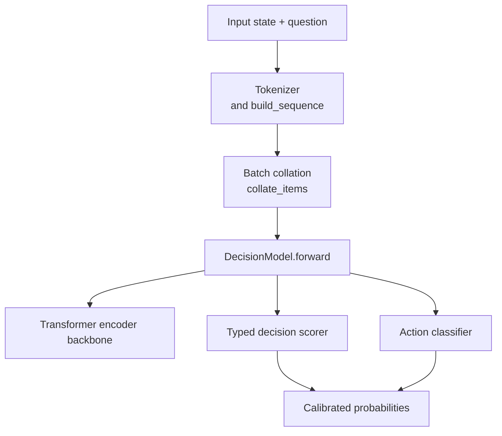
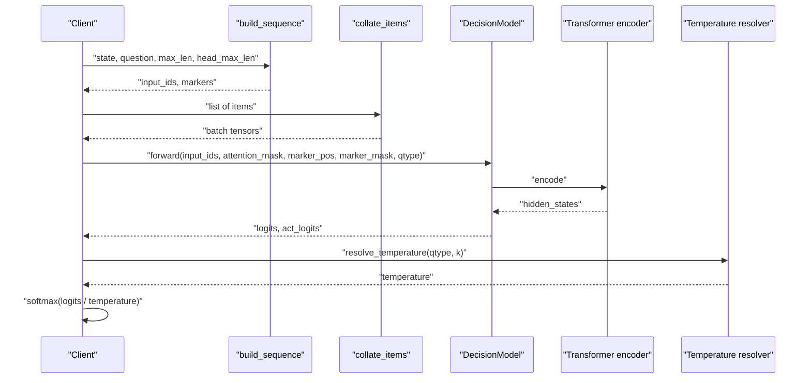
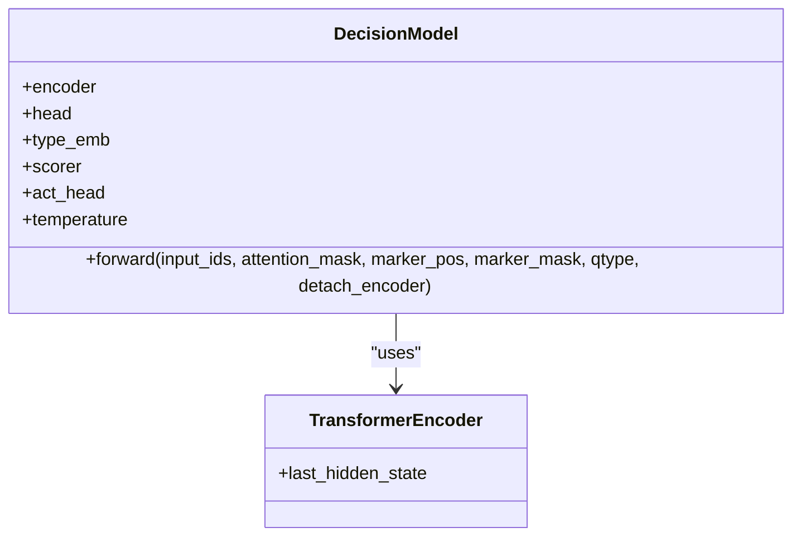
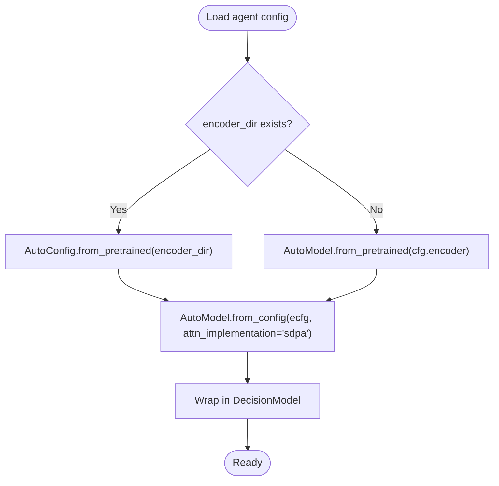
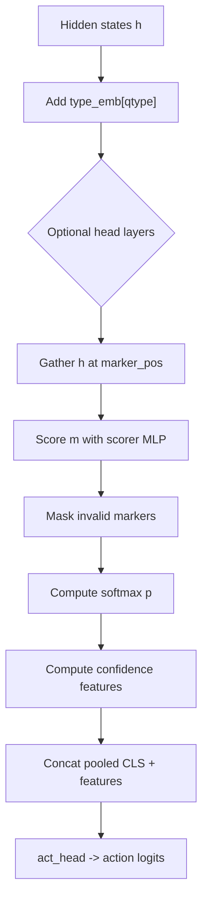
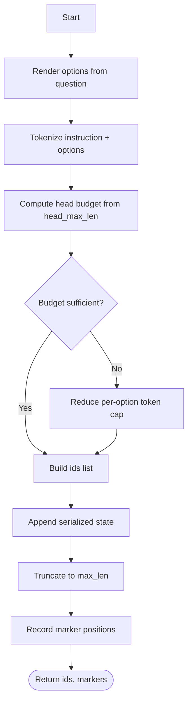
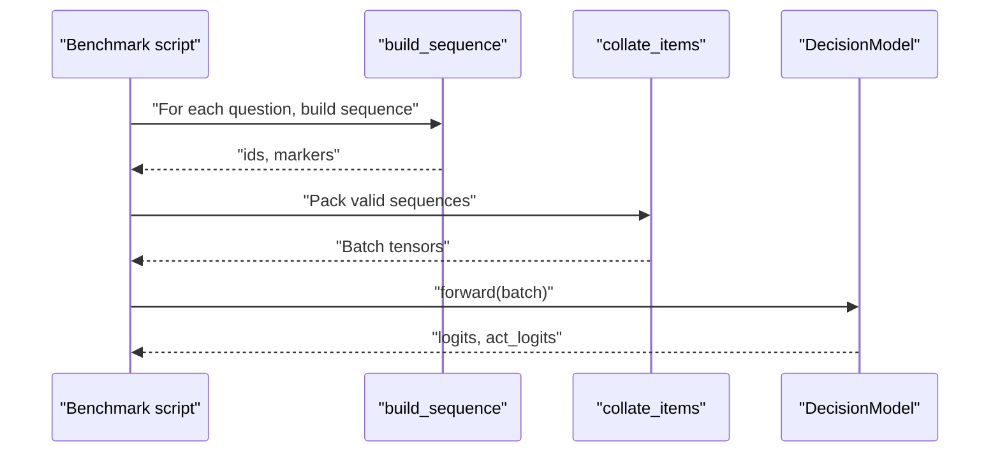
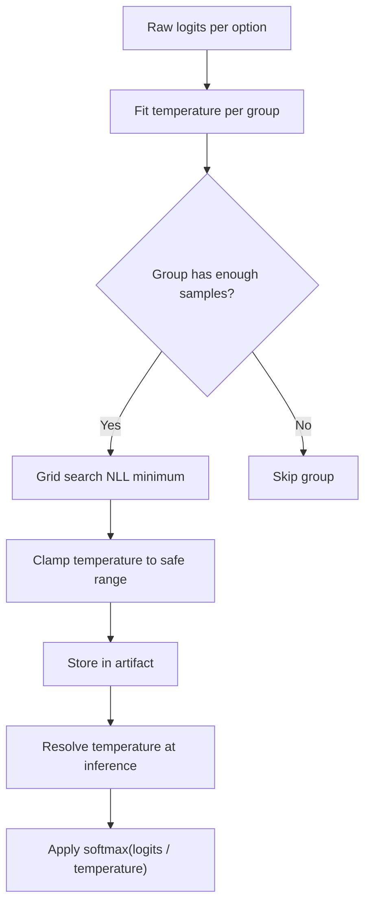
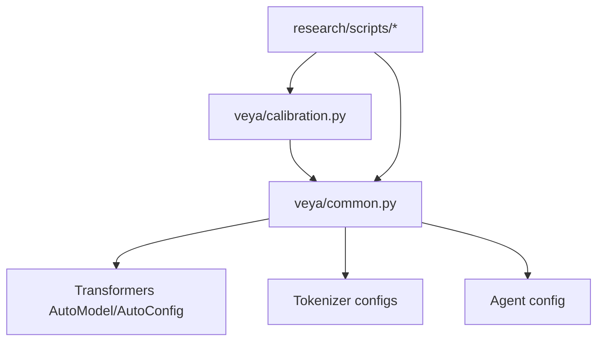

# Model Architecture

<cite>
**Referenced Files in This Document**
- [common.py](file://veya/common.py)
- [calibration.py](file://veya/calibration.py)
- [rl_agent_config.json](file://models/production/typed-decisions/rl_agent_config.json)
- [rl_agent_config.json](file://models/production/multilingual/rl_agent_config.json)
- [config.json](file://models/production/encoder/config.json)
- [config.json](file://models/production/multilingual/encoder/config.json)
- [tokenizer_config.json](file://models/production/tokenizer/tokenizer_config.json)
- [tokenizer_config.json](file://models/production/typed-decisions/tokenizer/tokenizer_config.json)
- [build_benchmark_nb.py](file://research/scripts/build_benchmark_nb.py)
- [bench_local.py](file://research/scripts/bench_local.py)
</cite>

## Table of Contents
1. [Introduction](#introduction)
2. [Project Structure](#project-structure)
3. [Core Components](#core-components)
4. [Architecture Overview](#architecture-overview)
5. [Detailed Component Analysis](#detailed-component-analysis)
6. [Dependency Analysis](#dependency-analysis)
7. [Performance Considerations](#performance-considerations)
8. [Troubleshooting Guide](#troubleshooting-guide)
9. [Conclusion](#conclusion)

## Introduction
This document explains Veya’s model architecture for typed decision scoring and calibration. It focuses on:
- The `DecisionModel` base class design.
- Integration of transformer encoder backbones, including ModernBERT-large and mmBERT-base.
- Typed decision heads that score choice, score, and noul question types.
- Sequence construction, tokenization strategy, and forward pass mechanics.
- Temperature-based calibration and the relationship between context length, head budget, and label space size.
- Data flow from input state through encoding to calibrated probabilities.

The goal is to make the architecture understandable for both practitioners and reviewers who need to reason about capacity, calibration, and deployment behavior.

## Project Structure
Veya’s model implementation lives primarily under `veya`, with production artifacts under `models/production`. Key areas relevant to this document are:
- `veya/common.py`: Core model class, sequence builder, collation utilities, and calibration helpers.
- `veya/calibration.py`: Versioned temperature calibration artifact handling and fitting.
- `models/production/*`: Encoder configurations, tokenizer configurations, and per-model agent configuration files.
- `research/scripts/*`: Benchmarking scripts that demonstrate how sequences are built, batched, forwarded, and scored.

**Diagram sources**
- [common.py:64-111](file://veya/common.py#L64-L111)
- [common.py:114-161](file://veya/common.py#L114-L161)
- [common.py:298-332](file://veya/common.py#L298-L332)
- [calibration.py:136-150](file://veya/calibration.py#L136-L150)

**Section sources**
- [common.py:1-333](file://veya/common.py#L1-L333)
- [calibration.py:1-193](file://veya/calibration.py#L1-L193)
- [rl_agent_config.json:1-36](file://models/production/typed-decisions/rl_agent_config.json#L1-L36)
- [rl_agent_config.json:1-26](file://models/production/multilingual/rl_agent_config.json#L1-L26)

## Core Components
- `DecisionModel`: A bidirectional transformer encoder backbone plus a small typed decision head and an action classifier. It adds type embeddings, optional head layers, a scorer over masked option positions, and an action prediction head.
- `build_sequence`: Builds a single input sequence containing instruction text, masked option slots, and serialized state. It returns token IDs and marker positions for each option.
- `collate_items`: Packs multiple sequences into batches with attention masks, marker positions, marker masks, question types, labels, and optional targets.
- Calibration utilities: Temperature grid search, NLL minimization, bucket resolution, artifact loading, and application to the agent.

Key responsibilities:
- Encoding: The encoder produces contextualized hidden states.
- Scoring: Option tokens marked by `[MASK]` are gathered and scored per question type.
- Action classification: A separate head predicts whether to escalate or proceed based on pooled representation and confidence features.
- Calibration: Temperatures are applied per question type and per cardinality bucket to produce well-calibrated probabilities.

**Section sources**
- [common.py:114-172](file://veya/common.py#L114-L172)
- [common.py:64-111](file://veya/common.py#L64-L111)
- [common.py:298-332](file://veya/common.py#L298-L332)
- [calibration.py:64-150](file://veya/calibration.py#L64-L150)

## Architecture Overview
At runtime, Veya converts structured questions and conversation state into token sequences, encodes them with a pretrained transformer encoder, scores options at masked positions, and optionally applies temperature scaling to obtain calibrated probabilities.

**Diagram sources**
- [common.py:64-111](file://veya/common.py#L64-L111)
- [common.py:298-332](file://veya/common.py#L298-L332)
- [common.py:130-161](file://veya/common.py#L130-L161)
- [calibration.py:136-150](file://veya/calibration.py#L136-L150)

## Detailed Component Analysis

### DecisionModel Base Class Design
`DecisionModel` wraps a pretrained encoder and adds:
- Type embedding: Adds a learned embedding per question type (choice, score, noul).
- Optional head layers: A small Transformer encoder stack applied after the backbone.
- Scorer: A small MLP that scores each masked option position.
- Action head: Predicts escalation or other actions using pooled representation and confidence features.
- Per-type temperatures: Buffers storing one temperature per question type.

Forward pass steps:
1. Encode input with the backbone.
2. Add type embeddings to all token positions.
3. Optionally run through head layers.
4. Gather hidden states at marker positions corresponding to options.
5. Score options and mask invalid positions.
6. Compute softmax-derived confidence features for the action head.
7. Return raw logits and action logits.

**Diagram sources**
- [common.py:114-161](file://veya/common.py#L114-L161)

**Section sources**
- [common.py:114-161](file://veya/common.py#L114-L161)

### Transformer Encoder Backbone Integration
Veya supports different encoder backbones through configuration:
- ModernBERT-large: Used by the typed-decisions model.
- mmBERT-base: Used by the multilingual model.

Encoder configuration details:
- ModernBERT-large config includes large hidden dimensions, many layers, and ModernBERT-specific settings such as sliding/full attention patterns and rope parameters.
- mmBERT-base config includes smaller hidden dimensions, fewer layers, and similar ModernBERT-style structure.

Model construction:
- `build_model` loads the encoder via `AutoConfig` and `AutoModel`, enabling efficient attention (`sdpa`).
- The agent configuration specifies which encoder to use and tuning parameters like `head_layers`, `max_len`, and `head_max_len`.

**Diagram sources**
- [common.py:164-172](file://veya/common.py#L164-L172)
- [rl_agent_config.json:1-36](file://models/production/typed-decisions/rl_agent_config.json#L1-L36)
- [rl_agent_config.json:1-26](file://models/production/multilingual/rl_agent_config.json#L1-L26)

**Section sources**
- [common.py:164-172](file://veya/common.py#L164-L172)
- [config.json:51-84](file://models/production/encoder/config.json#L51-L84)
- [config.json:1-79](file://models/production/multilingual/encoder/config.json#L1-L79)
- [rl_agent_config.json:1-36](file://models/production/typed-decisions/rl_agent_config.json#L1-L36)
- [rl_agent_config.json:1-26](file://models/production/multilingual/rl_agent_config.json#L1-L26)

### Typed Decision Heads
The decision head is typed in two ways:
- Question type embedding: Adds a type signal to every token so the encoder can condition its representations on whether the question is choice, score, or noul.
- Option scoring: For each question, the model gathers hidden states at masked option positions and scores them independently. Invalid positions are masked out before softmax.

Action classification:
- Uses the CLS token representation concatenated with confidence features derived from option probabilities.
- Confidence features include top probability, top-1 minus top-2 gap, normalized entropy, and effective option count scaled by maximum context length.

**Diagram sources**
- [common.py:130-161](file://veya/common.py#L130-L161)

**Section sources**
- [common.py:114-161](file://veya/common.py#L114-L161)

### Sequence Building and Tokenization Strategy
Sequence format:
- `[CLS] <type> instructions [SEP] [MASK] opt0 [MASK] opt1 ... [SEP] state [SEP]`
- Each option is preceded by a `[MASK]` token so the model knows where to score.
- The state is serialized to JSON-like text and appended after the options.

Tokenization rules:
- Options are rendered from the question schema; for choice questions, keys become labels; for score questions, ordered levels are used; for noul, false/true labels are used.
- Option texts are truncated to a bounded number of tokens controlled by `option_token_cap`.
- If the total option budget exceeds `head_max_len`, per-option budgets are reduced to fit.
- State tokens are appended up to the remaining room in `max_len`, with optional left truncation.

Marker tracking:
- The builder records the index of each `[MASK]` token so the model can gather option representations during the forward pass.

**Diagram sources**
- [common.py:64-111](file://veya/common.py#L64-L111)

**Section sources**
- [common.py:64-111](file://veya/common.py#L64-L111)
- [tokenizer_config.json:1-14](file://models/production/tokenizer/tokenizer_config.json#L1-L14)
- [tokenizer_config.json:1-15](file://models/production/typed-decisions/tokenizer/tokenizer_config.json#L1-L15)

### Forward Pass Mechanics
The forward pass performs:
- Backbone encoding.
- Type embedding addition.
- Optional head processing.
- Option gathering via `marker_pos`.
- Scoring and masking.
- Confidence feature computation for action classification.

Batching:
- Sequences are sorted by length and packed into batches constrained by `max_seqs` and `max_tokens`.
- Padding is minimal due to sorting and packing.

**Diagram sources**
- [build_benchmark_nb.py:162-212](file://research/scripts/build_benchmark_nb.py#L162-L212)
- [bench_local.py:53-79](file://research/scripts/bench_local.py#L53-L79)
- [common.py:298-332](file://veya/common.py#L298-L332)
- [common.py:130-161](file://veya/common.py#L130-L161)

**Section sources**
- [build_benchmark_nb.py:162-212](file://research/scripts/build_benchmark_nb.py#L162-L212)
- [bench_local.py:53-79](file://research/scripts/bench_local.py#L53-L79)
- [common.py:298-332](file://veya/common.py#L298-L332)

### Calibration System: Temperature Scaling and RLCD Training Objectives
Temperature scaling:
- Temperatures are fitted per group key using negative log-likelihood on a calibration split.
- Groups include primitive question types and cardinality buckets such as `choice:3-5`, `score:6-10`, and `noul:2`.
- Resolution order: language-specific bucket, cardinality bucket, primitive type, then global fallback.
- Temperatures are clamped to a safe range to avoid sharpening that would mislead callers.

RLCD training objectives:
- The repository contains references to distributed RLCD training in notebooks and research scripts, indicating policy gradient approaches combined with proper scoring rules.
- Proper scoring rule utilities implement log score, spherical score, and ranked probability score components, with special handling for score-type questions.
- TD(lambda) targets support multi-turn trajectories, aligning decisions across conversation turns.

Artifact lifecycle:
- Calibration artifacts record fitting metadata, sample counts, and per-bucket temperatures.
- Applying calibration overlays fitted values onto the checkpoint’s default temperatures without dropping unspecified buckets.

**Diagram sources**
- [calibration.py:34-75](file://veya/calibration.py#L34-L75)
- [calibration.py:136-150](file://veya/calibration.py#L136-L150)
- [calibration.py:175-192](file://veya/calibration.py#L175-L192)
- [common.py:175-201](file://veya/common.py#L175-L201)
- [common.py:204-219](file://veya/common.py#L204-L219)

**Section sources**
- [calibration.py:1-193](file://veya/calibration.py#L1-L193)
- [common.py:175-219](file://veya/common.py#L175-L219)
- [rl_agent_config.json:13-25](file://models/production/typed-decisions/rl_agent_config.json#L13-L25)

### Relationship Between Context Length, Head Max Length, and Label Space Constraints
- `max_len`: Controls the total sequence length, including instruction, options, and state.
- `head_max_len`: Controls the budget allocated to option tokens and instruction text within the head portion of the sequence.
- Label space constraints:
  - The number of options determines the number of markers and thus the label dimension for scoring.
  - If options do not fit within `head_max_len`, per-option token caps are reduced, potentially truncating option descriptions.
  - Single-option questions are handled specially in the action head to ensure stable confidence signals.

Practical implications:
- Large label spaces increase memory and compute costs due to more markers and larger softmax operations.
- Short `head_max_len` may force aggressive truncation of option text, reducing discriminative information.
- Long `max_len` allows more state context but increases encoder cost.

**Section sources**
- [common.py:64-111](file://veya/common.py#L64-L111)
- [common.py:144-161](file://veya/common.py#L144-L161)
- [rl_agent_config.json:4-5](file://models/production/typed-decisions/rl_agent_config.json#L4-L5)
- [rl_agent_config.json:4-5](file://models/production/multilingual/rl_agent_config.json#L4-L5)

## Dependency Analysis
The model depends on:
- Transformers library for encoder loading and attention implementation.
- Tokenizers configured per model variant.
- Agent configuration specifying encoder, context lengths, and calibration-related parameters.

**Diagram sources**
- [common.py:164-172](file://veya/common.py#L164-L172)
- [calibration.py:1-193](file://veya/calibration.py#L1-L193)
- [build_benchmark_nb.py:162-212](file://research/scripts/build_benchmark_nb.py#L162-L212)
- [bench_local.py:53-79](file://research/scripts/bench_local.py#L53-L79)

**Section sources**
- [common.py:164-172](file://veya/common.py#L164-L172)
- [calibration.py:1-193](file://veya/calibration.py#L1-L193)
- [build_benchmark_nb.py:162-212](file://research/scripts/build_benchmark_nb.py#L162-L212)
- [bench_local.py:53-79](file://research/scripts/bench_local.py#L53-L79)

## Performance Considerations
- Attention efficiency: Encoders are loaded with `attn_implementation="sdpa"` for speed.
- Batch packing: Sequences are length-sorted and packed to minimize padding overhead.
- Context budget: Tuning `max_len` and `head_max_len` balances context retention against compute cost.
- Calibration safety: Temperature clamping prevents extreme sharpening that could distort confidence.

[No sources needed since this section provides general guidance]

## Troubleshooting Guide
Common issues and resolutions:
- Options do not fit: If `len(markers) != len(render_options(q))`, sequences are dropped. Increase `head_max_len` or reduce option description length.
- Empty calibration groups: Fitting requires a minimum number of observations; otherwise, the group is skipped and fallback temperatures are used.
- Unsupported calibration format: Ensure the artifact format matches the expected version and fitting role.
- Mismatched checkpoint hash: Calibration artifacts must match the checkpoint they were fitted for.

**Section sources**
- [build_benchmark_nb.py:172-180](file://research/scripts/build_benchmark_nb.py#L172-L180)
- [calibration.py:159-172](file://veya/calibration.py#L159-L172)
- [calibration.py:78-89](file://veya/calibration.py#L78-L89)

## Conclusion
Veya’s model architecture combines a flexible typed decision head with strong transformer backbones. The sequence builder ensures that instructions, options, and state are encoded together while preserving clear marker positions for option scoring. Calibration is robustly implemented through per-group temperature fitting and safe clamping, ensuring that published probabilities are reliable. Careful tuning of `max_len`, `head_max_len`, and label space size is essential to balance accuracy, latency, and calibration quality.

[No sources needed since this section summarizes without analyzing specific files]