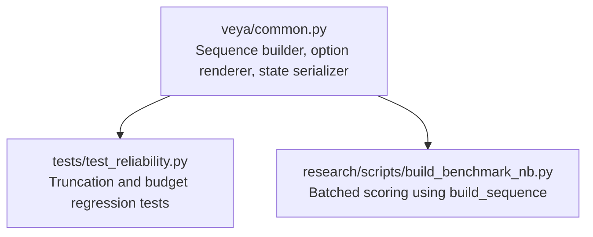
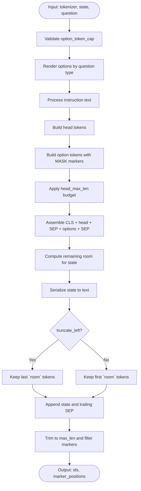
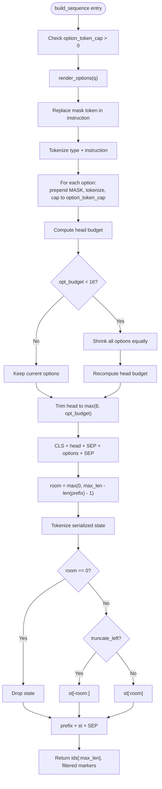
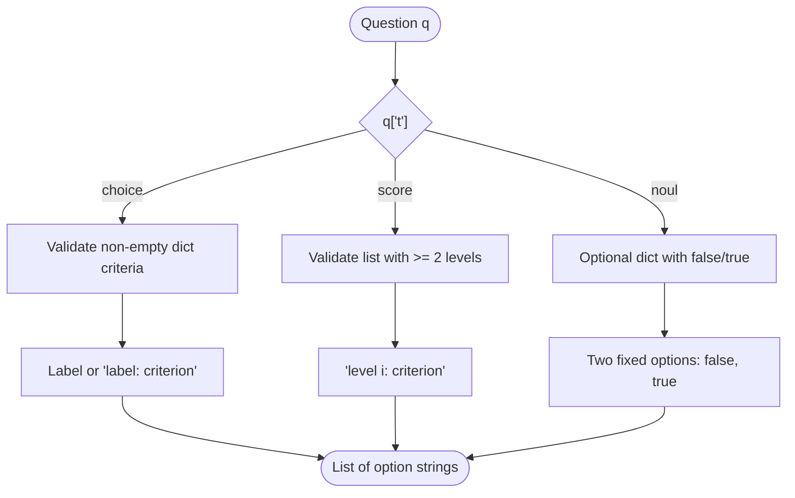
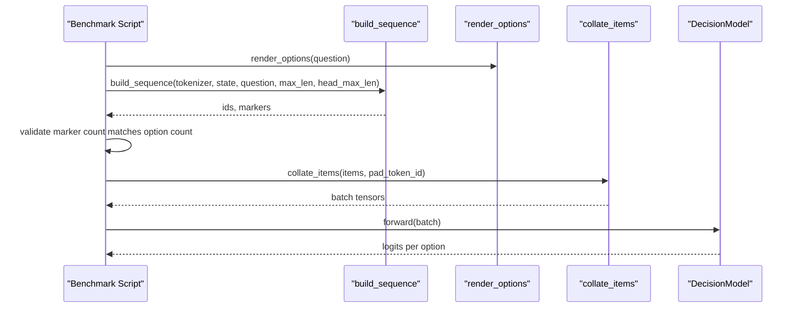
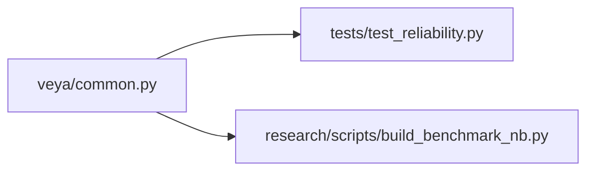

# Sequence Construction & Tokenization

<cite>
**Referenced Files in This Document**
- [common.py](file://veya/common.py)
- [test_reliability.py](file://tests/test_reliability.py)
- [build_benchmark_nb.py](file://research/scripts/build_benchmark_nb.py)
</cite>

## Table of Contents
1. [Introduction](#introduction)
2. [Project Structure](#project-structure)
3. [Core Components](#core-components)
4. [Architecture Overview](#architecture-overview)
5. [Detailed Component Analysis](#detailed-component-analysis)
6. [Dependency Analysis](#dependency-analysis)
7. [Performance Considerations](#performance-considerations)
8. [Troubleshooting Guide](#troubleshooting-guide)
9. [Conclusion](#conclusion)

## Introduction
This document explains Veya’s sequence construction and tokenization pipeline used to prepare model inputs for typed decision tasks. The central routine is `build_sequence`, which converts a conversation state, a question definition, and tokenizer configuration into a single tokenized sequence with marker positions for option scoring.

The expected output format is:

`[CLS] <type> instructions [SEP] [MASK] opt0 [MASK] opt1 ... [SEP] state [SEP]`

Key responsibilities include:
- Rendering options according to the question type.
- Processing instructions while avoiding accidental mask-token leakage.
- Serializing flexible states as strings or JSON.
- Managing token budgets across the head, options, and state.
- Handling truncation strategies for long sequences and edge cases such as empty states.

## Project Structure
The sequence construction logic lives in the core library module, while tests and benchmark scripts exercise it under realistic constraints.

**Diagram sources**
- [common.py:15-111](file://veya/common.py#L15-L111)
- [test_reliability.py:46-66](file://tests/test_reliability.py#L46-L66)
- [build_benchmark_nb.py:146-181](file://research/scripts/build_benchmark_nb.py#L146-L181)

**Section sources**
- [common.py:15-111](file://veya/common.py#L15-L111)
- [test_reliability.py:46-66](file://tests/test_reliability.py#L46-L66)
- [build_benchmark_nb.py:146-181](file://research/scripts/build_benchmark_nb.py#L146-L181)

## Core Components
The sequence pipeline is implemented by three cooperating functions:

| Function | Responsibility | Important Behavior |
|---|---|---|
| `serialize_state` | Converts string, dict, or list state into a text representation | Strings pass through; structured values are serialized as JSON without ASCII escaping. |
| `render_options` | Produces option texts in label-index order | Supports choice, score, and noul question types; validates criteria structure and renders criterion values safely. |
| `build_sequence` | Builds the final token sequence and marker positions | Applies token budgets, truncation, special tokens, and returns masked positions for each option. |

These components are tightly coupled: `build_sequence` calls `render_options`, which may call `render_criterion`; both rely on the tokenizer interface for token IDs and masks.

**Section sources**
- [common.py:15-18](file://veya/common.py#L15-L18)
- [common.py:30-39](file://veya/common.py#L30-L39)
- [common.py:42-61](file://veya/common.py#L42-L61)
- [common.py:64-111](file://veya/common.py#L64-L111)

## Architecture Overview
The end-to-end flow from input data to model-ready sequences is shown below.

**Diagram sources**
- [common.py:64-111](file://veya/common.py#L64-L111)

**Section sources**
- [common.py:64-111](file://veya/common.py#L64-L111)

## Detailed Component Analysis

### Sequence Builder: `build_sequence`
`build_sequence` is the main entry point for constructing model inputs. It accepts:

| Parameter | Meaning | Default | Notes |
|---|---|---:|---|
| `tok` | Tokenizer-like object providing tokens, IDs, and masking behavior | Required | Must support `mask_token`, `mask_token_id`, `cls_token_id`, `sep_token_id`, and callable tokenization. |
| `state` | Conversation or context state | Required | Can be a string, dict, or list. |
| `q` | Question definition | Required | Must contain `t` (type), `ins` (instructions), and optionally `crit` (criteria). |
| `max_len` | Maximum sequence length | 512 | Final sequence is trimmed to this length. |
| `head_max_len` | Budget for the question head and options | 192 | Controls how much space is reserved before the state. |
| `option_order` | Optional permutation of option indices | None | Allows reordering options without changing rendering. |
| `truncate_left` | Whether to keep the tail of the state | False | When True, the rightmost part of the state is retained. |
| `option_token_cap` | Maximum number of tokens per option | 48 | Must be a positive integer. |

#### Output Format
The function produces:
- A list of token IDs starting with `[CLS]`, followed by the typed instruction head, then one `[MASK]`-prefixed option per candidate, and finally the serialized state.
- Marker positions indicating where each option’s prediction token should be read by the model.

#### Token Budget Management
The budgeting strategy has two stages:

1. **Option-level cap**: Each option is truncated to `option_token_cap` tokens after its leading `[MASK]`.
2. **Head-level cap**: The combined head and options must fit within `head_max_len`. If the computed budget for the instruction head is too small, options are shrunk further so that at least a minimal instruction portion remains.

After assembling the prefix, the remaining room is calculated as `max_len - len(prefix) - 1`. The state is then truncated either from the left or right depending on `truncate_left`.

#### Special Token Handling
- The instruction text replaces any occurrence of the tokenizer’s mask token with a space to avoid confusing the model.
- Option texts also replace mask tokens with spaces.
- State serialization replaces mask tokens with spaces before tokenization.
- The final sequence is trimmed to `max_len`, and marker positions are filtered to only include those still inside the window.

**Diagram sources**
- [common.py:64-111](file://veya/common.py#L64-L111)

**Section sources**
- [common.py:64-111](file://veya/common.py#L64-L111)

### Option Rendering: `render_options`
`render_options` converts a question’s criteria into human-readable option strings in a stable index order.

| Question Type | Criteria Shape | Output Behavior |
|---|---|---|
| `choice` | Non-empty dictionary mapping labels to descriptions | Returns label keys; if a description is `None` or empty, only the label is used; otherwise uses `"label: description"`. |
| `score` | Ordered list with at least two levels | Returns `"level i: description"` for each level. |
| `noul` | Optional dictionary with optional `false` and `true` entries | Always returns two options: false and true, with default fallback text when no custom description is provided. |

Criterion values are rendered safely: strings pass through, while structured values become compact JSON. This prevents Python repr artifacts and ensures deterministic text for training and evaluation.

**Diagram sources**
- [common.py:42-61](file://veya/common.py#L42-L61)

**Section sources**
- [common.py:30-39](file://veya/common.py#L30-L39)
- [common.py:42-61](file://veya/common.py#L42-L61)

### State Serialization: `serialize_state`
`serialize_state` normalizes the state into a single string:

- String states are returned unchanged.
- Dict and list states are converted to JSON.
- The resulting string is later passed through the tokenizer without adding special tokens.

This design allows Veya to accept both plain conversation text and structured agent state, such as retrieved documents, previous turns, or metadata.

**Section sources**
- [common.py:15-18](file://veya/common.py#L15-L18)

### Integration with Benchmarking and Batching
In benchmark code, `build_sequence` is called for every question, and the resulting marker count is validated against the expected number of options. Sequences are then sorted by length and packed into batches constrained by a maximum token budget.

**Diagram sources**
- [build_benchmark_nb.py:146-181](file://research/scripts/build_benchmark_nb.py#L146-L181)
- [build_benchmark_nb.py:187-199](file://research/scripts/build_benchmark_nb.py#L187-L199)
- [common.py:298-332](file://veya/common.py#L298-L332)

**Section sources**
- [build_benchmark_nb.py:146-181](file://research/scripts/build_benchmark_nb.py#L146-L181)
- [build_benchmark_nb.py:187-199](file://research/scripts/build_benchmark_nb.py#L187-L199)
- [common.py:298-332](file://veya/common.py#L298-L332)

## Dependency Analysis
The following diagram shows how the sequence construction components depend on each other and on external callers.

**Diagram sources**
- [common.py:64-111](file://veya/common.py#L64-L111)
- [test_reliability.py:46-66](file://tests/test_reliability.py#L46-L66)
- [build_benchmark_nb.py:146-181](file://research/scripts/build_benchmark_nb.py#L146-L181)

**Section sources**
- [common.py:64-111](file://veya/common.py#L64-L111)
- [test_reliability.py:46-66](file://tests/test_reliability.py#L46-L66)
- [build_benchmark_nb.py:146-181](file://research/scripts/build_benchmark_nb.py#L146-L181)

## Performance Considerations
- **Option token cap**: Limiting each option to `option_token_cap` tokens reduces memory usage and stabilizes batching. The default value is 48.
- **Head budget shrinkage**: When options consume too much of `head_max_len`, the builder shrinks options uniformly to preserve a minimal instruction segment.
- **State truncation**: Long conversation histories can be truncated to fit the global `max_len`. With `truncate_left=True`, the most recent tokens are kept, which is often desirable for conversational context.
- **Batch packing**: Benchmark code sorts sequences by length and packs them into token-budgeted batches to minimize padding overhead.

These behaviors help maintain throughput while preserving the most important parts of the prompt and state.

## Troubleshooting Guide

### Common Errors and Edge Cases

| Symptom | Likely Cause | Resolution |
|---|---|---|
| `option_token_cap must be a positive integer` | Invalid or boolean `option_token_cap` | Pass a positive integer. |
| `choice criteria must be a non-empty dict` | Missing or empty criteria for choice questions | Provide a non-empty label-to-description mapping. |
| `score criteria must contain at least two ordered levels` | Too few score levels | Provide at least two ordered levels. |
| `noul criteria must be a dict when provided` | Incorrect criteria shape for noul questions | Use a dict with optional `false` and `true` keys. |
| State does not appear in short sequences | Zero remaining room after head and options | Reduce instruction length, reduce option lengths, or increase `max_len`. |
| State tail is missing when truncating | `truncate_left=False` keeps the beginning of the state | Set `truncate_left=True` to keep the tail. |
| Markers do not match option count | Options were dropped or malformed during construction | Verify `render_options` output and question schema. |

### Verified Behaviors from Tests
- When the remaining state budget is zero, the state is dropped rather than accidentally included.
- The final sequence length never exceeds `max_len`.
- With `truncate_left=True`, the end of a long state is preserved.

**Section sources**
- [common.py:75-76](file://veya/common.py#L75-L76)
- [common.py:46-47](file://veya/common.py#L46-L47)
- [common.py:51-52](file://veya/common.py#L51-L52)
- [common.py:54-55](file://veya/common.py#L54-L55)
- [common.py:100-111](file://veya/common.py#L100-L111)
- [test_reliability.py:46-66](file://tests/test_reliability.py#L46-L66)

## Conclusion
Veya’s sequence construction pipeline provides a robust, budget-aware transformation from structured questions and flexible conversation states into model-ready token sequences. The design separates concerns clearly: option rendering handles question-type-specific formatting, state serialization supports both textual and structured contexts, and `build_sequence` manages token budgets, truncation, and marker positioning.

For production use:
- Keep instructions concise and avoid embedding the tokenizer’s mask token.
- Prefer structured criteria with clear descriptions for better option rendering.
- Tune `head_max_len`, `option_token_cap`, and `truncate_left` based on your typical state length and model capacity.
- Validate marker counts against option counts during data preparation to catch malformed prompts early.