# Benchmarking Framework

<cite>
**Referenced Files in This Document**   
- [BENCHMARKS.md](file://BENCHMARKS.md)
- [bench_latency.py](file://research/scripts/bench_latency.py)
- [bench_apps.py](file://research/scripts/bench_apps.py)
- [bench_local.py](file://research/scripts/bench_local.py)
- [bench_rival.py](file://research/scripts/bench_rival.py)
- [make_rival_plot.py](file://research/scripts/make_rival_plot.py)
- [build_benchmark_nb.py](file://research/scripts/build_benchmark_nb.py)
- [protocol.py](file://research/veyabench/protocol.py)
- [phase10_data.py](file://research/veyabench/phase10_data.py)
- [phase11_protocol.py](file://research/veyabench/phase11_protocol.py)
- [phase12_context.py](file://research/veyabench/phase12_context.py)
- [run_phase10_validate.py](file://research/veyabench/run_phase10_validate.py)
- [run_phase11_validate.py](file://research/veyabench/run_phase11_validate.py)
- [run_phase12_context_audit.py](file://research/veyabench/run_phase12_context_audit.py)
- [rivals/__init__.py](file://research/veyabench/rivals/__init__.py)
- [rivals/base.py](file://research/veyabench/rivals/base.py)
- [rivals/nli.py](file://research/veyabench/rivals/nli.py)
- [rivals/st.py](file://research/veyabench/rivals/st.py)
- [rivals/jev.py](file://research/veyabench/rivals/jev.py)
- [test_rival_benchmark.py](file://tests/test_rival_benchmark.py)
</cite>

## Update Summary
**Changes Made**
- Added comprehensive rival head-to-head benchmarking system documentation
- Updated project structure to include new rival adapter framework
- Added detailed analysis of unified Rival interface and three implementations
- Included benchmark driver script and visualization tools documentation
- Enhanced dependency analysis with rival system components
- Updated troubleshooting guide with rival-specific issues

## Table of Contents
1. [Introduction](#introduction)
2. [Project Structure](#project-structure)
3. [Core Components](#core-components)
4. [Architecture Overview](#architecture-overview)
5. [Detailed Component Analysis](#detailed-component-analysis)
6. [Rival Head-to-Head Benchmarking System](#rival-head-to-head-benchmarking-system)
7. [Dependency Analysis](#dependency-analysis)
8. [Performance Considerations](#performance-considerations)
9. [Troubleshooting Guide](#troubleshooting-guide)
10. [Conclusion](#conclusion)
11. [Appendices](#appendices)

## Introduction
This document explains Veya's benchmarking framework and evaluation tools. It covers:
- Latency benchmarks that measure routing, model loading, and per-question throughput.
- Application-performance benchmarks that evaluate real workflow themes and public datasets.
- Local extensive benchmarks for multilingual intent tasks and typed-decisions decisions.
- **New:** Comprehensive rival head-to-head benchmarking system providing fair comparisons between Veya and alternative decision-making models.
- The `veyabench` package, which provides phase-specific protocols, data preparation utilities, and automated validation workflows.
- Guidance on running benchmarks, interpreting results, and creating custom metrics or suites.

The repository distinguishes between measured results and third-party published numbers. Historical capability measurements are not release certification, and some datasets were part of the training mix. The audited English Choice path is a research release; other primitive or language scopes are research-only.

**Section sources**
- [BENCHMARKS.md:1-12](file://BENCHMARKS.md#L1-L12)

## Project Structure
The benchmarking surface is split into multiple layers:

| Layer | Purpose | Key files |
|---|---|---|
| Scripts | Run latency, application, local, and rival benchmarks; generate Colab notebooks | `bench_latency.py`, `bench_apps.py`, `bench_local.py`, `bench_rival.py`, `make_rival_plot.py`, `build_benchmark_nb.py` |
| Phase harnesses | Protocol definitions, data registries, contamination-aware splits, and validation reports | `veyabench/protocol.py`, `phase10_data.py`, `phase11_protocol.py`, `phase12_context.py`, `run_phase*_validate.py` |
| Rival adapters | Unified interface for competing decision models with shared probability mapping | `veyabench/rivals/base.py`, `nli.py`, `st.py`, `jev.py` |

```mermaid
graph TB
Scripts["Benchmark scripts"] --> Latency["Latency benchmark"]
Scripts --> Apps["Application benchmark"]
Scripts --> Local["Local extensive benchmark"]
Scripts --> Rival["Rival head-to-head benchmark"]
Scripts --> Notebook["Colab notebook generator"]
Harness["Phase harnesses"] --> Protocol["Split ledger and metrics"]
Harness --> Data10["Phase 10 data registry"]
Harness --> Protocol11["Phase 11 truncation and hard negatives"]
Harness --> Context12["Phase 12 context packing"]
Harness --> Validate10["Phase 10 validation"]
Harness --> Validate11["Phase 11 validation"]
Harness --> Audit12["Phase 12 context audit"]
Rivals["Rival adapters"] --> Base["Unified Rival interface"]
Rivals --> NLI["NLI-based BART-MNLI"]
Rivals --> ST["Sentence-transformer nearest-centroid"]
Rivals --> JEV["Dormant Jev/TypeSafe"]
```

**Diagram sources**
- [bench_latency.py:1-170](file://research/scripts/bench_latency.py#L1-L170)
- [bench_apps.py:1-303](file://research/scripts/bench_apps.py#L1-L303)
- [bench_local.py:1-338](file://research/scripts/bench_local.py#L1-L338)
- [bench_rival.py:1-180](file://research/scripts/bench_rival.py#L1-L180)
- [make_rival_plot.py:1-81](file://research/scripts/make_rival_plot.py#L1-L81)
- [build_benchmark_nb.py:1-800](file://research/scripts/build_benchmark_nb.py#L1-L800)
- [protocol.py:1-125](file://research/veyabench/protocol.py#L1-L125)
- [phase10_data.py:1-337](file://research/veyabench/phase10_data.py#L1-L337)
- [phase11_protocol.py:1-204](file://research/veyabench/phase11_protocol.py#L1-L204)
- [phase12_context.py:1-145](file://research/veyabench/phase12_context.py#L1-L145)
- [run_phase10_validate.py:1-502](file://research/veyabench/run_phase10_validate.py#L1-L502)
- [run_phase11_validate.py:1-800](file://research/veyabench/run_phase11_validate.py#L1-L800)
- [run_phase12_context_audit.py:1-168](file://research/veyabench/run_phase12_context_audit.py#L1-L168)

**Section sources**
- [bench_latency.py:1-170](file://research/scripts/bench_latency.py#L1-L170)
- [bench_apps.py:1-303](file://research/scripts/bench_apps.py#L1-L303)
- [bench_local.py:1-338](file://research/scripts/bench_local.py#L1-L338)
- [bench_rival.py:1-180](file://research/scripts/bench_rival.py#L1-L180)
- [make_rival_plot.py:1-81](file://research/scripts/make_rival_plot.py#L1-L81)
- [build_benchmark_nb.py:1-800](file://research/scripts/build_benchmark_nb.py#L1-L800)
- [protocol.py:1-125](file://research/veyabench/protocol.py#L1-L125)
- [phase10_data.py:1-337](file://research/veyabench/phase10_data.py#L1-L337)
- [phase11_protocol.py:1-204](file://research/veyabench/phase11_protocol.py#L1-L204)
- [phase12_context.py:1-145](file://research/veyabench/phase12_context.py#L1-L145)
- [run_phase10_validate.py:1-502](file://research/veyabench/run_phase10_validate.py#L1-L502)
- [run_phase11_validate.py:1-800](file://research/veyabench/run_phase11_validate.py#L1-L800)
- [run_phase12_context_audit.py:1-168](file://research/veyabench/run_phase12_context_audit.py#L1-L168)

## Core Components
The benchmarking system has six core responsibilities:

| Component | Responsibility | Primary outputs |
|---|---|---|
| Latency benchmark | Measures language detection overhead, raw model latency, router hot/cold paths, and mixed-language workloads | `latency_benchmark_results.json` |
| Application benchmark | Evaluates six workflow themes and Jev-comparable datasets with accuracy, F1, ECE, and timing | `app_benchmark_results.json` |
| Local benchmark | Runs MASSIVE intent across languages and typed-decisions decisions with calibrated metrics | `local_benchmark_results.json` |
| **Rival benchmark** | **Runs Veya vs alternative decision models on byte-identical cases through shared metrics pipeline** | `rival_benchmark.json`, `veya_vs_rival.png` |
| Phase protocols | Defines split ledgers, recall-at-k, permutation robustness, risk coverage, tokenization audits, and hard-negative lineage | JSON reports and artifacts under `artifacts/experiments` |
| Validation runners | Reproduce frozen-scorer behavior, end-to-end retrieval + scoring, robustness diagnostics, runtime cost, and integrity checks | `validation_report.json` per phase |

**Section sources**
- [bench_latency.py:1-170](file://research/scripts/bench_latency.py#L1-L170)
- [bench_apps.py:1-303](file://research/scripts/bench_apps.py#L1-L303)
- [bench_local.py:1-338](file://research/scripts/bench_local.py#L1-L338)
- [bench_rival.py:1-180](file://research/scripts/bench_rival.py#L1-L180)
- [protocol.py:1-125](file://research/veyabench/protocol.py#L1-L125)
- [run_phase10_validate.py:1-502](file://research/veyabench/run_phase10_validate.py#L1-L502)
- [run_phase11_validate.py:1-800](file://research/veyabench/run_phase11_validate.py#L1-L800)
- [run_phase12_context_audit.py:1-168](file://research/veyabench/run_phase12_context_audit.py#L1-L168)

## Architecture Overview
At a high level, benchmarks load Veya checkpoints, construct question sequences, run inference, apply calibration where relevant, compute metrics, and write structured JSON results. Phase harnesses add stricter constraints: deterministic splits, contamination checks, frozen scorer verification, and reproducible embedding caches. The rival system extends this by providing a unified adapter interface that normalizes diverse model outputs to the same probability format used by Veya's metrics pipeline.

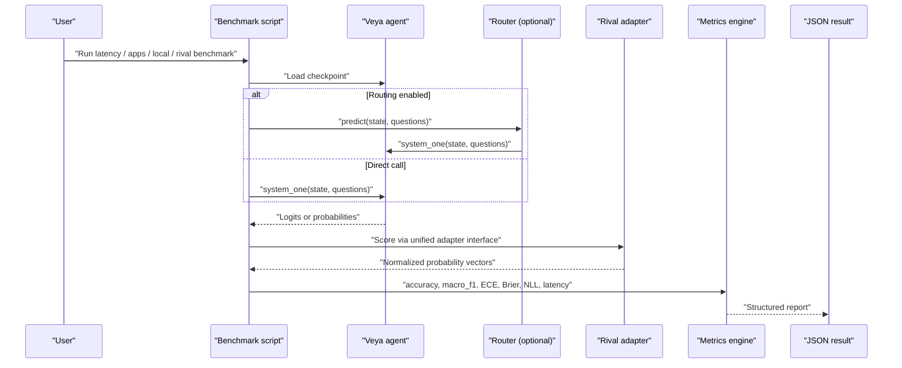

**Diagram sources**
- [bench_latency.py:66-165](file://research/scripts/bench_latency.py#L66-L165)
- [bench_apps.py:267-298](file://research/scripts/bench_apps.py#L267-L298)
- [bench_local.py:53-97](file://research/scripts/bench_local.py#L53-L97)
- [bench_rival.py:72-89](file://research/scripts/bench_rival.py#L72-L89)

## Detailed Component Analysis

### Latency Benchmark
The latency benchmark measures four regimes:
1. Language detection overhead without model calls.
2. Raw `system_one` latency for each model at different question counts.
3. Router hot path when the target model is already loaded.
4. Router cold path when model swapping occurs.
5. Mixed-language workload performance across different non-English shares and `max_loaded` settings.

Key behaviors:
- Uses CPU by default but references GPU T4 numbers from the Colab benchmark.
- Records p50, p95, mean, and min latency.
- Computes per-question latency for batched calls.
- Writes results to `latency_benchmark_results.json`.

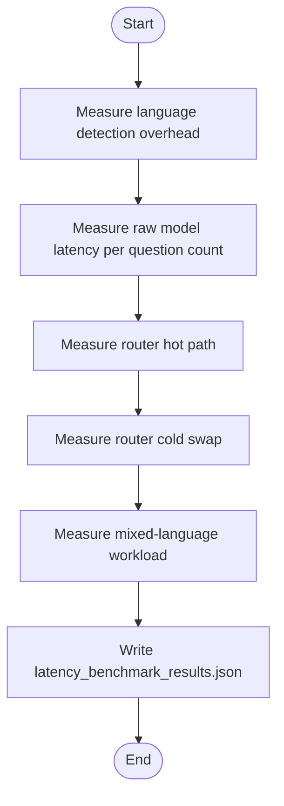

**Diagram sources**
- [bench_latency.py:73-165](file://research/scripts/bench_latency.py#L73-L165)

**Section sources**
- [bench_latency.py:1-170](file://research/scripts/bench_latency.py#L1-L170)

### Application Performance Benchmark
The application benchmark evaluates six workflow themes plus public datasets where Jev numbers exist:
- Support triage queue routing.
- Email spam and phishing detection.
- LLM guardrails against jailbreaking.
- RAG passage relevance filtering.
- Moderation toxicity detection.
- Model routing over code, math, writing, factual lookup, data analysis, and chitchat.

It also loads public datasets such as AG News, DAIR Emotion, Banking77, and compares measured accuracy against published Jev numbers. Results include accuracy, macro F1, ECE, seconds, ms per case, and dropped cases.

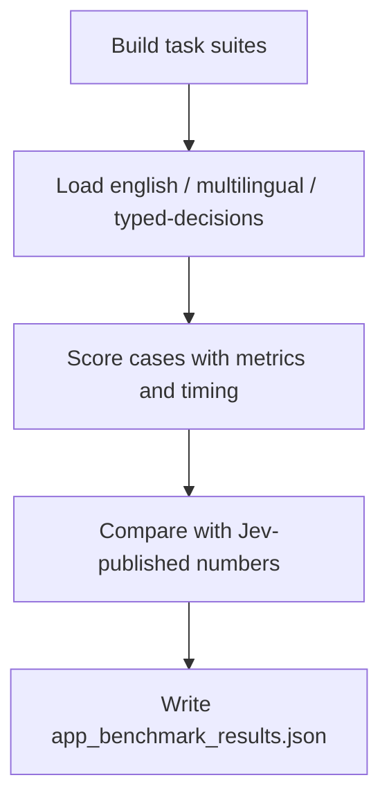

**Diagram sources**
- [bench_apps.py:72-264](file://research/scripts/bench_apps.py#L72-L264)
- [bench_apps.py:267-298](file://research/scripts/bench_apps.py#L267-L298)

**Section sources**
- [bench_apps.py:1-303](file://research/scripts/bench_apps.py#L1-L303)

### Local Extensive Benchmark
The local benchmark has two parts:
- Part A: MASSIVE intent across all available languages with 20 options per choice question.
- Part B: Typed-decisions benchmark with 400 cases and 2,000 decisions across three checkpoints.

Important implementation details:
- Sequences are built through `build_sequence`, collated via `collate_items`, and scored in token-budgeted batches.
- Calibration uses temperature selection based on question type and option count.
- Metrics include accuracy, macro F1, ECE, Brier, NLL, mean confidence, and coverage-based accuracy.
- Typed-decisions adds soft accuracy, Brier vs soft labels, score MAE, and within-one-level accuracy.

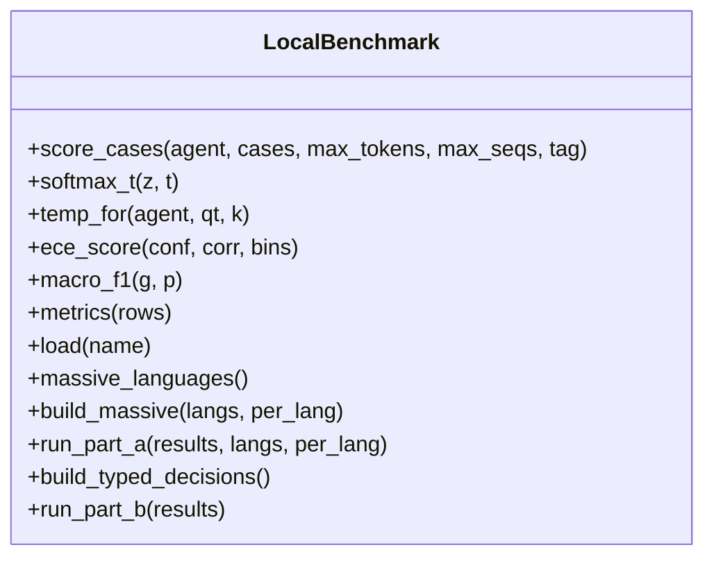

**Diagram sources**
- [bench_local.py:43-150](file://research/scripts/bench_local.py#L43-L150)
- [bench_local.py:153-338](file://research/scripts/bench_local.py#L153-L338)

**Section sources**
- [bench_local.py:1-338](file://research/scripts/bench_local.py#L1-L338)

### Phase Protocols and Data Preparation
The `veyabench` package defines reusable protocol primitives and phase-specific data handling.

#### Split Ledger and Metrics
- `SplitLedger` enforces disjoint train/calibration/validation/test assignments and prevents test rows from being marked as training exposure.
- `recall_at_k` computes hit rate for ranked candidate lists.
- `permutation_report` measures option-order stability.
- `risk_coverage` computes error rate after dropping lowest-confidence predictions and includes safe automation coverage buckets.

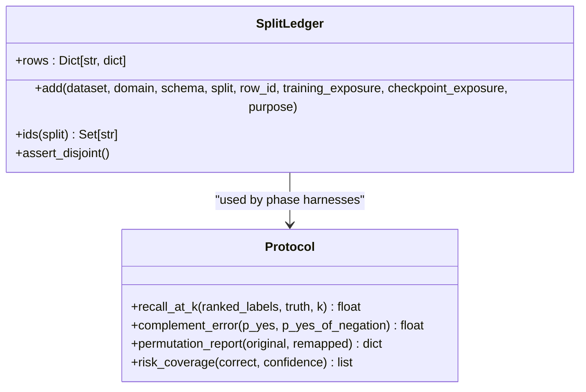

**Diagram sources**
- [protocol.py:16-52](file://research/veyabench/protocol.py#L16-L52)
- [protocol.py:54-125](file://research/veyabench/protocol.py#L54-L125)

**Section sources**
- [protocol.py:1-125](file://research/veyabench/protocol.py#L1-L125)

#### Phase 10 Data Registry
Phase 10 builds contamination-aware splits from:
- Banking77 training data.
- SGD training dialogues.
- CLINC150 training partition used only for development/validation roles.

It caps examples per label deterministically, writes JSONL splits, candidate registries, dataset metadata, and a freeze manifest with SHA-256 digests.

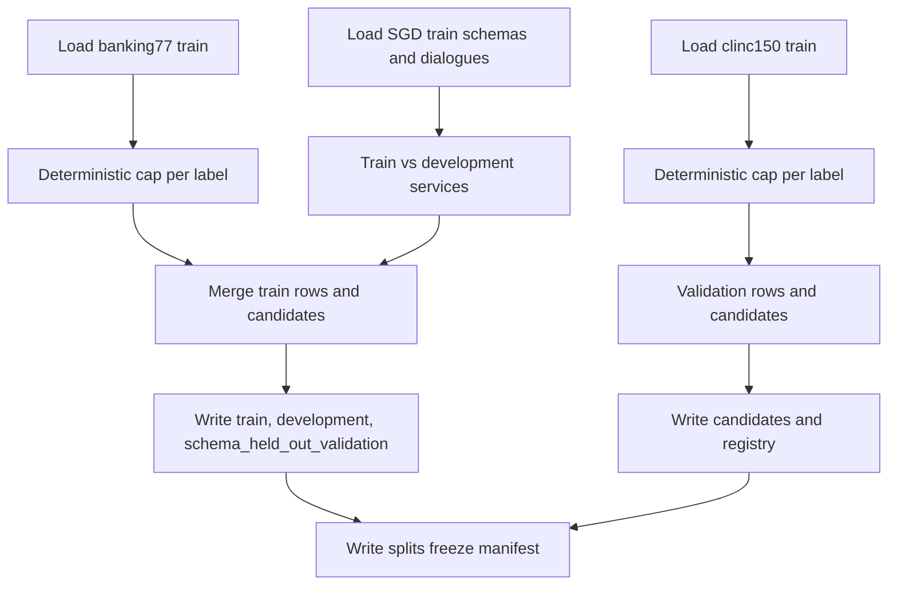

**Diagram sources**
- [phase10_data.py:72-174](file://research/veyabench/phase10_data.py#L72-L174)
- [phase10_data.py:183-332](file://research/veyabench/phase10_data.py#L183-L332)

**Section sources**
- [phase10_data.py:1-337](file://research/veyabench/phase10_data.py#L1-L337)

#### Phase 11 Truncation and Hard-Negative Protocol
Phase 11 adds:
- Tokenization audit that tracks whether useful source spans are fully retained, partially retained, or truncated.
- Hard-negative mining with lineage, false-negative screening, normalized-label deduplication, and semantic similarity thresholds.
- Length bucketing for robustness reporting.

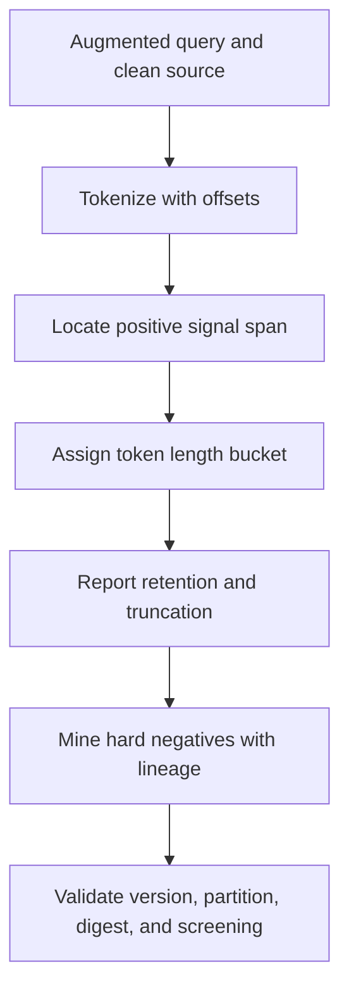

**Diagram sources**
- [phase11_protocol.py:18-80](file://research/veyabench/phase11_protocol.py#L18-L80)
- [phase11_protocol.py:83-162](file://research/veyabench/phase11_protocol.py#L83-L162)
- [phase11_protocol.py:181-204](file://research/veyabench/phase11_protocol.py#L181-L204)

**Section sources**
- [phase11_protocol.py:1-204](file://research/veyabench/phase11_protocol.py#L1-L204)

#### Phase 12 Context Packing
Phase 12 prepares causal SGD USER-turn inputs and packs dialogue history under a strict head budget:
- Only `utterance_only`, `previous_turn`, and `full_context` modes are allowed.
- Current turn must be retained; prior turns are added backwards until the token budget is exceeded.
- Source file hashes protect against unsealed test dialogue access.

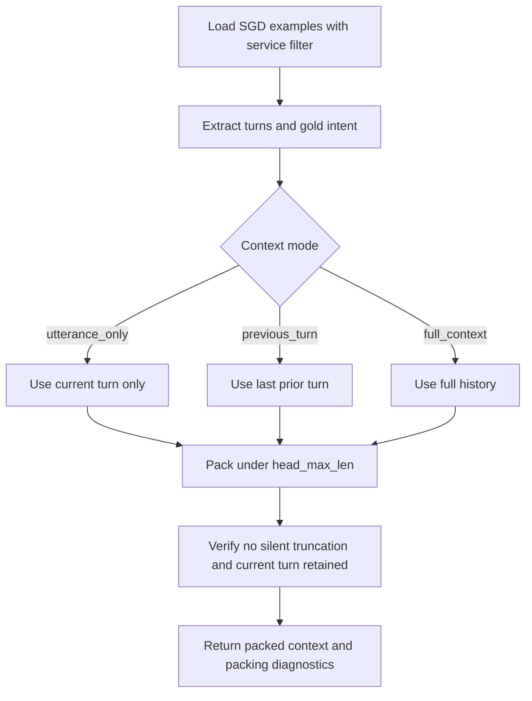

**Diagram sources**
- [phase12_context.py:20-62](file://research/veyabench/phase12_context.py#L20-L62)
- [phase12_context.py:65-145](file://research/veyabench/phase12_context.py#L65-L145)

**Section sources**
- [phase12_context.py:1-145](file://research/veyabench/phase12_context.py#L1-L145)

### Phase Validation Workflows
Each phase runner validates frozen components, reproduces scores, measures robustness, and records runtime characteristics.

#### Phase 10 Validation
- Loads frozen retriever artifact and release manifest.
- Reconstructs embeddings and verifies fresh-process reproducibility.
- Runs end-to-end Recall@8, conditional accuracy, end-to-end accuracy, ECE, and scorer latency.
- Measures robustness against distractor text, long structured state, and intent-equivalent utterance variation.
- Reports exact top-K ranking performance and cache/memory diagnostics.

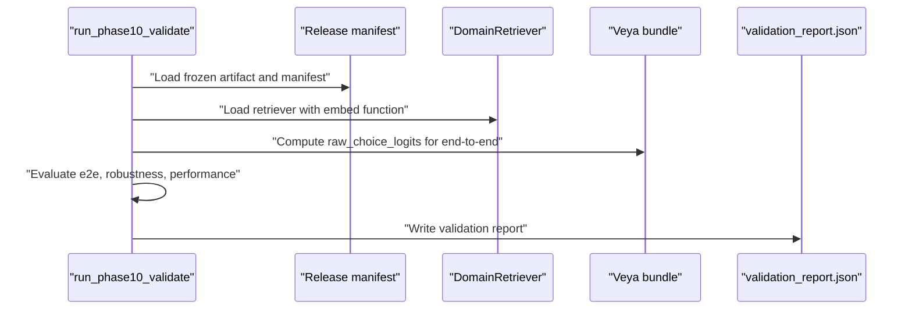

**Diagram sources**
- [run_phase10_validate.py:324-497](file://research/veyabench/run_phase10_validate.py#L324-L497)

**Section sources**
- [run_phase10_validate.py:1-502](file://research/veyabench/run_phase10_validate.py#L1-L502)

#### Phase 11 Validation
- Loads ablation models and winner configuration.
- Encodes validation texts once and caches embeddings with checksums.
- Evaluates noise conditions, query policies, fusion strategies, adaptive views, and tokenization truncation.
- Produces paired bootstrap comparisons against Phase 10 baseline.
- Includes runtime benchmark, memory estimates, and clean-reload determinism checks.

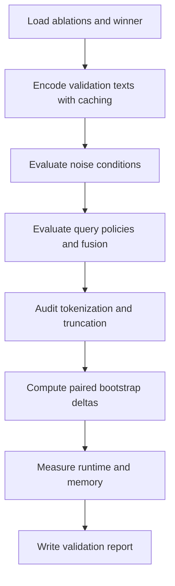

**Diagram sources**
- [run_phase11_validate.py:99-154](file://research/veyabench/run_phase11_validate.py#L99-L154)
- [run_phase11_validate.py:335-774](file://research/veyabench/run_phase11_validate.py#L335-L774)

**Section sources**
- [run_phase11_validate.py:1-800](file://research/veyabench/run_phase11_validate.py#L1-L800)

#### Phase 12 Context Audit
- Loads SGD examples only from allowed splits and verifies source file hashes.
- Summarizes label distribution, service transitions, and exact-input feasibility ceilings.
- Extracts regression pairs where identical current utterances have different intents due to context.
- Flags lexically similar intent descriptions for review.

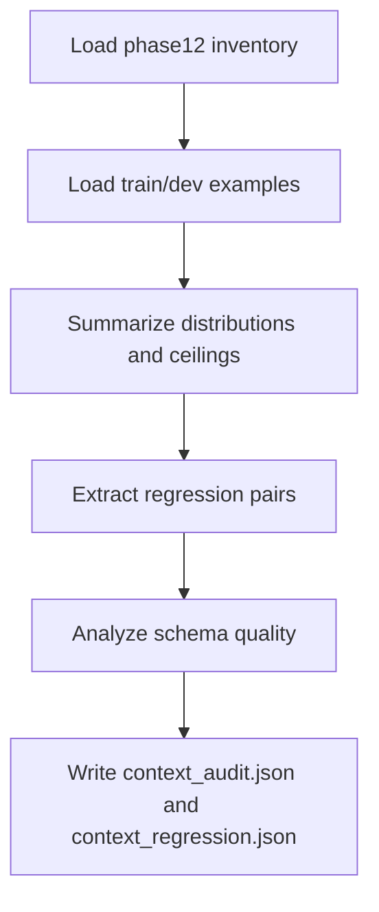

**Diagram sources**
- [run_phase12_context_audit.py:97-168](file://research/veyabench/run_phase12_context_audit.py#L97-L168)

**Section sources**
- [run_phase12_context_audit.py:1-168](file://research/veyabench/run_phase12_context_audit.py#L1-L168)

### Colab Benchmark Generator
`build_benchmark_nb.py` generates a Colab notebook that runs both open checkpoints over identical questions and writes `veya_benchmark_results.json`. It documents:
- Typed-decisions zero-shot evaluation.
- Multilingual MASSIVE and XNLI evaluation.
- English zero-shot tasks and Banking77 many-option stress test.
- Latency measurement.
- Option-order robustness.
- Calibration repair using temperature refit.

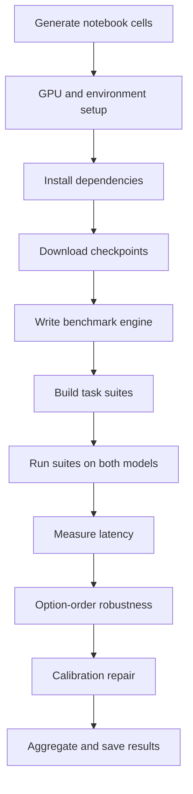

**Diagram sources**
- [build_benchmark_nb.py:1-800](file://research/scripts/build_benchmark_nb.py#L1-L800)

**Section sources**
- [build_benchmark_nb.py:1-800](file://research/scripts/build_benchmark_nb.py#L1-L800)

## Rival Head-to-Head Benchmarking System

**Updated** Added comprehensive rival head-to-head benchmarking system that provides fair comparisons between Veya and alternative decision-making models using shared probability mapping utilities and standardized evaluation protocols.

### Unified Rival Interface
The rival system centers around a unified `Rival` adapter interface that normalizes diverse model outputs to the same probability format used by Veya's metrics pipeline. This ensures byte-identical case comparison across all models.

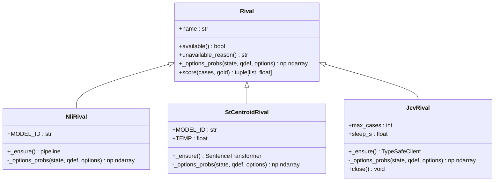

**Diagram sources**
- [rivals/base.py:87-122](file://research/veyabench/rivals/base.py#L87-L122)
- [rivals/nli.py:15-45](file://research/veyabench/rivals/nli.py#L15-L45)
- [rivals/st.py:11-39](file://research/veyabench/rivals/st.py#L11-L39)
- [rivals/jev.py:32-102](file://research/veyabench/rivals/jev.py#L32-L102)

### Three Rival Implementations

#### NLI-Based BART-MNLI (`nli-bart`)
- Uses HuggingFace transformers zero-shot classification pipeline
- Implements proper re-indexing to maintain option order despite sorted output
- Requires `transformers` package installation
- Downloads ~1.6GB model weights on first use

#### Sentence-Transformer Nearest-Centroid (`st-centroid`)  
- Uses cosine similarity between premise and option embeddings
- Applies temperature scaling (TEMP=0.1) for probability conversion
- Lighter weight model (~80MB) compared to BART-MNLI
- Requires `sentence-transformers` package installation

#### Dormant Jev/TypeSafe (`jev-typesafe`)
- Activates only when `TYPESAFE_API_KEY` environment variable is set
- Uses documented TypeSafe SDK API for decision requests
- Caps cases to prevent excessive API usage (default 200)
- Gracefully degrades to "not measured" status when unavailable

### Benchmark Driver and Visualization
The `bench_rival.py` driver script orchestrates the complete head-to-head comparison:
- Builds task suites using `bench_apps.build()` 
- Loads Veya checkpoints and rival adapters
- Scores all models through identical `metrics()` pipeline
- Generates combined tables and JSON results
- Handles graceful degradation for missing components

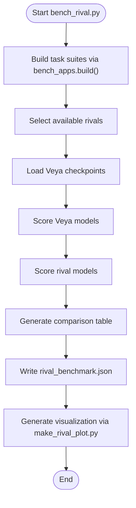

**Diagram sources**
- [bench_rival.py:103-159](file://research/scripts/bench_rival.py#L103-L159)
- [make_rival_plot.py:41-81](file://research/scripts/make_rival_plot.py#L41-L81)

### Shared Probability Mapping Utilities
The base module provides critical utility functions ensuring consistent probability interpretation:
- `render_state()`: Flattens case states to readable text strings
- `option_texts()`: Generates descriptive option strings for embedding/NLI candidates  
- `option_labels()`: Extracts bare labels in gold-index order
- `probs_from_scores()`: Numerically stable softmax implementation
- `to_rows()`: Zips probability vectors with gold indices

**Section sources**
- [bench_rival.py:1-180](file://research/scripts/bench_rival.py#L1-L180)
- [make_rival_plot.py:1-81](file://research/scripts/make_rival_plot.py#L1-L81)
- [rivals/base.py:1-122](file://research/veyabench/rivals/base.py#L1-L122)
- [rivals/nli.py:1-45](file://research/veyabench/rivals/nli.py#L1-L45)
- [rivals/st.py:1-39](file://research/veyabench/rivals/st.py#L1-L39)
- [rivals/jev.py:1-102](file://research/veyabench/rivals/jev.py#L1-L102)
- [test_rival_benchmark.py:1-185](file://tests/test_rival_benchmark.py#L1-L185)

## Dependency Analysis
The benchmarking scripts depend on:
- `veya` for loading agents, routing, language analysis, and release manifests.
- `torch` and `numpy` for inference and metric computation.
- `datasets` for loading public benchmarks.
- Phase harnesses for protocol definitions, data registries, and validation logic.
- **New:** Rival adapters require optional dependencies like `transformers`, `sentence-transformers`, and `typesafe_sdk`.

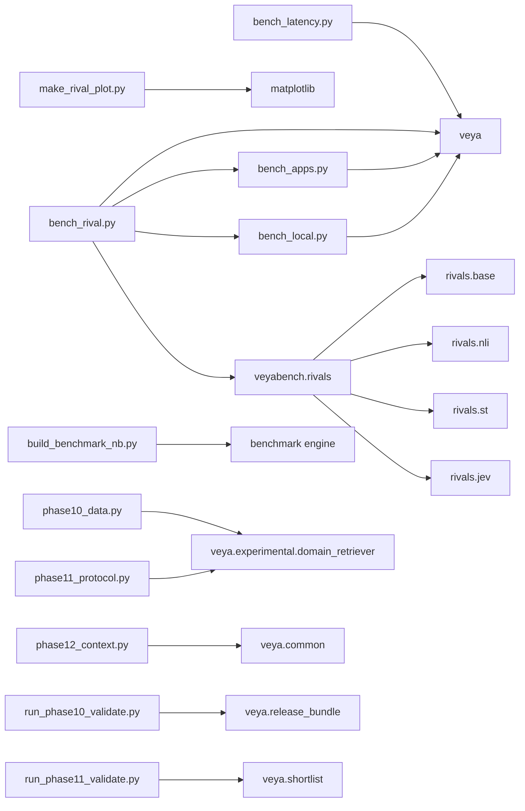

**Diagram sources**
- [bench_latency.py:26-31](file://research/scripts/bench_latency.py#L26-L31)
- [bench_apps.py:32-37](file://research/scripts/bench_apps.py#L32-L37)
- [bench_local.py:29-33](file://research/scripts/bench_local.py#L29-L33)
- [bench_rival.py:31-33](file://research/scripts/bench_rival.py#L31-L33)
- [make_rival_plot.py:12-15](file://research/scripts/make_rival_plot.py#L12-L15)
- [build_benchmark_nb.py:1-800](file://research/scripts/build_benchmark_nb.py#L1-L800)
- [phase10_data.py:16-16](file://research/veyabench/phase10_data.py#L16-L16)
- [phase11_protocol.py:11-11](file://research/veyabench/phase11_protocol.py#L11-L11)
- [phase12_context.py:13-14](file://research/veyabench/phase12_context.py#L13-L14)
- [run_phase10_validate.py:29-33](file://research/veyabench/run_phase10_validate.py#L29-L33)
- [run_phase11_validate.py:39-50](file://research/veyabench/run_phase11_validate.py#L39-L50)

**Section sources**
- [bench_latency.py:26-31](file://research/scripts/bench_latency.py#L26-L31)
- [bench_apps.py:32-37](file://research/scripts/bench_apps.py#L32-L37)
- [bench_local.py:29-33](file://research/scripts/bench_local.py#L29-L33)
- [bench_rival.py:31-33](file://research/scripts/bench_rival.py#L31-L33)
- [make_rival_plot.py:12-15](file://research/scripts/make_rival_plot.py#L12-L15)
- [build_benchmark_nb.py:1-800](file://research/scripts/build_benchmark_nb.py#L1-L800)
- [phase10_data.py:16-16](file://research/veyabench/phase10_data.py#L16-L16)
- [phase11_protocol.py:11-11](file://research/veyabench/phase11_protocol.py#L11-L11)
- [phase12_context.py:13-14](file://research/veyabench/phase12_context.py#L13-L14)
- [run_phase10_validate.py:29-33](file://research/veyabench/run_phase10_validate.py#L29-L33)
- [run_phase11_validate.py:39-50](file://research/veyabench/run_phase11_validate.py#L39-L50)

## Performance Considerations
- **Routing overhead**: Every call pays language detection; switching models may pay model load unless the model is already resident.
- **Hot vs cold paths**: Hot-path routing assumes the target model is loaded; cold-path routing forces swaps and can dominate latency.
- **Batching**: Local and Colab engines pack sequences by token budget and sequence count to reduce padding and improve throughput.
- **Calibration**: Shipped temperatures matter; `veya-multilingual` ships uncalibrated defaults, while `veya` ships fitted temperatures. Refitting per question-type and option-count bucket improves ECE.
- **Many-option stress**: Large option sets like Banking77 expose shared option-token budget limits; retrieval reranking routes are domain-specific.
- **Robustness**: Long prefixes, suffixes, middle insertions, duplicate metadata, and JSON noise affect single-view and adaptive-view strategies differently.
- **Rival model loading**: NLI-based rivals require large model downloads; sentence-transformer rivals are lighter but still significant. Jev rival requires network connectivity and API credentials.

## Troubleshooting Guide
Common issues and their likely causes:

| Symptom | Likely cause | Resolution |
|---|---|---|
| TensorFlow deadlock during model build | TensorFlow abseil runtime conflicts | Ensure `USE_TF=0` and `USE_TORCH=1` before importing heavy dependencies. |
| Tokenizer config fails on multilingual checkpoint | Extra special tokens stored as a list instead of dict | Patch tokenizer config or use the provided notebook helper that normalizes it. |
| Dropped questions in local benchmark | Options do not fit or sequence construction fails | Check `render_options` length and `build_sequence` output; inspect dropped count. |
| Fresh-process embedding mismatch | Embedding cache or text index changed | Verify cache metadata SHA-256 and recompute embeddings if necessary. |
| Top-8 candidate set changes after reload | Non-deterministic ranking or changed artifact | Check stable sort keys, artifact SHA-256, and frozen scorer configuration. |
| Too few context regression pairs | Insufficient labeled variants with same current utterance | Review service filter, gold intent distribution, and context rendering. |
| **Rival benchmark fails to import datasets** | Missing `datasets` package required for suite building | Install with `pip install 'veya[train]'` or `pip install datasets`. |
| **NLI rival shows transformers not installed** | Missing `transformers` package | Install with `pip install transformers`. |
| **ST rival shows sentence-transformers not installed** | Missing `sentence-transformers` package | Install with `pip install sentence-transformers`. |
| **Jev rival always shows unavailable** | Missing `TYPESAFE_API_KEY` environment variable | Set the environment variable and ensure `typesafe_sdk` is installed. |
| **Rival model download hangs** | Network connectivity issues or large model sizes | Check internet connection and disk space; consider using CPU device for smaller models. |

**Section sources**
- [bench_local.py:53-97](file://research/scripts/bench_local.py#L53-L97)
- [run_phase10_validate.py:339-431](file://research/veyabench/run_phase10_validate.py#L339-L431)
- [run_phase11_validate.py:119-154](file://research/veyabench/run_phase11_validate.py#L119-L154)
- [run_phase12_context_audit.py:131-168](file://research/veyabench/run_phase12_context_audit.py#L131-L168)
- [bench_rival.py:40-44](file://research/scripts/bench_rival.py#L40-L44)
- [rivals/nli.py:23-27](file://research/veyabench/rivals/nli.py#L23-L27)
- [rivals/st.py:20-24](file://research/veyabench/rivals/st.py#L20-L24)
- [rivals/jev.py:42-51](file://research/veyabench/rivals/jev.py#L42-L51)

## Conclusion
Veya's benchmarking framework separates practical performance measurement from rigorous phase-specific validation. Scripts provide accessible entry points for latency, application workflows, local extensive evaluation, and now comprehensive rival head-to-head comparisons. The `veyabench` package enforces protocol discipline: disjoint splits, contamination awareness, tokenization auditing, hard-negative lineage, and context packing guarantees. The rival system extends this with a unified adapter interface that enables fair comparisons between Veya and alternative decision-making models using shared probability mapping utilities and standardized evaluation protocols. Validation runners reproduce frozen behavior, measure robustness, and record runtime diagnostics. For reliable interpretation, always distinguish measured results from published baselines, account for calibration, treat many-option retrieval routes as domain-dependent, and leverage the rival system for controlled model comparisons.

## Appendices

### How to Run Benchmarks
- **Latency benchmark**: Run the CPU latency script and inspect `latency_benchmark_results.json`. Use GPU T4 numbers from the Colab benchmark for reference.
- **Application benchmark**: Run the application script and inspect `app_benchmark_results.json`. Adjust `BENCH_N` to control cases per task.
- **Local benchmark**: Run the local script and inspect `local_benchmark_results.json`. Use `--langs` and `--per-lang` to limit language coverage; use `--skip-a` or `--skip-b` to skip parts.
- **Rival benchmark**: Run the rival head-to-head comparison and inspect `rival_benchmark.json`. Use `--rival all,nli,st,jev` to select specific rivals; use `--device` for model placement.
- **Visualization**: Generate plots from rival benchmark results using `make_rival_plot.py` to create `assets/veya_vs_rival.png`.
- **Colab benchmark**: Execute the generated notebook to compare `veya` and `veya-multilingual` on typed-decisions, multilingual tasks, English tasks, latency, option-order robustness, and calibration repair.

**Section sources**
- [bench_latency.py:10-11](file://research/scripts/bench_latency.py#L10-L11)
- [bench_apps.py:15-16](file://research/scripts/bench_apps.py#L15-L16)
- [bench_local.py:10-11](file://research/scripts/bench_local.py#L10-L11)
- [bench_rival.py:6-10](file://research/scripts/bench_rival.py#L6-L10)
- [make_rival_plot.py:3-6](file://research/scripts/make_rival_plot.py#L3-L6)
- [build_benchmark_nb.py:1-47](file://research/scripts/build_benchmark_nb.py#L1-L47)

### Interpreting Results
- **Accuracy and macro F1**: Primary classification performance; macro F1 is more sensitive to minority classes.
- **ECE**: Expected calibration error; lower is better. High ECE indicates overconfidence or miscalibration.
- **Brier and NLL**: Probabilistic loss metrics; lower is better.
- **Latency percentiles**: p50/p95 indicate typical and tail latency; ms per question helps compare batching efficiency.
- **Recall@8 and conditional accuracy**: Retrieval quality and scorer quality when the correct candidate is present.
- **Option-order flip rate**: Stability of predictions under option permutation; lower is better.
- **Risk coverage and SAC**: Coverage-controlled error rates and safe automation coverage thresholds.
- **Rival comparison metrics**: Accuracy, macro-F1, ECE, and milliseconds per case enable direct model-to-model comparison on identical cases.

**Section sources**
- [bench_local.py:100-144](file://research/scripts/bench_local.py#L100-L144)
- [protocol.py:54-125](file://research/veyabench/protocol.py#L54-L125)
- [BENCHMARKS.md:163-194](file://BENCHMARKS.md#L163-L194)
- [bench_rival.py:92-101](file://research/scripts/bench_rival.py#L92-L101)

### Creating Custom Evaluation Metrics
To extend the framework:
1. Add a new suite to an application or local benchmark by registering cases, gold labels, and metadata.
2. Use `score_cases` or the Colab engine to obtain logits and indices.
3. Apply temperature calibration with `temp_for` or a custom refit routine.
4. Compute metrics using existing helpers or extend `metrics` with additional fields.
5. Record environment, seed, model configuration, and dataset provenance in the result JSON.

For phase-specific protocols:
- Use `SplitLedger` to enforce split integrity.
- Use `recall_at_k`, `permutation_report`, and `risk_coverage` for robustness and safety metrics.
- Use tokenization audit and hard-negative lineage for traceable data transformations.

For rival adapters:
- Extend the `Rival` base class with custom `_options_probs` implementation.
- Register your rival in the `REGISTRY` dictionary.
- Handle availability checking and graceful degradation for missing dependencies.
- Ensure probability vectors align with gold-index order defined by `option_labels()`.

**Section sources**
- [bench_apps.py:62-69](file://research/scripts/bench_apps.py#L62-L69)
- [bench_local.py:53-144](file://research/scripts/bench_local.py#L53-L144)
- [protocol.py:16-125](file://research/veyabench/protocol.py#L16-L125)
- [phase11_protocol.py:18-162](file://research/veyabench/phase11_protocol.py#L18-L162)
- [rivals/base.py:87-122](file://research/veyabench/rivals/base.py#L87-L122)
- [rivals/__init__.py:9-12](file://research/veyabench/rivals/__init__.py#L9-L12)