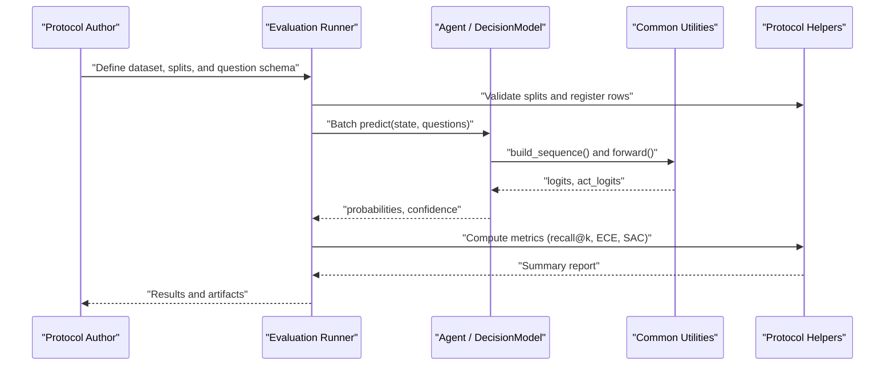
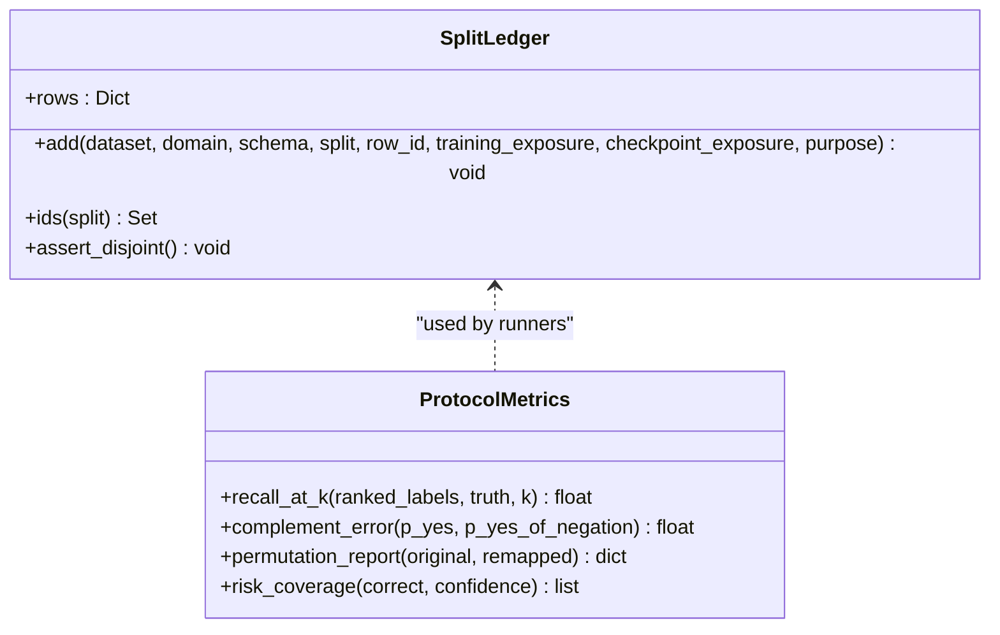
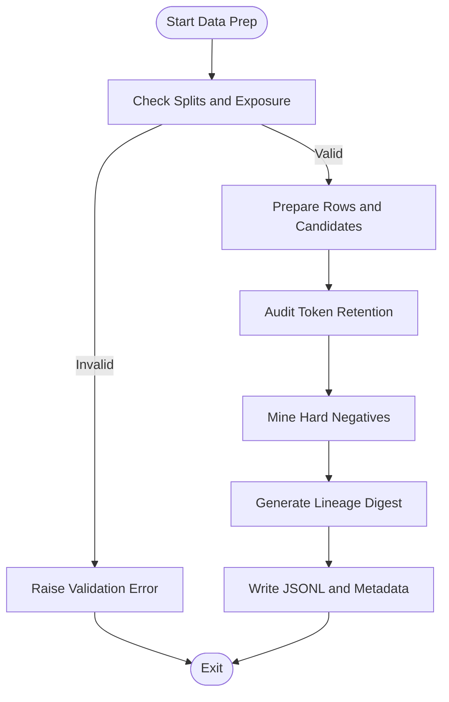
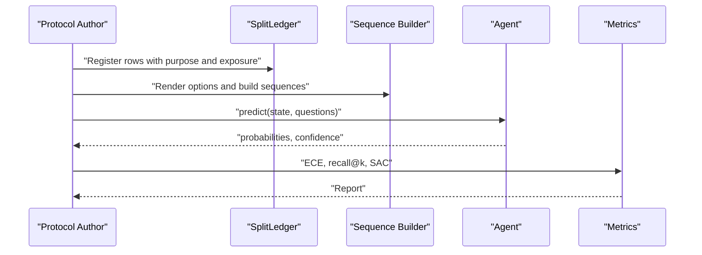
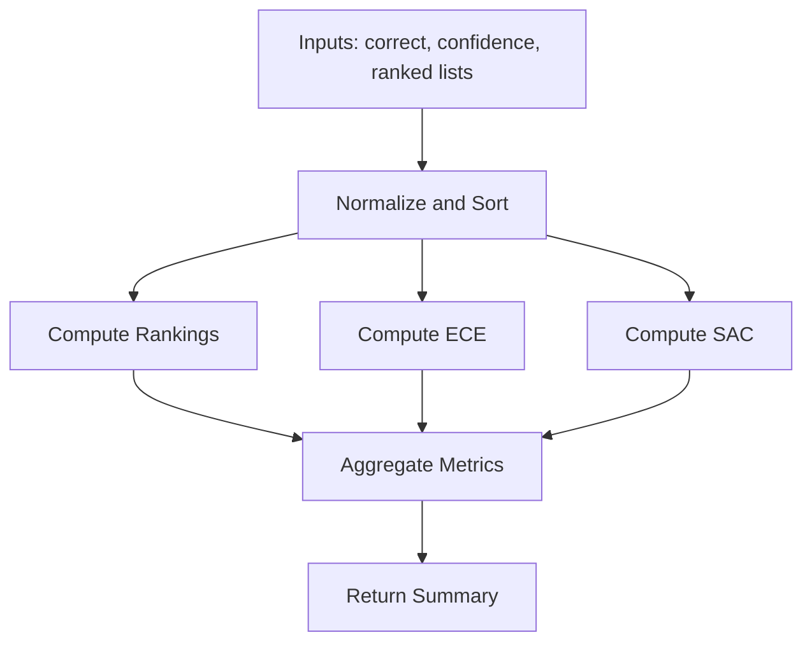
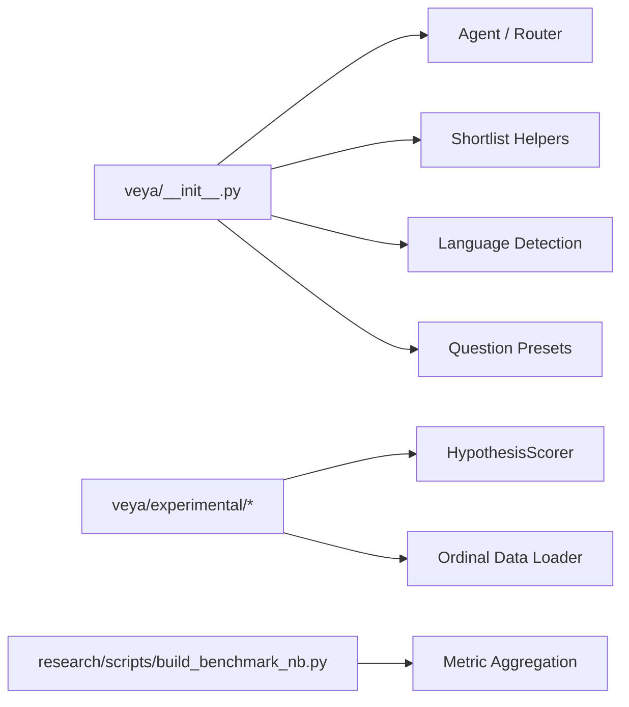
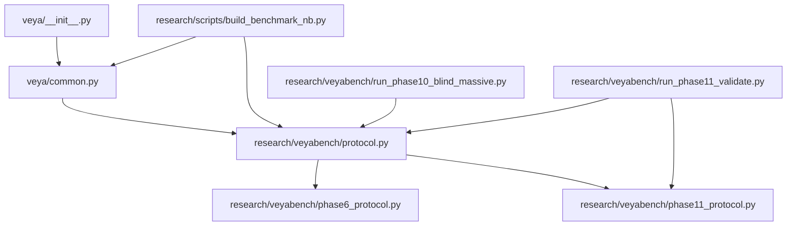

# Custom Evaluation Framework

<cite>
**Referenced Files in This Document**
- [README.md](file://README.md)
- [veya/__init__.py](file://veya/__init__.py)
- [veya/common.py](file://veya/common.py)
- [veya/experimental/hypothesis.py](file://veya/experimental/hypothesis.py)
- [veya/experimental/ordinal_data.py](file://veya/experimental/ordinal_data.py)
- [research/veyabench/protocol.py](file://research/veyabench/protocol.py)
- [research/veyabench/phase6_protocol.py](file://research/veyabench/phase6_protocol.py)
- [research/veyabench/phase11_protocol.py](file://research/veyabench/phase11_protocol.py)
- [research/veyabench/run_phase10_blind_massive.py](file://research/veyabench/run_phase10_blind_massive.py)
- [research/veyabench/run_phase11_validate.py](file://research/veyabench/run_phase11_validate.py)
- [research/veyabench/run_ordinal_eval.py](file://research/veyabench/run_ordinal_eval.py)
- [research/configs/ordinal_micro.json](file://research/configs/ordinal_micro.json)
- [research/scripts/build_benchmark_nb.py](file://research/scripts/build_benchmark_nb.py)
</cite>

## Table of Contents
1. [Introduction](#introduction)
2. [Project Structure](#project-structure)
3. [Core Components](#core-components)
4. [Architecture Overview](#architecture-overview)
5. [Detailed Component Analysis](#detailed-component-analysis)
6. [Dependency Analysis](#dependency-analysis)
7. [Performance Considerations](#performance-considerations)
8. [Troubleshooting Guide](#troubleshooting-guide)
9. [Conclusion](#conclusion)
10. [Appendices](#appendices)

## Introduction
This document explains how to extend Veya’s evaluation framework with custom protocols. It covers the base protocol architecture, data preparation utilities, and evaluation pipeline customization. You will learn how to create new evaluation phases, implement custom metrics, integrate with existing infrastructure, build domain-specific evaluation protocols, handle custom data formats, and deploy specialized testing workflows.

The repository provides:
- A typed decision model that evaluates choice, score, and noul questions without text generation.
- Shared utilities for token sequence construction, confidence estimation, calibration, and batching.
- Auditable protocol helpers for splits, hard negatives, truncation audits, ranking metrics, and end-to-end evaluation.
- Example scripts that show how to assemble datasets, run scoring, compute calibrated metrics, and report results.

**Section sources**
- [README.md:27-46](file://README.md#L27-L46)

## Project Structure
Veya’s evaluation surface is split between the runtime SDK and the research benchmarking layer:

- `veya` package: public API, agent loading, routing, shortlist helpers, shared primitives, and experimental components such as ordinal data handling and hypothesis scorers.
- `research/veyabench`: dataset registries, phase-specific protocols, data loaders, and runner scripts that orchestrate scoring, metric computation, and reporting.
- `research/scripts`: reusable benchmarking utilities used by notebooks and scripts.

```mermaid
graph TB
subgraph "Public SDK"
VEYA_INIT["veya/__init__.py"]
COMMON["veya/common.py"]
HYPOTHESIS["veya/experimental/hypothesis.py"]
ORDINAL_DATA["veya/experimental/ordinal_data.py"]
end
subgraph "Research Benchmarks"
PROTOCOL["research/veyabench/protocol.py"]
PHASE6["research/veyabench/phase6_protocol.py"]
PHASE11["research/veyabench/phase11_protocol.py"]
MASSIVE["research/veyabench/run_phase10_blind_massive.py"]
P11VAL["research/veyabench/run_phase11_validate.py"]
ORD_EVAL["research/veyabench/run_ordinal_eval.py"]
NBUTILS["research/scripts/build_benchmark_nb.py"]
end
VEYA_INIT --> COMMON
VEYA_INIT --> HYPOTHESIS
VEYA_INIT --> ORDINAL_DATA
NBUTILS --> PROTOCOL
NBUTILS --> COMMON
MASSIVE --> PROTOCOL
P11VAL --> PROTOCOL
P11VAL --> PHASE11
ORD_EVAL --> ORDINAL_DATA
```

**Diagram sources**
- [veya/__init__.py:1-56](file://veya/__init__.py#L1-L56)
- [veya/common.py:1-333](file://veya/common.py#L1-L333)
- [veya/experimental/hypothesis.py:378-412](file://veya/experimental/hypothesis.py#L378-L412)
- [veya/experimental/ordinal_data.py:1-16](file://veya/experimental/ordinal_data.py#L1-L16)
- [research/veyabench/protocol.py:1-125](file://research/veyabench/protocol.py#L1-L125)
- [research/veyabench/phase6_protocol.py:1-140](file://research/veyabench/phase6_protocol.py#L1-L140)
- [research/veyabench/phase11_protocol.py:1-204](file://research/veyabench/phase11_protocol.py#L1-L204)
- [research/veyabench/run_phase10_blind_massive.py:82-115](file://research/veyabench/run_phase10_blind_massive.py#L82-L115)
- [research/veyabench/run_phase11_validate.py:183-216](file://research/veyabench/run_phase11_validate.py#L183-L216)
- [research/veyabench/run_ordinal_eval.py:1-28](file://research/veyabench/run_ordinal_eval.py#L1-L28)
- [research/scripts/build_benchmark_nb.py:508-550](file://research/scripts/build_benchmark_nb.py#L508-L550)

**Section sources**
- [veya/__init__.py:1-56](file://veya/__init__.py#L1-L56)
- [research/veyabench/protocol.py:1-125](file://research/veyabench/protocol.py#L1-L125)

## Core Components
This section maps the building blocks you will reuse when extending the evaluation framework.

### Typed Decision Primitives
- Question types are encoded as integers and names for consistent processing across pipelines.
- Options are rendered deterministically from question definitions so prompts remain stable across permutations.
- Sequence construction packs instruction heads, masked options, and state into a single transformer input.

Key responsibilities:
- Define and validate question types.
- Render option texts consistently.
- Build tokenizer-compatible sequences with marker positions for answer extraction.

**Section sources**
- [veya/common.py:11-12](file://veya/common.py#L11-L12)
- [veya/common.py:30-61](file://veya/common.py#L30-L61)
- [veya/common.py:64-111](file://veya/common.py#L64-L111)

### Decision Model and Scoring
- The backbone encoder is followed by a typed decision head.
- Per-question-type embeddings allow the same encoder to serve multiple tasks.
- Confidence and activation features are derived from softmax distributions over options.

Key responsibilities:
- Encode inputs and extract per-option logits at marker positions.
- Compute entropy and top-2 gap features for activation modeling.
- Provide temperature buffers for calibration.

**Section sources**
- [veya/common.py:114-161](file://veya/common.py#L114-L161)

### Calibration and Confidence Utilities
- Expected Calibration Error (ECE) bins confidence scores and measures miscalibration.
- Confidence is derived from normalized Shannon entropy over option probabilities.
- Temperature clamping prevents extreme sharpening or softening.

Key responsibilities:
- Compute ECE across bins.
- Convert probability vectors to scalar confidence.
- Clamp fitted temperatures to safe ranges.

**Section sources**
- [veya/common.py:222-234](file://veya/common.py#L222-L234)
- [veya/common.py:261-267](file://veya/common.py#L261-L267)
- [veya/common.py:275-291](file://veya/common.py#L275-L291)

### Protocol Ledger and Metrics
- SplitLedger enforces disjoint train/calibration/validation/test assignments and prevents test leakage.
- Utility functions include recall-at-k, complement error, permutation stability reports, and risk coverage curves.

Key responsibilities:
- Register rows with dataset, schema, split, purpose, and exposure metadata.
- Validate disjointness and purpose constraints.
- Compute ranking and robustness metrics.

**Section sources**
- [research/veyabench/protocol.py:16-52](file://research/veyabench/protocol.py#L16-L52)
- [research/veyabench/protocol.py:54-83](file://research/veyabench/protocol.py#L54-L83)
- [research/veyabench/protocol.py:86-124](file://research/veyabench/protocol.py#L86-L124)

### Phase-Specific Protocols
- Phase-6 defines fixed training slices, release test boundaries, bootstrap comparisons, and confusion analysis helpers.
- Phase-11 adds truncation auditing, hard-negative mining with lineage, and length bucketing.

Key responsibilities:
- Enforce deterministic slice boundaries and validation rules.
- Audit tokenizer retention and signal position under truncation.
- Mine hard negatives with explicit false-negative screening and verifiable lineage.

**Section sources**
- [research/veyabench/phase6_protocol.py:1-140](file://research/veyabench/phase6_protocol.py#L1-L140)
- [research/veyabench/phase11_protocol.py:18-80](file://research/veyabench/phase11_protocol.py#L18-L80)
- [research/veyabench/phase11_protocol.py:83-162](file://research/veyabench/phase11_protocol.py#L83-L162)
- [research/veyabench/phase11_protocol.py:181-204](file://research/veyabench/phase11_protocol.py#L181-L204)

### Ranking and End-to-End Evaluation
- Rank metrics compute Recall@K, MRR, mean rank, and median rank from scores and gold labels.
- End-to-end evaluators select candidate shortlists, cache scorer calls, measure latency, and aggregate correctness and margins.

Key responsibilities:
- Convert raw scores into rankings and summary statistics.
- Run staged retrieval-plus-scoring loops with deterministic subset selection.
- Cache scorer outputs for repeated evaluations.

**Section sources**
- [research/veyabench/run_phase10_blind_massive.py:99-115](file://research/veyabench/run_phase10_blind_massive.py#L99-L115)
- [research/veyabench/run_phase11_validate.py:183-216](file://research/veyabench/run_phase11_validate.py#L183-L216)

### Ordinal Score Data Adapter
- Provides a strict loader for ordinal CSV tables and refuses missing data paths.
- Used by ordinal evaluation entry points to gate runs until real data is configured.

Key responsibilities:
- Load ordinal datasets with required columns.
- Raise explicit errors when data is unavailable.

**Section sources**
- [veya/experimental/ordinal_data.py:1-16](file://veya/experimental/ordinal_data.py#L1-L16)
- [research/veyabench/run_ordinal_eval.py:1-28](file://research/veyabench/run_ordinal_eval.py#L1-L28)
- [research/configs/ordinal_micro.json:1-7](file://research/configs/ordinal_micro.json#L1-L7)

### Benchmark Notebook Utilities
- Reusable scoring and metric aggregation routines for suites of cases.
- Applies temperature scaling per question type and cardinality bucket.
- Produces calibrated and raw metrics, plus optional soft-distribution metrics.

Key responsibilities:
- Batch-score cases and collect logits with indices.
- Apply temperature scaling and compute ECE, accuracy, F1, and auxiliary metrics.
- Aggregate per-question-type breakdowns.

**Section sources**
- [research/scripts/build_benchmark_nb.py:508-550](file://research/scripts/build_benchmark_nb.py#L508-L550)

## Architecture Overview
The evaluation architecture connects user-defined protocols to Veya’s typed decision engine and shared utilities.

**Diagram sources**
- [veya/common.py:64-111](file://veya/common.py#L64-L111)
- [veya/common.py:114-161](file://veya/common.py#L114-L161)
- [research/veyabench/protocol.py:16-52](file://research/veyabench/protocol.py#L16-L52)
- [research/scripts/build_benchmark_nb.py:508-550](file://research/scripts/build_benchmark_nb.py#L508-L550)

## Detailed Component Analysis

### Base Protocol Architecture
The base protocol layer ensures data integrity and provides reusable metrics.

- SplitLedger enforces disjoint splits and prevents test leakage.
- Utility functions support recall-at-k, complement error, permutation stability, and risk coverage.

**Diagram sources**
- [research/veyabench/protocol.py:16-52](file://research/veyabench/protocol.py#L16-L52)
- [research/veyabench/protocol.py:54-124](file://research/veyabench/protocol.py#L54-L124)

**Section sources**
- [research/veyabench/protocol.py:16-52](file://research/veyabench/protocol.py#L16-L52)
- [research/veyabench/protocol.py:54-124](file://research/veyabench/protocol.py#L54-L124)

### Data Preparation Utilities
Phase-specific modules provide deterministic data handling and auditing.

- Phase-6: Fixed slices, release test boundaries, bootstrap comparison, confusion graph analysis.
- Phase-11: Tokenization audit, hard-negative mining with lineage, length bucketing.

**Diagram sources**
- [research/veyabench/phase6_protocol.py:29-66](file://research/veyabench/phase6_protocol.py#L29-L66)
- [research/veyabench/phase11_protocol.py:18-80](file://research/veyabench/phase11_protocol.py#L18-L80)
- [research/veyabench/phase11_protocol.py:83-162](file://research/veyabench/phase11_protocol.py#L83-L162)

**Section sources**
- [research/veyabench/phase6_protocol.py:1-140](file://research/veyabench/phase6_protocol.py#L1-L140)
- [research/veyabench/phase11_protocol.py:1-204](file://research/veyabench/phase11_protocol.py#L1-L204)

### Evaluation Pipeline Customization
Custom evaluation phases should follow this pattern:

1. Define dataset and schema registry entries.
2. Use SplitLedger to register rows with purpose and exposure.
3. Construct questions using render_options and build_sequence.
4. Batch predictions through the agent.
5. Apply temperature scaling per question type and cardinality bucket.
6. Compute metrics using protocol utilities and phase-specific helpers.
7. Report results and artifacts.

**Diagram sources**
- [research/veyabench/protocol.py:16-52](file://research/veyabench/protocol.py#L16-L52)
- [veya/common.py:42-111](file://veya/common.py#L42-L111)
- [research/scripts/build_benchmark_nb.py:508-550](file://research/scripts/build_benchmark_nb.py#L508-L550)

**Section sources**
- [research/veyabench/protocol.py:16-52](file://research/veyabench/protocol.py#L16-L52)
- [veya/common.py:42-111](file://veya/common.py#L42-L111)
- [research/scripts/build_benchmark_nb.py:508-550](file://research/scripts/build_benchmark_nb.py#L508-L550)

### Creating New Evaluation Phases
To add a new phase:

- Create a module under `research/veyabench` for phase-specific logic.
- Implement deterministic data loaders and slice boundaries.
- Add auditable helpers for tokenization and negative sampling if needed.
- Integrate with SplitLedger and metric utilities.
- Provide a runner script that orchestrates scoring and reporting.

Example references:
- Phase-6 slice definitions and bootstrap comparison.
- Phase-11 truncation audit and hard-negative lineage.

**Section sources**
- [research/veyabench/phase6_protocol.py:1-140](file://research/veyabench/phase6_protocol.py#L1-L140)
- [research/veyabench/phase11_protocol.py:1-204](file://research/veyabench/phase11_protocol.py#L1-L204)

### Implementing Custom Metrics
Use protocol utilities and common utilities to implement metrics:

- For ranking-based metrics, use recall-at-k and rank ordering helpers.
- For calibration, use ECE and confidence-from-probs.
- For automation safety, use safe automation coverage and risk coverage curves.

**Diagram sources**
- [research/veyabench/protocol.py:54-124](file://research/veyabench/protocol.py#L54-L124)
- [veya/common.py:222-234](file://veya/common.py#L222-L234)
- [veya/common.py:237-258](file://veya/common.py#L237-L258)

**Section sources**
- [research/veyabench/protocol.py:54-124](file://research/veyabench/protocol.py#L54-L124)
- [veya/common.py:222-258](file://veya/common.py#L222-L258)

### Integrating With Existing Infrastructure
Integration points:

- Public SDK exports: agent loading, routing, shortlist helpers, language detection, and presets.
- Experimental components: hypothesis scorer for high-N choice paths; ordinal data adapter for ordinal evaluation.
- Benchmark utilities: batch scoring, temperature scaling, and metric aggregation.

**Diagram sources**
- [veya/__init__.py:1-56](file://veya/__init__.py#L1-L56)
- [veya/experimental/hypothesis.py:378-412](file://veya/experimental/hypothesis.py#L378-L412)
- [veya/experimental/ordinal_data.py:1-16](file://veya/experimental/ordinal_data.py#L1-L16)
- [research/scripts/build_benchmark_nb.py:508-550](file://research/scripts/build_benchmark_nb.py#L508-L550)

**Section sources**
- [veya/__init__.py:1-56](file://veya/__init__.py#L1-L56)
- [veya/experimental/hypothesis.py:378-412](file://veya/experimental/hypothesis.py#L378-L412)
- [veya/experimental/ordinal_data.py:1-16](file://veya/experimental/ordinal_data.py#L1-L16)
- [research/scripts/build_benchmark_nb.py:508-550](file://research/scripts/build_benchmark_nb.py#L508-L550)

### Building Domain-Specific Evaluation Protocols
Steps:

1. Define a dataset registry with dataset name, schema, and label mapping.
2. Use SplitLedger to assign each row to train/calibration/validation/test with exposure metadata.
3. Build questions using render_options and build_sequence.
4. Run batched predictions via the agent.
5. Apply temperature scaling per question type and cardinality bucket.
6. Compute metrics using protocol utilities and phase-specific helpers.
7. Write artifacts and summaries.

References:
- SplitLedger registration and validation.
- Sequence construction and option rendering.
- Metric computation and reporting.

**Section sources**
- [research/veyabench/protocol.py:16-52](file://research/veyabench/protocol.py#L16-L52)
- [veya/common.py:42-111](file://veya/common.py#L42-L111)
- [research/scripts/build_benchmark_nb.py:508-550](file://research/scripts/build_benchmark_nb.py#L508-L550)

### Handling Custom Data Formats
Guidelines:

- For CSV-based ordinal data, use the ordinal data loader and ensure required columns exist.
- For JSONL datasets, write deterministic rows with id, dataset, schema, text, and candidate_id.
- Validate schema leakage across splits before writing outputs.

References:
- Ordinal data loader behavior and error handling.
- Phase-10 data preparation patterns for JSONL outputs.

**Section sources**
- [veya/experimental/ordinal_data.py:1-16](file://veya/experimental/ordinal_data.py#L1-L16)
- [research/veyabench/run_ordinal_eval.py:1-28](file://research/veyabench/run_ordinal_eval.py#L1-L28)

### Deploying Specialized Testing Workflows
Patterns:

- Use paired bootstrap for comparing baseline and new models.
- Compute rank metrics for retrieval stages.
- Run end-to-end evaluations with deterministic subsets and scorer caching.

References:
- Paired bootstrap implementation.
- Rank metrics computation.
- End-to-end evaluation loop.

**Section sources**
- [research/veyabench/phase6_protocol.py:78-92](file://research/veyabench/phase6_protocol.py#L78-L92)
- [research/veyabench/run_phase10_blind_massive.py:99-115](file://research/veyabench/run_phase10_blind_massive.py#L99-L115)
- [research/veyabench/run_phase11_validate.py:183-216](file://research/veyabench/run_phase11_validate.py#L183-L216)

## Dependency Analysis
The evaluation framework depends on:

- Public SDK for model loading, routing, and shortlist helpers.
- Common utilities for sequence construction, scoring, and calibration.
- Protocol helpers for splits, metrics, and auditing.
- Phase-specific modules for deterministic slicing and lineage.
- Benchmark utilities for batch scoring and metric aggregation.

**Diagram sources**
- [veya/__init__.py:1-56](file://veya/__init__.py#L1-L56)
- [veya/common.py:1-333](file://veya/common.py#L1-L333)
- [research/veyabench/protocol.py:1-125](file://research/veyabench/protocol.py#L1-L125)
- [research/veyabench/phase6_protocol.py:1-140](file://research/veyabench/phase6_protocol.py#L1-L140)
- [research/veyabench/phase11_protocol.py:1-204](file://research/veyabench/phase11_protocol.py#L1-L204)
- [research/scripts/build_benchmark_nb.py:508-550](file://research/scripts/build_benchmark_nb.py#L508-L550)
- [research/veyabench/run_phase10_blind_massive.py:99-115](file://research/veyabench/run_phase10_blind_massive.py#L99-L115)
- [research/veyabench/run_phase11_validate.py:183-216](file://research/veyabench/run_phase11_validate.py#L183-L216)

**Section sources**
- [veya/__init__.py:1-56](file://veya/__init__.py#L1-L56)
- [research/veyabench/protocol.py:1-125](file://research/veyabench/protocol.py#L1-L125)

## Performance Considerations
- Batched inference reduces per-question latency significantly.
- Preloading checkpoints avoids repeated model reloads during language switches.
- Shortlisting high-cardinality choices improves throughput and accuracy when label spaces are large.
- Temperature scaling should be applied per question type and cardinality bucket to stabilize probabilities.

Recommendations:
- Use Router with preload for multi-language workloads.
- Use predict_shortlist for high-N choice questions.
- Fit and clamp temperatures before relying on confidence gating.

**Section sources**
- [README.md:161-187](file://README.md#L161-L187)
- [README.md:388-420](file://README.md#L388-L420)
- [veya/common.py:275-291](file://veya/common.py#L275-L291)

## Troubleshooting Guide
Common issues and resolutions:

- Test leakage: Ensure SplitLedger assertions pass and no test rows are marked as training exposure.
- Missing ordinal data: Ordinal evaluation exits with a specific code when CSV is not configured.
- Truncation problems: Use tokenization audit to verify positive signal retention and position.
- Hard-negative contamination: Validate lineage digest and screening flags.

Actions:
- Validate splits and purposes before running evaluations.
- Configure ordinal data environment variables and CSV path.
- Inspect tokenization audit outputs for truncated signals.
- Verify hard-negative lineage records and digests.

**Section sources**
- [research/veyabench/protocol.py:16-52](file://research/veyabench/protocol.py#L16-L52)
- [research/veyabench/run_ordinal_eval.py:12-24](file://research/veyabench/run_ordinal_eval.py#L12-L24)
- [research/veyabench/phase11_protocol.py:18-80](file://research/veyabench/phase11_protocol.py#L18-L80)
- [research/veyabench/phase11_protocol.py:181-195](file://research/veyabench/phase11_protocol.py#L181-L195)

## Conclusion
Extending Veya’s evaluation framework involves combining the typed decision model, shared utilities, and auditable protocol helpers. By following the patterns in phase-specific modules and benchmark utilities, you can build domain-specific evaluation protocols, handle custom data formats, implement custom metrics, and deploy specialized testing workflows with confidence and reproducibility.

## Appendices

### Step-by-Step Guide: Domain-Specific Evaluation Protocol
1. Define dataset and schema registry entries.
2. Register rows with SplitLedger including purpose and exposure.
3. Build questions using render_options and build_sequence.
4. Run batched predictions via the agent.
5. Apply temperature scaling per question type and cardinality bucket.
6. Compute metrics using protocol utilities and phase-specific helpers.
7. Write artifacts and summaries.

References:
- SplitLedger registration and validation.
- Sequence construction and option rendering.
- Metric computation and reporting.

**Section sources**
- [research/veyabench/protocol.py:16-52](file://research/veyabench/protocol.py#L16-L52)
- [veya/common.py:42-111](file://veya/common.py#L42-L111)
- [research/scripts/build_benchmark_nb.py:508-550](file://research/scripts/build_benchmark_nb.py#L508-L550)