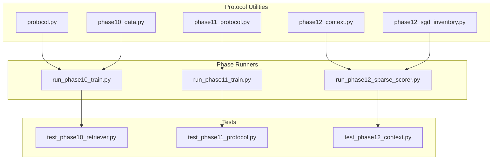
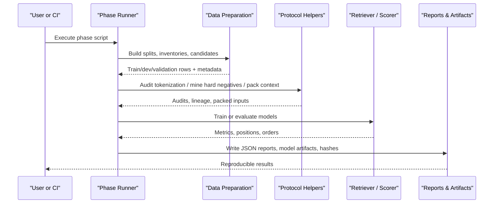
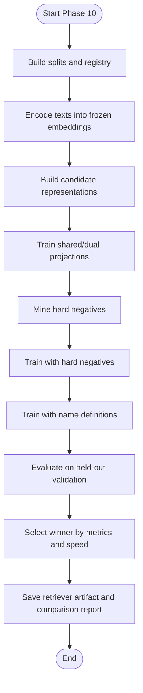
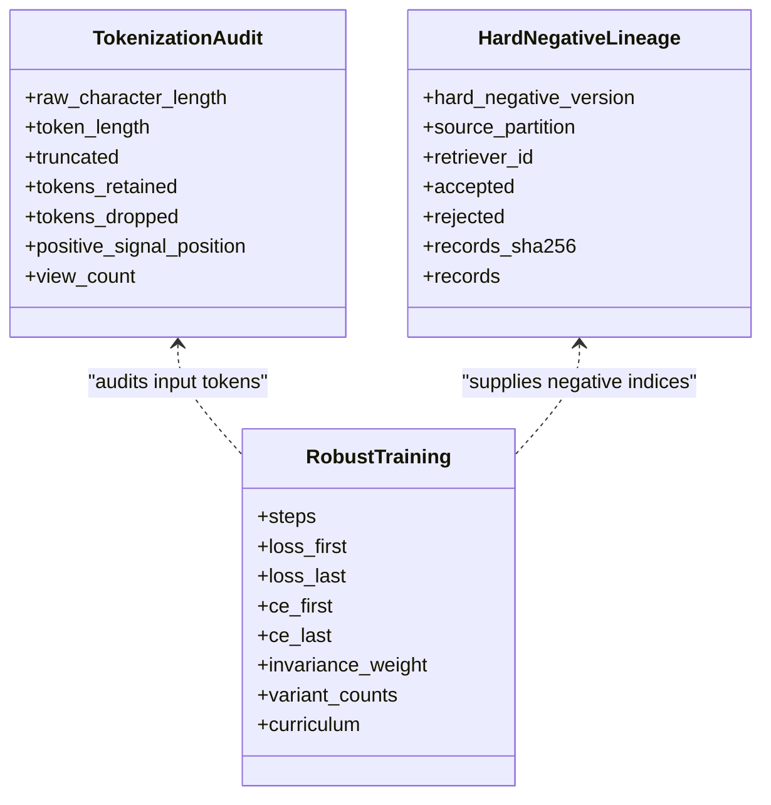
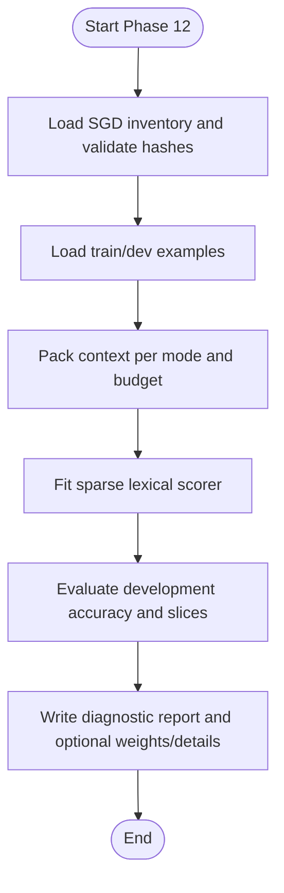
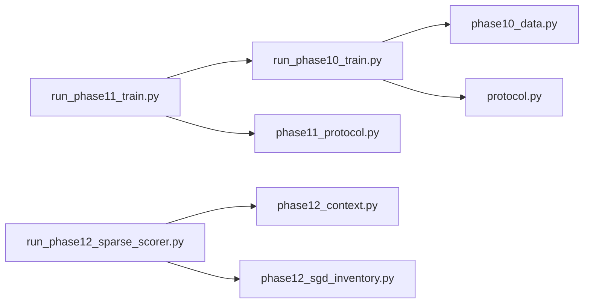

# Evaluation Protocols

<cite>
**Referenced Files in This Document**
- [protocol.py](file://research/veyabench/protocol.py)
- [phase10_data.py](file://research/veyabench/phase10_data.py)
- [phase11_protocol.py](file://research/veyabench/phase11_protocol.py)
- [phase12_context.py](file://research/veyabench/phase12_context.py)
- [phase12_sgd_inventory.py](file://research/veyabench/phase12_sgd_inventory.py)
- [run_phase10_train.py](file://research/veyabench/run_phase10_train.py)
- [run_phase11_train.py](file://research/veyabench/run_phase11_train.py)
- [run_phase12_sparse_scorer.py](file://research/veyabench/run_phase12_sparse_scorer.py)
- [test_phase10_retriever.py](file://tests/test_phase10_retriever.py)
- [test_phase11_protocol.py](file://tests/test_phase11_protocol.py)
- [test_phase12_context.py](file://tests/test_phase12_context.py)
</cite>

## Table of Contents
1. [Introduction](#introduction)
2. [Project Structure](#project-structure)
3. [Core Components](#core-components)
4. [Architecture Overview](#architecture-overview)
5. [Detailed Component Analysis](#detailed-component-analysis)
6. [Dependency Analysis](#dependency-analysis)
7. [Performance Considerations](#performance-considerations)
8. [Troubleshooting Guide](#troubleshooting-guide)
9. [Conclusion](#conclusion)
10. [Appendices](#appendices)

## Introduction
This document explains Veya’s evaluation protocol framework implemented under the `research/veyabench` package. It focuses on three phase-specific protocols:

- Phase 10: schema-holdout retriever training and frozen-backbone selection.
- Phase 11: noise-robust training, tokenization auditing, and auditable hard-negative mining.
- Phase 12: causal SGD context packing, service-level inventory validation, and a lightweight sparse lexical scorer diagnostic.

It also covers data preparation utilities, automated testing workflows, how to implement custom evaluation phases, and how to interpret the resulting reports and artifacts.

## Project Structure
The evaluation framework is organized around reusable protocol helpers and phase-specific runners:

**Diagram sources**
- [protocol.py:1-125](file://research/veyabench/protocol.py#L1-L125)
- [phase10_data.py:1-337](file://research/veyabench/phase10_data.py#L1-L337)
- [phase11_protocol.py:1-204](file://research/veyabench/phase11_protocol.py#L1-L204)
- [phase12_context.py:1-145](file://research/veyabench/phase12_context.py#L1-L145)
- [phase12_sgd_inventory.py:1-217](file://research/veyabench/phase12_sgd_inventory.py#L1-L217)
- [run_phase10_train.py:1-532](file://research/veyabench/run_phase10_train.py#L1-L532)
- [run_phase11_train.py:1-621](file://research/veyabench/run_phase11_train.py#L1-L621)
- [run_phase12_sparse_scorer.py:1-257](file://research/veyabench/run_phase12_sparse_scorer.py#L1-L257)
- [test_phase10_retriever.py:1-288](file://tests/test_phase10_retriever.py#L1-L288)
- [test_phase11_protocol.py:1-67](file://tests/test_phase11_protocol.py#L1-L67)
- [test_phase12_context.py:1-82](file://tests/test_phase12_context.py#L1-L82)

**Section sources**
- [protocol.py:1-125](file://research/veyabench/protocol.py#L1-L125)
- [phase10_data.py:1-337](file://research/veyabench/phase10_data.py#L1-L337)
- [phase11_protocol.py:1-204](file://research/veyabench/phase11_protocol.py#L1-L204)
- [phase12_context.py:1-145](file://research/veyabench/phase12_context.py#L1-L145)
- [phase12_sgd_inventory.py:1-217](file://research/veyabench/phase12_sgd_inventory.py#L1-L217)
- [run_phase10_train.py:1-532](file://research/veyabench/run_phase10_train.py#L1-L532)
- [run_phase11_train.py:1-621](file://research/veyabench/run_phase11_train.py#L1-L621)
- [run_phase12_sparse_scorer.py:1-257](file://research/veyabench/run_phase12_sparse_scorer.py#L1-L257)
- [test_phase10_retriever.py:1-288](file://tests/test_phase10_retriever.py#L1-L288)
- [test_phase11_protocol.py:1-67](file://tests/test_phase11_protocol.py#L1-L67)
- [test_phase12_context.py:1-82](file://tests/test_phase12_context.py#L1-L82)

## Core Components
The framework provides shared evaluation primitives and phase-specific building blocks:

- Shared protocol primitives:
  - Split ledger for dataset row ownership and leakage checks.
  - Retrieval metrics such as recall-at-k, permutation stability, risk coverage, and hard-negative mining utilities.

- Phase 10 data preparation:
  - Deterministic capping per label.
  - Schema-aware train/development/validation split construction.
  - Registry and freeze artifacts that record provenance and prohibited partitions.

- Phase 11 protocol helpers:
  - Tokenization audit for truncated queries.
  - Auditable hard-negative mining with lineage verification.
  - Token-length bucketing for analysis.

- Phase 12 context utilities:
  - Causal turn extraction from dialogues.
  - Context packing with strict truncation budgets.
  - Service-level inventory validation and sealed test protection.

**Section sources**
- [protocol.py:16-125](file://research/veyabench/protocol.py#L16-L125)
- [phase10_data.py:30-332](file://research/veyabench/phase10_data.py#L30-L332)
- [phase11_protocol.py:18-204](file://research/veyabench/phase11_protocol.py#L18-L204)
- [phase12_context.py:20-145](file://research/veyabench/phase12_context.py#L20-L145)
- [phase12_sgd_inventory.py:24-217](file://research/veyabench/phase12_sgd_inventory.py#L24-L217)

## Architecture Overview
The evaluation architecture separates data preparation, protocol logic, and runner orchestration:

**Diagram sources**
- [run_phase10_train.py:275-532](file://research/veyabench/run_phase10_train.py#L275-L532)
- [run_phase11_train.py:355-621](file://research/veyabench/run_phase11_train.py#L355-L621)
- [run_phase12_sparse_scorer.py:192-257](file://research/veyabench/run_phase12_sparse_scorer.py#L192-L257)
- [phase10_data.py:183-332](file://research/veyabench/phase10_data.py#L183-L332)
- [phase11_protocol.py:18-204](file://research/veyabench/phase11_protocol.py#L18-L204)
- [phase12_context.py:20-145](file://research/veyabench/phase12_context.py#L20-L145)

## Detailed Component Analysis

### Phase 10: Schema-Held-Out Retriever Training
Phase 10 builds deterministic splits from Banking77, SGD, and CLINC150, then trains small projection heads over frozen encoder vectors. It evaluates multiple candidate representations and selects a winner using development metrics and bootstrap uncertainty.

Key responsibilities:
- Deterministic cap per label to control dataset size.
- Schema separation between train, development, and validation sets.
- Frozen embedding cache keyed by checkpoint hash and text inventory.
- Episodic InfoNCE training with optional hard-negative refresh.
- Validation report comparing current production retrieval against trained variants.

**Diagram sources**
- [run_phase10_train.py:180-242](file://research/veyabench/run_phase10_train.py#L180-L242)
- [run_phase10_train.py:245-268](file://research/veyabench/run_phase10_train.py#L245-L268)
- [run_phase10_train.py:341-447](file://research/veyabench/run_phase10_train.py#L341-L447)
- [run_phase10_train.py:448-527](file://research/veyabench/run_phase10_train.py#L448-L527)

Implementation highlights:
- Deterministic labeling and hashing ensure reproducible splits and caches.
- Hard-negative mining uses normalized label equality and top-ranked non-gold candidates.
- Bootstrap uncertainty compares delta recall at k=8 across finalists.
- Final artifact includes metadata, dataset provenance, and selection rationale.

**Section sources**
- [phase10_data.py:38-51](file://research/veyabench/phase10_data.py#L38-L51)
- [phase10_data.py:183-332](file://research/veyabench/phase10_data.py#L183-L332)
- [run_phase10_train.py:81-120](file://research/veyabench/run_phase10_train.py#L81-L120)
- [run_phase10_train.py:138-165](file://research/veyabench/run_phase10_train.py#L138-L165)
- [run_phase10_train.py:180-242](file://research/veyabench/run_phase10_train.py#L180-L242)
- [run_phase10_train.py:245-268](file://research/veyabench/run_phase10_train.py#L245-L268)
- [run_phase10_train.py:341-447](file://research/veyabench/run_phase10_train.py#L341-L447)
- [run_phase10_train.py:448-527](file://research/veyabench/run_phase10_train.py#L448-L527)

### Phase 11: Noise-Robust Training and Auditable Hard Negatives
Phase 11 extends Phase 10 with robustness ablations, tokenization audits, and lineage-tracked hard-negative mining. It validates augmentation semantics, tracks tokenizer retention, and enforces a clean-noninferiority floor before selecting winners.

Key responsibilities:
- Augmentation validation and semantic audit records.
- Tokenization audit reporting truncated signals and position categories.
- Hard-negative mining with explicit false-negative screening and tamper-evident lineage.
- Curriculum training mixing clean and noisy views with optional invariance loss.
- Development evaluation grouped by noise condition and robust mean recall.

**Diagram sources**
- [phase11_protocol.py:18-80](file://research/veyabench/phase11_protocol.py#L18-L80)
- [phase11_protocol.py:83-162](file://research/veyabench/phase11_protocol.py#L83-L162)
- [run_phase11_train.py:136-238](file://research/veyabench/run_phase11_train.py#L136-L238)

Implementation highlights:
- Tokenization audit detects fully retained, partially retained, or truncated positive signal spans.
- Hard-negative lineage enforces versioning, partition constraints, and SHA-256 integrity.
- Robust training mixes clean/noisy views through a staged curriculum and optionally adds invariance loss.
- Selection requires clean recall not below a floor; otherwise fallback eligibility is allowed.

**Section sources**
- [phase11_protocol.py:18-204](file://research/veyabench/phase11_protocol.py#L18-L204)
- [run_phase11_train.py:284-352](file://research/veyabench/run_phase11_train.py#L284-L352)
- [run_phase11_train.py:431-504](file://research/veyabench/run_phase11_train.py#L431-L504)
- [run_phase11_train.py:505-605](file://research/veyabench/run_phase11_train.py#L505-L605)

### Phase 12: Causal Context Packing and Sparse Lexical Scorer Diagnostic
Phase 12 prepares causal SGD USER-turn inputs, packs context within strict token budgets, and runs a lightweight sparse lexical scorer diagnostic on train services only. Official test dialogues remain sealed until a separate finalist harness opens them.

Key responsibilities:
- Load examples from train/dev with file-hash verification.
- Extract causal turns and service transitions.
- Pack context while preserving the current USER turn and newest prior turns.
- Validate source schemas and service splits.
- Fit and evaluate a hashed n-gram overlap scorer with development-only diagnostics.

**Diagram sources**
- [phase12_context.py:20-145](file://research/veyabench/phase12_context.py#L20-L145)
- [phase12_sgd_inventory.py:121-217](file://research/veyabench/phase12_sgd_inventory.py#L121-L217)
- [run_phase12_sparse_scorer.py:192-257](file://research/veyabench/run_phase12_sparse_scorer.py#L192-L257)

Implementation highlights:
- Context packing rejects empty current turns and over-budget current turns explicitly.
- Embedded newlines are escaped so they cannot spoof speaker boundaries.
- Test dialogues are never parsed by this module; attempting to load them raises an error.
- Sparse scorer features use hashed term overlaps and bias terms, trained online with softmax cross-entropy.

**Section sources**
- [phase12_context.py:20-145](file://research/veyabench/phase12_context.py#L20-L145)
- [phase12_sgd_inventory.py:121-217](file://research/veyabench/phase12_sgd_inventory.py#L121-L217)
- [run_phase12_sparse_scorer.py:32-150](file://research/veyabench/run_phase12_sparse_scorer.py#L32-L150)
- [run_phase12_sparse_scorer.py:153-257](file://research/veyabench/run_phase12_sparse_scorer.py#L153-L257)

## Dependency Analysis
The runners depend on protocol helpers and shared utilities:

**Diagram sources**
- [run_phase10_train.py:23-32](file://research/veyabench/run_phase10_train.py#L23-L32)
- [run_phase11_train.py:19-55](file://research/veyabench/run_phase11_train.py#L19-L55)
- [run_phase12_sparse_scorer.py:19-21](file://research/veyabench/run_phase12_sparse_scorer.py#L19-L21)

Coupling and cohesion:
- Phase runners encapsulate orchestration and artifact writing.
- Protocol modules provide pure functions and auditable utilities.
- Data preparation modules enforce provenance, hashing, and split integrity.

Potential circular dependencies:
- No direct cycles observed; runners import protocol/data modules but not vice versa.

External integration points:
- Release manifest loading and shortlist artifact handling.
- Domain retriever save/load and projection pair training.
- SGD dataset provenance and commit verification.

**Section sources**
- [run_phase10_train.py:23-32](file://research/veyabench/run_phase10_train.py#L23-L32)
- [run_phase11_train.py:19-55](file://research/veyabench/run_phase11_train.py#L19-L55)
- [run_phase12_sparse_scorer.py:19-21](file://research/veyabench/run_phase12_sparse_scorer.py#L19-L21)

## Performance Considerations
- Frozen embedding caching avoids recomputation when checkpoint hash and text inventory match.
- Batched encoding reduces overhead during large-scale embedding generation.
- Episodic training rotates schemas and cardinalities to improve generalization.
- Hard-negative mining limits candidate pools and blocks normalized duplicates to reduce noise.
- Context packing ensures current turns fit within head budgets, preventing silent truncation.

[No sources needed since this section provides general guidance]

## Troubleshooting Guide
Common issues and resolutions:

- Unknown split or purpose:
  - Ensure split and purpose values are among the allowed set.
  - Check that test rows are not marked as training exposure.

- Row registration conflicts:
  - Verify each dataset-row key appears only once.
  - Confirm disjointness across train/calibration/validation/test.

- Test partition leakage:
  - Do not mark test rows as training exposure.
  - Ensure test purpose aligns with test split.

- Hard-negative lineage mismatch:
  - Validate version string and partition constraint.
  - Recompute digest if records were altered.

- Tokenization truncation:
  - Inspect positive signal position and dropped tokens.
  - Adjust max length or view policy to retain critical spans.

- Context packing failures:
  - Reject empty current turns or over-budget current turns.
  - Ensure embedded newlines do not spoof speaker boundaries.

- Sealed test access:
  - Do not attempt to load test dialogues outside the sealed finalist harness.

**Section sources**
- [protocol.py:16-52](file://research/veyabench/protocol.py#L16-L52)
- [phase11_protocol.py:181-195](file://research/veyabench/phase11_protocol.py#L181-L195)
- [phase12_context.py:20-145](file://research/veyabench/phase12_context.py#L20-L145)

## Conclusion
Veya’s evaluation protocol framework provides rigorous, auditable pipelines for domain retrieval and intent scoring across phases. Phase 10 establishes schema-holdout retrieval training; Phase 11 adds robustness and lineage-tracked hard negatives; Phase 12 introduces causal context packing and a transparent sparse scorer diagnostic. The design emphasizes reproducibility, provenance, and safety against data leakage, with comprehensive tests validating core behaviors.

[No sources needed since this section summarizes without analyzing specific files]

## Appendices

### How to Implement Custom Evaluation Protocols
Steps to extend the framework:

1. Define data preparation:
   - Create a module similar to `phase10_data.py` to build deterministic splits and registries.
   - Include hashing, caps, and prohibited partitions.

2. Add protocol helpers:
   - Follow patterns in `phase11_protocol.py` for audits and lineage tracking.
   - Provide validation functions to enforce constraints.

3. Build a runner:
   - Mirror structure in `run_phase10_train.py`, `run_phase11_train.py`, or `run_phase12_sparse_scorer.py`.
   - Load release manifests, encode embeddings, train/evaluate models, and write reports.

4. Integrate tests:
   - Add unit tests like those in `test_phase10_retriever.py`, `test_phase11_protocol.py`, and `test_phase12_context.py`.
   - Cover edge cases, invariants, and security constraints (e.g., sealed test access).

5. Produce artifacts:
   - Save model artifacts with metadata and checksums.
   - Write JSON reports with provenance, selection criteria, and caveats.

**Section sources**
- [phase10_data.py:183-332](file://research/veyabench/phase10_data.py#L183-L332)
- [phase11_protocol.py:18-204](file://research/veyabench/phase11_protocol.py#L18-L204)
- [run_phase10_train.py:275-532](file://research/veyabench/run_phase10_train.py#L275-L532)
- [run_phase11_train.py:355-621](file://research/veyabench/run_phase11_train.py#L355-L621)
- [run_phase12_sparse_scorer.py:192-257](file://research/veyabench/run_phase12_sparse_scorer.py#L192-L257)
- [test_phase10_retriever.py:59-288](file://tests/test_phase10_retriever.py#L59-L288)
- [test_phase11_protocol.py:29-67](file://tests/test_phase11_protocol.py#L29-L67)
- [test_phase12_context.py:17-82](file://tests/test_phase12_context.py#L17-L82)

### Running Standardized Tests
- Unit tests verify naturalization, query views, exact rank stability, artifact loading, and feature flags.
- Protocol tests validate tokenization audits, hard-negative lineage integrity, and token-length buckets.
- Context tests ensure causal ordering, packing invariants, newline escaping, and sealed test protection.

Run pytest against the test files to confirm correctness and invariants.

**Section sources**
- [test_phase10_retriever.py:59-288](file://tests/test_phase10_retriever.py#L59-L288)
- [test_phase11_protocol.py:29-67](file://tests/test_phase11_protocol.py#L29-L67)
- [test_phase12_context.py:17-82](file://tests/test_phase12_context.py#L17-L82)

### Interpreting Evaluation Results
- Phase 10 reports include:
  - Comparison metrics across candidate representations.
  - Bootstrap uncertainty for recall deltas.
  - Winner selection rationale and artifact metadata.

- Phase 11 reports include:
  - Development metrics grouped by noise conditions.
  - Clean noninferiority floor and selected variant.
  - Hard-negative lineage summary and audit samples.

- Phase 12 diagnostics include:
  - Development accuracy, Wilson score intervals, and slice breakdowns.
  - Optional weights and per-item details.
  - Caveats indicating research-only status and sealed test protection.

**Section sources**
- [run_phase10_train.py:448-527](file://research/veyabench/run_phase10_train.py#L448-L527)
- [run_phase11_train.py:523-605](file://research/veyabench/run_phase11_train.py#L523-L605)
- [run_phase12_sparse_scorer.py:220-257](file://research/veyabench/run_phase12_sparse_scorer.py#L220-L257)