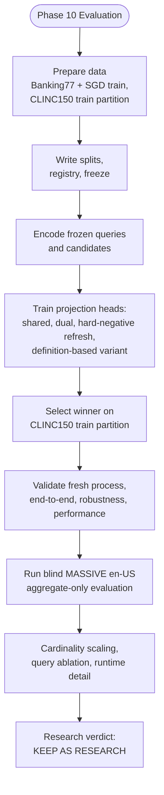
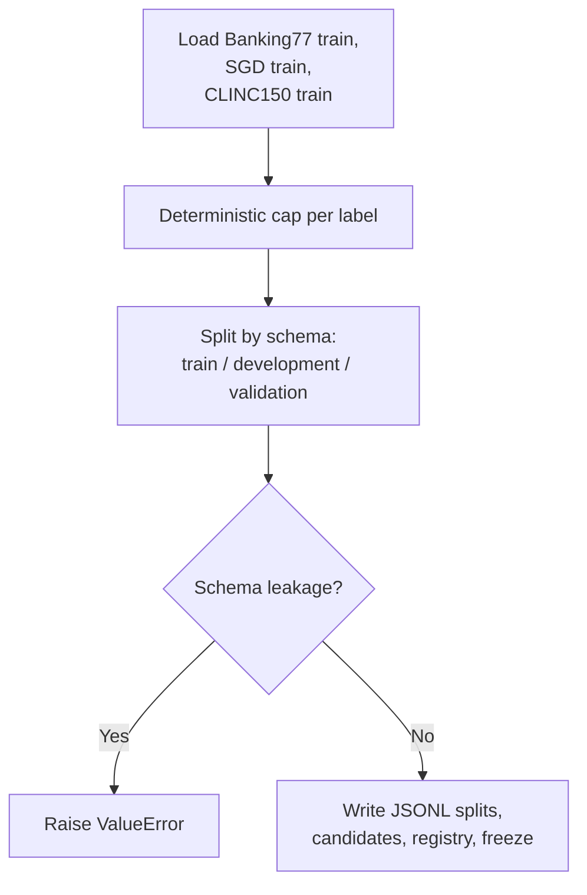
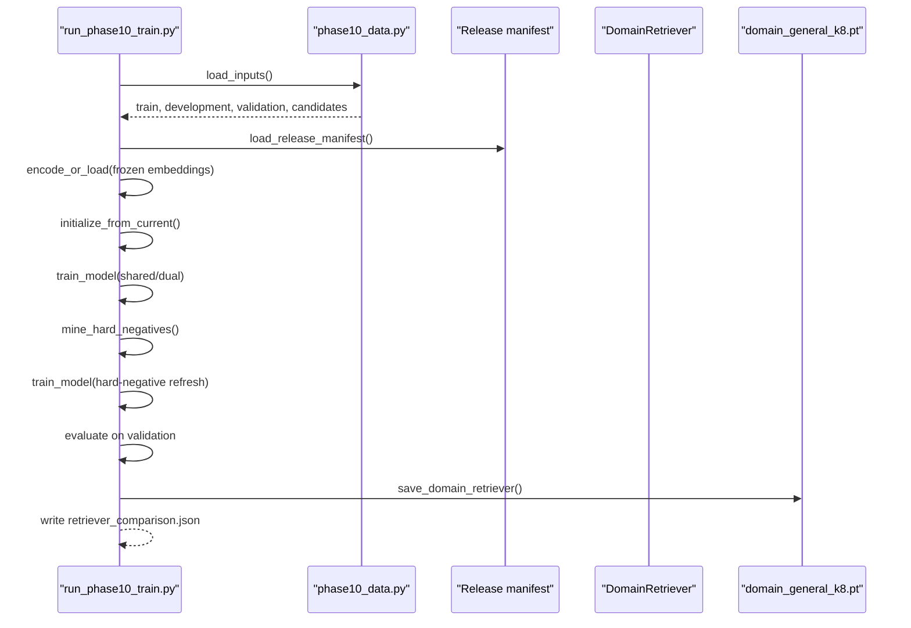
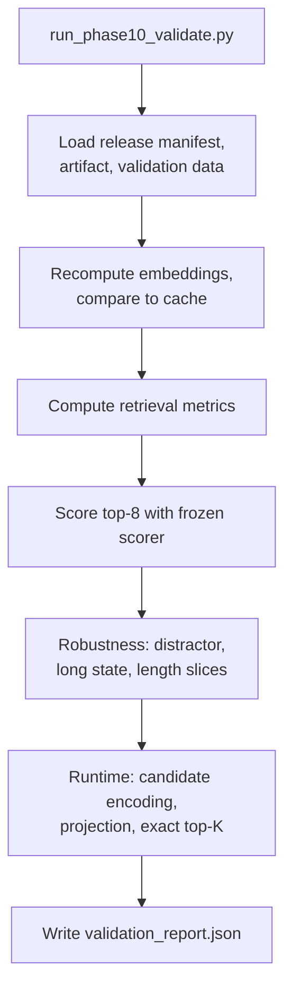
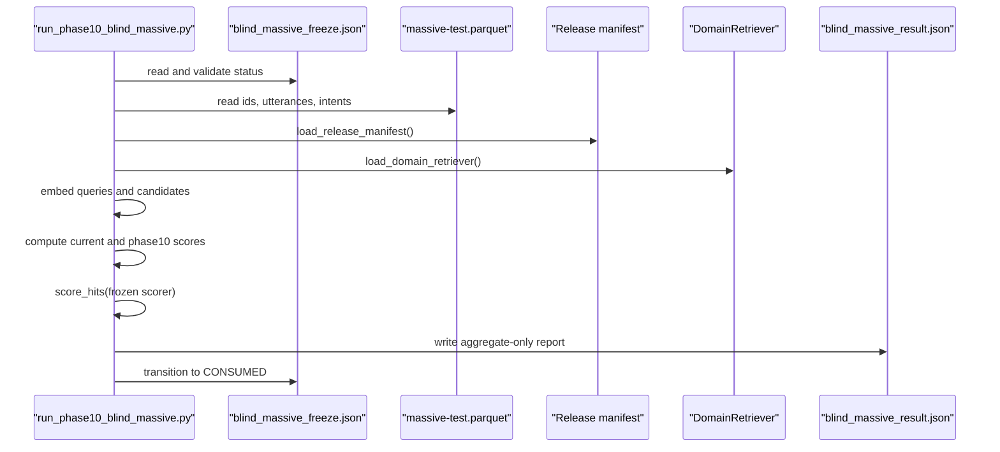
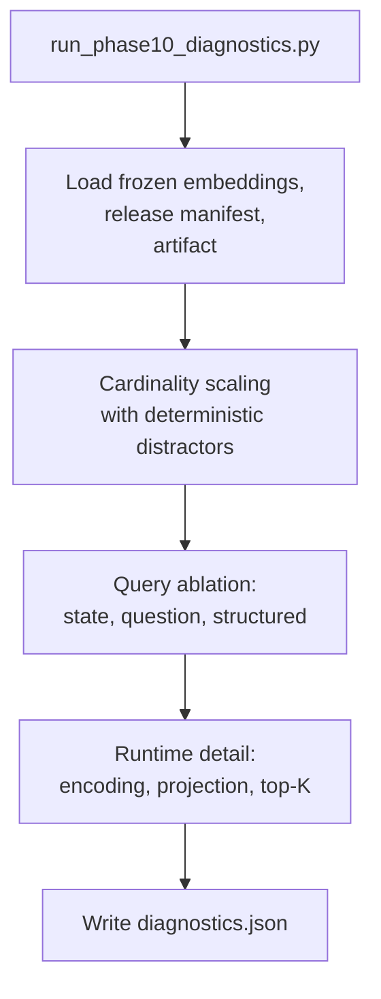
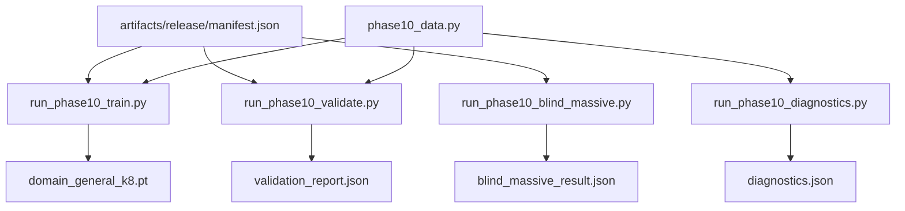
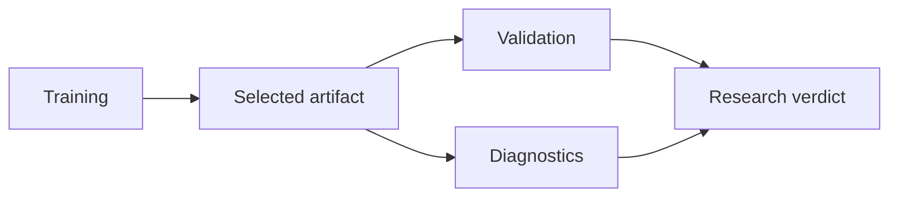

# Phase 10 Evaluation Protocol

<cite>
**Referenced Files in This Document**
- [README.md](file://README.md)
- [final_report.md](file://docs/phase10/final_report.md)
- [research_manifest.json](file://artifacts/experiments/phase10/research_manifest.json)
- [validation_report.json](file://artifacts/experiments/phase10/validation_report.json)
- [blind_massive_result.json](file://artifacts/experiments/phase10/blind_massive_result.json)
- [diagnostics.json](file://artifacts/experiments/phase10/diagnostics.json)
- [phase10_data.py](file://research/veyabench/phase10_data.py)
- [run_phase10_train.py](file://research/veyabench/run_phase10_train.py)
- [run_phase10_validate.py](file://research/veyabench/run_phase10_validate.py)
- [run_phase10_blind_massive.py](file://research/veyabench/run_phase10_blind_massive.py)
- [run_phase10_diagnostics.py](file://research/veyabench/run_phase10_diagnostics.py)
</cite>

## Table of Contents
1. [Introduction](#introduction)
2. [Project Structure](#project-structure)
3. [Core Components](#core-components)
4. [Architecture Overview](#architecture-overview)
5. [Detailed Component Analysis](#detailed-component-analysis)
6. [Dependency Analysis](#dependency-analysis)
7. [Performance Considerations](#performance-considerations)
8. [Troubleshooting Guide](#troubleshooting-guide)
9. [Conclusion](#conclusion)
10. [Appendices](#appendices)

## Introduction
Phase 10 evaluates a frozen-backbone, multi-schema retriever that improves intent retrieval without changing the production scorer or release manifest. The protocol separates three tightly controlled phases:

- Data preparation and contamination-aware split construction.
- Training and selection of a small projection head on frozen embeddings.
- Validation, robustness diagnostics, and one-shot blind evaluation on an untouched MASSIVE English test set.

The final decision is research-only because retrieval generalizes to unseen schemas but fails robustness gates under irrelevant or long state content.

**Section sources**
- [final_report.md:1-118](file://docs/phase10/final_report.md#L1-L118)
- [research_manifest.json:1-56](file://artifacts/experiments/phase10/research_manifest.json#L1-L56)

## Project Structure
Phase 10 artifacts live under `artifacts/experiments/phase10`, while the harness code lives under `research/veyabench`. Data preparation writes JSONL splits and a registry under `research/data/phase10`.

```mermaid
graph TB
A["research/veyabench/phase10_data.py"] --> B["research/data/phase10/train.jsonl"]
A --> C["research/data/phase10/development.jsonl"]
A --> D["research/data/phase10/schema_held_out_validation.jsonl"]
A --> E["research/data/phase10/candidates.json"]
A --> F["research/data/phase10/registry.json"]
G["research/veyabench/run_phase10_train.py"] --> H["artifacts/experiments/phase10/domain_general_k8.pt"]
G --> I["artifacts/experiments/phase10/retriever_comparison.json"]
J["research/veyabench/run_phase10_validate.py"] --> K["artifacts/experiments/phase10/validation_report.json"]
L["research/veyabench/run_phase10_blind_massive.py"] --> M["artifacts/experiments/phase10/blind_massive_result.json"]
N["research/veyabench/run_phase10_diagnostics.py"] --> O["artifacts/experiments/phase10/diagnostics.json"]
```

**Diagram sources**
- [phase10_data.py:18-332](file://research/veyabench/phase10_data.py#L18-L332)
- [run_phase10_train.py:35-41](file://research/veyabench/run_phase10_train.py#L35-L41)
- [run_phase10_validate.py:36-36](file://research/veyabench/run_phase10_validate.py#L36-L36)
- [run_phase10_blind_massive.py:32-35](file://research/veyabench/run_phase10_blind_massive.py#L32-L35)
- [run_phase10_diagnostics.py:31-31](file://research/veyabench/run_phase10_diagnostics.py#L31-L31)

**Section sources**
- [phase10_data.py:18-332](file://research/veyabench/phase10_data.py#L18-L332)
- [run_phase10_train.py:35-41](file://research/veyabench/run_phase10_train.py#L35-L41)
- [run_phase10_validate.py:36-36](file://research/veyabench/run_phase10_validate.py#L36-L36)
- [run_phase10_blind_massive.py:32-35](file://research/veyabench/run_phase10_blind_massive.py#L32-L35)
- [run_phase10_diagnostics.py:31-31](file://research/veyabench/run_phase10_diagnostics.py#L31-L31)

## Core Components
Phase 10 has five core components:

| Component | Responsibility | Key Outputs |
|---|---|---|
| Data registry and split builder | Loads Banking77 train, SGD train, CLINC150 train; caps examples per label; enforces schema separation; writes splits and freeze metadata | `train.jsonl`, `development.jsonl`, `schema_held_out_validation.jsonl`, `candidates.json`, `registry.json`, `splits.json` |
| Training harness | Encodes frozen embeddings, trains shared/dual projections, mines hard negatives, selects winner, saves artifact | `domain_general_k8.pt`, `retriever_comparison.json` |
| Validation harness | Fresh-process reproducibility, end-to-end scoring with frozen scorer, robustness tests, runtime cardinality audit | `validation_report.json` |
| Blind harness | One-shot aggregate-only evaluation on MASSIVE en-US test with strict freeze checks | `blind_massive_result.json` |
| Diagnostics harness | Cardinality scaling, query ablation, detailed latency breakdown | `diagnostics.json` |

**Section sources**
- [phase10_data.py:1-337](file://research/veyabench/phase10_data.py#L1-L337)
- [run_phase10_train.py:1-532](file://research/veyabench/run_phase10_train.py#L1-L532)
- [run_phase10_validate.py:1-502](file://research/veyabench/run_phase10_validate.py#L1-L502)
- [run_phase10_blind_massive.py:1-307](file://research/veyabench/run_phase10_blind_massive.py#L1-L307)
- [run_phase10_diagnostics.py:1-254](file://research/veyabench/run_phase10_diagnostics.py#L1-L254)

## Architecture Overview
The Phase 10 pipeline uses a frozen ModernBERT encoder and learns only a small projection head for query-candidate similarity. Retrieval is exact top-K over projected vectors; no ANN index is introduced.

**Diagram sources**
- [phase10_data.py:183-332](file://research/veyabench/phase10_data.py#L183-L332)
- [run_phase10_train.py:180-469](file://research/veyabench/run_phase10_train.py#L180-L469)
- [run_phase10_validate.py:324-497](file://research/veyabench/run_phase10_validate.py#L324-L497)
- [run_phase10_blind_massive.py:156-302](file://research/veyabench/run_phase10_blind_massive.py#L156-L302)
- [run_phase10_diagnostics.py:170-249](file://research/veyabench/run_phase10_diagnostics.py#L170-L249)

## Detailed Component Analysis

### Data Preparation and Contamination Control
The data module loads only allowed training partitions and constructs deterministic, capped subsets per candidate label. It also enforces whole-schema exclusion rules so development and validation schemas do not leak into training.

Key behaviors:
- Deterministic example capping per label using seed, row ID, and text hash.
- SGD development services are frozen out of training.
- CLINC150 validation uses only the train partition.
- Registry records dataset provenance, license, role, and contamination policy.
- Split freeze records SHA-256 digests for train, development, and held-out validation sets.

**Diagram sources**
- [phase10_data.py:38-51](file://research/veyabench/phase10_data.py#L38-L51)
- [phase10_data.py:72-174](file://research/veyabench/phase10_data.py#L72-L174)
- [phase10_data.py:183-201](file://research/veyabench/phase10_data.py#L183-L201)
- [phase10_data.py:202-332](file://research/veyabench/phase10_data.py#L202-L332)

**Section sources**
- [phase10_data.py:1-337](file://research/veyabench/phase10_data.py#L1-L337)

### Training and Retriever Selection
Training fits small projection heads on precomputed frozen embeddings. It compares several variants:

- Current production projection baseline.
- Shared vs dual projection modes.
- Hard-negative refresh after initial training.
- Candidate representation using naturalized labels versus name-plus-definition strings.

Selection is based on held-out CLINC150 train-partition metrics, with paired bootstrap confidence intervals against the current baseline.

**Diagram sources**
- [run_phase10_train.py:54-63](file://research/veyabench/run_phase10_train.py#L54-L63)
- [run_phase10_train.py:81-120](file://research/veyabench/run_phase10_train.py#L81-L120)
- [run_phase10_train.py:168-177](file://research/veyabench/run_phase10_train.py#L168-L177)
- [run_phase10_train.py:180-242](file://research/veyabench/run_phase10_train.py#L180-L242)
- [run_phase10_train.py:245-268](file://research/veyabench/run_phase10_train.py#L245-L268)
- [run_phase10_train.py:448-469](file://research/veyabench/run_phase10_train.py#L448-L469)

**Section sources**
- [run_phase10_train.py:1-532](file://research/veyabench/run_phase10_train.py#L1-L532)

### Validation, Robustness, and End-to-End Scoring
The validation harness performs fresh-process verification, end-to-end scoring with the frozen base decision head, robustness stress tests, and runtime cardinality profiling.

Important validations:
- Fresh embeddings must match cached embeddings within cosine tolerance.
- Top-8 candidate sets must be identical between cached and fresh runs.
- Permutation tests verify score stability under candidate reordering.
- End-to-end accuracy uses the frozen scorer temperature and K=8 shortlist.
- Robustness measures recall collapse under irrelevant suffixes and long structured state.

**Diagram sources**
- [run_phase10_validate.py:324-404](file://research/veyabench/run_phase10_validate.py#L324-L404)
- [run_phase10_validate.py:405-431](file://research/veyabench/run_phase10_validate.py#L405-L431)
- [run_phase10_validate.py:433-447](file://research/veyabench/run_phase10_validate.py#L433-L447)
- [run_phase10_validate.py:448-497](file://research/veyabench/run_phase10_validate.py#L448-L497)

**Section sources**
- [run_phase10_validate.py:1-502](file://research/veyabench/run_phase10_validate.py#L1-L502)
- [validation_report.json:1-347](file://artifacts/experiments/phase10/validation_report.json#L1-L347)

### Blind MASSIVE Evaluation
The blind harness is intentionally restrictive: it refuses reruns, validates dataset and harness hashes, consumes the freeze manifest once, and writes only aggregate metrics. No per-example predictions, errors, ranks, confidences, or class-level metrics are persisted.

Blind workflow:
1. Verify freeze status and SHA-256 checksums.
2. Read MASSIVE en-US test from Parquet.
3. Compute retrieval scores for current and Phase 10 retrievers.
4. Score end-to-end accuracy using the frozen scorer.
5. Transition freeze manifest through RUNNING_CONSUMED_ON_FAILURE to CONSUMED.

**Diagram sources**
- [run_phase10_blind_massive.py:156-181](file://research/veyabench/run_phase10_blind_massive.py#L156-L181)
- [run_phase10_blind_massive.py:183-205](file://research/veyabench/run_phase10_blind_massive.py#L183-L205)
- [run_phase10_blind_massive.py:207-227](file://research/veyabench/run_phase10_blind_massive.py#L207-L227)
- [run_phase10_blind_massive.py:247-252](file://research/veyabench/run_phase10_blind_massive.py#L247-L252)
- [run_phase10_blind_massive.py:293-301](file://research/veyabench/run_phase10_blind_massive.py#L293-L301)

**Section sources**
- [run_phase10_blind_massive.py:1-307](file://research/veyabench/run_phase10_blind_massive.py#L1-L307)
- [blind_massive_result.json:1-207](file://artifacts/experiments/phase10/blind_massive_result.json#L1-L207)

### Diagnostics and Query Ablation
Diagnostics analyze how candidate cardinality and query input format affect retrieval. It also breaks down runtime costs across candidate encoding, query encoding, projection, and exact top-K ranking.

Diagnostics focus areas:
- Cardinality scaling from 8 to 250 candidates.
- Query ablation comparing state-only, question-only, combined state-plus-question, and structured JSON wrapper.
- Runtime measurements for candidate and query embedding/projection plus exact scoring.

**Diagram sources**
- [run_phase10_diagnostics.py:170-199](file://research/veyabench/run_phase10_diagnostics.py#L170-L199)
- [run_phase10_diagnostics.py:209-222](file://research/veyabench/run_phase10_diagnostics.py#L209-L222)
- [run_phase10_diagnostics.py:223-249](file://research/veyabench/run_phase10_diagnostics.py#L223-L249)

**Section sources**
- [run_phase10_diagnostics.py:1-254](file://research/veyabench/run_phase10_diagnostics.py#L1-L254)
- [diagnostics.json:1-256](file://artifacts/experiments/phase10/diagnostics.json#L1-L256)

## Dependency Analysis
Phase 10 depends on the release manifest, frozen encoder, domain retriever utilities, and shortlist helpers. The training and validation harnesses share data loading and embedding logic, while the blind harness isolates itself behind a strict freeze contract.

**Diagram sources**
- [run_phase10_train.py:23-32](file://research/veyabench/run_phase10_train.py#L23-L32)
- [run_phase10_validate.py:18-33](file://research/veyabench/run_phase10_validate.py#L18-L33)
- [run_phase10_blind_massive.py:24-29](file://research/veyabench/run_phase10_blind_massive.py#L24-L29)
- [run_phase10_diagnostics.py:17-28](file://research/veyabench/run_phase10_diagnostics.py#L17-L28)

**Section sources**
- [run_phase10_train.py:1-532](file://research/veyabench/run_phase10_train.py#L1-L532)
- [run_phase10_validate.py:1-502](file://research/veyabench/run_phase10_validate.py#L1-L502)
- [run_phase10_blind_massive.py:1-307](file://research/veyabench/run_phase10_blind_massive.py#L1-L307)
- [run_phase10_diagnostics.py:1-254](file://research/veyabench/run_phase10_diagnostics.py#L1-L254)

## Performance Considerations
Phase 10 avoids approximate nearest neighbor infrastructure because exact scoring remains sub-millisecond after candidate projection. The dominant cost is candidate encoding and projection, which scales linearly with candidate count.

Observed characteristics:
- Candidate encoding and projection dominate runtime at higher cardinalities.
- Exact top-K ranking is extremely fast once projections exist.
- Process-local candidate projection cache reduces repeated work.
- Blind evaluation reports model load time and retrieval embedding time separately.

Recommendations:
- Cache candidate projections when the candidate universe is stable.
- Keep candidate cardinality bounded where possible.
- Use batched embedding calls rather than per-item encoding.
- Monitor robustness slices, especially long or noisy state content.

**Section sources**
- [run_phase10_validate.py:269-321](file://research/veyabench/run_phase10_validate.py#L269-L321)
- [run_phase10_diagnostics.py:132-167](file://research/veyabench/run_phase10_diagnostics.py#L132-L167)
- [validation_report.json:90-205](file://artifacts/experiments/phase10/validation_report.json#L90-L205)
- [diagnostics.json:118-252](file://artifacts/experiments/phase10/diagnostics.json#L118-L252)

## Troubleshooting Guide
Common failure points and their meanings:

| Symptom | Likely Cause | Resolution |
|---|---|---|
| Development or validation schema leaked into training | Schema overlap in data preparation | Rebuild splits; ensure whole-schema exclusion |
| Fresh-process embedding direction tolerance exceeded | Encoder or configuration drift | Rebuild frozen embedding cache with matching manifest |
| Top-8 candidate set changed during fresh validation | Numerical instability or wrong cache | Verify cache metadata, text hash, and projection order |
| Blind harness refuses to run | Freeze manifest not unopened or hashes mismatched | Restore original freeze file and dataset |
| Blind result already exists | Second blind run attempted | Remove or rename existing result before rerun |
| Robustness Recall@8 collapses | Irrelevant or long state suffix overwhelms query window | Investigate truncation, noise-robust query encoding, and context filtering |
| End-to-end accuracy drops more than expected | Shortlist retrieves harder competing labels | Review conditional accuracy and scorer calibration |

**Section sources**
- [phase10_data.py:197-201](file://research/veyabench/phase10_data.py#L197-L201)
- [run_phase10_validate.py:387-403](file://research/veyabench/run_phase10_validate.py#L387-L403)
- [run_phase10_validate.py:422-431](file://research/veyabench/run_phase10_validate.py#L422-L431)
- [run_phase10_blind_massive.py:157-181](file://research/veyabench/run_phase10_blind_massive.py#L157-L181)
- [final_report.md:80-117](file://docs/phase10/final_report.md#L80-L117)

## Conclusion
Phase 10 demonstrates statistically significant retrieval gains on unseen schemas and an untouched MASSIVE blind test, but it does not meet operational promotion criteria. The next bottleneck is noise-robust query encoding and truncation. Until irrelevant or long state content can be handled reliably, the artifact remains research-only and the production release stays unchanged.

**Section sources**
- [final_report.md:1-118](file://docs/phase10/final_report.md#L1-L118)
- [research_manifest.json:1-56](file://artifacts/experiments/phase10/research_manifest.json#L1-L56)

## Appendices

### Running Phase 10 Evaluations
Use these steps to reproduce the Phase 10 protocol:

1. Prepare data and splits:
   - Run the data builder to generate JSONL splits, candidates, registry, and freeze metadata.
   - Confirm that prohibited datasets are not loaded.

2. Train and select the retriever:
   - Load the frozen release manifest.
   - Encode frozen embeddings.
   - Train shared and dual projections.
   - Mine hard negatives and refresh training.
   - Evaluate candidates and save the selected artifact.

3. Validate the artifact:
   - Recompute embeddings and compare to cache.
   - Verify permutation stability.
   - Run end-to-end scoring with the frozen scorer.
   - Run robustness and performance diagnostics.

4. Run blind evaluation:
   - Ensure the blind freeze manifest is unopened.
   - Verify dataset, harness, artifact, and manifest hashes.
   - Execute the blind harness once; it will consume the freeze.

5. Analyze diagnostics:
   - Inspect cardinality scaling results.
   - Review query representation ablation.
   - Examine runtime breakdowns.

**Section sources**
- [phase10_data.py:335-337](file://research/veyabench/phase10_data.py#L335-L337)
- [run_phase10_train.py:275-531](file://research/veyabench/run_phase10_train.py#L275-L531)
- [run_phase10_validate.py:324-501](file://research/veyabench/run_phase10_validate.py#L324-L501)
- [run_phase10_blind_massive.py:156-302](file://research/veyabench/run_phase10_blind_massive.py#L156-L302)
- [run_phase10_diagnostics.py:170-249](file://research/veyabench/run_phase10_diagnostics.py#L170-L249)

### Interpreting Results Across Models
Compare current production retrieval with Phase 10 using these anchors:

- Held-out CLINC150 train partition: Phase 10 improves Recall@8 and MRR.
- Frozen-scorer end-to-end accuracy: Phase 10 improves overall accuracy despite lower conditional accuracy on harder shortlists.
- MASSIVE blind test: Phase 10 improves Recall@8 and end-to-end accuracy with paired bootstrap confidence intervals.
- Robustness: Phase 10 fails under irrelevant or long state suffixes.
- Runtime: Exact scoring is cheap; candidate encoding dominates.

Interpretation guidance:
- Treat Recall@8 as the primary retrieval gate.
- Treat end-to-end accuracy as the system-level metric.
- Treat conditional accuracy as a diagnostic of scorer difficulty on retrieved shortlists.
- Treat robustness deltas as promotion blockers.
- Treat runtime rows as capacity planning inputs.

**Section sources**
- [validation_report.json:3-52](file://artifacts/experiments/phase10/validation_report.json#L3-L52)
- [blind_massive_result.json:4-84](file://artifacts/experiments/phase10/blind_massive_result.json#L4-L84)
- [blind_massive_result.json:111-190](file://artifacts/experiments/phase10/blind_massive_result.json#L111-L190)
- [validation_report.json:213-335](file://artifacts/experiments/phase10/validation_report.json#L213-L335)
- [diagnostics.json:2-61](file://artifacts/experiments/phase10/diagnostics.json#L2-L61)

### Relationship Between Training, Validation, and Diagnostic Phases
- Training builds and selects the retriever artifact using frozen embeddings and held-out schema metrics.
- Validation proves reproducibility, measures end-to-end behavior with the frozen scorer, and stresses robustness.
- Diagnostics explain why retrieval behaves differently under varying cardinality and query formats without retuning the artifact.

**Diagram sources**
- [run_phase10_train.py:448-469](file://research/veyabench/run_phase10_train.py#L448-L469)
- [run_phase10_validate.py:448-497](file://research/veyabench/run_phase10_validate.py#L448-L497)
- [run_phase10_diagnostics.py:223-249](file://research/veyabench/run_phase10_diagnostics.py#L223-L249)