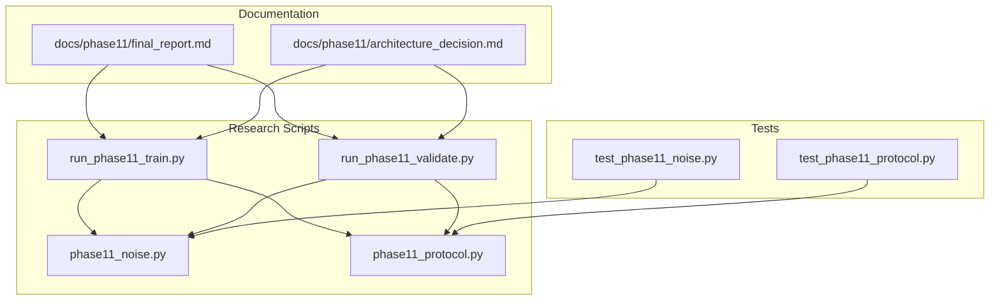
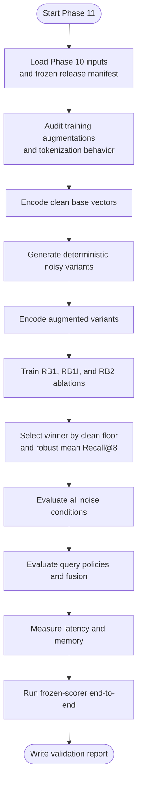
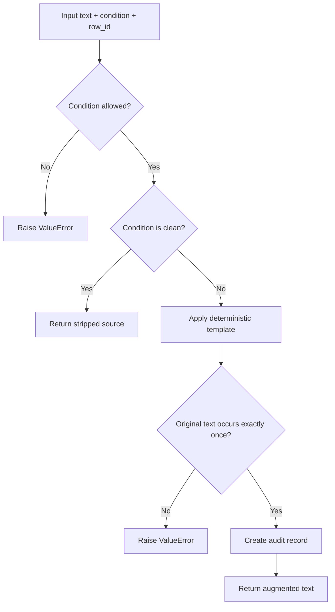
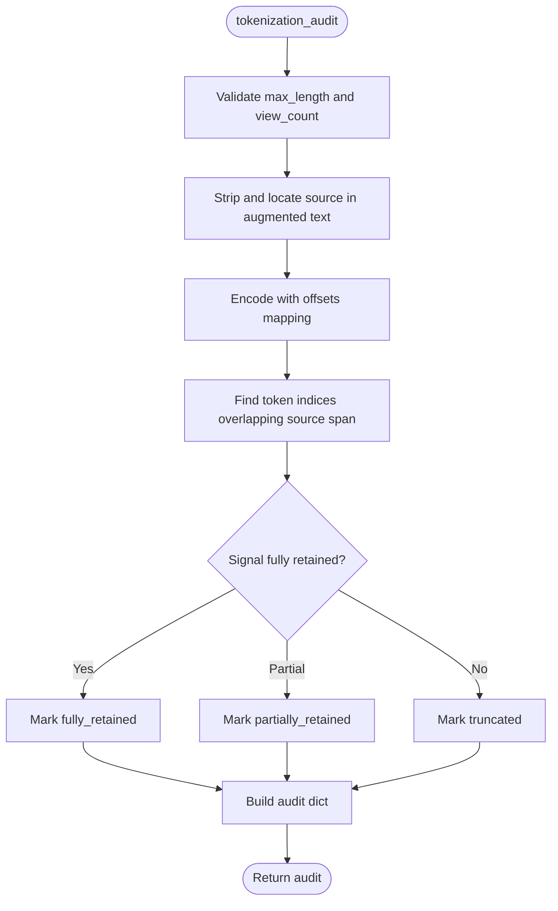
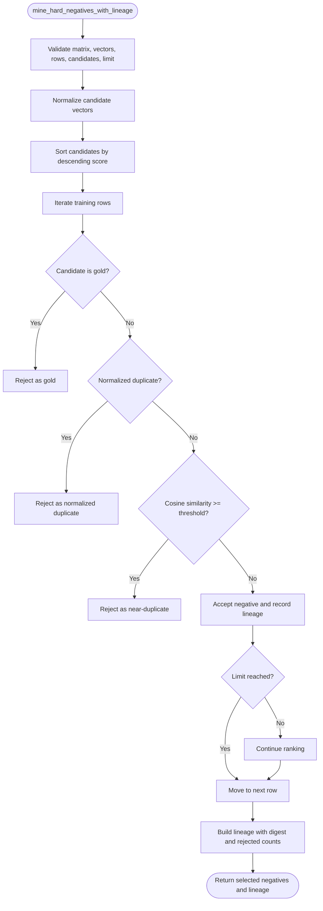
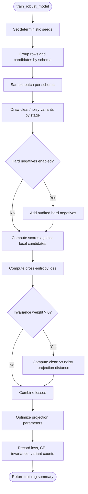
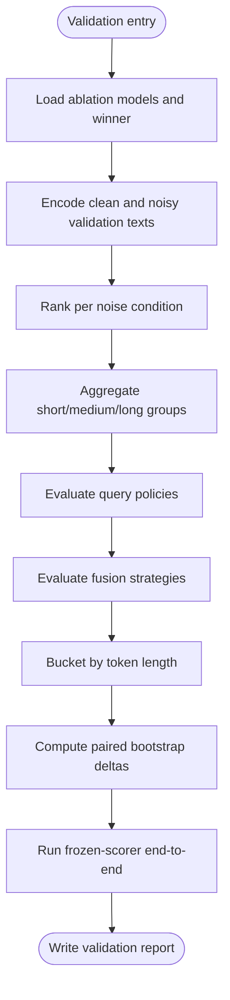
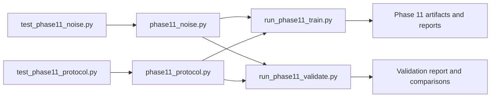
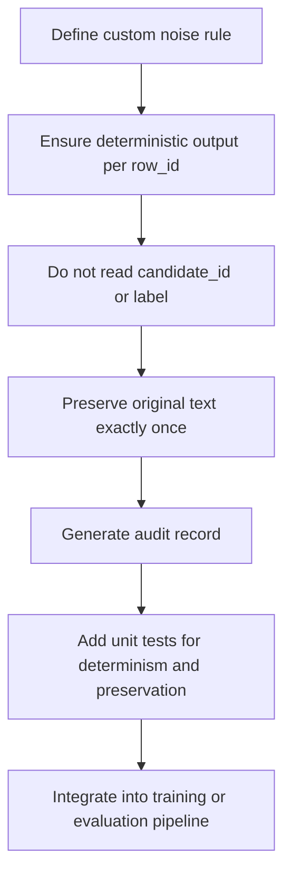

# Phase 11 Evaluation Protocol

<cite>
**Referenced Files in This Document**
- [phase11_noise.py](file://research/veyabench/phase11_noise.py)
- [phase11_protocol.py](file://research/veyabench/phase11_protocol.py)
- [run_phase11_train.py](file://research/veyabench/run_phase11_train.py)
- [run_phase11_validate.py](file://research/veyabench/run_phase11_validate.py)
- [test_phase11_noise.py](file://tests/test_phase11_noise.py)
- [test_phase11_protocol.py](file://tests/test_phase11_protocol.py)
- [final_report.md](file://docs/phase11/final_report.md)
- [architecture_decision.md](file://docs/phase11/architecture_decision.md)
</cite>

## Table of Contents
1. [Introduction](#introduction)
2. [Project Structure](#project-structure)
3. [Core Components](#core-components)
4. [Architecture Overview](#architecture-overview)
5. [Detailed Component Analysis](#detailed-component-analysis)
6. [Dependency Analysis](#dependency-analysis)
7. [Performance Considerations](#performance-considerations)
8. [Troubleshooting Guide](#troubleshooting-guide)
9. [Conclusion](#conclusion)
10. [Appendices](#appendices)

## Introduction
Phase 11 evaluates dense retriever robustness to deterministic, label-agnostic query noise while keeping the production serving path unchanged. The protocol focuses on:
- Noise injection that preserves the original source text exactly once.
- Tokenization auditing to understand truncation and useful-span retention.
- Training ablations over a frozen backbone with a bounded curriculum of clean and noisy views.
- A second hard-negative refresh with lineage and false-negative screening.
- Multi-policy query evaluation including single, fixed multi-view, adaptive, and structured-field extraction.
- Metrics centered on Recall@8, degradation curves, position sensitivity, length buckets, paired bootstrap comparisons, and end-to-end frozen-scorer accuracy.

The goal is not merely to survive noise but to demonstrate measurable robustness gains without degrading clean performance beyond an explicit floor.

## Project Structure
Phase 11 research code lives under `research/veyabench`, tests live under `tests`, and narrative decisions and results are documented under `docs/phase11`.

**Diagram sources**
- [run_phase11_train.py:1-70](file://research/veyabench/run_phase11_train.py#L1-L70)
- [run_phase11_validate.py:1-73](file://research/veyabench/run_phase11_validate.py#L1-L73)
- [phase11_noise.py:1-33](file://research/veyabench/phase11_noise.py#L1-L33)
- [phase11_protocol.py:1-15](file://research/veyabench/phase11_protocol.py#L1-L15)
- [test_phase11_noise.py:1-11](file://tests/test_phase11_noise.py#L1-L11)
- [test_phase11_protocol.py:1-12](file://tests/test_phase11_protocol.py#L1-L12)
- [final_report.md:1-10](file://docs/phase11/final_report.md#L1-L10)
- [architecture_decision.md:1-10](file://docs/phase11/architecture_decision.md#L1-L10)

**Section sources**
- [run_phase11_train.py:1-70](file://research/veyabench/run_phase11_train.py#L1-L70)
- [run_phase11_validate.py:1-73](file://research/veyabench/run_phase11_validate.py#L1-L73)
- [phase11_noise.py:1-33](file://research/veyabench/phase11_noise.py#L1-L33)
- [phase11_protocol.py:1-15](file://research/veyabench/phase11_protocol.py#L1-L15)
- [final_report.md:1-10](file://docs/phase11/final_report.md#L1-L10)
- [architecture_decision.md:1-10](file://docs/phase11/architecture_decision.md#L1-L10)

## Core Components
Phase 11 has two foundational modules and two orchestration scripts:

| Component | Responsibility | Key Outputs |
|---|---|---|
| Noise generator | Applies deterministic, label-agnostic perturbations while preserving the original text exactly once | Augmented queries, audit records, versioned noise policy |
| Protocol helpers | Audits tokenizer behavior, mines audited hard negatives, validates lineage, and buckets token lengths | Tokenization audits, hard-negative lineage, bucket labels |
| Training script | Builds augmented embeddings, runs a clean-to-noisy curriculum, optionally adds invariance loss, mines second hard negatives, and selects a winner | Ablation models, training report, artifact metadata |
| Validation script | Evaluates noise conditions, query policies, fusion strategies, runtime latency, permutation stability, and end-to-end frozen-scorer behavior | Validation report, bootstrap comparisons, failure decomposition |

**Section sources**
- [phase11_noise.py:43-127](file://research/veyabench/phase11_noise.py#L43-L127)
- [phase11_protocol.py:18-203](file://research/veyabench/phase11_protocol.py#L18-L203)
- [run_phase11_train.py:136-281](file://research/veyabench/run_phase11_train.py#L136-L281)
- [run_phase11_validate.py:157-332](file://research/veyabench/run_phase11_validate.py#L157-L332)

## Architecture Overview
The Phase 11 pipeline separates data augmentation, representation learning, and evaluation into auditable stages.

**Diagram sources**
- [run_phase11_train.py:355-555](file://research/veyabench/run_phase11_train.py#L355-L555)
- [run_phase11_validate.py:335-774](file://research/veyabench/run_phase11_validate.py#L335-L774)

**Section sources**
- [run_phase11_train.py:355-555](file://research/veyabench/run_phase11_train.py#L355-L555)
- [run_phase11_validate.py:335-774](file://research/veyabench/run_phase11_validate.py#L335-L774)

## Detailed Component Analysis

### Noise Injection Methodology
The noise module defines a fixed set of conditions, including clean, short prefix/suffix, long prefix/suffix, middle insertion, duplicate metadata, reordered fields, boilerplate wrapper, JSON noise, and repeated low-information text. Each condition is deterministic for a given row ID and never consumes candidate IDs or labels.

Key behaviors:
- `perturb` applies one of the allowed conditions and raises an error for unknown conditions or empty input.
- `training_conditions` returns a deterministic three-step curriculum per row: clean, one short-style condition, and one long-style condition.
- `audit_record` verifies that the original text appears exactly once and records character counts, occurrences, and the noise version.
- `validate_augmentation` enforces exact preservation before returning the augmented text.

**Diagram sources**
- [phase11_noise.py:43-127](file://research/veyabench/phase11_noise.py#L43-L127)

**Section sources**
- [phase11_noise.py:9-33](file://research/veyabench/phase11_noise.py#L9-L33)
- [phase11_noise.py:43-127](file://research/veyabench/phase11_noise.py#L43-L127)
- [test_phase11_noise.py:17-49](file://tests/test_phase11_noise.py#L17-L49)

### Tokenization and Truncation Auditing
Tokenization auditing measures whether the useful span survives tokenizer truncation and where it falls relative to the maximum length. It reports:
- Raw character length and token length.
- Whether truncation occurred.
- Tokens retained and dropped.
- Positive signal start/end tokens.
- Number of positive tokens retained.
- Position classification: fully retained, partially retained, or truncated.
- View count used during evaluation.

**Diagram sources**
- [phase11_protocol.py:18-80](file://research/veyabench/phase11_protocol.py#L18-L80)

**Section sources**
- [phase11_protocol.py:18-80](file://research/veyabench/phase11_protocol.py#L18-L80)
- [test_phase11_protocol.py:15-36](file://tests/test_phase11_protocol.py#L15-L36)

### Hard-Negative Mining and Lineage
Hard negatives are mined only from the training partition using scores and normalized candidate embeddings. The process:
- Normalizes candidate vectors.
- Orders candidates by score per query.
- Skips the gold candidate.
- Rejects normalized duplicates.
- Rejects base-embedding near-duplicates above a cosine threshold.
- Records accepted negatives with rank, similarity, truth schema, negative schema, and false-negative screening details.
- Produces a tamper-evident lineage digest.

**Diagram sources**
- [phase11_protocol.py:83-162](file://research/veyabench/phase11_protocol.py#L83-L162)

**Section sources**
- [phase11_protocol.py:83-162](file://research/veyabench/phase11_protocol.py#L83-L162)
- [phase11_protocol.py:181-194](file://research/veyabench/phase11_protocol.py#L181-L194)
- [test_phase11_protocol.py:39-58](file://tests/test_phase11_protocol.py#L39-L58)

### Training Curriculum and Robustness Losses
Training uses frozen base embeddings and trains only the shared projection. The curriculum progresses through:
- Stage 0: Mostly clean with some short noise.
- Stage 1: Balanced clean and short noise.
- Stage 2: Clean plus short plus long noise.

An optional invariance loss encourages similarity between clean and noisy query projections. Hard negatives can be injected to increase difficulty.

**Diagram sources**
- [run_phase11_train.py:136-238](file://research/veyabench/run_phase11_train.py#L136-L238)

**Section sources**
- [run_phase11_train.py:136-238](file://research/veyabench/run_phase11_train.py#L136-L238)
- [run_phase11_train.py:429-504](file://research/veyabench/run_phase11_train.py#L429-L504)

### Evaluation Metrics and Comparative Framework
Evaluation measures:
- Per-condition Recall@8 and MRR.
- Grouped metrics for short, medium, and long noise.
- Robust mean Recall@8 across non-clean conditions.
- Query-policy comparisons across single, first-last, first-middle-last, four-view, and adaptive policies.
- Fusion ablations over max, mean, and reciprocal rank fusion.
- Length-bucket robustness comparing single-view and adaptive paths.
- Paired bootstrap confidence intervals versus the Phase 10 baseline.
- End-to-end frozen-scorer accuracy, conditional accuracy, margins, calibration, and scorer latency.

**Diagram sources**
- [run_phase11_validate.py:335-774](file://research/veyabench/run_phase11_validate.py#L335-L774)

**Section sources**
- [run_phase11_validate.py:241-281](file://research/veyabench/run_phase11_validate.py#L241-L281)
- [run_phase11_validate.py:401-524](file://research/veyabench/run_phase11_validate.py#L401-L524)
- [run_phase11_validate.py:526-640](file://research/veyabench/run_phase11_validate.py#L526-L640)
- [run_phase11_validate.py:674-774](file://research/veyabench/run_phase11_validate.py#L674-L774)

## Dependency Analysis
Phase 11 components have clear responsibilities and limited coupling:

**Diagram sources**
- [phase11_noise.py:1-127](file://research/veyabench/phase11_noise.py#L1-L127)
- [phase11_protocol.py:1-203](file://research/veyabench/phase11_protocol.py#L1-L203)
- [run_phase11_train.py:1-70](file://research/veyabench/run_phase11_train.py#L1-L70)
- [run_phase11_validate.py:1-50](file://research/veyabench/run_phase11_validate.py#L1-L50)
- [test_phase11_noise.py:1-11](file://tests/test_phase11_noise.py#L1-L11)
- [test_phase11_protocol.py:1-12](file://tests/test_phase11_protocol.py#L1-L12)

**Section sources**
- [phase11_noise.py:1-127](file://research/veyabench/phase11_noise.py#L1-L127)
- [phase11_protocol.py:1-203](file://research/veyabench/phase11_protocol.py#L1-L203)
- [run_phase11_train.py:1-70](file://research/veyabench/run_phase11_train.py#L1-L70)
- [run_phase11_validate.py:1-50](file://research/veyabench/run_phase11_validate.py#L1-L50)
- [test_phase11_noise.py:1-11](file://tests/test_phase11_noise.py#L1-L11)
- [test_phase11_protocol.py:1-12](file://tests/test_phase11_protocol.py#L1-L12)

## Performance Considerations
Phase 11 explicitly measures both retrieval quality and serving cost:
- Latency percentiles (p50, p95, p99), throughput, and mean/max views per query.
- Candidate cache memory at different candidate counts.
- Projection parameter size and process peak RSS.
- Frozen encoder calls dominate repeated-query cost; exact ranking and shared projections are relatively cheap.
- Adaptive views avoid encoding all views for short inputs, but fusion and multiple encodes still add overhead compared to single-view.

Recommendations:
- Prefer single-view for latency-sensitive deployments unless adaptive segmentation materially improves Recall@8.
- Cache projected candidates when possible.
- Monitor token-length distribution because right truncation removes useful spans in long-prefix cases.
- Treat multi-view gains cautiously if they do not translate into aggregate retrieval improvements.

**Section sources**
- [run_phase11_validate.py:275-332](file://research/veyabench/run_phase11_validate.py#L275-L332)
- [final_report.md:95-107](file://docs/phase11/final_report.md#L95-L107)

## Troubleshooting Guide
Common issues and their likely causes:

| Symptom | Likely Cause | Resolution |
|---|---|---|
| Unknown noise condition error | Invalid condition string passed to `perturb` | Use only conditions defined in the noise module |
| Empty source text error | Blank or whitespace-only input | Ensure the source text contains meaningful content |
| Augmentation did not preserve source text | Custom noise logic changed the original text | Keep the original text verbatim and use the provided templates |
| Tokenization audit invalid bounds | `max_length < 4` or `view_count < 1` | Adjust audit parameters according to the protocol |
| Hard-negative lineage digest mismatch | Tampered or incomplete lineage records | Regenerate lineage from audited mining outputs |
| Unexpected hard-negative version | Lineage format changed | Update validation to match the current version constant |
| Source not found in augmented text | Noise removed or altered the original text | Verify label preservation and audit occurrence count |
| Validation embedding cache mismatch | Base checkpoint hash or text inventory changed | Rebuild caches after updating frozen backbone or dataset |
| Artifact changed after selection | Model file was modified post-training | Restore the original artifact and rerun validation |

**Section sources**
- [phase11_noise.py:43-127](file://research/veyabench/phase11_noise.py#L43-L127)
- [phase11_protocol.py:18-80](file://research/veyabench/phase11_protocol.py#L18-L80)
- [phase11_protocol.py:181-194](file://research/veyabench/phase11_protocol.py#L181-L194)
- [run_phase11_validate.py:99-108](file://research/veyabench/run_phase11_validate.py#L99-L108)
- [run_phase11_validate.py:119-154](file://research/veyabench/run_phase11_validate.py#L119-L154)
- [run_phase11_validate.py:342-343](file://research/veyabench/run_phase11_validate.py#L342-L343)

## Conclusion
Phase 11 establishes a rigorous noise-robustness protocol around deterministic augmentation, tokenization auditing, frozen-backbone projection training, audited hard negatives, and comprehensive evaluation. The core finding is that generic noise alone does not make the retriever robust enough, but a second hard-negative refresh and structured semantic-field extraction show credible improvements. The protocol’s strength lies in its reproducibility, lineage, and separation of concerns: noise generation, training, evaluation, and reporting are each independently testable and auditable.

For future work, the evidence points toward representation and backbone capacity rather than additional heuristic views. Any new intervention should be evaluated under the same constraints: TRAIN-only noise, frozen production components, bounded views, explicit clean floors, paired bootstrap comparisons, and full artifact integrity checks.

[No sources needed since this section summarizes without analyzing specific files]

## Appendices

### How to Configure Noise Parameters
- Choose noise conditions from the allowed set.
- For training, use the deterministic curriculum that pairs clean, short-style, and long-style conditions per row.
- For evaluation, apply all conditions to measure per-condition and grouped robustness.
- Keep `MAX_LENGTH` consistent across training and validation to ensure comparable truncation behavior.
- Do not inject candidate IDs, labels, or secret routing signals into noise.

**Section sources**
- [phase11_noise.py:9-33](file://research/veyabench/phase11_noise.py#L9-L33)
- [phase11_noise.py:91-99](file://research/veyabench/phase11_noise.py#L91-L99)
- [run_phase11_train.py:67-70](file://research/veyabench/run_phase11_train.py#L67-L70)

### How to Run Robustness Tests
1. Prepare Phase 10 inputs and the frozen release manifest.
2. Audit training augmentations and tokenization behavior.
3. Encode clean base vectors and augmented variants.
4. Train ablations: noise-only, invariance-augmented, and second hard-negative refresh.
5. Select the winner based on the clean floor and robust mean Recall@8.
6. Evaluate noise conditions, query policies, fusion strategies, runtime, and end-to-end behavior.
7. Write and verify the training and validation reports.

**Section sources**
- [run_phase11_train.py:355-605](file://research/veyabench/run_phase11_train.py#L355-L605)
- [run_phase11_validate.py:335-774](file://research/veyabench/run_phase11_validate.py#L335-L774)

### How to Interpret Stability Results
- **Recall@8**: Primary retrieval metric; higher is better.
- **Absolute and relative degradation**: Difference from clean performance within noise groups.
- **Robust mean Recall@8**: Average across non-clean conditions; compares overall resilience.
- **Paired bootstrap CI**: Indicates whether improvements over Phase 10 are credible.
- **Length buckets**: Show whether longer inputs degrade performance due to truncation or representation limits.
- **End-to-end accuracy**: Confirms whether retriever changes improve final decision-making with a frozen scorer.
- **Artifact reload and permutation checks**: Confirm numerical stability and determinism.

**Section sources**
- [run_phase11_validate.py:401-524](file://research/veyabench/run_phase11_validate.py#L401-L524)
- [run_phase11_validate.py:622-640](file://research/veyabench/run_phase11_validate.py#L622-L640)
- [run_phase11_validate.py:698-713](file://research/veyabench/run_phase11_validate.py#L698-L713)
- [final_report.md:9-33](file://docs/phase11/final_report.md#L9-L33)

### Creating Custom Noise Scenarios
Custom noise should follow these rules:
- Be deterministic for a given row ID.
- Never consume candidate IDs or labels.
- Preserve the original source text exactly once.
- Avoid leaking routing semantics.
- Produce an audit record verifying preservation and character counts.
- Integrate with the existing condition dispatch or extend the allowed set with corresponding tests.

**Diagram sources**
- [phase11_noise.py:43-127](file://research/veyabench/phase11_noise.py#L43-L127)
- [test_phase11_noise.py:17-49](file://tests/test_phase11_noise.py#L17-L49)

**Section sources**
- [phase11_noise.py:43-127](file://research/veyabench/phase11_noise.py#L43-L127)
- [test_phase11_noise.py:17-49](file://tests/test_phase11_noise.py#L17-L49)

### Evaluating Model Resilience
To evaluate resilience:
- Measure per-condition Recall@8.
- Aggregate short, medium, and long noise groups.
- Compare robust mean Recall@8 against Phase 10.
- Analyze position sensitivity for long prefix/suffix and middle insertion.
- Inspect tokenization truncation rates and useful-span retention.
- Run paired bootstrap tests to determine credible improvements.

**Section sources**
- [run_phase11_validate.py:401-524](file://research/veyabench/run_phase11_validate.py#L401-L524)
- [run_phase11_validate.py:607-640](file://research/veyabench/run_phase11_validate.py#L607-L640)
- [final_report.md:22-45](file://docs/phase11/final_report.md#L22-L45)

### Comparing Performance Under Various Noise Conditions
Use the following comparison framework:
- Baseline: Phase 10 retriever.
- Noise-only training: RB1.
- Invariance-augmented training: RB1I.
- Second hard-negative refresh: RB2.
- Query policies: single, first-last, first-middle-last, four-view, adaptive.
- Fusion: max, mean, RRF.
- Structured field extraction: recursive semantic field parsing for JSON-like noise.

Interpret results through:
- Point estimates for Recall@8.
- Degradation curves.
- Bootstrap confidence intervals.
- Failure decomposition categories such as truncation loss, noise dominance, lexical mismatch, and semantic ambiguity.

**Section sources**
- [run_phase11_train.py:429-504](file://research/veyabench/run_phase11_train.py#L429-L504)
- [run_phase11_validate.py:446-524](file://research/veyabench/run_phase11_validate.py#L446-L524)
- [run_phase11_validate.py:642-672](file://research/veyabench/run_phase11_validate.py#L642-L672)
- [final_report.md:47-76](file://docs/phase11/final_report.md#L47-L76)