# Phase 12 Evaluation Protocol

<cite>
**Referenced Files in This Document**
- [phase12_context.py](file://research/veyabench/phase12_context.py)
- [phase12_sgd_inventory.py](file://research/veyabench/phase12_sgd_inventory.py)
- [run_phase12_context_audit.py](file://research/veyabench/run_phase12_context_audit.py)
- [run_phase12_sparse_scorer.py](file://research/veyabench/run_phase12_sparse_scorer.py)
- [run_phase12_sgd_baseline.py](file://research/veyabench/run_phase12_sgd_baseline.py)
- [run_phase12_sparse_compare.py](file://research/veyabench/run_phase12_sparse_compare.py)
- [freeze_phase12_context.py](file://research/veyabench/freeze_phase12_context.py)
- [context_baselines.json](file://artifacts/experiments/phase12/context_baselines.json)
- [sparse_context_comparison.json](file://artifacts/experiments/phase12/sparse_context_comparison.json)
</cite>

## Table of Contents
1. [Introduction](#introduction)
2. [Project Structure](#project-structure)
3. [Core Components](#core-components)
4. [Architecture Overview](#architecture-overview)
5. [Detailed Component Analysis](#detailed-component-analysis)
6. [Dependency Analysis](#dependency-analysis)
7. [Performance Considerations](#performance-considerations)
8. [Troubleshooting Guide](#troubleshooting-guide)
9. [Conclusion](#conclusion)

## Introduction
Phase 12 introduces a controlled evaluation protocol for schema-guided service intent routing over the SGD dataset. It focuses on three pillars:

- Context auditing: validating how prior turns are selected, packed, and constrained before scoring.
- Sparse scoring: training and evaluating lightweight lexical scorers conditioned on official intent descriptions and context fields.
- SGD inventory management: hashing source files, constraining service splits, and auditing label quality without opening sealed test dialogues.

The protocol deliberately separates development work from sealed test access. Development scripts read only train and dev data, verify source integrity, and produce aggregate artifacts. Sealed test dialogues remain inaccessible to these modules.

## Project Structure
Phase 12 lives under `research/veyabench` and writes results into `artifacts/experiments/phase12`. The key pieces are:

- Inventory and provenance: `phase12_sgd_inventory.py`
- Context construction and packing: `phase12_context.py`
- Context audit and regression pair discovery: `run_phase12_context_audit.py`
- Sparse scorer training and evaluation: `run_phase12_sparse_scorer.py`
- Packed Choice baseline over SGD dev: `run_phase12_sgd_baseline.py`
- Paired sparse context comparison: `run_phase12_sparse_compare.py`
- Frozen context selection rule: `freeze_phase12_context.py`

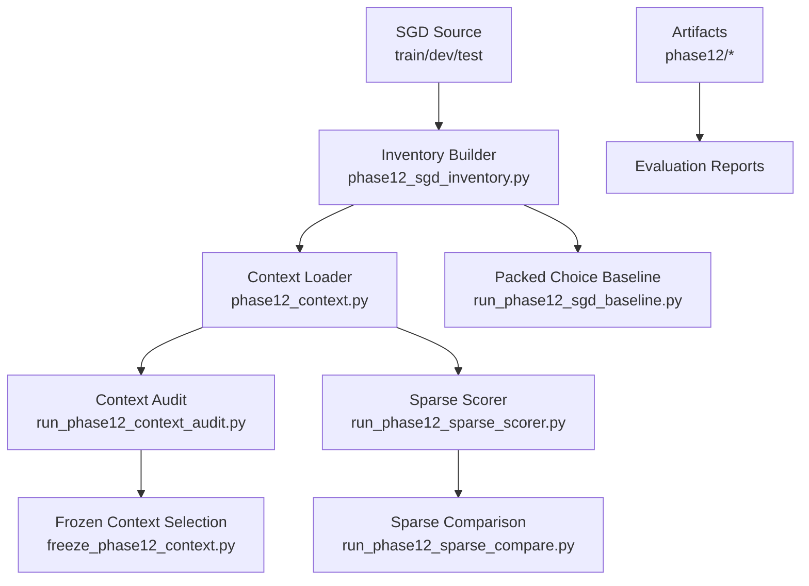

**Diagram sources**
- [phase12_sgd_inventory.py:17-21](file://research/veyabench/phase12_sgd_inventory.py#L17-L21)
- [phase12_context.py:20-32](file://research/veyabench/phase12_context.py#L20-L32)
- [run_phase12_context_audit.py:10-15](file://research/veyabench/run_phase12_context_audit.py#L10-L15)
- [run_phase12_sparse_scorer.py:19-24](file://research/veyabench/run_phase12_sparse_scorer.py#L19-L24)
- [run_phase12_sgd_baseline.py:23-28](file://research/veyabench/run_phase12_sgd_baseline.py#L23-L28)
- [run_phase12_sparse_compare.py:9-15](file://research/veyabench/run_phase12_sparse_compare.py#L9-L15)
- [freeze_phase12_context.py:9-14](file://research/veyabench/freeze_phase12_context.py#L9-L14)

**Section sources**
- [phase12_sgd_inventory.py:17-21](file://research/veyabench/phase12_sgd_inventory.py#L17-L21)
- [phase12_context.py:1-145](file://research/veyabench/phase12_context.py#L1-L145)
- [run_phase12_context_audit.py:1-168](file://research/veyabench/run_phase12_context_audit.py#L1-L168)
- [run_phase12_sparse_scorer.py:1-257](file://research/veyabench/run_phase12_sparse_scorer.py#L1-L257)
- [run_phase12_sgd_baseline.py:1-180](file://research/veyabench/run_phase12_sgd_baseline.py#L1-L180)
- [run_phase12_sparse_compare.py:1-95](file://research/veyabench/run_phase12_sparse_compare.py#L1-L95)
- [freeze_phase12_context.py:1-80](file://research/veyabench/freeze_phase12_context.py#L1-L80)

## Core Components
This section summarizes the responsibilities of each Phase 12 component.

| Component | Responsibility | Key Inputs | Key Outputs |
|---|---|---|---|
| SGD Inventory | Hashes source files, validates commit, defines train/validation/sealed service splits, audits labels | SGD train/dev/test schemas and dialogues | `sgd_inventory.json` with provenance, split rules, and label collision statistics |
| Context Builder | Loads examples, selects context windows, packs turns within token budget | Inventory hashes, tokenizer, question template | Packed turn text and packing diagnostics |
| Context Auditor | Computes exact-input ceilings, finds regression pairs, checks schema similarity | Train/dev examples, inventory | `context_audit.json`, `context_regression.json` |
| Sparse Scorer | Builds sparse features from current/prior utterances and intent descriptions; trains via SGD | Train/dev examples, schema candidates | Development accuracy, confusion, optional weights/details |
| Packed Baseline | Scores initial USER turns using the release bundle’s packed Choice path | Dev schema, release manifest | `sgd_dev_baseline.json` with latency and calibration metrics |
| Sparse Comparator | Compares paired previous-turn vs full-context sparse models | Saved detail JSONL files | `sparse_context_comparison.json` |
| Context Selector | Freezes the chosen context mode based on matched controls | Early and full context baselines, inventories | `context_selection.json` |

**Section sources**
- [phase12_sgd_inventory.py:24-46](file://research/veyabench/phase12_sgd_inventory.py#L24-L46)
- [phase12_sgd_inventory.py:49-118](file://research/veyabench/phase12_sgd_inventory.py#L49-L118)
- [phase12_sgd_inventory.py:121-196](file://research/veyabench/phase12_sgd_inventory.py#L121-L196)
- [phase12_context.py:20-32](file://research/veyabench/phase12_context.py#L20-L32)
- [phase12_context.py:65-85](file://research/veyabench/phase12_context.py#L65-L85)
- [phase12_context.py:88-144](file://research/veyabench/phase12_context.py#L88-L144)
- [run_phase12_context_audit.py:22-56](file://research/veyabench/run_phase12_context_audit.py#L22-L56)
- [run_phase12_context_audit.py:59-94](file://research/veyabench/run_phase12_context_audit.py#L59-L94)
- [run_phase12_sparse_scorer.py:32-94](file://research/veyabench/run_phase12_sparse_scorer.py#L32-L94)
- [run_phase12_sparse_scorer.py:119-150](file://research/veyabench/run_phase12_sparse_scorer.py#L119-L150)
- [run_phase12_sparse_scorer.py:153-189](file://research/veyabench/run_phase12_sparse_scorer.py#L153-L189)
- [run_phase12_sgd_baseline.py:31-39](file://research/veyabench/run_phase12_sgd_baseline.py#L31-L39)
- [run_phase12_sgd_baseline.py:74-165](file://research/veyabench/run_phase12_sgd_baseline.py#L74-L165)
- [run_phase12_sparse_compare.py:24-90](file://research/veyabench/run_phase12_sparse_compare.py#L24-L90)
- [freeze_phase12_context.py:17-75](file://research/veyabench/freeze_phase12_context.py#L17-L75)

## Architecture Overview
Phase 12 follows a strict pipeline:

1. Build or validate the SGD inventory.
2. Load examples only for allowed services and splits.
3. Construct context according to a frozen mode.
4. Evaluate either a packed Choice baseline or a sparse lexical scorer.
5. Produce auditable artifacts that record provenance, budgets, and whether sealed tests were opened.

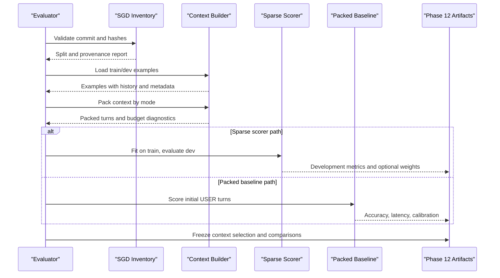

**Diagram sources**
- [phase12_sgd_inventory.py:121-196](file://research/veyabench/phase12_sgd_inventory.py#L121-L196)
- [phase12_context.py:20-32](file://research/veyabench/phase12_context.py#L20-L32)
- [phase12_context.py:88-144](file://research/veyabench/phase12_context.py#L88-L144)
- [run_phase12_sparse_scorer.py:192-250](file://research/veyabench/run_phase12_sparse_scorer.py#L192-L250)
- [run_phase12_sgd_baseline.py:74-165](file://research/veyabench/run_phase12_sgd_baseline.py#L74-L165)
- [freeze_phase12_context.py:17-75](file://research/veyabench/freeze_phase12_context.py#L17-L75)

## Detailed Component Analysis

### SGD Inventory Management
The inventory is the single source of truth for Phase 12 data provenance. It:

- Verifies the expected Git commit and unmodified checkout.
- Reads train/dev/test schemas and enforces unique service names and required intent definitions.
- Cross-checks Phase 10 exposure against the public schema.
- Defines Phase 12 splits by whole service names, excluding services with fewer than two intents.
- Audits train/dev label collisions and missing values.
- Records SHA-256 hashes for every relevant source file.
- Declares that test dialogues are not parsed during inventory construction.

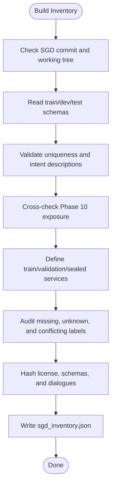

**Diagram sources**
- [phase12_sgd_inventory.py:121-196](file://research/veyabench/phase12_sgd_inventory.py#L121-L196)

**Section sources**
- [phase12_sgd_inventory.py:24-46](file://research/veyabench/phase12_sgd_inventory.py#L24-L46)
- [phase12_sgd_inventory.py:49-118](file://research/veyabench/phase12_sgd_inventory.py#L49-L118)
- [phase12_sgd_inventory.py:121-196](file://research/veyabench/phase12_sgd_inventory.py#L121-L196)

### Context Selection Mechanisms
Context selection supports three modes:

- `utterance_only`: Only the current user utterance.
- `previous_turn`: The immediately preceding turn plus the current user utterance.
- `full_context`: All prior turns plus the current user utterance.

The builder extracts per-frame service and intent information, tracks service transitions, marks initial user turns, and renders turns deterministically. Packing respects a token budget: it keeps the current turn and adds prior turns from newest to oldest until the head budget is filled. If the current turn alone exceeds the budget, the example is rejected with a diagnostic reason.

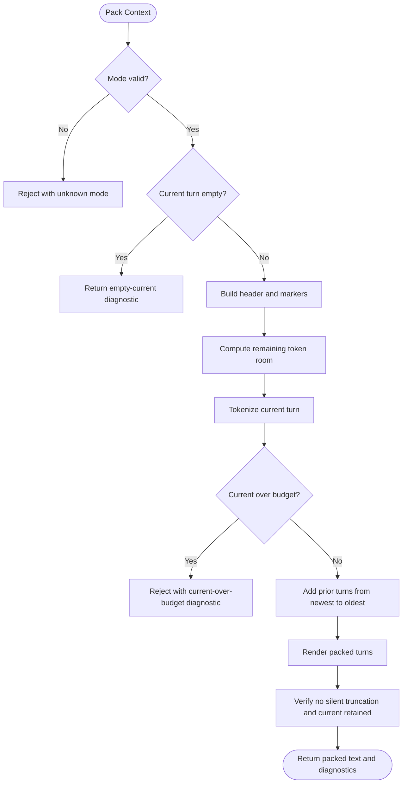

**Diagram sources**
- [phase12_context.py:65-85](file://research/veyabench/phase12_context.py#L65-L85)
- [phase12_context.py:88-144](file://research/veyabench/phase12_context.py#L88-L144)

**Section sources**
- [phase12_context.py:17-17](file://research/veyabench/phase12_context.py#L17-L17)
- [phase12_context.py:35-62](file://research/veyabench/phase12_context.py#L35-L62)
- [phase12_context.py:65-85](file://research/veyabench/phase12_context.py#L65-L85)
- [phase12_context.py:88-144](file://research/veyabench/phase12_context.py#L88-L144)

### Context Auditing
The context auditor computes feasibility bounds and identifies regression pairs:

- Exact-input ceiling: groups identical rendered inputs by service and mode, then counts unavoidable conflicts when different gold labels appear for the same input.
- Summary statistics: total rows, NONE rows, initial turns, service transitions, and per-service label distributions.
- Regression pairs: finds cases where the same current utterance has multiple gold labels but different previous-turn contexts, producing deterministic hashes for safe sharing.
- Schema quality: flags intent pairs with high lexical overlap across descriptions.

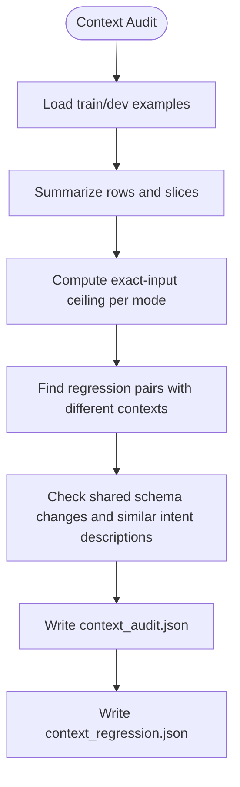

**Diagram sources**
- [run_phase12_context_audit.py:22-56](file://research/veyabench/run_phase12_context_audit.py#L22-L56)
- [run_phase12_context_audit.py:59-94](file://research/veyabench/run_phase12_context_audit.py#L59-L94)
- [run_phase12_context_audit.py:97-128](file://research/veyabench/run_phase12_context_audit.py#L97-L128)

**Section sources**
- [run_phase12_context_audit.py:18-36](file://research/veyabench/run_phase12_context_audit.py#L18-L36)
- [run_phase12_context_audit.py:39-56](file://research/veyabench/run_phase12_context_audit.py#L39-L56)
- [run_phase12_context_audit.py:59-94](file://research/veyabench/run_phase12_context_audit.py#L59-L94)
- [run_phase12_context_audit.py:97-128](file://research/veyabench/run_phase12_context_audit.py#L97-L128)
- [run_phase12_context_audit.py:131-163](file://research/veyabench/run_phase12_context_audit.py#L131-L163)

### Sparse Feature Evaluation
The sparse scorer builds a lightweight classifier using:

- Token n-grams from current and prior utterances.
- Intent name decomposition and description tokens.
- Fixed-size hashed feature indices with small dense overlap features.
- Online SGD with cross-entropy loss and per-index gradient scaling.

It evaluates development accuracy, Wilson score intervals, per-service accuracy, slice-based accuracy (initial vs later, transition vs same service), and confusion matrices.

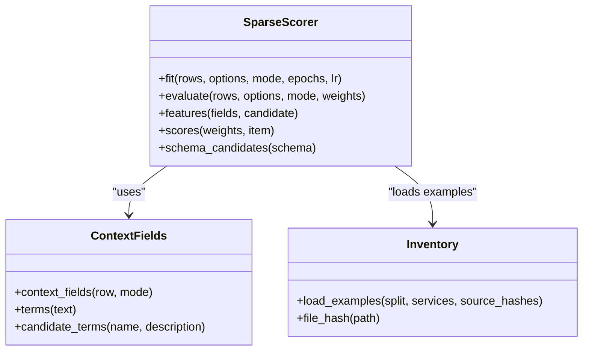

**Diagram sources**
- [run_phase12_sparse_scorer.py:32-94](file://research/veyabench/run_phase12_sparse_scorer.py#L32-L94)
- [run_phase12_sparse_scorer.py:97-116](file://research/veyabench/run_phase12_sparse_scorer.py#L97-L116)
- [run_phase12_sparse_scorer.py:119-150](file://research/veyabench/run_phase12_sparse_scorer.py#L119-L150)
- [run_phase12_sparse_scorer.py:153-189](file://research/veyabench/run_phase12_sparse_scorer.py#L153-L189)
- [phase12_context.py:20-32](file://research/veyabench/phase12_context.py#L20-L32)
- [phase12_sgd_inventory.py:24-29](file://research/veyabench/phase12_sgd_inventory.py#L24-L29)

**Section sources**
- [run_phase12_sparse_scorer.py:32-94](file://research/veyabench/run_phase12_sparse_scorer.py#L32-L94)
- [run_phase12_sparse_scorer.py:119-150](file://research/veyabench/run_phase12_sparse_scorer.py#L119-L150)
- [run_phase12_sparse_scorer.py:153-189](file://research/veyabench/run_phase12_sparse_scorer.py#L153-L189)
- [run_phase12_sparse_scorer.py:192-250](file://research/veyabench/run_phase12_sparse_scorer.py#L192-L250)

### Inventory-Based Testing Approaches
Phase 12 uses inventory-driven testing to prevent accidental leakage:

- Scripts read `sgd_inventory.json` and verify its hash.
- Train/dev examples are loaded only for services listed in the inventory’s train/validation sets.
- Test dialogues are never parsed by development code.
- Baseline and sparse scorer paths both assert that the seal remains intact.

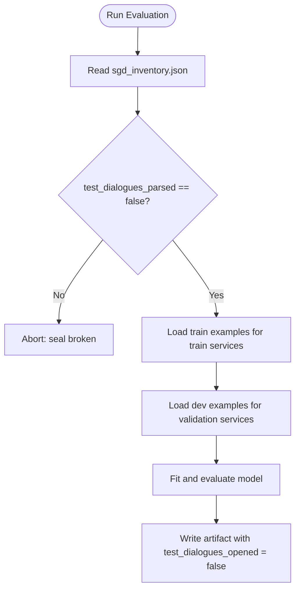

**Diagram sources**
- [run_phase12_sparse_scorer.py:201-206](file://research/veyabench/run_phase12_sparse_scorer.py#L201-L206)
- [run_phase12_sparse_scorer.py:220-236](file://research/veyabench/run_phase12_sparse_scorer.py#L220-L236)
- [run_phase12_sgd_baseline.py:42-71](file://research/veyabench/run_phase12_sgd_baseline.py#L42-L71)

**Section sources**
- [run_phase12_sparse_scorer.py:201-206](file://research/veyabench/run_phase12_sparse_scorer.py#L201-L206)
- [run_phase12_sparse_scorer.py:220-236](file://research/veyabench/run_phase12_sparse_scorer.py#L220-L236)
- [run_phase12_sgd_baseline.py:42-71](file://research/veyabench/run_phase12_sgd_baseline.py#L42-L71)

### Frozen Context Selection
The context selection script freezes the context formulation by comparing two matched controls:

- Early controls: `utterance_only` and `previous_turn`.
- Full control: `full_context`.
- Both must use the same source commit, device, batch size, and matched sample count.
- The winner is selected by highest raw all-turn development accuracy among context-bearing modes, with tiebreakers favoring fewer dropped contexts and shorter inputs.
- The output records control artifact hashes and explicitly states that this does not qualify a finalist.

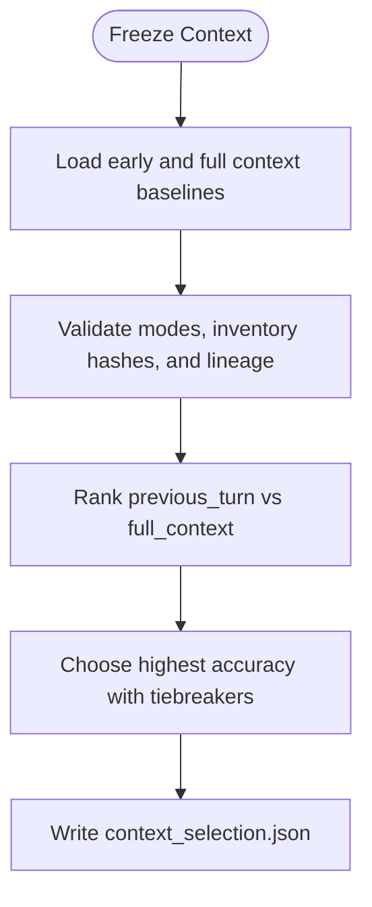

**Diagram sources**
- [freeze_phase12_context.py:17-75](file://research/veyabench/freeze_phase12_context.py#L17-L75)

**Section sources**
- [freeze_phase12_context.py:17-75](file://research/veyabench/freeze_phase12_context.py#L17-L75)
- [context_baselines.json:1-152](file://artifacts/experiments/phase12/context_baselines.json#L1-L152)

### Packed Choice Baseline
The packed baseline scores initial USER turns using the release bundle’s packed Choice path. It:

- Validates the inventory commit and dev schema hash.
- Restricts evaluation to validation services.
- Calls the release bundle with instructions built from service and intent descriptions.
- Requires the packed path with no shortlist.
- Reports accuracy, confidence, NLL, Brier score, latency percentiles, throughput, and per-service confusion.

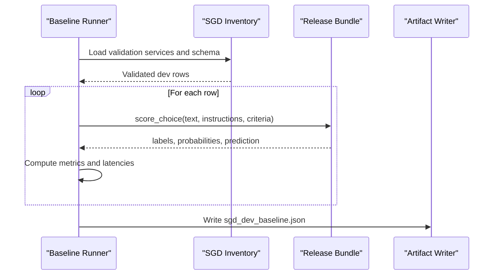

**Diagram sources**
- [run_phase12_sgd_baseline.py:42-71](file://research/veyabench/run_phase12_sgd_baseline.py#L42-L71)
- [run_phase12_sgd_baseline.py:74-165](file://research/veyabench/run_phase12_sgd_baseline.py#L74-L165)

**Section sources**
- [run_phase12_sgd_baseline.py:31-39](file://research/veyabench/run_phase12_sgd_baseline.py#L31-L39)
- [run_phase12_sgd_baseline.py:42-71](file://research/veyabench/run_phase12_sgd_baseline.py#L42-L71)
- [run_phase12_sgd_baseline.py:74-165](file://research/veyabench/run_phase12_sgd_baseline.py#L74-L165)

### Sparse Context Comparison
The comparison script evaluates two saved sparse context models on matched decisions:

- Reads paired detail JSONL files for previous-turn and full-context models.
- Asserts matching IDs and gold labels.
- Computes overall accuracy, dialogue-cluster bootstrap confidence intervals, oracle either-correct accuracy, and per-service/class precision/recall/F1.
- Produces `sparse_context_comparison.json`.

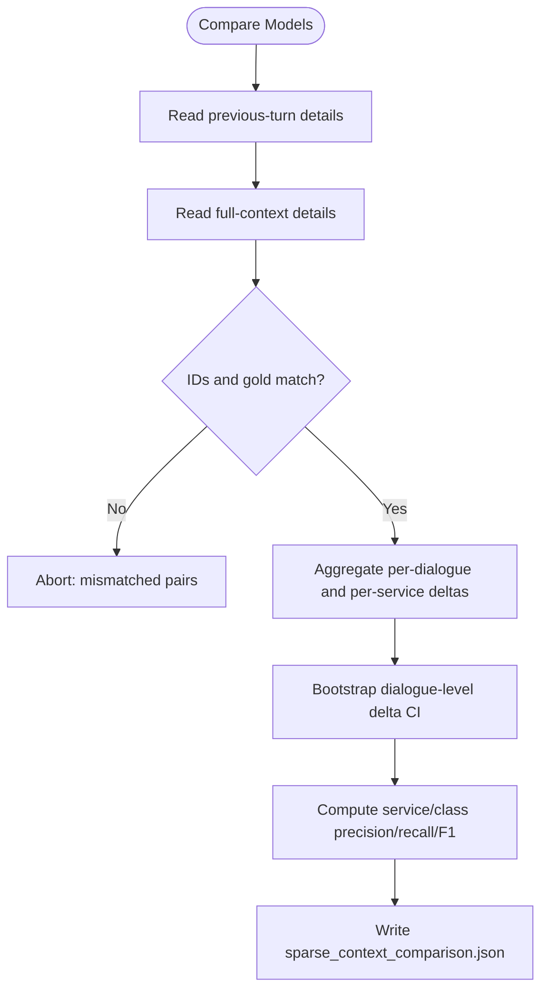

**Diagram sources**
- [run_phase12_sparse_compare.py:19-28](file://research/veyabench/run_phase12_sparse_compare.py#L19-L28)
- [run_phase12_sparse_compare.py:24-90](file://research/veyabench/run_phase12_sparse_compare.py#L24-L90)

**Section sources**
- [run_phase12_sparse_compare.py:19-28](file://research/veyabench/run_phase12_sparse_compare.py#L19-L28)
- [run_phase12_sparse_compare.py:24-90](file://research/veyabench/run_phase12_sparse_compare.py#L24-L90)
- [sparse_context_comparison.json:1-187](file://artifacts/experiments/phase12/sparse_context_comparison.json#L1-L187)

## Dependency Analysis
The main dependency relationships are:

- Context and sparse scorer depend on the inventory for service lists and source hashes.
- Context audit depends on context utilities and inventory provenance.
- Sparse comparison depends on saved sparse scorer details.
- Frozen context selection depends on early/full baselines and inventory lineage.
- Packed baseline depends on the release manifest and inventory.

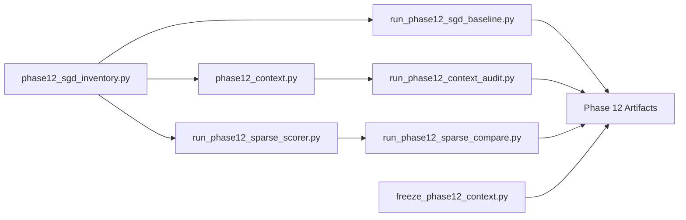

**Diagram sources**
- [phase12_sgd_inventory.py:17-21](file://research/veyabench/phase12_sgd_inventory.py#L17-L21)
- [phase12_context.py:13-14](file://research/veyabench/phase12_context.py#L13-L14)
- [run_phase12_context_audit.py:10-15](file://research/veyabench/run_phase12_context_audit.py#L10-L15)
- [run_phase12_sparse_scorer.py:19-24](file://research/veyabench/run_phase12_sparse_scorer.py#L19-L24)
- [run_phase12_sgd_baseline.py:23-28](file://research/veyabench/run_phase12_sgd_baseline.py#L23-L28)
- [run_phase12_sparse_compare.py:9-15](file://research/veyabench/run_phase12_sparse_compare.py#L9-L15)
- [freeze_phase12_context.py:9-14](file://research/veyabench/freeze_phase12_context.py#L9-L14)

**Section sources**
- [phase12_context.py:13-14](file://research/veyabench/phase12_context.py#L13-L14)
- [run_phase12_context_audit.py:10-15](file://research/veyabench/run_phase12_context_audit.py#L10-L15)
- [run_phase12_sparse_scorer.py:19-24](file://research/veyabench/run_phase12_sparse_scorer.py#L19-L24)
- [run_phase12_sgd_baseline.py:23-28](file://research/veyabench/run_phase12_sgd_baseline.py#L23-L28)
- [run_phase12_sparse_compare.py:9-15](file://research/veyabench/run_phase12_sparse_compare.py#L9-L15)
- [freeze_phase12_context.py:9-14](file://research/veyabench/freeze_phase12_context.py#L9-L14)

## Performance Considerations
- Context packing is token-aware and rejects examples that exceed the head budget rather than silently truncating them.
- Sparse scoring uses a fixed large hashed index space with small dense overlap features, making it fast to fit and evaluate on CPU.
- The packed baseline reports latency percentiles and sequential throughput, but excludes HTTP and cold-start costs.
- Sparse comparison uses bootstrapping over dialogue clusters to estimate uncertainty around accuracy differences.

[No sources needed since this section provides general guidance]

## Troubleshooting Guide
Common issues and their likely causes:

| Symptom | Likely Cause | Resolution |
|---|---|---|
| `unexpected SGD commit` or `official SGD checkout is modified` | Inventory build detects wrong commit or dirty working tree. | Reset the SGD repository to the expected commit and ensure no local modifications. |
| `Phase 10 exposure map does not cover SGD train schemas` | Phase 10 split changed relative to the public schema. | Reconcile Phase 10 exposure with the current SGD schema before rebuilding inventory. |
| `service split overlap` | Train, validation, or sealed sets share services. | Adjust split logic so each service appears in exactly one set. |
| `unknown context mode` | Invalid mode passed to context utilities. | Use one of `utterance_only`, `previous_turn`, or `full_context`. |
| `current turn over budget` | Current turn alone exceeds available token room after header construction. | Reduce instruction/header length or adjust model limits. |
| `model would silently truncate packed context` | Packing verification failed. | Ensure the tokenizer and question template preserve marker positions. |
| `test seal broken` | Inventory indicates test dialogues were parsed. | Stop using sealed test data in development runs. |
| `too few real context regression pairs` | Not enough non-NONE examples with differing contexts. | Expand train data or relax filtering conditions carefully. |
| `expected all-candidate packed Choice path` | Baseline received a shortlisted or non-packed response. | Confirm the release bundle path and criteria formatting. |

**Section sources**
- [phase12_sgd_inventory.py:121-130](file://research/veyabench/phase12_sgd_inventory.py#L121-L130)
- [phase12_sgd_inventory.py:132-153](file://research/veyabench/phase12_sgd_inventory.py#L132-L153)
- [phase12_context.py:65-67](file://research/veyabench/phase12_context.py#L65-L67)
- [phase12_context.py:114-134](file://research/veyabench/phase12_context.py#L114-L134)
- [run_phase12_context_audit.py:137-139](file://research/veyabench/run_phase12_context_audit.py#L137-L139)
- [run_phase12_sparse_scorer.py:201-203](file://research/veyabench/run_phase12_sparse_scorer.py#L201-L203)
- [run_phase12_sgd_baseline.py:98-99](file://research/veyabench/run_phase12_sgd_baseline.py#L98-L99)

## Conclusion
Phase 12 establishes a reproducible, inventory-driven evaluation protocol for SGD-based intent routing. It enforces strict provenance, isolates sealed test data, and provides auditable mechanisms for context selection, sparse scoring, and baseline evaluation. The frozen context selection and paired sparse comparison artifacts document how context windows affect performance, while the inventory and audit reports provide transparency about data quality and feasibility bounds.

[No sources needed since this section summarizes without analyzing specific files]