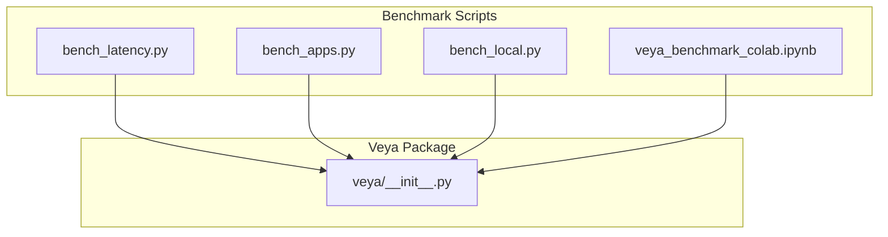
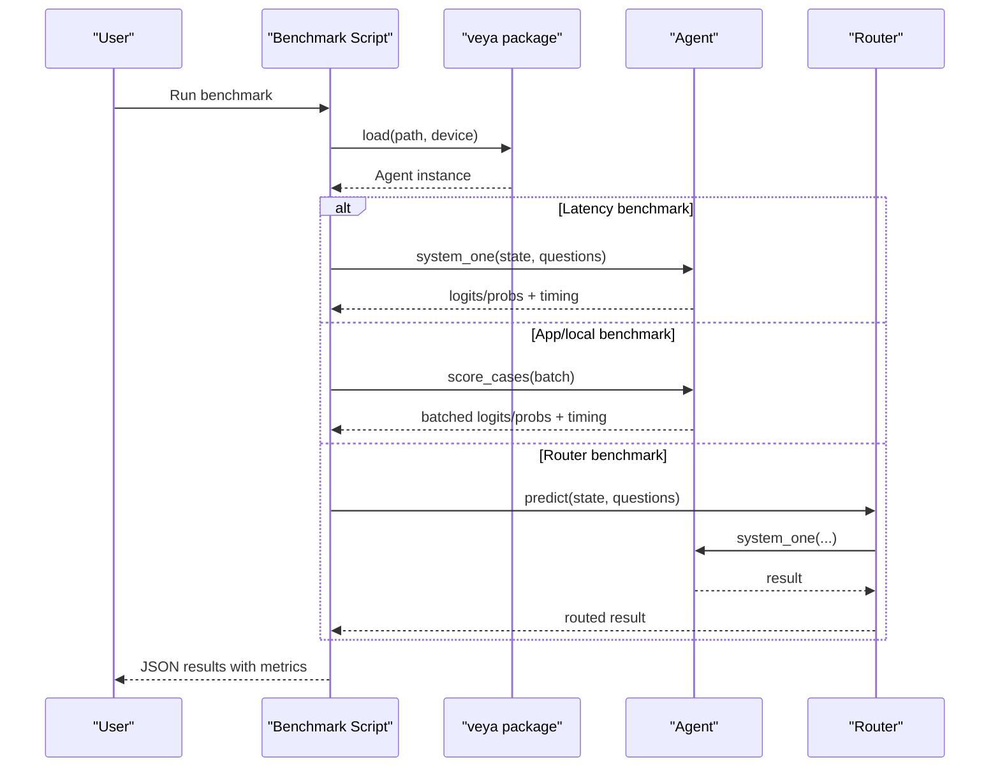
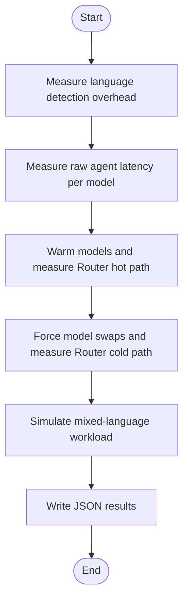
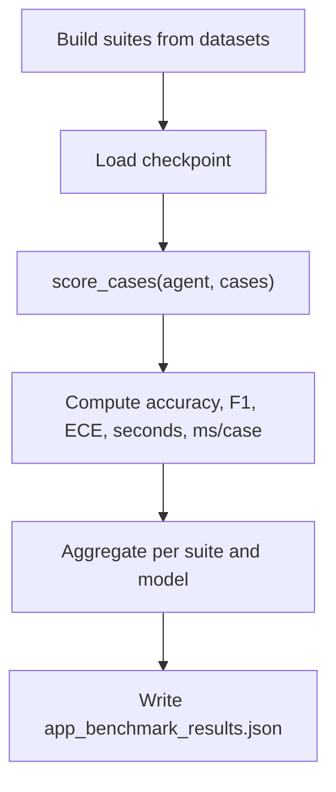
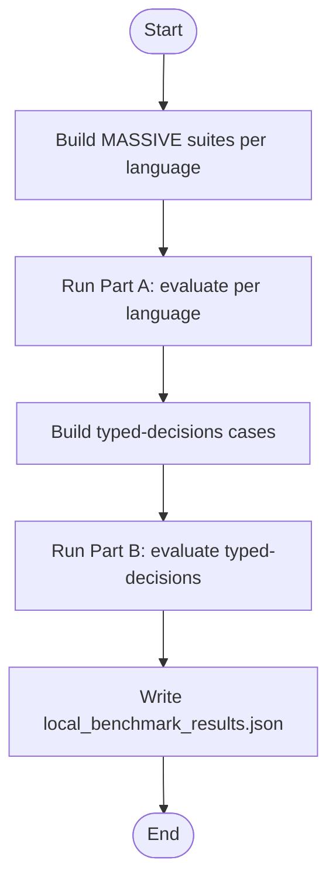
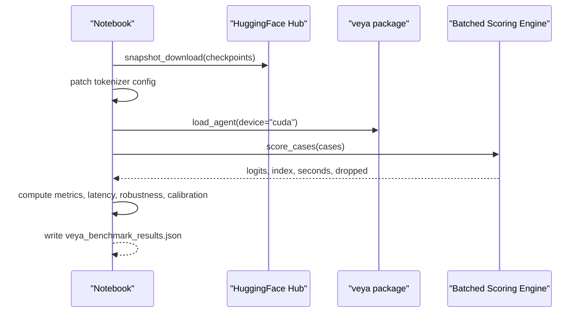

# Performance Benchmarks

<cite>
**Referenced Files in This Document**
- [bench_latency.py](file://research/scripts/bench_latency.py)
- [bench_apps.py](file://research/scripts/bench_apps.py)
- [bench_local.py](file://research/scripts/bench_local.py)
- [veya_benchmark_colab.ipynb](file://research/scripts/veya_benchmark_colab.ipynb)
- [BENCHMARKS.md](file://BENCHMARKS.md)
- [__init__.py](file://veya/__init__.py)
</cite>

## Table of Contents
1. [Introduction](#introduction)
2. [Project Structure](#project-structure)
3. [Core Components](#core-components)
4. [Architecture Overview](#architecture-overview)
5. [Detailed Component Analysis](#detailed-component-analysis)
6. [Dependency Analysis](#dependency-analysis)
7. [Performance Considerations](#performance-considerations)
8. [Troubleshooting Guide](#troubleshooting-guide)
9. [Conclusion](#conclusion)
10. [Appendices](#appendices)

## Introduction
This document explains Veya’s performance benchmarking tools and how to run, interpret, and extend them. It covers:
- Latency benchmarking for inference speed, including routing overhead and model load costs.
- Application-level benchmarking for real-world workflows such as triage, email filtering, moderation, RAG filtering, and domain routing.
- Local evaluation scripts for extensive model testing across languages, typed decisions, and calibration metrics.

The goal is to help you measure throughput, latency percentiles, accuracy, calibration, and resource-related behavior consistently across CPU and GPU environments.

## Project Structure
Veya’s benchmarking tooling lives under `research/scripts`. The main entry points are:
- `bench_latency.py`: measures end-to-end latency with language detection and router hot/cold paths.
- `bench_apps.py`: evaluates application workflows on labeled datasets and compares against published baselines where available.
- `bench_local.py`: runs extensive local benchmarks across many languages and the typed-decisions workload.
- `veya_benchmark_colab.ipynb`: a comprehensive Colab notebook that orchestrates dataset loading, batched scoring, latency measurement, option-order robustness, and calibration repair.

**Diagram sources**
- [bench_latency.py:1-170](file://research/scripts/bench_latency.py#L1-L170)
- [bench_apps.py:1-303](file://research/scripts/bench_apps.py#L1-L303)
- [bench_local.py:1-338](file://research/scripts/bench_local.py#L1-L338)
- [veya_benchmark_colab.ipynb:1-800](file://research/scripts/veya_benchmark_colab.ipynb#L1-L800)
- [__init__.py:1-56](file://veya/__init__.py#L1-L56)

**Section sources**
- [bench_latency.py:1-170](file://research/scripts/bench_latency.py#L1-L170)
- [bench_apps.py:1-303](file://research/scripts/bench_apps.py#L1-L303)
- [bench_local.py:1-338](file://research/scripts/bench_local.py#L1-L338)
- [veya_benchmark_colab.ipynb:1-800](file://research/scripts/veya_benchmark_colab.ipynb#L1-L800)
- [__init__.py:1-56](file://veya/__init__.py#L1-L56)

## Core Components
- Latency Benchmark (`bench_latency.py`):
  - Measures language detection overhead without model calls.
  - Measures raw agent latency per model (no routing).
  - Measures Router hot path when target models are already resident.
  - Measures Router cold path when model swapping occurs.
  - Simulates mixed-language workloads at different `max_loaded` capacities.
  - Outputs percentiles (p50, p95), mean, min, and per-question latency.

- Application Benchmark (`bench_apps.py`):
  - Builds suites for support triage, email spam/phishing, guardrails/jailbreak detection, toxicity moderation, RAG passage relevance, and model routing by domain.
  - Runs all three checkpoints and reports accuracy, macro-F1, ECE, seconds, ms per case, and dropped cases.
  - Includes published Jev numbers for comparison where applicable.

- Local Evaluation (`bench_local.py`):
  - Part A: MASSIVE intent across all available languages with 20-option choice questions; reports per-language accuracy, F1, ECE, confidence, and throughput.
  - Part B: Typed-decisions benchmark across all three checkpoints; reports accuracy, soft accuracy, Brier vs soft labels, score MAE, within-one-level rate, and per-workflow/per-question-type metrics.

- Colab Notebook (`veya_benchmark_colab.ipynb`):
  - Orchestrates environment setup, checkpoint download, batched scoring engine, task suites, latency measurement, option-order robustness, and calibration repair.
  - Provides a reproducible head-to-head comparison between English and multilingual checkpoints.

**Section sources**
- [bench_latency.py:1-170](file://research/scripts/bench_latency.py#L1-L170)
- [bench_apps.py:1-303](file://research/scripts/bench_apps.py#L1-L303)
- [bench_local.py:1-338](file://research/scripts/bench_local.py#L1-L338)
- [veya_benchmark_colab.ipynb:1-800](file://research/scripts/veya_benchmark_colab.ipynb#L1-L800)

## Architecture Overview
The benchmarking scripts integrate with Veya’s public API surface:
- `veya.load(path, device)` loads a checkpoint into an Agent.
- `Agent.system_one(state, questions)` performs inference for a single call.
- `Router(models, device, max_loaded)` manages multiple models and routing overhead.
- Language detection via `veya.lang.analyse` adds deterministic overhead before model calls.

**Diagram sources**
- [bench_latency.py:52-164](file://research/scripts/bench_latency.py#L52-L164)
- [bench_apps.py:267-298](file://research/scripts/bench_apps.py#L267-L298)
- [bench_local.py:53-97](file://research/scripts/bench_local.py#L53-L97)
- [__init__.py:1-56](file://veya/__init__.py#L1-L56)

## Detailed Component Analysis

### Latency Benchmark (`bench_latency.py`)
Purpose:
- Quantify end-to-end latency including language detection and routing.
- Distinguish hot-path (model resident) vs cold-path (model swap) scenarios.
- Evaluate mixed-language workloads under different memory capacities (`max_loaded`).

Key behaviors:
- Environment variables force Torch backend and disable tokenizer parallelism.
- `timed(fn, warmup, reps)` collects percentile and mean latencies.
- Detection overhead measured using `analyse(state)` without model calls.
- Raw latency measured per model using `agent.system_one(state, questions)`.
- Router hot path warms English and Hindi models then measures latency.
- Router cold path forces swaps by alternating languages with `max_loaded=1`.
- Mixed workload simulates varying non-English shares and measures total time, mean ms per call, and calls per second.

Parameters:
- `MODELS`: maps logical names to local paths for English, multilingual, and typed-decisions checkpoints.
- `ROOT`: default location for model directories.
- `OUT`: output file path for results.
- `STATE_EN`, `STATE_HI`, `Q_NOUL`, `Q_CHOICE`: canonical inputs used for consistent measurements.

Execution:
- Run from repository root: `USE_TF=0 python3 research/scripts/bench_latency.py`
- Results written to `latency_benchmark_results.json`.

Result interpretation:
- `detection_overhead`: latency of language detection alone.
- `raw_latency`: per-model latency for 1/5/10/50 questions, plus per-question cost.
- `cold_load_ms`: model load time per checkpoint.
- `router_hot`: latency with target models resident; includes routing overhead relative to raw latency.
- `router_cold_swap`: samples and median latency when forced to swap models.
- `mixed_workload`: total time, mean ms per call, and calls per second for different non-English shares and `max_loaded` settings.

**Diagram sources**
- [bench_latency.py:52-164](file://research/scripts/bench_latency.py#L52-L164)

**Section sources**
- [bench_latency.py:1-170](file://research/scripts/bench_latency.py#L1-L170)

### Application Benchmark (`bench_apps.py`)
Purpose:
- Evaluate real-world workflows across labeled datasets.
- Compare performance across three checkpoints.
- Provide context via published Jev numbers where applicable.

Workflows:
- Support triage (queue routing).
- Email spam and phishing detection.
- Guardrails/jailbreak detection (held out).
- Moderation/toxicity detection (held out).
- RAG passage relevance filtering.
- Model routing by domain classification.

Metrics:
- Accuracy, macro-F1, ECE, seconds, ms per case, dropped cases.
- Per-suite breakdowns by model name.

Execution:
- Run from repository root: `USE_TF=0 python3 research/scripts/bench_apps.py`
- Optional environment variable `BENCH_N` controls number of cases per task.
- Results written to `app_benchmark_results.json`.

Interpretation:
- Suites include metadata indicating whether data was in training or held out.
- Published Jev numbers are included for reference but not re-measured here.
- Use `seconds` and `ms_per_case` to estimate throughput and latency at scale.

**Diagram sources**
- [bench_apps.py:62-264](file://research/scripts/bench_apps.py#L62-L264)
- [bench_apps.py:267-298](file://research/scripts/bench_apps.py#L267-L298)

**Section sources**
- [bench_apps.py:1-303](file://research/scripts/bench_apps.py#L1-L303)

### Local Evaluation (`bench_local.py`)
Purpose:
- Extensive evaluation across languages and typed-decisions tasks.
- Provide detailed metrics including calibration and soft-label comparisons.

Part A: MASSIVE Intent Across Languages
- Discovers available languages from Hugging Face dataset index.
- Builds 20-option choice questions per language.
- Reports per-language accuracy, macro-F1, ECE, confidence, and throughput.
- Aggregates macro accuracy/ECE and counts languages above random baseline.

Part B: Typed-Decisions Benchmark
- Loads test parquet with 400 cases and 2,000 decisions.
- Computes hard metrics and soft-label metrics (soft accuracy, Brier vs soft, score MAE, within-one-level).
- Breaks down by workflow and question type.

Execution:
- Run from repository root: `USE_TF=0 python3 research/scripts/bench_local.py [--langs N] [--per-lang N] [--skip-a] [--skip-b]`
- Results written to `local_benchmark_results.json`.

Interpretation:
- Use `macro_accuracy` and `languages_above_random` to assess multilingual capability.
- For typed-decisions, compare accuracy, soft accuracy, and score MAE across checkpoints.
- Use `by_workflow` and `by_question_type` to identify weak areas.

**Diagram sources**
- [bench_local.py:153-217](file://research/scripts/bench_local.py#L153-L217)
- [bench_local.py:220-307](file://research/scripts/bench_local.py#L220-L307)
- [bench_local.py:309-333](file://research/scripts/bench_local.py#L309-L333)

**Section sources**
- [bench_local.py:1-338](file://research/scripts/bench_local.py#L1-L338)

### Colab Notebook (`veya_benchmark_colab.ipynb`)
Purpose:
- Reproducible head-to-head benchmark between English and multilingual checkpoints.
- Comprehensive coverage: typed-decisions, multilingual tasks, English zero-shot tasks, latency, option-order robustness, calibration repair.

Highlights:
- Forces T4 GPU runtime and disables torch.compile for small batches.
- Downloads checkpoints and patches tokenizer configuration if needed.
- Implements a batched scoring engine with token-budgeted batching and progress reporting.
- Builds task suites with fixed seeds and consistent option sets.
- Measures latency percentiles (p50/p95) and per-question latency.
- Evaluates option-order robustness by permuting criteria keys.
- Refits temperatures per (question type, option-count bucket) to improve calibration.

Execution:
- Open notebook in Colab, select T4 GPU runtime, and run all cells.
- Produces `veya_benchmark_results.json`.

Interpretation:
- Use calibrated vs raw metrics to understand calibration impact.
- Review latency table for p50/p95 across 1/5/10/50 questions.
- Check flip rates for option-order robustness.
- Compare ECE before and after temperature refit.

**Diagram sources**
- [veya_benchmark_colab.ipynb:76-153](file://research/scripts/veya_benchmark_colab.ipynb#L76-L153)
- [veya_benchmark_colab.ipynb:160-318](file://research/scripts/veya_benchmark_colab.ipynb#L160-L318)
- [veya_benchmark_colab.ipynb:569-652](file://research/scripts/veya_benchmark_colab.ipynb#L569-L652)
- [veya_benchmark_colab.ipynb:703-739](file://research/scripts/veya_benchmark_colab.ipynb#L703-L739)
- [veya_benchmark_colab.ipynb:745-790](file://research/scripts/veya_benchmark_colab.ipynb#L745-L790)

**Section sources**
- [veya_benchmark_colab.ipynb:1-800](file://research/scripts/veya_benchmark_colab.ipynb#L1-L800)

## Dependency Analysis
Benchmark scripts depend on:
- `veya` package for model loading, language detection, and routing.
- PyTorch and NumPy for tensor operations and statistics.
- Hugging Face datasets and Hub for dataset access.
- Optional pandas for typed-decisions parquet loading.

Coupling:
- `bench_latency.py` couples directly with `veya.lang.analyse` and `veya.router.Router`.
- `bench_apps.py` and `bench_local.py` reuse shared scoring utilities and metrics functions.
- The Colab notebook encapsulates a self-contained pipeline that mirrors parts of `bench_local.py` and `bench_apps.py`.

External integration points:
- Hugging Face Hub for downloading checkpoints and datasets.
- Public third-party baselines (Jev) referenced in documentation and notebooks.

Potential circular dependencies:
- None observed among benchmark scripts; they import from `veya` and standard libraries only.

**Section sources**
- [bench_latency.py:1-170](file://research/scripts/bench_latency.py#L1-L170)
- [bench_apps.py:1-303](file://research/scripts/bench_apps.py#L1-L303)
- [bench_local.py:1-338](file://research/scripts/bench_local.py#L1-L338)
- [veya_benchmark_colab.ipynb:1-800](file://research/scripts/veya_benchmark_colab.ipynb#L1-L800)
- [__init__.py:1-56](file://veya/__init__.py#L1-L56)

## Performance Considerations
- Backend selection:
  - Force Torch backend via `USE_TORCH=1`; TensorFlow is disabled to avoid deadlocks during model build.
  - Disable tokenizer parallelism to prevent contention.

- Device and compilation:
  - On T4-class GPUs, disable `reference_compile` because it can hurt small-batch performance.
  - Use CUDA synchronization around latency measurements to ensure accurate timings.

- Batching strategy:
  - Batch sequences by length and token budget to minimize padding and maximize throughput.
  - Adjust `max_tokens` and `max_seqs` to balance memory usage and speed.

- Calibration:
  - Fit temperatures per (question type, option-count bucket) to reduce ECE significantly.
  - Multilingual checkpoint ships uncalibrated; refitting is essential for reliable probabilities.

- Routing overhead:
  - Hot path routing adds minimal overhead compared to raw latency.
  - Cold path swaps incur significant latency; tune `max_loaded` based on workload mix.

- Throughput estimation:
  - Use `calls_per_s` and `questions_per_second` from results to estimate capacity planning.
  - Monitor `dropped` cases due to option set size exceeding token budget.

[No sources needed since this section provides general guidance]

## Troubleshooting Guide
Common issues and resolutions:
- Missing GPU runtime in Colab:
  - Ensure T4 GPU runtime is selected; assert will fail otherwise.
- Tokenizer configuration errors:
  - Patch `extra_special_tokens` list to dict and normalize `tokenizer_class` if present.
- Dataset download failures:
  - Verify network connectivity and dataset availability; some datasets may require authentication.
- Out-of-memory during batching:
  - Reduce `max_tokens` or `max_seqs`; increase batch size gradually.
- Slow performance on CPU:
  - Expect higher latencies; consider GPU for realistic throughput.
- Calibration not improving:
  - Ensure sufficient calibration data; fit temperature only on held-out splits.

**Section sources**
- [veya_benchmark_colab.ipynb:45-52](file://research/scripts/veya_benchmark_colab.ipynb#L45-L52)
- [veya_benchmark_colab.ipynb:95-115](file://research/scripts/veya_benchmark_colab.ipynb#L95-L115)
- [bench_local.py:153-182](file://research/scripts/bench_local.py#L153-L182)

## Conclusion
Veya’s benchmarking suite provides a comprehensive toolkit for measuring inference latency, application-level performance, and local evaluation across languages and decision types. By following the execution methods and interpreting the documented metrics, you can:
- Quantify latency percentiles and throughput under realistic routing conditions.
- Assess accuracy, calibration, and robustness across diverse workflows.
- Plan capacity and optimize routing strategies based on workload characteristics.

For production readiness, prioritize calibration repair, monitor routing overhead, and validate option-order robustness on your specific schemas.

[No sources needed since this section summarizes without analyzing specific files]

## Appendices

### Example Commands
- Latency benchmark:
  - `USE_TF=0 python3 research/scripts/bench_latency.py`
- Application benchmark:
  - `USE_TF=0 python3 research/scripts/bench_apps.py`
  - Optional: `BENCH_N=800 USE_TF=0 python3 research/scripts/bench_apps.py`
- Local evaluation:
  - `USE_TF=0 python3 research/scripts/bench_local.py --langs 10 --per-lang 200`
  - Skip parts: `USE_TF=0 python3 research/scripts/bench_local.py --skip-a`

### Result Interpretation Tips
- Latency:
  - Focus on p50 and p95 for typical and tail latency.
  - Compare per-question latency across batch sizes to detect batching efficiency.
- Accuracy and Calibration:
  - Use ECE to assess probability reliability; lower is better.
  - Compare soft accuracy and score MAE for typed-decisions to understand ordinal quality.
- Robustness:
  - Lower option-order flip rates indicate more stable decision-making.
- Resource Utilization:
  - Track `dropped` cases to identify token budget constraints.
  - Monitor `seconds` and derive throughput for capacity planning.

**Section sources**
- [BENCHMARKS.md:1-205](file://BENCHMARKS.md#L1-L205)