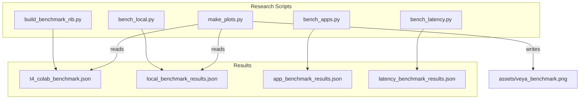
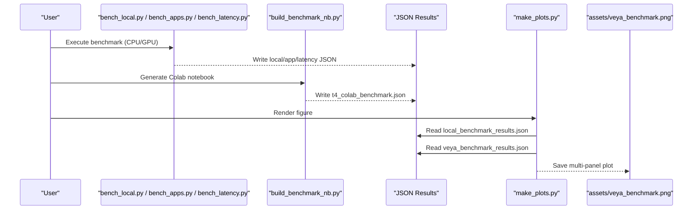
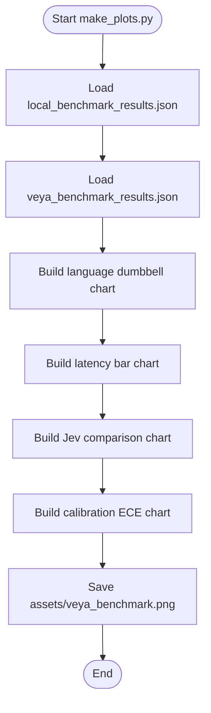
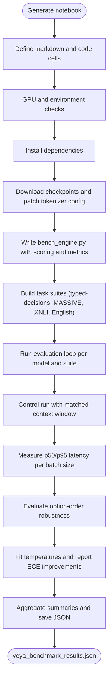
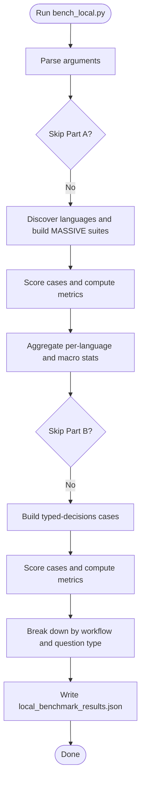
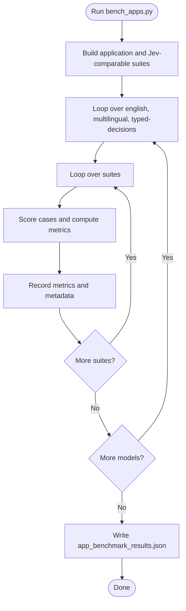
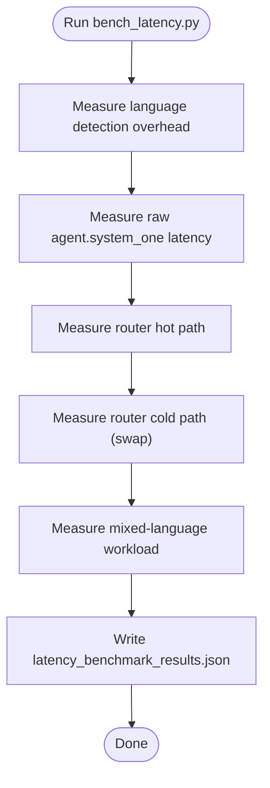
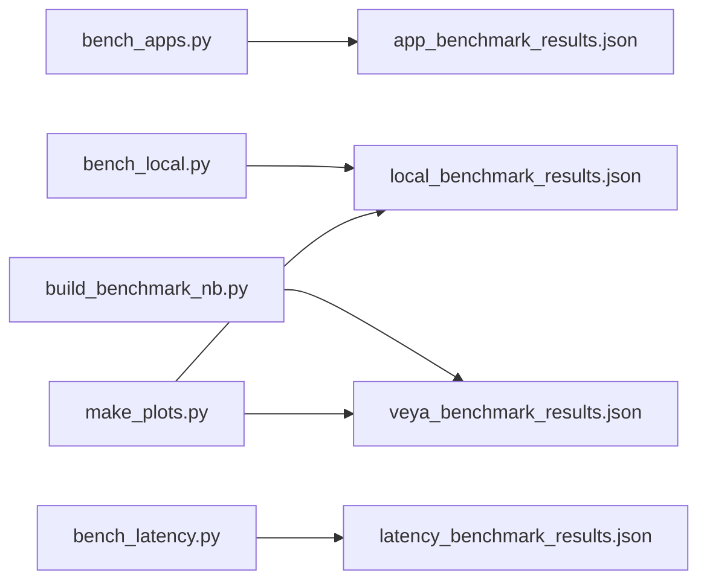

# Result Analysis Tools

<cite>
**Referenced Files in This Document**
- [BENCHMARKS.md](file://BENCHMARKS.md)
- [make_plots.py](file://research/scripts/make_plots.py)
- [build_benchmark_nb.py](file://research/scripts/build_benchmark_nb.py)
- [bench_local.py](file://research/scripts/bench_local.py)
- [bench_apps.py](file://research/scripts/bench_apps.py)
- [bench_latency.py](file://research/scripts/bench_latency.py)
- [t4_colab_benchmark.json](file://research/results/t4_colab_benchmark.json)
</cite>

## Table of Contents
1. [Introduction](#introduction)
2. [Project Structure](#project-structure)
3. [Core Components](#core-components)
4. [Architecture Overview](#architecture-overview)
5. [Detailed Component Analysis](#detailed-component-analysis)
6. [Dependency Analysis](#dependency-analysis)
7. [Performance Considerations](#performance-considerations)
8. [Troubleshooting Guide](#troubleshooting-guide)
9. [Conclusion](#conclusion)
10. [Appendices](#appendices)

## Introduction
This document explains Veya’s result analysis and visualization tools for its benchmarking framework. It covers:
- Plotting utilities that render performance figures from benchmark JSON artifacts.
- Notebook builders that generate reproducible, head-to-head benchmark notebooks.
- Result file formats produced by the benchmark scripts.
- Guidance on interpreting results, creating custom visualizations, and integrating these tools into research workflows.
- Examples of generating performance reports and comparing results across model configurations.

The focus is on how experiments are measured, how results are structured, and how to turn those results into charts and reports.

## Project Structure
Veya’s benchmarking and analysis code lives under `research/scripts`, with example result artifacts under `research/results`. The main pieces are:
- Benchmark runners that execute models on datasets and compute metrics.
- A plotting script that renders a multi-panel figure from benchmark JSON files.
- A notebook builder that emits a Colab-style notebook for running and saving a full benchmark.
- Example result JSONs showing the expected structure.

**Diagram sources**
- [bench_local.py:1-11](file://research/scripts/bench_local.py#L1-L11)
- [bench_apps.py:1-16](file://research/scripts/bench_apps.py#L1-L16)
- [bench_latency.py:1-11](file://research/scripts/bench_latency.py#L1-L11)
- [build_benchmark_nb.py:1-6](file://research/scripts/build_benchmark_nb.py#L1-L6)
- [make_plots.py:1-7](file://research/scripts/make_plots.py#L1-L7)

**Section sources**
- [bench_local.py:1-11](file://research/scripts/bench_local.py#L1-L11)
- [bench_apps.py:1-16](file://research/scripts/bench_apps.py#L1-L16)
- [bench_latency.py:1-11](file://research/scripts/bench_latency.py#L1-L11)
- [build_benchmark_nb.py:1-6](file://research/scripts/build_benchmark_nb.py#L1-L6)
- [make_plots.py:1-7](file://research/scripts/make_plots.py#L1-L7)

## Core Components
- **Benchmark runners**: Produce standardized JSON artifacts containing accuracy, calibration, latency, robustness, and dataset metadata.
- **Notebook builder**: Generates a runnable notebook that downloads checkpoints, builds task suites, runs inference, computes metrics, and saves a single benchmark JSON.
- **Plotting utility**: Reads benchmark JSONs and produces a publication-ready multi-panel figure.
- **Result artifacts**: Structured JSON files used as inputs to plots and reports.

Key responsibilities:
- `bench_local.py`: Runs MASSIVE intent across languages and typed-decisions across three checkpoints; writes `local_benchmark_results.json`.
- `bench_apps.py`: Runs application-workflow benchmarks and Jev-comparable tasks; writes `app_benchmark_results.json`.
- `bench_latency.py`: Measures routing and raw inference latency; writes `latency_benchmark_results.json`.
- `build_benchmark_nb.py`: Emits a Colab notebook that produces `veya_benchmark_results.json`.
- `make_plots.py`: Renders `assets/veya_benchmark.png` from `local_benchmark_results.json` and `veya_benchmark_results.json`.

**Section sources**
- [bench_local.py:1-11](file://research/scripts/bench_local.py#L1-L11)
- [bench_apps.py:1-16](file://research/scripts/bench_apps.py#L1-L16)
- [bench_latency.py:1-11](file://research/scripts/bench_latency.py#L1-L11)
- [build_benchmark_nb.py:1-6](file://research/scripts/build_benchmark_nb.py#L1-L6)
- [make_plots.py:1-7](file://research/scripts/make_plots.py#L1-L7)

## Architecture Overview
The benchmarking pipeline has two phases:
1. **Execution phase**: Runners or notebooks execute models on curated task suites, compute metrics, and write JSON artifacts.
2. **Visualization phase**: The plotting script consumes one or more JSON artifacts and generates static figures.

**Diagram sources**
- [bench_local.py:1-11](file://research/scripts/bench_local.py#L1-L11)
- [bench_apps.py:1-16](file://research/scripts/bench_apps.py#L1-L16)
- [bench_latency.py:1-11](file://research/scripts/bench_latency.py#L1-L11)
- [build_benchmark_nb.py:1-6](file://research/scripts/build_benchmark_nb.py#L1-L6)
- [make_plots.py:1-7](file://research/scripts/make_plots.py#L1-L7)

## Detailed Component Analysis

### Plotting Utilities: `make_plots.py`
Purpose:
- Produces a multi-panel figure used in documentation and repositories.
- Reads two benchmark JSON artifacts and draws:
  - A language-level dumbbell chart comparing English vs multilingual checkpoints on MASSIVE intent.
  - Latency bars across question batch sizes.
  - Accuracy comparisons against published Jev numbers.
  - Calibration ECE before and after temperature refit.

Inputs:
- `local_benchmark_results.json`: Contains the 51-language sweep and related metrics.
- `veya_benchmark_results.json`: Contains T4 latency, suite results, and calibration repair data.

Outputs:
- `assets/veya_benchmark.png`: A high-DPI figure with consistent styling and labels.

Key behaviors:
- Uses matplotlib with an Agg backend for non-interactive rendering.
- Applies a fixed color palette and typography settings.
- Extracts per-language accuracies and sorts them by improvement delta.
- Computes bar positions and annotations for latency and ECE panels.

**Diagram sources**
- [make_plots.py:40-150](file://research/scripts/make_plots.py#L40-L150)

Usage guidance:
- Ensure both JSON artifacts exist at the repository root before running the script.
- Adjust colors, fonts, or panel layout by editing the script’s constants and subplot definitions.
- Extend the script to add new panels by reading additional keys from the JSON artifacts.

**Section sources**
- [make_plots.py:1-7](file://research/scripts/make_plots.py#L1-L7)
- [make_plots.py:20-32](file://research/scripts/make_plots.py#L20-L32)
- [make_plots.py:40-150](file://research/scripts/make_plots.py#L40-L150)

### Notebook Builder: `build_benchmark_nb.py`
Purpose:
- Emits a Colab-compatible notebook that performs a comprehensive benchmark between `veya` and `veya-multilingual`.
- Builds task suites, scores cases, computes metrics, measures latency, evaluates option-order robustness, and performs calibration repair.
- Saves a single `veya_benchmark_results.json` artifact.

Key sections generated:
- Environment setup and dependency installation.
- Checkpoint download and tokenizer configuration patching.
- Batched scoring engine written to a temporary module.
- Task suite construction for typed-decisions, MASSIVE, XNLI, and English tasks.
- Evaluation loop producing calibrated and raw metrics.
- Control run matching context windows.
- Latency measurement across batch sizes.
- Option-order robustness evaluation.
- Calibration repair using temperature fitting on held-out splits.
- Aggregation and summary writing.

**Diagram sources**
- [build_benchmark_nb.py:1-6](file://research/scripts/build_benchmark_nb.py#L1-L6)
- [build_benchmark_nb.py:22-47](file://research/scripts/build_benchmark_nb.py#L22-L47)
- [build_benchmark_nb.py:49-138](file://research/scripts/build_benchmark_nb.py#L49-L138)
- [build_benchmark_nb.py:140-291](file://research/scripts/build_benchmark_nb.py#L140-L291)
- [build_benchmark_nb.py:293-493](file://research/scripts/build_benchmark_nb.py#L293-L493)
- [build_benchmark_nb.py:495-572](file://research/scripts/build_benchmark_nb.py#L495-L572)
- [build_benchmark_nb.py:574-605](file://research/scripts/build_benchmark_nb.py#L574-L605)
- [build_benchmark_nb.py:607-636](file://research/scripts/build_benchmark_nb.py#L607-L636)
- [build_benchmark_nb.py:638-677](file://research/scripts/build_benchmark_nb.py#L638-L677)
- [build_benchmark_nb.py:679-730](file://research/scripts/build_benchmark_nb.py#L679-L730)
- [build_benchmark_nb.py:732-791](file://research/scripts/build_benchmark_nb.py#L732-L791)

Interpretation tips:
- Use the generated JSON to compare calibrated vs raw metrics, soft accuracy, and calibration ECE.
- Inspect `summary` and family-level aggregations for cross-dataset trends.
- Compare `calibration_repair` to understand post-processing impact.

**Section sources**
- [build_benchmark_nb.py:1-6](file://research/scripts/build_benchmark_nb.py#L1-L6)
- [build_benchmark_nb.py:22-47](file://research/scripts/build_benchmark_nb.py#L22-L47)
- [build_benchmark_nb.py:140-291](file://research/scripts/build_benchmark_nb.py#L140-L291)
- [build_benchmark_nb.py:495-572](file://research/scripts/build_benchmark_nb.py#L495-L572)
- [build_benchmark_nb.py:679-730](file://research/scripts/build_benchmark_nb.py#L679-L730)
- [build_benchmark_nb.py:732-791](file://research/scripts/build_benchmark_nb.py#L732-L791)

### Benchmark Runner: `bench_local.py`
Purpose:
- Executes Part A (MASSIVE intent across all available languages) and Part B (typed-decisions across three checkpoints).
- Writes `local_benchmark_results.json`.

Key features:
- Language discovery via Hugging Face API.
- Case scoring with batching and token budget constraints.
- Metrics including accuracy, macro F1, ECE, Brier, NLL, mean confidence, and coverage-based accuracy.
- Per-language aggregation and macro statistics.
- Typed-decisions breakdown by workflow and question type.

**Diagram sources**
- [bench_local.py:1-11](file://research/scripts/bench_local.py#L1-L11)
- [bench_local.py:153-218](file://research/scripts/bench_local.py#L153-L218)
- [bench_local.py:220-306](file://research/scripts/bench_local.py#L220-L306)
- [bench_local.py:309-337](file://research/scripts/bench_local.py#L309-L337)

Interpretation tips:
- Use `part_a.by_model.per_language` to compare checkpoint performance across languages.
- Use `part_b.by_model` to compare zero-shot base checkpoints with the fine-tuned typed-decisions checkpoint.
- Review `by_workflow` and `by_question_type` to identify where models struggle.

**Section sources**
- [bench_local.py:1-11](file://research/scripts/bench_local.py#L1-L11)
- [bench_local.py:153-218](file://research/scripts/bench_local.py#L153-L218)
- [bench_local.py:220-306](file://research/scripts/bench_local.py#L220-L306)
- [bench_local.py:309-337](file://research/scripts/bench_local.py#L309-L337)

### Application Workflow Benchmarks: `bench_apps.py`
Purpose:
- Evaluates real-world application workflows and Jev-comparable tasks.
- Writes `app_benchmark_results.json`.

Task categories:
- Support triage queue routing.
- Email spam and phishing detection.
- Guardrails and moderation (held-out datasets).
- RAG passage relevance filtering.
- Model routing across domains.
- Jev-comparable tasks: AG News, Banking77, Emotion.

**Diagram sources**
- [bench_apps.py:1-16](file://research/scripts/bench_apps.py#L1-L16)
- [bench_apps.py:72-264](file://research/scripts/bench_apps.py#L72-L264)
- [bench_apps.py:267-302](file://research/scripts/bench_apps.py#L267-L302)

Interpretation tips:
- Compare accuracy and ECE across workflows to identify strengths and weaknesses.
- Use Jev-comparable tasks to contextualize results against published baselines.
- Inspect metadata like `in_training` and `n_labels` to understand dataset characteristics.

**Section sources**
- [bench_apps.py:1-16](file://research/scripts/bench_apps.py#L1-L16)
- [bench_apps.py:72-264](file://research/scripts/bench_apps.py#L72-L264)
- [bench_apps.py:267-302](file://research/scripts/bench_apps.py#L267-L302)

### Latency Benchmark: `bench_latency.py`
Purpose:
- Measures inference speed including routing overhead and cold/hot model loading.
- Writes `latency_benchmark_results.json`.

Measured aspects:
- Language detection overhead.
- Raw agent latency without routing.
- Router hot path and cold path (model swap).
- Mixed-language workload performance.

**Diagram sources**
- [bench_latency.py:1-11](file://research/scripts/bench_latency.py#L1-L11)
- [bench_latency.py:66-165](file://research/scripts/bench_latency.py#L66-L165)

Interpretation tips:
- Compare p50/p95 latency across scenarios to understand real-world cost.
- Use `routing_overhead_hot_ms` to quantify routing cost when models are already loaded.
- Use `mixed_workload` to estimate throughput under realistic language distributions.

**Section sources**
- [bench_latency.py:1-11](file://research/scripts/bench_latency.py#L1-L11)
- [bench_latency.py:66-165](file://research/scripts/bench_latency.py#L66-L165)

### Result File Formats
The benchmark scripts produce structured JSON artifacts. Key fields include:

- `meta`: Timestamp, device, version info, and model metadata.
- `suites`: Per-task results with calibrated and raw metrics, timing, and optional extra metrics.
- `calibration_repair`: Temperature-fitted ECE improvements per suite and model.
- `latency`: p50/p95 latency across batch sizes.
- `option_order_robustness`: Flip rates under option permutation.
- `summary`: Aggregated metrics by family or dataset group.

Example artifact:
- `research/results/t4_colab_benchmark.json` contains model metadata, suite results, and calibration repair data.

Guidance:
- Use `suites.<suite>.<model>.calibrated` for primary accuracy and calibration metrics.
- Use `suites.<suite>.<model>.raw` to compare uncalibrated performance.
- Use `calibration_repair.<model>.per_suite` to assess temperature refit impact.
- Use `latency.<model>` for latency comparisons across batch sizes.

**Section sources**
- [t4_colab_benchmark.json:1-73](file://research/results/t4_colab_benchmark.json#L1-L73)
- [t4_colab_benchmark.json:74-200](file://research/results/t4_colab_benchmark.json#L74-L200)

## Dependency Analysis
Component relationships:
- `make_plots.py` depends on `local_benchmark_results.json` and `veya_benchmark_results.json`.
- `build_benchmark_nb.py` generates a notebook that writes `veya_benchmark_results.json`.
- `bench_local.py`, `bench_apps.py`, and `bench_latency.py` write their respective JSON artifacts consumed by downstream analysis.

**Diagram sources**
- [bench_local.py:1-11](file://research/scripts/bench_local.py#L1-L11)
- [bench_apps.py:1-16](file://research/scripts/bench_apps.py#L1-L16)
- [bench_latency.py:1-11](file://research/scripts/bench_latency.py#L1-L11)
- [build_benchmark_nb.py:1-6](file://research/scripts/build_benchmark_nb.py#L1-L6)
- [make_plots.py:1-7](file://research/scripts/make_plots.py#L1-L7)

**Section sources**
- [bench_local.py:1-11](file://research/scripts/bench_local.py#L1-L11)
- [bench_apps.py:1-16](file://research/scripts/bench_apps.py#L1-L16)
- [bench_latency.py:1-11](file://research/scripts/bench_latency.py#L1-L11)
- [build_benchmark_nb.py:1-6](file://research/scripts/build_benchmark_nb.py#L1-L6)
- [make_plots.py:1-7](file://research/scripts/make_plots.py#L1-L7)

## Performance Considerations
- Batching and token budgeting reduce memory pressure and improve throughput during scoring.
- Temperature refitting can significantly improve calibration ECE, especially for models shipped without fitted temperatures.
- Routing introduces small overhead when models are hot but can incur cold-load costs when swapping models.
- Option-order robustness highlights sensitivity to label permutations; consider training-time shuffling strategies if needed.

[No sources needed since this section provides general guidance]

## Troubleshooting Guide
Common issues and resolutions:
- Missing JSON artifacts: Ensure benchmark runners or the notebook have executed successfully before invoking the plotting script.
- GPU runtime not set: The Colab notebook requires a T4 GPU runtime; otherwise, latency and inference steps will fail.
- Tokenizer configuration mismatch: The notebook patches tokenizer configs for compatibility; verify patches were applied.
- TensorFlow abseil deadlock: Set `USE_TF=0` to avoid deadlocks during model build.

Operational tips:
- Re-run benchmark scripts incrementally using skip flags to isolate failures.
- Validate JSON schema by inspecting top-level keys (`meta`, `suites`, etc.).
- For latency measurements, ensure warmup runs are included to stabilize p50/p95 estimates.

**Section sources**
- [build_benchmark_nb.py:49-58](file://research/scripts/build_benchmark_nb.py#L49-L58)
- [build_benchmark_nb.py:67-138](file://research/scripts/build_benchmark_nb.py#L67-L138)
- [bench_local.py:22-24](file://research/scripts/bench_local.py#L22-L24)
- [bench_latency.py:19-21](file://research/scripts/bench_latency.py#L19-L21)

## Conclusion
Veya’s benchmarking framework provides a cohesive set of tools for measuring, analyzing, and visualizing model performance:
- Benchmark runners produce standardized JSON artifacts covering accuracy, calibration, latency, and robustness.
- The notebook builder enables reproducible, head-to-head evaluations and saves a single result file.
- The plotting utility turns benchmark JSONs into clear, publication-ready figures.
- Researchers can extend these tools by adding new suites, metrics, or panels, and integrate them into automated pipelines for continuous evaluation.

[No sources needed since this section summarizes without analyzing specific files]

## Appendices

### Interpreting Benchmark Results
- Accuracy and macro F1: Primary classification performance; use macro F1 for imbalanced label spaces.
- ECE and Brier: Calibration quality; lower is better. Temperature refit often improves ECE substantially.
- Latency: p50/p95 across batch sizes; compare hot vs cold routing paths.
- Option-order robustness: Lower flip rates indicate stability under label permutation.
- Coverage-based accuracy: Useful for risk-aware deployment where only top-k confident predictions are used.

### Creating Custom Visualizations
- Add new panels to `make_plots.py` by reading additional keys from benchmark JSONs.
- Use consistent color palettes and typography for readability.
- Export figures with appropriate DPI and bounding boxes for publication.

### Integrating Into Research Workflows
- Automate benchmark execution via CI or scheduled jobs.
- Store JSON artifacts in version-controlled directories for reproducibility.
- Generate figures automatically after benchmark runs to keep documentation current.

### Examples: Generating Reports and Comparing Configurations
- Generate a Colab notebook with `build_benchmark_nb.py`, run it on a T4 GPU, and review `veya_benchmark_results.json`.
- Compare `veya` vs `veya-multilingual` using `calibration_repair` and `summary` sections.
- Create a custom plot by extending `make_plots.py` to include new metrics such as option-order robustness or coverage-based accuracy.

**Section sources**
- [BENCHMARKS.md:1-205](file://BENCHMARKS.md#L1-L205)
- [build_benchmark_nb.py:732-791](file://research/scripts/build_benchmark_nb.py#L732-L791)
- [make_plots.py:40-150](file://research/scripts/make_plots.py#L40-L150)