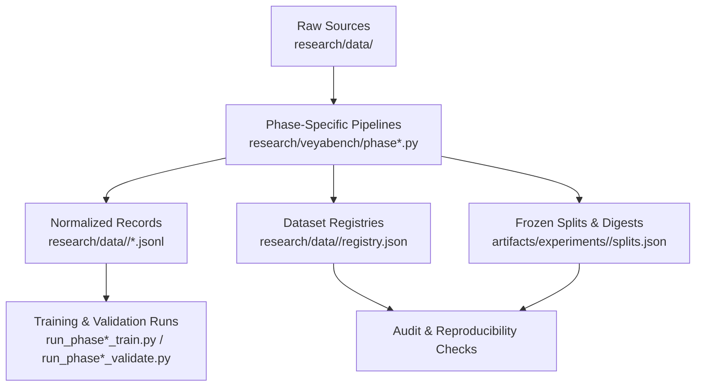
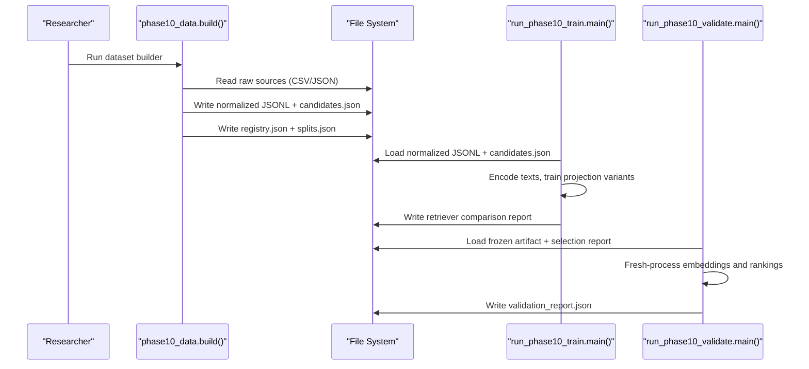
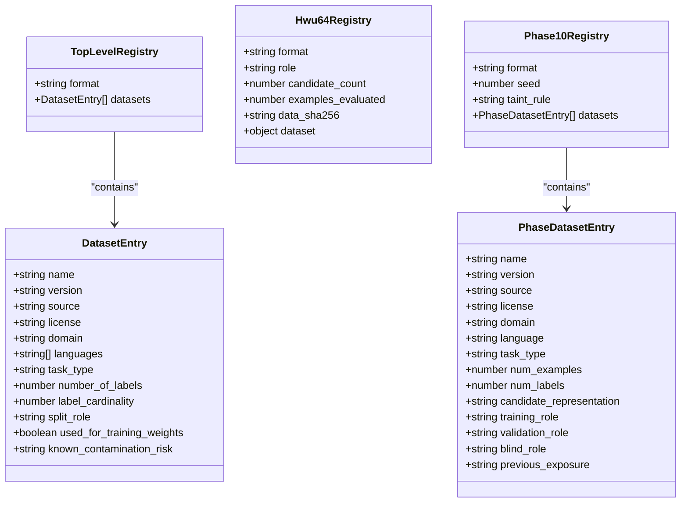
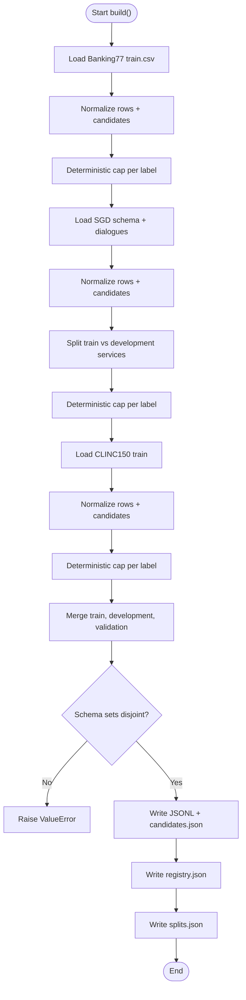
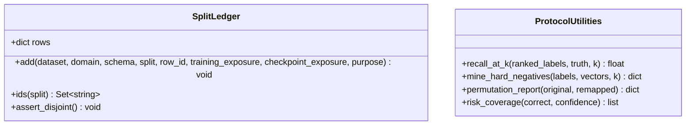
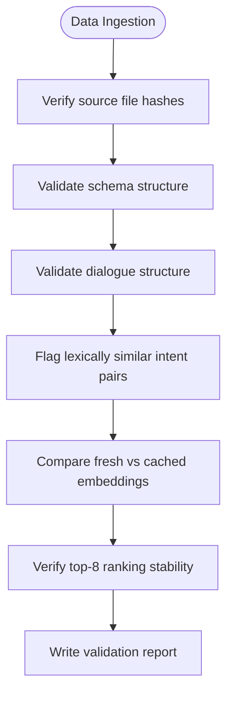
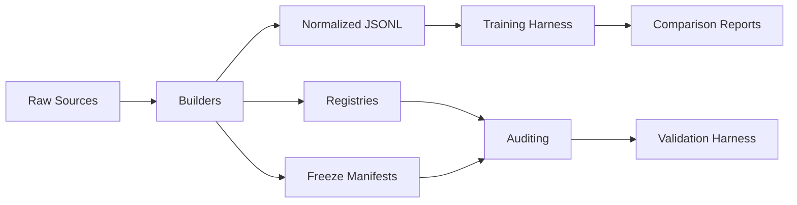

# Dataset Preparation

<cite>
**Referenced Files in This Document**
- [research/data/registry.json](file://research/data/registry.json)
- [research/data/hwu64/registry.json](file://research/data/hwu64/registry.json)
- [research/data/banking77/train.csv](file://research/data/banking77/train.csv)
- [research/data/sgd/train/schema.json](file://research/data/sgd/train/schema.json)
- [research/data/phase10/registry.json](file://research/data/phase10/registry.json)
- [research/veyabench/protocol.py](file://research/veyabench/protocol.py)
- [research/veyabench/phase10_data.py](file://research/veyabench/phase10_data.py)
- [research/veyabench/run_phase10_train.py](file://research/veyabench/run_phase10_train.py)
- [research/veyabench/run_phase10_validate.py](file://research/veyabench/run_phase10_validate.py)
- [research/veyabench/run_phase12_sgd_baseline.py](file://research/veyabench/run_phase12_sgd_baseline.py)
- [research/veyabench/run_phase12_context_audit.py](file://research/veyabench/run_phase12_context_audit.py)
</cite>

## Table of Contents
1. [Introduction](#introduction)
2. [Project Structure](#project-structure)
3. [Core Components](#core-components)
4. [Architecture Overview](#architecture-overview)
5. [Detailed Component Analysis](#detailed-component-analysis)
6. [Dependency Analysis](#dependency-analysis)
7. [Performance Considerations](#performance-considerations)
8. [Troubleshooting Guide](#troubleshooting-guide)
9. [Conclusion](#conclusion)

## Introduction
This document explains how Veya’s research pipeline prepares, registers, transforms, validates, and consumes datasets. It focuses on the data under `research/data/`, including banking77, clinc150, hwu64, massive, SGD, and phase-specific datasets such as Phase 10. It documents:
- The dataset registry formats used across the repository.
- The canonical transformation pipeline that converts raw sources into normalized training, development, validation, and candidate records.
- The protocol for split ownership, contamination control, and reproducibility.
- Data quality checks, integrity verification, and validation procedures.
- Practical guidance for adding new datasets, converting formats, preparing splits, and maintaining auditability.

## Project Structure
The dataset preparation system is centered around three layers:
- Raw source storage under `research/data/`.
- Phase-specific normalization and registry generation under `research/veyabench/`.
- Experiment artifacts and frozen splits under `artifacts/experiments/` and `research/data/<phase>/`.

**Diagram sources**
- [research/veyabench/phase10_data.py:183-332](file://research/veyabench/phase10_data.py#L183-L332)
- [research/veyabench/run_phase10_train.py:23-63](file://research/veyabench/run_phase10_train.py#L23-L63)
- [research/veyabench/run_phase10_validate.py:324-337](file://research/veyabench/run_phase10_validate.py#L324-L337)

**Section sources**
- [research/veyabench/phase10_data.py:1-27](file://research/veyabench/phase10_data.py#L1-L27)
- [research/data/phase10/registry.json:1-79](file://research/data/phase10/registry.json#L1-L79)

## Core Components
- **Registry files**: Describe dataset provenance, license, domain, task type, label cardinality, exposure history, and split roles.
- **Protocol ledger**: Enforces disjoint split membership, purpose constraints, and leakage detection.
- **Phase-specific builders**: Convert raw CSV/JSON into normalized rows and candidates, cap examples deterministically, and write JSONL outputs plus registries and freeze manifests.
- **Training/validation harnesses**: Load normalized data, compute embeddings, train or evaluate retrievers, and produce auditable reports.

Key responsibilities:
- Provenance tracking through SHA-256 digests of source files and generated artifacts.
- Deterministic sampling using a fixed seed and stable hashing.
- Schema-level taint rules to prevent validation or blind evaluation schemas from leaking into retriever training.
- End-to-end reproducibility by comparing fresh-process embeddings and rankings against frozen selection metrics.

**Section sources**
- [research/data/registry.json:1-34](file://research/data/registry.json#L1-L34)
- [research/data/hwu64/registry.json:1-21](file://research/data/hwu64/registry.json#L1-L21)
- [research/veyabench/protocol.py:1-52](file://research/veyabench/protocol.py#L1-L52)
- [research/veyabench/phase10_data.py:38-69](file://research/veyabench/phase10_data.py#L38-L69)

## Architecture Overview
The dataset preparation architecture follows a staged pipeline with strong separation between raw inputs, normalized records, and experiment artifacts.

**Diagram sources**
- [research/veyabench/phase10_data.py:183-332](file://research/veyabench/phase10_data.py#L183-L332)
- [research/veyabench/run_phase10_train.py:275-527](file://research/veyabench/run_phase10_train.py#L275-L527)
- [research/veyabench/run_phase10_validate.py:324-497](file://research/veyabench/run_phase10_validate.py#L324-L497)

## Detailed Component Analysis

### Registry System
Veya uses multiple registry formats depending on scope:
- **Top-level dataset registry**: Summarizes datasets like ag_news and banking77 with fields such as name, version, source, license, domain, languages, task_type, number_of_labels, label_cardinality, split_role, used_for_training_weights, and known_contamination_risk.
- **HWU64 registry entry**: Uses a compact format with fields like candidate_count, data_sha256, dataset metadata (name, source_repository, source_commit, license), examples_evaluated, format, role, and various result/provenance hashes.
- **Phase-specific registry**: Describes datasets used in a given phase, including training_role, validation_role, blind_role, previous_exposure, source_sha256, num_examples, num_labels, and candidate_representation.

**Diagram sources**
- [research/data/registry.json:1-34](file://research/data/registry.json#L1-L34)
- [research/data/hwu64/registry.json:1-21](file://research/data/hwu64/registry.json#L1-L21)
- [research/data/phase10/registry.json:1-79](file://research/data/phase10/registry.json#L1-L79)

**Section sources**
- [research/data/registry.json:1-34](file://research/data/registry.json#L1-L34)
- [research/data/hwu64/registry.json:1-21](file://research/data/hwu64/registry.json#L1-L21)
- [research/data/phase10/registry.json:1-79](file://research/data/phase10/registry.json#L1-L79)

### Data Transformation Pipeline
The Phase 10 builder demonstrates the canonical transformation pattern:
- Reads raw sources:
  - Banking77 CSV with text and category columns.
  - SGD schema and dialogues, filtering USER turns and frames.
  - CLINC150 JSON containing train pairs.
- Normalizes each row into a uniform structure with id, dataset, schema, text, and candidate_id.
- Builds candidate definitions per schema, including naturalized labels and optional authoritative definitions.
- Applies deterministic capping per label using a fixed seed and stable hash ordering.
- Writes normalized JSONL files for train, development, and schema-held-out validation, plus a combined candidates file.
- Generates a phase registry and a frozen split manifest with SHA-256 digests.

**Diagram sources**
- [research/veyabench/phase10_data.py:72-174](file://research/veyabench/phase10_data.py#L72-L174)
- [research/veyabench/phase10_data.py:183-332](file://research/veyabench/phase10_data.py#L183-L332)

**Section sources**
- [research/veyabench/phase10_data.py:72-174](file://research/veyabench/phase10_data.py#L72-L174)
- [research/veyabench/phase10_data.py:183-332](file://research/veyabench/phase10_data.py#L183-L332)

### Protocol Definitions and Split Ledger
The protocol module defines:
- Allowed split purposes: train, calibration, validation, test.
- A `SplitLedger` that enforces:
  - Each row belongs to at most one split.
  - Test rows cannot be marked as training exposure.
  - Test purpose must align with the test split.
  - Duplicate registration raises a leakage error.
- Utility functions for recall-at-k, hard-negative mining, permutation reporting, and risk coverage.

**Diagram sources**
- [research/veyabench/protocol.py:16-52](file://research/veyabench/protocol.py#L16-L52)
- [research/veyabench/protocol.py:54-124](file://research/veyabench/protocol.py#L54-L124)

**Section sources**
- [research/veyabench/protocol.py:1-52](file://research/veyabench/protocol.py#L1-L52)
- [research/veyabench/protocol.py:54-124](file://research/veyabench/protocol.py#L54-L124)

### Phase-Specific Datasets

#### Banking77
- Format: CSV with text and category columns.
- Usage: Train split is read; test split is excluded from this builder to avoid contamination.
- Candidate representation: Raw intent names are naturalized deterministically without authoritative definitions.

**Section sources**
- [research/data/banking77/train.csv:9861-9882](file://research/data/banking77/train.csv#L9861-L9882)
- [research/veyabench/phase10_data.py:72-89](file://research/veyabench/phase10_data.py#L72-L89)
- [research/data/phase10/registry.json:3-19](file://research/data/phase10/registry.json#L3-L19)

#### CLINC150
- Format: JSON containing train pairs of text and label.
- Usage: Only the train partition is used for schema-held-out validation in Phase 10; previously consumed validation/test partitions are prohibited.
- Candidate representation: Raw intent names are naturalized deterministically without authoritative definitions.

**Section sources**
- [research/veyabench/phase10_data.py:156-174](file://research/veyabench/phase10_data.py#L156-L174)
- [research/data/phase10/registry.json:40-56](file://research/data/phase10/registry.json#L40-L56)

#### HWU64
- Format: Compact registry entry describing dataset provenance, license, commit, and evaluation role.
- Usage: One-shot blind consumption with explicit data and result hashes.

**Section sources**
- [research/data/hwu64/registry.json:1-21](file://research/data/hwu64/registry.json#L1-L21)

#### Massive
- Format: Listed as an unfrozen future blind candidate in Phase 10 registry; data absent and untouched until finalist selection.
- Usage: Intended for blind evaluation after finalist freeze; base-checkpoint exposure cannot be independently excluded.

**Section sources**
- [research/data/phase10/registry.json:57-73](file://research/data/phase10/registry.json#L57-L73)

#### SGD (Schema-Guided Dialogue)
- Format: JSON schema defining services, slots, intents, and descriptions; dialogues contain turns and frames with active_intent.
- Usage: Train split provides both training and development subsets based on service names; development services are frozen during retriever training.
- Quality checks: Dev schema integrity and dialogue structure are validated before loading.

**Section sources**
- [research/data/sgd/train/schema.json:1-800](file://research/data/sgd/train/schema.json#L1-L800)
- [research/veyabench/phase10_data.py:92-153](file://research/veyabench/phase10_data.py#L92-L153)
- [research/veyabench/run_phase12_sgd_baseline.py:42-71](file://research/veyabench/run_phase12_sgd_baseline.py#L42-L71)

### Adding New Datasets
To add a new dataset to the research pipeline:
1. Place raw sources under `research/data/<dataset>/`.
2. Create or update the appropriate registry:
   - For general catalog entries, extend `research/data/registry.json`.
   - For phase-specific usage, extend `research/data/<phase>/registry.json`.
3. Implement a loader function similar to existing loaders:
   - Normalize rows into `{id, dataset, schema, text, candidate_id}`.
   - Build candidates with naturalized labels and optional definitions.
   - Apply deterministic capping per label using a fixed seed.
4. Add the dataset to the builder’s merge step and ensure schema sets remain disjoint where required.
5. Generate JSONL outputs and update the phase registry and freeze manifest.
6. Validate provenance by computing SHA-256 digests for source files and outputs.

Guidance notes:
- Keep candidate_ids stable and schema-scoped to avoid cross-schema leakage.
- Use deterministic sorting and hashing for reproducibility.
- Record license, source URL, commit, and exposure history in the registry.
- If the dataset will be used for validation or blind evaluation, apply the taint rule: whole candidate schemas must not leak into retriever training.

**Section sources**
- [research/veyabench/phase10_data.py:38-69](file://research/veyabench/phase10_data.py#L38-L69)
- [research/veyabench/phase10_data.py:183-332](file://research/veyabench/phase10_data.py#L183-L332)
- [research/data/phase10/registry.json:75-79](file://research/data/phase10/registry.json#L75-L79)

### Converting Data Formats
Common conversion patterns:
- CSV to normalized rows: Parse text and label columns, generate stable ids, map labels to candidate_ids, and construct schema identifiers.
- JSON dialogues to normalized rows: Iterate dialogues, filter user turns, extract frames, validate active_intent, and map service/intent to candidate_ids.
- Label naturalization: Normalize label strings deterministically for consistent candidate representations.

Best practices:
- Validate unknown candidate references and raise clear errors.
- Preserve original labels alongside naturalized forms for traceability.
- Compute and store SHA-256 digests for all transformed outputs.

**Section sources**
- [research/veyabench/phase10_data.py:72-174](file://research/veyabench/phase10_data.py#L72-L174)

### Preparing Custom Training/Validation Splits
Recommended approach:
- Define split roles explicitly: train, calibration, validation, test.
- Ensure disjointness: each row id appears in exactly one split.
- Apply deterministic capping per label to balance classes.
- Verify schema separation: do not allow validation or blind-evaluation schemas to appear in training.
- Record split digests and freeze manifests for reproducibility.

**Section sources**
- [research/veyabench/protocol.py:16-52](file://research/veyabench/protocol.py#L16-L52)
- [research/veyabench/phase10_data.py:194-201](file://research/veyabench/phase10_data.py#L194-L201)
- [research/veyabench/phase10_data.py:298-331](file://research/veyabench/phase10_data.py#L298-L331)

### Data Quality Checks and Validation Procedures
Quality controls include:
- Source integrity: Compare file hashes against expected values; reject changes.
- Schema consistency: Detect changed schemas and mismatched service definitions.
- Structural validation: Ensure dialogues have required fields and valid speaker/frame structures.
- Lexical similarity flags: Identify potentially ambiguous intent pairs for review.
- Reproducibility checks: Compare fresh-process embeddings and rankings against frozen selection metrics; enforce cosine direction tolerance and top-8 set stability.

**Diagram sources**
- [research/veyabench/run_phase12_sgd_baseline.py:42-71](file://research/veyabench/run_phase12_sgd_baseline.py#L42-L71)
- [research/veyabench/run_phase12_context_audit.py:97-128](file://research/veyabench/run_phase12_context_audit.py#L97-L128)
- [research/veyabench/run_phase10_validate.py:324-497](file://research/veyabench/run_phase10_validate.py#L324-L497)

**Section sources**
- [research/veyabench/run_phase12_sgd_baseline.py:42-71](file://research/veyabench/run_phase12_sgd_baseline.py#L42-L71)
- [research/veyabench/run_phase12_context_audit.py:97-128](file://research/veyabench/run_phase12_context_audit.py#L97-L128)
- [research/veyabench/run_phase10_validate.py:324-497](file://research/veyabench/run_phase10_validate.py#L324-L497)

## Dependency Analysis
The dataset preparation components depend on each other in a layered fashion:
- Builders depend on raw sources and utility functions for hashing and naturalization.
- Training and validation harnesses depend on normalized JSONL outputs and frozen artifacts.
- Registries and freeze manifests provide the contract for downstream consumers.

**Diagram sources**
- [research/veyabench/phase10_data.py:183-332](file://research/veyabench/phase10_data.py#L183-L332)
- [research/veyabench/run_phase10_train.py:275-527](file://research/veyabench/run_phase10_train.py#L275-L527)
- [research/veyabench/run_phase10_validate.py:324-497](file://research/veyabench/run_phase10_validate.py#L324-L497)

**Section sources**
- [research/veyabench/phase10_data.py:183-332](file://research/veyabench/phase10_data.py#L183-L332)
- [research/veyabench/run_phase10_train.py:275-527](file://research/veyabench/run_phase10_train.py#L275-L527)
- [research/veyabench/run_phase10_validate.py:324-497](file://research/veyabench/run_phase10_validate.py#L324-L497)

## Performance Considerations
- Deterministic capping ensures balanced label distributions without randomness drift.
- Frozen embedding caches reduce repeated encoding costs while preserving reproducibility via metadata hashes.
- Schema-level taint rules prevent unnecessary candidate expansion during training, improving efficiency and reducing leakage risk.
- Fresh-process validation compares embeddings and rankings to detect subtle numerical differences early.

[No sources needed since this section provides general guidance]

## Troubleshooting Guide
Common issues and resolutions:
- Unknown split or purpose: Ensure split and purpose values conform to allowed sets.
- Test row marked as training exposure: Remove training exposure flag from test rows.
- Duplicate row registration: Confirm each row id is unique across splits.
- Schema leakage: Verify that development and validation schemas do not overlap with training schemas.
- Source file changes: Update expected hashes or revert source changes to maintain reproducibility.
- Embedding direction mismatch: Investigate environment or model version differences if cosine similarity drops below tolerance.

**Section sources**
- [research/veyabench/protocol.py:22-32](file://research/veyabench/protocol.py#L22-L32)
- [research/veyabench/phase10_data.py:194-201](file://research/veyabench/phase10_data.py#L194-L201)
- [research/veyabench/run_phase10_validate.py:402-431](file://research/veyabench/run_phase10_validate.py#L402-L431)

## Conclusion
Veya’s dataset preparation system emphasizes provenance, reproducibility, and contamination control. Registries capture dataset metadata and exposure history; builders normalize diverse sources into consistent records; protocols enforce strict split ownership; and validation harnesses verify freshness and stability. Following the documented patterns for adding datasets, converting formats, preparing splits, and applying quality checks ensures reliable, auditable research pipelines.

[No sources needed since this section summarizes without analyzing specific files]