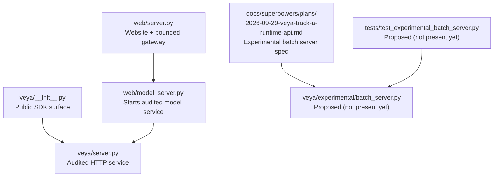
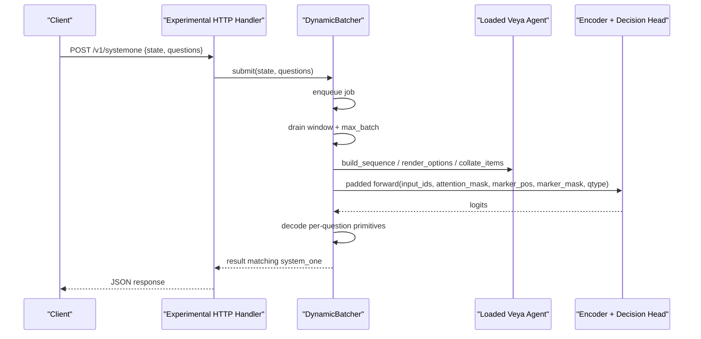
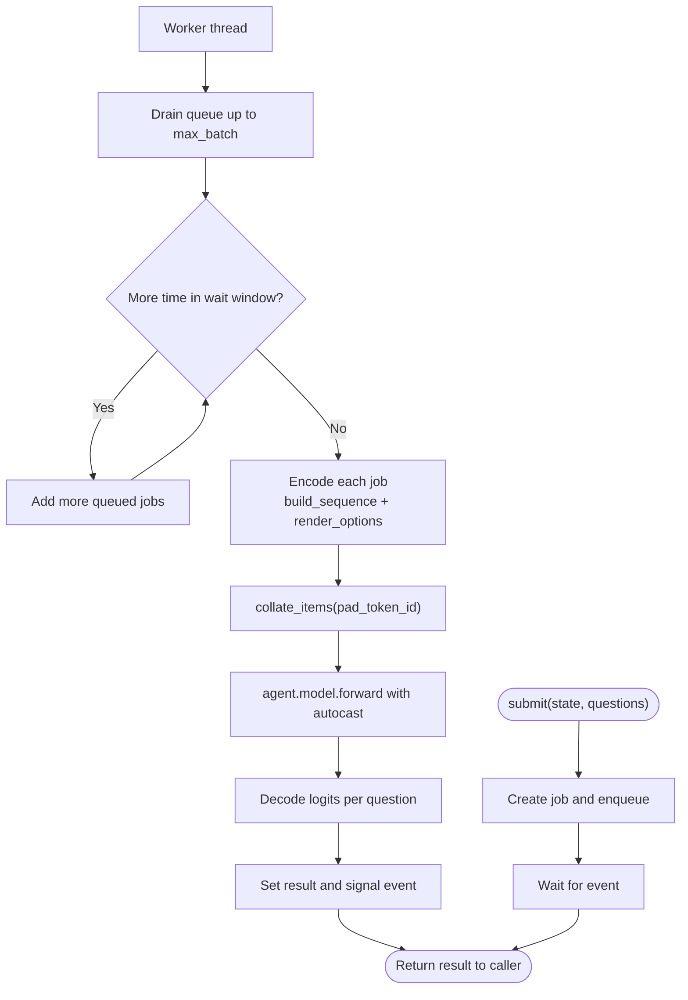
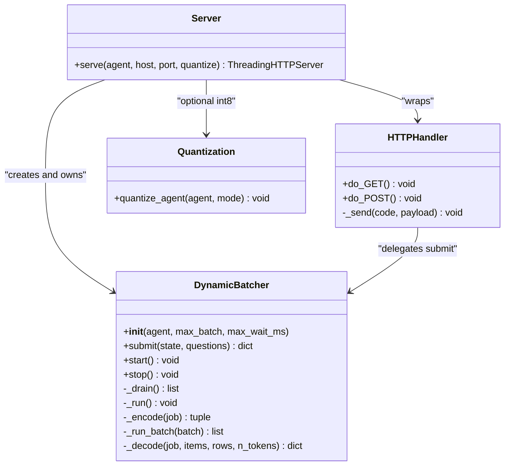
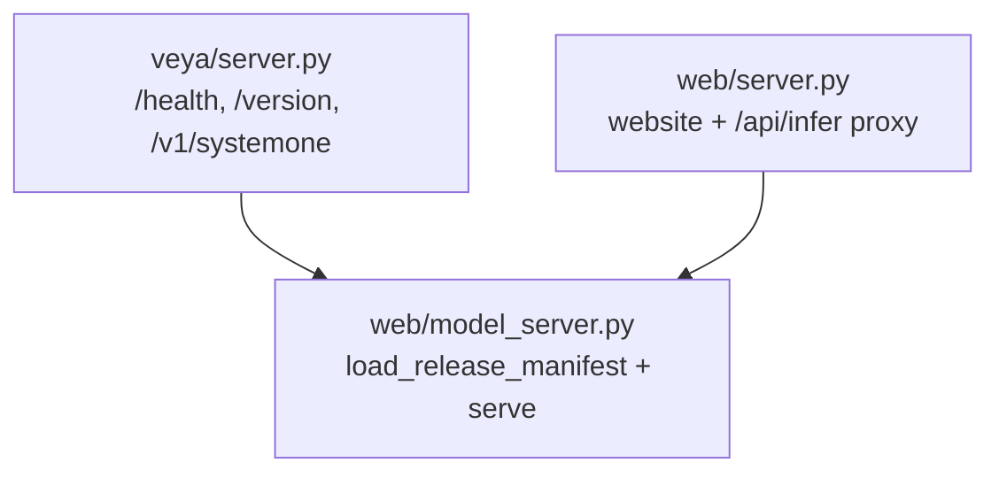
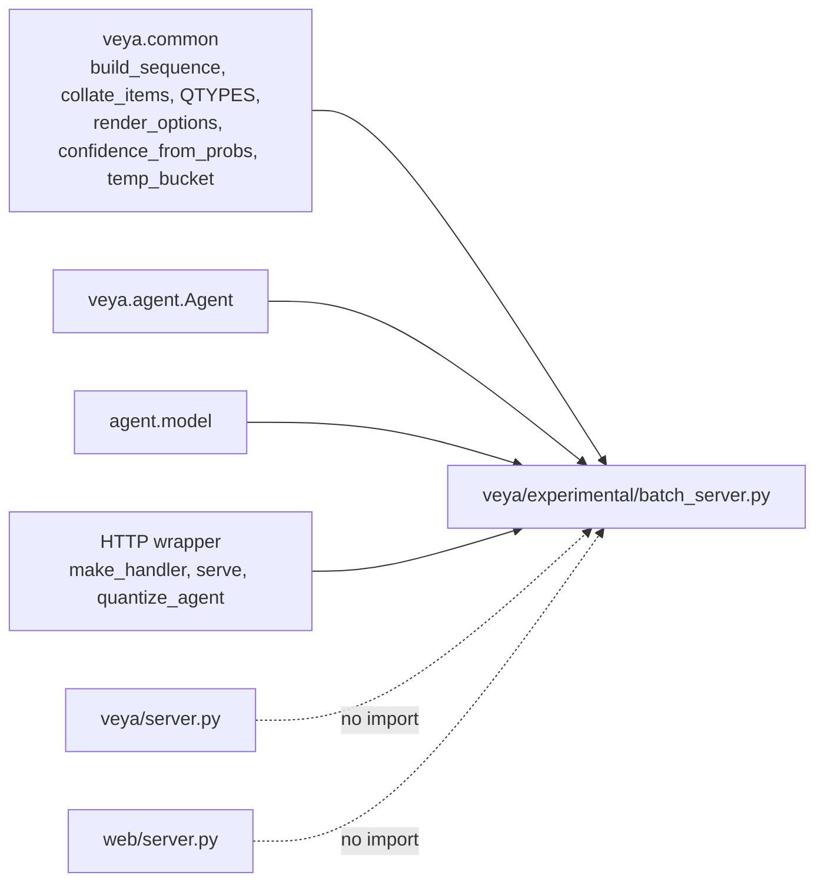

# Experimental Batch Server Design

<cite>
**Referenced Files in This Document**   
- [README.md](file://README.md)
- [veya/__init__.py](file://veya/__init__.py)
- [veya/server.py](file://veya/server.py)
- [web/model_server.py](file://web/model_server.py)
- [web/server.py](file://web/server.py)
- [2026-09-29-veya-track-a-runtime-api.md](file://docs/superpowers/plans/2026-09-29-veya-track-a-runtime-api.md)
</cite>

## Table of Contents
1. [Introduction](#introduction)
2. [Project Structure](#project-structure)
3. [Core Components](#core-components)
4. [Architecture Overview](#architecture-overview)
5. [Detailed Component Analysis](#detailed-component-analysis)
6. [Dependency Analysis](#dependency-analysis)
7. [Performance Considerations](#performance-considerations)
8. [Troubleshooting Guide](#troubleshooting-guide)
9. [Conclusion](#conclusion)

## Introduction
This document explains the experimental batch server design for Veya as specified in the repository’s superpowers plan. The design proposes a research-only dynamic batching layer that coalesces concurrent requests with different states into a single padded encoder forward, while preserving strict parity with the existing `Agent.system_one` contract. It also specifies an optional HTTP wrapper and optional CPU quantization helper.

The current repository snapshot does not include the proposed implementation files:
- `veya/experimental/batch_server.py`
- `tests/test_experimental_batch_server.py`

Instead, the design is fully specified in the plan document, including interfaces, behavior, tests, and audit guards. This document therefore synthesizes the intended architecture from the plan and contrasts it with the existing audited runtime surface.

**Section sources**
- [README.md:27-55](file://README.md#L27-L55)
- [2026-09-29-veya-track-a-runtime-api.md:754-1340](file://docs/superpowers/plans/2026-09-29-veya-track-a-runtime-api.md#L754-L1340)

## Project Structure
The experimental batch server is scoped to the `veya/experimental` package. The plan explicitly marks this module as research-only and asserts that it must never be imported by the audited load path.

**Diagram sources**
- [veya/__init__.py:1-56](file://veya/__init__.py#L1-L56)
- [veya/server.py:1-243](file://veya/server.py#L1-L243)
- [web/model_server.py:1-18](file://web/model_server.py#L1-L18)
- [web/server.py:1-660](file://web/server.py#L1-L660)
- [2026-09-29-veya-track-a-runtime-api.md:754-1340](file://docs/superpowers/plans/2026-09-29-veya-track-a-runtime-api.md#L754-L1340)

**Section sources**
- [veya/__init__.py:1-56](file://veya/__init__.py#L1-L56)
- [veya/server.py:1-243](file://veya/server.py#L1-L243)
- [web/model_server.py:1-18](file://web/model_server.py#L1-L18)
- [web/server.py:1-660](file://web/server.py#L1-L660)
- [2026-09-29-veya-track-a-runtime-api.md:754-1340](file://docs/superpowers/plans/2026-09-29-veya-track-a-runtime-api.md#L754-L1340)

## Core Components
The plan defines two main layers:

| Layer | Responsibility | Key Interfaces |
|---|---|---|
| Dynamic batching core | Coalesce concurrent single-request jobs into padded joint forwards; preserve serial parity | `DynamicBatcher.__init__`, `submit`, `start`, `stop`; `RESEARCH_ONLY`; `research_banner` |
| HTTP wrapper and acceleration | Expose `/v1/systemone`, `/health`, `/version`; optionally apply int8 dynamic quantization | `make_handler`, `serve`, `quantize_agent` |

### Dynamic Batcher Contract
- Consumes a loaded Veya agent and stable core utilities such as sequence building, collation, question types, option rendering, confidence computation, and temperature bucketing.
- Produces results matching `Agent.system_one` shape, including decision, answers, usage, and deferred semantics.
- Uses a thread-safe queue, condition variable, worker thread, and per-forward lock.
- Propagates batch-level exceptions to all waiters rather than silently dropping partial results.

### HTTP Wrapper Contract
- Returns a `BaseHTTPRequestHandler` subclass via `make_handler`.
- Serves:
  - `GET /health`
  - `GET /version` with `research_only: true`
  - `POST /v1/systemone` accepting JSON state and questions
- Wraps the batcher so each request calls `batcher.submit(state, questions)`.
- Provides `serve(agent, host, port, quantize)` returning a `ThreadingHTTPServer`.
- Optionally applies dynamic int8 quantization to the encoder’s `Linear` layers without writing weights to disk.

**Section sources**
- [2026-09-29-veya-track-a-runtime-api.md:754-1092](file://docs/superpowers/plans/2026-09-29-veya-track-a-runtime-api.md#L754-L1092)
- [2026-09-29-veya-track-a-runtime-api.md:1096-1254](file://docs/superpowers/plans/2026-09-29-veya-track-a-runtime-api.md#L1096-L1254)

## Architecture Overview
The experimental batch server is designed as a sidecar-style enhancement around an already loaded Veya agent. It does not replace the audited model server; instead, it provides a research-only path optimized for cross-state batching.

**Diagram sources**
- [2026-09-29-veya-track-a-runtime-api.md:848-1079](file://docs/superpowers/plans/2026-09-29-veya-track-a-runtime-api.md#L848-L1079)
- [2026-09-29-veya-track-a-runtime-api.md:1185-1236](file://docs/superpowers/plans/2026-09-29-veya-track-a-runtime-api.md#L1185-L1236)

## Detailed Component Analysis

### Experimental Dynamic Batcher
The planned `DynamicBatcher` is a threading-based batcher that:
- Accepts single-request inputs through `submit`.
- Runs a daemon worker thread that drains queued jobs up to `max_batch`.
- Applies a small wait window (`max_wait_ms`) to increase batch size before forwarding.
- Encodes each job using the same internal question conversion, sequence construction, and option rendering used by the stable core.
- Collates multiple encoded items into one padded tensor batch.
- Calls the agent’s model once with autocast enabled on CUDA.
- Decodes logits back into choice, score, or noul answers with calibrated probabilities and confidence.
- Mirrors deferral and invalid-schema short-circuit behavior from `Agent.system_one`.

**Diagram sources**
- [2026-09-29-veya-track-a-runtime-api.md:899-1079](file://docs/superpowers/plans/2026-09-29-veya-track-a-runtime-api.md#L899-L1079)

#### Parity Requirements
The test suite requires that batched output matches serial `Agent.system_one` within tight numerical tolerance:
- Choice decisions and label probabilities must match exactly or within a small absolute error.
- Noul probabilities must match within a small absolute error.
- Question type metadata must remain consistent.
- Padding rows must not leak across samples because collation uses `attention_mask`.

**Section sources**
- [2026-09-29-veya-track-a-runtime-api.md:768-839](file://docs/superpowers/plans/2026-09-29-veya-track-a-runtime-api.md#L768-L839)
- [2026-09-29-veya-track-a-runtime-api.md:848-1079](file://docs/superpowers/plans/2026-09-29-veya-track-a-runtime-api.md#L848-L1079)

### Experimental HTTP Wrapper
The planned HTTP layer wraps `DynamicBatcher` and exposes a minimal REST interface:
- `GET /health` returns a simple health status.
- `GET /version` returns `research_only: true` plus a banner string.
- `POST /v1/systemone` parses JSON, validates length, and delegates to `batcher.submit`.
- Errors are returned as JSON with `decision: "invalid"` and a `defer_reason` field.
- `serve` creates a `ThreadingHTTPServer`, starts the batcher, and attaches the batcher to the server object to avoid garbage collection.

**Diagram sources**
- [2026-09-29-veya-track-a-runtime-api.md:1185-1236](file://docs/superpowers/plans/2026-09-29-veya-track-a-runtime-api.md#L1185-L1236)

**Section sources**
- [2026-09-29-veya-track-a-runtime-api.md:1096-1254](file://docs/superpowers/plans/2026-09-29-veya-track-a-runtime-api.md#L1096-L1254)

### Existing Audited Runtime Surface
For contrast, the existing audited runtime surface is:
- `veya.server`: stdlib HTTP server exposing `/health`, `/version`, `/v1/systemone`, and primitive endpoints.
- `web.model_server`: entry point that loads the release manifest bundle and starts the audited model service.
- `web.server`: website and bounded gateway that proxies to the upstream model service.

**Diagram sources**
- [veya/server.py:137-243](file://veya/server.py#L137-L243)
- [web/model_server.py:1-18](file://web/model_server.py#L1-L18)
- [web/server.py:94-114](file://web/server.py#L94-L114)

**Section sources**
- [veya/server.py:1-243](file://veya/server.py#L1-L243)
- [web/model_server.py:1-18](file://web/model_server.py#L1-L18)
- [web/server.py:1-660](file://web/server.py#L1-L660)

## Dependency Analysis
The experimental batch server is intentionally decoupled from the audited runtime:

| Relationship | Direction | Notes |
|---|---:|---|
| Plan → Implementation | Spec drives code | The plan file contains full interface definitions and tests. |
| Batch server → Stable core | Imports only | Uses `build_sequence`, `collate_items`, `QTYPES`, `render_options`, `confidence_from_probs`, `temp_bucket`, and related helpers. |
| Batch server → Agent | Reads configuration | Uses `agent.cfg`, `agent.tok`, `agent.device`, `agent.dtype`, and `agent.temperature_by_options`. |
| Batch server → Model | Calls forward | Calls `agent.model(...)` with padded tensors and marker inputs. |
| HTTP wrapper → Batch server | Delegates | `serve` constructs `DynamicBatcher` and passes it to `make_handler`. |
| Audited runtime → Experimental batch server | None | The plan enforces that the experimental module is not part of any release manifest or audited import path. |

**Diagram sources**
- [2026-09-29-veya-track-a-runtime-api.md:760-764](file://docs/superpowers/plans/2026-09-29-veya-track-a-runtime-api.md#L760-L764)
- [2026-09-29-veya-track-a-runtime-api.md:848-1079](file://docs/superpowers/plans/2026-09-29-veya-track-a-runtime-api.md#L848-L1079)
- [2026-09-29-veya-track-a-runtime-api.md:1243-1246](file://docs/superpowers/plans/2026-09-29-veya-track-a-runtime-api.md#L1243-L1246)

**Section sources**
- [2026-09-29-veya-track-a-runtime-api.md:760-764](file://docs/superpowers/plans/2026-09-29-veya-track-a-runtime-api.md#L760-L764)
- [2026-09-29-veya-track-a-runtime-api.md:848-1079](file://docs/superpowers/plans/2026-09-29-veya-track-a-runtime-api.md#L848-L1079)
- [2026-09-29-veya-track-a-runtime-api.md:1243-1246](file://docs/superpowers/plans/2026-09-29-veya-track-a-runtime-api.md#L1243-L1246)

## Performance Considerations
The experimental batch server targets throughput gains through cross-state batching:
- **Batch size:** Controlled by `max_batch`, defaulting to 16 in the plan.
- **Latency tradeoff:** Controlled by `max_wait_ms`, defaulting to 10 ms in the plan.
- **Forward serialization:** A per-batch forward lock prevents concurrent model calls.
- **Autocast:** Enabled on CUDA to reduce memory and improve throughput where supported.
- **Quantization:** Optional int8 dynamic quantization targets CPU inference speed without changing frozen checkpoint files.

Important constraints:
- Parity tests require numerical agreement with serial execution, limiting aggressive optimizations that would change outputs.
- Padding must not leak across samples because correctness depends on `attention_mask`.
- The batcher is research-only and should not be assumed production-ready.

[No sources needed since this section provides general guidance]

## Troubleshooting Guide
Based on the plan’s tests and design notes, common issues and their expected handling include:

| Issue | Expected Behavior | Diagnostic Action |
|---|---|---|
| Missing experimental module | Import fails before checkpoint checks | Confirm whether `veya/experimental/batch_server.py` has been implemented. |
| No local checkpoint | Tests skip when `models/production` is missing | Set `VEYA_TEST_MODEL_DIR` or provide a local checkpoint directory. |
| Invalid schema or empty state | Short-circuits to `decision: "defer"` with `reason: "invalid_schema"` | Validate request body against the `systemone` contract. |
| Deferral rules block input | Short-circuits to `decision: "defer"` with a defer reason | Inspect `agent.cfg` and the language/deferral logic used by the batcher. |
| Forward failure | Exception propagated to every waiter in the batch | Check model availability, device/dtype settings, and tensor shapes. |
| HTTP version endpoint | Must return `research_only: true` | Verify the experimental server is being used, not the audited server. |
| Quantization unsupported | Should be guarded by platform-specific skips | Wrap `torch.quantization.quantize_dynamic` in a try/except and skip if unavailable. |
| Audited path contamination | Import check must pass | Ensure no audited module imports `veya.experimental.batch_server`. |

**Section sources**
- [2026-09-29-veya-track-a-runtime-api.md:768-839](file://docs/superpowers/plans/2026-09-29-veya-track-a-runtime-api.md#L768-L839)
- [2026-09-29-veya-track-a-runtime-api.md:1144-1155](file://docs/superpowers/plans/2026-09-29-veya-track-a-runtime-api.md#L1144-L1155)
- [2026-09-29-veya-track-a-runtime-api.md:1243-1246](file://docs/superpowers/plans/2026-09-29-veya-track-a-runtime-api.md#L1243-L1246)

## Conclusion
The experimental batch server design adds a research-only dynamic batching layer around a loaded Veya agent. Its primary goals are:
- Preserve exact serial parity with `Agent.system_one`.
- Reduce redundant encoder work by batching different states.
- Provide a minimal HTTP interface clearly marked as research-only.
- Offer optional CPU quantization for local performance research.
- Remain isolated from the audited release path.

As of this snapshot, the implementation is still a specification. The plan document contains the complete intended API, behavior, tests, and audit guard requirements. Until `veya/experimental/batch_server.py` and its test file are added, the design remains a blueprint rather than executable code.

[No sources needed since this section summarizes without analyzing specific files]