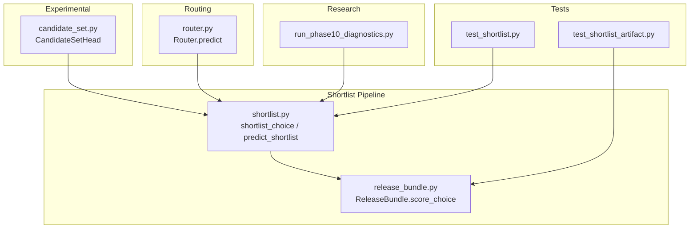
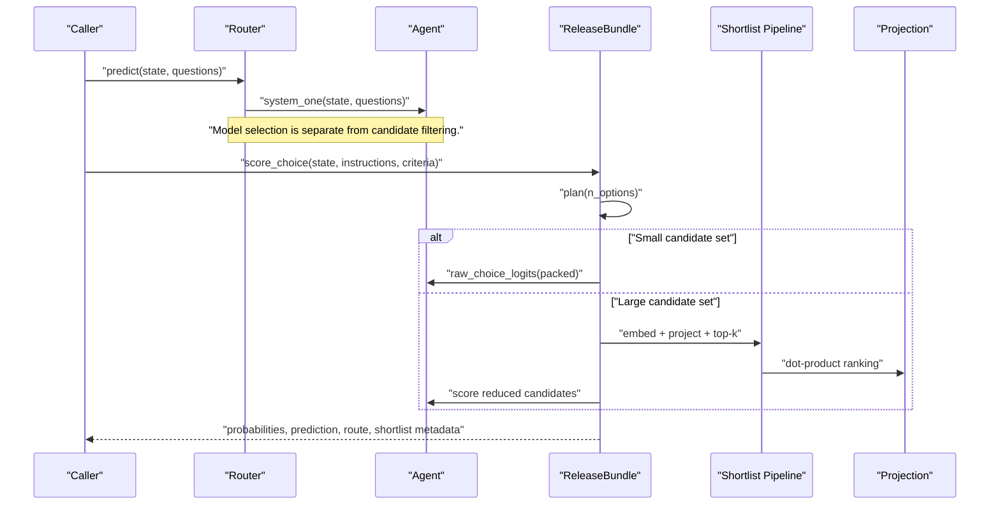
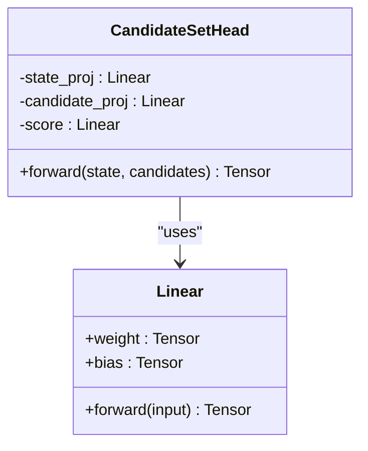
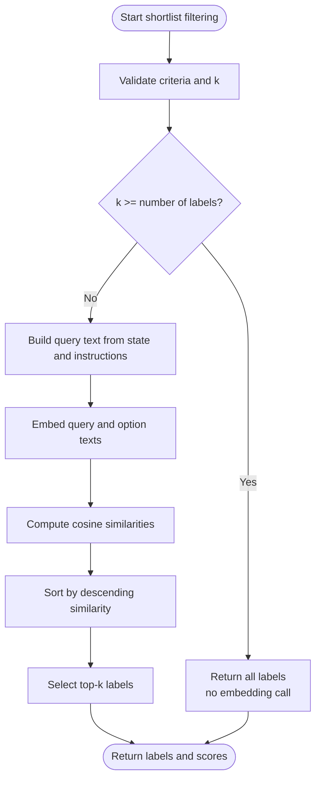
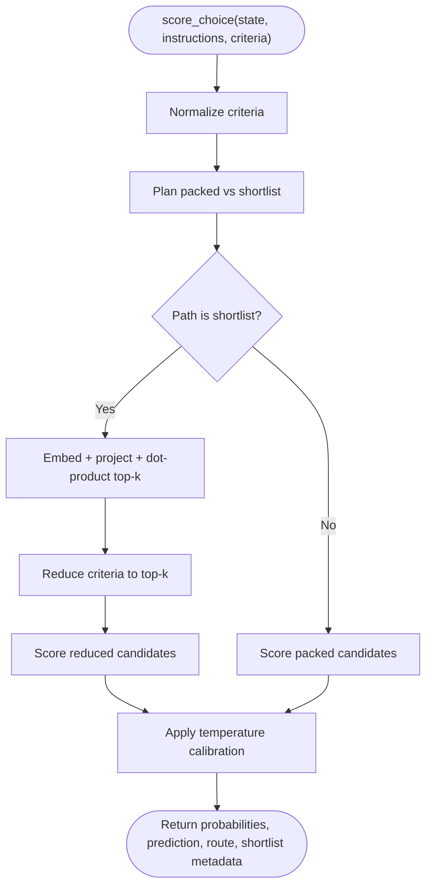
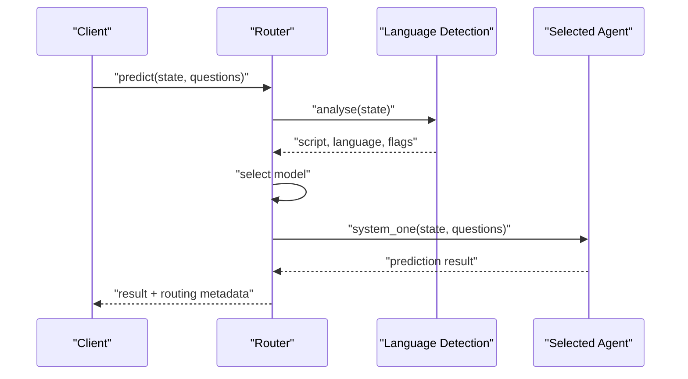
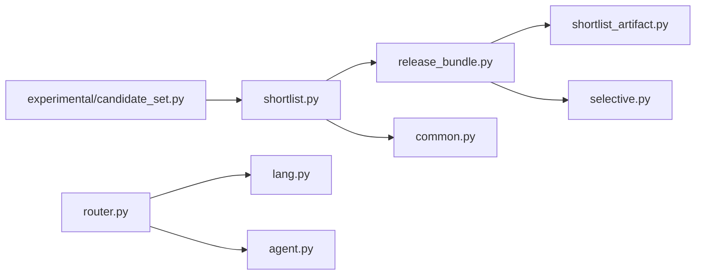

# Candidate Set Management

<cite>
**Referenced Files in This Document**
- [candidate_set.py](file://veya/experimental/candidate_set.py)
- [shortlist.py](file://veya/shortlist.py)
- [release_bundle.py](file://veya/release_bundle.py)
- [router.py](file://veya/router.py)
- [test_shortlist.py](file://tests/test_shortlist.py)
- [test_shortlist_artifact.py](file://tests/test_shortlist_artifact.py)
- [run_phase10_diagnostics.py](file://research/veyabench/run_phase10_diagnostics.py)
</cite>

## Table of Contents
1. [Introduction](#introduction)
2. [Project Structure](#project-structure)
3. [Core Components](#core-components)
4. [Architecture Overview](#architecture-overview)
5. [Detailed Component Analysis](#detailed-component-analysis)
6. [Dependency Analysis](#dependency-analysis)
7. [Performance Considerations](#performance-considerations)
8. [Troubleshooting Guide](#troubleshooting-guide)
9. [Conclusion](#conclusion)
10. [Appendices](#appendices)

## Introduction
This document explains Veya’s candidate set management experimental system and its integration with the shortlist optimization pipeline. It focuses on how potential decisions are represented, filtered, ranked, and routed through Veya’s decision infrastructure.

The system has two related layers:

- **Experimental candidate scoring**: `CandidateSetHead` is an order-equivariant neural head that scores a state against a batch of candidate embeddings independently of list position. It is experimental and not wired into the production agent prediction path.
- **Production shortlist pipeline**: The shortlist module provides filtering, ranking, and routing for high-cardinality choice questions. It can use cosine similarity over text embeddings or a learned projection dot-product, then score only the top candidates through the model.

Together, these pieces support large decision spaces by avoiding full packed scoring when the number of options is too large for the model’s token budget.

## Project Structure
The relevant code lives under `veya/experimental`, `veya`, and supporting tests and research scripts:

**Diagram sources**
- [candidate_set.py:11-25](file://veya/experimental/candidate_set.py#L11-L25)
- [shortlist.py:67-148](file://veya/shortlist.py#L67-L148)
- [release_bundle.py:127-258](file://veya/release_bundle.py#L127-L258)
- [router.py:123-333](file://veya/router.py#L123-L333)
- [test_shortlist.py](file://tests/test_shortlist.py)
- [test_shortlist_artifact.py](file://tests/test_shortlist_artifact.py)
- [run_phase10_diagnostics.py:56-63](file://research/veyabench/run_phase10_diagnostics.py#L56-L63)

**Section sources**
- [candidate_set.py:1-26](file://veya/experimental/candidate_set.py#L1-L26)
- [shortlist.py:1-40](file://veya/shortlist.py#L1-L40)
- [release_bundle.py:1-31](file://veya/release_bundle.py#L1-L31)
- [router.py:1-29](file://veya/router.py#L1-L29)

## Core Components
This section summarizes the main building blocks used to manage candidate sets.

| Component | Responsibility | Key Behavior |
|---|---|---|
| `CandidateSetHead` | Experimental per-candidate scoring | Scores each candidate independently from a shared state vector; input shapes are validated; output is one score per candidate. |
| `shortlist_choice` | Embedding-based candidate filtering | Returns the top-k labels for a state and criteria using a caller-supplied embedding function. |
| `predict_shortlist` | Shortlist-aware prediction wrapper | Reduces choice questions to their top-k candidates, calls the agent once, and attaches metadata about the shortlist. |
| `ReleaseBundle.score_choice` | Production shortlist routing | Chooses between packed scoring and learned shortlist K=8 routing, applies calibration, and returns probabilities and metadata. |
| `Router.predict` | Model checkpoint routing | Selects the appropriate Veya checkpoint (English, multilingual, typed-decisions) and runs inference. |

**Section sources**
- [candidate_set.py:11-25](file://veya/experimental/candidate_set.py#L11-L25)
- [shortlist.py:67-148](file://veya/shortlist.py#L67-L148)
- [release_bundle.py:127-258](file://veya/release_bundle.py#L127-L258)
- [router.py:123-333](file://veya/router.py#L123-L333)

## Architecture Overview
The candidate set system connects experimental scoring ideas with a production shortlist pipeline and the broader routing layer.

**Diagram sources**
- [router.py:315-333](file://veya/router.py#L315-L333)
- [release_bundle.py:208-258](file://veya/release_bundle.py#L208-L258)
- [release_bundle.py:150-198](file://veya/release_bundle.py#L150-L198)
- [shortlist.py:151-203](file://veya/shortlist.py#L151-L203)

## Detailed Component Analysis

### CandidateSetHead: Experimental Per-Candidate Scoring
`CandidateSetHead` is a small neural module designed to score a fixed-length state vector against a sequence of candidate vectors. Its key design goal is order equivariance: the score for candidate i should not depend on where it appears in the list.

Important implementation characteristics:

- Input validation ensures the state has shape `[B, D]` and candidates have shape `[B, N, D]`.
- The state is projected and broadcast across candidates; each candidate is also projected.
- A nonlinearity combines them before a linear score head produces one scalar per candidate.
- The module raises errors for mismatched batch sizes or dimensions.

**Diagram sources**
- [candidate_set.py:11-25](file://veya/experimental/candidate_set.py#L11-L25)

Operational notes:

- The module is marked experimental and is not wired into `Agent.predict`.
- It is intended for experiments where candidates can be cached and concatenated later.
- Tests verify order equivariance and basic learning behavior.

**Section sources**
- [candidate_set.py:1-26](file://veya/experimental/candidate_set.py#L1-L26)
- [test_phase2.py:146-152](file://tests/test_phase2.py#L146-L152)

### Shortlist Filtering and Ranking
The shortlist module implements the practical candidate filtering strategy used for high-cardinality choices.

Key functions:

| Function | Purpose | Output |
|---|---|---|
| `shortlist_choice` | Rank labels by similarity to the state | Top-k label list |
| `predict_shortlist` | Reduce choice questions, run inference once, attach metadata | Prediction dict plus `shortlist` entry |
| `_rank` | Internal ranking logic | Labels, scores, passthrough flag, original count |
| `embed_fn_from_agent` | Build an embedding function from a loaded agent | Callable returning embeddings for texts |

Filtering workflow:

1. Validate and normalize criteria.
2. If k is at least the number of labels, return all labels without embedding.
3. Otherwise, embed the query and option texts.
4. Compute cosine similarities.
5. Sort and select the top-k labels.

**Diagram sources**
- [shortlist.py:67-88](file://veya/shortlist.py#L67-L88)
- [shortlist.py:206-219](file://veya/shortlist.py#L206-L219)
- [shortlist.py:228-253](file://veya/shortlist.py#L228-L253)

Metadata handling:

- `predict_shortlist` attaches a `shortlist` field containing labels, scores, k, n, and passthrough status.
- Non-choice questions pass through unchanged.
- Choice questions with fewer than or equal to k labels do not call the embedding function.

**Section sources**
- [shortlist.py:67-148](file://veya/shortlist.py#L67-L148)
- [shortlist.py:206-292](file://veya/shortlist.py#L206-L292)

### Production Shortlist Integration
`ReleaseBundle` integrates the shortlist pipeline into the production decision path.

Behavior highlights:

- `plan(n_options)` chooses between packed scoring and shortlist routing based on a router configuration.
- `embed` caches text embeddings to avoid recomputation.
- `project` converts embeddings into the learned projection space.
- `shortlist` computes state and candidate projections, performs a dot-product, and returns top-k labels with timing metadata.
- `score_choice` selects the correct scoring path, applies temperature calibration, and returns probabilities, prediction, and shortlist information.
- `answer_questions` routes each question: packed questions go through the normal agent path; large-choice questions go through the shortlist path.

**Diagram sources**
- [release_bundle.py:84-89](file://veya/release_bundle.py#L84-L89)
- [release_bundle.py:153-198](file://veya/release_bundle.py#L153-L198)
- [release_bundle.py:208-258](file://veya/release_bundle.py#L208-L258)

**Section sources**
- [release_bundle.py:84-89](file://veya/release_bundle.py#L84-L89)
- [release_bundle.py:127-258](file://veya/release_bundle.py#L127-L258)
- [release_bundle.py:325-392](file://veya/release_bundle.py#L325-L392)

### Routing System Integration
The routing system decides which Veya checkpoint handles a request. It is separate from candidate filtering but works alongside it.

Routing precedence:

1. Explicit model name.
2. Explicit task.
3. Detected typed-decisions workflow when auto-detection is enabled.
4. Explicit language.
5. Detected script/language.
6. Default model.

Integration points:

- `Router.predict` calls `route`, loads the selected agent, runs `system_one`, and attaches routing metadata.
- The shortlist pipeline does not change `DecisionModel.forward`; it reduces the candidate set before scoring.
- Release bundles validate router configuration constants such as cutoff and K.

**Diagram sources**
- [router.py:257-312](file://veya/router.py#L257-L312)
- [router.py:315-333](file://veya/router.py#L315-L333)

**Section sources**
- [router.py:123-333](file://veya/router.py#L123-L333)
- [release_bundle.py:43-56](file://veya/release_bundle.py#L43-L56)

### Candidate Generation Strategies
Veya supports multiple ways to generate or represent candidate sets:

| Strategy | Description | When Used |
|---|---|---|
| Packed choice | All candidates are encoded together inside the model’s token window. | Small candidate sets within the marker ceiling. |
| Cosine shortlist | Text embeddings are compared with cosine similarity. | Development and benchmark paths. |
| Learned projection shortlist | Embeddings are projected into a learned space and ranked by dot product. | Production shortlist route. |
| Experimental per-candidate head | Neural head scores each candidate independently. | Experiments; not production. |

Generation helpers include:

- Rendering criteria into option texts.
- Normalizing and deduplicating labels.
- Caching embeddings for repeated texts.
- Using diagnostic hashing for deterministic candidate subsets in research scripts.

**Section sources**
- [shortlist.py:228-292](file://veya/shortlist.py#L228-L292)
- [release_bundle.py:153-198](file://veya/release_bundle.py#L153-L198)
- [run_phase10_diagnostics.py:56-63](file://research/veyabench/run_phase10_diagnostics.py#L56-L63)

### Metadata Handling
Metadata is important for auditing, debugging, and controlling downstream behavior.

Key metadata fields:

- `shortlist.labels`: Ranked label order.
- `shortlist.scores`: Similarity or projection scores.
- `shortlist.k`: Number of candidates kept.
- `shortlist.n`: Original number of candidates.
- `shortlist.passthrough`: Whether no filtering occurred.
- `stages_s`: Timing breakdown for embedding, projection, and scoring stages.
- `routing`: Selected model, reason, detection results, and workflow match.

**Section sources**
- [shortlist.py:91-148](file://veya/shortlist.py#L91-L148)
- [release_bundle.py:208-258](file://veya/release_bundle.py#L208-L258)
- [router.py:83-99](file://veya/router.py#L83-L99)

### Performance Optimizations for Large Candidate Pools
The system avoids expensive full-scoring paths when the candidate pool is large.

Optimization techniques:

- **Cardinality gating**: Use packed scoring while the candidate list fits; switch to shortlist otherwise.
- **Embedding caching**: Cache embeddings for repeated texts in `ReleaseBundle.embed`.
- **Batched embedding**: `embed_fn_from_agent` processes texts in batches.
- **Projection dot-product**: Replace expensive per-candidate model passes with matrix multiplication.
- **Top-k selection**: Only score the retained candidates.
- **Token budget awareness**: Constants like `PACKED_MARKER_CEILING` and `PRODUCTION_SHORTLIST_ABOVE` reflect tokenizer capacity limits.

Complexity considerations:

- Cosine ranking is approximately O(N·D), where N is the number of candidates and D is embedding dimension.
- Projection ranking is O(N·P), where P is projection dimension.
- Full packed scoring scales with the number of candidates inside the model’s token window and can become unstable or inaccurate beyond the supported cardinality.

**Section sources**
- [shortlist.py:25-40](file://veya/shortlist.py#L25-L40)
- [shortlist.py:151-203](file://veya/shortlist.py#L151-L203)
- [release_bundle.py:153-198](file://veya/release_bundle.py#L153-L198)

## Dependency Analysis
The candidate set system depends on several modules:

Coupling observations:

- `CandidateSetHead` is self-contained but conceptually related to shortlist scoring experiments.
- `shortlist.py` depends on rendering utilities and numeric operations.
- `release_bundle.py` coordinates the agent, projection, router configuration, and calibration artifacts.
- `router.py` is mostly independent of candidate filtering; it selects checkpoints.

Potential circular dependencies:

- `release_bundle.py` imports internal helpers from `shortlist.py`, but this is a one-way dependency.
- `embed_fn_from_agent` uses the agent object, but the agent does not import back into the shortlist module.

**Diagram sources**
- [candidate_set.py:1-26](file://veya/experimental/candidate_set.py#L1-L26)
- [shortlist.py:17-23](file://veya/shortlist.py#L17-L23)
- [release_bundle.py:16-27](file://veya/release_bundle.py#L16-L27)
- [router.py:30-34](file://veya/router.py#L30-L34)

**Section sources**
- [shortlist.py:17-23](file://veya/shortlist.py#L17-L23)
- [release_bundle.py:16-27](file://veya/release_bundle.py#L16-L27)
- [router.py:30-34](file://veya/router.py#L30-L34)

## Performance Considerations
When working with high-cardinality decision spaces, prefer the following practices:

- Keep candidate lists below the packed marker ceiling when possible.
- Use the shortlist path for large label sets.
- Reuse embedding functions rather than rebuilding them per request.
- Avoid unnecessary re-embedding of identical candidate texts.
- Monitor `stages_s` timing data to identify whether embedding, projection, or scoring dominates latency.
- Tune k conservatively; larger k improves recall but increases downstream scoring cost.
- Validate inputs early to fail fast on malformed or oversized candidate sets.

Memory management considerations:

- Embedding caches grow with unique texts; clear or limit cache size if memory pressure is observed.
- Projection tensors should remain in evaluation mode and on the intended device.
- Avoid holding large intermediate arrays longer than needed.
- Prefer batched embedding calls for throughput.
- Unload unused models through the router when running multiple checkpoints.

[No sources needed since this section provides general guidance]

## Troubleshooting Guide
Common issues and their likely causes:

| Symptom | Likely Cause | Resolution |
|---|---|---|
| Duplicate label error | Criteria contain duplicate labels after normalization | Remove or rename duplicates. |
| Candidate limit exceeded | More than the maximum allowed candidates | Reduce candidate set or rely on automatic shortlist routing. |
| Embedding shape error | `embed_fn` returns wrong array shape | Ensure output is `(N, D)` float array. |
| Shortlist artifact mismatch | Artifact hash or K does not match bundle expectations | Reload matching artifacts or update manifest. |
| Router K mismatch | Router file K differs from production constant | Align router configuration with release constants. |
| No shortlist metadata | Question was passed through without filtering | Check whether k was greater than or equal to the number of labels. |

Relevant validation and error paths:

- Criteria normalization checks label type, emptiness, length, duplication, and rendered value length.
- Embedding output validation checks dimensionality and row count.
- Router and release bundle loaders reject mismatched formats, hashes, K values, and temperatures.

**Section sources**
- [shortlist.py:222-292](file://veya/shortlist.py#L222-L292)
- [release_bundle.py:43-56](file://veya/release_bundle.py#L43-L56)
- [test_shortlist_artifact.py:19-47](file://tests/test_shortlist_artifact.py#L19-L47)

## Conclusion
Veya’s candidate set management system separates experimental scoring ideas from a robust production shortlist pipeline. `CandidateSetHead` provides a clean, order-equivariant baseline for per-candidate scoring experiments, while the shortlist and release bundle components provide practical filtering, ranking, and routing for large decision spaces.

For production workloads:

- Use packed scoring for small candidate sets.
- Switch to shortlist routing for large candidate sets.
- Rely on the release bundle to enforce consistent router, projection, and calibration settings.
- Treat `CandidateSetHead` as experimental until it is validated against production benchmarks.

For development and research:

- Use `shortlist_choice` and `predict_shortlist` to prototype candidate filtering.
- Inspect shortlist metadata to understand ranking quality and passthrough behavior.
- Use diagnostic tools to evaluate candidate access and ranking stability.

[No sources needed since this section summarizes without analyzing specific files]

## Appendices

### Creating Candidate Sets
Typical steps:

1. Define a choice question with a dictionary or list of criteria.
2. Normalize and validate criteria.
3. Decide whether to use packed scoring or shortlist routing.
4. For shortlist, embed the state and candidate texts.
5. Rank candidates and optionally rerank or score only the top-k.

Example references:

- Creating and validating criteria: [criteria normalization:228-253](file://veya/shortlist.py#L228-L253).
- Embedding helper: [embed_fn_from_agent:151-203](file://veya/shortlist.py#L151-L203).
- Shortlist-aware prediction: [predict_shortlist:91-148](file://veya/shortlist.py#L91-L148).

**Section sources**
- [shortlist.py:91-148](file://veya/shortlist.py#L91-L148)
- [shortlist.py:151-203](file://veya/shortlist.py#L151-L203)
- [shortlist.py:228-253](file://veya/shortlist.py#L228-L253)

### Applying Filters
Filtering is controlled by k and the cardinality of the candidate set.

- If k is large enough, no filtering occurs.
- Otherwise, cosine similarity or projection ranking selects the top-k.
- Metadata records whether filtering happened.

References:

- Filtering decision: [_rank:206-219](file://veya/shortlist.py#L206-L219).
- Metadata attachment: [predict_shortlist:117-148](file://veya/shortlist.py#L117-L148).

**Section sources**
- [shortlist.py:206-219](file://veya/shortlist.py#L206-L219)
- [shortlist.py:117-148](file://veya/shortlist.py#L117-L148)

### Using Candidate Sets with the Routing System
The routing system selects the checkpoint; the shortlist system selects the candidate subset. They operate at different levels:

- `Router.predict` chooses English, multilingual, or typed-decisions.
- `ReleaseBundle.score_choice` chooses packed or shortlist scoring.
- Both layers add metadata for auditability.

References:

- Routing flow: [Router.predict:315-333](file://veya/router.py#L315-L333).
- Shortlist scoring flow: [ReleaseBundle.score_choice:208-258](file://veya/release_bundle.py#L208-L258).

**Section sources**
- [router.py:315-333](file://veya/router.py#L315-L333)
- [release_bundle.py:208-258](file://veya/release_bundle.py#L208-L258)