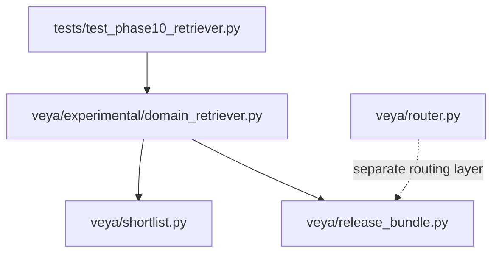
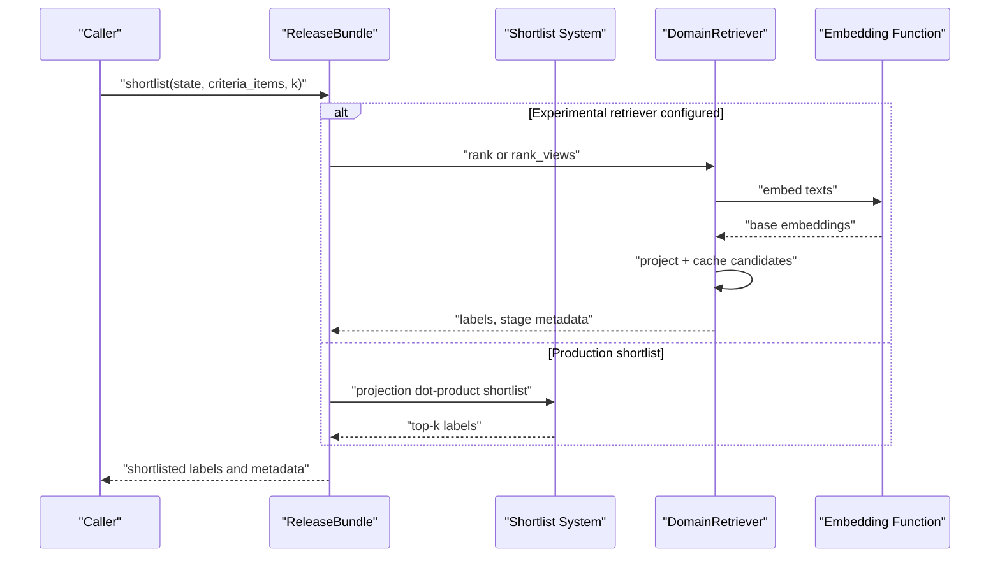
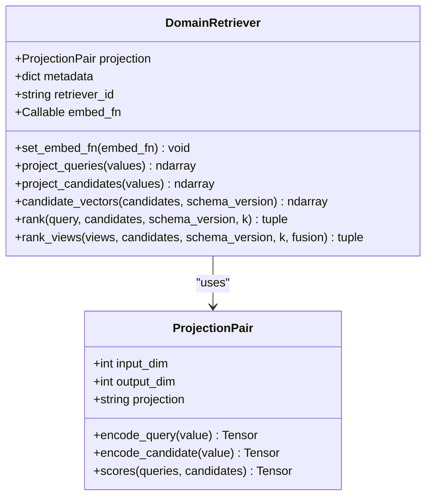
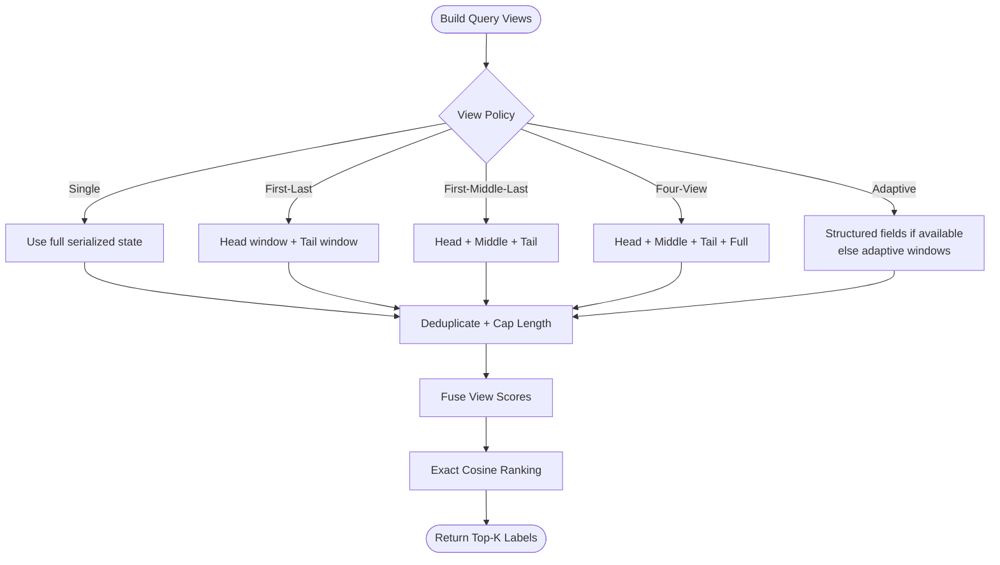
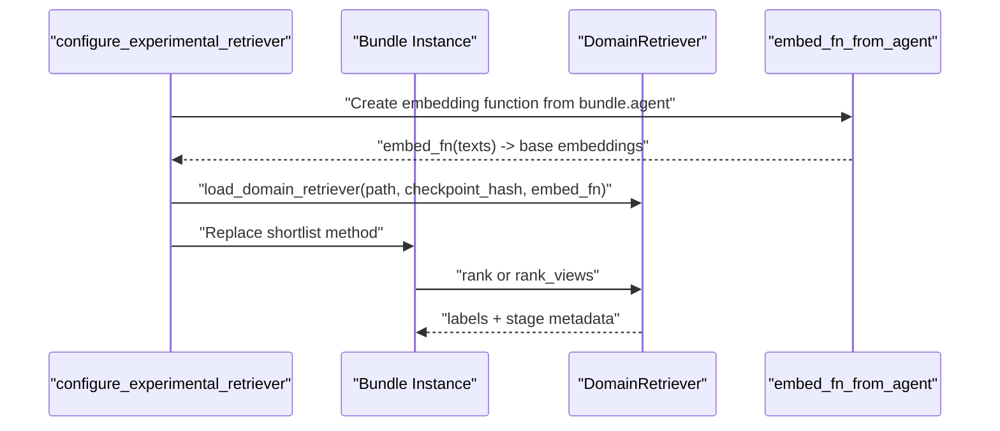
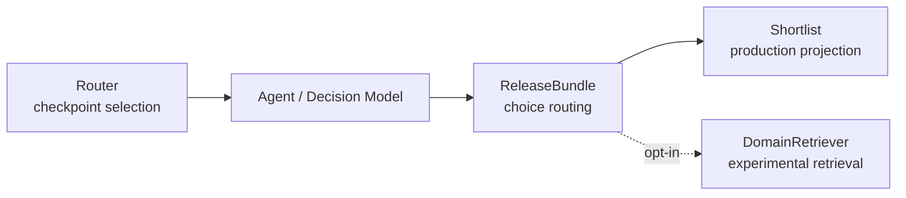
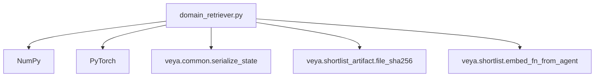

# Domain-Specific Retrieval

<cite>
**Referenced Files in This Document**
- [domain_retriever.py](file://veya/experimental/domain_retriever.py)
- [shortlist.py](file://veya/shortlist.py)
- [release_bundle.py](file://veya/release_bundle.py)
- [router.py](file://veya/router.py)
- [test_phase10_retriever.py](file://tests/test_phase10_retriever.py)
</cite>

## Table of Contents
1. [Introduction](#introduction)
2. [Project Structure](#project-structure)
3. [Core Components](#core-components)
4. [Architecture Overview](#architecture-overview)
5. [Detailed Component Analysis](#detailed-component-analysis)
6. [Dependency Analysis](#dependency-analysis)
7. [Performance Considerations](#performance-considerations)
8. [Troubleshooting Guide](#troubleshooting-guide)
9. [Conclusion](#conclusion)
10. [Appendices](#appendices)

## Introduction
This document explains Veya’s experimental domain-specific retrieval feature. It focuses on the `DomainRetriever`, which enables context-aware candidate shortlisting using a frozen shared backbone encoder plus small learned query and candidate projections. The retriever ranks choice candidates by exact cosine similarity, supports deterministic multi-view query fusion, caches candidate embeddings, and integrates with Veya’s shortlist optimization system through an opt-in bundle hook.

The feature is explicitly experimental: it does not replace the audited production routing or decision path unless you configure a bundle to use it. It is designed for high-cardinality choice questions where semantic similarity between the user state and candidate definitions can improve recall before downstream scoring.

## Project Structure
The domain-specific retrieval feature lives under the experimental package and integrates with the release bundle and shortlist pipeline.

**Diagram sources**
- [domain_retriever.py:1-560](file://veya/experimental/domain_retriever.py#L1-L560)
- [shortlist.py:1-322](file://veya/shortlist.py#L1-L322)
- [release_bundle.py:1-503](file://veya/release_bundle.py#L1-L503)
- [router.py:1-337](file://veya/router.py#L1-L337)
- [test_phase10_retriever.py:193-287](file://tests/test_phase10_retriever.py#L193-L287)

**Section sources**
- [domain_retriever.py:1-35](file://veya/experimental/domain_retriever.py#L1-L35)
- [shortlist.py:1-40](file://veya/shortlist.py#L1-L40)
- [release_bundle.py:127-198](file://veya/release_bundle.py#L127-L198)
- [router.py:123-143](file://veya/router.py#L123-L143)

## Core Components
- **DomainRetriever**: Loads a frozen bi-encoder projection pair, embeds queries and candidates, caches candidate vectors, and performs exact cosine ranking. It supports single-query ranking and multi-view ranking with deterministic fusion strategies.
- **ProjectionPair**: A lightweight PyTorch module that normalizes query and candidate embeddings and computes cosine-like scores via dot product after normalization.
- **configure_experimental_retriever**: Opt-in function that replaces a bundle instance’s shortlist method with domain-retriever-based ranking and attaches metadata about the experimental mode.
- **Shortlist integration**: The experimental retriever returns labels compatible with Veya’s shortlist contract, including stage metadata such as experimental retriever ID, number of views, and fusion strategy.
- **Production shortlist baseline**: The audited production path uses a learned K=8 projection and cached embedding + projection dot products; the experimental retriever is not the default production ranker.

**Section sources**
- [domain_retriever.py:258-402](file://veya/experimental/domain_retriever.py#L258-L402)
- [domain_retriever.py:463-559](file://veya/experimental/domain_retriever.py#L463-L559)
- [shortlist.py:43-55](file://veya/shortlist.py#L43-L55)
- [shortlist.py:151-203](file://veya/shortlist.py#L151-L203)
- [release_bundle.py:153-198](file://veya/release_bundle.py#L153-L198)

## Architecture Overview
The experimental retriever sits alongside the existing routing and shortlist systems rather than replacing them.

**Diagram sources**
- [domain_retriever.py:353-402](file://veya/experimental/domain_retriever.py#L353-L402)
- [domain_retriever.py:463-559](file://veya/experimental/domain_retriever.py#L463-L559)
- [release_bundle.py:172-198](file://veya/release_bundle.py#L172-L198)
- [shortlist.py:151-203](file://veya/shortlist.py#L151-L203)

## Detailed Component Analysis

### DomainRetriever and ProjectionPair
`DomainRetriever` encapsulates:
- A frozen `ProjectionPair` for query and candidate projections.
- Metadata describing the retriever artifact, including retriever ID, backbone, checkpoint hash, training datasets, held-out schemas, candidate/query representation, objective, and K.
- An optional embedding function that maps text strings to base encoder outputs.
- Candidate vector caching keyed by retriever ID, schema version, and content hash of candidate label-text pairs.
- Exact cosine ranking over projected vectors.

`ProjectionPair` provides:
- Shared or dual linear projections from a backbone dimension to a smaller output dimension.
- L2-normalized query and candidate encodings.
- Score computation as normalized dot product.

**Diagram sources**
- [domain_retriever.py:258-285](file://veya/experimental/domain_retriever.py#L258-L285)
- [domain_retriever.py:287-402](file://veya/experimental/domain_retriever.py#L287-L402)

**Section sources**
- [domain_retriever.py:258-402](file://veya/experimental/domain_retriever.py#L258-L402)

### Query View Construction and Fusion
The retriever supports multiple ways to construct query representations without treating untrusted candidate strings as instructions:

- **Generic view builder**: Extracts bounded lines, structured fields, and full serialized state into up to `max_views` unique views capped at `max_chars`.
- **Phase-11 view builder**: Produces label-blind windows such as head, middle, tail, one-third, two-thirds, and structured semantic fields, selected by policy.
- **Fusion strategies**: First view, element-wise max, mean across views, or reciprocal rank fusion (RRF).

**Diagram sources**
- [domain_retriever.py:37-97](file://veya/experimental/domain_retriever.py#L37-L97)
- [domain_retriever.py:133-204](file://veya/experimental/domain_retriever.py#L133-L204)
- [domain_retriever.py:207-226](file://veya/experimental/domain_retriever.py#L207-L226)
- [domain_retriever.py:373-402](file://veya/experimental/domain_retriever.py#L373-L402)

**Section sources**
- [domain_retriever.py:37-97](file://veya/experimental/domain_retriever.py#L37-L97)
- [domain_retriever.py:133-204](file://veya/experimental/domain_retriever.py#L133-L204)
- [domain_retriever.py:207-226](file://veya/experimental/domain_retriever.py#L207-L226)

### Integration with the Shortlist Optimization System
The experimental retriever integrates by replacing the bundle’s shortlist method. When configured:

1. The retriever builds candidate tuples from criteria items.
2. If the retriever metadata indicates naturalized labels, candidate text is derived from the label; otherwise, it prefers the criterion value when present.
3. Depending on the configured mode, it either:
   - Ranks a single serialized state.
   - Builds bounded query views and fuses their scores.
   - Uses Phase-11 noise-robust view policies.
4. It returns top-k labels and stage metadata including experimental retriever ID, number of views, and fusion strategy.

**Diagram sources**
- [domain_retriever.py:463-559](file://veya/experimental/domain_retriever.py#L463-L559)
- [shortlist.py:151-203](file://veya/shortlist.py#L151-L203)

**Section sources**
- [domain_retriever.py:463-559](file://veya/experimental/domain_retriever.py#L463-L559)
- [test_phase10_retriever.py:201-228](file://tests/test_phase10_retriever.py#L201-L228)

### Relationship with the Core Routing System
Veya’s core routing system selects among checkpoints based on language, script, task, or explicit configuration. It is separate from domain-specific retrieval:

- **Router**: Chooses between English, multilingual, and typed-decisions checkpoints.
- **DomainRetriever**: Operates inside a chosen checkpoint’s shortlist path to improve candidate selection for high-cardinality choices.

**Diagram sources**
- [router.py:123-143](file://veya/router.py#L123-L143)
- [router.py:257-331](file://veya/router.py#L257-L331)
- [release_bundle.py:127-198](file://veya/release_bundle.py#L127-L198)
- [domain_retriever.py:463-559](file://veya/experimental/domain_retriever.py#L463-L559)

**Section sources**
- [router.py:1-29](file://veya/router.py#L1-L29)
- [router.py:123-143](file://veya/router.py#L123-L143)
- [router.py:257-331](file://veya/router.py#L257-L331)
- [release_bundle.py:127-198](file://veya/release_bundle.py#L127-L198)

## Dependency Analysis
The experimental retriever depends on:
- NumPy and PyTorch for tensor operations and exact ranking.
- Veya’s serialization utilities for safe state handling.
- The shortlist artifact hashing utility for deterministic sidecar metadata.
- The production shortlist embedding helper when loading the retriever through a bundle.

**Diagram sources**
- [domain_retriever.py:10-24](file://veya/experimental/domain_retriever.py#L10-L24)
- [domain_retriever.py:476-487](file://veya/experimental/domain_retriever.py#L476-L487)

**Section sources**
- [domain_retriever.py:10-24](file://veya/experimental/domain_retriever.py#L10-L24)
- [domain_retriever.py:463-559](file://veya/experimental/domain_retriever.py#L463-L559)

## Performance Considerations
- **Candidate embedding caching**: Candidate vectors are cached per retriever ID, schema version, and content hash. Cache hits avoid recomputing embeddings and projections.
- **Exact cosine ranking**: After projection, ranking is a matrix multiplication followed by deterministic sorting. There is no approximate nearest neighbor index.
- **Multi-view overhead**: Multi-view modes compute embeddings for multiple query views and fuse scores. Use bounded view counts and character limits to control cost.
- **Batched embedding**: The embedding function processes texts in batches, reducing per-request overhead while staying compatible with the frozen backbone.
- **K constraint**: Phase-10 retrievers enforce K=8 during load validation, aligning with the production shortlist cardinality.

Optimization recommendations:
- Prefer single-view mode when query semantics are stable and compact.
- Use multi-view mode only when robustness to noisy or long states justifies additional embedding calls.
- Keep candidate lists within reasonable size; the retriever validates uniqueness and enforces bounds.
- Reuse the same retriever artifact and schema version to maximize cache hits.

**Section sources**
- [domain_retriever.py:330-351](file://veya/experimental/domain_retriever.py#L330-L351)
- [domain_retriever.py:353-402](file://veya/experimental/domain_retriever.py#L353-L402)
- [domain_retriever.py:443-460](file://veya/experimental/domain_retriever.py#L443-L460)
- [shortlist.py:151-203](file://veya/shortlist.py#L151-L203)

## Troubleshooting Guide
Common issues and resolutions:

- **Missing embedding function**: The retriever raises an error if no embedding function is set. Ensure `configure_experimental_retriever` is used with a valid bundle and artifact path.
- **Unsupported retriever format or checkpoint mismatch**: Loading requires matching format, checkpoint hash, and K=8. Verify the artifact belongs to the expected base checkpoint.
- **Invalid K parameter**: K must be a positive integer. Pass K=8 for Phase-10 compatibility.
- **Empty or invalid candidates**: Candidates must be non-empty and have unique labels.
- **Unknown fusion or view policy**: Only supported fusion strategies and Phase-11 view policies are accepted.
- **State bounds exceeded**: Phase-11 view construction enforces maximum state characters and view counts.

Diagnostic tips:
- Inspect the returned stage metadata to confirm experimental retriever ID, number of views, and fusion strategy.
- Compare cache hits and misses to determine whether candidate reuse is effective.
- Validate candidate schema version consistency across runs.

**Section sources**
- [domain_retriever.py:304-318](file://veya/experimental/domain_retriever.py#L304-L318)
- [domain_retriever.py:353-402](file://veya/experimental/domain_retriever.py#L353-L402)
- [domain_retriever.py:443-460](file://veya/experimental/domain_retriever.py#L443-L460)
- [domain_retriever.py:463-559](file://veya/experimental/domain_retriever.py#L463-L559)
- [test_phase10_retriever.py:193-287](file://tests/test_phase10_retriever.py#L193-L287)

## Conclusion
Veya’s experimental domain-specific retrieval adds a context-aware shortlist option built on a frozen shared backbone and small learned projections. It improves candidate recall for high-cardinality choices by ranking against semantic similarity, with deterministic fusion and caching for reproducibility and performance. It integrates cleanly with the shortlist system through an opt-in bundle hook and remains separate from the core checkpoint routing system. Use it when semantic matching between user state and candidate definitions matters more than the default packed or production shortlist paths, and validate its behavior against your schema and workload before relying on it in production.

## Appendices

### Configuration Examples

#### Enable Experimental Retriever Mode
Configure a bundle to use the experimental retriever instead of the current shortlist implementation.

- Set `retriever` to one of:
  - `current`: keep the audited bundle unchanged.
  - `phase10_domain_general`: single serialized-state ranking.
  - `phase10_domain_general_multiview`: bounded multi-view ranking with fusion.
  - `phase11_noise_robust`: Phase-11 view policies and fusion.
- Provide `artifact_path` pointing to a saved retriever artifact.
- Optionally set `candidate_schema_version` to control candidate embedding cache keys.

**Section sources**
- [domain_retriever.py:463-559](file://veya/experimental/domain_retriever.py#L463-L559)
- [test_phase10_retriever.py:201-228](file://tests/test_phase10_retriever.py#L201-L228)

#### Customize Similarity Thresholds and Ranking Behavior
The experimental retriever does not expose a similarity threshold filter; it returns top-k labels by exact cosine ranking. To influence ranking:

- Adjust `k` passed to the shortlist method.
- Tune view construction parameters:
  - `query_max_views`
  - `query_view_max_chars`
  - `query_window_chars`
  - `query_max_state_chars`
- Choose fusion strategies:
  - `first`
  - `max`
  - `mean`
  - `rrf`
- Select Phase-11 view policies:
  - `single`
  - `first_last`
  - `first_middle_last`
  - `four_view`
  - `adaptive`

**Section sources**
- [domain_retriever.py:37-97](file://veya/experimental/domain_retriever.py#L37-L97)
- [domain_retriever.py:133-204](file://veya/experimental/domain_retriever.py#L133-L204)
- [domain_retriever.py:207-226](file://veya/experimental/domain_retriever.py#L207-L226)
- [domain_retriever.py:373-402](file://veya/experimental/domain_retriever.py#L373-L402)

### When to Use Domain Retrieval Versus Other Strategies
- **Use domain retrieval** when:
  - Choice options are numerous and semantically distinct.
  - User state contains meaningful text that should match candidate definitions.
  - You want deterministic, reproducible shortlisting backed by a frozen backbone.
- **Use production shortlist** when:
  - You need the audited K=8 projection path integrated with calibrated temperatures and selective policies.
  - You prefer the release-managed bundle behavior without experimental overrides.
- **Use packed choice** when:
  - The number of options is small enough to fit within token budgets.
  - You want the model to score all options directly without shortlisting.

**Section sources**
- [shortlist.py:1-40](file://veya/shortlist.py#L1-L40)
- [release_bundle.py:127-198](file://veya/release_bundle.py#L127-L198)
- [domain_retriever.py:1-7](file://veya/experimental/domain_retriever.py#L1-L7)