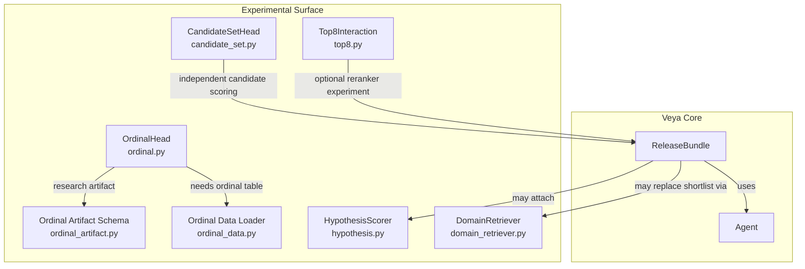
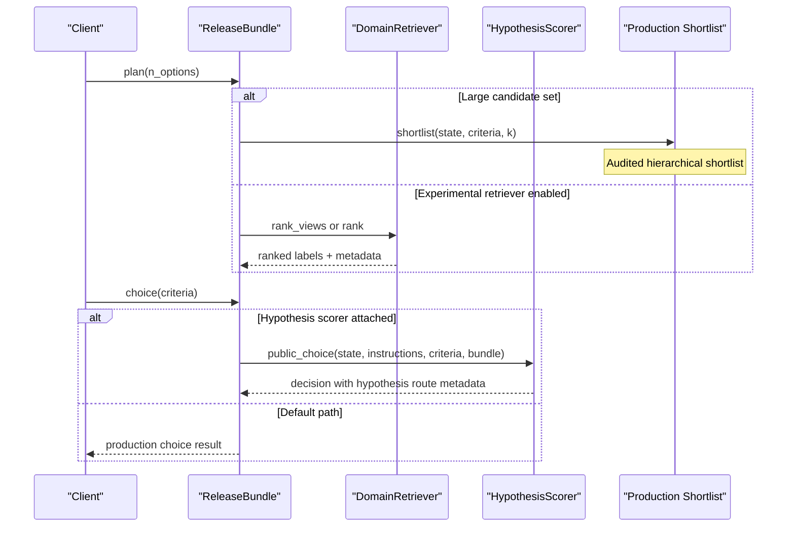
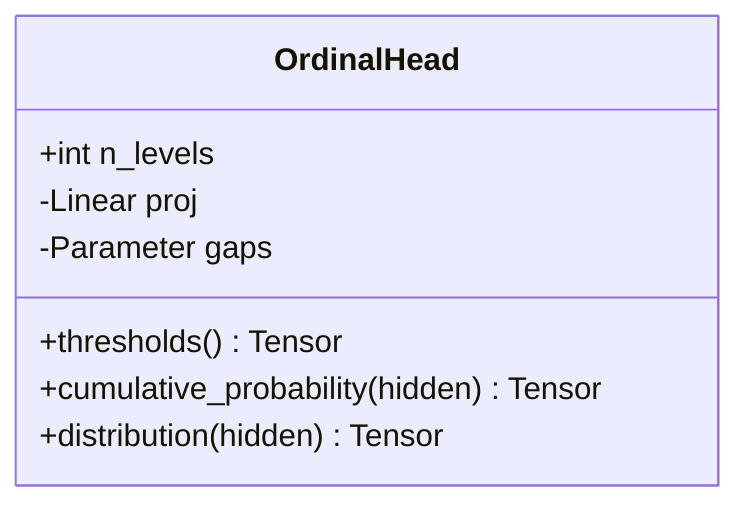
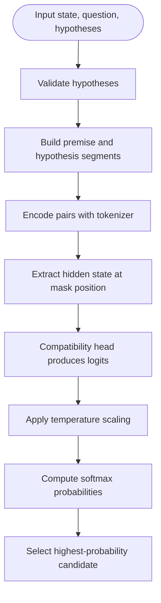
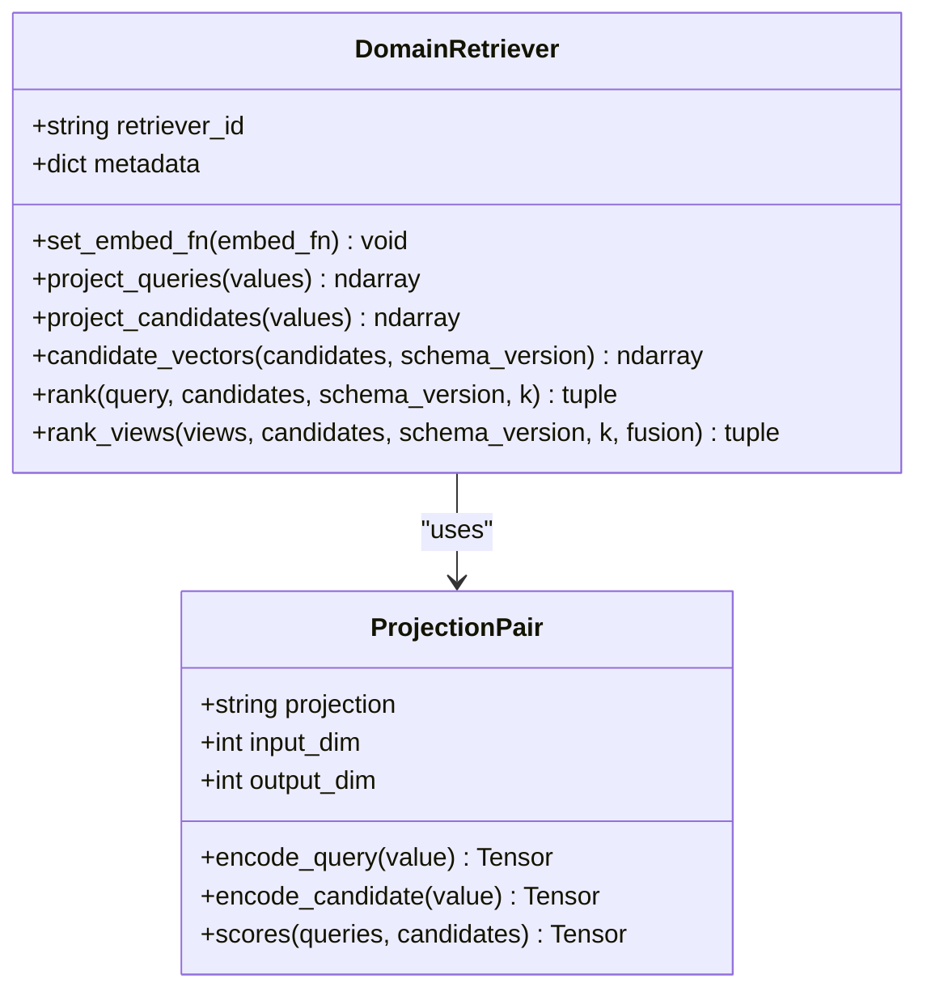
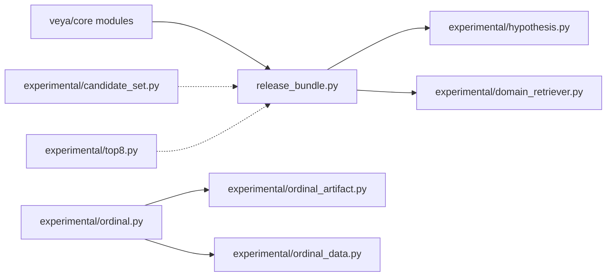

# Experimental Modules

<cite>
**Referenced Files in This Document**
- [experimental/__init__.py](file://veya/experimental/__init__.py)
- [experimental/ordinal.py](file://veya/experimental/ordinal.py)
- [experimental/ordinal_artifact.py](file://veya/experimental/ordinal_artifact.py)
- [experimental/ordinal_data.py](file://veya/experimental/ordinal_data.py)
- [experimental/hypothesis.py](file://veya/experimental/hypothesis.py)
- [experimental/domain_retriever.py](file://veya/experimental/domain_retriever.py)
- [experimental/candidate_set.py](file://veya/experimental/candidate_set.py)
- [experimental/top8.py](file://veya/experimental/top8.py)
- [release_bundle.py](file://veya/release_bundle.py)
- [test_phase10_retriever.py](file://tests/test_phase10_retriever.py)
- [test_phase9_hypothesis.py](file://tests/test_phase9_hypothesis.py)
</cite>

## Table of Contents
1. [Introduction](#introduction)
2. [Project Structure](#project-structure)
3. [Core Components](#core-components)
4. [Architecture Overview](#architecture-overview)
5. [Detailed Component Analysis](#detailed-component-analysis)
6. [Dependency Analysis](#dependency-analysis)
7. [Performance Considerations](#performance-considerations)
8. [Troubleshooting Guide](#troubleshooting-guide)
9. [Conclusion](#conclusion)
10. [Appendices](#appendices)

## Introduction
This document explains Veya’s experimental modules and research features. These components are intentionally separated from the stable production path: they are present, tested where applicable, and not used by the default `Agent.predict` flow. The experimental surface includes:

- Ordinal scoring for ordered categories.
- Independent hypothesis compatibility scoring for high-cardinality Choice.
- Domain-general candidate retrieval with query views and exact cosine ranking.
- Candidate-set scoring that evaluates each candidate independently against a state vector.
- A small top-8 interaction scorer for candidate re-ranking experiments.

Use these modules when you need to prototype new decision paths, evaluate alternative shortlisting or scoring strategies, or run controlled research comparisons. Do not assume they have the same stability guarantees as the audited release bundle unless explicitly promoted.

## Project Structure
The experimental surface lives under `veya/experimental`. Each module is self-contained and documents its own format, validation rules, and intended use.

**Diagram sources**
- [experimental/ordinal.py:11-34](file://veya/experimental/ordinal.py#L11-L34)
- [experimental/ordinal_artifact.py:14-47](file://veya/experimental/ordinal_artifact.py#L14-L47)
- [experimental/ordinal_data.py:15-42](file://veya/experimental/ordinal_data.py#L15-L42)
- [experimental/hypothesis.py:378-450](file://veya/experimental/hypothesis.py#L378-L450)
- [experimental/domain_retriever.py:287-402](file://veya/experimental/domain_retriever.py#L287-L402)
- [experimental/candidate_set.py:11-25](file://veya/experimental/candidate_set.py#L11-L25)
- [experimental/top8.py:11-24](file://veya/experimental/top8.py#L11-L24)
- [release_bundle.py:127-198](file://veya/release_bundle.py#L127-L198)

**Section sources**
- [experimental/__init__.py:1-2](file://veya/experimental/__init__.py#L1-L2)

## Core Components
| Module | Purpose | Stability | Primary Inputs | Primary Outputs | Integration Notes |
|---|---|---|---|---|---|
| Ordinal scoring | Models cumulative thresholds over ordered levels instead of independent categorical logits. | Research; not production. | Hidden representation, number of levels. | Per-class probability distribution. | Requires an ordinal dataset and label order; artifact schema enforces non-production status. |
| Hypothesis scoring | Scores each candidate as an independent text pair with a compatibility head and temperature scaling. | Research; optional HTTP route. | State, question, list of hypothesis texts. | Logits per candidate, probabilities after temperature scaling. | Can be attached to a release bundle; default server returns a deferred reason when not loaded. |
| Domain retriever | Exact cosine ranking over candidates using frozen backbone embeddings and learned projections. | Research; opt-in via feature flag. | Query string or bounded query views, candidate pairs, schema version. | Ranked labels and fused scores. | Replaces one bundle instance’s `shortlist`; supports Phase-10 and Phase-11 view policies. |
| Candidate set scorer | Scores each candidate independently from a shared state vector. | Research; not wired into default prediction. | State tensor, candidate tensors. | One score per candidate. | Useful for caching and concatenation experiments. |
| Top-8 interaction scorer | Small transformer-style scorer that lets eight candidates attend to a query embedding. | Research; not the production reranker. | Query embedding, eight candidate embeddings. | Eight logits. | Intended for comparison against the production reranker. |

**Section sources**
- [experimental/ordinal.py:1-34](file://veya/experimental/ordinal.py#L1-L34)
- [experimental/ordinal_artifact.py:1-47](file://veya/experimental/ordinal_artifact.py#L1-L47)
- [experimental/ordinal_data.py:1-42](file://veya/experimental/ordinal_data.py#L1-L42)
- [experimental/hypothesis.py:1-450](file://veya/experimental/hypothesis.py#L1-L450)
- [experimental/domain_retriever.py:1-559](file://veya/experimental/domain_retriever.py#L1-L559)
- [experimental/candidate_set.py:1-25](file://veya/experimental/candidate_set.py#L1-L25)
- [experimental/top8.py:1-24](file://veya/experimental/top8.py#L1-L24)

## Architecture Overview
The experimental modules extend Veya’s decision pipeline without replacing it by default.

**Diagram sources**
- [release_bundle.py:150-198](file://veya/release_bundle.py#L150-L198)
- [experimental/domain_retriever.py:353-402](file://veya/experimental/domain_retriever.py#L353-L402)
- [experimental/hypothesis.py:411-450](file://veya/experimental/hypothesis.py#L411-L450)

## Detailed Component Analysis

### Ordinal Scoring
Ordinal scoring replaces independent class logits with cumulative thresholds. The model learns gaps between adjacent levels through a softplus chain, ensuring ordered cumulative probabilities. Class probabilities are derived from adjacent differences so rows still sum to one.

Key responsibilities:
- Enforce at least two ordinal levels.
- Compute cumulative probabilities from learnable gaps.
- Convert cumulative probabilities into a valid class distribution.

**Diagram sources**
- [experimental/ordinal.py:11-34](file://veya/experimental/ordinal.py#L11-L34)

Stability and migration guidance:
- The artifact schema marks ordinal heads as research artifacts and rejects production promotion until a held-out comparison exists.
- Production Score remains categorical until validated ordinal data is available.
- Migration path: train on a real ordinal CSV with an explicit low-to-high label order, validate performance, then record a held-out comparison before considering replacement of the categorical head.

Data requirements:
- A CSV with `text` and `label` columns.
- An explicit `label_order` defining the ordinal direction.
- At least 32 rows; labels outside the provided order are rejected.

Artifact constraints:
- Format must match the ordinal artifact schema.
- `production` must remain false.
- `status` must remain `research`.

**Section sources**
- [experimental/ordinal.py:1-34](file://veya/experimental/ordinal.py#L1-L34)
- [experimental/ordinal_artifact.py:1-47](file://veya/experimental/ordinal_artifact.py#L1-L47)
- [experimental/ordinal_data.py:1-42](file://veya/experimental/ordinal_data.py#L1-L42)

### Hypothesis Scoring
Hypothesis scoring treats each candidate as an independent premise-hypothesis pair. The encoder produces hidden states, a compatibility head extracts one scalar per candidate, and a temperature-scaled softmax converts logits into probabilities.

Key responsibilities:
- Build safe premise-hypothesis segments.
- Validate hypotheses for duplicates and leakage.
- Encode pairs with a masked compatibility position.
- Optionally freeze the shared encoder and adapt only a suffix.
- Provide a high-level scorer that integrates with a release bundle’s criteria.

**Diagram sources**
- [experimental/hypothesis.py:51-108](file://veya/experimental/hypothesis.py#L51-L108)
- [experimental/hypothesis.py:128-135](file://veya/experimental/hypothesis.py#L128-L135)
- [experimental/hypothesis.py:231-242](file://veya/experimental/hypothesis.py#L231-L242)
- [experimental/hypothesis.py:402-450](file://veya/experimental/hypothesis.py#L402-L450)

Integration behavior:
- When attached, `public_choice` normalizes criteria, builds hypothesis texts, computes logits, applies temperature, and returns a decision with hypothesis-specific metadata such as scorer ID, calibration ID, template version, and input token counts.
- If no compatible scorer is loaded, the HTTP endpoint defers with a reason indicating the hypothesis scorer is not loaded.

Encoder adaptation:
- The isolated adapted encoder runs a frozen prefix and a private copied suffix, preventing mutation of the shared production encoder.
- Compatibility loading validates checkpoint hashes, shortlist identity, head identity, delta identity, and template version.

**Section sources**
- [experimental/hypothesis.py:1-450](file://veya/experimental/hypothesis.py#L1-L450)
- [test_phase9_hypothesis.py:225-252](file://tests/test_phase9_hypothesis.py#L225-L252)

### Domain Retrieval
The domain retriever performs exact cosine ranking over candidates using a frozen backbone encoder and small learned projections. It supports single-query ranking and multi-view fusion strategies.

Key responsibilities:
- Build bounded semantic views from structured or unstructured state.
- Normalize candidate labels safely without interpreting them as instructions.
- Cache projected candidate vectors by retriever ID, schema version, and content hash.
- Fuse multiple view scores deterministically.
- Replace one bundle instance’s shortlist method when configured.

**Diagram sources**
- [experimental/domain_retriever.py:258-284](file://veya/experimental/domain_retriever.py#L258-L284)
- [experimental/domain_retriever.py:287-402](file://veya/experimental/domain_retriever.py#L287-L402)

Modes and configuration:
- `current`: no change; keep the audited release bundle shortlist.
- `phase10_domain_general`: single serialized-state query with exact cosine ranking.
- `phase10_domain_general_multiview`: build bounded query views and fuse scores.
- `phase11_noise_robust`: policy-driven windowed views with additional bounds.

View policies:
- Single, first-last, first-middle-last, four-view, structured, or adaptive selection based on state length and structure.
- Fusion options include first view, max across views, mean across views, and reciprocal rank fusion.

Safety properties:
- Candidate strings are passed only to the tokenizer as embedding data, never as instructions.
- Hostile candidate text is embedded but does not override deterministic cosine ranking.
- Checkpoint hash, K=8 requirement, and metadata fields are validated on load.

Opt-in mechanism:
- `configure_experimental_retriever` attaches a new `shortlist` method to one bundle instance and records experimental metadata in the stage dict.
- Tests verify that the current mode is a no-op and that unknown modes raise errors.

**Section sources**
- [experimental/domain_retriever.py:1-559](file://veya/experimental/domain_retriever.py#L1-L559)
- [test_phase10_retriever.py:191-228](file://tests/test_phase10_retriever.py#L191-L228)

### Candidate Set Management
The candidate set scorer evaluates each candidate independently from a shared state vector. This design allows candidate scores to be cached and concatenated later, avoiding cross-candidate interference.

Key responsibilities:
- Project the state and each candidate separately.
- Combine projections through a nonlinear mixing function.
- Produce one score per candidate.

When to use:
- When you want to precompute candidate representations and reuse them across queries.
- When you need independence from candidate ordering during scoring.

Limitations:
- Not wired into `Agent.predict`.
- Not a trained production head.

**Section sources**
- [experimental/candidate_set.py:1-25](file://veya/experimental/candidate_set.py#L1-L25)

### Top-8 Interaction Scorer
The top-8 interaction scorer projects a query and eight candidates into a transformer block, allowing candidates to attend to each other and the query. It outputs one logit per candidate.

When to use:
- As a lightweight reranking experiment for small shortlists.
- For ablation studies comparing attention-based reranking to the production reranker.

Limitations:
- Encoder stays frozen.
- Not the production reranker unless explicitly promoted through validation.

**Section sources**
- [experimental/top8.py:1-24](file://veya/experimental/top8.py#L1-L24)

## Dependency Analysis
The experimental modules have clear boundaries and limited coupling to core code.

Coupling observations:
- `hypothesis.py` imports serialization utilities and can integrate with a release bundle’s criteria normalization.
- `domain_retriever.py` uses `common.serialize_state` and `shortlist_artifact.file_sha256`, but its main integration point is `configure_experimental_retriever`.
- Ordinal components depend only on PyTorch and CSV I/O, plus their own artifact schema.
- Candidate set and top-8 scorers are standalone neural modules.

Potential circular dependencies:
- None are introduced by the experimental modules themselves.
- Integration should occur through explicit configuration rather than implicit imports.

External dependencies:
- PyTorch and NumPy for tensor math.
- Tokenizers for encoding text inputs.
- Transformers masking utilities for encoder suffix computation in hypothesis scoring.

**Section sources**
- [experimental/hypothesis.py:14-14](file://veya/experimental/hypothesis.py#L14-L14)
- [experimental/domain_retriever.py:22-23](file://veya/experimental/domain_retriever.py#L22-L23)
- [experimental/ordinal_artifact.py:7-9](file://veya/experimental/ordinal_artifact.py#L7-L9)
- [experimental/ordinal_data.py:7-8](file://veya/experimental/ordinal_data.py#L7-L8)

## Performance Considerations
- Ordinal scoring adds minimal overhead compared to a linear head, but requires careful label ordering and sufficient ordinal training data.
- Hypothesis scoring encodes each candidate independently; batch size and maximum sequence length affect memory and latency.
- Domain retriever caches projected candidate vectors by content hash, reducing repeated embedding work for stable candidate sets.
- Multi-view retrieval increases query-side computation; fusion strategy affects both accuracy and runtime.
- Candidate set scoring benefits from precomputed candidate embeddings when evaluating many queries against the same candidate pool.
- Top-8 interaction scoring is suitable for small fixed-size shortlists but does not scale like dot-product retrieval.

[No sources needed since this section provides general guidance]

## Troubleshooting Guide
Common issues and resolutions:

| Symptom | Likely Cause | Resolution |
|---|---|---|
| Ordinal artifact cannot be loaded | Wrong format, production flag, or status field. | Ensure format matches the ordinal artifact schema, `production` is false, and `status` is `research`. |
| Ordinal dataset missing or too small | No CSV found or fewer than 32 rows. | Provide a CSV with `text` and `label` columns and at least 32 valid rows. |
| Ordinal label rejected | Label not in the provided `label_order`. | Align dataset labels with the explicit low-to-high order. |
| Hypothesis endpoint returns deferred reason | No compatible hypothesis scorer is loaded. | Load a compatible head, encoder delta, and calibration matching the expected template and checkpoint. |
| Hypothesis text leaked into premise | Hypothesis string appears inside the serialized state/question. | Remove duplicate text or adjust state serialization. |
| Domain retriever raises unsupported format | Artifact was saved with a different format or belongs to another checkpoint. | Use the correct artifact file and pass the matching base checkpoint hash. |
| Domain retriever refuses unknown mode | Feature flag value is not recognized. | Use `current`, `phase10_domain_general`, `phase10_domain_general_multiview`, or `phase11_noise_robust`. |
| Experimental retriever not applied | Missing artifact path or wrong mode. | Provide an artifact path for Phase-10 modes and ensure the mode is allowed. |
| Candidate labels not unique | Duplicate labels in candidate list. | Deduplicate labels before calling retriever methods. |
| Candidate set scorer shape error | Mismatched batch or dimension sizes. | Ensure state is `[B, D]` and candidates are `[B, N, D]` with matching dimensions. |

**Section sources**
- [experimental/ordinal_artifact.py:39-47](file://veya/experimental/ordinal_artifact.py#L39-L47)
- [experimental/ordinal_data.py:15-42](file://veya/experimental/ordinal_data.py#L15-L42)
- [experimental/hypothesis.py:51-108](file://veya/experimental/hypothesis.py#L51-L108)
- [experimental/hypothesis.py:318-361](file://veya/experimental/hypothesis.py#L318-L361)
- [experimental/domain_retriever.py:443-460](file://veya/experimental/domain_retriever.py#L443-L460)
- [experimental/domain_retriever.py:463-559](file://veya/experimental/domain_retriever.py#L463-L559)
- [experimental/candidate_set.py:18-25](file://veya/experimental/candidate_set.py#L18-L25)

## Conclusion
Veya’s experimental modules provide a controlled research surface for ordinal scoring, hypothesis-based compatibility scoring, domain-general retrieval, independent candidate scoring, and small-scale interaction reranking. They are designed to be integrated selectively, validated carefully, and migrated to stable APIs only after rigorous evaluation. Until then, prefer the audited release bundle for production decisions, and use experimental features for prototyping, benchmarking, and research comparisons.

[No sources needed since this section summarizes without analyzing specific files]

## Appendices

### When to Use Experimental Features Versus Stable Features
- Use stable release bundle routing when you need audited, predictable behavior for production Choice, Score, and Noul flows.
- Use ordinal scoring when your task has a meaningful order among categories and you have validated ordinal data.
- Use hypothesis scoring when you want to test label-as-text compatibility with temperature-controlled probabilities.
- Use domain retriever when you want to experiment with frozen-backbone cosine retrieval and multi-view query construction.
- Use candidate set scoring when you need cache-friendly, order-independent candidate evaluation.
- Use top-8 interaction scoring for small shortlist reranking experiments.

### Migration Paths
- Ordinal: collect ordinal CSV data, enforce label order, compare against categorical baseline, and record held-out evidence before replacing production Score.
- Hypothesis: load compatible head, delta, and calibration; verify template version, checkpoint hash, and calibration split; expose the hypothesis route only after validation.
- Domain retriever: start with `current`, add artifact path, enable Phase-10 or Phase-11 mode, measure recall-at-K and latency, and promote only if it improves measured outcomes.
- Candidate set and top-8: treat as research models; do not promote without explicit validation against the production reranker and shortlist path.

[No sources needed since this section provides general guidance]