# Hypothesis Testing Framework

<cite>
**Referenced Files in This Document**   
- [hypothesis.py](file://veya/experimental/hypothesis.py)
- [server.py](file://veya/server.py)
- [release_bundle.py](file://veya/release_bundle.py)
- [run_phase9_hypothesis.py](file://research/veyabench/run_phase9_hypothesis.py)
- [test_phase9_hypothesis.py](file://tests/test_phase9_hypothesis.py)
</cite>

## Table of Contents
1. [Introduction](#introduction)
2. [Project Structure](#project-structure)
3. [Core Components](#core-components)
4. [Architecture Overview](#architecture-overview)
5. [Detailed Component Analysis](#detailed-component-analysis)
6. [Dependency Analysis](#dependency-analysis)
7. [Performance Considerations](#performance-considerations)
8. [Troubleshooting Guide](#troubleshooting-guide)
9. [Conclusion](#conclusion)
10. [Appendices](#appendices)

## Introduction
This document explains Veya’s hypothesis testing experimental framework and how it enables statistical validation of model decisions for A/B-style comparisons. The framework evaluates each candidate as an independent hypothesis paired with the input state, then converts compatibility scores into calibrated probabilities. It is designed to complement the existing packed Choice path and shortlist routing, allowing researchers to validate whether a hypothesis-based scorer can match or improve upon the production control without mutating shared encoder weights.

The documentation covers:
- How hypothesis pairs are constructed and scored.
- The `HypothesisScorer` class and its configuration options.
- Calibration, temperature scaling, and result interpretation.
- Integration with the HTTP server and release bundle routing.
- Practical examples for setting up, running, and analyzing experiments.
- Current limitations and planned improvements inferred from the implementation.

## Project Structure
The hypothesis testing framework lives under the experimental module and integrates with the HTTP server and release bundle system:

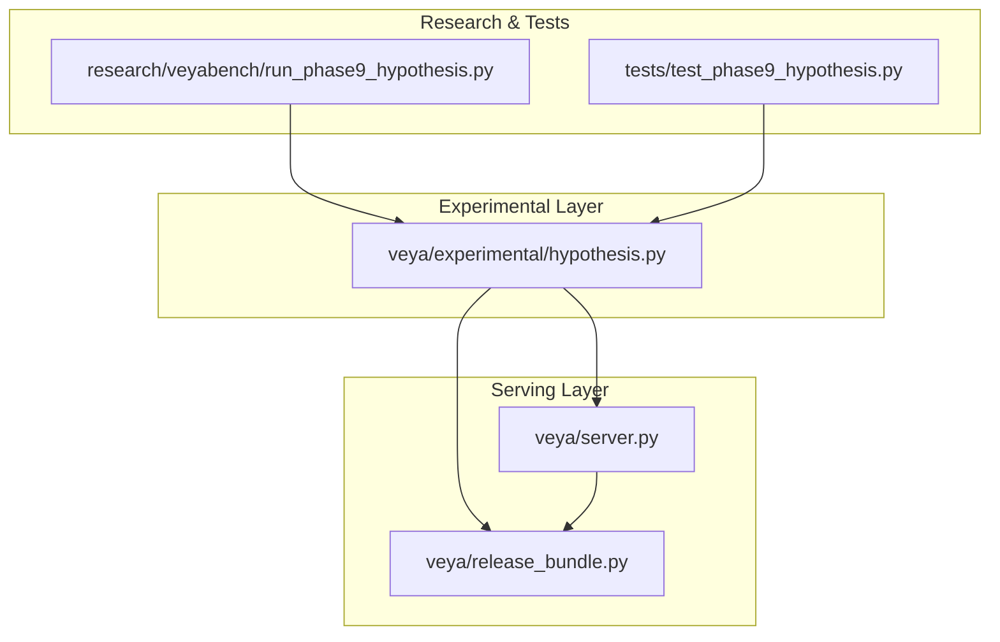

**Diagram sources**
- [hypothesis.py:1-451](file://veya/experimental/hypothesis.py#L1-L451)
- [server.py:137-243](file://veya/server.py#L137-L243)
- [release_bundle.py:127-392](file://veya/release_bundle.py#L127-L392)
- [run_phase9_hypothesis.py:1-800](file://research/veyabench/run_phase9_hypothesis.py#L1-L800)
- [test_phase9_hypothesis.py:1-394](file://tests/test_phase9_hypothesis.py#L1-L394)

**Section sources**
- [hypothesis.py:1-451](file://veya/experimental/hypothesis.py#L1-L451)
- [server.py:137-243](file://veya/server.py#L137-L243)
- [release_bundle.py:127-392](file://veya/release_bundle.py#L127-L392)
- [run_phase9_hypothesis.py:1-800](file://research/veyabench/run_phase9_hypothesis.py#L1-L800)
- [test_phase9_hypothesis.py:1-394](file://tests/test_phase9_hypothesis.py#L1-L394)

## Core Components
The core components include:
- Pair construction utilities that build premise-hypothesis inputs.
- Compatibility scoring over a masked token position.
- An isolated adapted encoder wrapper that avoids mutating shared encoder weights.
- The `HypothesisScorer`, which exposes inference and public-choice behavior.
- Calibration record validation and loading helpers.
- Server integration endpoints for experimental hypothesis routes.
- Release bundle routing that selects between packed, reranker, and hypothesis paths.

Key responsibilities:
- Ensure hypothesis text does not leak into the premise.
- Validate duplicate hypotheses and tokenizer requirements.
- Compute per-candidate logits and convert them to probabilities using temperature.
- Provide deterministic permutation-invariant scoring across sibling candidates.
- Expose a stable interface for A/B comparison through HTTP endpoints.

**Section sources**
- [hypothesis.py:22-108](file://veya/experimental/hypothesis.py#L22-L108)
- [hypothesis.py:111-168](file://veya/experimental/hypothesis.py#L111-L168)
- [hypothesis.py:171-242](file://veya/experimental/hypothesis.py#L171-L242)
- [hypothesis.py:245-284](file://veya/experimental/hypothesis.py#L245-L284)
- [hypothesis.py:287-361](file://veya/experimental/hypothesis.py#L287-L361)
- [hypothesis.py:378-451](file://veya/experimental/hypothesis.py#L378-L451)
- [server.py:137-243](file://veya/server.py#L137-L243)
- [release_bundle.py:208-258](file://veya/release_bundle.py#L208-L258)

## Architecture Overview
The hypothesis testing framework integrates at two levels:
1. Inference layer: `HypothesisScorer` computes compatibility logits for each candidate hypothesis and returns calibrated probabilities.
2. Routing layer: `ReleaseBundle.score_choice` chooses between packed Choice, reranker, or hypothesis scoring based on the number of candidates and whether a hypothesis scorer is attached.

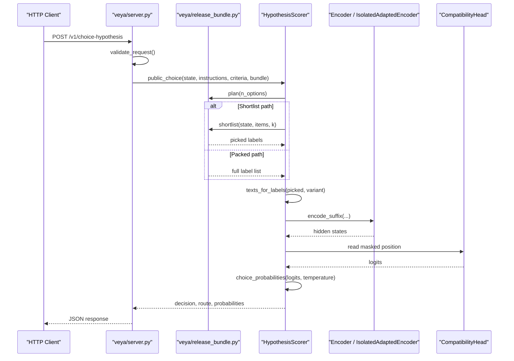

**Diagram sources**
- [server.py:196-213](file://veya/server.py#L196-L213)
- [release_bundle.py:208-258](file://veya/release_bundle.py#L208-L258)
- [hypothesis.py:378-451](file://veya/experimental/hypothesis.py#L378-L451)
- [hypothesis.py:200-242](file://veya/experimental/hypothesis.py#L200-L242)

## Detailed Component Analysis

### Hypothesis Text Construction and Validation
Hypothesis text generation supports three variants:
- H0: direct label statement.
- H1: naturalized label phrasing.
- H2: requires an authoritative definition and rejects contrastive boundary text.

Validation ensures:
- At least one hypothesis is provided.
- No empty or normalized-duplicate hypothesis strings.
- Tokenizer mask handling prevents leakage of hypothesis text into the premise.

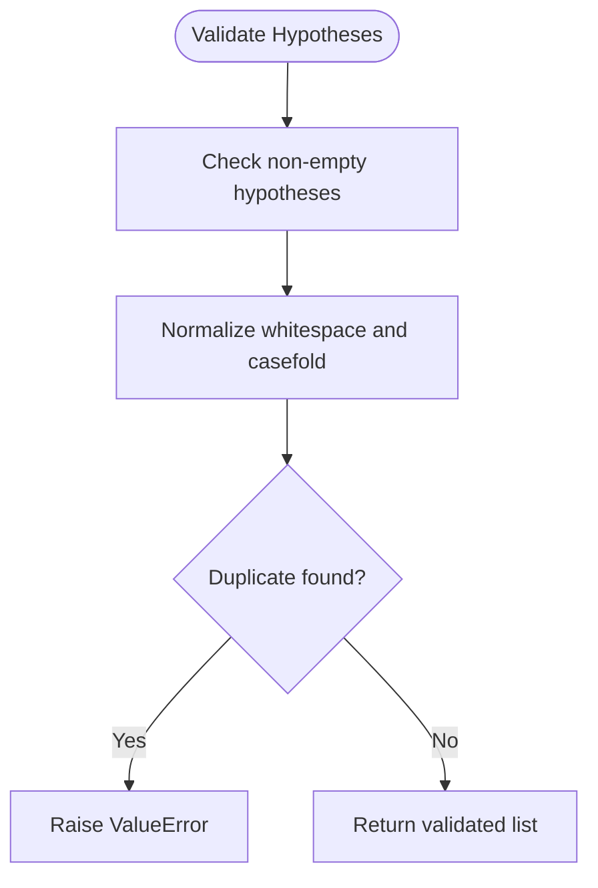

**Diagram sources**
- [hypothesis.py:51-63](file://veya/experimental/hypothesis.py#L51-L63)

**Section sources**
- [hypothesis.py:22-48](file://veya/experimental/hypothesis.py#L22-L48)
- [hypothesis.py:51-63](file://veya/experimental/hypothesis.py#L51-L63)

### Pair Encoding and Mask Positioning
Pairs are built as `[CLS] premise [SEP] [MASK] hypothesis [SEP]`. The masked token position is used as the compatibility readout. Premise tokens may be truncated to fit the budget; hypothesis tokens are preserved. Attention masks cover padded positions.

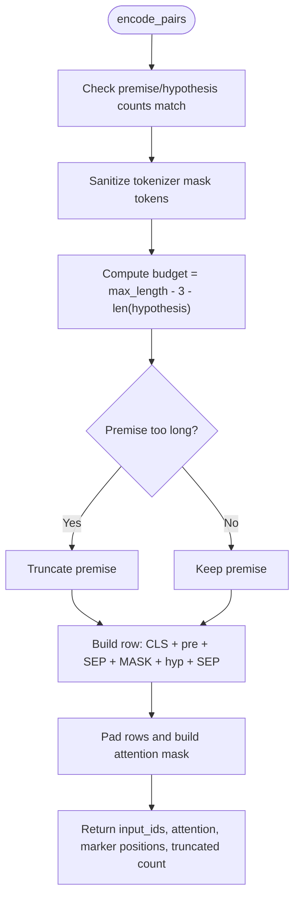

**Diagram sources**
- [hypothesis.py:73-108](file://veya/experimental/hypothesis.py#L73-L108)

**Section sources**
- [hypothesis.py:73-108](file://veya/experimental/hypothesis.py#L73-L108)

### Compatibility Head and Probability Conversion
The compatibility head applies LayerNorm followed by a linear projection to produce one scalar per pair. Probabilities are computed via softmax over logits divided by a positive temperature. Temperature does not change argmax but redistributes probability mass.

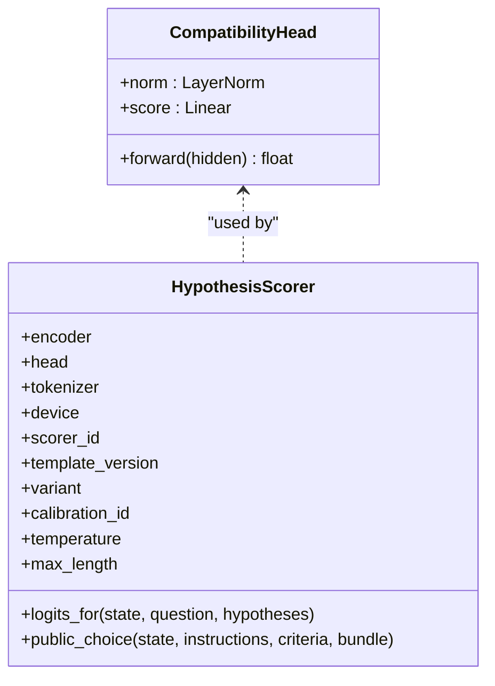

**Diagram sources**
- [hypothesis.py:111-135](file://veya/experimental/hypothesis.py#L111-L135)
- [hypothesis.py:378-451](file://veya/experimental/hypothesis.py#L378-L451)

**Section sources**
- [hypothesis.py:111-135](file://veya/experimental/hypothesis.py#L111-L135)
- [hypothesis.py:378-451](file://veya/experimental/hypothesis.py#L378-L451)

### Isolated Adapted Encoder
The isolated adapted encoder wraps a base encoder and runs only a suffix of layers plus final normalization. This design avoids mutating shared encoder weights during hypothesis scoring.

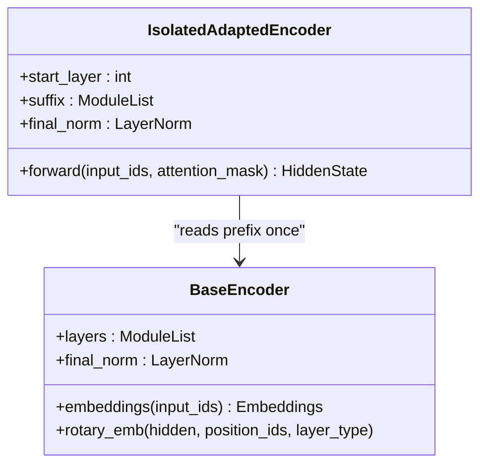

**Diagram sources**
- [hypothesis.py:138-197](file://veya/experimental/hypothesis.py#L138-L197)

**Section sources**
- [hypothesis.py:138-197](file://veya/experimental/hypothesis.py#L138-L197)

### Group Scoring and Permutation Invariance
Group scoring flattens multiple hypothesis lists, encodes them in batches, and returns one logit tensor per group. Scores are independent of sibling order; permutations are restored using `remap_scores`.

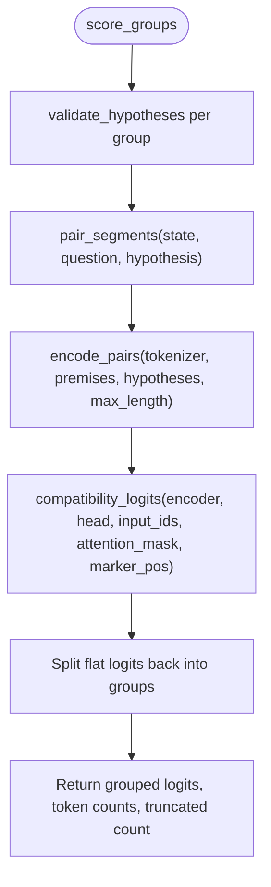

**Diagram sources**
- [hypothesis.py:245-279](file://veya/experimental/hypothesis.py#L245-L279)
- [hypothesis.py:368-375](file://veya/experimental/hypothesis.py#L368-L375)

**Section sources**
- [hypothesis.py:245-279](file://veya/experimental/hypothesis.py#L245-L279)
- [hypothesis.py:368-375](file://veya/experimental/hypothesis.py#L368-L375)

### HypothesisScorer Class
`HypothesisScorer` provides:
- `logits_for`: compute per-candidate logits for a single state and set of hypotheses.
- `public_choice`: integrate with the release bundle to select either shortlist or packed path, generate hypothesis texts, compute probabilities, and return a structured decision payload.

Configuration options include:
- `scorer_id`: identifier for the scorer instance.
- `template_version`: version tag for template compatibility.
- `variant`: hypothesis variant (e.g., H0).
- `calibration_id`: calibration identity string.
- `temperature`: positive temperature for probability scaling.
- `max_length`: maximum sequence length for pair encoding.

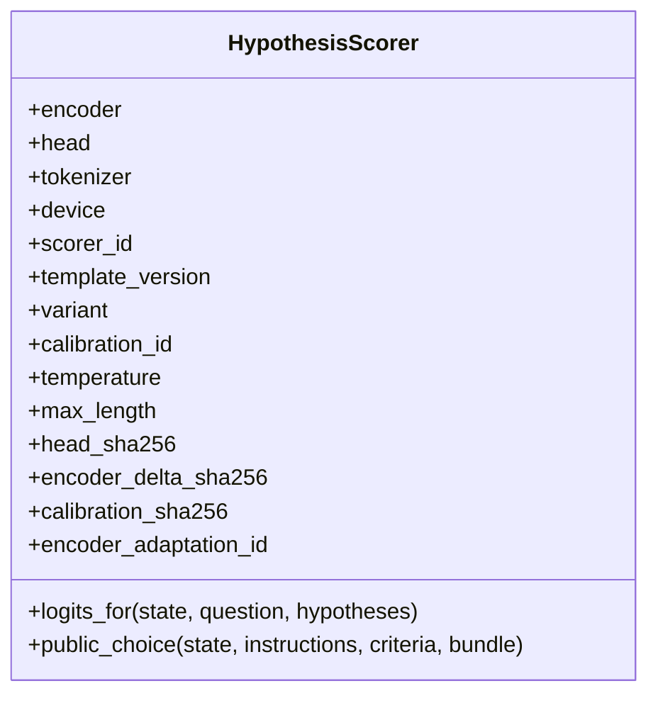

**Diagram sources**
- [hypothesis.py:378-451](file://veya/experimental/hypothesis.py#L378-L451)

**Section sources**
- [hypothesis.py:378-451](file://veya/experimental/hypothesis.py#L378-L451)

### Calibration Record Validation and Loading
Calibration records are validated against required fields, allowed splits, K=8 constraints, route identity, method type, temperature positivity, checkpoint hash, shortlist hash, head/delta hashes, and template version. Loading validates format, metadata, delta shape, and attaches SHA256 identifiers to the scorer.

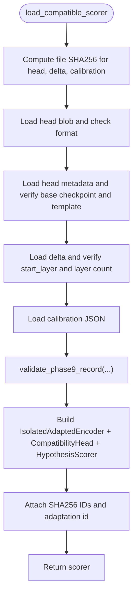

**Diagram sources**
- [hypothesis.py:287-361](file://veya/experimental/hypothesis.py#L287-L361)

**Section sources**
- [hypothesis.py:287-361](file://veya/experimental/hypothesis.py#L287-L361)

### HTTP Server Integration
The server exposes:
- `/version`: includes hypothesis scorer metadata when attached.
- `/v1/choice-hypothesis`: calls `HypothesisScorer.public_choice`.
- `/v1/choice-compare`: compares packed and hypothesis routes side-by-side.

If no hypothesis scorer is attached, `/v1/choice-hypothesis` returns a 404 with `defer_reason: hypothesis_not_loaded`.

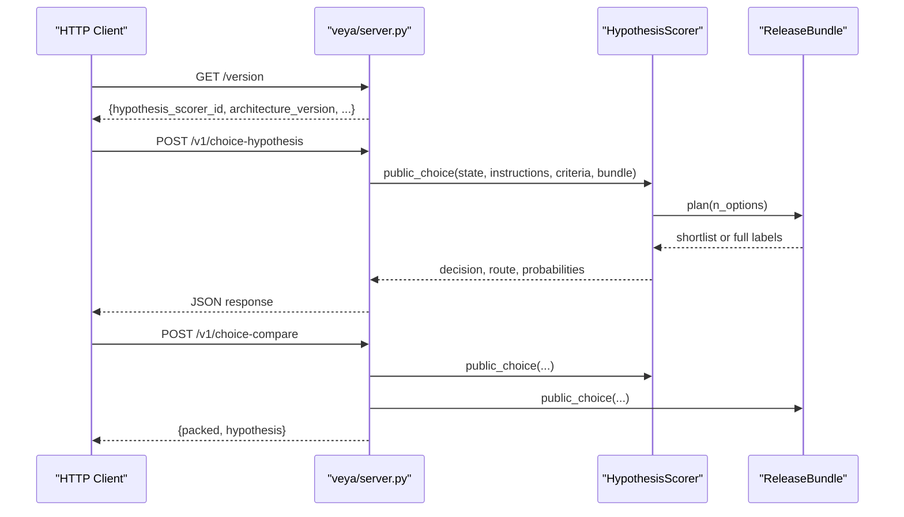

**Diagram sources**
- [server.py:57-111](file://veya/server.py#L57-L111)
- [server.py:196-213](file://veya/server.py#L196-L213)

**Section sources**
- [server.py:57-111](file://veya/server.py#L57-L111)
- [server.py:196-213](file://veya/server.py#L196-L213)

### Release Bundle Routing and Model Selection
`ReleaseBundle.score_choice` selects the scoring path:
- If hypothesis scorer is attached and path is shortlist, use hypothesis logits and set route name to `shortlist_k8_hypothesis_hce2`.
- Else if reranker exists, use reranker logits.
- Else use packed Choice logits.

Temperature selection depends on path:
- Packed uses bucketed temperature.
- Shortlist uses route calibration temperature unless overridden by hypothesis scorer.

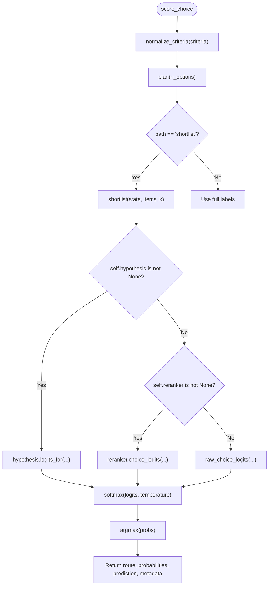

**Diagram sources**
- [release_bundle.py:208-258](file://veya/release_bundle.py#L208-L258)

**Section sources**
- [release_bundle.py:208-258](file://veya/release_bundle.py#L208-L258)

### Experimental Workflow and A/B Comparison
The research script demonstrates:
- Building training corpora from natural top-8 and forced-positive cases.
- Training heads and optional encoder suffixes.
- Permutation gates to ensure stability.
- Security and paraphrase robustness checks.
- Latency comparisons between packed and hypothesis paths.
- Integration tests verifying manifest attachment and HTTP behavior.

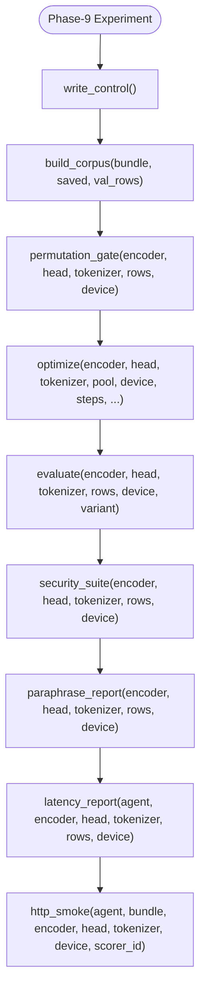

**Diagram sources**
- [run_phase9_hypothesis.py:184-245](file://research/veyabench/run_phase9_hypothesis.py#L184-L245)
- [run_phase9_hypothesis.py:280-337](file://research/veyabench/run_phase9_hypothesis.py#L280-L337)
- [run_phase9_hypothesis.py:340-384](file://research/veyabench/run_phase9_hypothesis.py#L340-L384)
- [run_phase9_hypothesis.py:405-503](file://research/veyabench/run_phase9_hypothesis.py#L405-L503)
- [run_phase9_hypothesis.py:506-522](file://research/veyabench/run_phase9_hypothesis.py#L506-L522)
- [run_phase9_hypothesis.py:630-739](file://research/veyabench/run_phase9_hypothesis.py#L630-L739)
- [run_phase9_hypothesis.py:792-800](file://research/veyabench/run_phase9_hypothesis.py#L792-L800)

**Section sources**
- [run_phase9_hypothesis.py:184-245](file://research/veyabench/run_phase9_hypothesis.py#L184-L245)
- [run_phase9_hypothesis.py:280-337](file://research/veyabench/run_phase9_hypothesis.py#L280-L337)
- [run_phase9_hypothesis.py:340-384](file://research/veyabench/run_phase9_hypothesis.py#L340-L384)
- [run_phase9_hypothesis.py:405-503](file://research/veyabench/run_phase9_hypothesis.py#L405-L503)
- [run_phase9_hypothesis.py:506-522](file://research/veyabench/run_phase9_hypothesis.py#L506-L522)
- [run_phase9_hypothesis.py:630-739](file://research/veyabench/run_phase9_hypothesis.py#L630-L739)
- [run_phase9_hypothesis.py:792-800](file://research/veyabench/run_phase9_hypothesis.py#L792-L800)

## Dependency Analysis
The hypothesis framework depends on:
- Tokenizer utilities for pair encoding.
- PyTorch modules for encoder and head operations.
- Release bundle routing for path selection and temperature application.
- Server handlers for HTTP exposure.
- Research scripts for training, evaluation, and integration verification.

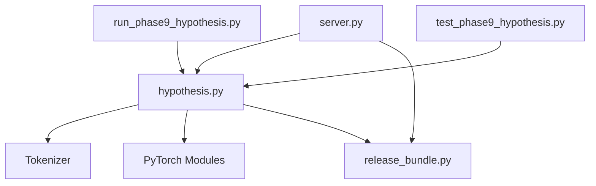

**Diagram sources**
- [hypothesis.py:1-451](file://veya/experimental/hypothesis.py#L1-L451)
- [server.py:137-243](file://veya/server.py#L137-L243)
- [release_bundle.py:127-392](file://veya/release_bundle.py#L127-L392)
- [run_phase9_hypothesis.py:1-800](file://research/veyabench/run_phase9_hypothesis.py#L1-L800)
- [test_phase9_hypothesis.py:1-394](file://tests/test_phase9_hypothesis.py#L1-L394)

**Section sources**
- [hypothesis.py:1-451](file://veya/experimental/hypothesis.py#L1-L451)
- [server.py:137-243](file://veya/server.py#L137-L243)
- [release_bundle.py:127-392](file://veya/release_bundle.py#L127-L392)
- [run_phase9_hypothesis.py:1-800](file://research/veyabench/run_phase9_hypothesis.py#L1-L800)
- [test_phase9_hypothesis.py:1-394](file://tests/test_phase9_hypothesis.py#L1-L394)

## Performance Considerations
- Pair encoding truncates premises to fit within `max_length`, preserving hypothesis tokens.
- Batched scoring reduces overhead for large candidate sets.
- Isolated adapted encoder avoids writing to shared encoder weights, preventing unintended side effects.
- Temperature scaling changes probability distribution without altering argmax decisions.
- Latency reports compare packed vs hypothesis paths and measure token usage.

[No sources needed since this section provides general guidance]

## Troubleshooting Guide
Common issues and resolutions:
- Empty or duplicate hypothesis text: ensure unique normalized strings and non-empty inputs.
- Missing pad token: provide a tokenizer with a defined pad token.
- Hypothesis leaking into premise: verify pair construction and avoid identical hypothesis strings in premise.
- Incompatible calibration record: check required fields, allowed splits, K=8 constraint, route identity, method type, temperature positivity, and matching hashes/template version.
- HTTP endpoint unavailable: attach a hypothesis scorer before calling `/v1/choice-hypothesis`; otherwise expect a 404 with `defer_reason: hypothesis_not_loaded`.

**Section sources**
- [hypothesis.py:51-63](file://veya/experimental/hypothesis.py#L51-L63)
- [hypothesis.py:73-108](file://veya/experimental/hypothesis.py#L73-L108)
- [hypothesis.py:287-361](file://veya/experimental/hypothesis.py#L287-L361)
- [server.py:196-213](file://veya/server.py#L196-L213)

## Conclusion
Veya’s hypothesis testing framework provides a rigorous, statistically grounded approach to validating model decisions through independent candidate hypotheses. It integrates cleanly with the existing routing system, enabling A/B comparisons between packed Choice, reranker, and hypothesis scorers while preserving encoder integrity. Calibration and temperature scaling ensure interpretable probabilities, and server endpoints facilitate practical experimentation. Current limitations include strict template/version checks, fixed K=8 shortlist assumptions, and reliance on specific tokenizer configurations. Planned improvements could expand supported variants, relax rigid constraints where safe, and enhance diagnostic outputs for broader research workflows.

[No sources needed since this section summarizes without analyzing specific files]

## Appendices

### Practical Examples

#### Setting Up a Hypothesis Test
- Prepare a tokenizer and encoder compatible with the hypothesis scorer.
- Construct hypothesis texts using supported variants (H0/H1/H2).
- Validate hypotheses to avoid duplicates and empty entries.
- Optionally train a compatibility head and/or encoder suffix using the research script.

**Section sources**
- [hypothesis.py:22-48](file://veya/experimental/hypothesis.py#L22-L48)
- [hypothesis.py:51-63](file://veya/experimental/hypothesis.py#L51-L63)
- [run_phase9_hypothesis.py:405-503](file://research/veyabench/run_phase9_hypothesis.py#L405-L503)

#### Running an Experiment
- Use `HypothesisScorer.logits_for` to compute per-candidate logits.
- Apply temperature scaling via `choice_probabilities`.
- Compare results with packed Choice through `/v1/choice-compare`.

**Section sources**
- [hypothesis.py:378-451](file://veya/experimental/hypothesis.py#L378-L451)
- [server.py:196-213](file://veya/server.py#L196-L213)

#### Interpreting Statistical Significance
- Inspect probabilities and margins to assess confidence.
- Use permutation gates to verify stability across candidate orderings.
- Review security and paraphrase reports for robustness.

**Section sources**
- [run_phase9_hypothesis.py:340-384](file://research/veyabench/run_phase9_hypothesis.py#L340-L384)
- [run_phase9_hypothesis.py:630-739](file://research/veyabench/run_phase9_hypothesis.py#L630-L739)