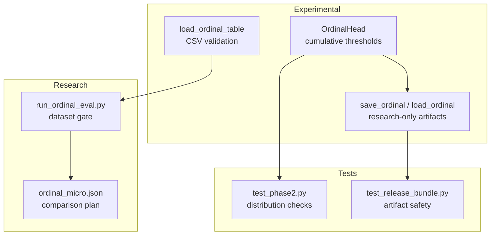
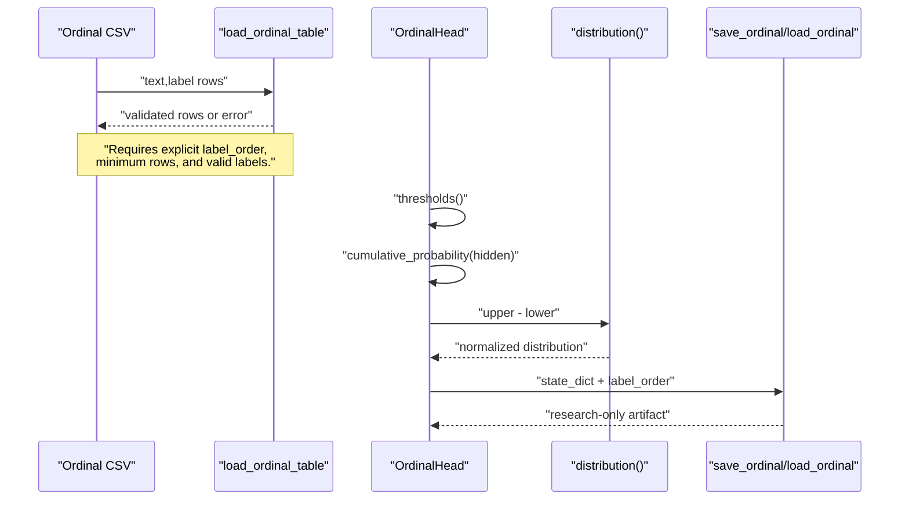
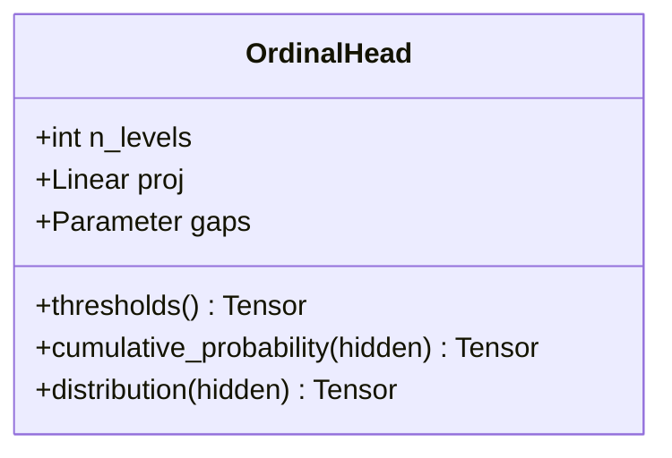
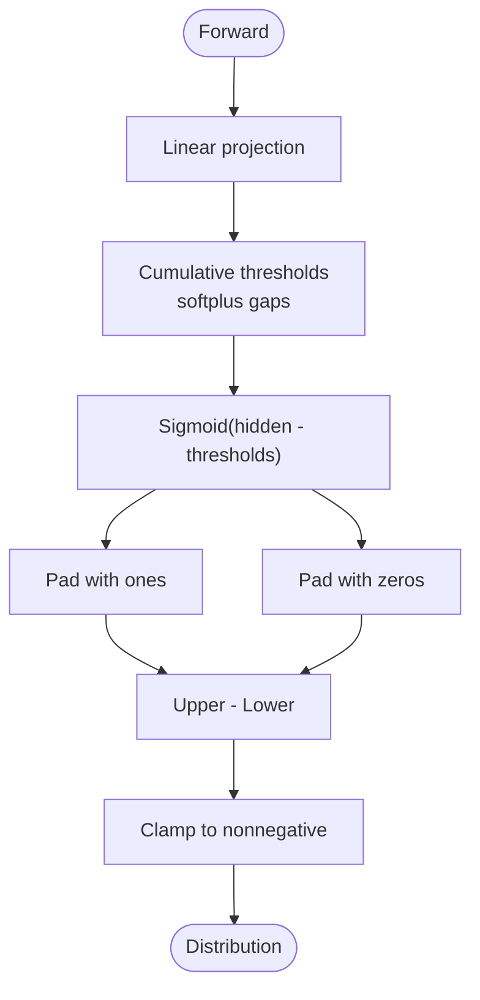
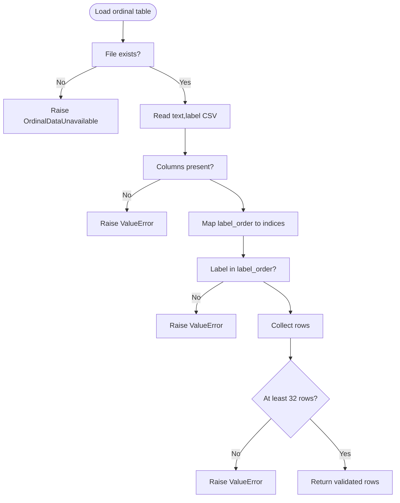
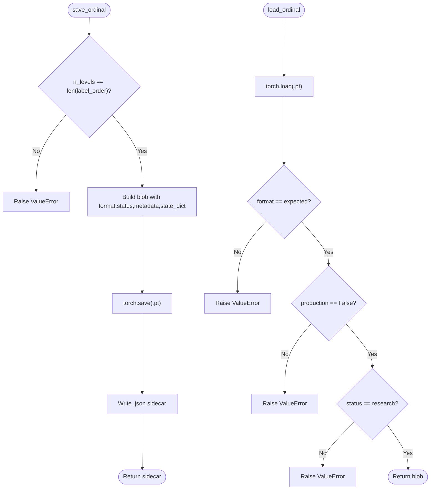
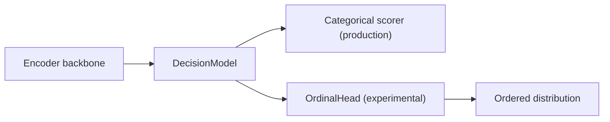
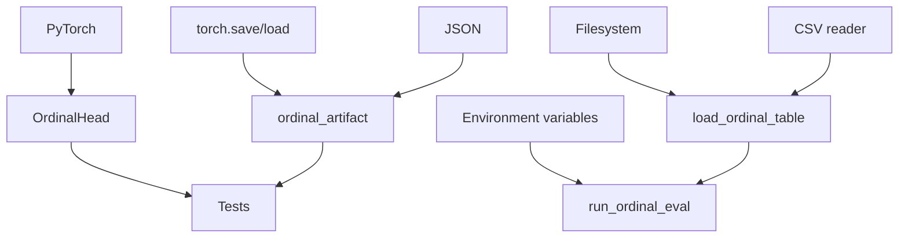

# Ordinal Scoring System

<cite>
**Referenced Files in This Document**
- [ordinal.py](file://veya/experimental/ordinal.py)
- [ordinal_data.py](file://veya/experimental/ordinal_data.py)
- [ordinal_artifact.py](file://veya/experimental/ordinal_artifact.py)
- [common.py](file://veya/common.py)
- [run_ordinal_eval.py](file://research/veyabench/run_ordinal_eval.py)
- [ordinal_micro.json](file://research/configs/ordinal_micro.json)
- [test_phase2.py](file://tests/test_phase2.py)
- [test_release_bundle.py](file://tests/test_release_bundle.py)
</cite>

## Table of Contents
1. [Introduction](#introduction)
2. [Project Structure](#project-structure)
3. [Core Components](#core-components)
4. [Architecture Overview](#architecture-overview)
5. [Detailed Component Analysis](#detailed-component-analysis)
6. [Dependency Analysis](#dependency-analysis)
7. [Performance Considerations](#performance-considerations)
8. [Troubleshooting Guide](#troubleshooting-guide)
9. [Conclusion](#conclusion)
10. [Appendices](#appendices)

## Introduction
This document explains Veya’s ordinal scoring experimental system. Ordinal scoring is an alternative to traditional categorical classification for Score-style tasks. Instead of treating each level as an independent class, it models a ranked ordering and outputs a probability distribution over ordered levels. The approach uses cumulative thresholds so that higher levels remain less likely than lower ones, while adjacent differences produce valid class probabilities.

The system is explicitly experimental:
- It is not used by the main agent prediction path.
- Production Score remains categorical until a reviewed comparison validates ordinal scoring.
- Ordinal artifacts are marked research-only and cannot be promoted to production through the artifact loader.

## Project Structure
The ordinal scoring feature lives under `veya/experimental` and is accompanied by evaluation and configuration files under `research`. Tests validate both the head behavior and artifact safety.

**Diagram sources**
- [ordinal.py:11-34](file://veya/experimental/ordinal.py#L11-L34)
- [ordinal_data.py:11-42](file://veya/experimental/ordinal_data.py#L11-L42)
- [ordinal_artifact.py:11-47](file://veya/experimental/ordinal_artifact.py#L11-L47)
- [run_ordinal_eval.py:12-24](file://research/veyabench/run_ordinal_eval.py#L12-L24)
- [ordinal_micro.json:1-7](file://research/configs/ordinal_micro.json#L1-L7)
- [test_phase2.py:159-167](file://tests/test_phase2.py#L159-L167)
- [test_release_bundle.py:94-121](file://tests/test_release_bundle.py#L94-L121)

**Section sources**
- [ordinal.py:1-35](file://veya/experimental/ordinal.py#L1-L35)
- [ordinal_data.py:1-43](file://veya/experimental/ordinal_data.py#L1-L43)
- [ordinal_artifact.py:1-48](file://veya/experimental/ordinal_artifact.py#L1-L48)
- [run_ordinal_eval.py:1-28](file://research/veyabench/run_ordinal_eval.py#L1-L28)
- [ordinal_micro.json:1-7](file://research/configs/ordinal_micro.json#L1-L7)
- [test_phase2.py:159-167](file://tests/test_phase2.py#L159-L167)
- [test_release_bundle.py:94-121](file://tests/test_release_bundle.py#L94-L121)

## Core Components
- Ordinal score head: Converts a hidden representation into a cumulative probability curve and then into a normalized distribution over ordered levels.
- Ordinal data loader: Loads a CSV with text and label columns, enforces an explicit low-to-high label order, and rejects missing or undersized datasets.
- Ordinal artifact manager: Saves and loads ordinal head state with format and status checks; prevents promotion to production.
- Evaluation gate: Requires environment variables pointing to a real ordinal dataset before running any ordinal evaluation.
- Configuration note: Records that ordinal scoring compares against the categorical softmax in the decision model scorer.

Key responsibilities:
- Maintain monotonicity across ordinal levels.
- Produce valid probability distributions.
- Keep ordinal scoring isolated from production inference.
- Provide safe round-trip serialization for research use.

**Section sources**
- [ordinal.py:11-34](file://veya/experimental/ordinal.py#L11-L34)
- [ordinal_data.py:15-42](file://veya/experimental/ordinal_data.py#L15-L42)
- [ordinal_artifact.py:14-47](file://veya/experimental/ordinal_artifact.py#L14-L47)
- [run_ordinal_eval.py:12-24](file://research/veyabench/run_ordinal_eval.py#L12-L24)
- [ordinal_micro.json:1-7](file://research/configs/ordinal_micro.json#L1-L7)

## Architecture Overview
Ordinal scoring is a replacement head for Score-style tasks. It does not replace the encoder or the broader decision model. The flow is:

1. A shared encoder produces a hidden vector.
2. The ordinal head maps the hidden vector to cumulative probabilities.
3. Adjacent differences yield a probability distribution over ordered levels.
4. Losses can compare reported distributions to target distributions.
5. Artifacts store only the ordinal head weights and metadata.

**Diagram sources**
- [ordinal_data.py:15-42](file://veya/experimental/ordinal_data.py#L15-L42)
- [ordinal.py:20-34](file://veya/experimental/ordinal.py#L20-L34)
- [ordinal_artifact.py:14-47](file://veya/experimental/ordinal_artifact.py#L14-L47)

## Detailed Component Analysis

### OrdinalHead
OrdinalHead implements a softplus chain of thresholds to keep cumulative probabilities ordered. Class probabilities are computed as adjacent differences of cumulative probabilities, ensuring nonnegative mass and row-wise normalization.

Behavioral guarantees verified by tests:
- Cumulative probabilities do not increase across levels.
- Distribution rows sum to one.
- No negative probability mass.

**Diagram sources**
- [ordinal.py:11-34](file://veya/experimental/ordinal.py#L11-L34)

**Section sources**
- [ordinal.py:11-34](file://veya/experimental/ordinal.py#L11-L34)
- [test_phase2.py:159-167](file://tests/test_phase2.py#L159-L167)

### Ordinal Data Loader
The ordinal data loader enforces strict input requirements:
- A file path must exist.
- The CSV must contain `text` and `label` columns.
- Labels must match an explicit low-to-high `label_order`.
- At least 32 rows are required.

If no genuine ordinal table is available, it raises a dedicated exception rather than inventing labels.

**Diagram sources**
- [ordinal_data.py:15-42](file://veya/experimental/ordinal_data.py#L15-L42)

**Section sources**
- [ordinal_data.py:11-42](file://veya/experimental/ordinal_data.py#L11-L42)

### Ordinal Artifact Manager
Ordinal artifacts are research-only:
- Format version is enforced.
- `production` must be false.
- `status` must be research.
- Label order length must match the head’s number of levels.

**Diagram sources**
- [ordinal_artifact.py:14-47](file://veya/experimental/ordinal_artifact.py#L14-L47)

**Section sources**
- [ordinal_artifact.py:11-47](file://veya/experimental/ordinal_artifact.py#L11-L47)
- [test_release_bundle.py:94-121](file://tests/test_release_bundle.py#L94-L121)

### Relationship to the Decision Model
The ordinal head is a specialized scoring head for Score-style tasks. It is not the default production scorer. The core decision model still uses a categorical softmax path for Choice and Score unless ordinal scoring is explicitly integrated and validated.

**Diagram sources**
- [common.py:114-161](file://veya/common.py#L114-L161)
- [ordinal.py:11-34](file://veya/experimental/ordinal.py#L11-L34)

**Section sources**
- [common.py:114-161](file://veya/common.py#L114-L161)
- [ordinal.py:1-5](file://veya/experimental/ordinal.py#L1-L5)

## Dependency Analysis
- `OrdinalHead` depends on PyTorch linear layers, parameters, and functional operations.
- `load_ordinal_table` depends on standard CSV I/O and filesystem checks.
- `save_ordinal`/`load_ordinal` depend on PyTorch serialization and JSON sidecars.
- The evaluation script depends on environment variables and the ordinal data loader.
- Tests depend on the head and artifact modules to verify correctness and safety.

**Diagram sources**
- [ordinal.py:6-8](file://veya/experimental/ordinal.py#L6-L8)
- [ordinal_data.py:7-8](file://veya/experimental/ordinal_data.py#L7-L8)
- [ordinal_artifact.py:7-9](file://veya/experimental/ordinal_artifact.py#L7-L9)
- [run_ordinal_eval.py:6-9](file://research/veyabench/run_ordinal_eval.py#L6-L9)
- [test_phase2.py:159-167](file://tests/test_phase2.py#L159-L167)
- [test_release_bundle.py:94-121](file://tests/test_release_bundle.py#L94-L121)

**Section sources**
- [ordinal.py:6-8](file://veya/experimental/ordinal.py#L6-L8)
- [ordinal_data.py:7-8](file://veya/experimental/ordinal_data.py#L7-L8)
- [ordinal_artifact.py:7-9](file://veya/experimental/ordinal_artifact.py#L7-L9)
- [run_ordinal_eval.py:6-9](file://research/veyabench/run_ordinal_eval.py#L6-L9)

## Performance Considerations
- Ordinal scoring adds a small linear projection and parameterized thresholds per head.
- Cumulative probabilities and adjacent-difference distribution computation are lightweight relative to encoder inference.
- The main cost remains the shared encoder; ordinal scoring does not change the encoder path.
- Because ordinal scoring is experimental and not used by the default agent prediction path, its runtime impact is limited to training or custom evaluation pipelines.

[No sources needed since this section provides general guidance]

## Troubleshooting Guide

Common issues and resolutions:

- Missing ordinal dataset
  - Symptom: Loading ordinal data raises a missing-data error.
  - Cause: No CSV path or invalid path provided.
  - Resolution: Set a valid `VEYA_ORDINAL_CSV` and ensure the file exists.

- Invalid label order
  - Symptom: Value error about label order or unknown label.
  - Cause: `label_order` has fewer than two levels, or a CSV label is not in the declared order.
  - Resolution: Provide at least two ordered labels and ensure all CSV labels match the order.

- Too few rows
  - Symptom: Value error about too few rows.
  - Cause: CSV contains fewer than 32 rows.
  - Resolution: Expand the dataset or combine multiple sources before evaluation.

- Research-only artifact errors
  - Symptom: Loading ordinal artifact raises a value error.
  - Cause: Artifact format mismatch, production flag set to true, or status not research.
  - Resolution: Use the correct format, keep `production=false`, and keep `status=research`.

- Evaluation exits without metrics
  - Symptom: Ordinal evaluation exits early when no dataset is configured.
  - Cause: Environment variables are not set or point to invalid data.
  - Resolution: Configure `VEYA_ORDINAL_CSV` and `VEYA_ORDINAL_LABELS`; the evaluator intentionally avoids printing invented metrics.

**Section sources**
- [ordinal_data.py:15-42](file://veya/experimental/ordinal_data.py#L15-L42)
- [ordinal_artifact.py:39-47](file://veya/experimental/ordinal_artifact.py#L39-L47)
- [run_ordinal_eval.py:12-24](file://research/veyabench/run_ordinal_eval.py#L12-L24)
- [test_release_bundle.py:94-121](file://tests/test_release_bundle.py#L94-L121)

## Conclusion
Veya’s ordinal scoring system provides a principled way to model ordered categories by enforcing monotonic cumulative probabilities and deriving class probabilities from adjacent differences. It is intentionally experimental:
- It is not part of the default agent prediction path.
- Production Score remains categorical until validated.
- Ordinal artifacts are restricted to research use.

When a reviewed ordinal dataset exists, teams can train ordinal heads, evaluate them against categorical baselines, and interpret results as distributions over ordered levels. Migration to stable APIs should wait until a held-out comparison demonstrates benefits and the ordinal artifact is promoted through approved processes.

[No sources needed since this section summarizes without analyzing specific files]

## Appendices

### Training Ordinal Models
- Prepare a CSV with `text` and `label` columns.
- Define an explicit low-to-high `label_order`.
- Ensure at least 32 rows.
- Train an ordinal head using the ordinal distribution output and a suitable loss over distributions.
- Save the head with the ordinal artifact manager.

**Section sources**
- [ordinal_data.py:15-42](file://veya/experimental/ordinal_data.py#L15-L42)
- [ordinal_artifact.py:14-36](file://veya/experimental/ordinal_artifact.py#L14-L36)

### Making Predictions with Confidence Intervals
- Use `OrdinalHead.distribution` to obtain a probability distribution over ordered levels.
- Compute confidence as the maximum predicted probability or another calibrated metric.
- For interval-like uncertainty, use the spread of the distribution (for example, entropy or cumulative threshold variance).
- Do not assume ordinal scores are exposed by `Agent.predict`; they are experimental and not used by the default prediction path.

**Section sources**
- [ordinal.py:27-34](file://veya/experimental/ordinal.py#L27-L34)
- [ordinal.py:1-5](file://veya/experimental/ordinal.py#L1-L5)

### Interpreting Ordinal Scores
- Higher levels have lower cumulative probabilities.
- Class probabilities represent the chance of landing exactly at each level.
- Monotonicity ensures that moving up the scale never increases the probability of exceeding a threshold.
- Calibration and accuracy can be measured alongside ordinal-specific metrics such as mean absolute error and proper scoring rules.

**Section sources**
- [ordinal.py:20-34](file://veya/experimental/ordinal.py#L20-L34)
- [ordinal_micro.json:1-7](file://research/configs/ordinal_micro.json#L1-L7)

### Migration Strategy from Ordinal to Stable APIs
- Keep production Score as categorical until a held-out comparison validates ordinal improvements.
- If promoting ordinal scoring:
  - Record a reviewed training run and comparison report.
  - Verify artifact metadata (`format`, `status`, `production`).
  - Update routing and serving paths only after approval.
  - Monitor calibration and error rates during rollout.

**Section sources**
- [ordinal_artifact.py:11-47](file://veya/experimental/ordinal_artifact.py#L11-L47)
- [ordinal_micro.json:1-7](file://research/configs/ordinal_micro.json#L1-L7)