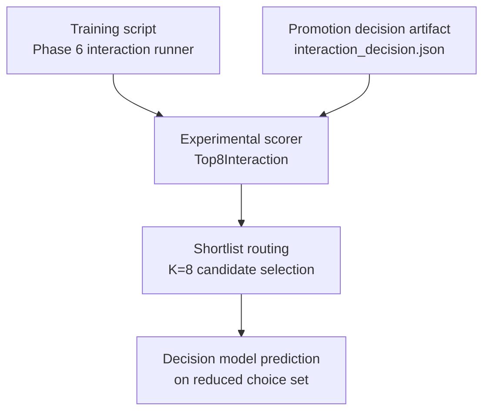
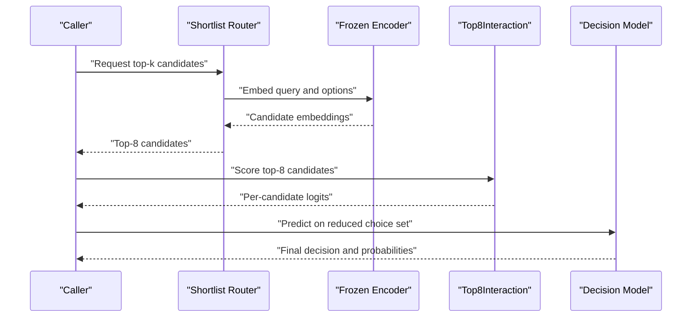
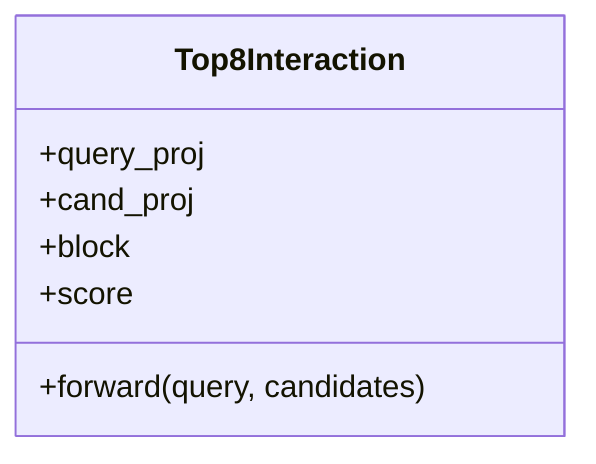
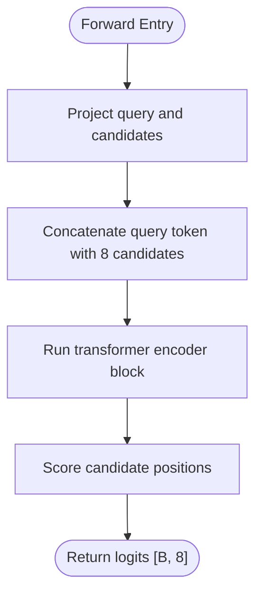
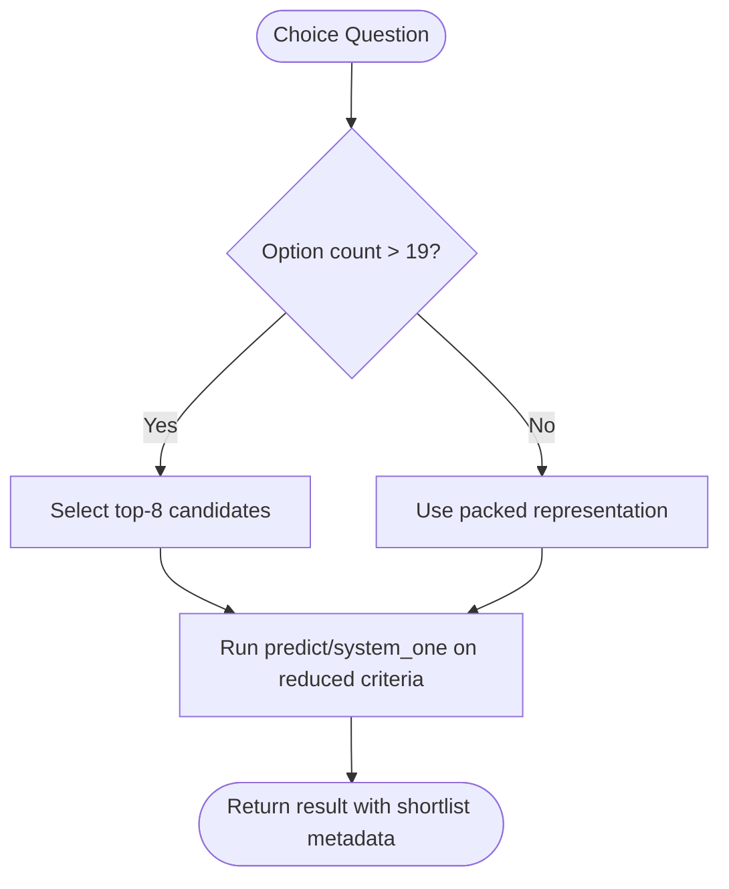
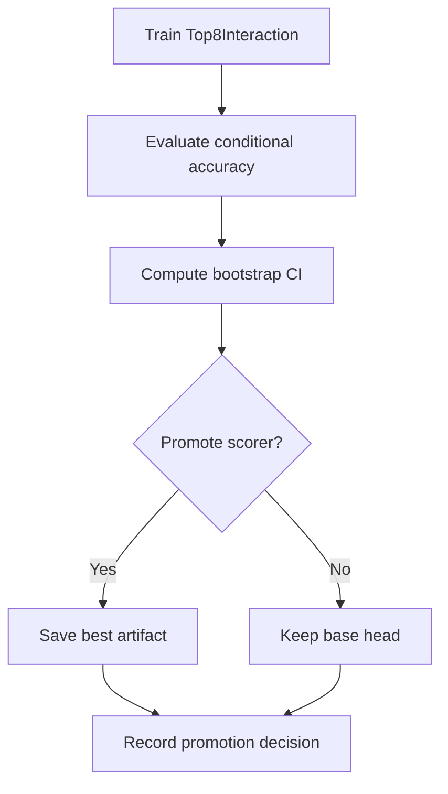
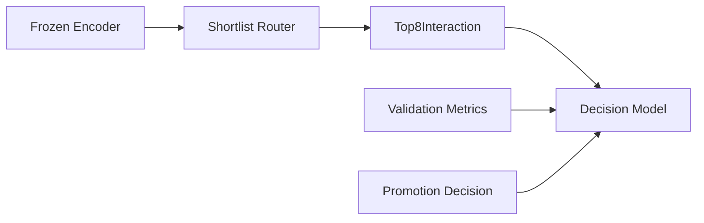

# Top-8 Optimization Strategy

<cite>
**Referenced Files in This Document**
- [veya/experimental/top8.py](file://veya/experimental/top8.py)
- [veya/shortlist.py](file://veya/shortlist.py)
- [tests/test_top8.py](file://tests/test_top8.py)
- [research/veyabench/run_phase6_interaction.py](file://research/veyabench/run_phase6_interaction.py)
- [artifacts/experiments/phase6/interaction_decision.json](file://artifacts/experiments/phase6/interaction_decision.json)
- [artifacts/decisions/k8_reranker.json](file://artifacts/decisions/k8_reranker.json)
- [BENCHMARKS.md](file://BENCHMARKS.md)
</cite>

## Table of Contents
1. [Introduction](#introduction)
2. [Project Structure](#project-structure)
3. [Core Components](#core-components)
4. [Architecture Overview](#architecture-overview)
5. [Detailed Component Analysis](#detailed-component-analysis)
6. [Dependency Analysis](#dependency-analysis)
7. [Performance Considerations](#performance-considerations)
8. [Troubleshooting Guide](#troubleshooting-guide)
9. [Conclusion](#conclusion)
10. [Appendices](#appendices)

## Introduction
This document explains Veya’s top-8 optimization experimental strategy. The strategy limits the reranking stage to eight candidate choices after an initial retrieval step, then applies a small interaction model that jointly attends over one state vector and eight candidate vectors. The design is intended to reduce computation while preserving discriminative scoring for the most promising options.

The documentation covers:
- Why limiting consideration to top-8 candidates is used.
- How the `Top8Interaction` class works.
- How shortlist routing selects K=8 candidates in production-like paths.
- How training and promotion decisions are recorded.
- Practical guidance for configuring, monitoring, and comparing top-8 optimization with full candidate evaluation.
- Trade-offs between speed and accuracy, and guidelines for when top-8 optimization is appropriate.

## Project Structure
The top-8 strategy spans three main areas:
- Experimental scorer implementation.
- Shortlist routing and candidate selection.
- Training, evaluation, and decision artifacts.

**Diagram sources**
- [veya/experimental/top8.py:11-24](file://veya/experimental/top8.py#L11-L24)
- [veya/shortlist.py:43-55](file://veya/shortlist.py#L43-L55)
- [research/veyabench/run_phase6_interaction.py:145-152](file://research/veyabench/run_phase6_interaction.py#L145-L152)
- [artifacts/experiments/phase6/interaction_decision.json:1-55](file://artifacts/experiments/phase6/interaction_decision.json#L1-L55)

**Section sources**
- [veya/experimental/top8.py:1-25](file://veya/experimental/top8.py#L1-L25)
- [veya/shortlist.py:1-55](file://veya/shortlist.py#L1-L55)
- [research/veyabench/run_phase6_interaction.py:127-152](file://research/veyabench/run_phase6_interaction.py#L127-L152)
- [artifacts/experiments/phase6/interaction_decision.json:1-55](file://artifacts/experiments/phase6/interaction_decision.json#L1-L55)

## Core Components
- `Top8Interaction`: A small transformer-based interaction scorer that takes a query embedding and exactly eight candidate embeddings, produces per-candidate logits, and is designed for inference on frozen encoder outputs.
- Shortlist routing: Production-style routing chooses K=8 candidates for large choice sets, reducing the number of candidates passed to downstream scoring.
- Training and promotion: The Phase 6 interaction runner trains the top-8 scorer and records whether it should be promoted based on validation metrics.

Key responsibilities:
- Candidate reduction: Keep only the most relevant candidates before applying expensive interaction scoring.
- Interaction scoring: Model cross-attention between the current state and the top-8 candidates.
- Decision recording: Track whether the top-8 scorer improves conditional accuracy or confidence behavior compared to the baseline.

**Section sources**
- [veya/experimental/top8.py:11-24](file://veya/experimental/top8.py#L11-L24)
- [veya/shortlist.py:43-55](file://veya/shortlist.py#L43-L55)
- [research/veyabench/run_phase6_interaction.py:145-152](file://research/veyabench/run_phase6_interaction.py#L145-L152)

## Architecture Overview
The top-8 optimization fits into a two-stage pipeline:
1. Retrieval or projection selects a small shortlist of candidates.
2. The top-8 interaction scorer ranks those candidates using joint attention.

**Diagram sources**
- [veya/shortlist.py:91-148](file://veya/shortlist.py#L91-L148)
- [veya/experimental/top8.py:20-24](file://veya/experimental/top8.py#L20-L24)

## Detailed Component Analysis

### Top8Interaction Class
`Top8Interaction` implements a compact interaction head:
- It projects the query and each candidate into a shared width dimension.
- It concatenates the projected query token with the eight candidate tokens.
- It passes the combined sequence through a single transformer encoder block.
- It scores the candidate positions (excluding the query position) with a linear layer.

**Diagram sources**
- [veya/experimental/top8.py:11-24](file://veya/experimental/top8.py#L11-L24)

Behavioral properties verified by tests:
- Output shape matches `[batch, 8]`.
- Outputs are finite.
- Forward pass is deterministic under fixed seeds.
- Different candidate inputs produce different logits.
- State dictionary round-trip preserves outputs.

**Diagram sources**
- [veya/experimental/top8.py:20-24](file://veya/experimental/top8.py#L20-L24)

**Section sources**
- [veya/experimental/top8.py:11-24](file://veya/experimental/top8.py#L11-L24)
- [tests/test_top8.py:23-67](file://tests/test_top8.py#L23-L67)

### Shortlist System and K=8 Routing
The shortlist module provides:
- A production-style choice plan that routes large choice sets to a shortlist path with K=8.
- A helper function that chooses between packed representation and shortlist based on option count.
- Functions to rank candidates, embed texts, and call the agent’s prediction API on a reduced question set.

Important constants:
- `PRODUCTION_SHORTLIST_ABOVE = 19`: Route more than 19 options to shortlist.
- `PRODUCTION_SHORTLIST_K = 8`: Use eight candidates in the shortlist path.

**Diagram sources**
- [veya/shortlist.py:43-55](file://veya/shortlist.py#L43-L55)
- [veya/shortlist.py:91-148](file://veya/shortlist.py#L91-L148)

**Section sources**
- [veya/shortlist.py:25-55](file://veya/shortlist.py#L25-L55)
- [veya/shortlist.py:91-148](file://veya/shortlist.py#L91-L148)

### Training and Promotion Decisions
The Phase 6 interaction runner:
- Trains the top-8 interaction scorer.
- Tracks conditional accuracy and bootstrap confidence intervals.
- Saves the best model artifact.
- Records whether the scorer was promoted relative to the baseline.

The decision artifact shows:
- The scorer was not promoted.
- Conditional accuracy remained low.
- Bootstrap confidence intervals did not support improvement.

**Diagram sources**
- [research/veyabench/run_phase6_interaction.py:145-152](file://research/veyabench/run_phase6_interaction.py#L145-L152)
- [artifacts/experiments/phase6/interaction_decision.json:1-55](file://artifacts/experiments/phase6/interaction_decision.json#L1-L55)

**Section sources**
- [research/veyabench/run_phase6_interaction.py:127-152](file://research/veyabench/run_phase6_interaction.py#L127-L152)
- [artifacts/experiments/phase6/interaction_decision.json:1-55](file://artifacts/experiments/phase6/interaction_decision.json#L1-L55)

## Dependency Analysis
The top-8 strategy depends on:
- Frozen encoder outputs from the main model.
- Shortlist routing to select eight candidates.
- Validation metrics and decision artifacts to determine whether the scorer should replace the baseline.

**Diagram sources**
- [veya/shortlist.py:91-148](file://veya/shortlist.py#L91-L148)
- [veya/experimental/top8.py:20-24](file://veya/experimental/top8.py#L20-L24)
- [artifacts/experiments/phase6/interaction_decision.json:1-55](file://artifacts/experiments/phase6/interaction_decision.json#L1-L55)

**Section sources**
- [veya/shortlist.py:91-148](file://veya/shortlist.py#L91-L148)
- [veya/experimental/top8.py:20-24](file://veya/experimental/top8.py#L20-L24)
- [artifacts/experiments/phase6/interaction_decision.json:1-55](file://artifacts/experiments/phase6/interaction_decision.json#L1-L55)

## Performance Considerations
Top-8 optimization trades off full candidate evaluation for faster, focused scoring:
- Speed benefit: Fewer candidates mean fewer interaction computations.
- Accuracy risk: If the shortlist misses the correct option, the interaction scorer cannot recover it.
- Current status: The experimental top-8 scorer was not promoted due to low conditional accuracy and unfavorable bootstrap intervals.

Benchmark context:
- Latency measurements show Veya can process multiple questions quickly, but this does not directly measure the top-8 scorer alone.
- Calibration and option-order robustness are separate concerns that affect overall system reliability.

Guidelines:
- Use top-8 optimization when retrieval quality is strong enough to keep the correct option in the shortlist.
- Monitor conditional accuracy, recall at K, and error decomposition to detect shortlist failures.
- Compare against full candidate evaluation to quantify accuracy loss.
- Prefer top-8 optimization when latency constraints outweigh minor accuracy differences.

[No sources needed since this section provides general guidance]

## Troubleshooting Guide
Common issues and checks:
- Incorrect output shape: Ensure the candidate tensor has exactly eight candidates per batch.
- Non-finite logits: Validate encoder outputs and check for NaN/Inf propagation.
- Determinism failures: Fix random seeds and ensure the model is in eval mode during testing.
- Shortlist misrouting: Verify option counts and thresholds; confirm that large choice sets route to K=8.
- Promotion failure: Review conditional accuracy, bootstrap confidence intervals, and high-confidence rates.

Relevant test coverage:
- Shape correctness.
- Finite outputs.
- Deterministic behavior.
- Discrimination across different candidates.
- State dictionary load/save consistency.

**Section sources**
- [tests/test_top8.py:23-67](file://tests/test_top8.py#L23-L67)
- [artifacts/experiments/phase6/interaction_decision.json:1-55](file://artifacts/experiments/phase6/interaction_decision.json#L1-L55)

## Conclusion
Veya’s top-8 optimization experimental strategy focuses computational effort on a small, high-quality candidate set. The `Top8Interaction` scorer models joint attention between the current state and eight candidates, while the shortlist system selects those candidates. In the recorded experiment, the scorer was not promoted because validation metrics did not demonstrate improvement.

When considering top-8 optimization:
- Treat it as an experimental reranking layer rather than a guaranteed production replacement.
- Validate shortlist quality carefully.
- Measure both latency and accuracy impacts.
- Use promotion criteria grounded in conditional accuracy and confidence behavior.

[No sources needed since this section summarizes without analyzing specific files]

## Appendices

### Configuration Examples

#### Configuring Top-8 Optimization
- Use the shortlist router to select K=8 candidates for large choice sets.
- Pass frozen encoder embeddings to `Top8Interaction`.
- Run prediction on the reduced choice set after scoring.

References:
- Shortlist routing constants and functions.
- Top-8 scorer interface.

**Section sources**
- [veya/shortlist.py:43-55](file://veya/shortlist.py#L43-L55)
- [veya/experimental/top8.py:20-24](file://veya/experimental/top8.py#L20-L24)

#### Monitoring Impact on Performance Metrics
Track:
- Conditional accuracy.
- Recall@K for shortlist quality.
- Bootstrap confidence intervals around accuracy deltas.
- High-confidence rate changes.

References:
- Phase 6 interaction runner metrics.
- Promotion decision artifact.

**Section sources**
- [research/veyabench/run_phase6_interaction.py:127-152](file://research/veyabench/run_phase6_interaction.py#L127-L152)
- [artifacts/experiments/phase6/interaction_decision.json:1-55](file://artifacts/experiments/phase6/interaction_decision.json#L1-L55)

#### Comparing Top-8 Optimization with Full Candidate Evaluation
Compare:
- Accuracy on full candidate set versus top-8 reranked set.
- Latency per call.
- Option-order robustness.
- Calibration quality.

References:
- Benchmark latency table.
- Shortlist vs packed routing logic.

**Section sources**
- [BENCHMARKS.md:163-196](file://BENCHMARKS.md#L163-L196)
- [veya/shortlist.py:43-64](file://veya/shortlist.py#L43-L64)

### Threshold Tuning Parameters
Threshold tuning is primarily relevant to selective automation policies rather than the top-8 scorer itself. Relevant concepts include:
- Confidence score kinds such as maximum probability, negative entropy, and margin.
- Threshold selection on a validation split with a risk epsilon.
- Applying the chosen threshold consistently to later splits.

These parameters help decide when to automate decisions based on model confidence, which can be combined with shortlist and reranking strategies.

**Section sources**
- [veya/selective.py:21-38](file://veya/selective.py#L21-L38)

### When Top-8 Optimization Is Appropriate
Appropriate use cases:
- Large choice sets where full evaluation is too expensive.
- Strong retrieval or projection methods that reliably keep correct options in the shortlist.
- Scenarios where latency savings justify potential accuracy trade-offs.

Inappropriate use cases:
- Low-quality shortlists that frequently drop the correct option.
- Tasks requiring exhaustive candidate comparison.
- Situations where calibration and option-order stability are critical and not yet validated.

[No sources needed since this section provides general guidance]

### Experimental Status Notes
- The top-8 interaction scorer is experimental.
- It is not the production reranker unless validation comparisons promote it.
- Historical decisions indicate the scorer was rejected in favor of other approaches.

**Section sources**
- [veya/experimental/top8.py:1-6](file://veya/experimental/top8.py#L1-L6)
- [artifacts/decisions/k8_reranker.json:1-5](file://artifacts/decisions/k8_reranker.json#L1-L5)