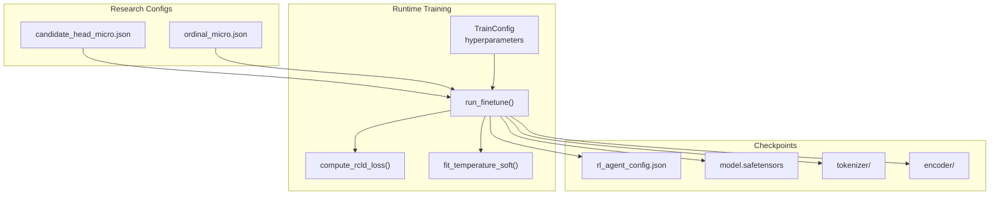
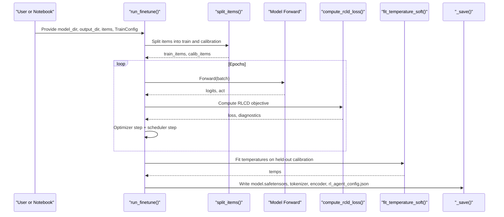
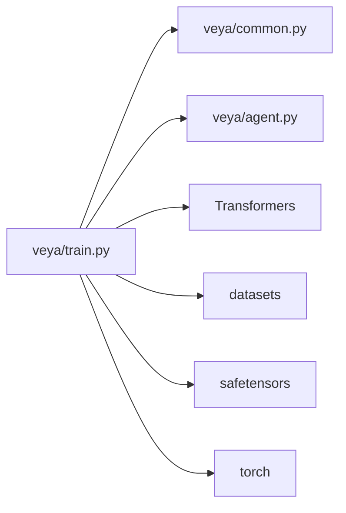

# Configuration Management

<cite>
**Referenced Files in This Document**
- [train.py](file://veya/train.py)
- [candidate_head_micro.json](file://research/configs/candidate_head_micro.json)
- [ordinal_micro.json](file://research/configs/ordinal_micro.json)
- [rl_agent_config.json (production)](file://models/production/rl_agent_config.json)
- [rl_agent_config.json (typed-decisions)](file://models/production/typed-decisions/rl_agent_config.json)
- [README.md](file://README.md)
</cite>

## Table of Contents
1. [Introduction](#introduction)
2. [Project Structure](#project-structure)
3. [Core Components](#core-components)
4. [Architecture Overview](#architecture-overview)
5. [Detailed Component Analysis](#detailed-component-analysis)
6. [Dependency Analysis](#dependency-analysis)
7. [Performance Considerations](#performance-considerations)
8. [Troubleshooting Guide](#troubleshooting-guide)
9. [Conclusion](#conclusion)
10. [Appendices](#appendices)

## Introduction
This document explains how to manage training configurations for Veya fine-tuning. It focuses on:
- The JSON configuration files used by research experiments and production checkpoints.
- The runtime hyperparameter schema that controls the RLCD fine-tuning loop.
- Candidate head and ordinal micro-configurations as concrete examples.
- Hyperparameter tuning strategies, learning rate scheduling, batch size optimization, and validation settings.
- Best practices for configuration versioning and experiment tracking.

The goal is to help you design reproducible, auditable fine-tuning runs while keeping the relationship between configuration files and model behavior explicit.

## Project Structure
Veya’s fine-tuning configuration spans two layers:
- Research-level JSON configs describe experiments, hardware targets, expected artifacts, and comparison baselines.
- Runtime-level configuration lives in `TrainConfig` and is persisted into the checkpoint’s `rl_agent_config.json`.

**Diagram sources**
- [candidate_head_micro.json:1-15](file://research/configs/candidate_head_micro.json#L1-L15)
- [ordinal_micro.json:1-8](file://research/configs/ordinal_micro.json#L1-L8)
- [train.py:69-120](file://veya/train.py#L69-L120)
- [train.py:362-484](file://veya/train.py#L362-L484)
- [train.py:487-539](file://veya/train.py#L487-L539)

**Section sources**
- [candidate_head_micro.json:1-15](file://research/configs/candidate_head_micro.json#L1-L15)
- [ordinal_micro.json:1-8](file://research/configs/ordinal_micro.json#L1-L8)
- [train.py:69-120](file://veya/train.py#L69-L120)
- [train.py:362-484](file://veya/train.py#L362-L484)
- [train.py:487-539](file://veya/train.py#L487-L539)

## Core Components
### TrainConfig: Fine-Tuning Hyperparameters
`TrainConfig` is the canonical source of truth for RLCD fine-tuning hyperparameters. It validates inputs and exposes knobs for:
- Epochs, micro-batch size, gradient accumulation, and GRPO group size.
- Separate encoder and head learning rates with weight decay.
- Exploration noise schedule via `sigma_start` and `sigma_end`.
- Loss weighting between policy-gradient reward (`rl_weight`) and soft cross-entropy (`ce_weight`).
- Optional defer/escalate head training via `act_weight`.
- Gradient clipping, seed, calibration split controls, sequence lengths, and model name.

Key behaviors:
- Validation enforces sensible ranges (e.g., positive learning rates, at least one non-zero loss weight).
- Noise annealing is linear across epochs through `sigma_for_epoch`.
- Calibration temperature fitting uses a held-out subset of items, not the training slice.

**Section sources**
- [train.py:69-120](file://veya/train.py#L69-L120)
- [train.py:117-120](file://veya/train.py#L117-L120)
- [train.py:211-231](file://veya/train.py#L211-L231)
- [train.py:234-265](file://veya/train.py#L234-L265)

### Research Micro-Configs: Candidate Head and Ordinal Examples
Research configs are lightweight JSON manifests describing an experiment’s purpose, command, hardware expectations, artifacts, and comparison points.

- Candidate head micro-config:
  - Identifies the run and status.
  - Points to a launcher command.
  - Documents that the head is order-equivariant and gradient-checked.
  - Describes dev vs full hardware profiles.
  - Lists expected artifacts such as a candidate head checkpoint and recall report.

- Ordinal micro-config:
  - Identifies the run and status.
  - Notes implementation details and dataset constraints.
  - Specifies metrics to compare against categorical softmax.

These configs do not contain training hyperparameters; they orchestrate and document experiments whose actual training logic is driven by `TrainConfig` and `run_finetune`.

**Section sources**
- [candidate_head_micro.json:1-15](file://research/configs/candidate_head_micro.json#L1-L15)
- [ordinal_micro.json:1-8](file://research/configs/ordinal_micro.json#L1-L8)

### Checkpoint Configuration: rl_agent_config.json
After training, `run_finetune` writes a checkpoint directory containing:
- `model.safetensors`: trained weights.
- `tokenizer/` and `encoder/`: tokenizer and encoder configs.
- `rl_agent_config.json`: model metadata, fitted temperatures, and selected training fields.

The saved config includes:
- Encoder identity and head architecture.
- Sequence length limits.
- Fitted per-primitive temperatures.
- Selected training metadata such as epochs, loss weights, act-head weight, seed, and clamp range.

Production examples show additional fields like `gradient_checkpointing`, `max_tokens_per_batch`, and `fine_tuned`, which can be present depending on the build path.

**Section sources**
- [train.py:516-539](file://veya/train.py#L516-L539)
- [rl_agent_config.json (production):1-33](file://models/production/rl_agent_config.json#L1-L33)
- [rl_agent_config.json (typed-decisions):1-36](file://models/production/typed-decisions/rl_agent_config.json#L1-L36)

## Architecture Overview
The fine-tuning pipeline reads a pre-trained model directory, builds training items, splits them into train and calibration sets, trains with RLCD, fits calibration temperatures, and saves a new checkpoint.

**Diagram sources**
- [train.py:362-484](file://veya/train.py#L362-L484)
- [train.py:487-539](file://veya/train.py#L487-L539)

## Detailed Component Analysis

### Training Loop and Hyperparameter Effects
`run_finetune` orchestrates:
- Device selection (CUDA, MPS, CPU).
- Loading the base model and tokenizer.
- Building AdamW with separate parameter groups for encoder and head.
- Cosine annealing learning rate scheduler over total updates.
- Mixed precision on CUDA.
- Gradient accumulation to simulate larger effective batches.
- RLCD loss combining policy-gradient reward and soft cross-entropy.
- Gradual exploration noise annealing controlled by `sigma_for_epoch`.
- Held-out calibration temperature fitting.
- Saving the final checkpoint and metadata.

Hyperparameter effects:
- `epochs`: Number of passes over the training set.
- `micro_batch` × `grad_accum`: Effective batch size and memory usage.
- `group_size`: GRPO baseline group size; must be ≥ 2.
- `lr_encoder`, `lr_head`: Learning rates for backbone vs decision head.
- `weight_decay`: L2 regularization.
- `sigma_start`, `sigma_end`: Exploration noise schedule.
- `w_sph`, `w_rps`: Weights for spherical and proper scoring rule components.
- `rl_weight`, `ce_weight`: Relative importance of policy gradient vs distillation.
- `act_weight`: Whether to train the defer/escalate head.
- `grad_clip`: Gradient norm clipping.
- `seed`: Reproducibility across RNGs.
- `calib_stride`, `calib_max`: Calibration split sampling.
- `max_len`, `head_max_len`: Sequence and marker budgets.
- `model_name`: Identifier stored in the checkpoint config.

**Section sources**
- [train.py:362-484](file://veya/train.py#L362-L484)
- [train.py:421-424](file://veya/train.py#L421-L424)
- [train.py:443-476](file://veya/train.py#L443-L476)

### RLCD Objective and Diagnostics
`compute_rcld_loss` computes:
- A policy-gradient term using noisy logit perturbations within a GRPO-style advantage normalization.
- A soft cross-entropy term against teacher probabilities.
- Optional defer/escalate head contribution.
- Diagnostics including RL loss, CE loss, reward, and act weight.

Validation rules ensure:
- Positive sigma.
- Group size at least 2.
- At least one of `rl_weight` or `ce_weight` is non-zero.

**Section sources**
- [train.py:268-325](file://veya/train.py#L268-L325)
- [train.py:101-115](file://veya/train.py#L101-L115)

### Calibration Temperature Fitting
`fit_temperature_soft` fits a scalar temperature per question type by minimizing NLL against soft teacher targets. It:
- Requires a minimum number of observations per type.
- Optimizes in log-space.
- Clamps the result to `[TEMP_MIN, TEMP_MAX]` to match serving behavior.

`_fit_calibration` applies this per primitive type and returns a list of fitted temperatures.

**Section sources**
- [train.py:234-265](file://veya/train.py#L234-L265)
- [train.py:487-513](file://veya/train.py#L487-L513)

### Data Preparation and Collation
`build_training_item` converts state, question, and gold answer triples into training items:
- Normalizes target distributions.
- Builds packed sequences and markers.
- Drops misaligned rows where the head budget cannot accommodate all options.

`collate_train_batch` pads sequences and markers into rectangular tensors suitable for batching.

**Section sources**
- [train.py:133-178](file://veya/train.py#L133-L178)
- [train.py:181-208](file://veya/train.py#L181-L208)

### Validation Splits and Calibration Holdout
`split_items` creates a non-overlapping train/calibration split:
- Every `stride`-th item becomes calibration up to `max_calib`.
- Calibration rows are excluded from training to keep ECE honest.

**Section sources**
- [train.py:211-231](file://veya/train.py#L211-L231)

### Candidate Head Micro-Configuration
The candidate head micro-config documents:
- Run identity and scaffolding status.
- Launcher command for the candidate head micro-run.
- Design notes about order-equivariance and gradient checks.
- Dev vs full hardware profiles.
- Expected artifacts including a candidate head checkpoint and recall report.

Best practices derived from this example:
- Keep hardware guidance explicit for reproducibility.
- Record expected artifacts so downstream evaluation can locate outputs.
- Use notes to capture architectural constraints and safety warnings.

**Section sources**
- [candidate_head_micro.json:1-15](file://research/configs/candidate_head_micro.json#L1-L15)

### Ordinal Micro-Configuration
The ordinal micro-config documents:
- Run identity and implementation status.
- Implementation notes about cumulative thresholds and CSV requirements.
- Comparison baseline against categorical softmax.
- Metrics to track during evaluation.

Best practices derived from this example:
- Clearly state dependencies and environment variables required by the experiment.
- Specify metrics and baselines upfront.
- Mark research validation status explicitly.

**Section sources**
- [ordinal_micro.json:1-8](file://research/configs/ordinal_micro.json#L1-L8)

## Dependency Analysis
The fine-tuning module depends on:
- Model building and tokenization utilities from `veya.common` and `veya.agent`.
- Hugging Face Transformers for tokenizers and datasets loading.
- Safetensors for checkpoint I/O.
- PyTorch for optimization, schedulers, and mixed precision.

**Diagram sources**
- [train.py:45-54](file://veya/train.py#L45-L54)
- [train.py:328-359](file://veya/train.py#L328-L359)
- [train.py:396-406](file://veya/train.py#L396-L406)

**Section sources**
- [train.py:45-54](file://veya/train.py#L45-L54)
- [train.py:328-359](file://veya/train.py#L328-L359)
- [train.py:396-406](file://veya/train.py#L396-L406)

## Performance Considerations
- Batch sizing:
  - Use `micro_batch` and `grad_accum` to fit large effective batches on limited GPU memory.
  - Monitor memory usage when increasing `group_size` because RLCD samples multiple noisy policies per step.
- Learning rate scheduling:
  - Cosine annealing reduces the learning rate smoothly over total updates.
  - Tune `lr_encoder` and `lr_head` separately to stabilize backbone adaptation.
- Mixed precision:
  - Enabled automatically on CUDA devices to reduce memory and improve throughput.
- Sequence length:
  - Increase `max_len` and `head_max_len` only if data requires it; longer sequences increase memory and compute.
- Calibration:
  - Ensure sufficient calibration samples by adjusting `calib_stride` and `calib_max`.
  - Avoid fitting calibration on training data to keep ECE estimates valid.

[No sources needed since this section provides general guidance]

## Troubleshooting Guide
Common issues and resolutions:
- Invalid hyperparameters:
  - Non-positive learning rates, invalid group size, or zeroed loss weights raise validation errors.
  - Fix by ensuring positive learning rates, `group_size >= 2`, and at least one of `rl_weight` or `ce_weight` is non-zero.
- Calibration problems:
  - If calibration fails due to insufficient samples, adjust `calib_stride` or `calib_max`.
  - Verify that calibration rows are held out from training.
- Memory errors:
  - Reduce `micro_batch`, `max_len`, `head_max_len`, or `group_size`.
  - Enable gradient checkpointing in the model config if supported.
- Reproducibility:
  - Set `seed` consistently across runs.
  - Confirm that device selection matches expectations (CUDA/MPS/CPU).

**Section sources**
- [train.py:101-115](file://veya/train.py#L101-L115)
- [train.py:211-231](file://veya/train.py#L211-L231)
- [train.py:382-389](file://veya/train.py#L382-L389)

## Conclusion
Veya’s fine-tuning configuration combines lightweight research manifests with a robust runtime hyperparameter schema. The `TrainConfig` class defines validated, interpretable knobs for RLCD training, while research micro-configs document experiment intent, hardware, and artifacts. Production checkpoints persist key training metadata in `rl_agent_config.json`, enabling traceability and safe deployment. By following the recommended tuning strategies, validation practices, and versioning guidelines, you can run reproducible, auditable fine-tuning experiments that scale from micro-runs to production models.

[No sources needed since this section summarizes without analyzing specific files]

## Appendices

### Hyperparameter Tuning Strategies
- Start with defaults and vary one factor at a time:
  - Learning rates: tune `lr_encoder` and `lr_head` independently.
  - Loss weights: ablate `rl_weight` vs `ce_weight` to understand policy gradient contribution.
  - Exploration noise: sweep `sigma_start` and `sigma_end` to balance exploration and stability.
- Batch size:
  - Increase effective batch size via `grad_accum` before raising `micro_batch`.
  - Validate that `group_size` remains feasible for your GPU memory.
- Sequence length:
  - Only increase `max_len` and `head_max_len` when necessary.
- Calibration:
  - Tune `calib_stride` and `calib_max` to ensure stable temperature estimates.

**Section sources**
- [train.py:78-99](file://veya/train.py#L78-L99)
- [train.py:117-120](file://veya/train.py#L117-L120)
- [train.py:211-231](file://veya/train.py#L211-L231)

### Learning Rate Scheduling
- Cosine annealing is applied over total updates computed from epochs, micro-batch, and gradient accumulation.
- The scheduler starts from configured learning rates and decays toward a small minimum.

**Section sources**
- [train.py:421-424](file://veya/train.py#L421-L424)

### Batch Size Optimization
- Effective batch size equals `micro_batch * grad_accum`.
- Larger `group_size` increases RL variance and memory use.
- Mixed precision reduces memory footprint on CUDA.

**Section sources**
- [train.py:421-426](file://veya/train.py#L421-L426)
- [train.py:443-476](file://veya/train.py#L443-L476)

### Validation Settings
- Calibration holdout:
  - Use `split_items` to exclude calibration rows from training.
  - Adjust `calib_stride` and `calib_max` to control calibration sample size.
- Metrics:
  - Track RL and CE losses, reward, and act weight diagnostics.
  - Report calibrated ECE using held-out calibration data.

**Section sources**
- [train.py:211-231](file://veya/train.py#L211-L231)
- [train.py:268-325](file://veya/train.py#L268-L325)
- [train.py:487-513](file://veya/train.py#L487-L513)

### Configuration Versioning and Experiment Tracking
- Research configs:
  - Store experiment manifests under `research/configs` with clear names, statuses, and notes.
  - Include hardware guidance and expected artifacts to make runs reproducible.
- Checkpoint metadata:
  - Persist training metadata in `rl_agent_config.json`, including epochs, loss weights, seed, and clamp range.
  - Use `model_name` to identify the model family and variant.
- Experiment tracking:
  - Record commit hashes, dataset splits, and evaluation reports alongside checkpoints.
  - Tag releases and maintain a graph of experiments and dependencies.

**Section sources**
- [candidate_head_micro.json:1-15](file://research/configs/candidate_head_micro.json#L1-L15)
- [ordinal_micro.json:1-8](file://research/configs/ordinal_micro.json#L1-L8)
- [train.py:516-539](file://veya/train.py#L516-L539)
- [README.md:438-452](file://README.md#L438-L452)