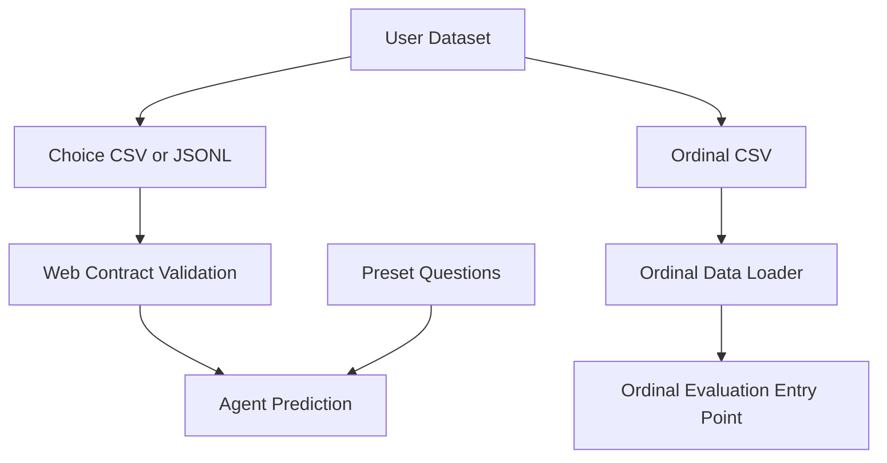
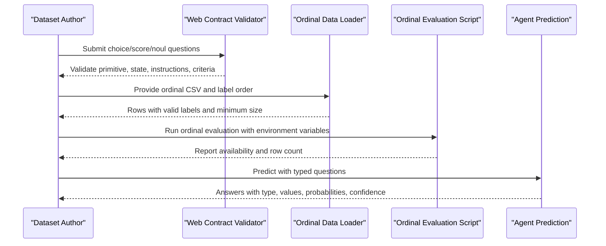
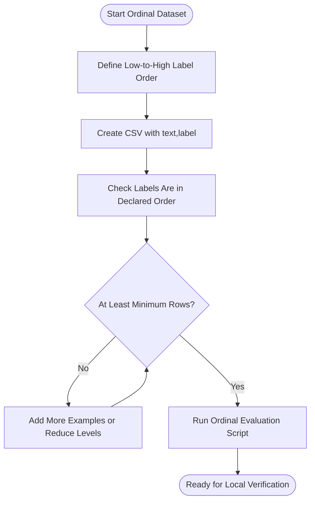
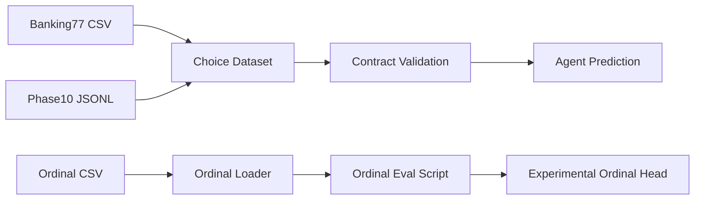

# Creating Custom Datasets

<cite>
**Referenced Files in This Document**
- [README.md](file://README.md)
- [presets.py](file://veya/presets.py)
- [agent.py](file://veya/agent.py)
- [ordinal_data.py](file://veya/experimental/ordinal_data.py)
- [ordinal.py](file://veya/experimental/ordinal.py)
- [run_ordinal_eval.py](file://research/veyabench/run_ordinal_eval.py)
- [ordinal_micro.json](file://research/configs/ordinal_micro.json)
- [train.csv](file://research/data/banking77/train.csv)
- [train.jsonl](file://research/data/phase10/train.jsonl)
- [development.jsonl](file://research/data/phase10/development.jsonl)
- [schema_held_out_validation.jsonl](file://research/data/phase10/schema_held_out_validation.jsonl)
- [schema.json](file://research/data/sgd/dev/schema.json)
- [contracts.py](file://web/contracts.py)
- [test_web_gateway.py](file://tests/test_web_gateway.py)
</cite>

## Table of Contents
1. [Introduction](#introduction)
2. [Project Structure](#project-structure)
3. [Core Components](#core-components)
4. [Architecture Overview](#architecture-overview)
5. [Detailed Component Analysis](#detailed-component-analysis)
6. [Dependency Analysis](#dependency-analysis)
7. [Performance Considerations](#performance-considerations)
8. [Troubleshooting Guide](#troubleshooting-guide)
9. [Conclusion](#conclusion)
10. [Appendices](#appendices)

## Introduction
This document provides step-by-step guidance for creating custom datasets tailored to three decision primitives used by the project:

- Choice classification: selecting one label from a defined set.
- Ordinal scoring: assigning an ordered level with a low-to-high rubric.
- Binary probability tasks: estimating calibrated probabilities for a true/false condition.

It explains how to structure data, validate it, and adapt existing presets for domain-specific applications. It also documents quality assurance procedures, including schema validation, size checks, label ordering, and audit-style checks already present in the repository.

## Project Structure
The dataset-related material is spread across several areas:

- Runtime question schemas are validated through web contracts and tests.
- Existing public datasets provide concrete examples of choice-oriented formats.
- Experimental ordinal scoring has its own loader and evaluation entry point.
- Preset question templates show how to define instructions and criteria for production workflows.

**Diagram sources**
- [contracts.py:121-154](file://web/contracts.py#L121-L154)
- [ordinal_data.py:15-42](file://veya/experimental/ordinal_data.py#L15-L42)
- [run_ordinal_eval.py:12-24](file://research/veyabench/run_ordinal_eval.py#L12-L24)
- [presets.py:5-42](file://veya/presets.py#L5-L42)

**Section sources**
- [README.md:255-262](file://README.md#L255-L262)
- [presets.py:5-42](file://veya/presets.py#L5-L42)
- [contracts.py:121-154](file://web/contracts.py#L121-L154)
- [ordinal_data.py:15-42](file://veya/experimental/ordinal_data.py#L15-L42)
- [run_ordinal_eval.py:12-24](file://research/veyabench/run_ordinal_eval.py#L12-L24)

## Core Components
The system supports three decision primitives:

| Primitive | Output | Typical Use Case |
|---|---|---|
| `choice` | Top label, per-option probabilities, confidence | Intent routing, category selection |
| `score` | Expected ordinal level, distribution, confidence | Urgency, frustration, harm severity |
| `noul` | Calibrated probability P(true) | Spam detection, churn risk, safety flags |

These primitives are consumed by the agent prediction pipeline and can be defined using preset question templates or custom schemas.

**Section sources**
- [README.md:255-262](file://README.md#L255-L262)
- [agent.py:378-406](file://veya/agent.py#L378-L406)
- [presets.py:5-42](file://veya/presets.py#L5-L42)

## Architecture Overview
Custom datasets flow into the model through typed questions. The runtime validates request shapes, while dataset loaders enforce structural rules. For ordinal scoring, the experimental loader requires a CSV with explicit text and label columns and a strict low-to-high label order.

**Diagram sources**
- [contracts.py:121-154](file://web/contracts.py#L121-L154)
- [ordinal_data.py:15-42](file://veya/experimental/ordinal_data.py#L15-L42)
- [run_ordinal_eval.py:12-24](file://research/veyabench/run_ordinal_eval.py#L12-L24)
- [agent.py:378-406](file://veya/agent.py#L378-L406)

## Detailed Component Analysis

### Choice Classification Datasets
Choice datasets map free-form text to one label from a closed set. Public examples include:

- Banking77 CSV with `text` and `category`.
- Phase 10 JSONL records with `text`, `candidate_id`, `dataset`, and `schema`.
- Held-out validation JSONL with similar fields.

Recommended steps:

1. Define your label set clearly.
2. Write representative prompts for each label.
3. Keep instructions concise and unambiguous.
4. Split data into train, development, and held-out validation sets.
5. Record metadata such as dataset name, schema, and candidate identifiers.

Validation checklist:

- Each example has a single clear intent.
- Labels are mutually exclusive where required.
- No leakage between splits.
- Label names are stable and documented.

Existing references:

- [banking77/train.csv](file://research/data/banking77/train.csv)
- [phase10/train.jsonl](file://research/data/phase10/train.jsonl)
- [phase10/schema_held_out_validation.jsonl](file://research/data/phase10/schema_held_out_validation.jsonl)

**Section sources**
- [train.csv:1-200](file://research/data/banking77/train.csv#L1-L200)
- [train.jsonl:1-200](file://research/data/phase10/train.jsonl#L1-L200)
- [schema_held_out_validation.jsonl:1-200](file://research/data/phase10/schema_held_out_validation.jsonl#L1-L200)

### Ordinal Scoring Datasets
Ordinal scoring requires an ordered rubric. The experimental ordinal loader enforces:

- A CSV file path.
- Columns named `text` and `label`.
- An explicit low-to-high label order.
- Rejection of labels not in the declared order.
- A minimum number of rows.

Steps to create an ordinal dataset:

1. Define at least two ordered levels, for example: low, medium, high.
2. Create a CSV with `text` and `label`.
3. Ensure every label appears in the declared order.
4. Aim for enough examples per level to support meaningful evaluation.
5. Set environment variables for the ordinal evaluation script.

**Diagram sources**
- [ordinal_data.py:15-42](file://veya/experimental/ordinal_data.py#L15-L42)
- [run_ordinal_eval.py:12-24](file://research/veyabench/run_ordinal_eval.py#L12-L24)

Important notes:

- Production Score remains categorical; the ordinal head is experimental.
- The evaluation script exits with a non-zero status when no ordinal dataset is configured.
- The ordinal configuration marks the feature as implemented but not research-validated.

**Section sources**
- [ordinal_data.py:1-42](file://veya/experimental/ordinal_data.py#L1-L42)
- [ordinal.py:1-35](file://veya/experimental/ordinal.py#L1-L35)
- [run_ordinal_eval.py:1-28](file://research/veyabench/run_ordinal_eval.py#L1-L28)
- [ordinal_micro.json:1-7](file://research/configs/ordinal_micro.json#L1-L7)

### Binary Probability Tasks
Binary probability tasks use the `noul` primitive to estimate calibrated probabilities for a true/false condition. Good practices:

- Frame instructions as a yes/no question about the input.
- Use balanced positive and negative examples.
- Avoid ambiguous wording that could flip meaning.
- Track calibration separately because probabilities must be treated carefully.

Examples in presets include spam detection, phishing detection, urgency flags, and churn risk.

**Section sources**
- [README.md:255-262](file://README.md#L255-L262)
- [presets.py:45-79](file://veya/presets.py#L45-L79)
- [presets.py:122-151](file://veya/presets.py#L122-L151)

### Adapting Presets for Domain-Specific Applications
Presets provide ready-to-use question templates for common workflows. You can adapt them by:

- Replacing categories with domain-specific options.
- Rewriting instructions to match your terminology.
- Adding or removing questions depending on your workflow.
- Keeping criteria descriptions actionable and observable.

Adaptable presets include:

- Customer support triage.
- Email triage and threat filtering.
- Guardrails for prompt safety.
- Content moderation.
- Model routing by difficulty and domain.

**Section sources**
- [presets.py:5-42](file://veya/presets.py#L5-L42)
- [presets.py:45-79](file://veya/presets.py#L45-L79)
- [presets.py:82-119](file://veya/presets.py#L82-L119)
- [presets.py:122-151](file://veya/presets.py#L122-L151)
- [presets.py:154-187](file://veya/presets.py#L154-L187)

### Request Validation and Quality Assurance
The web contract validator enforces supported primitives, allowed fields, state constraints, and question limits. Tests assert boundary behavior such as maximum state size, unique criterion keys, minimum criterion counts, instruction length, and duplicate field handling.

Quality assurance procedures you should adopt:

- Validate request shape before inference.
- Enforce maximum state size.
- Require unique criterion keys.
- Require a reasonable range of choices or score levels.
- Reject empty or whitespace-only instructions.
- Log and reject malformed JSON.

**Section sources**
- [contracts.py:121-154](file://web/contracts.py#L121-L154)
- [test_web_gateway.py:32-54](file://tests/test_web_gateway.py#L32-L54)

## Dependency Analysis
The following diagram shows how dataset inputs connect to validation, loading, evaluation, and prediction components.

**Diagram sources**
- [train.csv:1-200](file://research/data/banking77/train.csv#L1-L200)
- [train.jsonl:1-200](file://research/data/phase10/train.jsonl#L1-L200)
- [ordinal_data.py:15-42](file://veya/experimental/ordinal_data.py#L15-L42)
- [run_ordinal_eval.py:12-24](file://research/veyabench/run_ordinal_eval.py#L12-L24)
- [ordinal.py:11-34](file://veya/experimental/ordinal.py#L11-L34)
- [contracts.py:121-154](file://web/contracts.py#L121-L154)
- [agent.py:378-406](file://veya/agent.py#L378-L406)

**Section sources**
- [contracts.py:121-154](file://web/contracts.py#L121-L154)
- [ordinal_data.py:15-42](file://veya/experimental/ordinal_data.py#L15-L42)
- [ordinal.py:11-34](file://veya/experimental/ordinal.py#L11-L34)
- [run_ordinal_eval.py:12-24](file://research/veyabench/run_ordinal_eval.py#L12-L24)
- [agent.py:378-406](file://veya/agent.py#L378-L406)

## Performance Considerations
- High-cardinality choice questions consume token budget per option. If you have many labels, consider shortlisting candidates or splitting coarse and fine-grained questions.
- Batched predictions are more efficient than repeated single-question calls.
- Calibration matters: probabilities should not be treated as absolute guarantees without proper calibration and gating.
- Ordinal scoring is experimental; do not assume production behavior until validated.

[No sources needed since this section provides general guidance]

## Troubleshooting Guide

Common issues and resolutions:

| Issue | Likely Cause | Resolution |
|---|---|---|
| Ordinal evaluation fails immediately | Missing CSV path or missing environment variable | Set the ordinal CSV path and label order environment variables. |
| Ordinal loader rejects labels | Label not in declared order | Align labels with the low-to-high order. |
| Ordinal dataset too small | Fewer than the required minimum rows | Add more examples or reduce the number of levels. |
| Web request rejected | Unsupported primitive, unexpected fields, invalid state size, or invalid criteria | Follow contract validation rules and test expectations. |
| Choice accuracy drops with many labels | Token budget per label is too small | Shortlist top candidates or split the label space. |

**Section sources**
- [ordinal_data.py:15-42](file://veya/experimental/ordinal_data.py#L15-L42)
- [run_ordinal_eval.py:12-24](file://research/veyabench/run_ordinal_eval.py#L12-L24)
- [contracts.py:121-154](file://web/contracts.py#L121-L154)
- [test_web_gateway.py:32-54](file://tests/test_web_gateway.py#L32-L54)
- [README.md:388-420](file://README.md#L388-L420)

## Conclusion
Creating custom datasets for Veya involves aligning your data format with the chosen decision primitive. For choice classification, follow the structure of existing CSV and JSONL datasets. For ordinal scoring, use the experimental loader’s requirements and treat the feature as local verification only. For binary probability tasks, frame clear true/false conditions and monitor calibration. Adapt presets to your domain, validate requests rigorously, and maintain strong QA practices around label definitions, split integrity, and size thresholds.

[No sources needed since this section summarizes without analyzing specific files]

## Appendices

### Appendix A: Templates and Field Reference

#### Choice Question Template
- `type`: `choice`
- `instructions`: Clear description of what the model should decide.
- `criteria`: Mapping from label to human-readable description.

#### Score Question Template
- `type`: `score`
- `instructions`: Description of the ordinal scale.
- `criteria`: Ordered list of levels from low to high.

#### Noul Question Template
- `type`: `noul`
- `instructions`: Yes/no question about the input.

#### Ordinal CSV Template
- Columns: `text`, `label`
- Label order: Explicitly provided to the loader.
- Minimum rows: Enforced by the loader.

**Section sources**
- [presets.py:5-42](file://veya/presets.py#L5-L42)
- [presets.py:45-79](file://veya/presets.py#L45-L79)
- [ordinal_data.py:15-42](file://veya/experimental/ordinal_data.py#L15-L42)

### Appendix B: Example Datasets

- Banking77 choice dataset: [research/data/banking77/train.csv](file://research/data/banking77/train.csv)
- Phase 10 choice dataset: [research/data/phase10/train.jsonl](file://research/data/phase10/train.jsonl)
- Phase 10 held-out validation: [research/data/phase10/schema_held_out_validation.jsonl](file://research/data/phase10/schema_held_out_validation.jsonl)
- SGD service schema: [research/data/sgd/dev/schema.json](file://research/data/sgd/dev/schema.json)

**Section sources**
- [train.csv:1-200](file://research/data/banking77/train.csv#L1-L200)
- [train.jsonl:1-200](file://research/data/phase10/train.jsonl#L1-L200)
- [schema_held_out_validation.jsonl:1-200](file://research/data/phase10/schema_held_out_validation.jsonl#L1-L200)
- [schema.json:1-200](file://research/data/sgd/dev/schema.json#L1-L200)