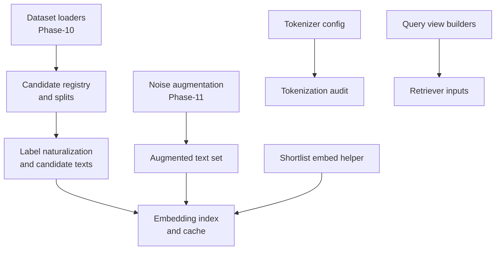
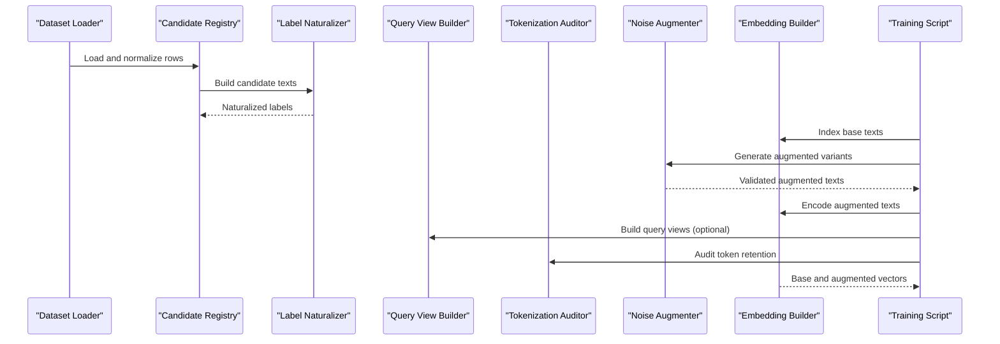
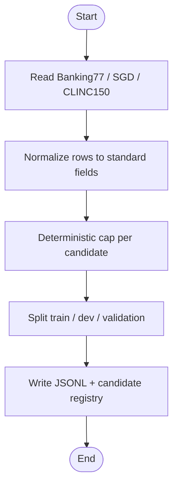
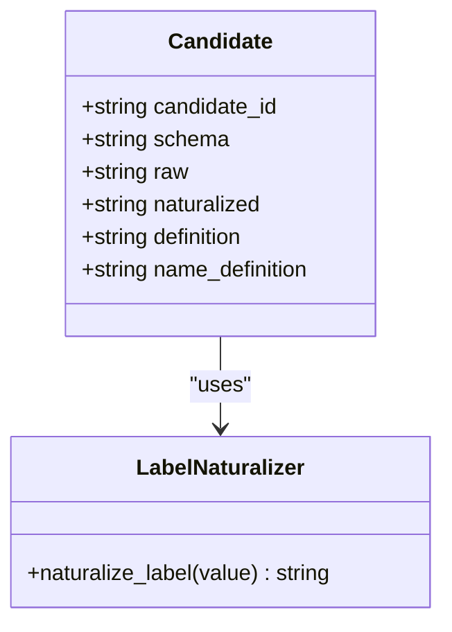
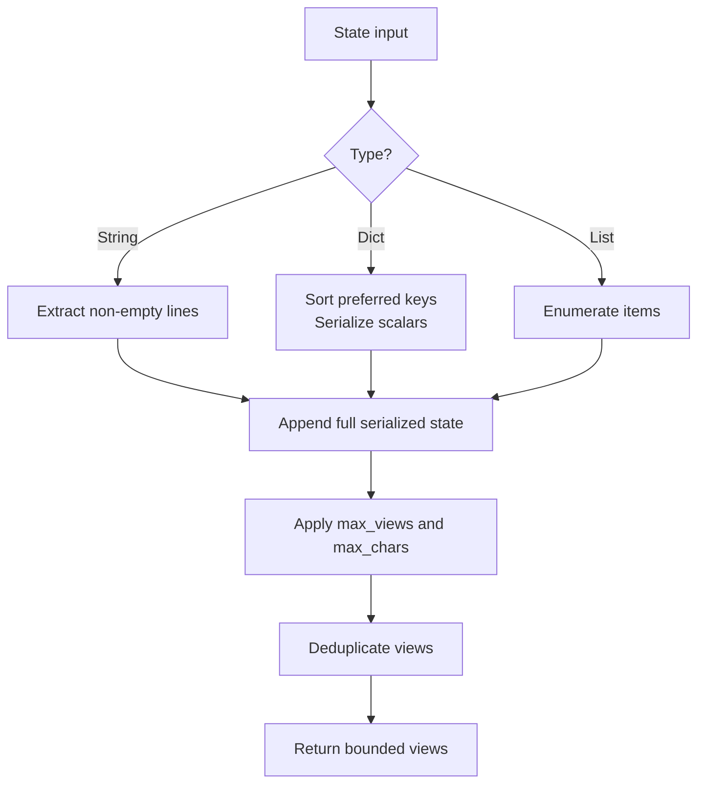
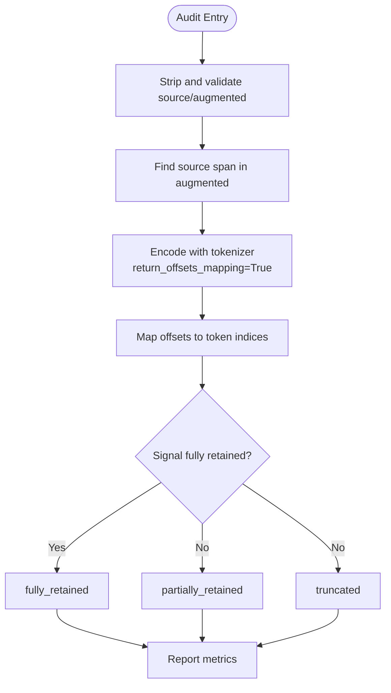
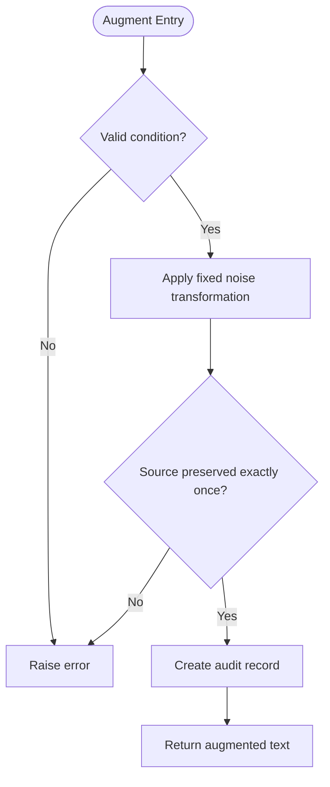
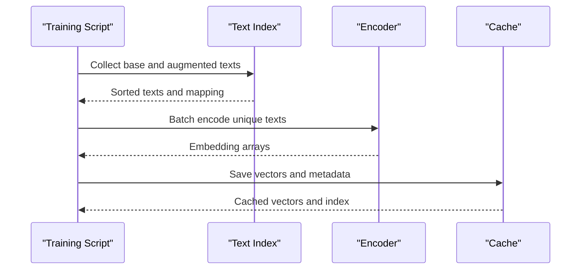
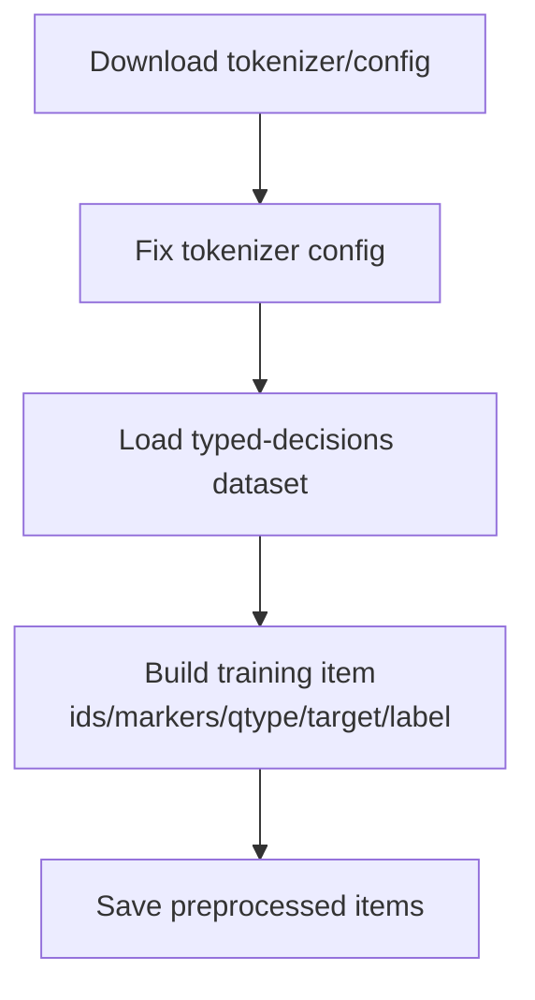
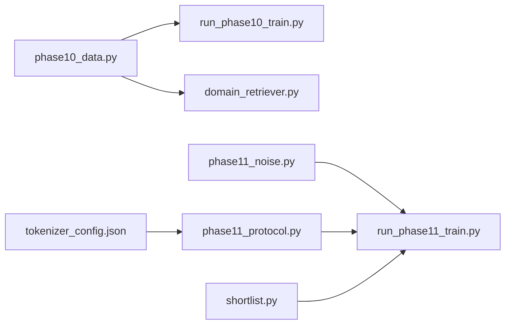

# Data Preprocessing Pipeline

<cite>
**Referenced Files in This Document**
- [phase10_data.py](file://research/veyabench/phase10_data.py)
- [run_phase10_train.py](file://research/veyabench/run_phase10_train.py)
- [phase11_noise.py](file://research/veyabench/phase11_noise.py)
- [phase11_protocol.py](file://research/veyabench/phase11_protocol.py)
- [run_phase11_train.py](file://research/veyabench/run_phase11_train.py)
- [domain_retriever.py](file://veya/experimental/domain_retriever.py)
- [shortlist.py](file://veya/shortlist.py)
- [tokenizer_config.json](file://models/production/tokenizer/tokenizer_config.json)
- [tokenizer_config.json](file://models/production/multilingual/tokenizer/tokenizer_config.json)
- [tokenizer_config.json](file://models/production/typed-decisions/tokenizer/tokenizer_config.json)
- [veya_finetune_typed_decisions_2xT4_kaggle.ipynb](file://notebooks/veya_finetune_typed_decisions_2xT4_kaggle.ipynb)
</cite>

## Table of Contents
1. [Introduction](#introduction)
2. [Project Structure](#project-structure)
3. [Core Components](#core-components)
4. [Architecture Overview](#architecture-overview)
5. [Detailed Component Analysis](#detailed-component-analysis)
6. [Dependency Analysis](#dependency-analysis)
7. [Performance Considerations](#performance-considerations)
8. [Troubleshooting Guide](#troubleshooting-guide)
9. [Conclusion](#conclusion)
10. [Appendices](#appendices)

## Introduction
This document explains the data preprocessing pipeline used in Veya fine-tuning workflows, focusing on:
- Text normalization and label encoding for candidates
- Tokenization strategies and truncation auditing
- Deterministic data augmentation for robustness training
- Handling different input formats and cleaning raw data
- Integration with existing Veya utilities such as embedding functions, query view builders, and shortlist helpers

The pipeline is designed to be deterministic, auditable, and compatible with both retrieval-style training and typed decision fine-tuning.

## Project Structure
The preprocessing pipeline spans research scripts, experimental retriever utilities, tokenizer configurations, and a fine-tuning notebook. The main responsibilities are:
- Dataset loading, candidate construction, and split generation
- Label naturalization and candidate representation
- Query view extraction and tokenization auditing
- Deterministic noise augmentation and validation
- Embedding preparation and caching for training

**Diagram sources**
- [phase10_data.py:183-332](file://research/veyabench/phase10_data.py#L183-L332)
- [domain_retriever.py:229-246](file://veya/experimental/domain_retriever.py#L229-L246)
- [phase11_noise.py:43-127](file://research/veyabench/phase11_noise.py#L43-L127)
- [phase11_protocol.py:18-80](file://research/veyabench/phase11_protocol.py#L18-L80)
- [shortlist.py:151-203](file://veya/shortlist.py#L151-L203)

**Section sources**
- [phase10_data.py:183-332](file://research/veyabench/phase10_data.py#L183-L332)
- [run_phase10_train.py:48-78](file://research/veyabench/run_phase10_train.py#L48-L78)
- [domain_retriever.py:229-246](file://veya/experimental/domain_retriever.py#L229-L246)
- [phase11_noise.py:43-127](file://research/veyabench/phase11_noise.py#L43-L127)
- [phase11_protocol.py:18-80](file://research/veyabench/phase11_protocol.py#L18-L80)
- [shortlist.py:151-203](file://veya/shortlist.py#L151-L203)

## Core Components
- Candidate construction and dataset splitting
  - Loads Banking77, SGD, and CLINC150 training partitions into normalized rows
  - Builds candidate records with raw labels, naturalized labels, and definitions
  - Writes train, development, and schema-held-out validation JSONL files plus a candidate registry
- Label naturalization
  - Normalizes machine-friendly labels into human-readable tokens without adding semantics
- Query view extraction
  - Extracts bounded semantic views from structured or unstructured state
  - Supports Phase-11 adaptive window policies
- Tokenization and truncation auditing
  - Reports retained tokens, dropped tokens, and signal position relative to max length
- Deterministic augmentation
  - Applies fixed generic noise while preserving source text exactly once
  - Produces audit records and validates augmentation integrity
- Embedding preparation
  - Builds an index of all base and augmented texts
  - Encodes embeddings via a frozen encoder and caches results

**Section sources**
- [phase10_data.py:38-69](file://research/veyabench/phase10_data.py#L38-L69)
- [phase10_data.py:72-174](file://research/veyabench/phase10_data.py#L72-L174)
- [phase10_data.py:183-332](file://research/veyabench/phase10_data.py#L183-L332)
- [domain_retriever.py:229-246](file://veya/experimental/domain_retriever.py#L229-L246)
- [domain_retriever.py:37-97](file://veya/experimental/domain_retriever.py#L37-L97)
- [domain_retriever.py:133-204](file://veya/experimental/domain_retriever.py#L133-L204)
- [phase11_protocol.py:18-80](file://research/veyabench/phase11_protocol.py#L18-L80)
- [phase11_noise.py:43-127](file://research/veyabench/phase11_noise.py#L43-L127)
- [shortlist.py:151-203](file://veya/shortlist.py#L151-L203)

## Architecture Overview
The preprocessing pipeline integrates dataset preparation, label normalization, query view building, tokenization auditing, augmentation, and embedding caching. Training scripts consume these artifacts to build query and candidate vectors for retrieval-style objectives.

**Diagram sources**
- [phase10_data.py:183-332](file://research/veyabench/phase10_data.py#L183-L332)
- [domain_retriever.py:229-246](file://veya/experimental/domain_retriever.py#L229-L246)
- [domain_retriever.py:133-204](file://veya/experimental/domain_retriever.py#L133-L204)
- [phase11_protocol.py:18-80](file://research/veyabench/phase11_protocol.py#L18-L80)
- [phase11_noise.py:43-127](file://research/veyabench/phase11_noise.py#L43-L127)
- [run_phase11_train.py:79-127](file://research/veyabench/run_phase11_train.py#L79-L127)

## Detailed Component Analysis

### Dataset Loading and Split Construction
- Reads CSV/JSON datasets and constructs uniform row dictionaries with identifiers, dataset names, schemas, text, and candidate IDs
- Caps examples per candidate deterministically using stable hashing
- Splits into train, development, and schema-held-out validation sets
- Writes JSONL outputs and a candidate registry with provenance metadata

**Diagram sources**
- [phase10_data.py:38-69](file://research/veyabench/phase10_data.py#L38-L69)
- [phase10_data.py:72-174](file://research/veyabench/phase10_data.py#L72-L174)
- [phase10_data.py:183-332](file://research/veyabench/phase10_data.py#L183-L332)

**Section sources**
- [phase10_data.py:38-69](file://research/veyabench/phase10_data.py#L38-L69)
- [phase10_data.py:72-174](file://research/veyabench/phase10_data.py#L72-L174)
- [phase10_data.py:183-332](file://research/veyabench/phase10_data.py#L183-L332)

### Label Encoding and Candidate Representation
- Candidate records include raw labels, naturalized labels, and optional definitions
- Naturalization removes formatting and normalizes casing and separators without inventing semantics
- Candidate texts may include raw, naturalized, and name-definition forms depending on dataset

**Diagram sources**
- [phase10_data.py:54-69](file://research/veyabench/phase10_data.py#L54-L69)
- [domain_retriever.py:229-246](file://veya/experimental/domain_retriever.py#L229-L246)

**Section sources**
- [phase10_data.py:54-69](file://research/veyabench/phase10_data.py#L54-L69)
- [domain_retriever.py:229-246](file://veya/experimental/domain_retriever.py#L229-L246)

### Query View Extraction
- For unstructured strings, extracts individual lines and full serialized state
- For structured states, extracts preferred keys and scalar values, then appends full serialization
- Phase-11 policy builds bounded windows (head, middle, tail) and selects views adaptively
- Views are deduplicated and bounded by character limits

**Diagram sources**
- [domain_retriever.py:37-97](file://veya/experimental/domain_retriever.py#L37-L97)
- [domain_retriever.py:133-204](file://veya/experimental/domain_retriever.py#L133-L204)

**Section sources**
- [domain_retriever.py:37-97](file://veya/experimental/domain_retriever.py#L37-L97)
- [domain_retriever.py:133-204](file://veya/experimental/domain_retriever.py#L133-L204)

### Tokenization Strategy and Truncation Auditing
- Uses the model’s tokenizer with explicit control over special tokens, padding, and truncation
- Audits token retention by locating the clean source span within augmented text
- Reports truncated status, token counts, and whether positive signal tokens are fully retained, partially retained, or truncated

**Diagram sources**
- [phase11_protocol.py:18-80](file://research/veyabench/phase11_protocol.py#L18-L80)
- [shortlist.py:151-203](file://veya/shortlist.py#L151-L203)

**Section sources**
- [phase11_protocol.py:18-80](file://research/veyabench/phase11_protocol.py#L18-L80)
- [shortlist.py:151-203](file://veya/shortlist.py#L151-L203)

### Data Augmentation Techniques
- Applies deterministic noise conditions that preserve the original source text exactly once
- Conditions include short/long prefixes/suffixes, middle insertion, duplicate metadata, reordered fields, boilerplate wrapping, JSON noise, and repeated low-information content
- Validates augmentation integrity and produces audit records including character lengths and preservation flags

**Diagram sources**
- [phase11_noise.py:43-127](file://research/veyabench/phase11_noise.py#L43-L127)

**Section sources**
- [phase11_noise.py:43-127](file://research/veyabench/phase11_noise.py#L43-L127)

### Embedding Preparation and Caching
- Builds a sorted inventory of all base and augmented texts
- Verifies compatibility with cached base embeddings and computes augmented embeddings in batches
- Caches augmented embeddings with metadata including checkpoint hash, text digest, max length, and file checksum

**Diagram sources**
- [run_phase10_train.py:66-78](file://research/veyabench/run_phase10_train.py#L66-L78)
- [run_phase11_train.py:79-127](file://research/veyabench/run_phase11_train.py#L79-L127)
- [shortlist.py:151-203](file://veya/shortlist.py#L151-L203)

**Section sources**
- [run_phase10_train.py:66-78](file://research/veyabench/run_phase10_train.py#L66-L78)
- [run_phase11_train.py:79-127](file://research/veyabench/run_phase11_train.py#L79-L127)
- [shortlist.py:151-203](file://veya/shortlist.py#L151-L203)

### Typed Decision Fine-Tuning Preprocessing
- Downloads tokenizer and configuration, fixes tokenizer config if needed
- Loads dataset and converts each typed decision into a preprocessed item containing token IDs, marker positions, question type, target probabilities, and label
- Saves preprocessed items for distributed training

**Diagram sources**
- [veya_finetune_typed_decisions_2xT4_kaggle.ipynb:88-149](file://notebooks/veya_finetune_typed_decisions_2xT4_kaggle.ipynb#L88-L149)

**Section sources**
- [veya_finetune_typed_decisions_2xT4_kaggle.ipynb:88-149](file://notebooks/veya_finetune_typed_decisions_2xT4_kaggle.ipynb#L88-L149)

## Dependency Analysis
The preprocessing components depend on each other and on Veya utilities:
- Dataset loaders produce canonical rows consumed by candidate registries
- Candidate registries rely on label naturalization for consistent representations
- Query view builders operate on serialized state and integrate with retriever ranking
- Tokenization auditing depends on the tokenizer configuration and encoder settings
- Noise augmentation is validated before embedding and training
- Embedding preparation uses shared encoder utilities and caches intermediate results

**Diagram sources**
- [phase10_data.py:183-332](file://research/veyabench/phase10_data.py#L183-L332)
- [run_phase10_train.py:48-78](file://research/veyabench/run_phase10_train.py#L48-L78)
- [phase11_noise.py:43-127](file://research/veyabench/phase11_noise.py#L43-L127)
- [phase11_protocol.py:18-80](file://research/veyabench/phase11_protocol.py#L18-L80)
- [run_phase11_train.py:79-127](file://research/veyabench/run_phase11_train.py#L79-L127)
- [shortlist.py:151-203](file://veya/shortlist.py#L151-L203)
- [tokenizer_config.json](file://models/production/tokenizer/tokenizer_config.json)

**Section sources**
- [phase10_data.py:183-332](file://research/veyabench/phase10_data.py#L183-L332)
- [run_phase10_train.py:48-78](file://research/veyabench/run_phase10_train.py#L48-L78)
- [phase11_noise.py:43-127](file://research/veyabench/phase11_noise.py#L43-L127)
- [phase11_protocol.py:18-80](file://research/veyabench/phase11_protocol.py#L18-L80)
- [run_phase11_train.py:79-127](file://research/veyabench/run_phase11_train.py#L79-L127)
- [shortlist.py:151-203](file://veya/shortlist.py#L151-L203)
- [tokenizer_config.json](file://models/production/tokenizer/tokenizer_config.json)

## Performance Considerations
- Batched embedding reduces memory pressure and improves throughput during augmentation encoding
- Caching augmented embeddings avoids recomputation across runs and ensures reproducibility
- Query view bounds and deduplication limit redundant computation and prevent oversized inputs
- Tokenization auditing helps identify truncation risks early, allowing adjustments to max_length or view policies
- Shortlist embedding helper uses mean pooling over attention masks to exclude padding tokens efficiently

[No sources needed since this section provides general guidance]

## Troubleshooting Guide
Common issues and resolutions:
- Unknown noise condition
  - Ensure the condition is part of the supported set; otherwise, the augmentation function raises an error
- Source text not preserved exactly once
  - Validation fails if augmentation duplicates or drops the source; adjust the noise strategy or verify the input
- Invalid tokenizer bounds
  - Tokenization audit requires valid max_length and view_count; correct parameters before auditing
- Hard-negative lineage mismatch
  - Version checks and digests must match; regenerate lineage only when versions align
- Missing embedding function
  - Retriever methods require an embed_fn; configure it before ranking or vectorization

**Section sources**
- [phase11_noise.py:43-127](file://research/veyabench/phase11_noise.py#L43-L127)
- [phase11_protocol.py:18-80](file://research/veyabench/phase11_protocol.py#L18-L80)
- [phase11_protocol.py:181-194](file://research/veyabench/phase11_protocol.py#L181-L194)
- [domain_retriever.py:330-351](file://veya/experimental/domain_retriever.py#L330-L351)

## Conclusion
The Veya preprocessing pipeline combines deterministic dataset preparation, label naturalization, query view extraction, tokenization auditing, and robust augmentation to prepare high-quality inputs for fine-tuning and retrieval training. By integrating with Veya utilities, it ensures consistency, reproducibility, and performance across diverse input formats and training objectives.

[No sources needed since this section summarizes without analyzing specific files]

## Appendices

### Tokenizer Configuration Notes
- Production tokenizer configuration enables space cleanup and defines special tokens
- Multilingual tokenizer configuration disables space cleanup and includes turn markers
- Typed decisions tokenizer configuration mirrors production defaults

**Section sources**
- [tokenizer_config.json](file://models/production/tokenizer/tokenizer_config.json)
- [tokenizer_config.json](file://models/production/multilingual/tokenizer/tokenizer_config.json)
- [tokenizer_config.json](file://models/production/typed-decisions/tokenizer/tokenizer_config.json)